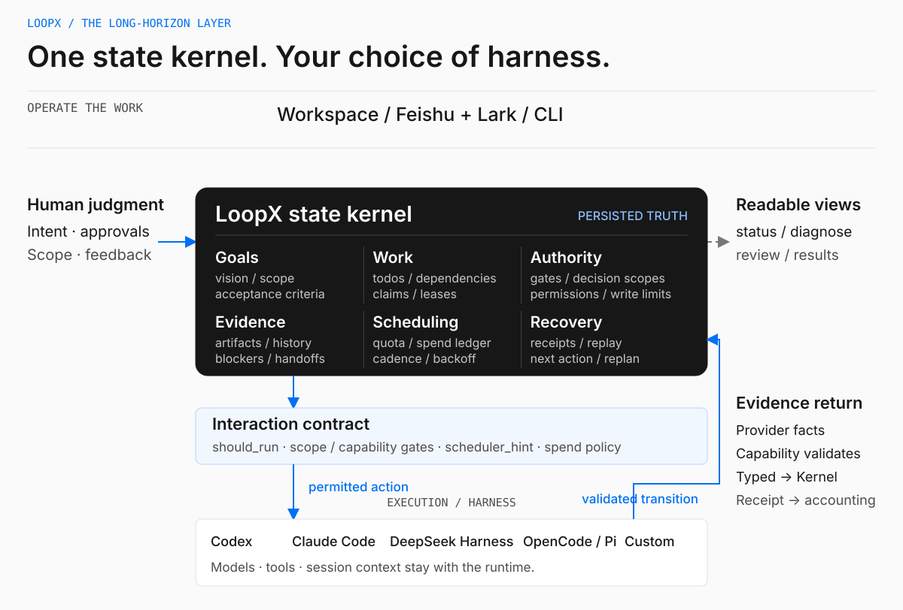
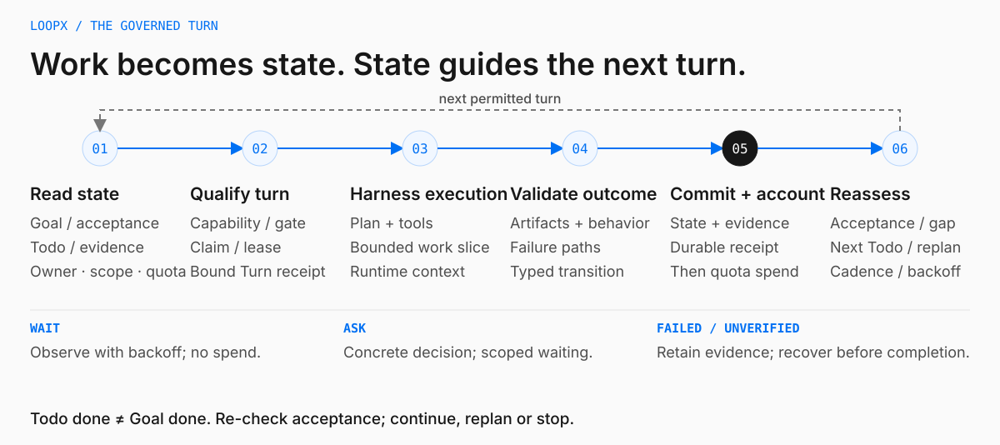
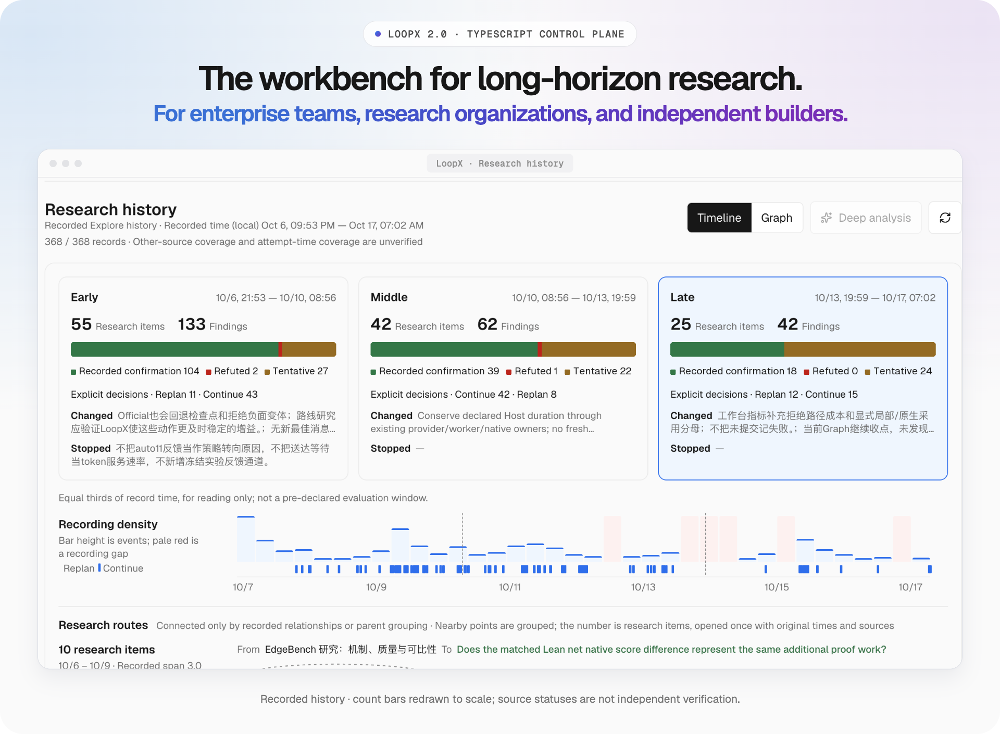

<div align="center">

<h1 align="center">LoopX 2.0</h1>

<a href="https://trendshift.io/repositories/102379"></a>

**1 つのゴールから始めましょう。長時間にわたるエージェントの作業を検証可能に保ちます。**

すでに使っている Agent に、やってほしいことを伝えるだけです。LoopX はゴール、
進捗、意思決定、検証可能な結果を保持するため、セッションをまたいで作業を続けられます。<br>
<sub>Codex、Claude Code、DeepSeek Harness などのランタイムにまたがる 24 時間 365 日常駐エージェントのための、オープンでハーネス非依存のコントロールプレーンです。ローカルの SQLite ワークフローからマルチエージェントチームまでスケールします。</sub>

[](https://github.com/loopx-project/loopx/releases/latest) [](LICENSE) [](docs/architecture/rfcs/typescript-control-plane-migration-v0.md) [](pyproject.toml)

[](docs/public-private-boundary.md) [](docs/product/release-readiness.md) [](https://github.com/loopx-project/loopx/graphs/contributors) [](https://discord.gg/XmGgQyCFZd) [](https://dsh-plugin.org/plugins/loopx-project/loopx)

[はじめる](#quick-start) · [なぜ LoopX なのか](#なぜ-loopx-なのか) · [24/7 常駐](#always-on-agents) · [動作を見る](#loopx-の動作を見る) · [エビデンス](#エビデンス) · [コントリビュート](#contributing) · [ドキュメント](https://loopx-project.github.io/loopx/docs/) · [English](README.md) · [简体中文](README.zh-CN.md)

</div>

---

<a id="quick-start"></a>

## 1 つのゴールから始める

**1. LoopX を一度インストールします。** Python 3.11 以降と
Node.js 22.22.3 以降（24 LTS を推奨）が必要です。

```bash
python3 -m pip install --upgrade loopx && loopx workflow-skills --install
```

[インストールオプションとアップグレード](docs/guides/installing-loopx.md)

**2. Agent に望む成果を伝えます。** Agent ホストを再起動してプロジェクトを開き、
自然言語のゴールを 1 つ送ります：

```text
$loopx speed up this project's slowest workflow; compare approaches and verify the gains
```

LoopX はそれを、目に見える計画、あなたの判断が必要な意思決定、そして必要に応じた検証へと変換します。
Claude Code では `/loopx <complex task>` を使います。その他のランタイムについては
[ホストのセットアップ](#使っている-agent-から始める)をご覧ください。ガイド付きで最初の
実行を試したい場合は、[下のタスクから選んでください](#loopx-を試す)。

## 📰 ニュース

<!-- Curate major product/architecture releases, research findings, consequential
     engineering lessons and substantive community milestones. Each needs a public
     source and a distinct reader takeaway; version bumps or PR merges alone are
     not news. Keep both languages aligned, newest first, using verified publication
     dates (UTC). -->

- **2026-11-01 · 📘 [24/7 エージェントのための段階的コンテキスト配信](https://loopx-project.github.io/loopx/blog/context-delivery/)** — コンパクションサイクル単位の構造化差分と段階的ビューにより、モデル向けの 213 回の起床にわたってコントロールプレーンのバイト数を削減しました（単層の段階的ビューで `32.5%`、サイクル内の 112 回の継続にわたる積み重ね型の初回読み取りエントリで本文 `3.0%` / CLI `5.0%`）。同時に、ロスレスなベースライン復元も維持しています。
- **2026-10-25 · 🤝 [長期タスク向けエージェント研究：共同研究者を募集中](https://loopx-project.github.io/loopx/blog/edgebench-feedback-and-memory/)** — EdgeBench と実世界のタスクにおけるフィードバック、再計画、再現可能な評価を通じて、**同一予算下での長期的な成果のブレークスルー**を探求しています。学術研究室や企業のチームとの共同研究を歓迎し、成果と総コストを比較していきます。[共同研究について話し合う](https://github.com/loopx-project/loopx/discussions)。
- **2026-10-20 · 🚀 [LoopX 2.0](https://github.com/loopx-project/loopx/releases/tag/v2.0.0)** — 共有の TypeScript 状態レイヤーと、長期研究用ワークベンチ。[移行ガイド](docs/product/releases/v2.0.0.md) · [エンジニアリングの舞台裏](https://loopx-project.github.io/loopx/blog/typescript-control-plane-refactor/)。
- **2026-10-14 · 🤖 [エージェント型ソフトウェア](https://loopx-project.github.io/loopx/blog/semantic-software-development/)** — ゴール、エビデンス、人間のフィードバックをエンジニアリングの成果物につなげます。
- **2026-10-02 · 🧠 [長期ブートストラップと RSI](https://loopx-project.github.io/loopx/blog/long-horizon-rsi/)** — LoopX を使って LoopX を開発した 4 か月間：公開されているプロジェクトの歴史と、システムレベルの自己改善に関する設計上の視点。
- **2026-09-18 · 🧪 [LoopX × LHTB](https://loopx-project.github.io/loopx/benchmarks/lhtb/)** — 同一モデルによる 46 タスクの研究が、**より多くの計算資源をより良い成果に変える**ことを実証的に裏付けました。LoopX 1.0.3 Heartbeat による継続実行の平均報酬は、Plain Codex より 17.3%、ネイティブ Goal より 10.6% 高くなりました。
- **2026-09-06 · 🎉 [LoopX 1.0](https://github.com/loopx-project/loopx/releases/tag/v1.0.0)** — セッションをまたいでエージェントの作業を追跡し、意思決定に対応し、納品された結果を確認できる Personal Agent Workspace。[Workspace ガイド](https://github.com/loopx-project/loopx/blob/v1.0.0/docs/guides/personal-workspace-user-guide.md)。
- **2026-08-02 · ⏱️ [200 時間超のトラジェクトリを X で公開](https://x.com/huangruiteng/status/2083904257494024425)** — 経過時間 200 時間超にわたるオーナー実行の初期事例が X で大きな注目を集め、実行、待機、人間の判断、復旧にまたがる作業を示しました。[トラジェクトリとその限界](#オープンソースの-issue-修正)。

[すべてのリリース](https://github.com/loopx-project/loopx/releases)

<a id="how-it-works"></a>

## なぜ LoopX なのか

最初の有用なアクションの前に、LoopX の内部を学ぶ必要はありません。
デフォルトの進め方はゴールファーストです。望む成果を記述し、Agent に計画を
準備させ、意思決定やデバッグが必要になったときにだけ内部の仕組みを確認します。

エージェントは 1 つのセッションでタスクを完了できます。しかし長時間にわたる作業はもっと難しくなります。
目的は変わり、オーナーの判断が必要になり、エビデンスは古くなり、エージェントは
作業を仲間に引き継ぎます。タイマーはループを動かし続けられますが、それだけでは有用になりません。

- **最初からやり直さずに続けられます。** ゴール、受け入れ済みの要件、
  意思決定、エビデンスを、セッションや再起動をまたいで保持します。
- **[コンテキストを失わずに連携できます。](https://loopx-project.github.io/loopx/blog/agent-facing-kanban/#walkthrough)** 委任された作業、依存する
  成果物、レビュー、返された結果を、責任の所在を明確にしたまま結び付けます。
- **何が変わったかで進捗を判断できます。** 単なる活動量ではなく、成果物、裏付けとなる
  エビデンスと反証となるエビデンス、コスト、次の意思決定を確認します。

モデルとツールは Agent ランタイムが提供します。LoopX の永続的な状態レイヤーは、
エンジニアリング、研究、運用のために、ゴール、受け入れ基準、意思決定、オーナーシップ、エビデンスを
セッションやランタイムをまたいで保持します。エージェントと人間はそれらの事実を使って、
次に何をすべきかを見直します。保護されたアクションは、引き続き人間の承認によって統制されます。

<a id="learn-loopx"></a>

| やりたいこと | ここから始める |
| --- | --- |
| コーディングや研究のエージェントをセッションをまたいで働かせ続ける | [インストールして始める](#quick-start) |
| 個人のプロジェクト、スケジュール、意思決定を 1 か所で管理する | [Personal Agent Workspace](#personal-agent-workspace-の紹介) |
| インフラを自作せずに 24/7 常駐エージェントを構築する | [24/7 常駐エージェントのコントロールプレーン](#always-on-agents) |
| エージェント同士を連携させ、検証可能な結果を納品させる | [エージェント連携ガイド](docs/product/use-cases/cross-runtime/README.md) |

LoopX は、永続的な作業状態を 1 つのコンパクトなレイヤーに保持します：

<picture>
  <source media="(max-width: 640px)" srcset="docs/assets/harness-neutral.en.mobile.svg">
  
</picture>

作業を実行するのは Agent ランタイムです。LoopX は、エンジニアリング、研究、探索、
運用のループが実行をまたいで継続できるようにするための状態を保持します。これは
新たなエージェントフレームワークでも、特定プロバイダー向けのオーケストレーションランタイムでもありません。

<details>
<summary>詳細：コントロールレイヤーの仕組みと位置付け</summary>

<picture>
  <source media="(max-width: 640px)" srcset="docs/assets/control-plane-board.en.mobile.svg">
  
</picture>

わかりやすいメンタルモデルは、
**[長時間作業のためのエージェントネイティブなカンバン](docs/development/control-plane-course/00-concept-primer.md)** です。
カードはアイデンティティ、権限、エビデンス、継続情報を持ちます。カードの移動は、claim、gate、monitor、
writeback などの検証済みオペレーターです。ボードは投影（プロジェクション）であり、
信頼できる唯一の情報源は LoopX の状態です。

登録されたエージェントは対等な仲間です。claim、リース、タスク境界、ケイパビリティ、
型付きの継続によって次に誰が動くかが決まり、永続的なリーダーのアイデンティティは
必要ありません。

LoopX は、次のようなものを実行するときに役立ちます：

- 複数日にわたるエンジニアリング、研究、ベンチマーク、実験の目標
- スコープ、エビデンス、レビュー状態を保持しなければならない Issue や PR のループ
- 定期的な heartbeat や監視の作業
- オーナー、安全性、公開、プライベートデータのゲートがあるプロジェクト
- オーナーシップ、リース、引き継ぎが重要になる対等なエージェントのチーム
- 進捗がエンジニアではないオペレーターにも理解できる状態でなければならない、
  クリエイター、研究、運用のワークフロー

LoopX は自律的な本番コントローラーではありません。危険な権限、
公開、本番環境への書き込み、最終的なオーナーシップは人間に残ります。

</details>

<a id="always-on-agents"></a>

### 5 つのサブシステムを自作せずに 24/7 常駐エージェントを構築する

[Anthropic の *Building always-on agents*](https://claude.com/resources/articles/building-always-on-agents)
では、効果的な常駐エージェントは実時間のほとんどをトークン消費ゼロで
スリープして過ごし、周囲の 5 つのサブシステム（**Event Inbox**、**Timers**、**Memory**、**Permissions**、
**Outbox**）にまたがる限定的な実行のために起床すると指摘しています。実際には、チームはエージェントホストごとに、
cron スクリプト、JSON キュー、プロンプトのコンパクション、場当たり的な承認チェックといった壊れやすい
つなぎのコードを作り直しがちで、2 週目には気付かないうちの陳腐化、重複書き込み、ノイズの多いステータス通知に
悩まされることになります。

LoopX はそのオープンでハーネス非依存のコントロールレイヤーをパッケージ化しているため、
すでに使っているランタイム（Codex CLI、Claude Code、DeepSeek Harness、カスタムランナー）を、
明示的な永続性と人間によるゲートを備えた状態で 24 時間 365 日運用できます：

| 常駐のためのプリミティブ | LoopX コントロールプレーンのサブシステム | 数週間にわたる実行で防げること |
| --- | --- | --- |
| **Event Inbox** | シングルフライトの **Goal / Todo / Hard Lease** キュー、非同期のアプリ受信箱、接続済みの Lark / GitHub リスナー | 同じリポジトリの状態を重複したワーカーが変更すること、実行中に人間の入力が失われること |
| **Timers & Wakeups** | **Guarded Heartbeat** と安全な定期プリセット（`daily-triage`、`changelog-draft`、`pr-watch`。`loopx preset list` で確認） | 何も変わっていない、またはゲートがまだ人間を待っているのに、やみくもな cron ループがトークンを浪費すること |
| **Memory & Compaction** | [`Decision Context`](loopx/capabilities/decision_context/README.md) によるソース追跡、コンパクションサイクル単位の **Progressive + Delta** [`context_delivery`](https://loopx-project.github.io/loopx/blog/context-delivery/)（213 回の起床にわたるビューで `32.5%`、サイクル内の 112 回の起床にわたる初回読み取りエントリで `3.0% / 5.0%`）、およびオプションの [`Reward Memory`](loopx/capabilities/reward_memory/README.md) | 気付かないうちのソースの陳腐化、コンパクションをまたいだプロンプトの再送の累積や差分の破損 |
| **Permissions & Deferred Calls** | 明示的な**オーナー、安全性、公開、プライベートデータのゲート**、分離されたワークツリー、レビュー可能な引き継ぎ | 自律的な cron 実行による外部への公開、強制マージ、プライベートなコンテキストの漏洩 |
| **Outbox** | 本当の完了、ブロッカー、未解決のゲートを示す、共有 Workspace と Lark の Goal/Decision/Evidence ビュー | 断片化したターミナルログや、人間に実行の子守りを強いるノイズの多い通知 |

**個人のローカル利用からチーム・組織規模まで、1 つの契約セットで：**

| 規模 | LoopX の動かし方 | 権限、連携、ガバナンスの姿勢 |
| --- | --- | --- |
| **個人開発者とローカルエージェント** | 外部インフラなしで `python3 -m pip install --upgrade loopx`。既存の CLI/デスクトップのランタイムを接続します | ハードリースを備えた正規のローカル **SQLite** ストア（既存の File セットアップも利用可）。アイドル時のトークン消費ゼロで、再起動やコンパクションを乗り越えます |
| **エンジニアリングチームとエンタープライズへの道筋** | 対等なワーカーが todo を claim し、Desktop Workspace、GitHub、Lark を通じて共有ゴール上でレビュー済みの成果物を返します（[3 エージェントのデモ](examples/collaboration-delivery/README.md)） | ワーカーのオーナーシップと人間の承認ゲートを維持します。段階的な **PostgreSQL** リモート権限（[プロバイダー](loopx/control_plane/coordination/postgresql_authority_store.ts)）や、計画中の組織ガバナンス（RBAC、SSO、クォータ、署名付き監査）へと拡張できます。詳しくは[導入と SaaS のロードマップ](docs/product/roadmaps/saas-opportunity-assessment.md)をご覧ください |

## LoopX の動作を見る

<a href="https://github.com/user-attachments/assets/543af0b1-c3d4-4cfb-aedd-a68563a20601"></a><br>
<sub><a href="https://github.com/user-attachments/assets/543af0b1-c3d4-4cfb-aedd-a68563a20601">研究ワークベンチの動画を見る · 86 秒</a> · <a href="docs/assets/personal-workspace/loopx-research-films.md">文字起こし、字幕、出典</a>。録画したアプリの抜粋、合成例、イラストにはラベルを付けています。</sub>

<a id="research-workbench"></a>

### 継続できる研究

ゴールを開くと、その作業、担当の Agent、記録された Explore の履歴を確認できます。
**Deep analysis** を使うと、登録されたトラジェクトリ、その引用、ネイティブな
結果の読み戻し、個別に計測されたコストを確認できます。研究画面では、出典に紐付いた
[人間の注意](docs/reference/trajectory-assessment.md#human-attention-in-research-optional)も、
記録された入力、タイミングのカバレッジ、確認可能な最適化ポイントとともに表示されます。ソースは Agent が準備します。
ページを開いたり結果を読んだりしても、モデル呼び出しは始まりません。明示的な分析では、
設定されたホストとアカウントが使われます。

裏付けられた発見、反証された発見、不明な発見を見える状態に保ちます。アプローチが
変更された理由や継続された理由を確認し、そのエビデンスを次の試行に持ち込みます。

### Personal Agent Workspace の紹介

長期的なゴールを 1 つのローカルファーストなワークスペースに保持します。ゴール、注意、
会話、タスク、ファイル、スケジュール、復旧は、日をまたいでも、再起動しても、
ハーネスが変わっても失われません。プロジェクトを再び開き、前のターンの状態と
エビデンスを確認して、次に許可されたアクションを続けます。

新しいデフォルトの Codex ゴールでは、タスクとワークスペースの権限を確認してから
**Create Goal and start first run** を確定します。元のタスクは、独立したチェックと実行枠の準備が整うと
元の会話の中で続行されます。通常のメッセージは読み取り専用のままです。待機、結果の読み戻し、
復旧については[ワークスペースガイド](docs/guides/personal-workspace-user-guide.md#在原对话执行已检查的任务--run-the-checked-original-task)に
従ってください。

LoopX は、こうした長期的なコントロール状態を Personal Workspace にまとめます。1 か所で次のことができます：

- 何があなたを必要としているか、何が実行中か、何が監視中か、何が
  スケジュール済みまたは停止中かを確認する
- ゴールのケイパビリティを設定し、マシンのデフォルトとゴールごとの上書きを区別し、
  適用前に変更をプレビューする
- 実行中のターンを誘導したり、メッセージをキューに入れたり、接続済みの Lark 会話から
  明示的な Goal/Agent/セッションのルーティングで非同期受信箱を使ったりする
- 納品されたファイル、定期レポート、それらを裏付けるエビデンスを確認する
- Codex、Claude Code、モデル直接利用、その他の登録済み Agent セッションをまたいで、
  ゴールの状態やエビデンスを失わずに作業を続ける
- 型付きのプレビュー、明示的な確認、受領記録を通じて保護された変更をレビューする。
  その間も、権威を持つのはブラウザーではなく LoopX の状態です

Manager のグループ会話では、LoopX はメッセージの可視性とターンの権限を分けて
扱います。バイリンガルの [Lark Manager のコンテキストと権限の
契約](docs/reference/protocols/lark-manager-context-authority-v0.md)をご覧ください。

```bash
loopx dashboard
```

`loopx dashboard` がサポートされているブラウザー/PWA の起動方法です。ネイティブのデスクトップ版
プレビューを[現在のリリース](https://github.com/loopx-project/loopx/releases/latest)からダウンロードすることもできます。
これらは同じループバックサービスとゴールの状態を再利用します。Apple Silicon の macOS では、
シェルと同梱のランタイムを組み合わせる署名付きのアプリ更新に加え、修復と
復旧にも対応しています。Python 3.11 以降が必要です。アプリは ad-hoc 署名のみで、公証はされていません。
Windows の NSIS プレビューインストーラーは main チャネルで同じ署名付きの更新フローに対応しており、
CLI は別途インストールします。stable チャネルと MSI でのインストールは
手動のままで、アプリのロールバックと修復は利用できず、インストーラーには
Authenticode 証明書がありません（Windows で SmartScreen の確認が表示される場合があります）。
[デスクトップ版のインストール、更新、ソースからの開発](apps/desktop/loopx-control-plane/README.md)。


<details>
<summary>ケイパビリティ設定と再現可能なワークスペースのシナリオ</summary>

ソースをチェックアウトした状態で `python -m demo.workspace serve` を実行すると、コミュニティ
イベント、家庭のエネルギー比較、地域の Web サイト公開の 3 つを試せます。それぞれに 4 つの
作業ロール、18 個のタスク、2 つの意思決定、2 つの監視があります。上のスクリーンショットは
この再現可能なワークスペースのものです。[シナリオとリプレイの手順](demo/workspace/README.md)。

</details>

[32 秒のウォークスルー全編を見る](docs/assets/personal-workspace/loopx-dashboard-launch.mp4)
· [ワークスペースガイドを読む](docs/guides/personal-workspace-user-guide.md)
· [5 分間のツアーを試す](docs/guides/personal-workspace-trial-guide.md)

## LoopX を試す

確認できる結果が得られるウォークスルーを選んでください：

| 始めるもの | やること |
| --- | --- |
| [初めてのバグ修正ループ](docs/guides/first-bugfix-loop.md) | 小さな Python プロジェクトで 2 つのバグを再現し、Agent に修正させてから、テストとパッチを確認します。 |
| [長時間のコーディング作業](docs/guides/long-running-coding-agents.md) | Issue を修正したり、自分のリポジトリを改善し続けたりします。レビュー、エビデンス、復旧はセッションをまたいで引き継がれます。 |
| [Personal Agent Workspace（中国語）](docs/guides/personal-workspace-user-guide.md) | 図解ガイドに沿って、アプリでプロジェクト、会話、タスク、納品された結果を管理します。 |

### 使っている Agent から始める

[2 ステップのセットアップ](#quick-start)の後、プロジェクトで開いたセッションで
お使いのホスト用のエントリを使います：

| ホスト | 開始と継続の確認 |
| --- | --- |
| Codex App | `$loopx <complex task>`。[heartbeat オートメーションが保存されていること](docs/guides/first-bugfix-loop.md#confirm-that-it-actually-started)を確認します。 |
| Codex CLI | `$loopx <complex task>`。生成された[ネイティブの `/goal`](docs/product/runtimes/codex-cli/codex-cli-packaged-install.md#current-user-path) を同じセッションで有効化します。 |
| Claude Code | `/loopx <complex task>`。定期的な作業には[ループドライバーのセットアップ](docs/guides/newcomer-command-path.md#choose-the-loop-driver)に従います。 |
| DeepSeek Harness | [ネイティブの DSH プラグイン](packages/dsh-loopx-plugin/README.md)をインストールし、`loopx` スキルを選択してから、タスクを記述します |

LoopX は既存のプロジェクト状態を再利用するか、プロジェクトを接続し、作業を
Todo として計画して、ホストの有効化をガイドします。アクティブなゴール、
次の Todo、継続の仕組みを Agent に確認してもらってください。セットアップパケットだけではアクティブなループになりません。
作業を続けるあいだは、ホストを利用可能な状態にしておいてください。`loopx status` はゴール、
あなたを待っている意思決定、次の Todo を表示します。`loopx doctor` はインストールを診断します。

[LoopX のインストール](docs/guides/installing-loopx.md)では、ネイティブの Windows、`pipx`、
アップグレード、ロールバック、アンインストールについて説明しています。

**1.x からアップグレードする場合は？** 既存のゴールを続ける前に、[2.0 の移行と復旧のガイド](docs/product/releases/v2.0.0.md)をお読みください。

<details>
<summary><b>その他のホスト、ループドライバー、カスタムランナー</b></summary>

| ホスト | 推奨される開始方法 | ループドライバー |
| --- | --- | --- |
| Codex App | プロジェクトで開いたスレッドで `$loopx <complex task>` を実行するか、`/skills` から `loopx` を選びます。 | Codex App の heartbeat オートメーション。`quota should-run.scheduler_hint` から更新されます |
| Codex App over SSH | `loopx agent-onboard --agent-type codex-app-ssh --project .` | 返される可視の `/goal <task_body>` |
| Codex CLI | プロジェクトで `codex` を起動し、`$loopx <complex task>` または `/skills` を使います。 | 可視の `/goal <task_body>`。デフォルトでは隠れたヘッドレス実行はありません |
| Claude Code | オプトインのアダプターをインストールし、`/loopx <task>` に続けて `/loop` を実行します。 | LoopX によってゲートされた、Claude Code ネイティブの `/loop` |
| KunlunCode | `loopx-kunluncode connect --project . --goal-id <goal-id> --agent-id <registered-agent-id>` を実行し、範囲を限定した todo を追加してから、`loopx-kunluncode run --project .` を実行します。 | app-server を介したネイティブの Goal Pro。LoopX は厳密な検証の後にのみ、完了とクォータを書き込みます |
| OpenCode | 静的なコマンドファサードをインストールし、定期的なゴールには `--with-goal-bridge` でオプトインします。 | OpenCode のコマンドファサードと明示的なゴールブリッジ |
| Pi | `loopx slash-commands --install --surface pi` でオプトインのゴール拡張をインストールし、信頼できる Pi セッションから `/loopx <task>` を使います。 | LoopX のクォータによってゲートされた可視の Pi ゴール拡張（`loopx_goal_activate` + `agent_settled` による継続） |
| ZCode | `loopx slash-commands --install --surface zcode` でスキルファサードをインストールし、プロジェクトの ZCode セッションから `$loopx` スキル（または `/loopx <complex task>`）を呼び出します。 | ZCode セッション自身のターンループ。すべての継続は `quota should-run` を経由します |
| Antigravity CLI (agy) | `loopx slash-commands --install --surface agy` でスキルファサードをインストールし、プロジェクトの `agy` セッションから `loopx` スキル（または `/loopx <complex task>`）を呼び出します。 | セッションのネイティブな `/goal` ループ（`<!-- GOAL_COMPLETE -->` まで監査されます）と、セッションが生きている間の `schedule` による自己起床。ファサードは各ターン/起床で `quota should-run` を経由して再入するよう指示します。これは助言的なペース配分であり、ホストが強制するゲートではありません |
| Kiro CLI | `loopx slash-commands --install --surface kiro-cli` でスキルファサードをインストールし、プロジェクトの `kiro-cli` セッションから `/loopx <complex task>` を実行します。 | セッションのネイティブな `/goal --max <N> <task_body> Done when: <criteria>` ループ。ホストがゴール文から受け入れ基準を導出するため、基準はゴール文の中に記述します。ホスト自身の反復予算（デフォルトは 5）で制限され、組み込みの `goal` 完了契約によって確定されます。ファサードは各ターンと反復で `quota should-run` を経由して再入するよう指示します。これは助言的なペース配分であり、ホストが強制するゲートではありません |
| DeepSeek Harness (dsh) | [ネイティブの DSH プラグイン](packages/dsh-loopx-plugin/README.md)をインストールし、`loopx` スキルを選択して、タスクを記述します。ヘッドレスなターンには、引き続き [dsh goal-mode アダプター](loopx/dsh_goal_mode/README.md)を利用できます。 | ネイティブな同一セッション内での継続と GoalBar、またはヘッドレスな dsh セグメント。どちらも LoopX の権限によってゲートされます |
| Cursor、シェル、カスタムランナー | `loopx start-goal --guided --project . --goal-text "<task>"` を実行するか、ランナーから LoopX を呼び出します。 | お使いのシェル、スケジューラー、ランナー |

そのままコピーできるセットアップメッセージとホストの復旧手順は、
[Getting Started](docs/guides/getting-started.md) にあります。ホスト連携では、
[Codex App のホストコマンドレジストリ契約](docs/reference/protocols/codex-app-host-command-registry-v0.md)、
[Codex CLI のパッケージインストール手順](docs/product/runtimes/codex-cli/codex-cli-packaged-install.md)、
[Claude Code アダプター](loopx/claude_goal_mode/README.md)、
[KunlunCode のネイティブ Goal アダプター](loopx/kunluncode_goal_mode/README.md)、
[Kiro CLI の goal-mode アダプター](loopx/kiro_cli_goal_mode/README.md)、または
[DeepSeek Harness のターンアダプター](loopx/dsh_goal_mode/README.md)を確認できます。

ネイティブな手順については、[60 秒の DSH × LoopX Replan の録画と再現可能な
フィクスチャ](docs/showcases/cases/dsh-loopx-replan-demo.md)をご覧ください：
プラグインをインストールし、スキルを 1 つ選択し、重要な制約を変更して、
保持された意思決定の記録を確認します。

カスタムランナーの場合は、まず
[最小限のカスタムランタイムの例](docs/guides/minimal-custom-runtime-example.md)
（`python3 examples/custom-runtime-minimal-cli-turn-smoke.py`）から始め、次に完全な
[Embed LoopX in Your Agent Runner](docs/guides/custom-agent-runner-integration.md)
ガイドと[ワーカーブリッジのインストール契約](docs/integrations/worker-bridge-install-contract.md)をご覧ください。
コアとなる 1 回の tick は、意図的に小さくしています：

```text
loopx quota should-run      # should this registered agent act now?
loopx todo claim            # who owns this slice?
loopx todo update           # what changed?
loopx refresh-state         # what should the next turn see?
loopx quota spend-slot      # account for a completed, validated slice
```

クローンによるインストールは、ライブの canary ラッパーを使いたいコントリビューター向けです：

```bash
git clone https://github.com/loopx-project/loopx ~/loopx
~/loopx/scripts/install-local.sh
loopx doctor
```

</details>

### 初回実行のフィードバック

LoopX がうまく動いたら、1 分で書ける公開 Issue が、実際の初回実行がどのようなものかを
知る助けになります。これは任意で、テレメトリは含まれません。ログ、パス、認証情報、
社内のプロジェクト名、ゴールの内容は含めないでください：

- [初回実行のフィードバック](https://github.com/loopx-project/loopx/issues/new?template=first_run.yml)
- [長時間の実行についての利用事例](https://github.com/loopx-project/loopx/issues/new?template=usage_story.yml)

`loopx first-run-report` は、何も送信せずに、同じ入力済みのリンクをローカルで
表示します。

基本的な利用統計は、初回利用時の告知の後、デフォルトで有効になります。プラットフォームのサポート状況と継続利用を把握するための、
ランダム ID による 1 日 1 回の heartbeat と、それとは別の ID なしの CLI 利用回数です。
コンテンツは収集しません。どちらも Settings → Capability Center、
または `loopx usage-ping disable` / `LOOPX_USAGE_PING=0` で無効化できます。送信内容は
`loopx usage-ping status` で確認できます。[基本的な利用統計](docs/reference/usage-ping.md)をご覧ください。

<a id="see-it-in-action"></a>

## エビデンス

<a id="lhtb-results"></a>

### LHTB：同じモデルでより高い平均報酬

**LoopX 1.0.3 Heartbeat は、対応する 46 タスクで平均報酬 0.4948 を達成しました：**
**Plain Codex を 17.3% 上回り**、**ネイティブの Codex Goal を 10.6% 上回っています**。
3 つとも GPT-5.6 Sol、最大の推論努力、Web Search 無効の条件で実行しています。
[Long-Horizon Terminal-Bench](https://zli12321.github.io/LHTB/index.html) はコーディングにとどまりません。これらのタスクは、研究の
再現、科学シミュレーション、マルチモーダル分析、専門的な
ワークフロー、ゲーム、システム関連の作業にまたがります。

| 実行モード | 平均報酬 ↑ | 厳格な合格率（≥0.95） | 合格率（≥0.80） |
| --- | ---: | ---: | ---: |
| Plain Codex | 0.4218 | 7/46 (15.2%) | 12/46 (26.1%) |
| ネイティブの Codex Goal | 0.4475 | 4/46 (8.7%) | 14/46 (30.4%) |
| **LoopX 1.0.3 Heartbeat** | **0.4948** | **7/46 (15.2%)** | **15/46 (32.6%)** |

≥0.80 のしきい値は補足的な事後の見方です。ベンチマークの厳格な解決しきい値は
引き続き ≥0.95 です。この研究にはちょうど 0.80 のスコアがないため、
これらの件数は研究概要の >0.80 の見方とも一致します。

ネイティブの Goal と比べると、タスク単位の報酬は **23** タスクで改善、**13** タスクで同等、
**10** タスクで悪化しました。厳格な解決数は Plain Codex と同じであるため、平均の向上は、
すべてのタスクが改善したことや、Plain より多くのタスクが完全に解決されたことを
主張するものではありません。平均報酬は部分的な進捗も評価に含めます。

タスクとモードごとに有効な試行は 1 回です。指定された代替試行があり、
ランタイムや予算は均等ではありません（一部の Heartbeat の代替試行にはより長い予算を含みます）。
これらは観測されたシステムとしての結果であり、同一予算での効率の結果でも、
LoopX の効果を単独で推定した因果的な推定値でもありません。

[インタラクティブな結果、タスクの比較、方法論](https://loopx-project.github.io/loopx/benchmarks/lhtb/)
· [5 アームの研究とその限界](benchmark/LHTB/studies/five-arm-gpt56sol-max/README.md)
· [公開されているタスク単位のスコア](benchmark/LHTB/studies/five-arm-gpt56sol-max/data.json)

ベンチマーク以外にも、LoopX には確認可能な長期プロジェクトのエビデンスがあります。
公開されている OpenViking へのコントリビューションの流れは、
**ループの経過時間で 200 時間超**にわたり、
範囲を限定したターン、意思決定、エビデンスの更新を保持しています。これはプロジェクトの実時間を
計測したものであり、連続したモデルの実行時間や無人での本番自律運用を示すものではありません。
図を開くと、公開しても安全なタスクグラフ、エビデンスの分岐、
ターンをまたいだ意思決定を確認できます。この事例には、出典と再現性の範囲が記載されています。

### オープンソースの Issue 修正

**200 時間超の公開コントリビューションの軌跡：PR の納品と再利用可能な修正知識が
ともに進化します。**

<a href="docs/assets/long-running-loop-openviking-trajectory.png">
  
</a>

<details>
<summary>コントリビューションの出典とエビデンスの範囲</summary>

LoopX の作者は、この手順を
[OpenViking のコントリビューター](https://github.com/volcengine/OpenViking/pulls?q=is%3Apr+author%3Ahuangruiteng)として使っています。
示されている公開コントリビューションの流れは、最初の PR の作成から、示されている最新の
レビューまたは更新まで、経過時間で 200 時間を超えています。
[Issue-Fix ケイパビリティ](loopx/capabilities/issue_fix/README.md)は、継続的に更新される
リポジトリのコンテキスト、リビジョンが刻まれた修正知識、レビュアー向けの
好みを分けて保持します。権威を持つのは、リンクされた PR と、現在のチェックアウトのソースおよびテストです。

</details>

### 実際のプロジェクトでの利用

- **独立したユーザー · `>13h` の C++ 精度改善の実行。** ユーザーの報告によると、
  複数段階のタスクが一貫性を保ち、公開情報の調査を行い、
  [公開されているコードメモリツール](https://github.com/DeusData/codebase-memory-mcp)を採用し、
  最終的な精度が向上しました。[エビデンスの範囲を読む](docs/showcases/cases/independent-cpp-accuracy-long-run.md)。
- **独立したユーザー · `4d` の無人実行。** ユーザーの報告によると、4 日間
  人間の介入なしに有用な作業が続き、定期レポートの画面も
  機能しました。[マスキング済みの事例を読む](docs/showcases/cases/independent-four-day-unattended-agent.md)。
- **独立したユーザー · `7` 件のマージ済み PR。** LoopX によるものとされる Engine のリファクタリングが、
  [公開 Issue](https://github.com/zilliztech/mfs/issues/166) と
  7 件のマージ済み PR で確認できます。LoopX によるものという帰属と、報告された `1B+` トークンという規模は、ユーザーの
  報告に基づくものです。[事例を確認する](docs/showcases/cases/independent-public-engine-refactor.md)。
- **独立したユーザー · vLLM の最適化がアップストリームにマージ。**
  [Zheng Cai](https://x.com/zigzagcai/status/2109952174822408443) は、プロファイリング、調査、実験、
  正確性チェックのワークフローエンジンとして LoopX を使ったと報告しています。[vLLM PR #54951](https://github.com/vllm-project/vllm/pull/54951)
  では sparse-indexer の最適化がマージされました。報告されている総トークンスループットの **32.59%** の向上は、
  GLM-5.3-Flash、入力 1M トークン、4×H200、TP4、C1 の条件でのものです。
  [ワークフロー、すべての条件、エビデンスの範囲を確認する](docs/showcases/cases/independent-vllm-long-context-optimization.md)。

これらは注目の独立ユーザー事例 4 件であり、すべてではありません。コントリビューターの事例、
作者自身によるドッグフーディング、再現可能なデモ、明示的なエビデンスの強度ラベルについては、
[Showcase の完全なカタログ](docs/showcases/README.md)をご覧ください。

### 探索的なベンチマーク研究

- **[SWE-Marathon](https://loopx-project.github.io/loopx/benchmarks/swe-marathon/)：**
  対応する 15 タスクで 5 つの実行モードを比較し、自己検証、スコア、
  コストを比べています。自己検証を増やしても、一貫して高いスコアにはなりませんでした。
- **[LHTB × LoopX](https://loopx-project.github.io/loopx/benchmarks/lhtb/)：**
  [上記の結果](#lhtb-results)から、5 つの実行メカニズム、
  タスク単位の比較、悪化した事例、探索的なタスクタイプ分析へと続きます。
- **[DeepSWE の行動分析](https://loopx-project.github.io/loopx/benchmarks/deepswe/behavior-discovery/)**（中国語）：
  選ばれた事例をもとに、ドメインのヒントが要件の保持や
  検証の選択とどう関係するかを調べ、さらなる検証のためのメカニズムの仮説を示しています。

SWE-Marathon と LHTB は、タスクとモードごとに有効な試行が 1 回です。DeepSWE は
選ばれた事例と事後分析を用いています。

その他の確認できる情報：

- 製品のストーリー、クイックスタート、長期実行のエビデンスについては
  [公開ホームページ](https://loopx-project.github.io/loopx/)
- [Showcase の完全なカタログ](docs/showcases/README.md)と、その
  [バイリンガルのホスト版インデックス](docs/showcases/index.html)
- 依存する成果物、独立したレビュー、返された結果については[エージェント連携ガイド](docs/product/use-cases/cross-runtime/README.md)
- 公開されている[ユーザーマニュアル](https://my.feishu.cn/wiki/CaL5wMk9ui17ngkWzeUcMlAYnZg)

<a id="capability-surface"></a>

## ケイパビリティ

必要な成果から始めましょう。オプションのケイパビリティは、同じゴール、
作業のオーナーシップ、エビデンスを再利用します。それぞれのサポート状況と権限の範囲を確認してください。

### 製品ケイパビリティの進め方

ケイパビリティは、汎用的なプリミティブを、成果に責任を持つ作業レーンに変えます。
成果から始め、現在登録されている実装とその書き込み範囲を
確認してください：

| やりたいこと | ケイパビリティ | 始め方 |
| --- | --- | --- |
| 公開 Issue を、レビュー可能でエビデンスに裏付けられた変更にする | [Issue Fix](loopx/capabilities/issue_fix/README.md) | `loopx capability show issue-fix --format json` |
| 納品前に、最終的な差分そのものを適格性確認する | [Change Quality](loopx/capabilities/change_quality/README.md) | `loopx capability show change-quality-qualification --format json` |
| 定期レビューの前に、忙しいのにゴールから外れている作業ラウンドに気付く | [Progress-Review Sentinel](loopx/capabilities/progress_review/README.md) | `loopx capability show progress-review-sentinel --format json` |
| すでにレビュー済みのブランチの、変化し続けるスタックを保持する | [Integration Branch](loopx/capabilities/integration_branch/README.md) | `loopx capability show integration-branch-reconcile --format json` |
| 仮説や発見を失わずに、不確実な研究を探索する | [Explore](loopx/capabilities/explore/README.md) | `loopx capability show explore --format json` |
| 現在のエビデンスと検証済みの結果に基づいて意思決定を見直す | [Decision Context](loopx/capabilities/decision_context/README.md) | `loopx capability show decision-context --format json` |
| 受領記録付きで、定期的または進捗をきっかけにしたレポートを作成する | [Periodic Report](loopx/capabilities/periodic_report/README.md) | `loopx capability show periodic-report --format json` |

インストール済みのリリースにおける正式なカタログは、`loopx capability list --format json` を実行すると確認できます。
ケイパビリティの詳細には、ユーザーにとっての価値、成熟度、
プロバイダーの準備状況、エントリコマンド、書き込み範囲、プロトコル、永続的な
検証が含まれます。成果から選ぶには[人が読めるケイパビリティのインデックス](loopx/capabilities/README.md)を参照し、
プロバイダーをインストールまたは構築するときは [Extensions and Capabilities](docs/reference/extensions.md) を
使ってください。

### コントロールプレーンの中核となる約束

Kernel は、その仕組みを 5 つの問いにまとめています。それぞれの問いが、あらゆるエージェントハーネスの上で
1 つの製品上の約束を果たします：目的 → 長期的な状態、
次 → 意味的な意思決定、人間の判断 → 人間とエージェントの協働、
エビデンス → 復旧、継続 → ガバナンス。

| 問い | LoopX が見える状態に保つもの |
| --- | --- |
| 目的は何か？ | アクティブなゴール、明示的なスコープ、現在の権限。 |
| 次に何が起こるか？ | 順序付けられたユーザーとエージェントの todo、オーナーシップ、claim、リース。 |
| 人間の判断が必要なものは何か？ | 曖昧な「オーナー待ち」ではなく、具体的なユーザーゲート。 |
| どのエビデンスが変わったか？ | コンパクトな実行履歴、検証、ブロッカー、受け入れられた writeback。 |
| ループを続けてよいか？ | クォータ、ケイパビリティ、安全なフォールバック、スケジューラーのヒント、停止条件。 |

Goal の停止は `loopx goal-lifecycle --goal-id <id> --operation stop` でプレビューできます。
資格を元に戻すには `--operation resume` を使います。遷移を適用するには
`--actor-kind owner --execute` を使い、Goal のアクションビューから提供された場合は最新の `--expected-state-fingerprint` を付けたままにします。
通常の CLI とスタンドアロンの
[`loopx-core`](packages/loopx-core/README.md) CLI は、同じライフサイクルオーナーを使います。

<details>
<summary>アーキテクチャ、コントロールプレーンの画面、ランタイムの責任</summary>

LoopX はアーキテクチャを明示的に保つことで、エージェントハーネスや外部プロバイダーが
変わっても、同じ統制された成果が生き残れるようにしています。以下の用語は、交換可能な
プラグインの種類ではなく、異なる境界を表しています：

| 境界 | 意味 | 詳しく見る |
| --- | --- | --- |
| **Kernel** | 永続的なゴール、todo、ゲート、エビデンス、クォータ、復旧、スケジューリングの真実を管理します。 | [アーキテクチャ](docs/architecture.md) |
| **Capability** | LoopX の状態から、範囲が限定され検証可能な呼び出し元の成果を 1 つ生み出すための、安定したプロバイダー非依存の契約を定義します。 | [ケイパビリティのカタログ](loopx/capabilities/README.md) |
| **Provider** | 外部システムやローカルの実装を呼び出し、範囲が限定された観測、効果の結果、読み戻しを返します。 | [プロバイダーの責任](docs/reference/extensions.md#runtime-responsibilities) |
| **Extension** | 明示的なインストール、準備状況、有効化、アップグレード、無効化、ロールバックのライフサイクルを通じて、オプションのプロバイダーをパッケージ化して運用します。 | [Extension のライフサイクル](docs/reference/extensions.md#runtime-lifecycle) |

`--available-capability shell` のようなホストの宣言は、観測された
実行サポートを表します。この製品マップでは、これらはランタイムの能力であり、製品の
ケイパビリティでも権限の付与でもありません。有効なケイパビリティは、遷移を提案する前に、
引き続き独自のポリシーと権限のチェックを適用します。

### コントロールプレーンの画面

| 画面 | 役割 | 始め方 |
| --- | --- | --- |
| ゴールの状態とステータス | アクティブな状態、todo、claim、ゲート、エビデンス、実行履歴、最初の画面で注意すべき点を追跡します。 | `loopx status`、`loopx diagnose`、`loopx review-packet` |
| クォータとインタラクションの契約 | ターンで納品するか、尋ねるか、待つか、自己修復するか、静かにしているかを決定します。 | `loopx quota should-run`、[クォータの割り当て](docs/quota-allocation.md) |
| Agent ランタイムのブリッジ | Codex App、Codex CLI、Claude Code、汎用ワーカーを同じガードにそろえます。 | `loopx heartbeat-prompt`、`loopx codex-cli-bootstrap-message`、`loopx worker-bridge` |
| オペレーター向け画面 | ブラウザーを状態の権威にすることなく、コンパクトなステータスを表示します。 | `loopx serve-status`、[ダッシュボード](apps/presentation/dashboard/README.md) |
| セッションダッシュ | セッション、そのゴール、各ゴールのステータス/todo の進捗といったフリート全体の進捗を、結果の統計とともに追跡するライブの単一ページパネルを起動します。その場で自動更新されます。 | `loopx dash`、[セッションダッシュの設計](docs/product/surfaces/session-dash-panel-design.md) |
| 外部への投影 | LoopX を権威として保ったまま、todo とゲートをコラボレーション画面に投影します。 | `loopx lark-kanban`、[Lark Kanban アダプター](docs/integrations/lark-kanban-control-plane-adapter.md) |
| ドメインケイパビリティ | Issue 修正、コンテンツ運用、価値コネクターの計画、ML 実験のアドバイス、ベンチマークのエビデンス、Explore など、繰り返し可能な作業レーンをパッケージ化します。 | `loopx issue-fix`、`loopx content-ops`、`loopx value-connectors`、`loopx ml-experiment`、`loopx benchmark`、[Explore](loopx/capabilities/explore/README.md) |
| 実験的なコンテキスト学習 | 名前付きの登録済みエージェントが、無視される・デフォルトでオフのプロジェクト設定を通じて、プロバイダー非依存の Reward Memory を試せるようにします。OpenViking はプロバイダーの選択肢の 1 つであり、グローバルな依存関係ではありません。 | `loopx reward-memory experiment-status`、[Reward Memory のアーキテクチャ](loopx/capabilities/reward_memory/README.md) |
| ガバナンスのパターン | 再利用可能なルーティング、ゲート、エビデンス、投影、計画の形を記録します。 | [インタラクションパターン](docs/concepts/interaction-pattern-catalog.md)、[状態モデル](docs/state-interaction-model.md) |

提供済みのプリミティブには、ライフタイムゴール、具体的なユーザーゲート、監査済みの安全な
フォールバック、対等な todo のオーナーシップ、クォータとステアリング、コンパクトな実行履歴、
エビデンスに裏付けられた引き継ぎ、読み取り優先の管理画面、プロジェクトレベルの価値
シグナル、公開/非公開の境界チェックが含まれます。

### ランタイムの責任

| 役割 | 責任 |
| --- | --- |
| **Agent** | ホスト/ランタイムを通じて、計画、分析、ツールの使用を行い、範囲を限定したアクションを 1 つ実行します。 |
| **Provider** | 外部システムを呼び出し、観測、効果の結果、読み戻しを返します。 |
| **Capability** | 呼び出し元の成果を定義し、プロバイダーの出力を正規化して検証し、型付きの遷移を提案します。 |
| **Kernel** | 永続的な todo、ゲート、監視、受け入れられた writeback、クォータ、復旧、スケジューリングを管理します。 |

実行の経路は `Agent -> Capability -> Provider` で、制御の経路は
`Provider readback -> Capability transition -> Kernel` と戻ってきます。Extension は、
オプションのプロバイダーをパッケージ化して管理する方法であり、コントロールプレーンの別の
オーナーではありません。[アーキテクチャ](docs/architecture.md)と
[Extensions and Capabilities](docs/reference/extensions.md) をご覧ください。

</details>

<details>
<summary>パーソナルエージェント、チーム、自己改善するワークフロー</summary>

### パーソナルエージェント、チーム、自己改善するワークフロー

[Meta Muse](https://about.fb.com/news/2026/09/introducing-muse-personal-ai-agent/)、
[Grok Bot](https://x.ai/news/introducing-grok-bot)、そして
[Anthropic の *Building always-on agents*](https://claude.com/resources/articles/building-always-on-agents)
によって、常駐するパーソナルエージェントや、スリープ/起床によるイベント駆動の実行は、おなじみの製品
およびアーキテクチャのモデルになっています。LoopX はこの領域に、すでに実行しているエージェントのための、オープンでプロバイダー非依存の
[24/7 コントロールプレーン](#always-on-agents)としてアプローチします。いずれかの製品を
置き換えるホスト型サービスではありません。

- **パーソナルエージェント：** 提供済みの Workspace と接続済みの Lark の画面を使って、
  ゴールを確認し、作業を誘導し、意思決定を解決します。
  [常駐スチュワードと意味的な引き継ぎの RFC](docs/architecture/rfcs/capable-manager-semantic-handoff-v0.md)
  は、これをチームのための有能な 1 つの窓口へと拡張するものです。完全な体験は
  まだ適格性確認中です。
- **エージェントチーム：** ワーカーのオーナーシップを消すことなくゴールを共有します。claim、エビデンス、
  明示的な返却によって、実装とレビューがつながった状態に保たれます。修正と 2 回のレビューラウンドを含む
  範囲を限定した例については、[3 エージェントの連携デモ](examples/collaboration-delivery/README.md)を
  ご覧ください。
- **自己改善するワークフロー：** [Reward Memory](loopx/capabilities/reward_memory/README.md) を通じて
  フィードバックを次の試行につなげ、[Explore](loopx/capabilities/explore/README.md) を通じて
  変更候補を評価します。どちらもオプションです。**再帰的自己改善（RSI）** とのつながりは
  提案、テスト、レビュー、保持というエンジニアリングのループであり、LoopX が
  自律的なモデルの改善や複利的な能力向上を実証したと主張するものではありません。

パーソナルスチュワードはインタラクション上の役割であり、2 つ目の権威の源ではありません。
バックグラウンドでの実行には、引き続き利用可能なホストと設定済みのランタイムが必要です。
[全体のロードマップ](docs/architecture/rfcs/loopx-overall-roadmap-v0.md)では、
提供済みの基盤と、次のエンドツーエンドの受け入れマイルストーンを分けて示しています。

</details>

<a id="loopx-20-1"></a>
<a id="whats-new-in-20"></a>

<details>
<summary>2.0 の背景と移行</summary>

| 共有のコントロールプレーン | 長期研究用ワークベンチ |
| --- | --- |
| 移行済みのトランザクション、権限、復旧のルールは TypeScript が担います。Python は実際のホスト/プロバイダーの IO と特殊な計算を引き続き担当します。 | 委任された作業、Explore の履歴、成果物、トラジェクトリ分析、次の意思決定を通じて、研究上の問いを追跡します。 |
| [2 か月間のエンジニアリング、ソースの履歴、主要な統計](https://loopx-project.github.io/loopx/blog/typescript-control-plane-refactor/) | [86 秒の動画を見る](https://github.com/user-attachments/assets/543af0b1-c3d4-4cfb-aedd-a68563a20601) · [分析の契約を読む](docs/reference/trajectory-assessment.md) |

**1.x からアップグレードする場合は？** 2.0 では、昇格されていない Markdown のゴールへの通常の書き込みを廃止しています。
それらのゴールを続ける前に、[移行と復旧のガイド](docs/product/releases/v2.0.0.md)を
確認してください。インストールによって既存の状態が黙って変換されることはありません。

</details>

## 高度な使い方

最初の有用なループには、すべてのオプション機能が必要なわけではありません。これらは作業で
必要になったときにだけ追加してください。

高度な機能を有効にする前に、現在のゴールの読み取り専用のケイパビリティカタログを
確認してください：

```bash
loopx configure-goal --goal-id <goal-id>
```

`--execute` を付けなければ、このコマンドはプロジェクトの状態を変更せずに、現在/デフォルトの状態、適合性、範囲、
コピーできるコマンドを報告します。

### 定期作業のプリセット

安全なプリセットは、日次のトリアージ、changelog の下書き、PR の監視をカバーしています。まずは
[初心者向けプリセットガイド](docs/product/foundations/beginner-loop-presets.md)から始めてください。

```bash
loopx preset list
loopx preset show daily-triage
```

プリセットの確認は読み取り専用です。接続済みの定期的なゴールについては、
`loopx ready-score --goal-id <goal-id> --agent-id <agent-id>` が、
ループを繰り返し実行する準備ができているかどうかを報告します。

### 統制されたターン

LoopX は、検証済みの受領記録、最新のクォータ状態、プロバイダー非依存の予算から、
純粋で範囲が限定されたターンの決定を 1 つ生成できます。現在の Codex CLI の
クイックスタートと有効化の契約は、
[LoopX Turn for Codex CLI](docs/product/runtimes/codex-cli/loopx-turn-codex-cli-quickstart.md) に記載されています。

### Explore のグラフとハーネス

Explore はサポートされているオプション機能で、デフォルトではオフです。タスクに
測定可能なオフライン評価、ベースライン、施策、ガードレールがある場合に最も効果を発揮します。
本番環境の承認の代わりにはなりません。まずは
[Explore ケイパビリティ](loopx/capabilities/explore/README.md)と、その
[Lark での表示のマッピング](loopx/capabilities/explore/README.md#presentation-sink-lark-mapping)から始めてください。

### エージェントの作業をレビューする

意思決定、エビデンス、検証、未解決のゲートを、オーナー向けにコンパクトに確認するには
`loopx review-packet` を使います。
[インテリジェントな管理画面](docs/product/surfaces/intelligent-management-surface.md)
ではオペレーターのモデルを説明しており、
[プロジェクトレベルの報酬モデル](docs/product/foundations/project-level-reward-model.md)
では、出力の量、品質、トークン
コスト、ユーザーの注意のコストにまたがる、控えめな価値シグナルを説明しています。

具体的な対等ワークフローについては、まず
[エージェント連携ガイド](docs/product/use-cases/cross-runtime/README.md)をご覧ください：
ビルダーがアナリストの成果物を使い、独立したレビューを受け、
オーナーからの修正に対応して、確認済みの結果を返します。このガイドでは、
実行可能な同一ホストの例と、以前のクロスランタイムの設計スケッチを区別しています。

### アプリと投影の使い方

- ローカルの読み取り優先 UI：[ダッシュボードガイド](apps/presentation/dashboard/README.md)
- 公開されている製品概要：[公開ホームページ](https://loopx-project.github.io/loopx/)
- ドキュメントポータル：[ホスト版ドキュメント](https://loopx-project.github.io/loopx/docs/)
- Feishu/Lark への投影：[Lark Kanban アダプター](docs/integrations/lark-kanban-control-plane-adapter.md)
- 汎用的なホスト連携：[連携ガイド](docs/integration.md)
- カスタムのマルチエージェントランナー：
  [最小限のカスタムランタイムの例](docs/guides/minimal-custom-runtime-example.md)、
  次に[カスタムランナーの連携](docs/guides/custom-agent-runner-integration.md)

オプションの投影は状態を確認しやすくしますが、信頼できる情報源に
なるわけではありません。

### 運用と復旧

日々の確認は次のコマンドから始めます：

```bash
loopx status
loopx history --goal-id your-project-goal
loopx quota should-run --goal-id your-project-goal
```

自動のターンは、まずクォータを確認し、検証済みの writeback の後にのみ消費を記録しなければなりません。
静かなスキップ、事前チェックの失敗、ドライランのプレビューでは消費しません。
ユーザーゲートが 1 つのレーンをブロックしている場合、別途監査された安全なフォールバックで
続行できることがありますが、ゲートを迂回してはいけません。

対等なエージェントは、納品の前に `loopx todo claim` を、検証の後に `loopx todo update` を使い、
オーナーシップとエビデンスが見える状態を保ちます。

スケジューラーの周期は `quota should-run.scheduler_hint` に従います。インストール済みの Codex
App のオートメーションは、返された `ack_hint.cli_args` を通じて現在のヒントを確認応答します。
衝突からの復旧、監視のセマンティクス、自己修復、
正確なオペレーターコマンドは、
[Getting Started](docs/guides/getting-started.md)、
[Quota Allocation](docs/quota-allocation.md)、
[Long-Task Cadence Policy](docs/operations/long-task-cadence-policy.md) で管理されています。

公開ドキュメントや例を公開する前に：

```bash
loopx check \
  --scan-path README.md \
  --scan-path docs/ \
  --scan-path examples/
```

## 現在の技術的方向性

LoopX には、3 つの進行中の戦略プログラムと、アーキテクチャおよび研究の
インキュベーターがあります。これらは方向性を示すものであり、納品の約束ではありません。提供済みの事実の情報源は、引き続き `main`、リリース済みの
成果物、安定したリファレンス契約です。

- **長期ベンチマークとエビデンス：** 相補的なベンチマーク環境にまたがる、
  再現可能な能力のエビデンスと、制御されたメカニズムの研究。[方向性トラッカー](https://github.com/loopx-project/loopx/issues/3243)
- **オペレーター画面と IM 連携：** オペレーターのワークスペース、セッションの
  記録、範囲を限定したコラボレーション画面。Personal Workspace は
  提供済みで、統合されたスチュワード、実行、復旧の体験はまだ適格性確認中です。
  実装リードは `@maxliux5` です。
  [方向性トラッカー](https://github.com/loopx-project/loopx/issues/3244)
- **共有ゴールの権限とクロスホストの連携：** 明示的に共有されたゴールのための、プロバイダー非依存の
  連携。NoKV は、新たなコントロールプレーンの権威ではなく、昇格前の
  プロバイダー候補です。
  [方向性トラッカー](https://github.com/loopx-project/loopx/issues/3245)
- **アーキテクチャと研究のインキュベーター：** Effect Program の堅牢化、
  TypeScript への同等性を保った移行、階層的なストライド、研究の探索、
  人間の注意、成果物のライフサイクル、メモリの有用性に関する作業。それぞれ成熟度は明示的に
  異なります。
  [方向性トラッカー](https://github.com/loopx-project/loopx/issues/3246)

ステージ、昇格のゲート、コントリビューターが安全に取り組める切り口、オーナーシップの範囲については、正式な
[Technical Directions マップ](docs/project/technical-directions.md)をお読みください。コミュニティでの議論には、
ピン留めされた [GitHub Discussion](https://github.com/loopx-project/loopx/discussions/2851)
を使ってください。コアとなるコントロールプレーンの信頼性は、これらのプログラムを支える
共通の基盤として継続されます。

## 高度なドキュメント

[製品 Web サイト](https://loopx-project.github.io/loopx/) · [ブログ](https://loopx-project.github.io/loopx/blog/) · [Developer Book](https://loopx-project.github.io/loopx/docs/book/en/)

現在のタスクに合った道筋から始めてください。公開されているドキュメントサイトには、ホスト版の
[ドキュメントポータル](https://loopx-project.github.io/loopx/docs/)を使ってください。
[ドキュメントのインデックス](docs/README.md)は、引き続き完全なソースマップです。この一覧は
厳選したものです。より詳しいドキュメントやバージョン管理されたプロトコルは、各カテゴリのインデックスが管理しています。

### 使う・運用する

- [Getting Started](docs/guides/getting-started.md)：インストール、接続、
  診断、日々のワークフロー、heartbeat、ダッシュボード、開発、コマンド。
- [ユーザーマニュアル](https://my.feishu.cn/wiki/CaL5wMk9ui17ngkWzeUcMlAYnZg)：
  公開されているオンボーディング、概念、FAQ、厳選した事例。
- [運用](docs/operations/README.md)：ゴールの継続、todo、周期、
  注意、権限のワークフロー。
- [Quota Allocation](docs/quota-allocation.md) と
  [Heartbeat Automation Prompt](docs/heartbeat-automation-prompt.md)：スケジューラーの
  実行可否、消費、スケジュールされた継続。
- [ダッシュボード](apps/presentation/dashboard/README.md)と
  [Status Data Contract](docs/status-data-contract.md)：オペレーター向けの状態
  と投影の契約。
- [Release Readiness](docs/product/release-readiness.md)：インストール/更新の手順、
  互換性のゲート、リリースノート、安心して依存できる画面。

### コントロールプレーンを理解する

- [アーキテクチャ](docs/architecture.md)：ライフタイムゴールの不変条件とカーネル。
- [State Interaction Model](docs/state-interaction-model.md)：アクター、ストア、
  インタラクションの契約、writeback。
- [概念](docs/concepts/README.md)：再利用可能なルーティング、ゲート、エビデンス、
  投影、計画のパターン。
- [Product Foundations](docs/product/foundations/README.md)：Loop Engineering の
  原則、プロジェクトレベルの報酬、報酬スタイルの再計画。
- [Product Vision](docs/product/vision.md)：より広い Loop Agent の方向性。

### 連携する・拡張する

- [連携ガイド](docs/integration.md)
- [最小限のカスタムランタイムの例](docs/guides/minimal-custom-runtime-example.md)
- [カスタムエージェントランナーの連携](docs/guides/custom-agent-runner-integration.md)
- [Integrations](docs/integrations/README.md)：ワーカーブリッジや Lark を含む、ランタイム、ホスト、コラボレーション、
  外部システムのアダプター。
- [Extensions and Capabilities](docs/reference/extensions.md)

### LoopX をビルドする・レビューする

- [開発者ガイド](docs/development/README.md)：コントリビューターのワークフロー、
  ベンチマークの開発、ドキュメントの構成、品質のゲート。
- [リファレンスとプロトコル](docs/reference/README.md)：ホストコマンドや Reward Memory の
  アーキテクチャを含む、安定した契約とバージョン管理された実装プロトコル。
- [コントロールプレーン開発者コース](docs/development/control-plane-course/README.md)：
  コードを中心とした中国語の講義 9 回。
- [テストと品質](docs/development/testing-and-quality.md)：検証の
  レイヤーとリスクに基づくチェック。
- [公開/非公開の境界](docs/public-private-boundary.md)：安全なフィクスチャ、
  例、エビデンス、公開。

### 成果を確認する

- [Showcase カタログ](docs/showcases/README.md)：公開しても安全な事例とエビデンスの
  ラベル。
- [研究とエビデンス](docs/research/README.md)：ベンチマークの調査
  と出典に裏付けられた発見。
- [Update Notes](docs/update-notes/README.md)：公開しても安全な進捗メモ。

### プロジェクトとコミュニティ

- [現在の技術的方向性](docs/project/technical-directions.md)
- [プロジェクトのガバナンス](.github/GOVERNANCE.md)
- [コントリビューション](CONTRIBUTING.md)と[コントリビューター向けタスク](docs/development/contributor-tasks.md)
- [作者とコントリビューター](docs/project/authors.md)
- [プロジェクトの歴史](docs/project/history.md)
- [名称と商標](docs/project/trademarks.md)
- [外部利用のためのブランドガイド](docs/project/brand-guide.md)：プロジェクトや企業が LoopX、その連携、アートワークに言及する方法
- [ADOPTERS](ADOPTERS.md)：任意の自己申告による導入事例ディレクトリ
- [エコシステムでの導入](docs/community/ecosystem-adoption.md) - 私たちが観測・追跡している連携、
  サンプリング、派生プロジェクト

## パートナープロジェクト

LoopX は、長時間稼働するエージェントのエコシステムを築くために、他のオープンソースプロジェクトとの
協力を歓迎しています。確定しているパートナーは次のとおりです：

- [OpenViking](https://github.com/volcengine/OpenViking) - AI エージェントのための
  自己進化するコンテキストデータベース
- [NoKV](https://github.com/NoKV-Lab/NoKV) - AI ネイティブな分散ファイルシステム

## 現在のステータス

LoopX は、長時間にわたるエージェントの作業のための実用的なローカルコントロールプレーンであり、
より広い導入の段階に入りつつあります。完全なエージェントプラットフォーム、エージェントランタイム、
自律的な本番コントローラーではありません。

現在の LoopX は、ゴール、型付きの todo と意思決定の
スコープ、対等な claim とリース、エビデンスと writeback、クォータを考慮したスケジューリング、
ターンをまたいだ継続のための永続的な状態カーネルを提供しています。ガイド付きの開始、定期的な heartbeat、分離された Codex
CLI のターン、エビデンスに裏付けられた Issue-Fix の受け入れ、オプションの Explore と自動
研究の手順、公開検証用の canary、複数プロジェクトの Personal
Workspace は、いずれもその共有のコントロール状態の上に構築されています。

サポートレベルは引き続き明示されています。状態と CLI の契約が安定した
中心であり、いくつかのホスト連携や高度な使い方は、オプション、デフォルトでオフ、
または実験的なものです。LoopX は、認証情報を付与したり、破壊的な操作や
本番環境での操作を承認したり、承認なしにユーザーに代わって公開したり、
検証されていない実行を成功のエビデンスに変えたりはしません。

現在の投資は、
[Technical Directions マップ](docs/project/technical-directions.md)を通じて整理されています：長期
ベンチマークのエビデンス、オペレーター画面と IM 連携、共有ゴールのクロスホスト
連携、そして明示的に段階分けされたアーキテクチャおよび研究のインキュベーターです。

<a id="contributing"></a>
<a id="community--feedback"></a>

## コミュニティとコントリビューション

長期的な Agent チームの働き方を一緒に形作りましょう。ワークフローを共有したり、
バグを再現したり、連携を構築したり、Agent が成し遂げたことを紹介したりしてください。コード、
ドキュメント、例、レビュー、慎重に範囲を限定したエビデンスの研究は、
いずれも歓迎します。

- **学ぶ：** [ドキュメント](https://loopx-project.github.io/loopx/docs/) ·
  [ブログ](https://loopx-project.github.io/loopx/blog/) ·
  [技術的方向性](docs/project/technical-directions.md)。
- **議論・共有する：** [GitHub Discussions](https://github.com/loopx-project/loopx/discussions) で、
  質問したり、ワークフローを比較したり、プロジェクトを共有したりしてください。
- **バグを報告する・機能を提案する：** バージョン、ホスト/ランタイム、期待される動作、公開しても安全な再現手順を添えて、
  [GitHub Issue](https://github.com/loopx-project/loopx/issues/new/choose) を
  作成してください。
- **最初のコントリビューションをする：** [コントリビューター向けタスク](docs/development/contributor-tasks.md)から
  公開タスクを選ぶか、自己完結した修正を持ち込んでください。[コントリビューションガイド](CONTRIBUTING.md)では、セットアップ、
  検証、PR のプロセスを説明しています。大きな変更は議論から始めてください。
- **会話に参加する：** [Discord](https://discord.gg/XmGgQyCFZd) ·
  [Lark](docs/assets/loopx-lark-developer-group.png) ·
  [WeChat](docs/assets/loopx-wechat-contact.png)。

チャネルの使い分けと公式の情報源については [Support](.github/SUPPORT.md) を、コミュニティへの参加については
[行動規範](CODE_OF_CONDUCT.md)をご覧ください。

<details>
<summary>コード、ログ、例を共有する前に</summary>

`.loopx/`、レガシーの `.codex/goals/`、ライブの `ACTIVE_GOAL_STATE.md`、生の Agent
セッションやベンチマークのトレース、認証情報、非公開のログ、社内リンク、
機密性の高いユーザー/チームのデータ、オペレーターの成果物は、公開のコントリビューションに含めないでください。

</details>

### コントリビューター

コード、ドキュメント、バグ報告、レビュー、実際の利用に基づくフィードバックで
貢献してくださっているすべての方に感謝します。皆さんのおかげで、長期的な Agent の作業は、より実行しやすく、
確認しやすく、信頼しやすいものになっています。

[](https://github.com/loopx-project/loopx/graphs/contributors)

[すべての GitHub コントリビューター](https://github.com/loopx-project/loopx/graphs/contributors) ·
[作者とコントリビューションの記録](docs/project/authors.md) ·
[ガバナンス](.github/GOVERNANCE.md) · [プロジェクトの歴史](docs/project/history.md) ·
[名称と商標](docs/project/trademarks.md)。

### コミュニティチャット

<p align="center">
  <a href="docs/assets/loopx-lark-developer-group.png"></a>
  <a href="docs/assets/loopx-wechat-contact.png"></a>
</p>
<p align="center">
  <sub><strong>Lark：</strong>スキャンして直接参加できます<br><strong>WeChat：<code>huangrt00</code></strong> · 友だち申請の際に LoopX と書き添えてください</sub>
</p>

## Star の推移

<p align="center">
  <a href="https://github.com/loopx-project/loopx/stargazers"></a><br>
  <sub>リポジトリで承認されたワークフローを使い、GitHub 公式の stargazer のタイムスタンプから 6 時間ごとに生成しています。スナップショットは、取得した行数が GitHub の現在のスター数と一致した場合にのみ公開されます。GitHub の画像キャッシュにより、更新が遅れることがあります。</sub>
</p>

## ライセンス

Copyright 2026 LoopX contributors. 作者は
[`@huangruiteng`](https://github.com/huangruiteng) です。公開されている
[作者とコントリビューターの記録](docs/project/authors.md)をご覧ください。

`v0.4.8` 以降は Apache License 2.0 です。[LICENSE](LICENSE) と
[NOTICE](NOTICE) をご覧ください。`v0.4.7` までのリリースは、元の MIT の
条件のままです。その歴史的なテキストと告知は
[LICENSE-MIT](LICENSE-MIT) に保存されています。[ライセンスポリシー](docs/project/licensing.md)では、
バージョン、コントリビューション、特許許諾、オープンコアの範囲について説明しています。

AI による生成、コードの書き換え、言語間の翻訳、
プロジェクト名の変更を根拠に、適用されるライセンスの下での著作権、帰属表示、
NOTICE の保持の要件を削除したり回避したりしてはなりません。配布される
素材が LoopX の派生物である場合、それらの義務は引き続き適用されます。この
説明は、適用されるライセンスで許可されている改変や再配布を制限するものではありません。[再利用と帰属表示](docs/project/licensing.md#reuse-ports-and-attribution)
と[名称と商標のガイダンス](docs/project/trademarks.md)をご覧ください。派生物の
配布物を LoopX の公式リリースとして提示してはなりません。

[osai-verify: eb42dd9cf910399988f0]: #
