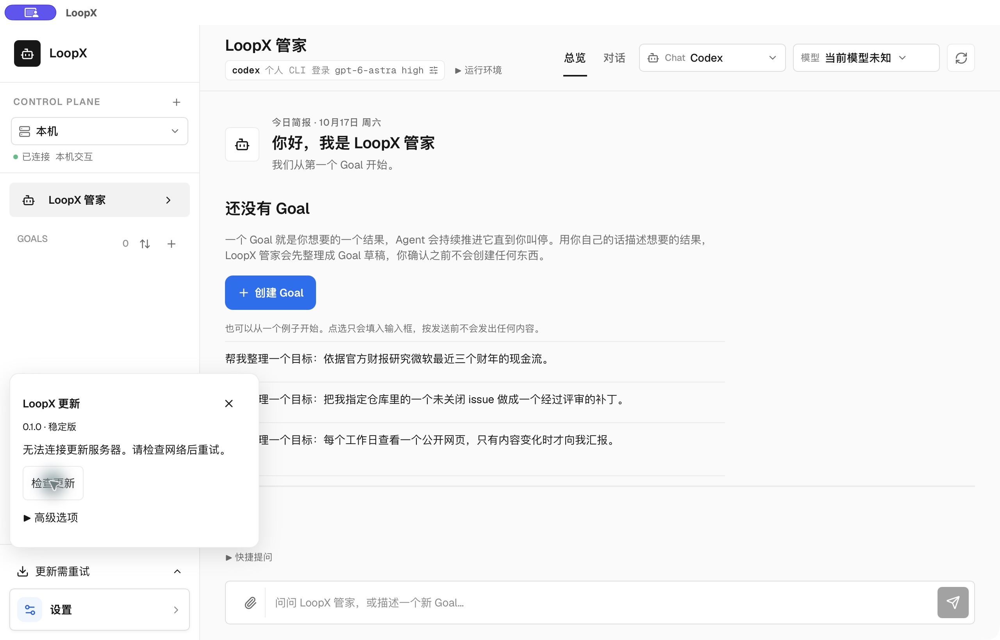
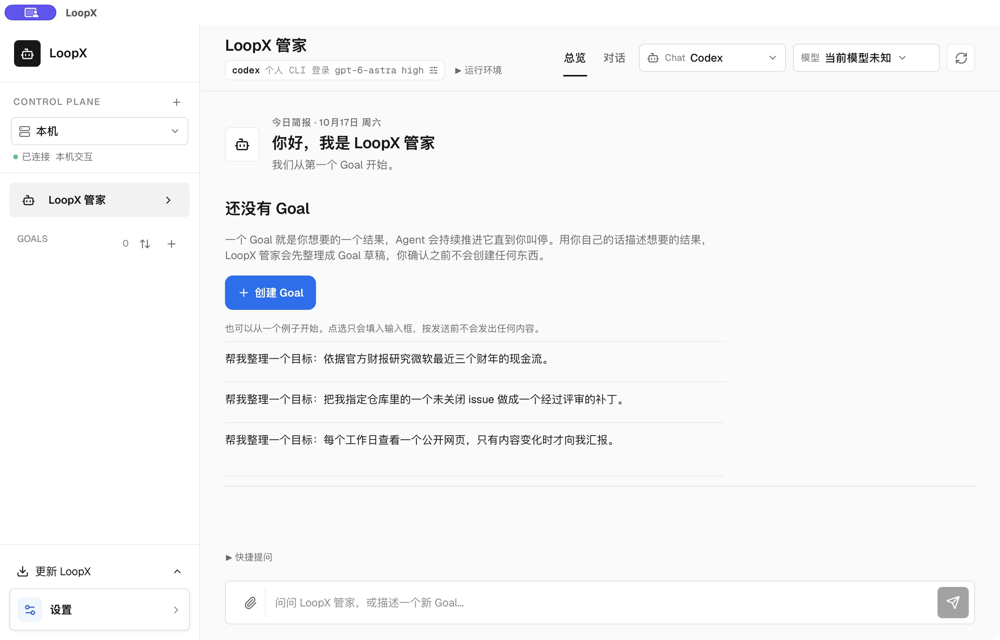
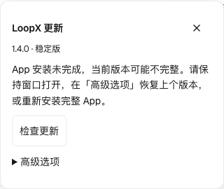
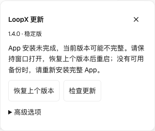

# LoopX Desktop

This directory contains the experimental Tauri shell for the LoopX personal
Agent workspace. It reuses the existing React dashboard and LoopX HTTP
services; it does not introduce another Goal, Todo, Gate, or Chat state owner.

This is currently a preview desktop shell. It is not installed by the LoopX
Python package; use `loopx dashboard` for the supported browser/PWA launch
path. Published LoopX releases attach desktop preview artifacts when the
desktop release workflow succeeds:

- macOS: `.dmg` plus a zipped `.app` bundle;
- Windows: `.msi` plus an NSIS `.exe` installer.

On Apple Silicon macOS, the App opens its qualified local runtime first, then
checks its current official channel and downloads a newer App in the background.
It verifies the updater signature and prepares the archive locally. The next
normal open verifies that archive again and installs it before starting services;
ordinary background preparation never replaces or restarts an active workspace.
An offline or failed check keeps the installed App usable; it does not certify
that the App is current. Main points to the latest complete signed build,
not arbitrary Git HEAD. Builds without the updater need a one-time replacement.
Windows preview retains manual CLI installation; browser/PWA users continue
with `loopx update`.

Background network requests do not hold service supervision. A slow or failed
check/download cannot prevent local startup or recovery of an owned child.
Manual **Check for updates** also leaves service supervision available while
reading the feed. Its result remains in the existing update panel after the
local workspace opens; an available update does not require installation to
finish startup. A newer check or an explicit maintenance action supersedes a
late response before it can admit a candidate. Apply, repair, rollback and
restart retain their exclusive native transaction and recovery boundaries.
Startup failures and feed results remain separate: an unusable local runtime
keeps its recovery message while a successful check still offers Install.
The existing update panel reports background progress or a prepared update;
manual actions cancel/supersede background work and retain their original
installation, restart, backup and rollback controls. A CLI-requested App upgrade
remains an explicit transaction with its original channel and service-ready
readback. A permission-restricted prepared installation stays on the verified
current App; use the existing explicit update action for native authorization.
The disposable cache is not an update authority: its signed bytes, channel,
version order and sealed bundle version are checked again before replacement.
Rejected cached signatures and verified-safe replacement failures keep local
startup moving, with the failure retained in diagnostics. They do not display
a stopped-startup state while services are connecting. An incomplete target,
failed journal retirement or unknown installation failure still requires recovery.

## Updates And Recovery

From a terminal, `loopx upgrade` coordinates the owning CLI installer and this
App's signed updater, restarts the App and waits for native service readiness.
Archive users can select Main with `loopx upgrade --ref main`; `--dry-run` is
read-only. The terminal passes only a bounded request id and an official channel
to the App. A private request receipt contains versions, source revisions,
update phase and the qualified service runtime identity; it contains no Goal
content or credentials. An update check failure remains a failed terminal
upgrade even when the workspace can still open. Normal launches without that
request perform their network check after local services are ready; an explicit
terminal upgrade retains its thirty-second interactive check budget.
The existing update panel shows the same native maintenance phases and recovery
actions. Main is the latest complete signed build, which can lag Git HEAD.

Release archive downloads share one native transfer policy for manual updates
and background preparation: a ten-second connection deadline, thirty seconds
without a response read, and a thirty-minute total ceiling. Steady progress may
continue beyond thirty seconds; stalled headers or body reads remain bounded.
The archive client limits apply only after feed discovery; the feed keeps its
existing check deadline (45 seconds manually, 30 seconds in the background).
Signature verification still precedes cache publication or installation.
The existing recovery and workspace update panels distinguish a download timeout,
an interrupted network request, an unavailable package and a rejected signature.
They keep the coarse cause and retry action without exposing transport URLs or
signature diagnostics. Unclassified failures retain the general download/verification
message; a failure never certifies that an update was installed.
Progress and failures use the
existing update panel; background IO does not hold the service supervisor or
restart a running workspace.

手动「检查更新」的网络等待也不占用本地服务启动或恢复锁。已有合格组件时，
工作区照常打开，检查结果与重试入口保留在原更新面板；发现更新不要求先安装
才能进入。较新的检查或明确维护操作使迟到响应失效，不能覆盖当前候选。
安装、修复、回滚与重启仍遵守原生独占事务及恢复边界。

手动与后台下载复用原生更新器：连接上限十秒、单次读取无响应上限三十秒、完整下载
上限三十分钟。持续有进展的下载可超过三十秒；下载的连接和读取期限仅在清单检查后
启用，清单仍保留手动四十五秒、后台三十秒的原期限。签名通过后
才写入准备缓存或安装。现有更新面板显示进度与失败，后台下载不阻塞服务监督或重启
正在使用的工作区。

启动恢复页与工作区更新面板分别提示下载超时、网络请求失败、安装包不可用和签名
校验失败，只展示可操作的原因与重试入口，不暴露传输地址或签名内部错误。
无法分类的失败仍保留通用提示，失败不会被显示为已安装。

Startup automatically uses the newest qualified local runtime it can establish.
It compares package versions; equal versions with source revisions use ancestry
from the fixed official GitHub repository. Installation time and lexical SHA
order never determine freshness. If the bounded check is offline, rate limited
or revisions diverge, a saved discovery path follows the current default CLI
when both are snapshots of the same installation and share a release base.
This follows the installer's completed promotion, without claiming unknown
source ancestry is newer. A provably older default is not adopted; other
installations remain independent. Neither case requires a version selection
screen. An App-owned snapshot with the same
release base can follow the current App's bundled snapshot when ancestry is
unknown; this is maintenance of the App's own installation, not proof that one
source revision is newer. A provably newer runtime remains selected. Both local HTTP services must expose the selected
artifact's identity before the workspace opens.

If anonymous GitHub ancestry lookup is unavailable, the App can reuse an
existing GitHub CLI login for the same fixed public-repository GET. It never
starts login or requests account permissions. Each tool has a three-second
process deadline; missing, failed or unauthenticated `gh` leaves ancestry
unknown. A successful non-ordering answer is not retried under another account.
Core still owns wheel qualification; this read neither changes its identity
rules nor grants Goal or account authority.

The bundled runtime carries its Core package version from the archived wheel
metadata. Native validation and ordering use Python's [PEP 440 version format](https://packaging.python.org/en/latest/specifications/version-specifiers/),
including alpha, beta, release candidate, development, post-release and local
versions. The original version string remains in the identity; parsing does not
rewrite receipts or installation metadata. A stable package is newer than its
same-base prerelease, so even an App-owned or installer-default fallback cannot
downgrade it. Equal package versions still need source ancestry or the existing
same-installation ownership rule. Invalid versions remain unavailable.

Main App build numbers (`0.0.0-main.…`) identify the native shell; they are not
compared with CLI package versions. Older bundle metadata retains its previous
shell-version fallback. Only those historical Main shell versions use their
release base for comparison; real Core prereleases keep their order. This
correction requires an App update; updating the CLI alone cannot patch it.

If the bundle is newer, or no selected CLI qualifies, the App prepares its
bundled snapshot in its own data directory through the existing installer.
This updates the CLI used by the App without replacing uv/pip/pipx's command or
editing the user's shell profile. An optional failed upgrade retains a qualified
previous runtime. Every discovered CLI must answer Core's installation-only
doctor successfully, including managed releases: a surviving `release.json`
cannot qualify a broken executable. Core also qualifies non-editable wheel
fingerprints: a local reuse fence, not publisher or source attestation. Older
CLIs without that readback can use the automatic App-owned fallback.

Wheel qualification has a separate ten-second subprocess deadline because it
starts Core, checks the TypeScript runtime and hashes package contents. The
one-second environment/version probes remain unchanged. A slow valid wheel can
therefore qualify without asking the user to repair it; invalid or timed-out
qualification still fails closed, and timed-out process groups are terminated
and reaped. This does not speed up doctor or certify every cold-start workload.

A launch-time `LOOPX_BIN` remains the developer's explicit pin. Development mode
also accepts a source runtime without promoting an installation. A previously
saved path is a discovery candidate, not a permanent version pin. Corrupt
preferences fall back to discovery. Runtime selection does not grant Goal,
Todo, capability or account authority.

Terminal failures stop the wait counter and expose recovery immediately.
**Repair this version** prepares the App-owned runtime, saves the qualified
promoted executable and reconnects the same window. Restart uses that completed
promotion rather than an older cached release path; separately managed or
explicitly pinned CLIs remain with their owner.
**Forget runtime choice** removes the saved discovery candidate, not a current
`LOOPX_BIN` value. Channels, rollback and copyable diagnostics remain in Recovery
& updates and the workspace's existing update panel. Browser callers supply only
fixed native actions, never commands, paths or download URLs.

The App binary owns windowing, startup, IPC and update/recovery. Its runtime owns
the CLI, HTTP APIs and workspace assets. A CLI update cannot patch the native
shell, and a shell update does not certify Goal acceptance or provider readiness.
The release workflow packages both layers from one Git revision.

The installer and App-owned services use the same bounded tool search,
including standard Homebrew locations on macOS, without loading interactive
shell profiles. Finder launches therefore do not depend on terminal PATH setup.
When preparing the first App-owned snapshot, an already selected managed CLI's
recorded Python is reused if the App has no interpreter record of its own.
This leaves that CLI's launcher and installation owner unchanged.
Installation uses `loopx doctor --deep --installation-only`: package ownership,
representative imports/commands/files and the TypeScript runtime semantic probe
remain required, but existing Goal projects are not traversed. Native runtime
preparation also leaves host skills/slash commands and provider doctors alone;
it cannot depend on a macOS Documents-folder consent prompt. Ordinary
`loopx doctor` retains its full operator/integration diagnostics. Terminal
installation still revalidates enabled extensions by default; the App sets
`LOOPX_INSTALL_REVALIDATE_EXTENSIONS=0` for its bounded bootstrap.
Runtime preparation isolates Git discovery to its verified export, so a
developer's Git environment or a checkout enclosing `TMPDIR` cannot supply
unrelated branch or dirty-state metadata. The bundled revision and digest
remain the source of the installed snapshot's identity.
Failed runtime preparation remains supervised, with at most three automatic
install attempts per App process and at least 30 seconds between attempts.
Existing recovery controls remain available after that budget is exhausted,
and externally corrected installations are still detected. Legacy journals
are cleared only after the actual App installation verifies; they do not pin
the runtime to an older source revision.

A listener that accepts TCP but does not answer HTTP is given a 15-second
startup grace period. The supervisor can then replace it only after verifying
its LoopX command, service kind and port, including a second PID readback before
termination. Unknown listeners are retained and reported as startup errors.

Chat begins serving its workspace and readiness endpoints independently of Lark
binding discovery. Slow or permission-blocked project reads remain in one
background initialization worker; discovery failures retry every five seconds.
Closing the server fences late discovery results before any queue resumption
or event consumer starts. Existing enabled bindings retain their routing and
authorization rules.

If startup cannot proceed, the embedded **Recovery & updates** screen stays
available without a working HTTP service. **Repair this version** reinstalls
the bundled runtime and then reconnects the same window automatically; it no
longer requires a second App restart. Reloading the WebView cannot terminate
the native startup supervisor.

On macOS, loss of the workspace's WebContent process re-arms that same native
navigation owner. It retains the current same-origin page, including SPA
history, and retries every two seconds until WebKit commits the document.
Recovery does not restart services or submit a task. Slow committed documents
are allowed to finish; boot pages retain the framework's reload behavior.
This changes post-crash navigation only; other platforms keep their existing
handoff policy.

The macOS App's two private Core services also follow the native process's
lifetime after an abrupt App crash. Each runs with a helper from the same
native executable. Losing the App's private pipe stops only that helper's own
process group; reopening does not leave an additional pair of services behind.
A service exit still reaches the existing supervisor for recovery. Shared
development services and other platforms keep their existing process policy.
This process cleanup does not establish the cause or visual recovery of a
WebContent blank screen, and it does not replay a failed task.

The opt-in macOS regression uses a hidden incognito window, a synthetic local
server and a separate App identifier. It terminates only that window's own
WebContent process, simulates a temporary backend failure and a slow response,
and requires automatic return to the original route without write requests:

```sh
uv run --extra test python scripts/desktop_runtime_bundle.py
cd apps/desktop/loopx-control-plane/src-tauri
cargo run --example webcontent_recovery
# Negative control: framework-only reload is expected to exit 1.
cargo run --example webcontent_recovery -- --baseline
```

It reads no Goals or accounts and never targets an installed LoopX process.

The fault injector uses a private WebKit process-id getter only in this example;
production recovery uses the public Tauri termination hook.
This controlled regression does not establish long-duration reliability or
identify the cause of a past uninstrumented incident.

Legacy update/rollback journals are resolved against the running App before
startup. An incomplete App installation retains its recovery state; runtime
freshness must prevent a journal from silently downgrading a newer CLI.
Concurrent transactions and another install before restart remain rejected.
macOS keeps a signature-verified previous App for **Restore previous version**;
recovery can restore the original install path even when a failed update moved
the App away entirely. If another installer recreates that path during recovery,
rollback stops without replacing the concurrent installation.
Goal data is not deleted or migrated backwards, so data-schema compatibility
still governs rollback suitability. Older backups may consume disk space.

The embedded Recovery & updates section includes selectable, copyable diagnostics
with the App version, last failure category, installer exit code when available,
runtime identity availability/match results, and (v2) coarse environment facts:
OS version, architecture, whether the runtime executable resolved, and whether a
`python3` in the installer's bounded search path reported a version. The last
failure survives a subsequent update check within the same App process. Copying
never includes raw installer output, environment variables, local paths, or Goal
content. Installation failures, missing/corrupt bundles, and runtime mismatch
show distinct recovery instructions. A terminal `loopx doctor` checks the
terminal-selected runtime; it does not prove that Desktop selected the same
installation or matching revision.

When the update snapshot stays in a terminal phase, the boot screen itself stops
presenting an endless loading state: the main status line immediately shows the current error, stops its wait
counter and expands Recovery & updates. Unchanged invalid selections are
rechecked at most every 30 seconds; an explicit recovery action wakes the
supervisor immediately. It returns to the loading shape as soon as the
snapshot leaves the terminal phase (for example while an explicit repair runs).

### Returning After A Normal Close

The packaged App remembers the selected local Goal, view, Agent and Todo when
its main window closes or the App quits. Reopening uses the newly allocated
loopback origin and returns to that selection without another navigation step.
Selecting **LoopX 管家** before closing instead returns to Manager next time.
This restores a reading position; it never submits a message or starts work.

The optional `workspace-location.json` in the App's private data directory
contains only those selection identifiers. It stores no origin, raw URL, prompt,
credentials or report/session query. Missing, corrupt or obsolete preferences
fall back to the ordinary workspace; unknown views fall back to the frontend's
default. Boot and foreign pages cannot overwrite a saved local selection.
Remote status sources and host-granted workspace contexts are not restored:
they reopen at local Manager, so their Goal identifiers cannot be replayed
against the local source. Vite development navigation is unchanged. Explicit
runtime repair retains its existing root handoff; WebContent crash recovery
continues to retain the current in-process route.

For native qualification, use a separately identified packaged App with the
real backend: select a local Goal and Agent page, quit normally, reopen, and
check the same selection on the new port. Also check window-close, an explicit
return to Manager and a corrupt preference in that disposable App profile.
Bind the disposable registry and its `common_runtime_root` at the QA launch
entrypoint, and set `LOOPX_USAGE_PING=0` for all synthetic Core invocations:
a caller-only environment can be lost when a window tool or the
system relaunches the bundle. Verify the reopened process's data route before
observing or operating it; never use the installed App as a fault fixture.
Retain Session IDs and active-Turn readbacks before and after; navigation is
not evidence that work was resumed or accepted. Cross-platform and sustained
use require their own qualification.

## Known Issues

### Fresh Mac without a usable Python stays on the boot screen

On a new macOS machine with no developer environment, the App's automatic
runtime installation can fail with `runtime_install_exit_2`: the installer
requires a usable Python 3.11+ (`python3` reachable through the bounded search
path that covers standard Homebrew locations), and a bare macOS does not ship
one. The automatic install budget (three attempts) exhausts itself, and before
this fix the failure was only visible inside the collapsed Recovery & updates
panel, so the window read as a permanent loading state.

Self-service:

1. Check the boot screen error code or Recovery & updates → Diagnostics
   (`error_code: runtime_install_exit_2`, `environment.python3_found` /
   `python3_version` confirm the missing interpreter).
2. Install Python 3.11+ — for example `brew install python@3.12` or via
   official python.org installer (note that macOS Command Line Tools provides
   Python 3.9, which does not satisfy the Python 3.11+ requirement).
3. Press **Repair this version** (or reopen the App); the live supervisor
   reconnects the same window without a second App restart.

`loopx doctor` run on another machine (for example the Linux host that also
serves your terminal runtime) checks that host's installation. It cannot
diagnose this Mac App's local bootstrap; only the App's own diagnostics do.

The updater accepts only fixed official HTTPS channels, not browser-provided
commands, paths or download URLs. Its signing private key is confined to the
release secret; the App embeds the public key. PR validation has no signing
secret. Updater signing does not provide Apple notarization. It also does not
change Goal authority, grant capabilities, or stop running agents on behalf of
the user. Services may briefly disconnect during reconciliation.

The background feed check has a thirty-second deadline and is outside local
workspace startup. A manual **Check for updates** allows 45 seconds for the same
official feed, including redirects; the panel keeps showing its checking state
while the existing workspace remains readable.
A timeout remains an explicit retryable error, never a claim that the App is
current. Archive downloads use the separate connection, idle-read and total
deadlines described above. Installation and recovery boundaries are unchanged.

Published macOS preview artifacts use ad-hoc code signing to verify bundle
integrity without requiring an Apple Developer account. They are not signed
with a Developer ID and are not notarized, so macOS may require the operator
to approve the first launch in System Settings > Privacy & Security.

## Runtime Model

The shell:

1. immediately renders an embedded startup surface instead of a blank WebView;
2. verifies or starts `loopx serve-status` on `127.0.0.1:8766`;
3. verifies or starts `loopx chat` on `127.0.0.1:8767`;
4. loads the versioned LoopX Chat workspace only after its lightweight
   capabilities endpoint is readable, retrying transient service replacement;
5. opens the existing personal workspace in one native window;
6. terminates only the service process groups it started when the window exits.

On macOS, the shell retries a failed workspace navigation until WebKit commits
the workspace document. A committed slow document can finish without repeated
reloads; explicit runtime repair starts a fresh handoff. Other platforms retain
their existing single navigation attempt because their page-start events do
not provide the same commit acknowledgement. Native startup changes require an
App update; updating the CLI alone does not replace the shell.

An unknown process on either LoopX port is a hard startup error. Existing
services are reused only after a successful response exposes both the exact
top-level JSON fingerprint and the same installed release identity as the
selected `loopx` command. Marker-like text in headers or nested values is not
accepted. A service left running by an older installation is reported as stale
and is replaced automatically only after the shell resolves the listener PID
and confirms that its command is the expected `loopx serve-status` or
`loopx chat` invocation on the matching port. If process ownership cannot be
confirmed, startup fails closed without sending a termination signal. Unknown
services remain a hard error. Windows currently keeps this owner-facing error
path instead of terminating an existing process automatically.

Release launchers publish a stable process fingerprint that is independent of
their internal Python entry module. The shell also recognizes the historical
fixed-CLI and lightweight-entrypoint launcher shapes, so upgrading LoopX can
replace an already-running older service without asking the operator to find
and stop it manually.

On macOS, when the standard `com.loopx.status` or `com.loopx.chat` LaunchAgent
is loaded, Desktop keeps launchd as the single service owner. After replacing a
stale listener it requests a launchd wake and waits through the throttle
interval instead of racing a second Desktop-owned process onto the same port.

The WebView is pinned to the loopback Chat origin served by the installed
LoopX release. Dashboard requests to the status and Chat services remain
restricted to loopback CORS and the existing preview/apply authority boundary.

## Coexistence With `loopx dashboard`

The packaged App allocates its own private Status and Chat endpoints for each
window. `loopx dashboard` keeps its CLI endpoints on `8766` and `8767`; either
entrypoint can run without adopting or stopping the other's listeners. Vite
development retains those CLI ports and its qualified-service reuse path.

The packaged App watches its own direct service children. When one exits, it
restarts that service on the same private endpoint with the same qualified
runtime and identity, keeping the healthy peer running. Recovery attempts are
at least two seconds apart. An occupied endpoint fails closed and is retried;
the intervening listener is never adopted or stopped. A live but unresponsive
child is outside this exit-recovery path.

Recovery keeps an update check's error or available-update choice visible. It
waits during maintenance and after an App replacement requires restart or leaves
the App incomplete. The native shell sends no conversation input or replay;
persisted Session and Turn recovery remain owned by Core. Closing the App stops
only its own service process groups.

## Prerequisites

- A working Python interpreter for runtime installation; existing managed
  installations preserve their interpreter. Windows requires a separately
  installed LoopX CLI. Set `LOOPX_BIN` only for deliberate runtime overrides.
- Node.js 20.19+ or 22.12+ for dashboard builds.
- Rust stable and the platform-specific Tauri build dependencies.

Linux requires WebKitGTK 4.1 and GTK 3 development packages. See the
[Tauri prerequisites](https://v2.tauri.app/start/prerequisites/).

## Development

```bash
cd apps/desktop/loopx-control-plane
npm install
python3 ../../../scripts/desktop_runtime_bundle.py
npm run dev
```

## Validation

For a process-exit drill, use a separately identified packaged QA App whose
launcher fixes a disposable empty registry and `LOOPX_USAGE_PING=0` before any
Core command. Keep its qualified Core artifact immutable across baseline and
candidate runs. Deny public network access only in that launcher, check for
updates through the actual App, then terminate its exact owned Chat and Status
children separately. Read back both HTTP identities, unchanged peer PID, exact
registry, retained Session and update failure, then normal quit/reopen cleanup.
Never substitute an installed App, real Goal or shared listener as a fixture.
Bind isolation at the QA bundle's executable entrypoint, so a window tool or OS
relaunch cannot drop a caller-only environment. The native services request
`--global-registry`; `LOOPX_REGISTRY` only changes the project default and does
not override that explicit selection. A QA-only CLI launcher must route through
Core's explicit `--registry` and `--runtime-root` arguments instead of that flag.
Fail closed when its fixture binding is absent. Before any UI operation or
public capture, read both service identities, the actual registry/runtime route
and the empty Goal set. A source mismatch invalidates the sample; retain it
privately and stop rather than operating on or publishing the real workspace.
Do not change the user's default registry or `HOME` to obtain isolation.
This qualifies child-exit recovery, not an interrupted model Turn, an
unresponsive process, a signed update installation or cross-OS operation.

This empty-registry macOS QA capture follows separate real Chat and Status
process exits. Both services recovered while the failed network update check
stayed visible. It uses a separately frozen installed Core; it is not a
single-revision release or official installation qualification.



For the ancestry fallback, use that isolated packaged App and a qualified Core
fixture. A QA-only invalid `CURL_CA_BUNDLE` can deny curl's public read while the
existing `gh` still reads the real relation. Compare the old and candidate
native binaries with the same corrupt preference and immutable Core fixture;
read both service identities and the saved selection after the window opens.
Also check that unavailable public transports retain a qualified runtime and
that normal reopening preserves the disposable Session. Remove faults from the
QA launcher afterwards; never change the system proxy or certificate store.

The viewport below is a separately packaged macOS QA shell with an empty
synthetic Goal registry. It records a successful workspace opening, not model
execution, model-selection qualification or an installed-product upgrade. The
ancestry change adds no new UI control or configuration step.



```bash
cd apps/desktop/loopx-control-plane/src-tauri
cargo fmt --check
cargo test
cargo clippy --all-targets -- -D warnings

cd ..
./scripts/dashboard.sh build
npm run build
```

The updater's real loopback HTTP/signature checks run with `cargo test`. Its
slow-transfer regressions deliberately exceed thirty seconds and are opt-in:

```sh
cargo test --lib maintenance::transfer_tests -- --ignored --nocapture --skip released_archive
LOOPX_TEST_SIGNED_ARCHIVE="/path/to/LoopX.app.tar.gz" cargo test --lib \
  released_archive_survives_slow_native_transport_and_cache_reopen -- --ignored --nocapture
```

They cover manual feed headers and bodies arriving between 30 and 45 seconds,
a progressing signed download, stalled archive headers and a mid-body stall
through the same native download owner, while service recovery remains usable.
The window runtime is a test runtime; the transport and signature verifier are
real. The ordinary fixture's signed bytes are not an installable App. The
artifact-backed check additionally transfers a complete released archive and
reopens its verified cache using the shipped public key; keep its `.sig` file
beside it. Neither check installs the archive or qualifies signed App
replacement, installed adoption or a real network's throughput. Never point
them at a live registry or workspace.

To qualify the native supervisor against an actual installed Core, first build
the runtime bundle as above with `LOOPX_USAGE_PING=0`, then run from `src-tauri`:

```sh
qa_root="$(mktemp -d)"
mkdir "$qa_root/state"
printf '%s\n' '{"goals":[]}' > "$qa_root/state/registry.global.json"
(
  set -e
  export LOOPX_USAGE_PING=0
  export LOOPX_REGISTRY="$qa_root/state/registry.global.json"
  export LOOPX_RUNTIME_ROOT="$qa_root/state"
  export LOOPX_TEST_PRIVATE_RUNTIME="$qa_root/runtime"
  export LOOPX_TEST_BUNDLE="$PWD/../runtime"
  cargo test --lib real_private_installer_keeps_the_default_cli_owner -- --ignored --nocapture
  cargo test --lib real_private_runtime_serves_and_rejects_stale_identity -- --ignored --nocapture
)
```

Both opt-in tests require the telemetry opt-out before invoking Core. A
disposable registry does not isolate machine-wide usage reporting; this
synthetic run must not contribute adoption or installation telemetry. The
opt-out applies only to this test invocation and leaves user consent unchanged.

This installs only in the disposable root. The second test uses an explicit
local launch pin to route the production supervisor's two services to its own
fresh empty registry and data directory. It checks both artifact identities,
serves the packaged Chat document, reads zero Goals/Sessions, stops and reopens
the services, and rejects
a stale expected identity without leaving owned listeners. It does not launch
the installed App, run a model, or qualify automatic runtime selection, native
window reopening, signed replacement or rendered UI. The incognito WebKit
regression above covers its separate navigation failure boundary.

On macOS, also qualify a released artifact using the opt-in checks below
(run from `src-tauri`, replacing the paths with downloaded release artifacts).
Keep the updater archive's `.sig` file beside it:

```bash
LOOPX_TEST_APP="/path/to/LoopX.app" cargo test --lib \
  real_release_backup_restores_damage_and_rejects_tampering -- --ignored
LOOPX_TEST_SIGNED_ARCHIVE="/path/to/LoopX.app.tar.gz" cargo test \
  --test signed_bundle -- --ignored
LOOPX_TEST_APP="/path/to/older/LoopX.app" \
LOOPX_TEST_SIGNED_ARCHIVE="/path/to/LoopX.app.tar.gz" \
LOOPX_TEST_INSTALL_PARENT="/Volumes/disposable-apfs-test-volume" cargo test --lib \
  real_release_installs_on_another_volume_and_keeps_the_old_app -- --ignored
LOOPX_TEST_APP="/path/to/older/LoopX.app" \
LOOPX_TEST_SIGNED_ARCHIVE="/path/to/LoopX.app.tar.gz" \
LOOPX_TEST_UNSUPPORTED_INSTALL_PARENT="/Volumes/disposable-hfs-test-volume" cargo test --lib \
  real_release_keeps_old_app_when_volume_rejects_atomic_exchange -- --ignored
```

The first check copies the signed App into temporary directories, then exercises
the production restore path after removing its executable, a sealed runtime
resource, or the entire target bundle. It also rejects a tampered backup before
journaling or replacement and checks that the source artifact remains intact.
The second verifies the updater archive with the shipped public key and rejects
modified bytes. The third requires a writable disposable APFS volume separate
from the system temporary directory. It copies the source App into a temporary
directory there, installs a distinct update through the production filesystem
adapter, and verifies both the replacement and retained previous App. It then
restores the pre-install backup through the production recovery adapter on that
same target, checking the old identity, executable and signature, and that the
rollback journal callback ran before replacement. The fourth requires
a writable disposable HFS+ volume and a source App distinct from the update
archive. It first confirms that the filesystem rejects atomic directory exchange,
then verifies that the production installer fails while the original App's
identity, executable and signature remain intact. The extracted candidate also
remains intact; no sequential replacement is accepted. These checks never
launch the App or write to an installed App or user data. They qualify the native
replacement, recovery and signature boundaries; they do
not replace packaged UI checks of download failure, restart, or runtime handoff.

### Recover An Interrupted App Update

On writable macOS installations, the signed update is extracted beside the
installed App and its bundle integrity is verified before the same atomic
exchange used by recovery. This also works when the App is on a different
APFS volume from the system temporary directory. The previous App remains in
the retained staging directory as well as the verified recovery backup. A
failed extraction or exchange leaves the current App in place. Filesystems
without atomic directory exchange, including HFS+, require manual App
replacement; no delete-and-move fallback is used. Administrator-owned install
directories retain the existing system authorization path. Windows installation
and separately managed CLI selection are unchanged.

If replacement leaves the App incomplete and a backup is available, the update
panel exposes **Restore previous version** directly. Restore it, then choose
**Restart to finish**. This removes two navigation disclosures from the failure
path; choosing a healthy installation's rollback remains under Advanced options.
The native updater still verifies the backup before replacement. An unavailable
or invalid backup reports its cause without recommending an unavailable runtime
repair. Restoring the App does not overwrite a separately managed CLI.

| Previous recovery panel | Direct recovery action |
| --- | --- |
|  |  |

These packaged-panel captures use synthetic native status for presentation
comparison; they do not certify an installed update or an executing task's recovery.

`npm run build` produces the configured platform bundles under
`src-tauri/target/release/bundle/`. The release workflow builds macOS `.dmg`
and `.app.zip` artifacts on macOS, Windows `.msi` and `.exe` artifacts on
Windows, and uploads them to the GitHub Release that triggered the workflow.
It verifies the ad-hoc macOS app signature and disk-image integrity before
upload. A separate `DESKTOP-SHA256SUMS` manifest covers all desktop artifacts
attached by the workflow, and release builds use the Git tag as the desktop
bundle version. A manual rerun for an existing tag is an explicit full desktop
republish: it rebuilds both macOS and Windows assets, preserves the previous
desktop set as a short-lived workflow artifact, validates the complete new
four-file set, replaces all desktop binaries, and uploads the new checksum
manifest last. Binary hashes may therefore change after a manual rerun.

## Disable Or Remove

Close the desktop window to stop service processes owned by the shell. Services
that were already running before the shell opened are left untouched. Removing
the desktop package does not modify LoopX project or runtime state.
