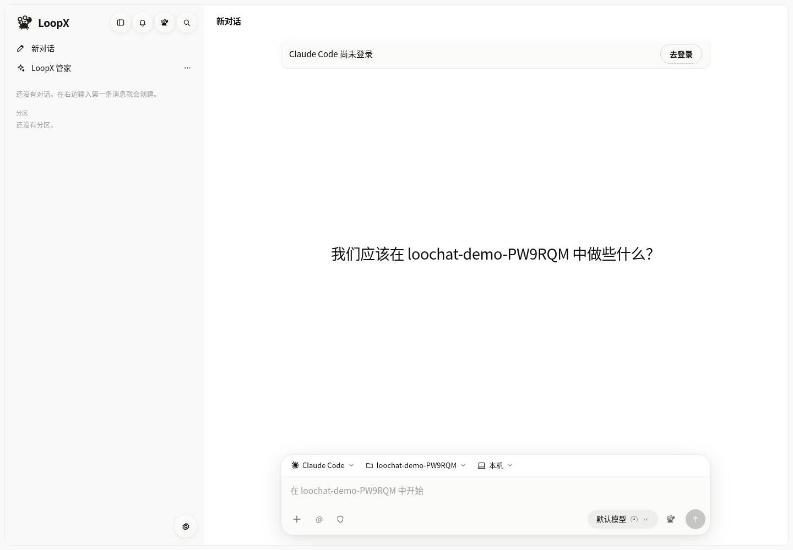
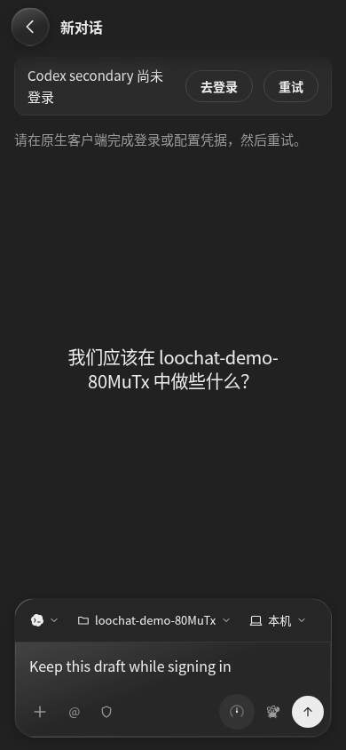
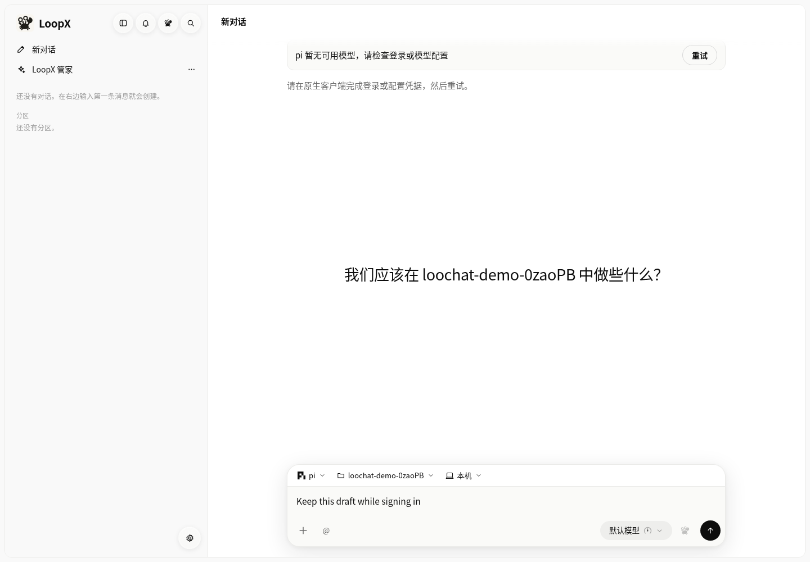
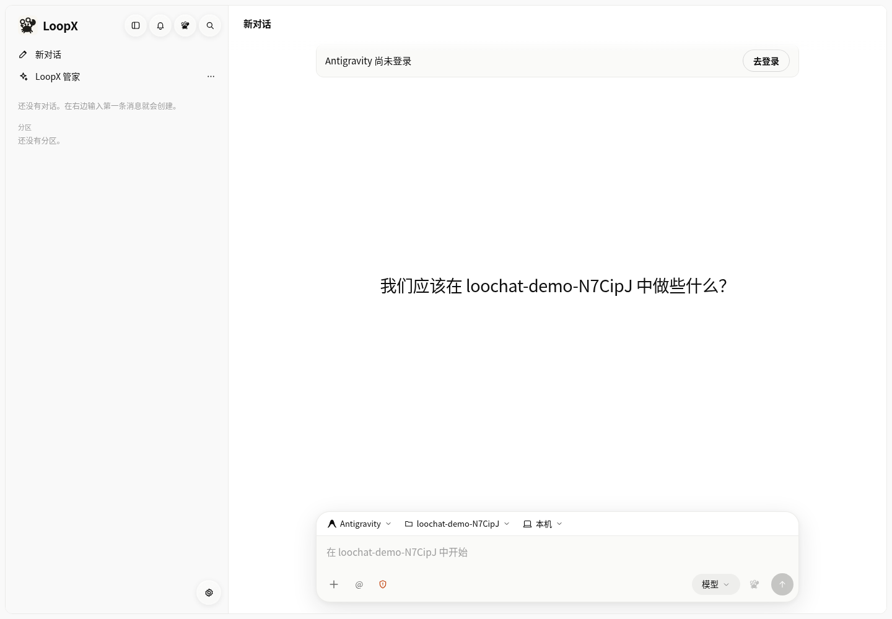
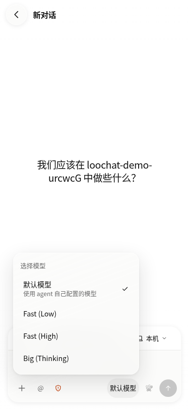
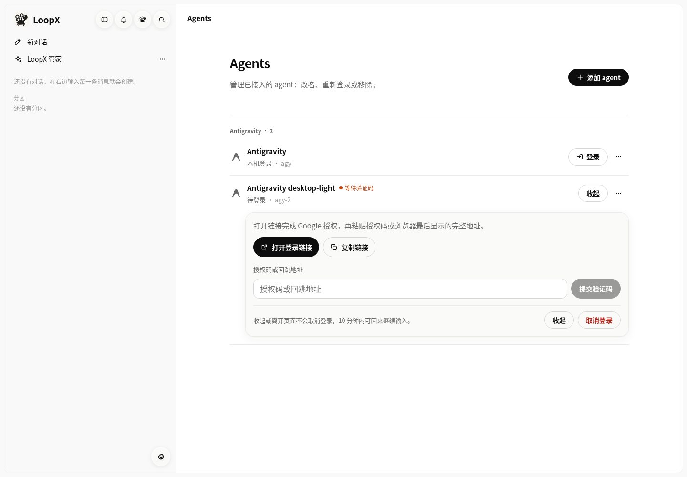
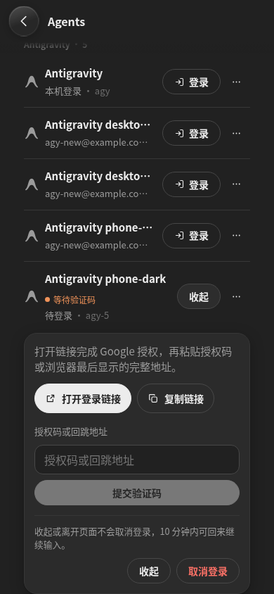

<p align="center">
  
</p>

<h1 align="center">LooChat</h1>

<p align="center">随时叫上你的 AI 伙伴。</p>

LooChat 是一个开源的 agent 工作台。用简单的界面管理 TRAE、zcode、Claude Code、Codex、pi、Antigravity 等国内外 agent，通过插件把好用的工具接进来。电脑和手机都能用，也欢迎每个人参与改进。

打开网页就能：

- 看每个 agent 在做什么——进展、审批、用量
- 随时发消息、补充要求、处理审批
- 一处管理多个 agent 和多台机器，保存团队分工、交接任务
- 额度快用完时，等本轮结束后自动写摘要、倒计时交给下一个账号或模型；支持时直接在原会话换模型
- 用实时语音和 agent 边聊边做：说出任务交给后台，接着聊别的，结果回来再念给你听
- 按需安装线程看板、Memory 记忆看板，或连接 LoopX 查看目标进度

LooChat 不动 agent 本身的目录、配置和会话，装好即用。LooChat 是自创品牌名，呼应随时叫上 AI 伙伴的感觉；图标采用一只举着大小双钳的蓝色小螃蟹，配浅蓝背景，保持简单、亲切的形象。

## 使用方式

消息菜单中的复制为引用、整条回复引用、作为上下文和侧边追问，见[引用使用说明](docs/references.md)。

实时语音：开启后输入框换成一个会随声音起伏的球，你说的话以浅蓝气泡记进线程；后台任务和待批准事项一行可见；结束后逐句对话折成一行，下面留一份文字总结。

用量与诊断：多 agent 的 token 用量、TPM 走势和费用估算。

写作模式：在加号菜单里一点就开。你口述观点，agent 用你的原话记成初稿、标出【待补】、追问具体场景，再按二稿、三稿、配图、润色一稿一稿往下走。正文是 `writing/` 下的 Markdown，按文章排版，画出 Mermaid 图、显示配图；读和写是同一张纸，可以直接改（键盘或语音输入法都行），agent 同时改过时不会覆盖你的版本。在正文里选中一句，一点「删」「待补」「为什么」「改成…」就成了给 agent 的注释。说「复盘」，agent 把你反复改的地方提炼成写作习惯，记进 `~/.loochat/notes/writing.md` 等你确认，之后每篇都照着写。

## 已支持

| Agent | 接入方式 | 审批 | 发图片 | 导入历史 / 分叉 |
|---|---|---|---|---|
| Claude Code | ACP（`@agentclientprotocol/claude-agent-acp`，随项目安装） | 有 | 有 | 有 |
| pi | `pi --mode rpc` | 无（pi 本身没有） | 有。纯文本模型需要装 pi 扩展 `pi-aux-vision` | 有 |
| Antigravity | `agy` 的无界面 stream-json 模式 | 无（不能询问，只有"自动改文件"和"完全访问"两档） | 有（按文件路径交给它） | 暂无 |
| Codex | `codex app-server` | 有 | 有 | 有 |
| TRAE CLI | app-server 执行，ACP 模型与历史接口 | 有 | 有 | 有 |
| zcode | `zcode app-server` 精简接入 | 有 | 按原生模型能力 | 暂无 |
| DeepSeek Harness | `dsh --profile acp`（ACP） | 有（仅允许一次/拒绝） | 有（按当前模型路由） | 暂无 |

各家 agent CLI 需要先在主机上装好。没装的 agent 在界面里显示为不可用；已安装的 Claude Code 和 Antigravity 可从 Agents 页发起登录。

### Agent 未登录时恢复

读取模型时，所有 Agent 明确返回的原生认证失败都会在工作区显示「账号名 尚未登录」。恢复方式按该实例支持的能力提供：

| Agent | 恢复入口 |
| --- | --- |
| Claude Code、Antigravity | 「去登录」展开行内授权面板；验证后自动刷新模型 |
| Codex、TRAE CLI、ZCode | 「去登录」打开该账号的原生终端登录；模型读取确认可用后自动恢复 |
| pi、DeepSeek Harness | 显示原生客户端凭据配置指引和「重试」；pi 在原生客户端使用 `/login` |

空目录单独提示「暂无可用模型，请检查登录或模型配置」；空列表本身不作为未登录证据。配置型 Agent 在原生客户端配置后点击「重试」，已有草稿保留。网络故障、额度耗尽、不受支持的订阅和 Workbench 自身的访问令牌错误保留各自含义。

以下为构建页面与隔离测试账号的实际界面；原生授权结果由测试 CLI 提供，不代表真实账号授权已验收。







认证识别遵循原生协议：[ACP 的认证错误](https://agentclientprotocol.com/protocol/v1/authentication)、Codex 的 `account/read`（仅在 `requiresOpenaiAuth` 为真且账号为空时判断未登录），以及 CLI 明确的登录或缺失凭据诊断。Codex 自定义服务和旧版账号协议保留原有目录行为。

### Antigravity 登录

若读取模型时尚未登录，当前页面会显示「Antigravity 尚未登录」和「去登录」。点击后在原位置展开授权面板；登录验证成功后自动加载模型列表，无需刷新页面。若此时模型读取暂时失败，可以重试读取，不必重复授权。网络或 CLI 故障仍单独显示为错误。





在 Agents 页点击 Antigravity 的「登录」，授权面板会在该账号行下方展开，不遮挡其他页面操作。打开 Google 授权链接，授权后把验证码或浏览器最后显示的完整回跳地址粘贴回来，点击「提交验证码」。出现登录成功后，账号邮箱会显示在列表中。收起面板、离开页面或刷新都不会取消登录，10 分钟内可从「继续登录」回到同一次授权；只有「取消登录」会主动结束它。链接过期或授权失败时点「重试」获取新链接。

另加账号时，选择「添加 agent → Antigravity → 添加账号」。创建后直接展开登录面板。新账号使用独立目录，只复制可移植设置、指令和技能，不复制原账号的凭据、历史或项目信任。原生 CLI 负责 OAuth 和保存凭据。安装器留下的 `.old` 等备份不会作为可用账号展示，原文件保留。

下面是同一登录入口在桌面与手机上的示意（使用测试账号）：





## 插件与参与

在「配置 → 扩展」按需安装：

- **线程看板**：按进行中、等你、待验收、已完成排列线程；agent 每轮结束报告进度，完成由你勾选。
- **Memory 记忆看板**：只读浏览 Codex 已有的记忆文档，不生成或同步记忆。
- **实时语音**（试验中，真人听说仍在验收）：用这台机器上已登录的 Codex 原生语音，不需要另配 API Key；会消耗现有额度，具体计费归属尚未核实。在任意支持协作的线程里都能开，任务可以交给当前线程的 agent（Claude Code、pi 等）去做。浏览器开麦需要 HTTPS 或 localhost。
- **LoopX**：需先安装并配置 LoopX，关联目标和线程后，在会话与看板中查看目标、待办和待决定事项。当前不提供自动推进。

skills 和 MCP 属于 agent 资源，通过各自的管理页操作，与 LooChat 插件分开。想接入工具、贡献一个工作视图，或者反馈使用中的问题，可以在 LoopX 仓库提交 issue。独立数据源可放在自己的仓库；当前还没有自动收录的插件市场。

## 快速开始

需要 Linux 或 macOS、git 和 Node.js 22 或更高版本。

```bash
curl -fsSL https://raw.githubusercontent.com/loopx-project/loopx/main/apps/workbench/install.sh | bash
```

脚本从 `loopx-project/loopx` 浅克隆，按需下载文件内容，仅检出 `apps/workbench`（及其父目录文件），在 `~/.local/share/loochat/apps/workbench` 安装依赖并构建，生成 `~/.config/loochat/.env`（随机 token；线程数据放在 `~/.local/state/loochat`；agent 默认在家目录工作），在 Linux 上装成 systemd 用户服务，最后打印地址和 token。打开地址，点「连接 hub」粘贴 token 即可；没连接时先显示一套示例数据，可以随便点开看。

- 先看会做什么：`… | bash -s -- --dry-run`
- 更新：再运行一次，获取所选 ref 的最新提交（默认 `main`）。设置、token 和线程数据都保留，等正在跑的线程结束后才重启。固定提交不会自动升级。
- 卸载：`… | bash -s -- --uninstall`。只删服务和代码，设置和数据保留。
- 不装服务：`--no-service`，脚本打印手动启动的命令。没有 systemd（如 macOS）时也是这样。

安装结束会打印完整提交 SHA。可用 `LOOCHAT_REF` 指定分支、tag 或完整提交 SHA；`LOOCHAT_REPO` 可指定镜像或本地 Git 仓库，`LOOCHAT_HOME` 指定克隆目录。重跑时使用相同的仓库和目录设置。例如固定版本时，下载的脚本和所装源码使用同一个 ref：

```bash
ref=main  # 固定版本时替换为 tag 或完整提交 SHA
curl -fsSL "https://raw.githubusercontent.com/loopx-project/loopx/$ref/apps/workbench/install.sh" |
  LOOCHAT_REF="$ref" bash -s -- --no-service
```

**Core 单独安装。** 上述稀疏检出不包含 Python Core，安装器不会启动或升级 Core。普通 agent 会话可独立使用；Goal 功能需要运行中的 Core，以及对应注册表的 LoopX CLI。安装器会检查 Core 的 `/healthz`，不可达时打印地址和配置提示。在生成的 `.env` 中配置 `LOOCHAT_LOOPX_CORE_URL`（默认 `http://127.0.0.1:8792`）；源码 Core 还需设置 `LOOCHAT_LOOPX_CMD`、`LOOCHAT_LOOPX_CWD`，具体见 [安装与 Core 连接](docs/install-agent.md#连接-loopx-core)。

**让 agent 帮你装**：把这句话发给这台机器上的 Claude Code、Codex 等：

```text
按 https://raw.githubusercontent.com/loopx-project/loopx/main/apps/workbench/docs/install-agent.md 在这台机器上安装 LooChat
```

它会先预览、再安装、确认服务在运行，最后告诉你地址和 token；装 Node.js、编译工具这类改系统的事会先问你。

各家 agent CLI 要自己装好并登录，LooChat 只调用这台机器上现有的。

### 统一启动命令

安装支持此命令的 LoopX CLI，并安装、构建同版本 Workbench 后：

```bash
loopx workbench start
loopx workbench status
loopx workbench stop
```

`start` 在后台启动 Workbench，输出访问地址和私密登录链接。重复执行复用已有实例；
`status` 只读检查实际服务及 Core 连通性，不创建配置、不签发登录链接。
`stop` 保留配置和会话数据，存在运行中的 Agent 时拒绝停止；明确要中断时使用
`loopx workbench stop --force`。Core 仍独立管理，以上命令不会启动、替换或停止 Core。
Core 不可达会明确提示，普通 Agent 会话仍可使用；连通性不代表 Goal 功能已验收。

需要登录电脑后自动运行时，显式启用：

```bash
loopx workbench start --autostart
loopx workbench status
# 本次停止；下次登录仍自动启动
loopx workbench stop
# 停止并取消自启动，保留会话和配置
loopx workbench stop --disable-autostart
```

macOS 使用当前用户的 LaunchAgent，登录后启动、异常退出后恢复；不承诺未登录时运行。
Linux 使用 `systemd --user`，需要可用的用户服务管理器；不自动启用 linger 或申请 root 权限。
`status` 从系统服务管理器读取自启动状态，无法核实会明确报错。普通 `start` 不主动开启自启动；
已有注册时沿用该服务。为已运行的 CLI 实例启用自启动需要一次空闲重启，运行中的任务会阻止迁移。
系统服务只读取已有配置，不签发登录链接；交互执行 `start` 就会输出带 token 的私密登录链接。
默认地址只适用于同机浏览器；异机访问仍需已有的可达域名或代理。

注册使用 Node 和当前 CLI 的绝对路径。应从稳定安装位置启用，保留 Node、CLI、应用及配置文件；
移动安装位置或更换 Node 后，先用原安装执行 `stop --disable-autostart`，再从新安装启用。
若服务文件被外部修改，CLI 会拒绝覆盖或删除，需先核对并恢复原注册；服务管理器不可用时不假报成功。
服务文件只保存启动路径和必要环境，不复制登录 token；密钥仍由已有 `.env` 管理。

默认数据目录与 `scripts/workbench.sh` 相同：
`${XDG_STATE_HOME:-~/.local/state}/loochat-workbench`。
可以用 `WORKBENCH_STATE_DIR` 或每次传入 `--state-dir` 指定已有目录。
`start --port 8796`、`--workbench-dir /path/to/apps/workbench`、
`--env-file /path/to/workbench.env` 可选择端口、已构建应用和已有配置；
成功启动后保存这些选择，停止后再次启动沿用。应用依次从显式目录、
`LOOPX_WORKBENCH_DIR`、已保存目录、`LOOCHAT_HOME`、CLI 源码目录和默认安装目录查找。
依赖或构建缺失时给出准备命令，不自动下载安装。

原有脚本或 systemd 正在管理的实例不会被接管或停止。迁移时先用原启动方式正常停止，
再指定同一数据和配置，例如安装器的默认目录：

```bash
loopx workbench start --state-dir ~/.local/state/loochat --env-file ~/.config/loochat/.env
loopx workbench status --state-dir ~/.local/state/loochat
loopx workbench stop --state-dir ~/.local/state/loochat
```

systemd 实例继续使用原服务管理也完全可行，不要让两种启动方式同时管理同一数据。
CLI 管理使用独立的私有 Unix socket，不开放浏览器或远程 relay 的停服接口；
旧 PID 文件不授予停止权限。后台日志在状态目录的 `daemon.log`；
启动失败先看日志，修正配置后重试。异常中断留下 `lifecycle.lock` 时，先确认没有进行中的
启动，再移除该锁目录重试。命令支持 `--format json`，但 `start` 输出包含登录链接，勿公开。

### 从源码开发

```bash
cd apps/workbench        # 从 LoopX 仓库根目录进入
npm install
npm run setup               # 生成 apps/workbench 下的 .env 和随机 LOOCHAT_TOKEN，并打印出来
npm run build
LOOCHAT_ENV_FILE=../../.env npm start -w @loopx/loochat    # 默认监听 127.0.0.1:8787
```

要让 agent 在哪些目录工作，编辑 `.env` 里的 `LOOCHAT_WORKDIRS`。开发时可以分开启动：

```bash
LOOCHAT_ENV_FILE=../../.env npm run dev:daemon   # 后端
npm run dev:web                              # Vite，http://127.0.0.1:5173，/api 代理到后端
```

daemon 在 `packages/daemon` 目录里运行，所以用 `LOOCHAT_ENV_FILE` 指向 `apps/workbench/.env`。没有设置 `LOOCHAT_ENV_FILE` 时，读取的是当前目录下的 `.env`。

## 远程访问

- 默认只监听 `127.0.0.1`。
- 远程使用时，通过 VPN 访问。把 `LOOCHAT_HOST` 设为 VPN 网卡的地址，不要设为 `0.0.0.0`。
- 使用 HTTP + token。VPN 已加密传输，项目不额外处理证书。
- 注意：`http://<IP>` 不是安全上下文，因此 PWA 的离线缓存和"添加到主屏幕"不可用，网页里的"拷贝"按钮需要降级处理。

## 管理另一台机器

浏览器只连主 hub，其他机器上的 daemon 主动通过 relay 连到 hub。线程、文件和 agent 都留在各自机器上，节点无需开放入站端口。

1. **浏览器**：打开「配置 → 机器 → 添加机器」，填写机器名称，生成接入配置。
2. **节点**：安装 LooChat，将 `LOOCHAT_HUB_URL` 和 `LOOCHAT_HUB_TOKEN` 写进 `~/.config/loochat/.env`。保持私有 socket 开启，安装服务用 `scripts/install-service.sh`，已有服务重启用 `scripts/restart.sh`。
3. **连接**：节点自动接入，浏览器在线程列表顶部切换机器。断线后节点自动重连。

接入令牌只显示一次，hub 只保存其哈希；丢失后移除再添加。旧 SSH 机器登记会被忽略并提示重新添加，加载时不修改原 hosts.json，节点会话和文件不受影响。

| 配置 | 用途 |
| --- | --- |
| `LOOCHAT_HUB_URL` | 节点可访问的 hub 地址，建议 HTTPS |
| `LOOCHAT_HUB_TOKEN` | hub 为此节点生成的接入令牌，与浏览器登录 token 不同 |
| `LOOCHAT_SOCKET` | 本机私有 socket，默认 `~/.local/state/loochat/daemon.sock`；接入节点不可设为 `off` |

私有 socket 由本机用户文件权限保护。hub token 能操作登记的节点；节点令牌只能领取自己的 relay 任务。移除机器会撤销令牌，不删除节点线程和文件。

`scripts/update-hosts.sh [机器ID] [--check]` 可经 relay 更新在线节点。节点需要 systemd 用户服务与仓库克隆（默认优先使用 `install.sh` 的 `~/.local/share/loochat`，否则回退 `~/code/loochat`；hosts.json 的 `repo` 可设为仓库根或 `apps/workbench` 子目录）。更新任务独立于节点服务运行，构建快照、等待空闲后切换、失败回滚；hub 在重连后读取结果。`--check` 会 fetch 并报告候选版本，保留当前检出、构建和服务。真实 systemd 更新与跨网络部署仍待验收。

## 开机自启

```bash
scripts/install-service.sh              # 装成 systemd 用户服务并启动；默认读 ~/.config/loochat/.env
scripts/install-service.sh --remove     # 停止并移除
journalctl --user -u loochat -f
```

服务通过登录 shell 启动，所以 agent 能拿到你在 shell 配置里设置的 API key。不登录也要在开机时启动，需要执行一次 `loginctl enable-linger $USER`。

更新代码后用 `scripts/restart.sh` 重启：先构建，构建失败就不动正在跑的服务；再等所有线程跑完这一轮，然后重启并检查健康状态。`--force` 不等，正在跑的那一轮会以错误结束。在 hub 的线程里由 agent 调用时，脚本会在后台等，等包括它自己在内的所有线程都空闲后再重启，日志在 `~/.local/state/loochat/restart.log`。

### 从 Limi 升级

应用由 Limi（更早叫 remote-agent-hub）更名为 LooChat。旧名字都还认：`limi` 命令是 `loochat` 的别名；`RAH_*`、`LIMI_*` 环境变量按对应的 `LOOCHAT_*` 读取（`LIMI_SOCKET`、`LIMI_KEY` 对应 `LOOCHAT_TEAM_SOCKET`、`LOOCHAT_TEAM_KEY`），同时设置时以新名字为准；只有旧目录 `~/.local/state/remote-agent-hub`、`~/.limi` 时继续用旧目录；浏览器里保存的 token、草稿和偏好在第一次打开新版时复制到新名字下。

升级后照常用 `scripts/restart.sh` 重启也行，它会把旧服务指向改名后的 workspace。想把服务和目录也换成新名字，就运行：

```bash
scripts/migrate-name.sh --dry-run   # 只列出会改什么
scripts/migrate-name.sh             # 构建，等线程空闲后切换，服务停几秒
```

脚本把服务 `remote-agent-hub` 改名为 `loochat`，名为 `remote-agent-hub-*` 的附属服务改成 `loochat-*`；把 `~/.config/remote-agent-hub` 和附属服务的目录移到新名字下，旧路径留一个指向新目录的链接；把 `.env` 里的键改成 `LOOCHAT_*`，值不变，token 也不变。数据目录 `~/.local/state/remote-agent-hub` 和 `~/.limi` 不移动：线程在里面工作，agent 可能按所在目录找回会话。这两个目录保留原名，另建 `~/.local/state/loochat` 链接到数据目录。新服务 30 秒内没有通过健康检查，脚本就把一切恢复原样，用这次的构建启动旧服务；备份在 `~/.local/state/remote-agent-hub/migrate-backup`。

## 发布前检查

```bash
node scripts/check-publish.mjs
```

扫描会被发布的文件，查找你的用户名、主机名、家目录路径、内网 IP、长密钥、邮箱地址。公司名、项目名这类私人词放在仓库外的 `~/.config/loochat/publish-denylist`（每行一个），也会一起检查。

## 目录结构

```
packages/daemon   网关：HTTP/SSE API、鉴权、SQLite 存储、各 agent 的适配器
packages/web      界面：React + Vite，手机与桌面共用一套组件
docs/             安装与 Core 连接指南
```

## 开发

```bash
scripts/init.sh   # 装依赖、构建，起一个用假 agent 的临时 hub 并跑一轮冒烟测试；加 --check 跑完即停
npm test          # daemon 与 web 的全部单元测试和 API 测试
npm run typecheck
npm run test:e2e   # 统一构建一次，再运行浏览器 E2E（最多并行 2 个测试文件）
```

测试不需要真实的模型账号：适配器测试使用 `packages/daemon/test/fixtures` 里的假 agent 进程。

E2E 需要本机有 Playwright Chromium 或系统 Chrome。根目录的 `npm run test:e2e` 和 `npm test -w @calli/e2e` 共用入口，构建失败就停止；测试进程只消费构建产物，不再自行构建。`npm test` 也会验证这个入口的构建次数、执行顺序、并发上限和失败退出行为，不启动浏览器。

只跑部分 E2E 时，文件路径相对于 `packages/e2e`，Node 测试参数放在文件路径前，带值参数使用 `--参数=值`：

```bash
npm run test:e2e -- test/smoke.spec.mjs test/appearance.spec.mjs
npm test -w @calli/e2e -- --test-concurrency=1 test/smoke.spec.mjs
```

需要复用已构建产物时，先单独运行一次 `npm run build`，再用 `node --test --test-concurrency=2 packages/e2e/test/*.spec.mjs`。截图脚本 `packages/e2e/shots.mjs` 和 `packages/e2e/overview-shots.mjs` 同样需要先构建。直接运行测试或截图脚本不会触发隐式构建；产物缺失时会提示先构建。以上限制针对单次 E2E 命令，不要同时启动多条 E2E 命令。

## 安全

- HTTP 监听上的 API 需要 `Authorization: Bearer <LOOCHAT_TOKEN>`，`/api/health` 除外；仅本机用户能访问的私有 Unix socket 免 token，由本机用户文件权限保护。
- daemon 等同于远程 shell。只把它暴露在可信网络（VPN）中。
- 工作目录必须在 `LOOCHAT_WORKDIRS` 白名单内，或是从页面添加的目录。侧栏列出本机所有目录里的 Agent 会话；导入白名单外的会话时，会把它所在的目录加入工作目录（home 或根目录本身除外）。不想列出的目录写进 `LOOCHAT_HIDDEN_SESSION_DIRS`。

## 许可证

[MIT](LICENSE)

### 安装为桌面应用

在 macOS 或 Windows 的 Chrome 中打开 LoopX，浏览器允许安装时，侧栏底部会出现「安装 LoopX」。点击「安装」后，在 Chrome 弹窗中确认；网页不能跳过这次确认。安装后可从 Spotlight 或开始菜单打开独立窗口。

选择「以后再说」或取消安装后，7 天内不再主动提示；「配置 → 安装 LoopX」仍可手动进入。没有快捷安装按钮时，该页面会显示浏览器菜单安装说明。请使用 HTTPS（本机 localhost 也可）；受管理的浏览器可能禁用安装。独立窗口仍需连接原来的 Workbench 服务，不提供离线 Agent 执行。

如果此前安装的应用仍显示 Limi、AgentHub 或旧图标，先尝试关闭所有应用窗口后重新打开，并接受 Chrome 提供的名称或图标更新。如果仍未更新，可卸载旧应用后从当前网页重新安装；卸载时不要勾选清除网站数据，以保留本机登录和偏好。
