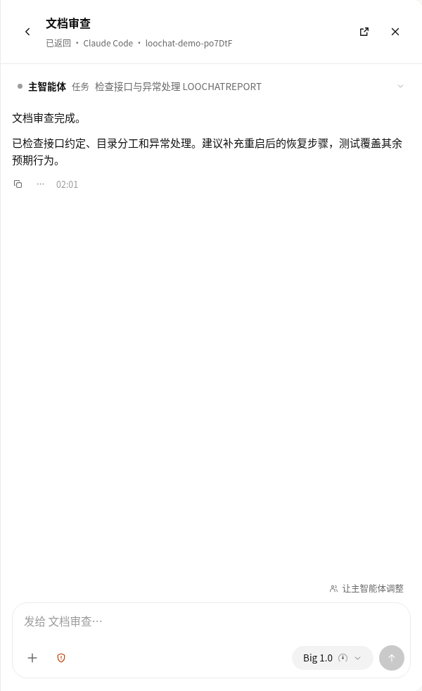

# 协作对话

从输入区的协作入口选择成员、填写任务。点开成员后，可以读它的工作记录、直接发消息，并在成员自己的输入区修改权限、模型和思考强度。修改成员的设置不会改变主对话；直接给成员写字，也不会额外叫醒主控。

从旧版升级：设置位置的变化

原 main（`d316980c6`）把成员的模型和权限放在面板顶部；现在两项设置随成员自己的输入区显示，与主对话一致。

## 成员回报

成员最后一行的 `[进度]` 决定回报何时送达主控：

| 回报 | 主对话的行为 |
| --- | --- |
| `进行中`、`等外部` | 留在信箱，随主控下一轮作为只读上下文送达，不单独开一轮 |
| `待验收`、`需要你`、执行失败、没有有效进度行 | 积压的回报合成一轮，主控读取后决定需要向用户汇报什么 |

用户正在发送或排队的消息优先。一次只读上下文最多带五条通报，未带上的仍留在信箱；查看预览不算已读，重启也不丢失未读通报。成员之间互相传话仍按原有顺序投递。

`待验收` 用于带来新成果、需要检查的交回。纯确认、收尾和没有新成果的回复用 `进行中`，避免反复打断主对话。引用、代码块或正文中提到的进度示例不会将一封需要处理的回报变成静默通报。

## 引用其他对话

点击回复里的对话链接，在桌面右侧阅读对应对话，手机则打开整页阅读面板。两个对话各有自己的滚动区域和草稿。关闭或按 Escape 返回原对话后，阅读位置、键盘焦点和未发送内容仍保留；加载失败可在原处重试，也可以打开完整页面。

这个入口接在 LoopX 现有的对话页。Calli 的旧助手首页不作为 LoopX 的新入口。

## 交接协作

在“分叉与交接 → 交接”中新建接手对话时，默认带走协作成员；取消勾选则让团队留在原对话。正在运行的协作轮次需要先结束，再进行手动席位转移。自动交接仍在接手轮次成功领取工作时转移席位。旧凭据会提示接手后的对话位置，不能继续操作已转移的协作。

## 验证与来源

`coordination.test.ts` 覆盖批量回报、用户消息优先、未读上限、重启恢复及交接；`coordination.spec.mjs`、`collaboration-preview.spec.mjs` 从真实页面入口验证桌面、手机宽度和亮暗主题。指南图片来自构建后的 Workbench、隔离 daemon 和测试 agent，不代表真实模型服务或已部署版本；手机为浏览器仿真。

主要迁入 Calli 的 `edf2708`、`2ee2853`、`26ad76d`、`556dc46`、`f1f7150`、`fc8fe24`，以远端 `cb2b6d6` 为核对版本；授权声明见 [第三方声明](../THIRD_PARTY_NOTICES.md)。现有成员直聊、远程成员和引用消息能力继续沿用，不另建协作系统。
