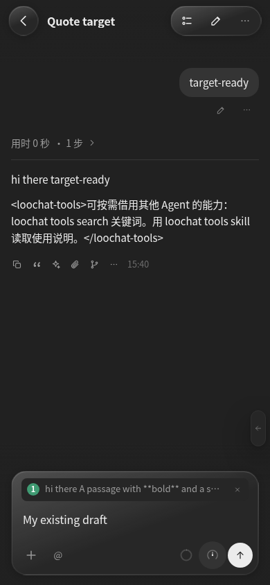
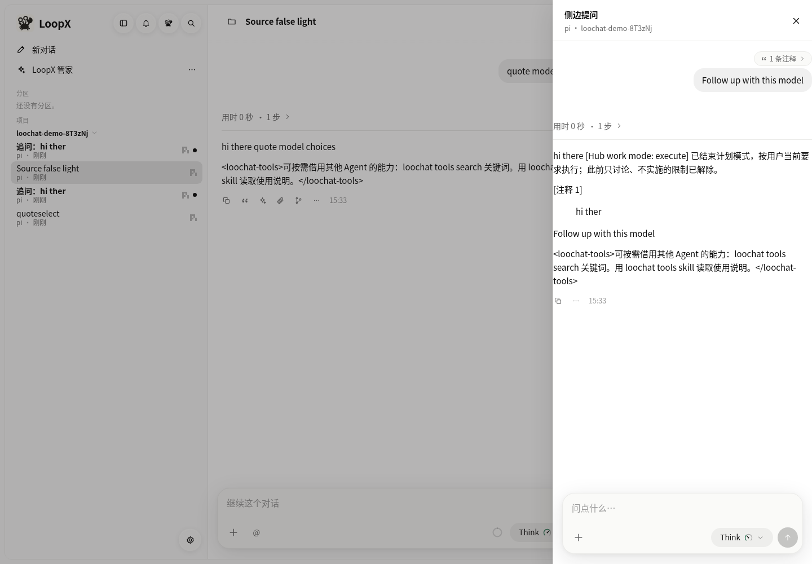

# 引用消息、会话与目录

消息下方的操作栏、更多菜单、桌面右键和手机长按提供复制、复制为引用、引用整条回复、交给助手、作为上下文和选择文字。选中的文字还可以加注释或在侧边栏追问。

## 复制与粘贴引用

「复制为引用」保留富文本和 Markdown 两种表示。在另一个会话的输入框中粘贴时，整段引用成为输入框上方的注释条，已有草稿保留；可继续添加评论或移除引用。外部应用复制来的整段 `>` 引用也可以识别，混合引用和正文仍按普通文本粘贴。

工作台复制的引用记录来源机器、会话和轮次。同一机器的另一会话附带 `loochat history THREAD --turn TURN` 来源说明；同一会话或其他机器只携带所选正文，不把另一台机器的标识当作本机历史读取权限。注释条沿用已有草稿、排队、撤回编辑和发送协议。刷新后重新打开该会话，引用和已输入的草稿一起恢复。

手机端粘贴后，引用留在输入框上方，正文继续编辑：

## 侧边追问

选择文字并打开侧边追问后，可以在发送前选择模型与思考档位。追问建立后，切换模型仍使用同一追问会话；切回某个模型时恢复记住的思考档位，源会话不受影响。模型目录的加载、失败和重试可见，附件入口遵循所选模型的图片能力。

模型控制位于追问输入框右下角，来源会话仍保留在背景：

## 作为上下文

输入框的 `@` 入口分成协作对象、会话和目录三个页签。消息上下文保存所选正文的快照；会话引用固定在选择时的历史范围，正文按需读取；目录引用不会切换会话工作目录。引用和编号注释分别保存，可以一起发送。

「交给助手」先把所选回复带入助手草稿，用户补充要求后再发送。取消或发送失败保留草稿，不修改来源会话。

## 验证范围

`pasted-quote.test.ts`、`copy-quote.test.ts` 和 `context-references.test.ts` 检查转换与协议。浏览器用例 `quote-paste.spec.mjs`、`quote.spec.mjs`、`context-references.spec.mjs`、`message-actions.spec.mjs` 覆盖粘贴、追问、上下文与菜单。以上截图来自构建后的界面、隔离服务和测试 agent，不代表已部署到日常使用环境。用例使用相同边界；粘贴事件为合成事件，不代表实体手机系统剪贴板已经验证。

迁入来源：Calli `b456a10`、`80eb16e`，以及本机 SideChat 的模型偏好和目录加载修正，授权声明见 [第三方声明](../THIRD_PARTY_NOTICES.md)。
