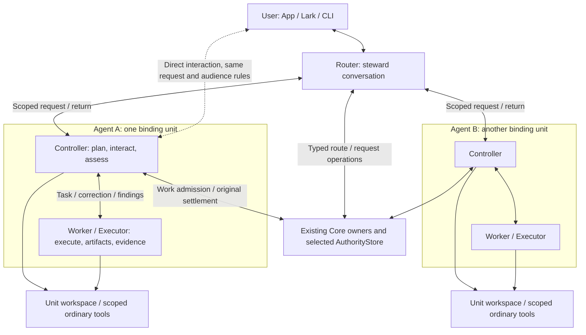
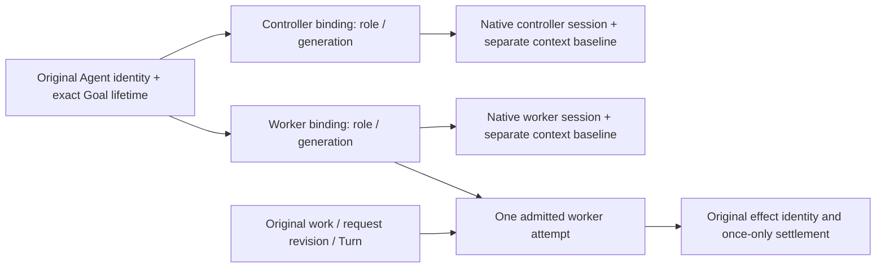
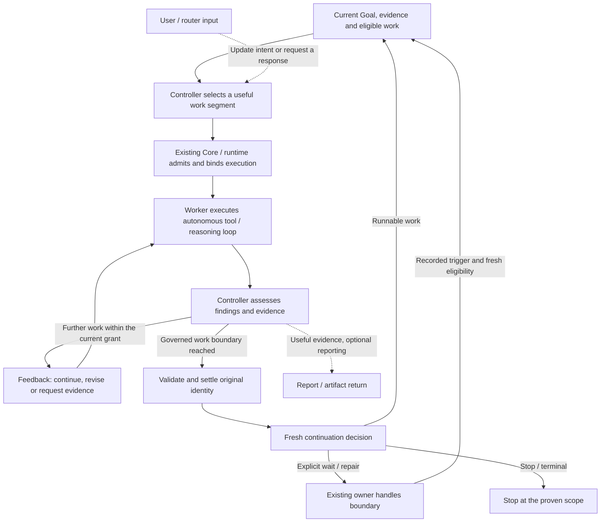
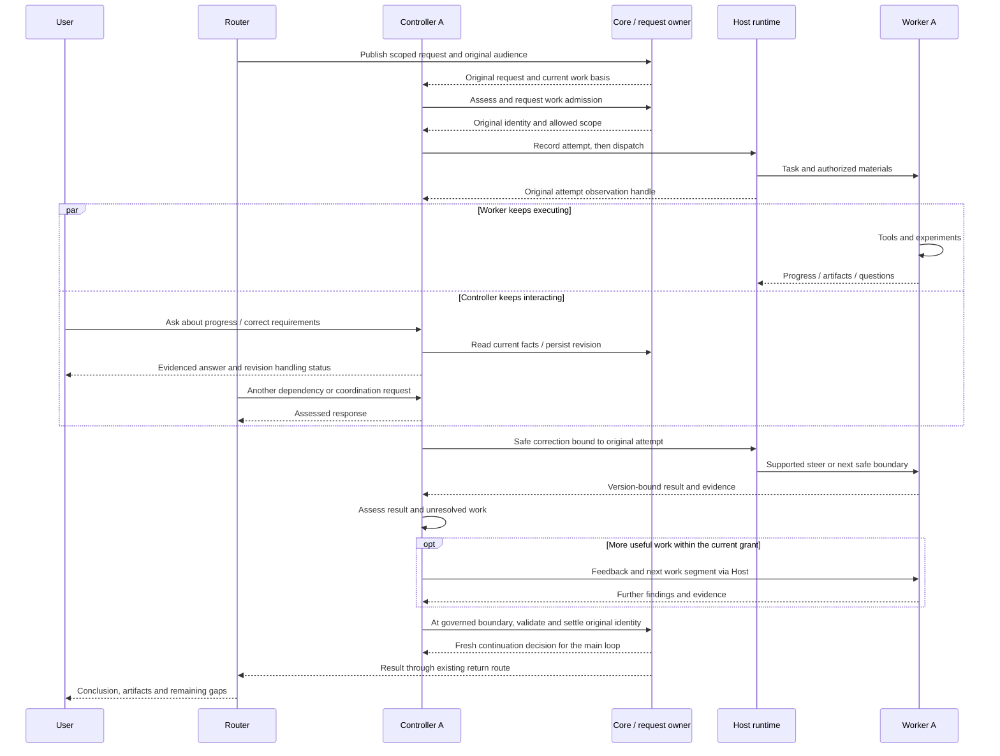
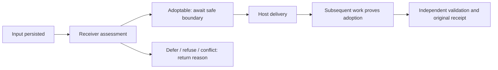
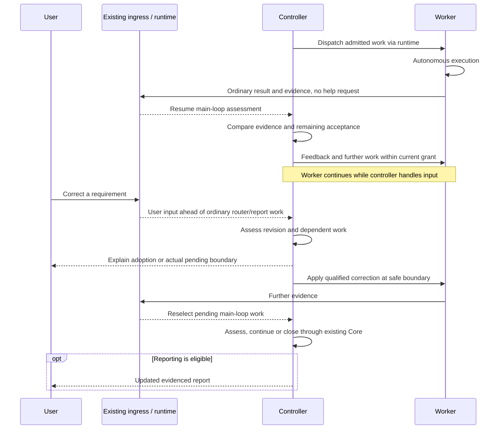
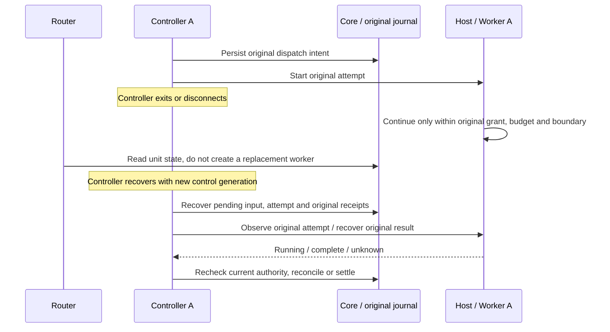
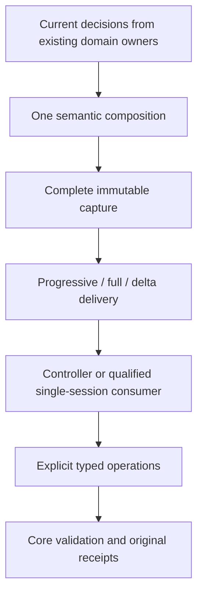
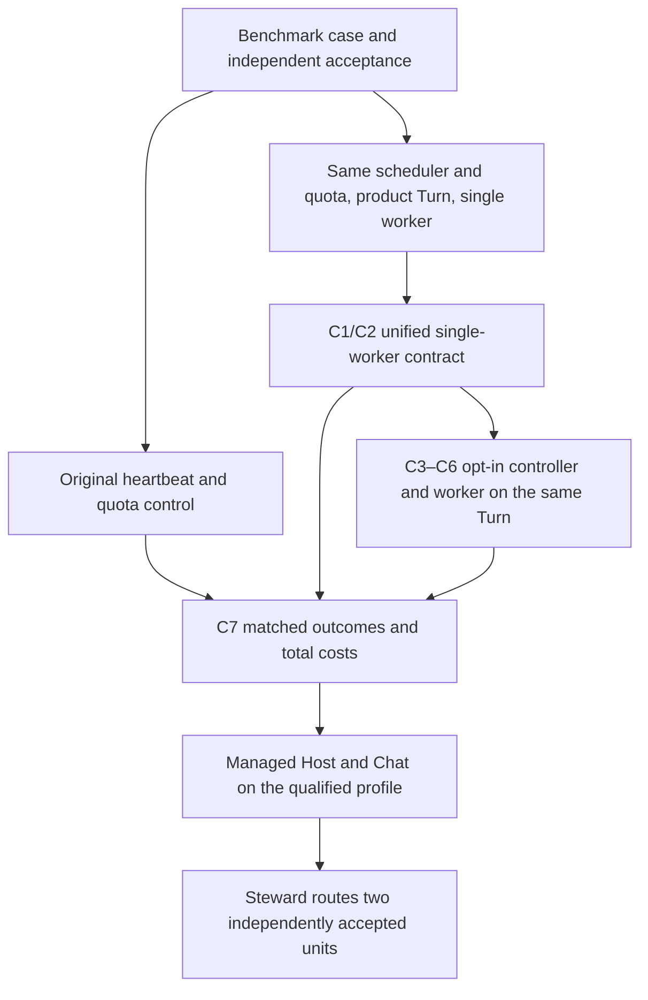

# RFC: Router–Controller–Worker Architecture and One Governed Work Contract (v0)

- **RFC status:** Accepted, existing contract. Router, binding-unit and session-discovery/shared-environment extensions are proposed.
- **Supersedes / closes:** none
- **Delivery maturity:** The single-worker EdgeBench entry is merged. #8484 qualifies a generic dual-role Turn on C1. Cross-admission continuity, multi-case benefit and conversation adoption remain open.
- **Authors / owners:** LoopX maintainers; control-plane and runtime owners
- **Created:** 2026-10-27
- **Last normative revision:** 2026-11-13
- **Source revisions:** main `9508f4de93`, C1 `9d283862e3`. Section 11 distinguishes implementation-PR evidence, original controls and open qualification.
- **Related contracts:** [Effect interpreter](agent-loop-effect-interpreter-v0.md), [Session execution modes](agent-session-execution-modes-v0.md), [Semantic handoff](capable-manager-semantic-handoff-v0.md), [Overall roadmap](loopx-overall-roadmap-v0.md)
- **Language mirror:** [中文版](controller-executor-unified-contract-v0.zh-CN.md)

## Document map and maintenance contract

**Target experience: a steward routes several Agents; each Agent continuously
closes the controller–worker loop of work selection, execution, evidence assessment
and feedback. Users can converse, correct and stop during that loop, and results
return along the original request.**
This is a long-horizon architecture choice to qualify, not a claim of universal
best practice.

| Reader question | Entry |
| --- | --- |
| Why split these roles, and what is missing? | Sections 1–4 and the [current source audit](#current-delivery-audit) |
| How do the three layers and one Agent identity fit? | [System diagram](#system-topology), [binding unit](#agent-binding-unit) |
| How does the controller inspect workers and read/write their environment? | [Session discovery and evidence](#worker-session-discovery), [shared workspace and tools](#shared-workspace-and-tools) |
| What keeps work advancing without another user message? | [Primary execution loop](#controller-worker-main-loop) |
| How do conversation, Stop and recovery work during execution? | [Asynchronous sequence](#asynchronous-control), [attention / preemption](#controller-attention-and-preemption), [failure isolation](#router-failure-recovery) |
| What gets delivered, validated and deleted? | [Dependencies and slices](#delivery-path-from-current-state), [product acceptance](#superagent-acceptance), sections 8–11 |
| Where are C1 field, context, wire and baseline details? | [Technical annex](controller-executor-unified-contract-v0/contract-and-context.md) |

English and Chinese are semantic mirrors. This main document owns current design;
the annex retains migration detail and dated ledgers retain historical evidence.
Original section anchors still reach the annex. Design acceptance, source presence,
packaged/installed qualification and measured benefit are distinct. This RFC creates
no runtime, changes no default and starts no experiment.

## 1. Decision summary

1. Converge quota execution packets and TurnEnvelope into **one versioned
   governed work contract**: one schema, one semantic producer, one capture,
   one delivery/recovery mechanism and one settlement identity. Different hosts
   carry that same contract; permanent quota/Turn compatibility views are not
   the target. Combine quota packet's decision-necessary information with
   TurnEnvelope's delivery efficiency; replace both and qualify the net change
   against the original quota-packet path. Existing domain owners still decide
   their own facts.
2. In the optional two-session profile, the **controller model session is the
   unit’s only model client for work control and settlement, and its intelligent mediator**.
   It reads the contract, reasons about work,
   talks to the executor and submits explicit typed Core operations. Core owns
   legal transitions and receipts; the controller is not a second authority.
   It can also read/write project files and use ordinary host tools in the same
   working environment as the worker, within current authorization.
3. The executor receives a natural-language task conversation, original source
   material and ordinary host tools. It returns findings, artifacts, evidence
   and questions. It neither consumes a second Core packet view nor authors
   quota, Vision, lease or settlement fields. A small machine carrier records
   routing and causality outside the task prose. The controller can discover
   and inspect its unit's worker sessions and work evidence on demand. Current
   activity comes from host observations; historical indexes add history only.
4. Save complete context, then compose two independent delivery layers:
   **Progressive by default across hosts**, and **Delta automatically only on
   qualified hosts**. Keep unread material discoverable from the current capture.
   Controller and executor have separate continuity evidence and cannot borrow
   each other's baseline. Full recovery remains available.
5. Unify quota, public Turn and benchmark heartbeat first. Compare single worker
   with standard heartbeat and opt into two roles on the same Turn provider.
   Qualify outcomes and full costs under §11 before Managed Host, Chat and Steward adoption.
6. The controller–worker execution loop is primary: assess ordinary results as
   well as blockers, give feedback and continue useful admitted work without a
   new user prompt. While the executor works, the controller also answers users,
   incorporates corrections and presents useful artifacts. Reporting is a side
   activity, not the loop's default destination. Qualify both through C6/C8.
7. Make the steward the **router**: use existing semantic requests to coordinate
   several controller + worker binding units. Each retains one Agent identity;
   the router may use authorized request/route operations but cannot settle the
   receiver's work. Deliver one asynchronous unit before adopting the existing
   multi-recipient chain.

## 2. Problem and motivation

A task can enter through App heartbeat, an external worker or `loopx turn`, yet
its context and result obligations are presented differently. Shared decision
facts already exist, but callers still choose packet formats, reconstruct
prompts and adapt model-authored bookkeeping. Adding another controller-specific
packet would multiply these paths.

For example, an executor asked to repair a failing export needs the original
requirements, the failure, permitted workspace and independent acceptance. It
does not need to learn how to encode a Vision delta or debit a LoopX Turn.
Separating that work may reduce distraction and repeated protocol input, but
an extra controller can also lose constraints, add latency or over-coordinate.
These are hypotheses to test, not benefits established by session separation.

Long work also needs a continuing human conversation. The user should be able
to understand progress, inspect results and correct direction while execution
continues, without repeatedly asking for status. A controller that only forwards
a final answer misses this product goal. Its reports and presentations must
help the user judge the work, and feedback must reach actual later decisions
and artifacts. Availability, a received message or an attractive preview alone
does not establish that loop.

### Invariants

- Preserve complete accepted requirements, revisions, authority, unresolved
  reads and evidence provenance; a shorter prompt is not permission to omit them.
- Exactly one current control owner and one admitted executor attempt for the
  selected work. Dialogue, routing ACKs and model completion are not receipts.
- Notifications do not govern execution. A quiet notification result cannot
  cancel admitted work; a message cannot override a genuine stop or budget gate.
- A governed Turn is a bounded work/settlement unit, not a wake, model response
  or controller/executor exchange. Do not charge a new Turn for each message.
- Preserve original identity through retry, source correction and closeout;
  never settle an old result against a newly selected Todo.

## 3. Scope and non-goals

In scope: contract convergence, context delivery, role-specific session binding,
controller/executor communication, shared lifecycle reuse, host adapters,
benchmark adoption, retirement and observable product acceptance.

Non-goals: a new Goal store, workflow DSL, generic effect executor, permission
engine, scheduler, mandatory two-session execution, unlimited team hierarchies,
automatic host switching or changes to benchmark scoring. Peer teams retain existing delegation/acceptance contracts.
This proposal does not move business reasoning into deterministic Core rules.

## 4. Current-system contract

| Existing concept | Actual role / source | Consequence for the target |
| --- | --- | --- |
| Quota packet / TurnEnvelope | [`quota.py`](../../../loopx/cli_commands/quota.py) projects a decided payload through separate ordinary/envelope branches; [`turn_envelope.ts`](../../../loopx/control_plane/quota/turn_envelope.ts) supplies bounded sections and action binding | Migrate both sets of obligations into one schema, then retire both old output paths |
| Work context | [`interaction_contract.ts`](../../../loopx/control_plane/work_items/interaction_contract.ts) carries typed execution/context requirements | Extend the existing owner; do not create a controller decision engine |
| Thin heartbeat | [`task_body.py`](../../../loopx/control_plane/heartbeat/task_body.py) renders product entry instructions with format-dependent branches | Keep the bootstrap/host entry; converge its consumed contract |
| `loopx turn` | [`turn.py`](../../../loopx/cli_commands/turn.py), [`executor.py`](../../../loopx/control_plane/turn_driver/executor.py), [`settlement.py`](../../../loopx/control_plane/turn_driver/settlement.py) implement governed invocation and receipt-bound closeout | Reuse the lifecycle; a CLI entry is not another product runtime |
| Managed Codex | [`codex_agent_session.py`](../../../loopx/control_plane/turn_driver/codex_agent_session.py) and [`codex_sessions.py`](../../../loopx/control_plane/turn_driver/codex_sessions.py) implement native session execution/resume | Runtime adapter, not a competing control plane; current Agent-scoped storage lacks the proposed role distinction |
| Executor result | [`codex_cli.py`](../../../loopx/control_plane/turn_driver/codex_cli.py) asks for a schema-constrained result including delivery and Vision/progress fields | Move Core authoring responsibility to the controller in the two-session profile; preserve validation |
| External worker | [`external_scheduler_worker.py`](../../../scripts/external_scheduler_worker.py) owns outer wake/command transport | Preserve that ownership; remove duplicate semantic orchestration where demonstrated |
| Benchmark runner | [`worker.py`](../../../benchmark/runtime/worker.py) uses the product thin body for heartbeat and public Turn CLI for Turn mode; [`sessions.py`](../../../benchmark/runtime/sessions.py) reuses the native session adapter | Evaluation harness around product profiles, not a separate implementation target |
| Turn Loop Controller | [Stable protocol](../../reference/protocols/turn-loop-controller-v0.md) defines a pure disposition function | Keep it deterministic; it is not the proposed controller model session |

Execution mode (`managed_runtime` / `attached_host`), runtime provider, wake
source, single/two-session organization and evaluation arm are independent
axes. Not every combination is supported. Native/plain benchmark controls may
intentionally have no LoopX Core and must remain uncontaminated controls.

### Current delivery audit

The 2026-11-10 audit is pinned to main `ab1406611809dc7707028a7f257f9717040bad2c`.
A mechanism present in source establishes an implementation boundary, not a
qualified dual-session journey or benefit.

| Capability | Source fact / in-flight work | Design consequence |
| --- | --- | --- |
| Steward requests to several Agents and returns | [`manager_context`](../../../loopx/capabilities/manager_context/README.md) supports several recipients; [`semantic_request.ts`](../../../loopx/control_plane/collaboration/semantic_request.ts) retains exact recipients and original-conversation returns | Router adopts that request chain with per-recipient success/refusal; no routing task store |
| Recipient identity and route | [`peer_route_selection.ts`](../../../loopx/control_plane/collaboration/peer_route_selection.ts) reports multiple candidates as ambiguous, not unknown as retired | Separate unit discovery from execution admission; integrate role mapping into current binding instead of bypassing ambiguity by choosing another native thread |
| Request revisions and asynchronous input | [`request_control.ts`](../../../loopx/control_plane/collaboration/request_control.ts) owns revision/assessment/reservation; [`chat_queue_steering.ts`](../../../loopx/control_plane/turn_driver/chat_queue_steering.ts) persists reservations and uncertain delivery | Reuse mechanisms, but current queued steering explicitly excludes some collaboration/LoopX execution inputs and native live steer is text-only; dual-role correction is not delivered |
| Original-audience return | [`return_delivery.ts`](../../../loopx/control_plane/collaboration/return_delivery.ts) distinguishes a provider write without a locator from no write | Router synthesis must not rerun tasks to repair delivery; delivery is not requester adoption |
| Shared managed operations | Codex/DSH both call [`managed_operation_host.py`](../../../loopx/control_plane/turn_driver/managed_operation_host.py) and `select_managed_operation_session` | C3.1's generic-handler extraction already exists; reuse it and audit remaining callers instead of repeating the project |
| Two-role binding | [`codex_sessions.py`](../../../loopx/control_plane/turn_driver/codex_sessions.py) stores sessions by Goal/Agent/Todo or Agent scope, without this proposed controller/worker pair | C3 needs roles/generations, independent queues and continuity within one Agent; two thread IDs alone are insufficient |
| Unified work contract | [#7430](https://github.com/loopx-project/loopx/pull/7430) merged and was reverted by [#8265](https://github.com/loopx-project/loopx/pull/8265). [#8266](https://github.com/loopx-project/loopx/pull/8266) carries the C1 replacement. [#8238](https://github.com/loopx-project/loopx/pull/8238) and [#8323](https://github.com/loopx-project/loopx/pull/8323) landed individual settlement-read and narrative-read improvements. [#8304](https://github.com/loopx-project/loopx/pull/8304) landed the staged replan path. [#8499](https://github.com/loopx-project/loopx/pull/8499) delivers the single-worker EdgeBench entry and original-wake recovery independently of the C1 writer cutover. | Keep moving useful fixes into main. Qualify the replacement against original single-session quota before profile cutover. Earlier transport or writeback measurements remain scoped to their measured path. |
| Common Host transport | [#7568](https://github.com/loopx-project/loopx/pull/7568) remains Draft, inspected at `e3a3c06524fae99519a72d751a16a5e8dd6f9a5d` | A candidate adapter; bounded calls do not establish bidirectional long-lived sessions/asynchronous control. OAR or an all-Host rewrite is not a prerequisite |

The benchmark integration on C1 `853eb8f56c1a` exercised planned task entry, quota admission and two independently validated Turn settlements on isolated SQLite. Native Codex used a scripted model endpoint. The Host received the v1 work contract. The raw quota compatibility view identifies its signed capture by hash. These checks cover dispatch and recovery. A matched trial with the native judge is still needed to compare outcomes and cost.

The annex below retains older field audits and experiments at their original
revisions. Historical Draft/test records do not replace this status, and this
audit does not relabel earlier evidence. Recheck live PRs and tasks before claiming
implementation.

### C1 source audit: shared owners and the remaining split

The complete field, consumer and qualification detail is in [the contract and context annex](controller-executor-unified-contract-v0/contract-and-context.md#c1-source-audit-shared-owners-and-the-remaining-split).

## 5. Proposed architecture

### Router, controller and worker: three user-facing responsibilities

**The router is the steward's cross-Agent coordination role; controller + worker
form one logical Agent binding unit.** Worker is the product term for this RFC's
executor, not another role, protocol or registered entity. A unit retains its
Agent identity, Goal ownership, work and budget while using two role sessions.
Several units may serve one Goal or collaborate across authorized Goals. The
steward's ordinary conversation needs no synthetic Goal and is not forced into
two sessions by this design.

Every request edge goes through existing runtime and authorization checks; it is
not permission for arbitrary model-to-model messaging. The router aggregates only
authorized returns, not every unit's private conversation. Cross-unit work reuses
[semantic handoff](capable-manager-semantic-handoff-v0.md), without a privileged
management tree.

| Role / owner | Decisions and behavior it owns | Responsibilities it does not own |
| --- | --- | --- |
| Router / steward | Understand intent, discover context-affine capable units, propose reuse/creation, pass revisions, synthesize results and cross-task tradeoffs | Micromanage worker tools, claim/accept for receivers, copy Goal task stores or budgets |
| Controller / within a unit | Select work from Goal, planning horizon and evidence; maintain continuity, discover/inspect worker sessions, read/write and validate in the shared environment, interact with user/router, assess correction and acceptance, call Core | Become another authority or replace durable work with chat notes; approve every local tool step |
| Worker / within a unit | Autonomously use tools, experiment, produce artifacts and report evidence/questions within admitted scope | Consume Core packets, author settlement or directly hold Core write access |
| Core + managed execution + Host adapter | Existing typed rules, persistence, identity, dispatch, observation, stop and recovery | Infer authority/completion from prose or choose domain solutions for the model |

The router may answer simple questions from sufficient existing evidence without
creating a unit. Prefer reuse of an Agent whose current context and authority fit;
new Agents still follow existing lifecycle and resource admission. Resolve
ambiguous bindings rather than taking over by title similarity or recent presence.
A router's priority is a request: the controller assesses local commitments and
dependencies, returns adoption, deferral or refusal with reasons, and Core applies
legal changes.

### One Agent identity, two independent sessions

This is a binding relationship, not a new `AgentUnit` state store. Extend the
existing session owner for roles, generations and native-session mapping; work
identity, request revisions and receipts remain with their owners. Reconstructing
a native session does not create a new logical Agent or task. Restarting or
changing models cannot borrow the other role's context baseline.

The first profile has one active controller consumer and at most one current
worker attempt per unit. Units may run concurrently. Future internal parallel
subtasks must use existing independent delegation/claim contracts, never duplicate
the same attempt. A governed Turn is not a native model turn: three controller
messages do not debit three business Turns, but all three model calls count in
costs. Do not copy the team's resource allowance to every unit; the router adds
no budget ledger.

### Controller discovery of worker sessions and evidence

The controller should have discovery comparable to [Obelisk session-evidence
retrieval](obelisk-session-evidence-provider-v0.md): identify its unit's worker
sessions, locate the session bound to current work, and inspect the authorized
work history on demand. Waiting only for a worker's summary is insufficient for
investigating failures, locating artifacts or recovering the original attempt.
This is a delivery requirement, not a claim of complete support in current hosts.

- **Locate before reading.** Reuse existing session/binding, request/attempt and
  host-observation owners. Discover the role, native session, generation, original
  request revision/Turn/attempt, actual provider/model and workspace under the
  exact Goal lifetime/Agent, plus running/stopped/failed facts the host actually
  observed. Expose provenance, observation time, coverage and continuation reads.
  Multiple bindings, missing and unreadable records remain explicit uncertainty;
  registration, names or recent timestamps cannot identify the current executor
  or certify execution readiness.
- **Inspect scoped work.** Locate authorized messages, tool calls/results,
  failures, artifacts and original-source references by work, session and event;
  read necessary context and subsequent pages. Preserve authorship, order and
  versions. A summary is not the full source, and zero hits do not mean no work.
  Raw internal reasoning, unrelated sessions and another audience's private
  content remain inaccessible. Discovery grants no resume, steer, interrupt,
  write or takeover authority.
- **Separate current facts from historical recall.** Active attempts and fresh
  state come from current host/Core owners. Optional providers such as Obelisk
  add indexed historical evidence only within their independently authorized
  scope. Retain default-off, same-Agent/project and source-access rules; a role
  binding does not inherit archive access. Missing providers, stale indexes,
  revoked sources, timeouts and zero hits expose coverage gaps. Basic session
  discovery and authorized work must not wait for historical indexing. This
  document neither installs/starts indexing nor creates a parallel session store.

Use bounded indexes, on-demand bodies and existing event continuation. Account
for scans, index maintenance, rereads, model input and latency; do not scan all
history every Turn or inject duplicate transcripts into both sessions. Retrieval
does not establish cost savings by itself.

### Ordinary read/write tools in one working environment

Controller and worker should access **the same authorized working environment**:
project/workspace, verifiable source revision, toolchain/dependencies, task
resources and artifact namespace. The controller also has scoped filesystem
read/write, search, test and ordinary process tools. It can inspect original
artifacts, validate a problem and perform bounded local work directly. Sharing
an environment does not merge native contexts, queues or continuity baselines.

The host binds the actual cwd/worktree, versions, tools and read/write scope to
the unit. Authorized controller writes must be readable by the worker; worker
artifacts must be readable by the controller at their original version. Path
aliases, containers and remote hosts must prove equivalent authorized resource
and dependency mappings. Report unsupported arrangements explicitly, without
silently choosing another checkout, copying stale artifacts or treating a remote
environment as local.

Ordinary tool sharing retains role permissions: the controller calls existing
typed Core owners, while Core credentials and write entrypoints remain isolated
from the worker. Each uses its authorized tools/credential broker, without
copying all environment variables or credentials, changing authentication,
providers or connection mode, or bypassing protected-operation confirmation.
The host enforces read-only grants, revocation, path and audience boundaries at
the actual call; sharing an environment does not expand authority.

Read/write tools do not create another uncoordinated writer. The controller can
inspect an active worker and perform non-conflicting operations permitted by
authority and work ownership. Overlapping file, process or effect changes use
existing claim/lease, request-revision and safe-boundary coordination. Before
taking over the same business execution, observe and reconcile the original
attempt, complete any required yielding/stopping and ownership handoff, then
write. A message ACK is not process termination. Never overwrite uncommitted
worker changes, launch duplicate work or create another settlement. Account for
all ordinary tools and recovery in the combined cost.

### The primary loop: select, execute, assess, feed back and continue

**The controller is an active work partner, not only a help desk for a blocked
worker or a reporting session.** An ordinary result, negative evidence or a
ready continuation is work for the controller even when nobody sends a message.

The arrows describe decisions, not one mandatory model call, new attempt or
quota debit per arrow. Keep three existing boundaries distinct:

| Loop | Who decides what | Boundary |
| --- | --- | --- |
| Worker reasoning ↔ tools | Worker chooses local methods within its task | No controller approval for each tool call; escalate material findings, questions or scope limits |
| Controller ↔ worker | Controller compares evidence with the Goal, supplies feedback and selects the next useful segment | May span several exchanges within admitted work; feedback alone neither settles a Turn nor grants a new attempt |
| Governed continuation across Turns | Existing Core/runtime validates original settlement and fresh admission | The model proposes work; the existing [Turn loop transition owner](../../reference/protocols/turn-loop-controller-v0.md) still decides legal continuation, waits and stops |

Assessment is substantive: inspect evidence and unresolved acceptance, then
continue the sound approach, correct it, request missing evidence or close the
work. Do not rubber-stamp the worker's claim or force a strategy change merely
to show activity. At a governed work boundary, validate and settle the original
identity; use fresh admission for a subsequent Turn. Completing a segment, a Todo,
a native model turn or a report does not by itself close the Goal. A genuine
dependency, user-action, budget, stop or terminal condition remains effective;
otherwise useful authorized work must not wait for the user to say “continue”.

This logical loop is event-driven, not a blocking wait that occupies the
controller session. Persist dispatch, observations, pending assessment and
continuation through their existing owners. The host/runtime resumes eligible
processing after a result or recorded wake; it does not keep a model polling.
On recovery, reconcile the original attempt and unfinished decision/effect before
continuing, without dispatching another worker merely to restart the loop.

After handling a user/router input, **reselect from the current main-loop work**:
an unevaluated result, owed feedback, eligible dispatch or settlement may be next.
Do not blindly resume an old report. Reporting uses evidenced state in bounded
opportunities while execution proceeds or the loop genuinely waits; it neither
holds the main loop hostage nor becomes a requirement after every exchange.

### Asynchronous control while the worker executes

Asynchronous means **the worker's long operation does not occupy the controller's
processing loop**, not concurrent conflicting decisions in one controller session.
Persist the original attempt before dispatch and return a recoverable observation
handle. Do not wait for the entire worker task while holding session or work locks.
User input, router requests and worker events wake bounded controller processing
through existing ordered ingress; commit decisions serially per unit. Host waits
or subscriptions may remain active without model polling. An adapter that blocks
until the entire task ends is unsupported for this asynchronous profile; a frontend
that merely accepts messages does not qualify controller interaction.

User and router inputs share the unit's durable ordered ingress and one control
writer. Processing order follows the attention and causality rules below, rather
than an unconditional FIFO queue; there are not two controllers. Invoke the model
when a question needs semantic interpretation; existing status can be shown directly through typed readback.
Worker events reach existing observation/journal ownership before triggering
processing. Recover disconnection by cursor and state reconciliation, not a one-shot
in-memory callback. Deduplicate by work identity; coalesce progress, but never
silently drop pending cancellation, revisions, results or errors. A full queue
returns readable deferral/unavailability and recovery. Reuse scheduler/ingress
limits and waits, qualifying capacity per host instead of creating a message bus.

| Input | May current work continue? | Handling and readback |
| --- | --- | --- |
| Query / artifact inspection | Yes; it does not mutate the attempt | Return recently evidenced state, revision and unknowns; questions do not redispatch work |
| In-scope correction | At the actual safe consumption boundary | Persist revision; observe adoption after supported steer; otherwise queue for the next boundary and say so |
| Scope / acceptance change / conflicting requirements | Recheck work that depends on the change | Bind expected revision and use the original owner; neither last-message-wins nor router priority overrides a conflict |
| Stop / revocation | Enter existing stop handling immediately | Do not wait for the controller model or ordinary progress reports; distinguish recorded request, Host interruption and actual stop, reconciling unknown effects |
| Worker result / late event | Assessment resumes the main loop, not unconditional new execution | Check original request, attempt, generation and revision; evaluate evidence, feed back or validate/settle at the work boundary, then use fresh admission for the next Turn; late evidence cannot complete another task |

These are evidence stages, not another registered state enum. Map them to existing
request assessment, ingress, Host observation, validation and settlement facts.
**Received is not adopted; delivered is not executed; executed is not accepted.**
The same revision sent directly or relayed by the router shares its original
request/idempotency identity. Genuinely different requests retain their identities
and coordinate through explicit version dependencies, not text deduplication.
There is no implicit global message order across units.

### Controller attention: user intent first, interruption at safe boundaries

**Default attention order: current user interaction → ready controller–worker
main-loop work → ordinary router coordination → unsolicited reporting.** This is
selection within a unit's existing ingress, not a new global task scheduler or a
license to override authority. Keep three questions separate: whose intent governs,
which eligible input needs attention next, and which current operation can yield.
A higher-priority message does not automatically cancel a worker or a tool call.

| Input / need | Attention policy | Boundary |
| --- | --- | --- |
| Authorized Stop, revocation or an enforced budget/fence | Existing deterministic control path runs independently of ordinary model work | Record and interrupt/reconcile through the current owner; never wait behind report generation or for a model to infer Stop |
| Current user instruction, correction or question | Foreground; address before autonomous coordination and reporting | A status question is not a direction change. A user-requested report is foreground work, unlike an unsolicited report |
| Main-loop dispatch, result assessment, feedback, continuation and settlement | Next; blocking worker exchanges take precedence within this work and may interrupt background composition | Ordinary results need assessment even without a help request. Routine progress/logs need no model wake unless they change a decision. Escalate required user approval without inventing it |
| Router's autonomous coordination and nonblocking worker information | Serve after foreground and ready main-loop work, with bounded deferral | A verified relay of an original user request retains its origin and dependency; it is not demoted merely for passing through the router |
| Unsolicited reports and optional housekeeping | Coalesce and run opportunistically in bounded slices | Refresh against current facts after interruption; do not send every obsolete draft |

Explicit, applicable user intent governs conflicts with autonomous worker/router
plans, within current authority and scope. Preserve older compatible requirements;
a recent question does not supersede them. Rank using authenticated origin, original
request/revision, current dependency and actual blocked state, never a sender's
self-declared urgency or words such as “urgent” in source text. Unclassified input
gets bounded assessment rather than a guessed permission change or silent drop.

A required dependency may temporarily inherit the waiting foreground request's
attention: if answering the user requires resolving a worker question, resolve that
question first as part of serving the user. Record the existing request/dependency
link and keep the inherited work bounded to that unblock; it gains no new authority
and does not promote the worker's entire backlog. Apply the same rule to a necessary
router dependency. Discover a cycle or missing permission as a blocker, not an
excuse for endlessly escalating priorities.

**Ordered ingress is not one global FIFO processing order.** Persist arrival and
revision history unchanged; select among causally eligible pending inputs. Retain
FIFO for equal attention and preserve per-request revision dependencies. A newer
correction can invalidate an old draft, but its predecessor is recorded as
superseded through the existing owner, not erased. A cancellation can invalidate
pending dispatch immediately without first executing every earlier queued request.
One controller commits decisions; priority never creates a second control writer.

Preemption has three concrete forms:

1. **Queued work:** select the higher-priority eligible input before starting an
   unsent report. Keep original arrival/handling facts for recovery and readback.
2. **Pure drafting / model reasoning:** yield cooperatively at a supported native
   turn/tool boundary, or interrupt a cancellable model call. Retain a brief and
   required evidence, not an assumed resumable model stack. Fence the old invocation
   before another controls the same session; late output/tool proposals cannot
   publish or mutate state. Recompose the report against current facts on resume.
3. **An admitted tool/effect or atomic commit:** do not tear it down or infer rollback
   from model interruption. Accept new input promptly; finish/recover the original
   transaction or use its supported cancellation. Hold only dependent new effects
   when an applicable change is pending; independent admitted work retains its
   scope. Revalidate current revisions before subsequent dispatch/publication.

“Interrupt reporting” therefore normally means interrupting the controller's
composition, **not restarting or cancelling the business worker**. If a report send
already happened or its delivery is uncertain, recover that original send before
retrying; do not retract facts already observed or label a partial stream complete.
Update visibly stale delivered material through the existing version/return owner.
A Host without reliable interruption must bound controller slices and expose the
actual wait; do not start concurrent calls in the same native controller session
or claim prompt responsiveness for an uninterruptible long report.

Prevent both starvation and interruption storms. Batch compatible user corrections
without losing their individual identities; coalesce supersedable progress, but
retain questions, errors, results and settlement/recovery obligations. Bound each
foreground service slice and reserve service opportunities for still-valid
main-loop work and owed returns; ageing can advance those obligations without overriding
Stop, explicit cancellation or intent. Optional stale reports can be superseded.
If arrivals exceed capacity, show backpressure/deferred work and the actual blocker
instead of promising an impossible latency bound. Do not repeatedly abort an
in-flight foreground response for every keystroke, or ask the user to tune priority
numbers. Existing quota/stop rules still bound the work and all wasted/interrupted
model calls count in complete cost.

For the MVP, qualify the autonomous main loop, stable selection and yielding
**background composition** on one real Host; do not build arbitrary preemptive tool scheduling. Extend existing
ingress/request/session facts only where the above origin, dependency and invocation
fences are absent. The typed owner selects admissible input and protects commits;
the controller assesses meaning. App/CLI and supported Lark readback distinguish
input received, handling, deferred/blocked and actual adoption without exposing a
priority console. This policy belongs to the optional unit profile; do not silently
reorder current single-session chat queues. C3/C6/C8 own implementation and the
attention acceptance below; a prose prompt alone does not implement the policy.

### Failure isolation: losing a session does not lose the work

An unavailable router does not stop admitted units just because their aggregate
return channel is down. Direct interaction retains original audience limits.
Without a controller, the worker may continue only its originally authorized,
bounded work; new approval, scope change or dispatch waits for recovery. A
replacement controller fences the old control generation without automatically
rerunning a still-valid worker attempt as an orphan. Unknown external effects
remain unknown; a timeout does not prove safe retry. Core/Host stop and budget
limits do not depend on either model being online.

Multi-recipient requests are not cross-Goal atomic transactions. If A adopts and B
refuses, the router presents partial results and assesses another request,
dependency revision or a needed user decision; it does not erase A's actual
effects. Cross-unit artifacts retain version, provenance, permission and
independent acceptance without broadcasting full private context. Rebinding or
profile rollback first closes new admission, reconciles/stops the original attempt
and pending effects, then continues with a newly qualified binding.

### Ownership and one contract

Use the existing TypeScript interaction/work-context and effect owners. The
composition owner captures their current facts once; it does not reimplement
quota, replan, Todo or lease decisions. Python may collect sources and adapt
native transport. Host-specific execution ownership remains explicit in the
same contract, including delegated scheduler effects and their ACK obligations.

The schema name and exact field migration require the task C1 inventory below.
The following are required semantic groups, **not additional nested protocols**:

| Group | Preserved capabilities |
| --- | --- |
| Identity and current decision | Contract version, capture/revision, Goal/Agent/work/Turn binding, selected action, admission, claim/lease, scope, approvals, cancellation and stop conditions |
| Complete work context | Original intent and requirements, unresolved obligations, accepted evidence, current sources/revisions, required-read completion and authorized detail access |
| Context delivery | Full/delta encoding, exact base/target digests, consumer session/role/epoch and immutable capture recovery |
| Operations and closeout | Available typed operations, action binding/integrity, conditional ordering, validation and writeback/debit identity, scheduler and notification ownership |

There is one semantic instance and one schema across CLI, heartbeat, managed
Turn and evaluation. Full versus delta is an encoding choice for that instance;
pagination is a transport limit. Neither creates a quota schema and a Turn
schema. Native tool wrappers may carry provider-required envelopes without
renaming, omitting or independently deciding contract fields. Human UI read
models remain presentation sinks, not alternate executable contracts.

The composition boundary is **after current domain decisions and host-operation
binding, before immutable capture and context encoding**. All live writers use
that boundary. They must not first compact a quota packet into an envelope and
then label the result the complete unified contract. Required source material
may use authorized detail references, but those references, revisions and read
obligations must be complete and recoverable from that same semantic capture.

“One capture” means one immutable semantic observation for an invocation, not
one file for every purpose. Keep the complete canonical instance, encoded
full/delta/page artifacts and the Turn journal's binding distinguishable. Exact
file-byte digests protect transport; canonical hashes protect semantic content;
the existing effect identity protects once-only settlement. None substitutes
for another or grants current authority. Reserve an identity/location before
serialization when recovery references need it; do not require a document to
contain the digest of its own final bytes. Encoding, pagination, native resume
and recovery derive from the saved instance without another guard. A legitimate
new selection or authority check may produce a new capture; it must not rewrite
an earlier observation or silently rebind an outstanding result.

### Controller intelligence and semantic compression

The controller session itself supplies intelligence. Its architectural role is
to turn the control plane's complete facts and obligations into useful work for
the executor, and interpret the executor's findings back into justified Core
operations. “Intelligent compressor” describes this mediation of control work;
fewer queries or shorter text alone do not implement it. The existing summary
already assigns reading, reasoning and typed operations to the controller. The
additional design choice here is **where decisions and attention are spent**:

| Decision | Controller responsibility | Retained boundary |
| --- | --- | --- |
| What to do next | Compare the current Goal gap, evidence, viable work and complete costs; continue a useful route or change it when warranted | Core still decides legal admission, claims, leases, budgets and transitions; controller judgment grants no authority |
| What to delegate together | Choose a coherent, verifiable task and decide which control concerns to absorb itself | The executor keeps local tool/step choice within scope; it does not request approval for each tool call or author Core bookkeeping |
| What the executor must know | Deliver the task's full constraints, relevant contrary evidence, original materials and unresolved reads; explain the decision in task language | A summary is not an alternate contract or proof of source reading. Unknown relevance requires more material before dependent work |
| What a result changes | Distinguish a finding, verified artifact, blocked attempt and accepted outcome; decide whether to continue, investigate or replan | Independent validation and current Core receipts, rather than either session's narrative, determine acceptance and settlement |

Keep three operations separate. The deterministic composition owner combines
domain facts without inventing policy; the existing codec encodes an exactly
recoverable full/delta input; the controller performs task-dependent semantic
selection and reasoning. A natural-language task can omit irrelevant control
syntax and cannot promise bit-for-bit equivalence. Its adequacy is tested by
preserved constraints, actual executor decisions and accepted outcomes, with
the original authorized material reachable. Do not replace these operations
with a second schema, model-authored state store or keyword-based relevance
classifier. Controller notes are working context, not a new durable authority.

For example, after an export repair produces a valid artifact but a packaging
check fails, the controller can keep the useful repair, delegate the evidenced
packaging correction and retain the original unsettled identity. It must not
reduce the result to “done”, discard the failed check or ask the executor to
learn writeback syntax. If the same evidence shows that the repair violates a
shared requirement, it must revise the task and deliver that requirement before
dependent work. This is a decision consequence, not a target compression ratio.

Amortization is a hypothesis. A controller can absorb several control-heavy
interactions while an executor continues ordinary authorized work, but every
new selection, permission change, cancellation and closeout still follows its
existing owner and freshness rules. Do not add a Core round trip or a new Turn
for each local tool step; do not cache an old permission to avoid a required
check. Small tasks, rapidly changing shared constraints and frequent controller
recovery can make the extra session cost more than it saves.

Controller failure must not make the executor a fallback Core client. Pause
dependent dispatch, recover the original capture and session/attempt records,
read current authority where required, and reconcile any already admitted
result through the original identity. An executor summary cannot reconstruct
missing control obligations. Conflicting or inaccessible required material
holds dependent work; independent authorized work keeps its existing route.

### Human interaction during execution

In a supported two-session profile, executor activity must not block the
controller's user conversation. Extend existing queues with role binding; reuse
versioned requests, host observations and the original-audience return path. A
question or report does not start another business executor, interrupt an
authorized attempt without cause, or create another Turn debit.

| User result | Required behavior and evidence |
| --- | --- |
| Converse while work runs | Answer questions and expose already saved artifacts while the executor is busy. Distinguish the latest observed state, its source/version and unknown activity; do not invent percentage progress or infer acceptance from a model's completion claim. |
| Receive useful changes proactively | Report important progress, new artifacts, risks, evidenced stalls and changes requiring a user decision, with their basis, impact and useful feedback request. Reuse configured event/delivery owners; coalesce duplicates and remain quiet without meaningful change. Do not add a polling model loop or a fixed reporting interval. |
| Understand and compare the work | Select task-appropriate charts, relationship diagrams, timelines, option comparisons, screenshots or artifact previews. Keep a concise overview with reachable original evidence/version, uncertainty, accessible text and a readable fallback when media is unavailable. No requirement to generate every format for every update. |
| See feedback affect execution | Preserve the original feedback and ordered revision through the existing request owner. Read back receipt, queued or clarification-needed handling, rejection with reasons, and actual adoption separately. Link adopted changes to the subsequent decision, work and artifact; an ACK or a revised brief is not proof of adoption. |

The controller distinguishes a correction within admitted scope from a scope
change needing fresh admission or missing authority. Apply revisions through
the current owner before dependent dispatch or acceptance, retaining prior
requirements and unresolved conflicting feedback. Do not silently treat the
latest message as cancellation of earlier commitments. Where the current
attempt cannot safely consume a correction, expose the pending revision and
its actual consumption boundary; preserve the host's stop/fencing contract
before any replacement attempt. Late results retain their original revision
and evidence but cannot overwrite current requirements or settle different work.

Use only the authorized conversation and audience. Presentation does not grant
new channels, recipients or public disclosure. Reconnect/restart recovers
pending feedback, attempt and delivery receipts before retry; neither lost
report delivery nor a user question causes redispatch. Stop acknowledgement,
host interruption and actual termination remain separately observable. Existing
host/Core stops remain effective if the controller is unavailable.

This is a C6/C8 product target, not a claim that current session or progress
primitives qualify the journey. It adds no prerequisite to independent C1
slices. In the later opt-in two-session evaluation, include reporting,
presentation generation/delivery, both sessions' calls and cached/uncached
input, material reads, recovery, latency and human attention in complete cost.
No responsiveness SLA or efficiency benefit is presumed.

### Review freshness and recovery

A complete capture proves what was observed; it does not freeze write-time
validity. Keep semantic content identity, review relevance and settlement
identity distinct. A supporting outcome owned by another agent may still
constrain the shared Goal: owner labels alone cannot remove its acceptance or
requirement-status changes from the review basis. Narrow invalidation requires
an explicit dependency-scoping rule and tests for shared constraints, not a
role-name filter or an allowlist inferred from prose.

When the same admitted obligation rejects a stale review, its current typed
owner should return the complete current review basis and applicable control
instructions. The consumer reads and reassesses that basis, then retries the
original writeback with its original identities. Do not send it an unbound
write command or require another guard merely to retrieve facts already used
by the writer. A changed basis still rejects; returning context does not accept
a decision or authorize spending. This recovery belongs to the existing
composition/writeback boundary and must survive the C1 writer transition.
It is not a claim that cross-agent invalidation has been narrowed or that the
complete unified contract is delivered.

### Executor input and output

Choose **natural-language work exchange with runtime-owned metadata**, rather
than an executor-facing Core view or an untracked chat. The controller explains
the objective, relevant facts, boundaries and acceptance in task-appropriate
prose; it can steer, answer questions and revise a request. The host carries
opaque request/revision, attempt, session/generation, causal sequence and
artifact references using existing request/dispatch records. The model need
not reproduce those identifiers in prose. No new independent message ledger
is introduced.

Original requirements and authorized evidence are attached or accessible through
host material readers. Core capture and access checks are performed by the
controller/runtime; the executor does not call Core to retrieve them. Preserve
mandatory source reading through the actual material delivery/read mechanism;
controller paraphrase or a routing ACK is insufficient. Required material that
cannot be delivered blocks dependent execution; independent work may continue.
Untrusted source text never acquires instruction or tool authority.

The executor chooses its local tools and steps within the delegated scope. It
does not ask the controller before every tool use. Tool permission enforcement
belongs to the host/provider, including scoped filesystem/process access:
omitting a Core tool name from the prompt is not isolation. An unrestricted shell
with Core credentials would violate this profile. Unsupported isolation is
reported as unsupported, without silently claiming a qualified two-session mode.

Outputs preserve the requested deliverable, artifact references, observed
validation, failures and uncertainty. The controller interprets these results,
performs or requests independent verification and submits explicit typed Core
commands. Core never infers completion, permission or replan from substrings in
the executor prose. Host termination is not business completion. A failed
validation can lead to feedback and further work within the same admitted scope;
a material scope/revision change needs a newly qualified dispatch.

**Length is language-neutral and task-dependent.** Preserve independently
executable meaning before minimizing size. Initial experimental targets are
200–800 model tokens for an ordinary brief, 800–2000 for a complex handoff and
150–600 for a result summary. These are unvalidated starting points, not schema
limits, defaults, pass criteria or truncation rules. Count with the actual model
tokenizer; record language/content mix. Code, mathematics, tables, source material
and full requested deliverables retain their natural format. Measure summaries,
attachments, rereads and all exchanges together; moving text behind a reference
does not remove its cost. Small same-session corrections carry only the change
when continuity is proven, with no minimum length requirement.

For example, the controller can ask: “Repair the export failure shown in the
attached reproduction; preserve the original ordering requirement and stay in
the assigned workspace. Validate the regression and report remaining gaps.”
The response can explain the change and link the patch and independent test
result. Neither sentence is a substitute for original requirements, a permission
grant or a canonical completion receipt.

### Sessions, lifecycle and recovery

Start with one logical work Agent and two explicitly bound native session
roles. Do not create a second Goal/Todo/quota identity merely to split cognition.
Extend the existing session binding owner with role and generation, separate
ordered queues and separate context baselines; do not write two native IDs into
the current single Agent-scoped slot. One controller owns control dialogue;
at most one executor attempt owns the selected work. The controller's ordinary
read/write tools follow the ownership and conflict rules of the
[shared working environment](#shared-workspace-and-tools), without an
uncoordinated second business executor. Peer or parallel execution
still needs its existing independent claim/lease/handoff contract.

1. The existing entrypoint obtains fresh admission or resumes an owed receipt.
   It supplies the captured unified contract to the controller.
2. The controller reasons from the Goal, unmet requirements, results and feasible
   work; Core validates its chosen operation. Replan policy still controls when
   review is required. Fact-first reasoning does not turn a stride-only trigger
   into the default policy or require a gratuitous route change.
3. Before dispatch, the host binds work/request revision, attempt, session role,
   generation, scope and budget. Record intent before invoking the executor.
4. The executor works and returns observations/artifacts. Readback distinguishes
   delivery, execution, result availability, independent validation and accepted
   writeback. The controller assesses ordinary results and gives feedback through
   the [primary loop](#controller-worker-main-loop), not only in response to a
   blocker. Dialogue can span several exchanges without multiple quota debits.
5. The controller proposes acceptance or revision; the existing effect owner
   validates and settles the original Turn exactly once. A fresh decision then
   continues runnable work, waits on the recorded event/time or stops.

| Failure | Required handling |
| --- | --- |
| Controller crashes after dispatch | Recover the persisted attempt and executor state/result before deciding to resend; do not start a duplicate executor |
| Result/settlement response is lost | Read existing receipts by original idempotency identity; retry only the unresolved effect |
| Executor restarts or context is compacted | Fence the old generation, requalify continuity and deliver complete current material if unknown |
| Cancellation, changed requirements, expired lease or late result | Revalidate current authority/revision before every owned dispatch/write; retain evidence, reject stale acceptance and reconcile admitted effects |
| Stop while a tool is running | Host interrupts within its supported contract; report acknowledgement and actual termination separately. Preserve unknown/in-flight effects; never claim physical rollback from a stop receipt |
| Controller is unavailable | Existing host/Core stop and budget mechanisms remain effective; hold dependent work and recover, without asking the executor to become Core owner |

### Differential context

The complete field, consumer and qualification detail is in [the contract and context annex](controller-executor-unified-contract-v0/contract-and-context.md#differential-context).

## 6. Alternatives and design choices

| Alternative | Disposition |
| --- | --- |
| Keep quota and TurnEnvelope as permanent compatible views | Reject as the end state: duplicate selection/rendering and field-drift remain; retain only bounded migration decoders |
| Give the executor a compact Core packet view | Reject as the default two-session design: it retains protocol authoring load and two model-facing Core clients |
| Pure natural-language chat with no runtime binding | Reject: stale/duplicate results, cancellation and restart cannot be reliably reconciled |
| Always use two sessions | Reject: controller cost, latency and lossy delegation may exceed the benefit; keep a qualified single-session profile |
| One universal runtime/effect executor | Reject: host, scheduler, transaction and provider permissions differ; share semantics and receipts, not ownership |

### How external practice informs this design

Primary sources inspected on 2026-11-06 inform mechanisms, not runtime dependencies
or evidence of LoopX benefit:

| Primary source | Design implication | What does not transfer directly |
| --- | --- | --- |
| [Anthropic: multi-agent research system](https://www.anthropic.com/research/multi-agent-research-system), 2025-06-13 | Independent contexts and handoffs suit decomposable long tasks; additional coordination and tokens belong in the value comparison | Parallel research gains do not establish cheaper coding or dual sessions; retain single-session and small-task counterexamples and complete costs |
| [Temporal: Workflow message passing](https://docs.temporal.io/encyclopedia/workflow-message-passing) | Separate queries, asynchronous input and changes with a processing result; observe receipt separately from handling | No Temporal/second workflow engine, and Signal semantics are not LoopX acceptance receipts |
| [Kubernetes: Controllers](https://kubernetes.io/docs/concepts/architecture/controller/) | Observe durable facts, request action and reconcile actual state; reconcile after restart rather than blindly replaying | LoopX's controller uses model judgment and business work is not always idempotently repeatable; deterministic admission and Host execution retain their owners |
| [Akka: Mailboxes](https://doc.akka.io/libraries/akka-core/current/typed/mailboxes.html) and [sequential actor processing](https://doc.akka.io/libraries/akka-core/current/typed/actors.html) | Priority mailboxes can preserve equal-priority FIFO while a single consumer protects state; queue selection and in-flight handling are separate boundaries | No Akka dependency; mailbox priority does not guarantee model/tool preemption, and silent overflow loss is unsuitable here |
| [A2A: Life of a Task](https://a2a-protocol.org/dev/topics/life-of-a-task/) (development version) | Distinguish conversation context, messages, tasks and versioned artifacts instead of making every message a new task | Do not copy its enums or terminal rules; retain LoopX request, work and effect identities. Protocol adapters need separate qualification |

Async handlers must also account for state changes across waits; [Temporal’s TypeScript message-handling guidance](https://docs.temporal.io/develop/typescript/workflows/message-passing) informs concurrency coordination. Here the choice is one control commit owner and version rechecks, not assumed preemption of model calls or external effects.

The choice is identity-bound asynchronous interaction with existing Core
reconciliation, not an extra Agent layer for everything. Section 11's real outcomes
and complete costs must determine whether this topology improves on single-session
work.

## 7. Safety, privacy and compatibility

Controller reasoning grants no extra authority. Runtime credentials and Core
write capabilities remain inaccessible to the executor; scoped work artifacts
are delivered under current access rules. Permission revocation and cancellation
are enforced outside model memory. Sensitive source material stays within its
authorized audience and retention boundary, including model-provider selection.

Existing single-session behavior and optional-capability-off behavior need
parity. Unsupported profiles fail explicitly. Old persisted captures and receipts
retain their original version/signature and replay identity; never rewrite them
to resemble the new schema. Mixed-version live writers are fenced, not merged
by best-effort prose conversion. Schema removal requires the exact field inventory,
lossless mapping and explicit maintainer approval required by the RFC index.

## 8. Migration and rollback

### C1 wire-layout recommendation

The complete field, consumer and qualification detail is in [the contract and context annex](controller-executor-unified-contract-v0/contract-and-context.md#c1-wire-layout-recommendation).

## 9. Validation and acceptance

| Claim | Evidence and required result | Boundary |
| --- | --- | --- |
| One complete contract | Field/clause inventory; same captured normal, replan, wait, recovery and capability-off workloads through all active entrypoints; identical reconstructed semantic instance | One serializer unit test is insufficient; malformed/unsupported versions fail explicitly |
| Lossless context delivery | Full/delta/recovery equivalence, missing/late/truncated pages, role/session mismatch and real native compaction/resume | Include all read/recovery costs; no second admission or spend |
| Role isolation and recovery | Controller/executor crash windows, duplicate dispatch, late result, revision change, lease expiry and stop under actual host tools | No executor Core access; no stale result adoption or hidden business executor |
| Discoverable worker sessions and inspectable evidence | Locate the real binding from the controller and read original messages, tool results and artifacts on demand; cover multiple bindings, restart/old generation, pagination, incomplete indexes, no provider and lost sources | No current-state inference from historical hits; reject foreign Agent/project/audience, unauthorized archives and internal reasoning; discovery never executes or takes over a session |
| Shared environment with read/write on both sides | On the native host, verify controller write→worker read, worker artifact→controller versioned read, and actual toolchain/dependency parity | Reject read-only/revoked writes, out-of-scope paths, environment mismatch, Core-credential exposure and conflicting writes while the worker is busy; legitimate handoff still executes/settles once |
| Semantic adoption | Original requirements → controller decision → actual executor work → independent verification → accepted result and original-audience return | Read receipt, valid JSON or successful replan alone cannot pass |
| Intelligent mediation | Coherent delegation, changed/contrary evidence and result interpretation across ordinary continuation, shared-constraint change, controller loss and a small-task counterexample | Explain the actual decision consequence and retained obligations; fewer queries or a shorter handoff cannot pass |
| Human interaction during execution | C6/C8 journey below through the real supported host and packaged conversation | Controller responsiveness, proactive delivery and feedback adoption require separate evidence; no inference from routing ACKs or previews |
| Shared production paths | Real CLI and supported File/SQLite paths; real isolated PostgreSQL suite when authority persistence changes; packaged App heartbeat and benchmark worker reuse | No live Goal corruption; unsupported/unrun hosts stay unqualified |
| Outcome and cost benefit | Matched current single-session, unified single-session and unified two-session arms with fixed task/model/policy/budget/evaluator | Report uncertainty, failures and counterexamples; no claim from prompt bytes alone |

The primary C1 comparison is **original quota packet versus the fused contract
in the same single-session product path**. Keep host, task, original facts,
model/policy, evaluator and available budget matched. Compare cold full input,
ordinary warm continuation, replan, missing baseline and interrupted recovery;
include long/repeated history and capability-off cases. The old envelope may be
a diagnostic reference arm, not a second permanent destination. Compare the new
full encoding and its delta encoding separately so transport reuse cannot hide
a semantic regression. Controller/executor separation is a later independent
comparison and cannot explain away a C1 regression.

### Default adoption and retirement qualification

The [context-delivery guide](../../guides/context-delivery.md#qualify-default-adoption-and-retirement)
turns this comparison into an operator plan. Documentation may ship first;
future broader default adoption needs both a declared DeepSeek model and a declared
strong model to support the claimed effectiveness and complete-cost scope.
The reference's existing Codex-scoped default remains current behavior, not proof
that these model comparisons have passed.
Record exact model/provider/version/effort and fixed task, source, host, tools,
feedback, evaluator, budget and stops. Include actual final input/output,
cached/uncached tokens, requests, detail/recovery reads, wall/IO/setup costs and
human attention, alongside task-native outcomes, constraint misses, wrong
actions and once-only recovery. Unknown cost is not zero; preserve repeated-run
variation, failures and negative cases. Historical-best optimization keeps that
native ranking, with final-retention facts separate. A Codex-scoped adapter
cannot qualify a DeepSeek host.

Keep this sequence in C1/C2/C9: explanation → both-model comparison → supported
profile's reversible adoption/release → scoped default → named old-path
retirement. Mixed or regressed results retain opt-in or explicit limitations.
Retirement requires actual caller replacement, historical decoding/readback,
supported-version and rollback coverage; full snapshots, digest checks,
authority/identity/stops and recovery remain. Do not preserve two permanent
semantic owners or delete a still-supported reader based on new-path existence.
This is a qualification plan, not new experiment authority, a claim of shipped
benefit, or a gate on other independent authorized work.

The [packaged source comparison](ledger/controller-executor-unified-contract-v0/2026-10-29-packaged-source-comparison.md)
pins mainline quota and the C1 candidate through real File/SQLite CLI delivery,
file deltas, capture refusal/recovery and once-only settlement. Source fidelity
improves while cold and observer-output bytes grow on that workload. Exact-byte
capture checks and standalone numeric hash integrity remain distinct; this
engineering evidence does not establish net cost benefit or complete C1.

Qualify [human interaction during execution](#human-interaction-during-execution)
on the same long-running work, rather than disconnected chat demonstrations:

| Scenario | Decisive observation |
| --- | --- |
| Executor busy; user asks or inspects an artifact | Controller responds from current observed evidence and serves the saved artifact before task completion, without a second executor or an unnecessary interruption. |
| Meaningful change, then no change and duplicate events | A useful report reaches the authorized audience without repeated user prompting; unchanged/duplicate observations do not produce repeated reports. Record actual delivery and cost, not a promised interval. |
| Continuous or conflicting feedback | Each revision and its handling remain attributable; subsequent work/artifacts prove what was adopted. Pending, rejected, conflicting and authority-dependent changes stay explicit. |
| Stop races correction or result | Current revision and scope govern acceptance; acknowledgement is distinct from actual host termination, and unknown/in-flight effects remain visible. |
| Disconnect, restart, lost reply or delayed/duplicate result | Recover original queues, revisions and receipts; no lost correction, duplicate dispatch/debit or stale overwrite. Retry only unresolved delivery/effects. |
| Rich view, missing media, stale evidence or wrong audience | A task-appropriate comparison/preview supports a user judgment and feedback; source/version and unknowns are readable, accessible text remains usable, and unauthorized delivery is refused. |

Exercise the supported managed and attached App heartbeat journeys separately;
an unsupported host stays explicit. Qualify installed behavior separately from
packaged fixtures. Preserve the original-quota single-session gate, then measure
the added interaction and presentation costs in the optional two-session arm.

### C1 baseline boundary and reuse inventory

The complete field, consumer and qualification detail is in [the contract and context annex](controller-executor-unified-contract-v0/contract-and-context.md#c1-baseline-boundary-and-reuse-inventory).

## 10. Operational contract

Existing Goal Chat, settings and work readback must expose the selected profile,
actual controller/executor availability, current work, meaningful progress,
unavailable/error state, scope of Stop and returned artifact. Avoid exposing
internal packet selection as a user task. Reuse shared typed projections and
configuration precedence; do not create an independent controller console or
duplicate provider/model settings.

C6/C8 own the [execution-time conversation and reporting journey](#human-interaction-during-execution).
Reuse existing Chat/Lark artifact, activity, feedback and delivery projections
within each supported audience; these sinks do not become work authority.
Readback must distinguish report delivery, feedback handling, actual adoption
and independent acceptance. Keep a failed report recoverable without replaying
the underlying work.

Observe captures, request/attempt/role/generation, current revisions, effect
receipts and cost coverage in existing diagnostics. Give operators actionable
recovery without raw private transcripts. Notifications remain separate from
work continuation; event/time waits and backoff use the current scheduler owner.
No model busy-polling loop or new recurring automation follows from this RFC.

## 11. Normative delivery plan and refactor tasks

### From current code to a useful product: dependencies and delivery slices

**First consumer and reference.** Run the public Turn provider through EdgeBench.
Keep standard `heartbeat-resume` with its ordinary quota decision as the reference.
At a new admission, select `--turn-topology single-worker` or `controller-worker`
on the same benchmark entry. The standalone product entry is
`loopx turn run-once --host codex-cli --execution-mode isolated-headless --topology controller-worker`.
Single worker remains the default. The capability and its recovery belong to Turn.
The benchmark adapter supplies the profile, task validator and judge settings.
[Single-worker integration](https://github.com/loopx-project/loopx/pull/8480) ·
[Product provider and experiment controls](https://github.com/loopx-project/loopx/pull/8484)

The C1 control comparison and isolated dual-role qualification may run in parallel. Pin the C1 revision and requalify affected callers after a contract change before production cutover.

**Same admission and settlement.** Quota selects the work and owns the ordinary
claim. After a successful claim, reread the very same Todo and verify its lease
before dispatch. Deliver the canonical Goal requirements and original decision
under C1. The Host verifies the complete inline decision against the journal
capture, keeping private Core files outside both role sandboxes. The Controller
delegates scoped work, assesses the Worker’s return and can change its next
instruction. Core independently validates the artifact and settles the original
Turn once. Pin topology, provider configuration and material on that journal.
An uncertain attempt holds for reconciliation. A rejected receipt can be repaired
on an authorized retry by the original read-only Controller. Preserve the Worker’s
completed work, bound automatic corrections and read back a lost reply.
A later admission can switch topology or roll back to single worker.

**What the roles exchange.** The Controller gives the Worker the original
objective, the success criteria and relevant task material. The Worker chooses
its method unless the task prescribes one. The Host delivers the instruction
verbatim and enforces the filesystem and tool boundary at execution. The
operator's phase deadline covers the entire exchange. The Controller can
request another segment while the original admission and budget remain live.
When the caller supplies a Worker task file, the initial instruction is the
literal `dispatch`. The Host sends the pinned file verbatim, including its task
rules. EdgeBench uses this path for the original problem. With Controller-only
material, the Controller authors the task instruction. Subsequent feedback can
revise either path. Detailed Core receipt guidance arrives at the Controller
after the first Worker return. Native sandbox enforcement stays active even
when its permissions briefing is omitted. The example covers both initial paths.

| Sender → receiver | Message | What happens next |
| --- | --- | --- |
| Controller → Host, original task supplied | `{"instruction":"dispatch","result":null}` | The Worker receives the original task text byte for byte. |
| Controller → Worker, authored task | `{"instruction":"Find a solution with the lowest measured cost. Save the best result under results/.","result":null}` | The Host sends the instruction to the Worker's session. The Worker uses its scoped tools. |
| Worker → Controller | `{"finding":"Candidate B had the lowest observed cost. Readback found a missing row.","artifacts":["results/best.txt"]}` | The Host resumes the original Controller with the finding and artifact paths. |
| Controller → Worker, if needed | `{"instruction":"Regenerate the missing row and check the complete file.","result":null}` | The same Worker resumes. Its next return uses the same `finding` and `artifacts` fields. |
| Controller → Core | `instruction=null`, with a complete typed Turn `result` containing `result_kind`, `work_evidence` and `validation_evidence` | Core checks the receipt, runs the independent validator for a material outcome and settles the original admission. |

A Worker readback is evidence for the Controller's decision. Core's validator
provides independent acceptance. The private Turn record binds the role steps
and message digests to their native sessions. An operator can match those
digests to retained native messages without duplicating transcripts in Core.

**Same effective budget.** Give all three arms the full standard heartbeat
phase deadline, including preparation, dispatch, work, validation and settlement.
An expired phase stops new work and interrupts the active Host. Preserve its
pending identity. Pin task entry, model and effort, sandbox, CPU, feedback and
judge cadence, cooldown, evaluator, validator and external scheduler. Record
solver time and end-to-end time, scored rounds, native score and pass rate,
verifiable artifacts, calls, input/cached/output tokens per distinct thread,
retries, quota spend and human intervention. Keep unavailable counts unknown.
Native/plain controls retain their own protocol.

**What the first case establishes.** With a 600-second solver budget on the
public permutation case, standard heartbeat and unified single worker used
602.27 and 602.24 seconds. Native tokens were 1,613,614 and 1,624,174. The
evaluator selected scores of 0.0028922644 and 0.0000000218 respectively.
Both reached 4/5 checks. The remaining integrity check also failed in the
unaltered pinned judge with no submission. A separate live native dual-role
stage selected from four candidates, passed independent cost recomputation
and settled once. Its constrained workload and the guest's unavailable nested
sandbox leave the full dual-role score comparison open. Use repeated matched
cases with independent acceptance and complete costs for a promotion decision.

An earlier matched CLI diagnostic gave each topology 150 seconds to select
among four measured candidates on that case. Both returned the same permutation,
passed independent cost recomputation, scored 0.0000000033 on the pinned judge
(four of five checks), and settled once. Single Worker took 44.07 seconds and
115,498 tokens. Controller and Worker took 121.53 seconds and 206,253 tokens
across two distinct sessions. Elapsed time includes independent readback and
judging. Earlier failed attempts exposed MCP configuration inheritance, shell
temporary-file restrictions, a provider capacity error and a Controller assigning
its own read-only grant to the Worker. A separate full-protocol dual launch in
the standard guest stopped at the native sandbox probe before inference, with
zero evaluation rounds. This case supports retaining the single-worker default.

Open optimization uses the original public black-box task and gives the solver
its choice of algorithm. A native diagnostic with a 240-second stage verified
that the Worker's first received message matched the entire supplied task file.
The original offline work image ran solver commands on two CPUs. Earlier trials
also produced independently scorable submissions when the Host reached its
deadline before returning a receipt. Report the last verified score, black-box
call count, full tokens, and Core settlement separately. The implementation PR
records the observed outcomes for each topology and the guest qualification
boundary. [Experiment readback](https://github.com/loopx-project/loopx/pull/8484)

**Product adoption.** Managed Host, Chat and Steward consume the same admitted
Turn provider after qualification. Both headless roles use `codex exec`, the same CLI entry as
standard heartbeat and single-worker Turn. Each role resumes its own explicit
session ID with `codex exec resume`. The peer handoff uses a scoped instruction
and a structured return. It requires no MCP registration. The Host interrupts a running CLI on stop or deadline. An attached desktop or Chat connection needs a verified owner,
role isolation, interruption and result return to its original conversation.
Each other Host qualifies its own transport. Connect one working unit before
qualifying a Steward routing several independent units.

| Slice within existing C tasks | Complete reviewable delivery / existing owner to adopt | Exit evidence and concrete simplification |
| --- | --- | --- |
| **C1/C2 — Finish existing contract cutover** | Converge the source, consumer and recovery work now in #8266; reuse the existing contract | Original single-session quota comparison, field/clause fidelity, real caller, off and recovery; remove each replaced format writer, retaining named historical decoders |
| **C3/C4 — One binding unit** | Two roles in one Agent through current session/managed-operation owners; qualify one Host with isolation, observation and interruption | Two real sessions and independent context baselines; concurrent/restarted callers cannot overwrite bindings or let old generations write; remove replaced single-slot assumptions without another dual-session runtime |
| **C5/C6.1/C8 — Work loop with interaction during execution** | Real long worker operation returns a handle; controller consumes user/worker input through request revisions, queue reservations, Stop and readback | Ordinary result → assessment/feedback → further execution without a user wake; original settlement and fresh continuation; substantive response before worker completion, correction changes subsequent artifacts, attention/safe-preemption/fairness cases pass, cancellation need not await a model; replace that caller's whole-task blocking wait and duplicate classification, delivering the same App journey |
| **C6.2/C8 — Router connects two units** | Steward adopts existing multi-recipient requests, original-audience returns and selected bindings; direct controller input uses the same revision entry | B progresses while A is busy; partial refusal does not rerun A; restart returns results to original audiences without expanding permissions/budgets; remove duplicate synthesis/routing branches |
| **C7/C8 — Compare and adopt narrowly** | Match workload/Host across original single-session, unified single-session and dual-session arms; separate additional multi-unit coordination arm | Comparable-budget outcomes and complete costs, response/correction/stop latency and human intervention; retain small-task counterexamples and model/Host boundaries. Qualify packaged App/CLI and supported Lark failure/recovery separately |
| **C9 — Named retirement and default decision** | Retire each replacement with caller, historical-reader window and rollback evidence; decide adoption for qualified workloads/profiles | No second decision/task/budget ledger; original attempts reconcile after new admission closes; retain qualified single-session use, without treating fewer lines or more sessions as benefit |

### Controller delivery cadence

1. **Qualify the product Turn provider.** The runtime and Turn owners exercise the same two-role Codex CLI provider through standalone Turn and benchmark entry points. The existing managed-operation adapter
   observes authenticated `turn/start` and the Chat host already routes
   `turn/interrupt`. Verify that a durable worker attempt remains observable
   after dispatch returns, including reconnect and an actual interruption.
   Extend the existing adapter at the missing boundary if required. The first
   runnable slice uses one Agent, two native sessions with independent context
   baselines, and one scoped task. The Controller is the sole model-side Core
   client. It consumes Progressive and Delta state and returns a typed result. Core owns admission,
   independent validation and settlement. The Worker receives the task, scoped ordinary
   tools and artifact references. It returns findings and artifacts through the
   existing request chain. Verify through both session traces that an attempted
   Worker Core call is denied and ordinary scoped tools still work. The slice exits when a worker result causes an
   evidence-based decision and another useful work segment under fresh
   admission, the original attempt settles once, and an unavailable Controller
   still permits Host/Core Stop. Verify restart, duplicate and late outcomes on
   the same recorded attempt before admitting a replacement.
2. **Measure whether separating the sessions pays.** Benchmark and acceptance
   owners first qualify the unified single-session path against original quota.
   Then compare the native two-session unit against both with frozen task
   acceptance, comparable budgets and matched Host/model settings. Record
   Controller and Worker input/output, calls, tools, retries, reporting,
   wall-clock cost and human interventions, including the cost of the Controller
   or Reviewer asking for another round. Measure response, correction adoption
   and actual Stop latency separately from completed-task latency. Freeze the
   acceptance oracles and cost/latency thresholds before running. Retain simple
   tasks where coordination overhead may dominate. Use existing Stride and
   Yardstick decisions to test whether a longer worker segment, a measurement
   change or stopping improves subsequent accepted work. Attribute a local
   yardstick's usefulness to later independent acceptance, including wrong
   rankings and plateau cases. A learned meta-controller is a later research
   hypothesis. Default adoption and old-path retirement follow the scoped §9
   and C9 evidence, including rollback to qualified single-session admission
   with reconciliation of original attempts.
3. **Make that unit usable while it works.** The request and App owners should
   deliver one real journey through existing Chat and artifact projections. Ask
   about a running task, get a substantive response from durable evidence before
   the Worker finishes, inspect a versioned artifact and request a correction.
   Apply it at a safe boundary and verify that the next artifact adopts the
   effective revision. The Worker keeps its original attempt while in-flight
   effects finish or reconcile. Offer unsolicited updates on material evidence
   or required decisions, deduplicated by revision and audience. Reuse the
   existing scheduler wait, Stop path and product readback. Once that journey
   works, have the steward adopt the same request/return path for a second
   independent unit. Verify that B advances while A is busy and that a refusal
   or restart preserves both the original audiences and scope.

Implement these slices through the current request, session, Turn and product
owners. Each PR records its replaced caller, the new observable outcome, the
evidence and the rollback. The preview introduces no second authority store or
separate user ingress.

### When this qualifies as a Superagent practice

“Superagent” here is a product hypothesis: **an Agent unit that can be entrusted
with long work, remains conversational during execution, recovers and returns
evidenced outcomes**, not a model tier or a proven best practice. These cases
jointly bound that claim:

| Case | Independent oracle / comparison |
| --- | --- |
| No user/router messages after initial authorization | Ordinary worker findings lead to controller assessment, useful feedback and another admitted work segment without a help request or human wake. Verify changed artifacts and independent acceptance, not message counts; negative evidence changes the next decision when warranted. Settle original work once and continue under fresh admission; an evidenced wait/stop remains valid |
| User question interrupts assessment or next dispatch | Answer, then select still-valid pending main-loop work from current facts. No lost result or stalled continuation, no automatic return to reporting and no replacement worker just to answer. Newly admitted segments retain their own identity |
| Busy worker + user question + new router input | Substantive response before worker completion, both control inputs recorded, original worker-attempt count unchanged. Measure arrival→processing→response, not just queue ACK |
| Same revision sent directly and relayed, then conflicting independent revisions | Same identity is not applied twice; different sources retain versions and handling reasons; actual subsequent artifacts obey effective requirements |
| Two independent units + one refusal/disconnection | Unaffected unit continues; refusal/unknown visible, retry does not repeat successful effects, resources are not multiplied per unit |
| Controller/router restart, reordered/duplicate results, lost settlement response | Recover original attempt, input and receipts; no duplicate execution/debit; old generations and late results cannot take over new work |
| Stop/revocation with a full queue or unavailable model | Existing Host/Core stop remains reachable; acknowledgment and actual stop are distinct, unknown external effects still require reconciliation |
| Unsolicited report + blocked worker, then user correction | Yield background composition and unblock; user correction precedes dependent new effects; the original worker is not restarted merely for interruption. Reselect main-loop work, updating the report only when eligible. Recover already-sent/uncertain delivery without duplicate sends |
| Progress flood, router-relayed user request, equal-priority and reordered input | Preserve user provenance and required dependencies across transport; ordinary progress/self-declared urgency does not preempt; retain equal-attention FIFO and revision causality, including across restart |
| Noncancellable operation / late model output races user input | Original effect completes/reconciles, old invocation's new tool proposals do not execute; no duplicate effects, actual wait/unsupported preemption readable, no concurrent replacement control writer |
| Sustained foreground input and repeated interruptions | Under declared capacity, foreground stays responsive and valid main-loop work/owed returns do not starve; measure service latency, worker wait, oldest deferral and cancelled/repeated tokens. Overload is explicit backpressure; Stop does not queue |
| Simple and long tasks under comparable acceptance | Compare full model/tool/recovery/reporting costs, omitted constraints, verified outcomes, correction rework and human attention. Single-session may win small tasks; faster interaction is not faster total completion |

Reuse semantic oracles through the full chain on isolated real File/SQLite and the
selected native Host, then qualify the packaged frontend. Changed PostgreSQL
authority semantics require its isolated real-backend validation. Avoid a giant
end-to-end fixture for every state permutation: share invariant tests, thin
adapter tests and a few representative complete journeys. Freeze workload-specific
thresholds under the existing measurement contract before experiments; untested
or unknown is not passed. This RFC launches no paid experiment, changes no default
profile and does not make this topology a prerequisite for all work.

These tasks extend roadmap S2/S4/S6/S7/S11 and the effect interpreter's existing
convergence work, not a new roadmap. Reconcile related active tasks/PRs before
claiming; reuse qualified fixes rather than reimplementing them. Task IDs below
are stable design references, not claims that a canonical Todo is complete.

| Task / dependency | Owner and concrete replacement | Decisive exit / rollback |
| --- | --- | --- |
| **C1 — Unified contract; new-profile cutover dependency** | Interaction/work-context + quota/Turn owners: inventory fields/instruction clauses, capture/view/read-evidence mappings and versioned two-layer configuration; capture one schema and migrate ordinary quota/Turn producers and thin renderer | Single-session real-entry parity with necessary information, action binding and once-only settlement, plus §9's quota-baseline effectiveness/full-cost comparison; preserve explicit off and version-pinned readers until cutover qualifies |
| **C2 — One context-delivery pipeline; C1** | Context owner + host observers: compose cross-host Progressive, independent qualified Delta, same-capture detail/recovery and conservative unread discovery; replace staged candidate delivery and duplicate packet branches | Unchanged unread constraints reach actual next-Turn work; qualify no-hook readers, exact evidence/continuity and all four layer combinations at complete cost; full fallback without a new admission; rollback encoding/configuration through the existing owner |
| **C3 — Session binding and native lifecycle; C1 for cutover** | Session/runtime owner: extend existing binding for role/generation; reuse native create/resume/observe/interrupt and ordered queues; expose sourced worker discovery and shared-environment/ordinary-tool access | Two roles cannot overwrite the Agent native ID, cross-read baselines or race execution; discovery and bidirectional read/write pass the permission/environment negative cases in §9; recovery observes existing attempts before retry; disable new role admission to roll back |
| **C4 — Shared governed lifecycle; C1 for cutover** | Effect/Turn owner + outer worker adapters: converge duplicated prepare/dispatch/observe/validate/writeback/settle orchestration around existing typed operations and receipts | App/Turn/external worker agree on admission, original result and single debit under partial failure; scheduler effects retain their true host owner; switch callers back only after receipt reconciliation |
| **C5 — Replan and result authoring boundary; C1 for cutover** | Goal/Vision and interaction owners: expose current facts and typed controller operations; remove ordinary executor obligations to manufacture Core writeback fields in the two-session profile | Fact-first decision preserves default/stride policy differences, all evidence and required validation; invalid proposed writes reject; single-session authoring remains qualified during rollout |
| **C6 — Controller/executor exchange; C2–C5** | Manager/request + host owners: reuse versioned semantic requests and result return; replace schema-constrained executor work with natural-language work/material exchange; keep user interaction available during execution | Complete sources, local autonomy, Core isolation, ordinary result → assessment → feedback → further work without human prompting, actual feedback adoption through ordered revisions, original settlement/fresh continuation and independently accepted outcome; busy, conflict, stop and late-result cases in §9; return new work to qualified single-session profile on rollback |
| **C7 — Benchmark reuse and full-cost attribution; C4/C6** | Benchmark toolkit/execution owner: thin adapters select the same product profiles; consolidate duplicated launch/session settings and track both sessions without changing frozen trials | Native/plain controls unchanged; matched-arm configuration/replay and complete cost coverage; no jobs launched merely by merging helpers |
| **C8 — Product configuration and operational readback; C3/C6** | Existing App/settings/Chat projections: one effective configuration owner, role-aware activity, failure/recovery, proactive evidence-based reports, task-appropriate rich views, feedback/readback, Stop and artifact return | Packaged managed and supported attached heartbeat journeys from §9, including unavailable host, late results, quiet/deduplicated reports, accessible fallback, audience denial and recovery; installed qualification separate; no new packet-format toggle |
| **C9 — Retire old paths and qualify adoption; C1–C8** | Contract/runtime maintainers: remove superseded producers, format switches, duplicated prompts and tests; update protocols, guides and RFC delivery facts | Caller/field/decoder retirement inventory, historical replay and rollback evidence; App + benchmark acceptance and matched benefit before any default promotion |

Evolve this delivery boundary through those existing tasks, not another roadmap:

1. **C1:** map canonical capture, derived view, reader references, coverage and
   retention to existing owners; version both layer decisions and the legacy
   migration matrix above. Keep unresolved mappings explicit before caller cutover.
2. **C2:** replace actual no-hook and native callers with the common Progressive
   composition/reader and conservative unread index. Add trusted Host coverage
   observations where available; unknown coverage must still work. Then qualify
   independent Delta auto/full recovery on supported hosts, with §5's negative
   cases and the original quota single-session/full-cost comparison.
3. **C9:** retire conflated switches, duplicate delivery assumptions and superseded
   readers only after their consumers, off path, historical replay and local
   rollback qualify. Reconcile existing C1/C2 tasks/PRs and preserve unpassed size
   or adoption gates; do not put this design into a frozen experimental treatment.

The existing native context entry now supports a bounded C2 precursor: complete
captures remain on disk, the normal response exposes file navigation, and exact
file deltas do not require model retention. After compaction the next work Turn
establishes a new full saved baseline, without an immediate full reread.
Required facts still precede dependent decisions; admission and settlement are
unchanged. This does not qualify C1's unified producer/consumer cutover or the
matched effectiveness/full-cost result in §9. Rollback uses the existing
context-delivery off path; staged material composition remains separately owned.

Native delivery now composes the existing progressive plan and full/delta codec
in one TypeScript invocation. The intermediate Python plan application and its
dispatch are retired. Python retains the session lock, Host observations and
private immutable-file publication: it saves the current complete recovery
before the optional transaction, then publishes any required view before
returning its encoded delivery. Original numeric spellings and source-reference
identity use the existing projection-edit transport. This changes neither
required-read obligations nor admission, settlement or the off path; it does
not close C1/C2 adoption or establish model-outcome/full-cost benefit.

Native quota emission and deferred saved-capture presentation now also obtain
initial navigation from that same TypeScript invocation. Both actual callers
reuse its invocation-local plan, bound to the published current capture; the
standalone reader shares the same selection policy and decision-field owner.
A changed file or a plan for another capture refuses before native publication.
The shared private writer returns the digest of its exact published bytes, so
capture, recovery and settlement callers no longer reopen a new file solely to
hash it. Independent complete recovery files, original numeric/Unicode values,
reader verification, current-before-optional publication and the off path remain.
Historical projection-only callers keep a delegating compatibility API.

A matched synthetic File/SQLite quota/read/work/check/settle/replay comparison
includes preparation and the internal spend process. In the SQLite warm case,
RPCs fall from 321 to 319, framed RPC bytes by about 3.16% and observed Python
file-read bytes by about 31.5%; model-visible output remains 66,839 bytes.
The IO observer now avoids counting the same fd-backed stream twice, and all
compared CLI processes use one interpreter with verified source provenance.
These are component results. The original quota current-step output is still
34,736 versus 40,929 bytes, and both RPC traffic and combined observed Python
read/write bytes remain higher overall. Native/kernel/provider IO, memory/CPU,
latency and model outcomes are not qualified by these counts. C1 remains open;
a smaller capture transport is not evidence of total net benefit.

The request-scoped runtime adapter now shares exact `todo.context.page` results
across quota, status and refresh callers. This handler remains the existing
TypeScript pure lens over supplied records. Reuse ends with the existing pinned
request scope, including copied-context retirement; inputs and outputs retain
their JSON order/types, changed records miss, and callers receive independent
mutable views. Encoded retained input/output is bounded by the existing request
byte limit. Authority reads, clocks, writes and settlement are never reused;
errors and oversized entries retain the ordinary path. No cross-Turn cache or
model retention assumption is introduced.

A separate matched File/SQLite cohort reduces warm RPCs from 319 to 284 and
framed RPC bytes by about 5.4%, with unchanged model-visible output and the same
independently checked synthetic artifact and single debit. It includes baseline
preparation and internal child processes. Original-quota warm current-step output
remains 34,298/34,628 versus 40,474/40,817 bytes (File/SQLite); framed traffic is
still about 1.3% higher. This is transport work avoided, not a model-token,
latency, memory, natural-outcome or overall net-benefit qualification. Historical
cohorts and their failures remain separate; the C1 acceptance gap stays open.

The existing initial reader also consumes complete acceptance navigation bound
to the captured Goal/Agent/Todo and source revisions. Suggested outcome bodies
reach the starting read, including peer dependencies; other outcomes remain
addressable. Missing or mismatched navigation keeps the prior detail route.
This reuses the relationship owner rather than adding an ownership/prose scope
rule. It changes neither activation defaults nor saved-view bytes or Delta;
matched initial-plus-required-detail traffic is a separate component comparison,
not the original quota outcome/full-cost qualification or an unread ledger.
The TurnEnvelope owner retains the top-level decision-field vocabulary and
supplies it to Progressive selection. Moving the selector does not duplicate
that vocabulary across owners or relax its semantic module budget.

Native Progressive supporting-material discovery now has a bounded precursor:
an unconfirmed index binds exact deferred-field pointers to the current complete
projection. Initial reads and file-backed warm deltas expose the complete index,
without requiring an old packet or model retention. Selected reads do not clear
its conservative coverage status or create a second ledger. Current-source CLI
reads qualify transport into a synthetic next artifact, including changed and
reordered material and unavailable predecessors; they do not establish natural
model adoption. All-host defaults, other omitted material, trusted Host coverage,
writer/reader cutover and §9's outcome/full-cost comparison remain open. Index
overhead participates in the existing full-versus-folded byte guard.

The C1 candidate's journal inspection, publication, settlement lookup and managed
retry now consume a present complete contract through the same checked-source
owner as Host dispatch. A changed source, unsupported version or self-consistent
but divergent executor adapter blocks recovery/publication; it cannot select the
historical decoder. Native file reads and Python transport retain the original
sparse numeric spellings. The old adapter-only decoder remains for historical
journals without a complete contract. This is a source-integrity repair with
additional validation cost, not installed adoption, full reader retirement or
the original-quota outcome/net-cost qualification.

The candidate's external generic CLI stdin now uses the same complete-source
Host request v1 as native model input. It removes the second executable
envelope from that wire and preserves the original contract, capture readers,
Turn key and result transport. The shared checked-source owner validates v1
directly; native adapters share version decoding, and the DSH stdio consumer
accepts v1 as well as historical v0. Missing/invalid source, mixed carriers and
capture drift refuse without selecting the historical decoder. Ark and MemT
distribution adapters also use the Core decoder through the
existing supported Host seam; provider permissions, receipt recovery and exact
memory-lifetime gates remain. Their matching-Core requirement is explicit.
The private executor adapter and versioned historical journal readers remain until their
own replacement is qualified. This source-level wire cutover requires external
v0 adapters to migrate; it establishes neither installed adoption, original
quota outcome/full-cost qualification nor model-retention benefit.

The candidate's built-in Codex/DSH session-index lookup now reads identity from
one checked complete source. Normal CLI planning, failed-session resolution and
journal inspection no longer transport a second executor adapter for that read.
The existing TypeScript identity owner and native session store retain the same
Goal/Agent/Todo scope, namespace and lifetime checks. An explicitly supplied
historical adapter still selects its existing decoder and consistency checks;
malformed supplied sources never fall back. Host dispatch, injected callbacks
and the private executor/journal adapter keep their separately qualified
boundaries. This read-only caller replacement does not authorize a launch or
qualify whole-C1 retirement, model adoption or original-quota full-cost benefit.

The candidate's strict Codex result normalizer also reads material-result
evidence applicability through the existing checked-source owner, for both the
CLI and operation Host. A complete source cannot lose that obligation when
its executor adapter is absent; malformed supplied sources do not fall back.
The strict output schema keeps required nullable fields, stop results normalize
null evidence to absence, and non-null evidence content remains the executor
validator's responsibility. Historical requests without a complete source
retain their original rule.
This replaces one active metadata reader and adds a fresh source check after
the provider; it does not qualify whole-C1 cutover or net-cost/model benefit.

Operation Hosts also reuse that dispatch owner for preparation and normalized
session lineage. Codex checks complete work and Goal delivery before native
initialization, retaining a fresh prompt/schema check after startup. DSH reuses
the lineage already checked in its preparation invocation instead of issuing
another identity read. The optional projection metadata stays outside model
input and persisted authority; callers that do not request it retain their
existing projection. Historical codecs, session scope/lifetime, confirmation
and consumption gates, and post-provider validation keep their owners. These
caller changes require separate startup/refusal, native protocol and matched
component-cost evidence; they do not close the remaining private-adapter cutover
or establish original-quota outcome/full-cost benefit.

The shared Turn Host-request producer now selects that same complete v1 input
for built-in Hosts and injected callbacks as well as generic CLI stdin. It
checks the private plan's source/version consistency and refuses a second
carrier before dispatch. Original-capture publication preserves v1 and its immutable reader
header; only an original historical observation can restore the old request
codec. A quota capture without a journal key retains its original source-Turn
reference; provided journal keys still match exactly, without a fabricated binding.
Failed-session recovery checks the complete source/header and retains the
existing native scope, action-hash number codec and scoped request/replan identity.
Its complete-input `driver_lineage` reader now consumes the checked action facts
directly, without regenerating a v0 adapter, cold reader commands or compaction
diagnostics. Both readers share the same route and scoped-identity rules;
historical envelopes retain their own version/signature proof and scalar codec.
Current v1 private plans/journals retain the complete contract and its original
source binding, without an executor adapter; historical v0 journals retain their
own decoder. This does not retire all Core adapters. Qualify actual dispatch,
recovery/replay and source-check/derivation costs separately. Unchanged bridge
traffic is not a measured latency gain; already-complete model input is not
another compression gain or original-quota outcome qualification.

Thin source-header, plan-selection and lineage transports now live in the
existing `quota.turn_envelope` adapter. Capture, journal, lane and identity
readers use that adapter directly, without importing the higher-level driver
or Host-result converter. Published driver/Host exports remain explicit aliases;
the three former private helper implementations are removed. Source/version
refusal, exact numbers, historical recovery and once-only settlement still use
the same TypeScript owner and wire versions. The configured 17-root Python
typecheck passes with a fresh cache and unchanged strict/import settings. This
qualifies that configured boundary, not every imported Python module, runtime
performance, whole C1 or a significant reduction of the parent PR.

The shared thin heartbeat renderer preserves dependency-scoped reading. A complete
capture remains available for recovery; ordinary execution does not acquire an
unconditional whole-capture read obligation. The Agent reads current work context
and required materials before acting, including applicable goals, criteria,
constraints and stops. Selection, replan, missing/truncated input and referenced
details require the relevant original sections. Original-execution or lost-context
recovery restores the complete original source and identity; explicit full-read
obligations and supplied capture/handoff flags remain binding. This correction
covers ordinary/App and default/explicit-off entries at their shared renderer.
It changes Agent-facing obligations and is validated against actual main and
candidate CLI output, not treated as text-only compaction or evidence of model
adoption, token savings or whole-task net benefit.

C1's inventory is part of its usable replacement, not a standalone architecture
framework. C3/C4/C5 can proceed independently once C1's contract is stable;
C7 can prepare measurements before C6 but cannot claim two-session outcomes.
Implementation PRs must name the replaced caller, remaining gap, actual tests
and rollback. No full language migration or unrelated manager rewrite is a
prerequisite. No task is complete merely because a new abstraction compiles.

C1 is one acceptance target, not one mandatory PR. Independently useful
prerequisites may land first when existing callers adopt the shared owner, their
entrypoint contracts are qualified, and rollback is local. For example, move
exact context-reference composition and recovery into the existing TypeScript
owner while the current quota and Turn entries keep their schemas. Name the
remaining cutover consumer; do not add unused infrastructure or a second ledger.
Separate shared-owner prerequisites, producer/capture cutover, reader recovery
and retirement, and adoption/full-cost qualification where each boundary is
independently reviewable. Record dependencies in the existing tasks and PRs.
Splitting delivery does not close C1 or waive §9's original quota-baseline test.

Native launch rechecks use the original `SettlementIdentity` as their sole
Todo/obligation binding. Both `codex-cli` and `codex-app-server` call the existing
`current_turn_host_launch_decision` owner; an observed replan packet is context,
not an additional binding argument. This transport simplification can ship before
wire cutover. Qualify real launch, refusal and replay against the same original
identity; retain the current typed eligibility, Stop and settlement owners.

The first **cutover** slice pairs the complete field/clause migration with a
real single-session producer and consumer replacement. Start at the
shared quota emission boundary and trace both attached heartbeat delivery and
the Turn adapter; retain their actual host ownership. Do not build an unused
third serializer while both active writers keep their own semantics. Existing
`test_quota_decision_capture.py` and `test_turn_host_decision_capture.py` provide
capture/recovery coverage to extend, not proof of the proposed schema. Qualify
normal work, selection, replan, wait, unsettled-Turn recovery, unavailable detail
and capability-off behavior through the real entries on isolated fixtures.
Each case must check complete obligations and original settlement identity as
well as reconstructed data. The oracle must include source-different but
projection-equal cases; comparing two outputs of the same projection is circular
evidence for completeness. Native-resume/context work remains with its existing
owner; adopt its qualified changes and add only the integration coverage missing
at the new composition boundary. Keep C1 open until the replacement works and
the remaining supported readers have explicit cutover/retirement conditions.

### Responsibility convergence and contributor handoff

The [source-backed refactor handoff](ledger/controller-executor-unified-contract-v0/2026-10-27-refactor-handoff.md)
decomposes C3/C4/C7/C8/C9 into concrete simplification candidates. It belongs to
this plan, not another roadmap or evidence of shipped implementation. The pinned
audit separates duplicated decisions, misplaced shared code, existing shared
owners and hypotheses requiring semantic comparison.

Keep three responsibilities clear:

1. **Core semantic owners:** decide legal work/session/effect transitions and
   validate original authority and receipts in the existing typed domains.
2. **Shared managed execution:** drive those decisions through session binding,
   native invocation, observations and recovery. Reuse existing Turn/effect
   owners; this is not another permission engine or scheduler.
3. **Host adapters:** implement native SDK/CLI transport, event translation,
   supported resume and resource cleanup. Preserve real host differences rather
   than hiding unsupported behavior behind a nominal common interface.

Select work from the overall roadmap, current user outcome, demonstrated
bottlenecks, open delivery and canonical work. Package IDs and table order are
references, not global priority, an Agent's fixed agenda or reserved ownership.
C1/C2 composition/capture/final-input work and these simplifications are options
within that same frontier, not competing permanent Agent mandates. Owners name
code boundaries, not assignments or execution grants; recheck target main,
open PRs and canonical work before claiming one.

| Existing task / package | Simplification result | Start condition |
| --- | --- | --- |
| **C3.1 Managed-operation protocol** | Generic handler and session selection are already shared; extend that boundary for roles and audit before removing remaining duplicated callers | Reuse `managed_operation_host.py`; do not reopen the completed extraction, and retain both real Hosts’ native differences |
| **C3.2 Session-binding callers** | Reuse shared persistence; eliminate caller-side binding reconstruction and private cross-host imports where a cohesive existing operation can replace them | Pair with C3.1 if a separate change would leave only a rename/facade; preview may pin C1; role/generation cutover waits for qualified C1 |
| **C4.1 Receipt-to-continuation** | Adopt a qualified typed Turn observation/continuation boundary; retire replaced Python receipt reconstruction and decisions | Keep journal recovery distinct from next-work decisions; integrate C1 and existing recovery fixes |
| **C4.2 Outer-worker adoption** | Consume qualified semantic results instead of reconstructing common retry/continuation policy | C4.1; preserve wake ownership, original receipts and opaque-command uncertainty |
| **C4.3 Settlement-adapter convergence** | Reuse settlement primitives; retire a second step/condition interpreter only where obligations coincide | Candidate: compare Host Todo completion and Turn settlement; coordinate active settlement PRs |
| **C7.1 Worker/process adapter cleanup** | Reuse applicable launch/drain/cleanup helpers and remove proven duplicated mechanics | Candidate: match ownership, signal/deadline and control-arm semantics first |
| **C8.1 Operational readback** | App/Chat/CLI consume the same typed work/session facts; retire superseded caller classifications | Candidate: role facts available and duplicate classification demonstrated; retain unknown/coverage and audience boundaries |
| **C9.1 Lease/source-path retirement** | Remove obsolete normal-writer routing/wrappers after caller migration; retain required release, fence-close and original-receipt recovery | Cross-RFC candidate: shared-authority/TS acceptance, not a controller-launch prerequisite |
| **C9.2 Contract-test consolidation** | Shared invariant cases and thin native-adapter tests replace duplicated complete-flow fixtures | Companion to the owning replacement; preserve unique integration and negative cases |

These are nine investigation/delivery packages, **not nine promised PRs**, a
fixed remaining count or mandatory work before C1 lands. Do not select C3.1
merely because it appears first, or prefer visible code deletion over a more
valuable current correctness, contract-delivery or authority-retirement outcome.
If selected, C3.2 may share C3.1's reversible PR. Only actual semantic dependencies
constrain order. Existing-behavior repairs and proven local simplifications can
land before C1; contract-dependent cutovers retain that dependency. Similar-looking
files do not qualify a conditional candidate.

Record why the chosen slice advances the current global outcome, which higher-
value alternatives or in-flight deliveries were considered, and its actual
dependency. Reassess after delivery or new evidence; this inventory neither
exhausts useful work nor obliges an Agent to finish one lane before changing
focus. Priority advice creates no new admission or approval gate.

Each claimed package carries its source owners/callers, target boundary,
specific deleted rules/branches, real-path oracle, dependencies and rollback
in the existing Todo and PR. An audit assigns no peer work and creates no parallel
task store. Complete caller replacement and deletion in the usable slice; keep a
wrapper only for an identified external or recovery contract. Measure total
production changes across languages, semantic owners, complete-transaction
runtime crossings and the next representative rule's change sites. Python LOC
reduction or a new shared class alone does not establish simplification; no
arbitrary net-negative LOC quota replaces correctness or required validation.

Reuse [TypeScript change-locality payoff](typescript-control-plane-migration-v0.md#28-change-locality-as-migration-payoff)
and [smoke consolidation policy](../../development/good-smokes.md). Internal
behavior-preserving replacements need real caller/backend evidence, not new
settings screens. Changed caller-facing operations/readback retain C8's packaged
frontend failure/recovery journey and first-screen evidence. C1/default-adoption
complete-cost and benefit qualification remain unchanged; a bounded refactor is
not full RFC acceptance.

## 12. Open decisions

1. **Exact wire name and field mapping — contract owner, before C1 cutover.**
   Prefer evolving one existing registered vocabulary/version over a parallel
   protocol family. Section 8 recommends preserving source-root paths; finalize
   the version and host-binding mapping after the complete producer/reader/field inventory;
   maintainer approval is required for removal, not for preserving old meaning.
2. **First qualified two-session host — runtime owner, before C6 dispatch.**
   Choose from actual session control and isolation capabilities. Managed Codex
   may be an implementation vehicle; App heartbeat is a required product
   qualification. Neither entry is presumed to prove the other or benchmark use.
3. **Resource allocation and default — product/evaluation owners, after C7–C8.**
   Test same-model controller/executor first to isolate architecture effects;
   cheaper controller models and different budgets are separate experiments.
   Keep the profile opt-in until full outcome/cost evidence supports a decision.

4. **Asynchronous Host/queue capability mapping — C3/C6 owners, before the first
   unit rollout.** Name actual handle return, event recovery, role fences,
   live-steer/next-boundary delivery, Stop and tool-isolation support. Qualify
   capacity, attention selection, background yielding and response objectives for
   that workload, not all Hosts by analogy.
5. **Cross-unit budgets and original-audience synthesis — existing request/quota/
   product owners, before C6.2.** Map resource limits and return identities,
   partial failures and direct/relayed input deduplication. Extend missing typed
   facts in their owners rather than creating another router ledger.

## Appendix A: Execution ledger

Source audits and subsequent delivery evidence live in
[`ledger/controller-executor-unified-contract-v0/`](ledger/controller-executor-unified-contract-v0/).
The directory is the index. A planning/source-inspection entry does not establish
runtime delivery; live priorities and claims remain in the roadmap and canonical
work. Keep historical entries append-only and refine the current normative plan
here rather than treating a dated audit as a permanent execution queue.

The [source-convergence checkpoint](ledger/controller-executor-unified-contract-v0/2026-10-30-c1-source-convergence.md)
keeps the candidate's detailed chronology outside this normative plan. Integration
preserves main's presentation/journal owners and shares numeric source identity
and edit transport across acceptance, summaries, authoring and Vision. This does
not qualify writer/consumer cutover, installed adoption or the original-quota
accepted-outcome/full-cost comparison. Remaining reader retirement and negative
cost observations keep C1 open.

The ledger's native command-ownership increment adopts the existing combined
refresh/spend owner and preserves three exact receipts on replay. Its smaller
total stdout does not clear the recurring warm-input regression or increased
transport/IO cost. Keep original-quota full-cost qualification open.
