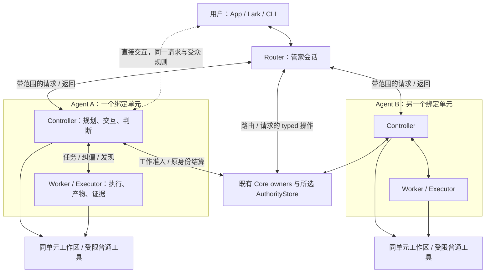
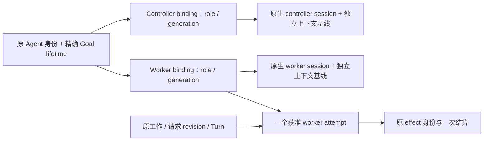
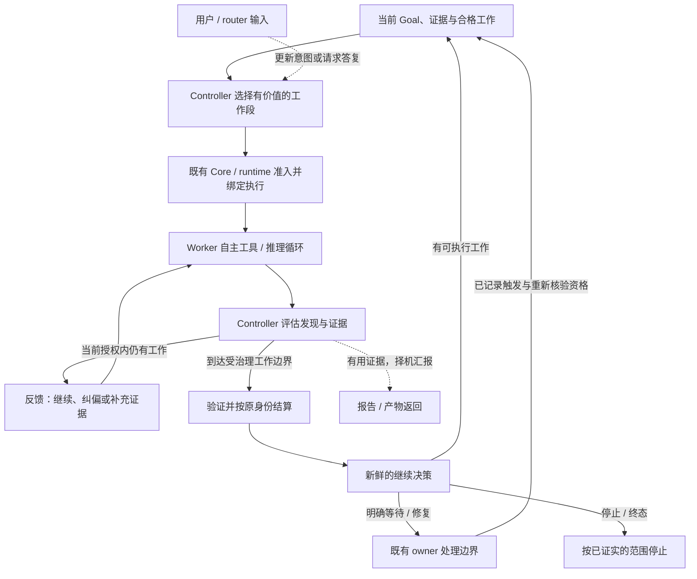
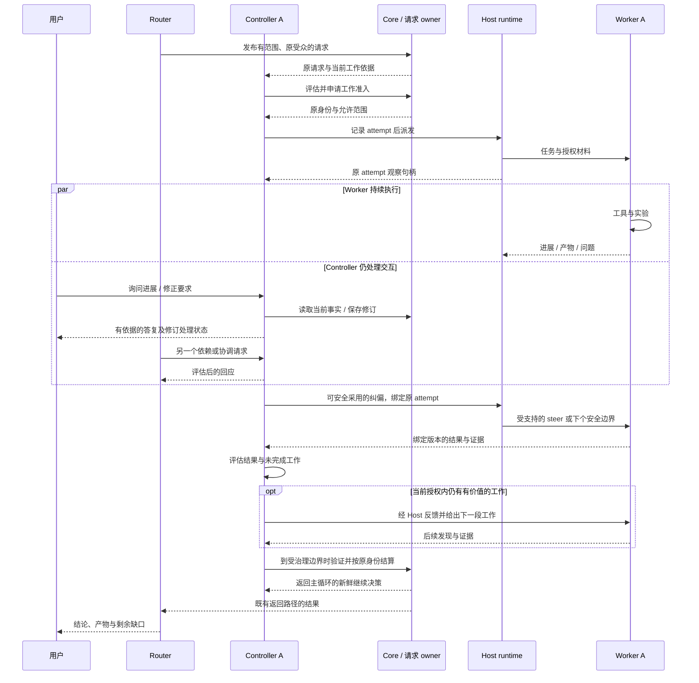
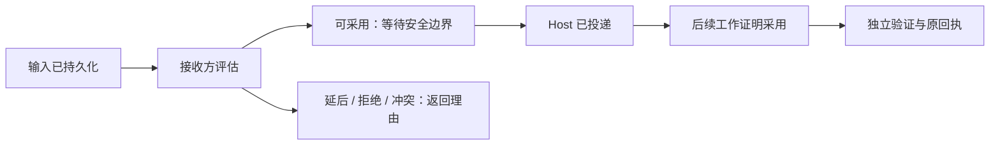
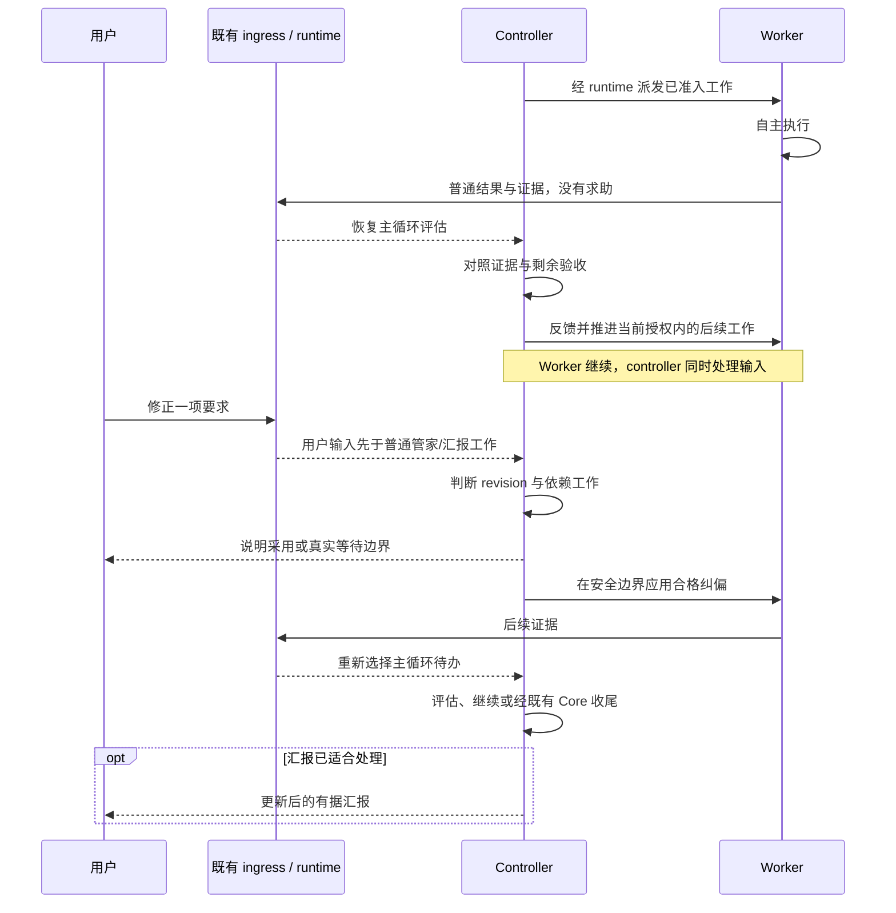
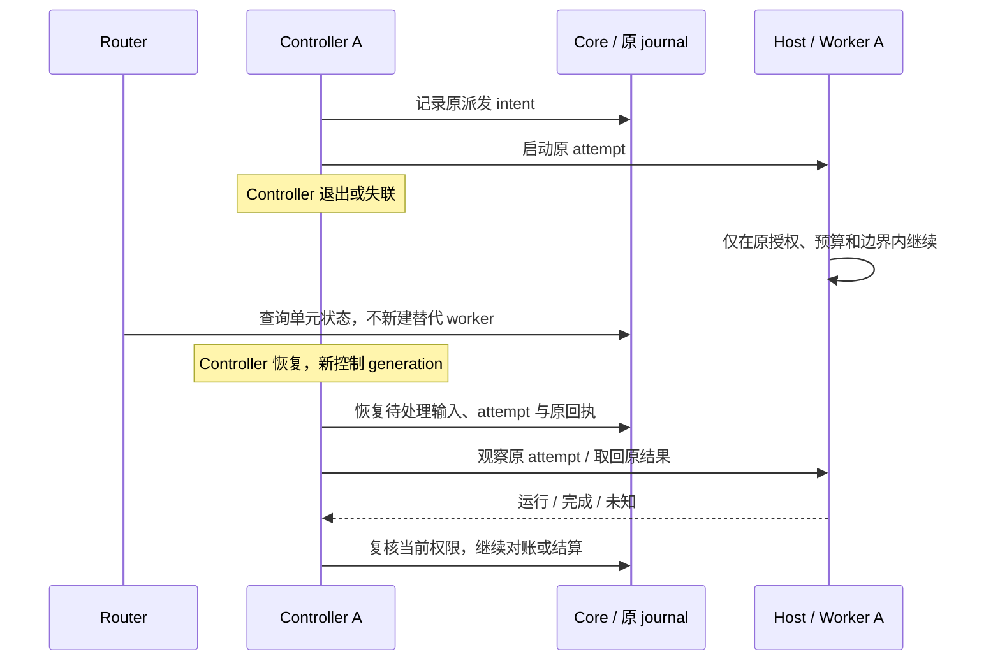
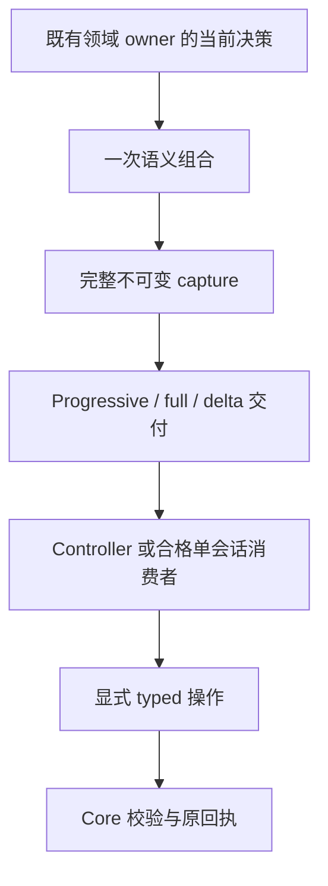
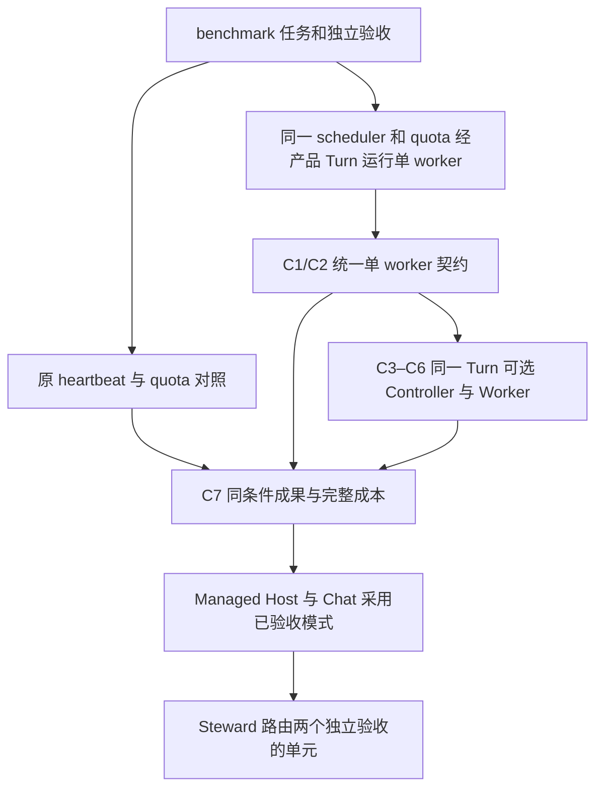

# RFC：Router—Controller—Worker 架构与统一受治理工作契约（v0）

- **RFC 状态：** 已接受，适用于既有契约。Router、绑定单元及会话发现/共享环境扩展待评审。
- **替代 / 关闭：** 无
- **交付成熟度：** 单 Worker 的 EdgeBench 入口已合入。#8484 在 C1 上验收通用双角色 Turn；跨准入延续、多题效果与成本、对话产品接入待验证。
- **作者 / 负责人：** LoopX 维护者、控制面与运行时 owner
- **创建日期：** 2026-10-27
- **最近规范性修订：** 2026-11-13
- **源码版本：** main `9508f4de93`、C1 `9d283862e3`。§11 区分实现 PR 的实测、原始对照及待验收边界。
- **相关契约：** [Effect interpreter](agent-loop-effect-interpreter-v0.zh-CN.md)、[会话执行模式](agent-session-execution-modes-v0.zh-CN.md)、[语义交接](capable-manager-semantic-handoff-v0.zh-CN.md)、[整体路线图](loopx-overall-roadmap-v0.zh-CN.md)
- **语言镜像：** [English](controller-executor-unified-contract-v0.md)

## 文档地图与维护契约

**目标体验：管家路由多个 Agent；每个 Agent 持续完成 controller—worker 的选工作、执行、
评估证据与反馈闭环。在这个循环中仍可沟通、纠偏与停止，结果沿原请求返回。** 这是一项待验证的长程 Agent
架构选择，不宣称已经成为通用最佳实践。

| 你要了解什么 | 阅读入口 |
| --- | --- |
| 为什么这样拆、当前差距 | 第 1–4 节；[最新源码核对](#current-delivery-audit) |
| 三层关系与一个 Agent 的身份 | [系统图](#system-topology)、[绑定单元](#agent-binding-unit) |
| Controller 如何了解 worker、在哪里读写 | [会话发现与证据读取](#worker-session-discovery)、[共享工作环境与读写](#shared-workspace-and-tools) |
| 没有用户新消息时，工作怎么持续推进 | [执行主循环](#controller-worker-main-loop) |
| 干活时怎么交流、停止、恢复 | [异步时序](#asynchronous-control)、[注意力与插队](#controller-attention-and-preemption)、[故障隔离](#router-failure-recovery) |
| 怎么交付、验证和删代码 | [依赖与切片](#delivery-path-from-current-state)、[产品验收](#superagent-acceptance)、第 8–11 节 |
| C1 字段、上下文、wire 与基线细节 | [技术附录](controller-executor-unified-contract-v0/contract-and-context.zh-CN.md) |

中英互为语义镜像。主文维护当前设计；技术附录保留迁移细节，日期 ledger 保留历史证据。
原章节锚点继续可达附录。设计接受、代码存在、打包/安装验收和收益资格是不同结论；
本文不创建运行时、修改默认配置或启动实验。

## 1. 决策摘要

1. 将 quota 执行 packet 与 TurnEnvelope 融合成**一份版本化的受治理工作契约**：
   同一 schema、语义生产入口、capture、交付/恢复机制和结算身份。不同宿主携带同一契约，
   长期保留 quota/Turn 兼容视图不是目标。吸收 quota packet 的必要信息量优势与
   TurnEnvelope 的交付效率优势，一起替换二者，并相对原 quota packet 路径验收净变化。
   各 domain owner 仍决定自己拥有的事实。
2. 在可选的双会话 profile 中，**controller 模型会话是该单元工作控制与结算的唯一模型客户端，
   也是控制工作的智能中介**。
   它读契约、判断工作、与 executor 沟通并提交显式 typed Core 操作。Core 拥有合法迁移与
   回执；controller 不是第二个权威。它也能在与 worker 相同的工作环境中，按当前授权
   直接读写项目文件并使用普通宿主工具。
3. Executor 接收自然语言任务对话、原始材料和普通宿主工具，返回发现、产物、证据与问题。
   它不消费第二份 Core packet 视图，不编写 quota、Vision、lease 或 settlement 字段。
   任务正文之外的小型机器载体负责记录路由与因果关系。Controller 可发现并按需检查
   本单元 worker 的会话与工作证据；当前活动来自宿主观察，历史索引只补充历史。
4. 先保存完整上下文，再组合两个独立交付层：**跨 Host 默认 Progressive**，以及
   **仅在已资格化 Host 自动使用 Delta**。未读材料仍可从当前 capture 发现。
   Controller 与 executor 分别证明连续性，不能借用对方的基线；完整恢复始终可用。
5. 先统一 quota、公开 Turn 和 benchmark 标准 heartbeat。以 heartbeat 为对照验证单 Worker，
   通过相同 Turn provider 显式选择双角色。按 §11 比较效果与完整成本后，再接入 Managed Host、Chat、Steward。
6. Controller—worker 执行循环是主干：既评估普通结果也处理阻塞，反馈并继续有价值的
   已准入工作，无需用户再发一句话。Executor 工作期间，controller 同时回答用户、
   采用纠偏、展现有用产物。汇报是旁路活动，不是循环的默认归宿；两者由 C6/C8 验收。
7. 将管家定位为 **router**：经既有语义请求协调多个 controller + worker 绑定单元。
   每个单元沿用一个 Agent 身份；router 可调用获授权的请求/路由操作，不替接收单元
   进行工作结算。先交付一个单元的异步闭环，再复用多接收方链。

## 2. 问题与动机

同一任务可从 App heartbeat、external worker 或 `loopx turn` 进入，但上下文和结果
义务的呈现不同。共享决策事实已经存在，调用方仍分别选择 packet 格式、组织提示，并适配
模型编写的记账信息。再增加一份 controller 专用 packet 会继续增加分支。

例如，修复导出失败的 executor 需要原始要求、失败事实、允许使用的工作区和独立验收，
不需要学习如何编码 Vision delta 或扣除 LoopX Turn。分离这些工作可能减少干扰与重复
协议输入，但额外 controller 也可能丢约束、增加延迟或过度指挥。这些是待验证假设，
不能从会话拆分直接推出收益。

长程工作还需要持续的人机对话。执行继续时，用户应能了解进展、检查成果和修正方向，
无需反复追问状态。只转发最终答案的 controller 没有满足这项产品目标。汇报与展现须
帮助用户判断工作，反馈须进入真实后续决策和产物；可联系、消息已收到或预览好看，
都不能单独证明闭环成立。

### 不变量

- 保留完整已接受要求、revision、权限、未完成必读和证据来源；短提示不能成为遗漏理由。
- 选定工作只有一个当前控制 owner 和一个已准入 executor attempt。对话、路由 ACK 和
  模型宣告完成都不是回执。
- 通知不决定执行。安静通知不能取消已准入工作；消息不能覆盖真实停止或预算 gate。
- 受治理 Turn 是有界工作/结算单位，不是 wake、模型回复或 controller/executor 往返。
  不能按每条消息另扣 Turn。
- 重试、来源修正与收尾保留原身份；不能把旧结果结算到新选中的 Todo。

## 3. 范围与非目标

范围包括：契约融合、上下文交付、按角色绑定会话、controller/executor 沟通、共享生命周期
复用、宿主 adapter、benchmark 采用、旧路径退役与可观察的产品验收。

非目标：新 Goal store、workflow DSL、通用 effect executor、权限引擎、scheduler、
强制双会话、无限层级团队、自动切换宿主或修改 benchmark 评分。Peer 团队沿用现有委派/验收
契约，不把业务判断移入确定性的 Core 规则。

## 4. 当前系统契约

| 现有概念 | 实际职责 / 源码 | 对目标设计的含义 |
| --- | --- | --- |
| Quota packet / TurnEnvelope | [`quota.py`](../../../loopx/cli_commands/quota.py) 对已决 payload 分普通/envelope 分支投影；[`turn_envelope.ts`](../../../loopx/control_plane/quota/turn_envelope.ts) 提供有界分节与动作绑定 | 将两者义务迁入同一 schema，再退役两条旧输出路径 |
| Work context | [`interaction_contract.ts`](../../../loopx/control_plane/work_items/interaction_contract.ts) 承载 typed 执行/上下文要求 | 扩展现有 owner，不新建 controller 决策引擎 |
| Thin heartbeat | [`task_body.py`](../../../loopx/control_plane/heartbeat/task_body.py) 按格式分支渲染产品入口指令 | 保留 bootstrap/宿主入口，统一其消费的契约 |
| `loopx turn` | [`turn.py`](../../../loopx/cli_commands/turn.py)、[`executor.py`](../../../loopx/control_plane/turn_driver/executor.py)、[`settlement.py`](../../../loopx/control_plane/turn_driver/settlement.py) 实现受治理调用与回执绑定收尾 | 复用生命周期；CLI 入口不是另一套产品 runtime |
| Managed Codex | [`codex_agent_session.py`](../../../loopx/control_plane/turn_driver/codex_agent_session.py) 与 [`codex_sessions.py`](../../../loopx/control_plane/turn_driver/codex_sessions.py) 实现原生会话执行/续接 | 属于 runtime adapter，不是竞争控制面；当前 Agent 级存储还没有提议中的角色区分 |
| Executor result | [`codex_cli.py`](../../../loopx/control_plane/turn_driver/codex_cli.py) 要求 schema 约束结果，包括 delivery、Vision/progress 字段 | 双会话 profile 把 Core 编写责任交给 controller，保留验证 |
| External worker | [`external_scheduler_worker.py`](../../../scripts/external_scheduler_worker.py) 拥有外层唤醒/命令传输 | 保留该归属；对已经证实重复的语义编排进行合并 |
| Benchmark runner | [`worker.py`](../../../benchmark/runtime/worker.py) 的 heartbeat 使用产品 thin body，Turn mode 使用公开 Turn CLI；[`sessions.py`](../../../benchmark/runtime/sessions.py) 复用原生会话 adapter | 它是产品 profile 外的评估 harness，不是独立实现目标 |
| Turn Loop Controller | [稳定协议](../../reference/protocols/turn-loop-controller-v0.md) 定义纯 disposition 函数 | 保持确定性；它不是本提案的 controller 模型会话 |

执行模式（`managed_runtime` / `attached_host`）、runtime provider、唤醒来源、单/双会话
组织与评估组是独立维度；并非所有组合都受支持。Native/plain benchmark 对照可以有意
不包含 LoopX Core，必须保留其独立性。

### 当前交付的源码核对

以下 2026-11-10 核对绑定 main `ab1406611809dc7707028a7f257f9717040bad2c`。
代码中存在机制只证明已有实现边界，不代表双会话用户旅程或收益已经验收。

| 能力 | 源码事实 / 在途工作 | 对本设计的决定 |
| --- | --- | --- |
| 管家到多个 Agent 的请求与返回 | [`manager_context`](../../../loopx/capabilities/manager_context/README.md) 已支持多接收方；[`semantic_request.ts`](../../../loopx/control_plane/collaboration/semantic_request.ts) 保留精确接收方和原对话返回 | Router 采用原请求链；逐接收方成功/拒绝，不新建路由任务库 |
| 接收方身份与路由 | [`peer_route_selection.ts`](../../../loopx/control_plane/collaboration/peer_route_selection.ts) 对多个候选返回 ambiguous，不把 unknown 当作已退役 | 发现单元与准入执行分离；把新角色映射接进现有绑定，不能靠另选 native thread 绕过歧义 |
| 请求修订与异步输入 | [`request_control.ts`](../../../loopx/control_plane/collaboration/request_control.ts) 已有 revision/assessment/reservation；[`chat_queue_steering.ts`](../../../loopx/control_plane/turn_driver/chat_queue_steering.ts) 已有持久 reservation 和不确定投递处理 | 复用机制，但现有 queued steering 明确排除部分 collaboration/LoopX execution 输入，且 native live steer 限文本；不能宣称双角色纠偏已支持 |
| 原受众返回 | [`return_delivery.ts`](../../../loopx/control_plane/collaboration/return_delivery.ts) 区分 provider 已写入但无定位符与未写入 | Router 汇总不得重新执行任务来补投递；投递不等于 requester 采用 |
| 受管操作复用 | Codex/DSH 均调用 [`managed_operation_host.py`](../../../loopx/control_plane/turn_driver/managed_operation_host.py) 与 `select_managed_operation_session` | C3.1 的通用 handler 抽取已存在；复用并检查剩余调用方，不重复开重构项目 |
| 双角色绑定 | [`codex_sessions.py`](../../../loopx/control_plane/turn_driver/codex_sessions.py) 按 Goal/Agent/Todo 或 Agent scope 保存 session；尚无本提案的 controller/worker 成对绑定 | C3 需要同一 Agent 的 role/generation 与独立队列、连续性；仅有两个 thread ID 不够 |
| 统一工作契约 | [#7430](https://github.com/loopx-project/loopx/pull/7430) 已合入，随后由 [#8265](https://github.com/loopx-project/loopx/pull/8265) 回退；C1 替换由 [#8266](https://github.com/loopx-project/loopx/pull/8266) 继续。[#8238](https://github.com/loopx-project/loopx/pull/8238) 和 [#8323](https://github.com/loopx-project/loopx/pull/8323) 已分别改善结算读取和叙事读取。[#8304](https://github.com/loopx-project/loopx/pull/8304) 已合入分阶段重规划路径。 [#8499](https://github.com/loopx-project/loopx/pull/8499) 独立交付 EdgeBench 单 Worker 入口和按原唤醒恢复，C1 写入格式切换另行推进。 | 继续将可独立验收的修复合入主干。切换 profile 前，按原 quota 单会话验收替换路径。此前传输或写回测量只适用于各自测过的路径。 |
| 通用 Host transport | [#7568](https://github.com/loopx-project/loopx/pull/7568) 仍为 Draft，本次核对头 `e3a3c06524fae99519a72d751a16a5e8dd6f9a5d` | 可作为适配器候选；bounded 调用不证明双向长期 session/异步控制，不把 OAR 或全 Host 重写设为先决条件 |

在 C1 `853eb8f56c1a` 上，benchmark 已走通任务规划、quota 准入，以及在隔离 SQLite 环境下经过独立验证的两次 Turn 结算。原生 Codex 连接脚本化模型端点，Host 收到了 v1 工作契约。quota 原有兼容视图通过哈希标识签名 capture。这些检查覆盖派发和恢复。比较成果与成本仍需在同等条件下运行原生评分器。

旧的逐字段审计与实验保留原版本，位于下面的技术附录；其中历史 Draft/测试记录不能
代替本表的状态，也不能用本表给旧结果重新标注版本。下一次认领须重查实时 PR 与任务。

### C1 源码核对：已有共享 owner 与剩余分叉

完整字段、消费者与验证细节见[契约与上下文迁移附录](controller-executor-unified-contract-v0/contract-and-context.zh-CN.md#c1-源码核对已有共享-owner-与剩余分叉)。

## 5. 提议架构

### Router、Controller、Worker：面向用户的三层分工

**Router 是管家的跨 Agent 协调角色；controller + worker 是一个逻辑 Agent 的绑定单元。**
Worker 是本文既有 executor 的产品称呼，不增加第二种角色、协议或注册实体。
一个单元保持原 Agent 身份、Goal 归属、工作与预算，内部使用两个角色会话；多个单元
可以服务同一 Goal，也可以在已授权范围内跨 Goal 协作。管家自己的普通对话不需要
虚构 Goal，也不因本设计被强制拆成两个会话。

图中每条请求边都要经过既有 runtime 和授权校验；不是模型间任意发消息的权限。
Router 只汇总获授权的结果，不能因此读取所有单元的私有会话。跨单元协作复用
[语义交接](capable-manager-semantic-handoff-v0.zh-CN.md)，不增加一棵拥有特权的管理树。

| 角色 / owner | 负责的判断与行为 | 不承担的职责 |
| --- | --- | --- |
| Router（管家） | 理解用户意图，发现有上下文和能力的单元，选择复用/创建的提议，传递修订，汇总结果及跨任务取舍 | 不逐工具指挥 worker，不替接收方认领/验收，不复制各 Goal 的任务库与预算 |
| Controller（单元内） | 结合 Goal、planning horizon 与证据选择工作，维护任务连续性，发现并检查 worker 会话，在共享工作环境中读写、核验，与用户/router 交互，判断纠偏与验收并调用 Core | 不成为第二权威，不用自己的聊天笔记代替工作状态；不必为每个工具步骤审批 |
| Worker（单元内） | 在已准入范围内自主使用工具、实验、产出及报告证据/问题 | 不消费 Core packet，不编造结算，不直接持有 Core 写权限 |
| Core + 受管执行 + Host adapter | 既有 typed 规则、持久化、身份、派发、观察、停止和恢复 | 不从自然语言猜权限/完成，不替模型决定领域方案 |

Router 可以直接回答已有证据足够的简单问题，不必每次创建单元。分配工作优先复用
当前上下文与授权匹配的 Agent；创建新 Agent 仍沿既有生命周期和资源准入。多个候选
绑定不明时先消歧，不能按标题相似或“最近在线”抢占。Router 给出的优先级是请求；
controller 结合本地承诺与依赖评估并返回接受、延后或拒绝及理由，Core 执行合法变更。

### 一个 Agent 身份，两个独立会话

这是绑定关系，不是新增 `AgentUnit` 状态库。角色、generation 和原生 session 映射由
既有 session owner 扩展；任务身份、请求修订和回执仍由各自 owner 保存。原生 session
可以重建，逻辑 Agent 不随之变成新任务。重启/换模型后不能借用另一角色的上下文基线。

首个 profile 中，一个单元有一个活跃 controller 消费者、至多一个当前 worker attempt。
多个单元可以并行；内部并行子任务将来只能使用既有独立 delegation/claim 契约，不能
把同一 attempt 复制多份。业务 Turn 与原生模型轮次不同：controller 回复三条消息
不等于扣三次业务 Turn，但这三次模型调用都必须计入成本。团队资源上限不能给每个单元
各复制一份；router 不新增预算账本。

### Controller 的 worker 会话发现与证据读取

Controller 应有类似 [Obelisk 会话证据检索](obelisk-session-evidence-provider-v0.zh-CN.md)
的发现能力：知道本单元有哪些 worker 会话，当前任务绑定了哪一个，并能按需读取允许
查看的工作过程。只等待 worker 自报摘要不足以支持检查失败、定位产物和恢复原 attempt。
这是一项待交付的产品要求，不代表现有 Host 已具备完整能力。

- **先定位，再读取。** 复用现有 session/binding、request/attempt 和 Host observation
  owner，发现精确 Goal lifetime/Agent 下的 role、native session、generation、原请求
  revision/Turn/attempt、实际 provider/模型、工作区，以及宿主确实观察到的运行/停止/失败
  事实。显示来源、观察时间、读取覆盖和继续读取入口；多个绑定、缺失和不可读保留明确
  不确定性，不以注册、会话名称或最近更新时间推断当前执行者和可执行资格。
- **按范围检查过程。** 可按任务、会话与事件定位获授权的消息、工具调用/结果、失败、
  产物及原始材料引用，并读取必要的上下文和分页内容。保留原作者、顺序与版本；摘要
  不是完整正文，零命中不是没有工作。原始内部推理、无关会话与其他受众的私密内容
  不因此开放。读取发现不授予 resume、steer、interrupt、写入或接管权限。
- **当前事实与历史召回分开。** 活跃 attempt 和新鲜状态由当前 Host/Core owner 提供。
  Obelisk 等可选 provider 仅在独立授权范围内补充已索引的历史证据；默认关闭、同 Agent/
  项目限制和来源访问校验沿原契约，不因角色绑定而自动继承 archive 权限。缺 provider、
  索引过期、来源撤销、超时或零命中时明确覆盖缺口；基础会话发现与已授权工作无需等待
  历史索引。本文不安装或启动索引，也不复制一套会话库。

发现与阅读采用有界索引、按需正文和既有事件续读。记录扫描、索引维护、补读、模型输入
和延迟成本；不每轮扫描全部历史或向两个会话重复注入 transcript，不预设检索必然省钱。

### 同一工作环境中的普通读写能力

Controller 与 worker 应访问**同一个已授权工作环境**：同一项目/工作区、可核验的源码
revision、工具链/依赖、任务资源及产物命名空间。Controller 也持有范围内的文件读写、
搜索、测试和普通进程工具，可直接检查原始产物、验证问题并完成有边界的本地工作。
同一环境不合并两个原生会话的上下文、队列或 continuity baseline。

Host 将实际 cwd/worktree、版本、工具能力和可读写范围绑定到该单元。Controller 写入的
获准材料应能由 worker 读取，worker 的产物也应能由 controller 按原版本读取。不同路径
别名、容器或远程 Host 必须证明映射到同一获准资源和依赖；不支持时明确不支持，不能
静默改用另一份 checkout、复制陈旧产物或把远程环境当成本地。

普通工具共享仍保留角色权限：controller 经既有 typed owner 操作 Core；worker 的 Core
凭据与写入口继续隔离。两者各用已授权的工具/凭据代理，不复制全部环境变量或凭据，
不改变认证、provider、连接模式或 protected operation 的确认路径。只读授权、撤权、
路径越界与受众限制仍由 Host 在实际调用时执行，不能靠“同环境”升级权限。

读写能力不增加第二个未协调的写入方。Controller 可检查正在执行的 worker，并进行
权限与所有权允许的非冲突操作；重叠文件、进程或 effect 的修改需沿既有 claim/lease、
request revision 和安全边界协调。需要接续同一业务执行时，先观察并对账原 attempt，
完成必要的让出/停止与所有权交接，再写入；消息 ACK 不证明原进程已退出。不得覆盖
worker 未提交改动、重复启动任务或制造另一笔结算。所有普通工具与恢复成本合并计量。

### 执行主循环：选工作、执行、评估、反馈、继续

**Controller 是主动推进工作的搭档，不只是 worker 阻塞时的答疑台，也不是汇报专用会话。**
普通结果、负面证据、已可继续的工作，即使没有人发消息，也需要 controller 处理。

箭头表达决策关系，不代表每条箭头强制调用一次模型、新建 attempt 或扣一次额度。
区分三个既有边界：

| 循环 | 谁决定什么 | 边界 |
| --- | --- | --- |
| Worker 推理 ↔ 工具 | Worker 在任务范围内自主选择方法 | 不逐工具调用要求 controller 批准；重要发现、问题或范围限制再交互 |
| Controller ↔ worker | Controller 将证据与 Goal 对照，给反馈并选择下一段有效工作 | 已准入工作内可以多次往返；一条反馈既不结算 Turn，也不自动授权新 attempt |
| 跨 Turn 的受治理接续 | 既有 Core/runtime 验证原结算与新准入 | 模型提出工作；既有 [Turn loop 状态转移 owner](../../reference/protocols/turn-loop-controller-v0.md) 仍判断合法继续、等待与停止 |

评估必须有内容：检查证据与未满足验收，决定沿有效路线继续、纠偏、补证或收尾；
不能照单接受 worker 的完成声明，也不为了显示活动而强制改变策略。到受治理工作边界时，
验证并结算原身份，下个 Turn 使用新准入。一段工作、一个 Todo、一次模型轮次或一份报告
完成，都不等于整个 Goal 结束。真实依赖、用户操作、预算、停止或终态条件仍然有效；
除此之外，有用且已获授权的工作不应停等用户说“继续”。

这个逻辑循环由事件驱动，不是占住 controller 会话的阻塞等待。派发、观察、待评估结果与
接续仍由各自既有 owner 持久化；结果或已记录唤醒到达后，由 host/runtime 恢复合格处理，
不让模型空轮询。恢复时先核对原 attempt 以及未完成决策/effect，再继续，不能为了
“重启循环”另派一个 worker。

处理完用户/router 输入后，**从当前主循环待办重新选择**：可能先评估未读结果、补上反馈、
派发已合格工作或结算，而不是无条件恢复旧汇报。汇报根据已有证据，在执行并行期间或
主循环真实等待时择机做有界片段，既不阻塞主循环，也不要求每次往返都出一份报告。

### Worker 执行期间的异步控制

异步指 **worker 的长操作不占住 controller 的处理循环**，不是让同一个 controller
会话并发写两条相互冲突的决策。派发先记录原 attempt，再返回可恢复的观察句柄；
controller 不在持有会话锁或工作锁时等待 worker 整项完成。用户输入、router 请求和
worker 事件通过既有有序入口唤醒短的 controller 处理轮次，按单元串行提交决策。
Host 的等待/订阅可以持续，模型无需持续空轮询。适配器只能阻塞到整项工作结束时，
应标为未支持异步 profile，不能拿“前端能收消息”冒充 controller 可交互。

图中用户与 router 的消息进入同一单元的持久有序 ingress，仅一个控制写入方；处理顺序
遵循下方注意力与因果规则，不是无条件 FIFO，也不会生成两个 controller。
只在查询需要新的语义解释时调用模型；已有状态可由 typed readback 直接展示。
Worker 的事件先落到既有观察/journal，再触发处理；断线靠游标和状态对账恢复，不能
依赖一次内存 callback。按工作身份去重，进度可以合并，未处理的取消、修订、结果和
错误不能静默丢弃。队列满时返回可读的延后/不可用及恢复入口；限制与等待复用现有
scheduler/ingress，具体容量随宿主验收，不另立消息总线。

| 输入 | 当前工作能否继续 | 处理与回读 |
| --- | --- | --- |
| 查询 / 查看产物 | 是，查询不修改 attempt | 返回最近有证据的状态、版本与 unknown；不因询问重复派工 |
| 范围内纠偏 | 按实际安全边界决定 | 持久化 revision；受支持 steer 后仍观察是否实际采用；不支持则排队至下一边界并明确告知 |
| 改范围 / 改验收 / 冲突要求 | 依赖变化的工作需重新核验 | 请求带预期 revision，经原 owner 判断；冲突不靠“最后一句赢”或 router 优先级覆盖 |
| Stop / 撤权 | 立即进入已有停止路径 | 不等 controller 模型或排在普通汇报后；分别回读请求记录、Host 中断与实际停止，未知效果继续对账 |
| Worker 结果 / 迟到事件 | 恢复主循环评估，不无条件启动新执行 | 核对原请求、attempt、generation 与 revision；评估证据、反馈或在工作边界验证/结算，下个 Turn 使用新准入；迟到证据不能完成新任务 |

此图是证据阶段，不注册另一套状态枚举。实现映射到已有 request assessment、ingress、
Host observation、验证和结算事实。**收到 ≠ 采用；投递 ≠ 执行；执行 ≠ 验收。**
用户直达 controller 与经 router 转发的同一修订共用原请求/幂等身份；真正不同的请求
保留各自身份，通过明确版本依赖协调，不用文本去重。跨单元没有隐含的全局消息顺序。

### Controller 注意力：用户意图优先，在安全边界插队

**默认注意力顺序：当前用户交互 → 已就绪的 controller—worker 主循环工作 → 普通 router 协调 → 主动汇报。**
这是单元既有 ingress 内的选择，不新建全局任务 scheduler，也不覆盖 authority。
要分清三件事：谁的意图约束工作、下一个合格输入先处理谁、当前操作能否让出。
消息优先级高，不意味着自动取消 worker 或工具调用。

| 输入 / 需要 | 注意力规则 | 边界 |
| --- | --- | --- |
| 已授权 Stop、撤权、强制预算/fence | 既有确定性控制路径独立于普通模型工作处理 | 由原 owner 记录、中断/对账；不能排在汇报生成后，也不等模型推断 Stop |
| 当前用户指令、纠偏、提问 | 前台，先于自主协调和汇报 | 问进度不等于改方向；用户明确索要的报告是前台工作，与自主汇报不同 |
| 主循环的派工、结果评估、反馈、继续与结算 | 其次；其中阻塞 worker 的交互优先，可打断后台内容生成 | 普通结果无需附带求助也应评估；普通进度/日志未改变决策则不唤醒模型；需要用户批准就升级，不能虚构批准 |
| Router 自主协调与非阻塞 worker 信息 | 在前台与已就绪的主循环工作之后处理，延后有界 | 可验证的原用户请求经 router 转达，保留来源和依赖，不因经过管家而降级 |
| 主动汇报与可选维护 | 合并后按有界片段择机处理 | 被打断后按当前事实更新，不逐条发送已经过时的草稿 |

显式且适用的用户意图在当前权限/范围内优先于 worker/router 的自主计划；保留与新意图
相容的旧要求，不能把一句新提问当作全部替换。选择依据是已认证来源、原请求/revision、
当前依赖与实际阻塞事实，不能靠发送者自报“紧急”或材料中的关键词取得优先级。
未分类输入做有界判断，不猜权限变化，也不静默丢弃。

必要依赖可以临时继承正在等待的前台请求的注意力：回答用户必须先解决 worker 的问题，
就先解除这个阻塞，作为服务用户的一部分。沿用原请求/依赖关系，仅提升这段解阻工作，
不扩权，也不把 worker 整个队列升为最高级。必要的 router 依赖同理。发现依赖环或缺权限
应暴露真实阻塞，不能无限提高优先级掩盖它。

**有序 ingress 不等于所有输入严格按 FIFO 处理。** 到达和修订历史照常持久化；从因果上
已可处理的 pending 输入中选择。同等注意力保持 FIFO，同一请求的 revision 依赖保留。
新纠偏可以使旧草稿失效，但前序要求经既有 owner 记录为被替代，不擦除历史。取消可以
立即使待派发工作失效，无需先执行完它前面的全部请求。仍只有一个 controller 提交决策，
不能靠插队生成第二个控制写入方。

插队具体分三种：

1. **尚未开始的工作**：先选择高优先级且合格的输入，再生成尚未发送的汇报；原到达与
   处理事实保留，供恢复和回读。
2. **纯草稿 / 模型推理**：在宿主支持的 native turn/tool 边界协作让出，或中断可取消的
   模型调用。保留简要意图和必要证据，不假设模型调用栈可原样恢复。先 fence 旧 invocation，
   再让另一次控制同一 session；迟到输出/工具提案不能发布或修改状态。恢复报告时按当前
   事实重新组织。
3. **已准入工具/effect 或原子提交**：不能强拆事务，也不能从“模型已中断”推出回滚成功。
   新输入及时入账；原事务完成/恢复，或使用它实际支持的取消。适用的变化待处理时仅暂停
   依赖它的新 effect，独立已准入工作保留原范围；后续派发/发布前重新核验 revision。

因此“打断汇报”通常是打断 controller 的内容组织，**不重启或取消业务 worker**。
若汇报已经发送或投递结果不明，先恢复原发送操作再重试；已被观察的内容不能假装不存在，
部分流式内容不能标作完整报告。已经送达却过时的材料，由既有版本/返回 owner 更新。
Host 不支持可靠中断时，应限制 controller 的单次片段并显示实际等待；不能并发调用
同一个 native controller session，也不能把不可中断的长报告宣称为及时响应。

同时防止饿死与反复打断。相容的用户纠偏可以合批，但保留各自身份；可替代的进度可以
合并，问题、错误、结果、结算/恢复义务必须保留。限制每段前台服务工作，给仍有效的主循环
工作与应返回结果保留处理机会；等待时间可提升这些义务的服务顺序，但不覆盖 Stop、显式
取消或用户意图。可选旧汇报允许被替代。输入长期超过容量时，展示背压/延后与真实阻塞，
不承诺做不到的时延。不要每次输入一个字就打断正在回答用户的调用，也不让用户调优先级
数字。既有 quota/停止规则仍约束执行，浪费及被中断的模型调用都计入完整成本。

MVP 在一个真实 Host 验证自主主循环、稳定选择与**后台内容生成的让出**，不做任意工具任务抢占。
来源、依赖、invocation fence 缺在哪里，就在既有 ingress/request/session owner 中补；
typed owner 选择可处理输入并保护提交，controller 判断语义。App/CLI 与受支持 Lark
区分已收、处理中、延后/阻塞、实际采用，无需增加优先级控制台。规则属于可选单元 profile，
不能静默重排现有单会话 chat 队列。C3/C6/C8 承接实现及下方注意力验收，仅写进 prompt
不算实现。

### 故障隔离：会话丢失不等于工作丢失

Router 不可用时，已准入单元不因汇总渠道掉线而停工；直接交互仍受原受众授权约束。
Controller 不可用时，worker 只可继续原授权的有界工作；需要新批准、范围变化或新的
dispatch 时等待恢复。接替 controller 必须围栏旧控制 generation，但不能把仍有效的
worker attempt 自动当成孤儿重跑。未知是否执行的外部效果保持未知，不能由超时推导
安全重试。Core/Host 的 Stop 与预算限制不依赖两个模型中的任何一个在线。

多接收方请求不是跨 Goal 原子事务。A 已接受、B 拒绝时，router 展示部分结果，决定
补充请求、调整依赖或请求用户决策；不抹掉 A 的真实效果。跨单元转交产物保留版本、
出处、权限与独立验收，不广播完整私有上下文。单元重绑定或 profile 回退时先关新准入，
核对/停止原 attempt 与未决 effect，再以新的合格绑定继续。

### 归属与统一契约

复用 TypeScript interaction/work-context 与 effect owner。组合 owner 一次捕获它们的
当前事实，不重写 quota、replan、Todo 或 lease 决策。Python 可以收集来源、适配原生
传输。宿主特定执行归属在同一契约中显式表达，包括委托给宿主的 scheduler effect 和
相应 ACK 义务。

Schema 名称与逐字段迁移需完成下文 C1 盘点。以下是必须覆盖的语义组，**不是再加几层
嵌套协议**：

| 语义组 | 保留能力 |
| --- | --- |
| 身份与当前决策 | 契约版本、capture/revision、Goal/Agent/work/Turn 绑定、选定动作、准入、claim/lease、范围、批准、取消与停止条件 |
| 完整工作上下文 | 原始意图与要求、未满足义务、已接受证据、当前来源/revision、必读完成状态与授权详情访问 |
| 上下文交付 | Full/delta 编码、精确 base/target digest、消费 session/role/epoch 与不可变 capture 恢复 |
| 操作与收尾 | 可用 typed 操作、动作绑定/完整性、条件顺序、验证及 writeback/debit 身份、scheduler 与通知归属 |

CLI、heartbeat、managed Turn 与评估使用一个语义实例、一个 schema。Full/delta 是该
实例的编码选择，分页是传输限制，都不形成 quota schema 和 Turn schema。原生工具
可以带 provider 必需的外层包装，但不能改名、遗漏或另行决定契约字段。人类 UI read
model 继续作为展示 sink，不成为另一份可执行契约。

组合边界位于**当前 domain 决策与宿主操作绑定之后、不可变 capture 与上下文编码之前**。
所有活跃 writer 使用该边界，不能先把 quota packet 压成 envelope，再把结果改称完整
统一契约。必需来源材料可以使用经授权的详情引用，但引用、revision 和必读义务必须完整，
并能从同一次语义 capture 恢复。

“一份 capture”指一次调用的一份不可变语义观察，不是所有用途只存一个文件。完整规范
实例、编码后的 full/delta/page 产物和 Turn journal 的绑定应保持可区分。精确文件字节
digest 保护传输，canonical hash 保护语义内容，既有 effect 身份保护只结算一次；三者
不能互相替代，也不授予当前权限。恢复引用需要身份/位置时，在序列化前预留；不要要求
文档包含自身最终字节的 digest。编码、分页、native resume 与恢复都从已保存实例派生，
不再执行 guard。合法的新选择或权限复核可以产生新 capture，但不能改写旧观察，或把
未结算结果悄悄绑定到新观察。

### Controller 的智能与语义压缩

智能来自 controller 会话本身。它在架构上把控制面的完整事实与义务转化成 executor
可执行的有用工作，再把 executor 的发现解释为有依据的 Core 操作。“智能压缩器”描述
的是对控制工作的这种中介作用；少查几次或缩短文本本身不能实现它。既有摘要已把阅读、
推理与 typed 操作交给 controller，这里补充的设计决定是**把判断与注意力放在哪里**：

| 判断 | Controller 的职责 | 保留的边界 |
| --- | --- | --- |
| 下一步做什么 | 比较当前 Goal 缺口、证据、可行工作与完整成本；有依据地继续或换路 | 合法准入、claim、lease、预算和迁移仍由 Core 决定；controller 的判断不授予权限 |
| 哪些工作一起交接 | 选择连贯、可验证的任务，决定自己吸收哪些控制事务 | Executor 在范围内自主选择局部工具与步骤，不逐次请示，也不编写 Core 记账 |
| Executor 必须知道什么 | 交付任务完整约束、相关反证、原始材料和未完成必读，用任务语言解释判断 | 摘要不是另一份契约，也不证明读过来源；相关性未知时，依赖工作前须补足材料 |
| 结果改变什么 | 区分发现、已验证产物、受阻尝试与已接受成果，判断继续、调查或 replan | 独立验证与当前 Core 回执决定验收和结算，不能由任一会话的叙述替代 |

区分三种操作：确定性的 composition owner 组合 domain 事实，不另造 policy；既有
codec 编码可精确恢复的 full/delta 输入；controller 按任务进行语义选择和推理。自然
语言任务可以省去无关控制语法，不能承诺逐字节等价。其充分性要由约束保留、executor
实际决策与验收成果检验，同时原始获授权材料仍可到达。不能用第二套 schema、模型编写的
状态库或按关键词判断相关性的分类器替代这些操作。Controller 笔记是工作上下文，不是
新的持久权威。

例如导出修复已产出有效文件，但打包检查失败：controller 可以保留有用修复，交接有
证据的打包纠正，并保留原未结算身份。它不能把结果缩成“完成”、丢掉失败检查，或要求
executor 学习 writeback 格式。如果同一证据表明修复违反共同要求，则先修改任务并交付
该要求，再继续依赖工作。这是实际判断后果，不是压缩比例目标。

成本摊薄仍是假设。Executor 继续普通获授权工作时，controller 可以吸收多次控制密集
交互，但每次新选择、权限变化、取消与收尾仍遵循既有 owner 和新鲜度规则。不要为每个
局部工具步骤增加一次 Core 往返或新 Turn，也不能缓存旧权限来跳过必需复核。小任务、
快速变化的共同约束和频繁 controller 恢复，都可能让额外会话的成本超过节省。

Controller 失败不能让 executor 变成备用 Core 客户端。暂停依赖的 dispatch，恢复原
capture 与 session/attempt 记录，在必要处读取当前权限，并按原身份对账已准入结果。
Executor 摘要不能重建缺失的控制义务。必需材料矛盾或不可达时，依赖工作保持阻塞；
独立获授权工作继续沿原路径推进。

### 执行期间的人机交互

在受支持的双会话 profile 中，executor 活动不能阻塞 controller 面向用户的对话。
在既有队列机制上补齐按角色绑定，复用版本化请求、host 观察和原受众返回路径。询问或汇报
不启动第二个业务 executor，不无故中断已授权 attempt，也不产生另一次 Turn 扣额。

| 用户结果 | 必需行为与证据 |
| --- | --- |
| 执行中可交流 | Executor 忙时仍能回答问题、提供已保存产物。区分最近实测状态、来源/版本和活动未知；不猜测进度百分比，不从模型宣告完成推断验收通过。 |
| 主动获知有用变化 | 重要进展、新产物、风险、有证据的停滞和需用户决策的变化应主动汇报，说明依据、影响及有用的反馈请求。复用已配置的事件/投递 owner，合并重复，无实质变化保持安静；不新增模型空轮询或固定汇报周期。 |
| 理解并比较工作 | 按任务选择图表、关系图、时间线、方案对比、截图或产物预览。简明概览可达原始证据/版本，保留不确定性、可访问文本及媒体不可用时的可读降级；不要求每次生成全部形式。 |
| 看到反馈进入执行 | 既有请求 owner 保留原反馈和有序 revision。分别回读收到、排队或待澄清、附理由拒绝，以及实际采用；把已采用变化关联到后续决策、工作和产物。ACK 或修改后的 brief 不能证明实际采用。 |

Controller 区分已准入范围内的纠偏，以及需要新准入或缺少权限的范围变化。依赖的
dispatch 或验收前，经当前 owner 应用修订，保留此前要求和未解决的冲突反馈；不能
静默把最新消息视为取消旧承诺。当前 attempt 无法安全消费纠偏时，展示待处理 revision
及其真实消费边界；替换 attempt 前仍满足 host 的 Stop/fencing 契约。迟到结果保留
原 revision 与证据，但不能覆盖当前要求或结算不同工作。

仅使用已授权会话与受众；展现不授予新渠道、收件人或公开披露权限。重连/重启后先
恢复待处理反馈、attempt 和投递回执再重试；报告投递丢失或用户询问不引发重新派工。
Stop 确认、host 中断及实际终止分别可观察。Controller 不可用时，既有 host/Core
停止机制仍有效。

这是 C6/C8 产品目标，不声称现有会话或进度原语已使旅程合格，也不新增独立 C1 切片
的前置条件。后续 opt-in 双会话评估将汇报、展现生成/投递、两个会话全部调用及
cached/uncached 输入、补读、恢复、时延和人工注意力计入完整成本；不预设响应 SLA
或效率收益。

### 评审新鲜度与恢复

完整 capture 证明当时观察到了什么，不会冻结写回时的有效性。语义内容身份、评审
相关性和结算身份应分别保留。由其他 Agent 持有的 supporting outcome 仍可能约束
共享 Goal；不能仅凭 owner 标签，从评审依据中排除其验收或要求状态变化。缩小失效
范围需要明确的依赖范围规则及共享约束测试，不能依靠角色名过滤或从文案推断白名单。

同一已准入 obligation 拒绝过期评审时，当前 typed owner 应返回完整的当前评审依据和
适用控制指令。消费者先阅读并重新判断，再以原身份重试原写回。不要返回丢失绑定的
通用写命令，也不要为了获取 writer 已使用的事实而要求再次 guard。依据再次变化仍
应拒绝；返回上下文不等于接受决策或授权扣额。这一恢复归现有组合/写回边界，应在
C1 writer 切换中保留；不代表已缩小跨 Agent 失效范围或交付完整统一契约。

### Executor 输入与输出

采用**自然语言工作交流，加运行时持有的元数据**，不提供 executor 专用 Core 视图，也
不退化为无记录聊天。Controller 用适合任务的正文说明目标、相关事实、边界和验收，可
steer、回答问题或修订请求。Host 通过既有 request/dispatch 记录携带 opaque request/
revision、attempt、session/generation、因果序列与产物引用；模型不必在正文复述这些
标识。不增加独立消息账本。

原始要求和授权证据以附件或宿主材料 reader 提供。Core capture 与访问校验由 controller/
runtime 完成，executor 不通过调用 Core 取材料。必读要求由实际材料交付/读取机制保留，
controller 转述或路由 ACK 不能替代。必需材料不能交付时，阻止依赖它的工作；独立工作
可以继续。不可信来源正文不能获得指令或工具权限。

Executor 在委派范围内自主选择工具和步骤，不必每次调用工具都询问 controller。工具
权限由宿主/provider 强制，包括文件与进程访问范围；仅从提示中移除 Core 工具名不构成
隔离。能访问 Core 凭据的无限制 shell 会违反这个 profile。不支持所需隔离的宿主应明确
显示不支持，不能静默声称双会话已经合格。

输出保留用户要求的交付物、产物引用、实测验证、失败与不确定性。Controller 理解结果、
执行或请求独立验证，再提交显式 typed Core 命令。Core 不从 executor 散文中的子串推断
完成、权限或 replan。宿主进程退出不等于业务完成。验证失败可在同一已准入范围内反馈
并继续工作；实质性的范围/revision 变化需要重新核验 dispatch。

**长度要求与语言无关，并随任务变化。** 先保留可独立执行的完整含义，再优化大小。实验
起点可采用：普通任务正文 200–800 model tokens，复杂交接 800–2000，结果摘要
150–600。这些是未经验证的起点，不是 schema 上限、默认值、通过条件或截断规则。
使用实际模型 tokenizer 计量，并记录语言/内容构成。代码、数学、表格、来源材料和完整
交付物保留自然格式；摘要、附件、补读和所有往返合计成本，引用不会消除材料成本。
同会话的小修正在连续性有据可查时只传变化，没有最低长度要求。

例如，controller 可以说：“修复附件复现中的导出失败；保留原始排序要求，在分配的
工作区操作。验证回归，说明剩余缺口。”结果可以解释修改并引用 patch 与独立测试。
这两段自然语言均不替代原始要求、权限授予或 canonical 完成回执。

### 会话、生命周期与恢复

首版使用一个逻辑工作 Agent 和两个显式绑定的原生 session role。不能只为认知分工再建
一个 Goal/Todo/quota 身份。扩展既有 session binding owner，加入 role/generation、
独立有序队列及上下文基线；不能把两个 native ID 写进当前单一 Agent 级槽位。
一个 controller 拥有控制对话，选定工作最多由一个 executor attempt 执行。Controller
的普通读写遵守[共享工作环境](#shared-workspace-and-tools)的所有权与冲突约束，不形成
未协调的第二个业务 executor。Peer 或并行执行仍需既有独立 claim/lease/handoff 契约。

1. 既有入口取得新鲜准入或恢复应结回执，把捕获的统一契约交给 controller。
2. Controller 围绕 Goal、未满足要求、已有结果和可行工作判断，Core 验证其选定操作。
   Replan policy 继续决定何时必须 review；先看事实不意味着把 stride 独有触发条件变成
   默认 policy，也不强迫无意义换路。
3. Dispatch 前，host 绑定 work/request revision、attempt、session role、generation、
   范围与预算；调用 executor 前记录 intent。
4. Executor 工作并返回观察/产物。Readback 区分投递、执行、结果可用、独立验证与已接受
   写回。Controller 沿[执行主循环](#controller-worker-main-loop)评估普通结果并反馈，不只
   响应阻塞。多次交流不产生多次 quota 扣除。
5. Controller 提议接受或修改；既有 effect owner 校验并对原 Turn 结算一次。后续新鲜
   决策继续可执行工作、按记录的事件/时间等待或停止。

| 故障 | 必需处理 |
| --- | --- |
| Controller 在 dispatch 后崩溃 | 先恢复已持久化 attempt 与 executor 状态/结果，再决定是否重发；不能启动重复 executor |
| 结果/结算响应丢失 | 以原幂等身份读既有回执，仅重试未解决的 effect |
| Executor 重启或上下文被压缩 | 围栏旧 generation，重新核验连续性；未知时完整交付当前材料 |
| 取消、需求变化、lease 到期或结果迟到 | 每次拥有的 dispatch/write 前重验当前权限/revision；保留证据，拒绝过时接受并核对已准入 effect |
| 工具执行中 Stop | Host 在受支持范围内中断；分别报告 ACK 与真实退出。保留未知/执行中 effect；停止回执不能证明物理回滚 |
| Controller 不可用 | 既有 host/Core 停止与预算机制仍有效；暂停依赖工作并恢复，不能让 executor 临时成为 Core owner |

### 差分上下文

完整字段、消费者与验证细节见[契约与上下文迁移附录](controller-executor-unified-contract-v0/contract-and-context.zh-CN.md#差分上下文)。

## 6. 备选方案与取舍

| 备选方案 | 结论 |
| --- | --- |
| Quota 与 TurnEnvelope 长期保留兼容视图 | 拒绝作为终态：仍有重复选择/渲染与字段漂移；仅保留有界迁移 decoder |
| 给 executor 一份紧凑 Core packet 视图 | 不作为双会话默认设计：仍有协议编写负担和两个面向 Core 的模型客户端 |
| 没有运行时绑定的纯自然语言聊天 | 拒绝：无法可靠核对过时/重复结果、取消与重启 |
| 始终使用双会话 | 拒绝：controller 成本、延迟和交接损失可能超过收益；保留合格单会话 profile |
| 一个万能 runtime/effect executor | 拒绝：host、scheduler、事务与 provider 权限不同；共享语义与回执，不共享执行所有权 |

### 外部实践如何影响这个设计

2026-11-06 阅读以下原始资料，采用其机制启发，不引入运行依赖，也不借用外部指标
证明 LoopX 收益：

| 原始资料 | 对本 RFC 的启发 | 不直接迁移的部分 |
| --- | --- | --- |
| [Anthropic：多 Agent 研究系统](https://www.anthropic.com/research/multi-agent-research-system)，2025-06-13 | 独立上下文和任务交接适合可分解的长任务；需把额外协调和 token 纳入价值比较 | 研究任务的并行收益不证明代码任务或双会话一定更省；因此保留单会话、小任务反例和完整成本对照 |
| [Temporal：Workflow message passing](https://docs.temporal.io/encyclopedia/workflow-message-passing) | 区分查询、异步输入与有处理结果的变更；把“消息已收”与“请求已处理”分开观察 | 不引入 Temporal/另一套 workflow engine，也不把 Signal 语义等同于 LoopX 验收回执 |
| [Kubernetes：Controllers](https://kubernetes.io/docs/concepts/architecture/controller/) | 观察持久事实、提出行动、再核对实际状态；重启后对账而非盲重放 | LoopX controller 有模型判断，业务工作并非都可幂等重做；确定性准入和 Host 执行仍有各自 owner |
| [Akka：Mailboxes](https://doc.akka.io/libraries/akka-core/current/typed/mailboxes.html) 与 [Actor 顺序处理](https://doc.akka.io/libraries/akka-core/current/typed/actors.html) | 有优先级的邮箱仍可保持同级 FIFO，单一消费者保护状态；队列顺序与正在执行的处理是两个边界 | 不引入 Akka；不把邮箱优先级当作抢占模型/工具的保证，也不采用满队列静默丢消息的行为 |
| [A2A：Life of a Task](https://a2a-protocol.org/dev/topics/life-of-a-task/)（开发版） | 区分对话上下文、消息、任务和版本化产物，避免把每条消息都变成新工作 | 不直接复制其状态枚举或终态规则；LoopX 继续使用现有请求、工作与 effect 身份。协议适配另行资格化 |

异步 handler 还需处理在等待点交错的状态变化；[Temporal 的 TS 消息处理说明](https://docs.temporal.io/develop/typescript/workflows/message-passing)提供并发协调的参考。这里采用单一控制提交与版本复核，不借此假设模型调用或外部 effect 可抢占。

因此本提案选择“有身份的异步交互 + 现有 Core 对账”，不是“所有事情都增加一层 Agent”。
三层拓扑是否优于现有单会话，需要第 11 节的真实成果与成本证据来回答。

## 7. 安全、隐私与兼容性

Controller 判断不授予额外权限。运行时凭据与 Core 写能力对 executor 不可访问；按
当前访问规则交付范围内工作材料。撤权和取消在模型记忆之外强制执行。敏感材料保留原有
受众、保留期限及模型 provider 选择边界。

现有单会话与可选能力关闭路径需要行为等价。不支持的 profile 显式失败。旧持久化
capture/回执保留原版本/签名与 replay 身份，不能改写成新 schema。混合版本 live writer
通过围栏处理，不靠尽力而为的散文转换合并。Schema 删除须满足 RFC 索引规定的逐字段
盘点、无损映射和显式维护者批准。

## 8. 迁移与回退

### C1 wire 布局建议

完整字段、消费者与验证细节见[契约与上下文迁移附录](controller-executor-unified-contract-v0/contract-and-context.zh-CN.md#c1-wire-布局建议)。

## 9. 验证与验收

| 主张 | 证据与必需结果 | 边界 |
| --- | --- | --- |
| 一份完整契约 | 字段/条款盘点；同次捕获的正常、replan、wait、recovery、能力关闭负载经过全部活跃入口；重建语义实例相同 | 单 serializer 单测不足；畸形/不支持版本显式失败 |
| 无损上下文交付 | Full/delta/recovery 等价；缺页、迟到、截断、role/session 不符与真实原生压缩/续接 | 合计所有读取/恢复成本，不重新准入/扣额 |
| 角色隔离与恢复 | 实际 host tools 下的 controller/executor 崩溃窗口、重复 dispatch、迟到结果、revision 变化、lease 到期、Stop | Executor 不能访问 Core，不能采用过时结果或隐藏第二个业务 executor |
| Worker 会话可发现、证据可检查 | 从 controller 定位真实绑定并按需读取原消息、工具结果与产物；覆盖多绑定、重启/旧 generation、分页、不完整索引、无 provider 与来源失效 | 当前状态不由历史命中推断；外 Agent/项目/受众、未授权 archive 和内部推理不可读；发现不执行/接管会话 |
| 同环境且双方可读写 | 原生 Host 上验证 controller 写入→worker 读取、worker 产物→controller 按版本读取，以及真实工具链/依赖一致性 | 只读/撤权、越界路径、环境不匹配、Core 凭据泄露与忙碌 worker 的重叠写入须拒绝；合法交接后仍仅一次执行/结算 |
| 语义采用 | 原始要求 → controller 判断 → executor 实际工作 → 独立验证 → 接受结果并回原受众 | 读回执、合法 JSON 或 replan 成功不能单独通过 |
| 智能中介 | 普通继续、共同约束变化、controller 丢失和小任务反例中的连贯交接、变化／反向证据及结果解释 | 说明真实判断后果与保留义务；少查询或短交接均不足 |
| 执行期间的人机交互 | 下表 C6/C8 旅程经真实受支持 host 和打包对话验证 | Controller 响应、主动投递和反馈采用分别需要证据；不能从路由 ACK 或预览推断 |
| 共享生产路径 | 真实 CLI 与受支持 File/SQLite；涉及 authority 持久化变更时跑真实隔离 PostgreSQL；打包 App heartbeat 与 benchmark worker 复用 | 不破坏 live Goal；未支持/未运行 host 仍未合格 |
| 成果与成本收益 | 当前单会话、统一契约单会话、统一契约双会话三组，固定 task/model/policy/budget/evaluator | 报告不确定性、失败与反例，不从 prompt bytes 单独宣称收益 |

C1 的主要对照是**同一单会话产品路径中的原 quota packet 与融合后新契约**。
匹配 host、任务、原始事实、模型/policy、evaluator 和可用预算，覆盖冷启动全量、普通
暖续接、replan、缺失基线与中断恢复，并包含长/重复历史和 capability-off。旧 envelope
可以作为诊断参考组，不成为永久第二目标。新契约 full 与 delta 编码分别比较，避免
传输复用掩盖语义退步。Controller/executor 分离是之后独立的对照，不能用来解释或
抵消 C1 回归。

### 默认采用与退役资格

[上下文交付指南](../../guides/context-delivery.zh-CN.md#默认化与退役的验收) 把此比较落实为
操作方案。文档可先交付；未来扩大默认采用范围需要明确版本的 DeepSeek 与强模型分别支持
所声明的效果和完整成本范围。reference 已有的 Codex 范围默认仍是当前行为，不证明
这些模型对照已通过。记录精确 model/provider/version/effort，固定 task、source、host、
tools、反馈、evaluator、预算与停止条件。除原生任务成果、约束遗漏、错误动作和
一次性恢复外，计入实际最终 input/output、cached/uncached tokens、请求、详情／恢复
补读、墙钟／IO／搭建成本与人工注意力。未知成本不记零，保留重复波动、失败与负例。
历史最佳优化保持原生排名，终态保留事实另列。仅 Codex adapter 不资格化 DeepSeek 宿主。

顺序留在 C1/C2/C9：解释 → 双模型比较 → 受支持 profile 的可回退采用／发布 → 范围化
默认 → 点名旧路径退役。结果混合或退步时保留 opt-in 或明确限制。退役须核实际 caller
替换、历史解码／readback、支持版本与回退覆盖；完整快照、摘要校验、权限／身份／停止
和恢复继续保留。不长期保留两个同义决策 owner，也不因新路径存在就删除仍受支持的
reader。这是资格方案，不授予新实验权限，不宣称已交付收益，也不阻塞其他独立获授权工作。

[打包来源对照](ledger/controller-executor-unified-contract-v0/2026-10-29-packaged-source-comparison.zh-CN.md)
固定 mainline quota 与 C1 候选版本，经真实 File/SQLite CLI 验证交付、文件差分、
capture 拒绝/恢复及一次结算。本负载来源保真改善，冷态和观察器累计输出字节增加。
精确字节 capture 校验与独立数值 hash 完整性仍是不同边界；这些工程证据不证明
净成本收益，也不结清 C1。

在同一长程工作上验收[执行期间的人机交互](#human-interaction-during-execution)，
不能用脱离工作的独立聊天演示代替：

| 场景 | 决定性观察 |
| --- | --- |
| Executor 忙；用户询问或查看产物 | 整项工作完成前，controller 根据当前实测证据回应、提供已保存产物；不产生第二个 executor 或无必要中断。 |
| 有实质变化，随后无变化及重复事件 | 无需用户反复追问，有用汇报到达已授权受众；不因无变化/重复观察而重复汇报。记录真实投递和成本，不承诺固定周期。 |
| 连续或冲突反馈 | 每个 revision 及其处理均可归因，后续工作/产物证明实际采用内容；待处理、拒绝、冲突和依赖权限的变化保持明确。 |
| Stop 与纠偏或结果竞态 | 当前 revision 和范围决定验收；确认与 host 实际终止分开，未知/在途效果仍可见。 |
| 断线、重启、丢回复或迟到/重复结果 | 恢复原队列、revision 和回执，不丢纠偏、不重复 dispatch/扣额、不被旧结果覆盖；仅重试未解决的投递/效果。 |
| 丰富展现、媒体缺失、证据过期或受众错误 | 适合任务的对比/预览支持用户判断和反馈；来源/版本、未知可读，可访问文本仍可用，拒绝未授权投递。 |

受支持的 managed 与 attached App heartbeat 旅程分别验证，不支持的 host 明示；
安装行为与打包 fixture 分开验收。保留原 quota 单会话门，随后在可选双会话组中测量
新增交互和展现成本。

### C1 基线边界与复用盘点

完整字段、消费者与验证细节见[契约与上下文迁移附录](controller-executor-unified-contract-v0/contract-and-context.zh-CN.md#c1-基线边界与复用盘点)。

## 10. 运行契约

既有 Goal Chat、settings 与工作 readback 应呈现选定 profile、controller/executor
真实可用性、当前工作、有意义进展、不可用/错误、Stop 范围及返回产物。不要把内部 packet
选择变成用户任务。复用共享 typed 投影与配置优先级，不建独立 controller console 或
重复 provider/model 设置。

C6/C8 拥有[执行期间的对话与汇报旅程](#human-interaction-during-execution)。在每个
受支持受众范围内，复用既有 Chat/Lark 的产物、活动、反馈和投递投影；这些 sink 不成为
工作权威。Readback 区分汇报投递、反馈处理、实际采用及独立验收；报告失败可恢复，
不能因此重放底层工作。

既有诊断记录 capture、request/attempt/role/generation、当前 revision、effect 回执
和成本覆盖；提供可操作恢复，不暴露私有原始对话。通知与工作延续分离；事件/时间等待及
backoff 继续归当前 scheduler owner。本文不引入模型空轮询或新的 recurring automation。

## 11. 规范性交付计划与重构任务

### 从现状到可用产品：依赖图与交付切片

**首个调用方与对照。** 先用 EdgeBench 调用公开 Turn provider，保留标准
`heartbeat-resume` 及其常规 quota 决策作对照。在同一 benchmark 入口的新准入上用
`--turn-topology single-worker` 或 `controller-worker` 选择拓扑。独立产品入口为
`loopx turn run-once --host codex-cli --execution-mode isolated-headless --topology controller-worker`。
默认使用单 Worker。Turn 提供执行与恢复能力，benchmark 适配器传入拓扑、任务验证器和 judge 设置。
[单 Worker 接入](https://github.com/loopx-project/loopx/pull/8480) ·
[产品 provider 与实验对照](https://github.com/loopx-project/loopx/pull/8484)

C1 对照与隔离的双角色验证可并行。绑定确切的 C1 版本，契约变更后重验受影响的调用方，再决定生产切换。

**相同的准入与结算。** Quota 选定工作并负责常规领取。领取成功后回读同一 Todo，
核实 lease 再派发。C1 交付 Goal 的完整要求与原决策。Host 核对内联完整决策与
journal 中捕获的原件，两个角色的沙箱均隔离 Core 私有文件。Controller 派发范围内的
工作，评估 Worker 返回的结果并可改变下一条指令。Core 独立验证产物，在原 Turn 上
结算一次。原 journal 固定拓扑、provider 配置和任务材料。结果归属不明时先对账。
回执被拒绝后，经授权可由原只读 Controller 修正；保留 Worker 已完成的工作，限制自动
修正次数，回包丢失时回读原记录。下一次新准入可以切换拓扑或回退到单 Worker。

**两个角色实际交换什么。** Controller 交付原任务目标、验收条件和相关材料。
任务指定了方法时遵循原要求，其余求解方式由 Worker 自选。Host 原样转发指令，
在执行时强制实施文件和工具边界。阶段截止覆盖整个往返。只要原准入仍有效且时间充足，
Controller 可以根据返回的证据再派一段工作。调用方提供 Worker 任务文件时，首条指令为
`dispatch`，Host 按准入时固定的内容原样发送文件，包括题目本身的规则。EdgeBench
通过这条路径交付原题。只有 Controller 持有补充材料时，由它撰写派工指令。两种路径都
可以在后续回合纠偏。首份 Worker 返回之后，Controller 才收到 Core 回执的详细写法。
原生沙箱在执行时实施约束，角色提示省去权限说明。

| 发送方 → 接收方 | 消息 | 后续动作 |
| --- | --- | --- |
| Controller → Host，调用方提供了原题 | `{"instruction":"dispatch","result":null}` | Worker 收到与原文件逐字节一致的任务。 |
| Controller → Worker，自拟派工 | `{"instruction":"寻找实测成本最低的解，将最佳结果保存到 results/。","result":null}` | Host 把指令交给 Worker 会话，Worker 使用其权限内的工具执行。 |
| Worker → Controller | `{"finding":"候选 B 的实测成本最低，回读时发现缺一行。","artifacts":["results/best.txt"]}` | Host 将发现和产物路径送回原 Controller 会话。 |
| Controller → Worker，需要返工时 | `{"instruction":"补齐缺行，重新检查整个文件。","result":null}` | 同一个 Worker 续跑，仍用 `finding` 和 `artifacts` 返回。 |
| Controller → Core | `instruction=null`，`result` 是完整的类型化 Turn 回执，包含 `result_kind`、`work_evidence` 和 `validation_evidence` | Core 检查回执，对实质性成果运行独立 validator，再结算原准入。 |

Worker 的回读为 Controller 判断是否返工提供证据，独立验收由 Core 的 validator 完成。
私有 Turn 记录把角色步骤、消息摘要绑定到原生会话。原生记录仍在时，操作者可以按摘要核对
原文，Core 无需再存一份完整对话。

**相同的有效预算。** 三组均可用到标准 heartbeat 的阶段截止，包括准备、派发、工作、
验证和结算。到期停止发起新工作并中断运行中的 Host，保留待恢复身份。固定任务入口、
模型及推理强度、沙箱、CPU、反馈与评测频率、提交冷却、评测器、验证器及外部调度器。
记录求解与全程时间、计分轮次、原生分数和通过率、可验证产物、调用次数、按独立线程
统计的输入／缓存／输出 token、重试、配额和人工介入。无法观测的指标保留为未知。
原生及 plain 对照沿用各自协议。

**首题验证范围。** 在公开排列题的 600 秒求解预算下，标准 heartbeat 和统一单
Worker 实际分别使用 602.27 与 602.24 秒，原生 token 为 1,613,614 与 1,624,174，
评测选中的分数分别为 0.0028922644 和 0.0000000218。两组均通过五项中的四项。
未挂载任何提交时，固定版本的原始 judge 镜像也无法通过剩余的完整性校验。
另一项真实原生双角色实验从四个候选中选解，经独立黑盒复算成本后结算一次。它验证的是
有界阶段，正式 guest 的嵌套沙箱仍不可用。完整双角色分数、效果和成本打平仍需多题
同条件重复验证，并以独立验收和完整成本决定是否调整默认配置。

先前用相同的 150 秒预算，在同一题的四候选阶段对比了两种 CLI 拓扑。两组交付相同排列，
独立黑盒复算通过，固定版本 judge 均给出 0.0000000033 分，通过五项中的四项，各结算一次。
单 Worker 消耗 44.07 秒、115,498 token，双角色消耗 121.53 秒、206,253 token，
后者按两个独立会话汇总。耗时包含独立回读与评测。先前失败的尝试暴露了账户 MCP 配置继承、
shell 临时文件受限、模型服务容量不足，以及 Controller 将自己的只读权限误传给 Worker。
另一次按完整协议启动的双角色任务在标准 guest 的原生沙箱预检处停止，未派发模型，
评测轮次为零。这个用例支持保留单 Worker 默认值。

开放搜索使用原题的公开黑盒，算法由求解者选择。在 240 秒阶段的原生调试中，已逐字节
核对 Worker 首条任务消息和调用方提供的完整原题。求解命令在固定版本的原始离线工作镜像
中运行，分配两个 CPU。此前也观察到 Host 到期时尚未返回回执，但已有提交可由独立
judge 评分。分别记录最后验证的分数、黑盒调用次数、完整 token 和 Core 结算。实现 PR
保留各拓扑的实验读回与标准 guest 的验证边界。[实验记录](https://github.com/loopx-project/loopx/pull/8484)

**产品接入。** Managed Host、Chat、Steward 在资格验证后复用同一 Turn provider。
两个 headless 角色均使用 `codex exec`，与标准 heartbeat 和单 Worker Turn 的 CLI
入口一致。后续调用用 `codex exec resume` 指定各自的原会话 ID。角色通过有界指令和
结构化返回交接，无需注册 MCP。Host 在停止或到期时中断运行中的 CLI。复用桌面或 Chat 现有连接时，需验证其
归属、角色隔离、中断与向原对话返回结果。其他 Host 各自验证原生传输。先接通一个
工作单元，再验证由 Steward 路由多个独立工作单元。

| 既有 C 任务下的切片 | 完整可审查交付 / 必须采用的旧 owner | 退出证据与具体精简 |
| --- | --- | --- |
| **C1/C2 — 完成现有契约切换** | 收敛 #8266 的来源、consumer 与恢复工作，复用既有契约 | 原单会话 quota 对照、字段/条款保真、真实 caller、off 与恢复；逐 caller 删除旧格式 writer，保留具名历史 decoder |
| **C3/C4 — 一个绑定单元** | 在现有 session/managed-operation owner 中实现同一 Agent 两角色；先资格化一个支持隔离、观察和中断的 Host | 两个真实会话、独立上下文基线；并发/重启不覆盖绑定，旧 generation 不可写；删除被实际替换的单槽位假设，不另建双会话 runtime |
| **C5/C6.1/C8 — 主循环与执行中交互** | 真实 worker 长操作返回 handle；controller 消费用户与 worker 输入；复用 request revision、queue reservation、Stop 与 readback | 无用户唤醒也能普通结果→评估/反馈→后续执行；原结算与新鲜接续正确；worker 未完成时已有实质答复；纠偏改变后续产物；注意力/安全插队与防饿死场景通过；取消无需等模型；替换该 caller 的整项阻塞等待与重复状态分类，交付同一个 App 旅程 |
| **C6.2/C8 — Router 接两个单元** | 管家使用既有多接收方、原受众返回与选择绑定；直达 controller 复用同一修订入口 | A 忙时 B 可独立推进；部分拒绝不重跑 A；router 重启后结果回原受众，跨单元权限和预算不扩大；删除重复汇总/路由分支 |
| **C7/C8 — 比较与小范围采用** | 相同 workload/Host 下比较原单会话、统一单会话、双会话；额外单列多单元协调组 | 同预算成果与完整成本、响应/纠偏/停止时延、人工介入；小任务负例与模型/Host 边界公开。打包 App/CLI 与受支持 Lark 失败恢复分别验证 |
| **C9 — 点名退役与默认决策** | 每条替换随 caller、历史读取窗口和回退证据删旧代码，采用决定按合格 workload/profile 范围作出 | 无第二套决策/任务/预算账本；新准入关闭后原 attempt 可对账；保留合格单会话，不以少代码或多会话数量证明收益 |

### Controller 推进节奏

1. **交付通用双角色 Turn。** 运行时和 Turn owner 从公开 CLI 和首个 benchmark 调用方验证同一个双角色 Codex CLI provider。已有受管操作适配器能观察经认证的 `turn/start`，Chat host 已能发送
   `turn/interrupt`。验证派工返回后仍可观察同一份持久化 worker attempt，覆盖断线
   重连和实际中断。缺口补在既有适配器。首个可运行切片限定一个 Agent、两个原生会话
   和一个有界任务，各会话独立维护上下文基线。Controller 是唯一面向 Core 的模型侧
   客户端，读取 Progressive 与 Delta 状态并提交类型化结果，Core 负责准入、独立验收与结算。Worker 收到任务、
   范围内的普通工具与产物引用，经既有请求链返回发现和产物。用两份轨迹验证 Worker 的
   Core 调用被拒绝，同时范围内的普通工具可用。退出条件是 Worker 结果触发基于证据的判断和下一段有用工作，后者使用新鲜准入，
   原 attempt 仅结算一次，Controller 不可用时仍可经 Host/Core Stop。重启、重复或迟到
   的结果先按原 attempt 对账，再决定是否重派。
2. **实测拆会话的净收益。** Benchmark 与验收 owner 先把统一单会话同原 quota 对照
   做完。再在固定任务验收、可比预算及匹配的 Host/模型设置下，对照两个单会话组与原生
   双会话组。分别记录 Controller 和 Worker 输入输出、调用、工具、重试、汇报、总耗时
   与人工介入，计入 Controller 或 Reviewer 要求返工一轮的成本。分开测答复、纠偏采用、
   实际停止和任务完成时延。开跑前冻结验收 oracle 与成本/时延阈值。保留可能被协调开销
   主导的简单任务。沿用 Stride 和 Yardstick，检验延长执行段、改标尺或停止是否改善后续
   独立验收的成果。用后续验收核对本地标尺是否有用，保留错排与长期停滞的例子。可学习的
   Meta Model 属于后续研究假设。默认采用和旧路径退役继续遵循第 9 节与 C9 的分范围证据，
   并验证回退到合格单会话后仍能对账原 attempt。
3. **让用户在执行中真正用起来。** 请求与 App owner 通过现有 Chat 和产物投影交付
   一条真实旅程。用户询问运行中的任务，在 Worker 完成前收到基于持久事实的实质答复，
   查看有版本的产物，再提出纠偏。到安全边界应用 revision，检查下一份产物实际采用
   纠偏。正在进行的效果仍在原 attempt 内完成或对账。主动汇报由有意义的新证据或需要
   用户决定的事项触发，按 revision 和受众去重。沿用现有调度等待、Stop 和产品回读。
   这条旅程跑通后，由管家沿同一请求和返回链接入第二个独立单元。验收 A 忙时 B 仍能
   推进，且单元拒绝或重启后，两个单元各自的范围和原受众都能恢复。

沿用已有的 request、session、Turn 和产品 owner。每个 PR 记录被替换的调用方、新的可观察
结果、验证证据和回退办法。预览沿用同一份权威状态和用户入口。

### 何时可以称为 Superagent 的实践

“Superagent”在这里是产品假设：**可长期托付、执行时仍可沟通、能恢复并交付有据可查
成果的 Agent 单元**，不是模型等级或已证明的最佳实践。以下用例一起限定宣称范围：

| 用例 | 独立 oracle / 比较 |
| --- | --- |
| 初始授权后不再发用户/router 消息 | 普通 worker 发现触发 controller 评估、有效反馈与后续已准入工作段，无需求助或人工唤醒。核验实际产物变化与独立验收，不以消息数代替；有必要时负面证据改变下一决策。原工作仅结算一次，新准入后继续；有依据的等待/停止仍有效 |
| 用户提问插入评估或下一次派工 | 答复后按当前事实选择仍有效的主循环待办；不丢结果、不停滞接续、不自动回汇报，也不为答复另启替代 worker；新准入工作段保留自己的身份 |
| 忙碌 worker + 用户问题 + router 新输入 | 在 worker 完成前有实质回复，两个控制输入均有记录；原 worker attempt 数量不变。测到达→处理→回复分段时延，不只测入队 ACK |
| 用户直达与 router 转发同一修订，随后互相冲突的独立修订 | 相同身份不重复应用，不同来源保留版本及处理理由；实际后继产物遵守有效要求 |
| 两单元独立执行 + 一个拒绝/失联 | 未受影响单元继续；拒绝/未知可见，重试不复写已成功效果，资源不被逐单元放大 |
| Controller/Router 重启、乱序/重复结果、结算回复丢失 | 恢复原 attempt、输入和回执；不重复执行/扣额；旧 generation 和迟到结果不能接管新工作 |
| 满队列或模型不可用时 Stop/撤权 | 已有 Host/Core 停止路径仍可达，确认与真实停止分开；未知外部效果仍待对账 |
| 主动汇报中 worker 阻塞，随后用户纠偏 | 先让出后台汇报并解阻；用户纠偏先于依赖它的新 effect；不因插队重启原 worker；重新选择主循环工作，仅在适合时更新报告；已发送/不确定投递不重复发送 |
| 进度刷屏、router 转达用户请求、同级与乱序输入 | 用户来源与必要依赖不被传输路径降级；普通进度/自称紧急不插队；同级 FIFO、revision 因果保留；跨重启选择不丢原输入 |
| 不可取消操作 / 旧模型迟到输出与用户输入竞态 | 原 effect 可完成/对账，旧 invocation 的新工具提案不执行；无重复效果，真实等待与无法抢占可读，controller 不中途另开并发写入方 |
| 持续前台输入与重复打断 | 在声明容量下，前台可响应且仍有效的主循环工作/应返回结果不被无限延后；统计服务时延、worker 等待、最长延后、取消/重做 token；过载显式背压，Stop 不排队 |
| 同等验收下的简单任务与长程任务 | 比较完整模型/工具/恢复/汇报成本、约束遗漏、验证成果、纠偏返工和人工注意力。短任务允许单会话胜出；异步响应快不等于总完成更快 |

复用已有语义 oracle，在真实隔离 File/SQLite 和所选原生 Host 上跑完整链，再资格化
打包前端；改变 PostgreSQL authority 语义时追加其真实隔离验证。不将每个状态排列
复制成一套巨大端到端 fixture：共享不变量测试加薄 adapter 与少量代表性全链路案例。
阈值在实验前随 workload 与现有测量合同冻结，未测/未知不记为通过。本文不启动付费
实验、不变更默认 profile，也不以实现这套拓扑作为所有任务的通用前提。

这些任务扩展整体路线图 S2/S4/S6/S7/S11 和 effect interpreter 既有融合工作，不另立
路线图。认领前对齐相关活跃任务/PR，复用已合格修复，不重复实现。下列 task ID 是稳定
设计引用，不代表 canonical Todo 已完成。

| 任务 / 依赖 | Owner 与实际替换内容 | 决定性退出 / 回退 |
| --- | --- | --- |
| **C1 — 统一契约；新 profile 切换依赖** | Interaction/work-context + quota/Turn owner：盘点字段/指令、capture/视图/读取证据映射及分版本双层配置；捕获同一 schema，迁移普通 quota/Turn producer 与 thin renderer | 单会话真实入口保留必要信息、动作绑定和一次结算，并完成第 9 节 quota 基线效果/完整成本对照；保留显式 off，cutover 合格前保留绑定版本的 reader |
| **C2 — 一个上下文交付管线；C1** | Context owner + host observer：组合跨 Host Progressive、独立资格化 Delta、同 capture 详情/恢复和保守未读发现，替换分阶段候选交付及重复 packet 分支 | 未变未读约束抵达下一 Turn 实际工作；按完整成本验收无 Hook reader、精确证据/连续性和四种分层组合；full 回退不重新准入；经既有 owner 回退编码/配置 |
| **C3 — 会话绑定与原生生命周期；切换依赖 C1** | Session/runtime owner：扩展 role/generation，复用 native create/resume/observe/interrupt 和有序队列，提供带来源的 worker 发现及共享环境/普通工具访问 | 两角色不覆盖 Agent native ID、不借用基线、不竞态执行；会话发现与双向读写通过第 9 节的权限/环境负例；重试前观察既有 attempt；关闭新角色准入即可开始回退 |
| **C4 — 共享受治理生命周期；切换依赖 C1** | Effect/Turn owner + 外层 worker adapter：围绕既有 typed 操作与回执合并重复 prepare/dispatch/observe/validate/writeback/settle 编排 | App/Turn/external worker 在部分失败下对准入、原结果与一次扣额一致；scheduler effect 保留真实 host owner；核对回执后才切回旧调用方 |
| **C5 — Replan 与结果编写边界；切换依赖 C1** | Goal/Vision 与 interaction owner：提供当前事实和 typed controller 操作，移除双会话 profile 中普通 executor 编造 Core 写回字段的义务 | 先看事实保留 default/stride policy 区别、全部证据与必要验证；非法写回拒绝；rollout 期间单会话编写仍合格 |
| **C6 — Controller/executor 交流；C2–C5** | Manager/request + host owner：复用版本化语义请求与结果返回，用自然语言工作/材料交流替换 executor 的 schema 约束任务；执行时用户仍可交互 | 完整来源、局部自主、Core 隔离、无需人工催促的普通结果→评估→反馈→后续执行、有序 revision 下的反馈实际采用、原结算/新鲜接续与独立验收结果；第 9 节忙碌、冲突、Stop 和迟到结果场景；回退后新工作使用合格单会话 profile |
| **C7 — Benchmark 复用与完整成本归因；C4/C6** | Benchmark toolkit/execution owner：薄 adapter 选择相同产品 profile；合并重复 launch/session 配置，跟踪两个会话，不改冻结 trial | Native/plain 对照不变，可比组配置/replay 与完整成本覆盖；合并 helper 不启动 job |
| **C8 — 产品配置与运行 readback；C3/C6** | 既有 App/settings/Chat 投影：同一 effective configuration owner，按角色展示 activity、失败/恢复、主动循证汇报、适合任务的丰富展现、反馈/readback、Stop 和产物返回 | 第 9 节打包 managed 及受支持 attached heartbeat 旅程，包括 host 不可用、迟到结果、安静/去重汇报、可访问降级、受众拒绝和恢复；安装资格另验；不新增 packet 格式开关 |
| **C9 — 旧路径退役与采用资格；C1–C8** | Contract/runtime 维护者：删除被替代 producer、格式开关、重复提示/测试，更新 protocol、guide 和 RFC 交付事实 | 调用方/字段/decoder 退役清单、历史 replay 与回退证据；App + benchmark 验收及可比收益成立后再决定默认提升 |

沿既有任务演进这条交付边界，不另立 roadmap：

1. **C1：** 把规范 capture、派生视图、reader 引用、覆盖与 retention 映射到既有
   owner，版本化两个层的决定及上表旧配置迁移；调用方切换前明确未决映射。
2. **C2：** 用共享 Progressive composition/reader 和保守未读索引替换真实无 Hook
   及原生调用方；可用时增加可信 Host 覆盖观察，没有覆盖证明也须可用。随后验收受支持
   Host 独立的 Delta auto/full 恢复，覆盖第 5 节负例和原 quota 单会话/完整成本对照。
3. **C9：** 消费者、off 路径、历史 replay 和局部回退合格后，才退役混合开关、重复交付
   假设与旧 reader。对齐既有 C1/C2 task/PR，保留未通过的体积或采用 gate；不能把这项
   设计塞入冻结实验 treatment。

现有原生上下文入口增加一个有界 C2 前置改进：完整捕获保存在磁盘，常规响应提供
文件导航，精确文件差分不依赖模型保留；压缩后下一个新 Turn 建立新的完整文件基线，不要求立即
全量重读。必要事实仍须在
依赖性决策前理解；准入、结算不变。这不代表 C1 统一 producer/consumer 切换或
第 9 节可比效果/完整成本验收完成。沿既有 context-delivery off 路径回滚；材料分阶段
组合仍由原 owner 独立收敛。

原生交付现在在一次 TypeScript 调用内组合既有渐进交付计划和 full/delta codec，
退役中间的 Python 计划应用流程及其 dispatch。Python 保留会话锁、Host 观察和
私有不可变文件发布：先保存当前完整恢复源，再执行可选事务；如需必读视图，
在返回编码结果前发布该视图。原始数值写法和来源引用身份复用既有投影编辑传输。
本改动不改变必读义务、准入、结算或关闭路径，也不代表 C1/C2 采用资格或
模型结果与完整成本收益已经验收。

原生 quota emission 与延迟的 saved-capture presentation 现在也从同一次 TypeScript
调用取得首读导航。两个真实调用方复用与当前已发布 capture 绑定的本次调用计划；
独立 reader 共用同一选读规则和 decision 字段 owner。文件变化或其他 capture 的计划，
在原生发布前拒绝。共享私有 writer 返回确切已发布字节的摘要，capture、recovery 和
settlement 调用方不再仅为哈希而重新打开新文件。独立完整恢复副本、原始数值／Unicode、
reader 校验、先发布当前恢复再做可选操作以及 off 路径均保留；历史 projection-only
调用方保留委托同一实现的兼容 API。

匹配的合成 File／SQLite quota／读取／工作／验收／结算／重放对照计入准备过程和内部
spend 子进程。SQLite 温态 RPC 从 321 降至 319，带 framing 的 RPC 字节约降 3.16%，
观察到的 Python 文件读取字节约降 31.5%；模型可见输出仍是 66,839 字节。
IO 计量器已避免重复计算同一 fd-backed stream，所有对照 CLI 进程使用同一解释器，
并核对实际源码来源。这些只是组件结果：原 quota 当前步骤输出仍为 34,736 对
40,929 字节，RPC 流量和观察到的 Python 读写总字节仍整体更高。原生／kernel／provider
IO、内存／CPU、延迟和模型成果不由这些计数取得资格。C1 继续开放；capture 运输更小
不能证明完整净收益。

现有请求作用域内的 runtime adapter 现在让 quota、status、refresh 调用方复用完全相同的
`todo.context.page` 结果。该处理器仍是原 TypeScript owner 对已提供记录的纯投影。
复用随原有固定版本的请求作用域结束，复制的 context 也遵守退役边界；输入／输出保留
JSON 顺序和类型，记录变化不命中，调用方取得独立可修改的视图。保留的输入／输出编码
总字节受既有请求字节上限约束。权威读取、时钟、写入和结算从不复用；错误和过大条目
仍走原路径，不新增跨 Turn 缓存或模型保留假设。

另一次匹配 File／SQLite 对照中，温态 RPC 从 319 降至 284，带 framing 的 RPC 字节约少
5.4%；模型可见输出不变，合成任务的独立验收产物及一次扣额相同。计量包含基线准备与
内部子进程。原 quota 温态当前步骤输出仍为 34,298／34,628 对 40,474／40,817 字节
（File／SQLite），RPC 流量仍约高 1.3%。这只证明避免了重复 transport 工作，不资格化
模型 token、延迟、内存、自然成果或完整净收益。历史组及其失败分别保留，C1 验收缺口
继续开放。

现有首读还消费与捕获的 Goal/Agent/Todo 及来源版本绑定的完整 acceptance 导航，
将建议成果正文直接放入起始读取，包括 peer 依赖；其他成果仍可按地址展开。导航缺失
或错配时保留原详情路线。复用既有关系 owner，不新增按归属/正文猜 scope 的规则；
不改变启用默认值、落盘视图字节或 Delta。相同首读加必需详情的流量只作独立组件对照，
不代表原 quota 成果/完整成本验收，也不交付未读台账。
顶层 decision 字段清单保留在 TurnEnvelope owner，由其传给 Progressive 选读；迁移
selector 不跨 owner 重复声明该词汇，也不放宽语义模块预算。

原生 Progressive 支持材料发现增加有界前置实现：保守未确认索引将延迟字段的精确
指针绑定当前完整 projection，首读和文件 warm delta 均完整呈现，不依赖旧包或模型
retention。选读不会清除覆盖未知状态或新增第二账本。当前源 CLI 读取覆盖变化、重排
及前序不可用，并进入合成后继产物；这只资格化运输，不证明自然模型采用。跨宿主默认、
其他省略材料、可信 Host 覆盖、writer/reader 切换及第9节成果/完整成本对照仍开放。
索引开销计入原完整/折叠字节守卫。

C1 候选的 journal 检查、发布、按结算查找及受管重试，现在通过与 Host dispatch
相同的 checked-source owner 消费已携带的完整契约。来源变化、不支持的版本或内部
签名自洽但偏离来源的 executor adapter 会阻止恢复／发布，不能选择历史 decoder。
原生文件读取与 Python 传输保留原始稀疏数值写法。没有完整契约的历史 journal 仍保留
原 adapter-only decoder。这是增加校验成本的来源完整性修复，不代表已安装采用、
全部 reader 退役或原 quota 成果／净成本资格已完成。

候选版的外部 generic CLI stdin 现在与原生模型输入共用完整来源的 Host request v1。
这条 wire 移除第二份可执行 envelope，保留原契约、capture reader、Turn key 和结果
传输。共享 checked-source owner 直接验证 v1；原生 adapter 共用版本解码，DSH stdio
消费者同时接受 v1 与历史 v0。来源缺失／无效、混合载体或 capture 偏移会拒绝，不能
选择历史 decoder。Ark 与 MemT 分发 adapter 也通过既有受支持 Host seam 使用 Core
decoder，provider 权限、receipt 恢复和精确 memory lifetime 门保持，并明确须匹配
同一 Core。私有 executor adapter 和分版本历史 journal reader 仍保留，直到
各自替换经过验收。此源码 wire 切换要求外部 v0 adapter 迁移；它不代表已安装采用、
原 quota 成果／完整成本资格或模型保留收益。

候选版内置 Codex／DSH 的会话索引读取，现在从一份已校验的完整来源取得身份。
普通 CLI 规划、失败会话解析及 journal 检查，不再为这次读取传输第二份 executor
adapter。既有 TypeScript 身份 owner 和原生会话存储保留相同 Goal／Agent／Todo
作用域、namespace 与 lifetime 检查。显式传入的历史 adapter 仍选择原 decoder 及
一致性校验；已提供但损坏的来源不能回退。Host dispatch、注入 callback 和私有
executor／journal adapter 保留各自资格边界。这次只读调用方替换不授权启动，也不
代表整个 C1 退役、模型采用或原 quota 完整成本收益已获资格。

候选版 Codex strict result 归一化也通过既有 checked-source owner 读取材料成果的
证据适用条件，CLI 与 operation Host 共用。完整来源不能因省略 executor adapter
丢失该义务；损坏的已提供来源不能回退。严格输出 schema 保留必填可空字段，停止
结果把 null evidence 归一化为缺省，非空证据的内容校验仍由 executor validator
负责；未携带完整来源的历史 v0 结果保持原规则。这只替换一处实际 metadata reader，并在 provider
返回后新增一次完整来源校验，不代表整个 C1 切换或净成本／模型收益已获资格。

operation Host 的准备和规范会话身份也复用该 dispatch owner。Codex 在原生初始化前
检查完整工作与 Goal 正文交付，启动后仍重新检查 prompt/schema；DSH 复用本次准备已
校验的身份，不再另发一次身份读取。可选投影 metadata 不进入模型输入或持久权限；
未请求它的调用方保持原投影。历史 codec、会话 scope/lifetime、确认与消费门以及
provider 后校验保留原 owner。这些调用方修改须分别提供启动／拒绝、原生协议和
匹配组件成本证据，不完成剩余 private adapter 切换，也不证明原 quota 成果／完整
成本收益。

共享 Turn Host-request producer 现在也为内置 Host 和注入 callback 选择同一份完整
v1 输入，与 generic CLI stdin 一致；先核 private plan 的来源／
版本一致性，并在 dispatch 前拒绝第二 carrier。原始 capture 发布保持 v1 及不可变 reader header，只有原始历史
observation 能恢复旧 request codec。没有 journal key 的 quota capture 保留原来源
Turn 引用；已提供的 journal key 仍须精确匹配，不补造绑定。失败会话恢复检查完整
来源／header，保留原生 scope、action-hash 数字 codec 和有作用域的 request/replan
身份。完整输入的 `driver_lineage` reader 现在直接消费已校验的 action facts，不再
重新生成 v0 adapter、cold reader 命令或 compaction 诊断。两种 reader 共享同一
route 和 scoped-identity 规则；历史 envelope 保留自己的版本／签名证明与 scalar codec。
当前 v1 private plan/journal 保存完整契约及原始来源绑定，不再保存 executor adapter；
历史 v0 journal 保留自己的 decoder。这不等于退出全部 Core adapter。
实际 dispatch、恢复／重放和来源校验／派生成本分别验收；bridge 流量
相同不代表测得延迟收益，原已完整的模型输入不再算一次压缩收益，也不建立原 quota
成果资格。

薄的来源 header、计划选择和 lineage 传输现归既有 `quota.turn_envelope` adapter。
捕获、journal、lane 和身份读取器直接使用它，不再导入上层 driver 或 Host 结果转换器。
已发布的 driver／Host 导出保留显式别名，三个旧私有 helper 实现删除；来源／版本拒绝、
精确数字、历史恢复及只结算一次仍走原 TypeScript owner 和原 wire 版本。
未改变严格配置和 import 跟随后，配置内 17 个 Python 检查入口在空缓存下通过。
这只资格该配置边界，不表示修完全部被导入 Python 模块，也不建立运行性能、整体 C1
或父 PR 已显著缩小的结论。

共享 thin heartbeat renderer 保留按依赖读取的边界。完整 capture 可供恢复，普通执行
不因此承担无条件通读整份 capture 的义务。Agent 行动前仍须读取当前工作上下文与
必读材料，包括适用目标、验收、约束和停止条件；selection、replan、缺失／截断输入
及所引用详情需要读取相关原始段落。原执行或丢上下文恢复须还原完整原来源与身份，
显式全读义务和所供 capture／handoff flags 继续有效。普通／App、默认／显式 off
入口都由同一个 renderer 修正。这是 Agent 可见义务的变化，须对照 main 与候选的
真实 CLI 生成结果验证，不能当作纯文本压缩、模型采用、token 节省或完整任务净收益。

C1 盘点是可用替换的一部分，不单独建设架构框架。C1 契约稳定后，C3/C4/C5 可以独立
推进；C7 可以提前准备测量，但不能提前宣称双会话成果。实现 PR 列明替换的调用方、剩余
缺口、实际测试与回退。完整语言迁移或无关 manager 重写不是前置条件；新抽象能编译
不能算任务完成。

C1 是一个验收目标，不要求放进一个 PR。独立有用的前置改动可以先落地，前提是现有
调用方实际采用共享 owner、入口契约经过验证，且能局部回退。例如，在现有 quota 和
Turn 入口保持各自 schema 时，将精确上下文引用组合与恢复收敛到既有 TypeScript
owner。列明后续切换消费者；不能添加无人使用的基础设施或第二套台账。
共享 owner 前置、producer/capture 切换、reader 恢复与退役、采用及完整成本验收，
可按独立可审查的边界拆分，在既有任务和 PR 中记录依赖。拆分交付不代表 C1 完成，
也不豁免第 9 节相对原 quota 基线的验证。

原生启动重查只从原 `SettlementIdentity` 取得 Todo/obligation 绑定。
`codex-cli` 和 `codex-app-server` 都调用既有
`current_turn_host_launch_decision` owner；观察到的 replan packet 是上下文，
不再作为另一份绑定参数。这项运输简化可以先于 wire 切换交付。沿相同原身份验证真实
启动、拒绝与重放，保留既有 typed 资格、Stop 和结算 owner。

首个**切换**片必须把完整字段/条款迁移与真实单会话 producer、consumer 替换一起交付。
从共享 quota emission 边界开始，同时追踪 attached heartbeat 交付与 Turn adapter，
保留各自真实宿主归属。不能新增无人使用的第三个 serializer，而两个活跃 writer 继续
各自拥有语义。既有 `test_quota_decision_capture.py` 与
`test_turn_host_decision_capture.py` 提供可扩展的 capture/恢复覆盖，不证明新 schema。
通过隔离 fixture 上的真实入口验收普通工作、选择、replan、等待、未结算 Turn 恢复、
详情不可用与 capability-off 行为。每例除重建数据外，还须验证完整义务和原结算身份。
独立 oracle 必须包含来源不同而投影相同的情况；比较同一投影的两份输出不能证明完整性。
Native-resume/context 工作保留原 owner；采用其已验收改动，只补新组合边界缺少的集成
覆盖。替换真正可用且其余受支持 reader 有明确切换/退役条件之前，C1 保持未完成。

### 职责收敛与贡献者交接

[有源码依据的重构交接清单](ledger/controller-executor-unified-contract-v0/2026-10-27-refactor-handoff.zh-CN.md)
把 C3/C4/C7/C8/C9 拆成具体精简候选。它属于本计划，不是另一份 roadmap，也不证明
实现已交付。固定版本核对区分重复决策、归属不当的共享代码、已有共享 owner，以及
需要语义比较才能成立的假设。

保持三个清晰的职责：

1. **Core 语义 owner：** 在既有 typed 领域内裁决合法工作、会话、effect 转移，验证
   原权限与回执。
2. **公共受管执行：** 按这些裁决驱动会话绑定、原生调用、观察与恢复。复用既有
   Turn/effect owner；不是另一套权限引擎或调度器。
3. **Host adapter：** 实现原生 SDK/CLI transport、事件转换、实际支持的 resume 和资源
   清理。保留真实宿主差异，不能用名义统一接口隐藏不支持的行为。

从整体 roadmap、当前用户成果、实际瓶颈、在途交付与 canonical 工作中选择任务。
工作包编号和表格顺序只是引用，不是全局优先级、某个 Agent 的固定议程或预留归属。
C1/C2 组合/capture/最终输入工作与这些精简同属一个候选前沿，不是永久分给不同 Agent
的竞争议程。Owner 指代码边界，不代表任务分配或执行授权；认领前重新核对目标 main、
开放 PR 与 canonical 工作。

| 既有任务 / 工作包 | 精简结果 | 启动条件 |
| --- | --- | --- |
| **C3.1 受管操作协议** | 通用 handler 与 session 选择已共享；新角色沿该边界扩展，核对后才删除剩余重复调用方 | 复用 `managed_operation_host.py`；不能再次把已完成抽取列为待办，保留两个真实 Host 的原生差异 |
| **C3.2 会话绑定调用方** | 复用共享持久化；以既有完整操作替换调用方重建 binding 和跨 Host 私有导入 | 若独立拆开只剩改名/facade，则与 C3.1 一起交付；预览可固定 C1 版本；role/generation 切换等 C1 验收 |
| **C4.1 回执到继续决策** | 采用已合格 typed Turn 观察/继续边界；退役被替代的 Python 回执重建与决策 | 保留 journal 恢复与下一工作决策的区别；整合 C1 及已有恢复修复 |
| **C4.2 外层 worker 采用** | 消费已合格语义结果，移除自行重建的公共重试/继续策略 | C4.1；保留唤醒归属、原回执和不透明命令的不确定性 |
| **C4.3 结算 adapter 收敛** | 复用 settlement 原语；仅在义务一致时删除第二套步骤/条件解释器 | 候选：比较 Host Todo completion 与 Turn settlement，并对齐在途结算 PR |
| **C7.1 Worker/进程 adapter 精简** | 复用适用 launch/drain/cleanup helper，删除已证实重复的机制 | 候选：先核对归属、信号/截止时间及对照组语义 |
| **C8.1 运行 readback** | App/Chat/CLI 消费同一 typed 工作/会话事实，退役被替代的调用方分类 | 候选：role 事实可用且证实分类重复；保留 unknown/coverage 与受众边界 |
| **C9.1 租约/来源旧路径退役** | 调用方迁移后删除过时正常 writer 路由/wrapper；保留必要 release、fence-close 和原回执恢复 | 跨 RFC 候选：遵循 shared-authority/TS 验收，不作为 controller 启动前置 |
| **C9.2 契约测试合并** | 共用不变量案例，加薄原生 adapter 测试，替换重复完整流程 fixture | 随所属替换交付；保留独有集成与负例 |

这是九个调查/交付工作包，**不是承诺九个 PR**、固定剩余数量，也不是 C1 合入前必须
完成的工作。不能因 C3.1 排在前面就选择它，也不能为了可见删代码而放弃当前更有价值的
正确性、契约交付或 authority 退役成果。若选定 C3.1，C3.2 可以属于同一个可逆 PR。
只有真实语义依赖约束顺序。现有行为修复和已证实局部精简可以先于 C1 交付；依赖契约
的切换仍保留该依赖。不能仅凭文件相似就认定候选具备实施条件。

记录所选切片为何推进当前全局成果、考虑过哪些更高价值替代项或在途交付，以及实际
依赖。交付或新证据出现后重新评估；此盘点不穷尽有价值工作，也不要求 Agent 做完
一条工作线才能换方向。优先级建议不新增准入或批准 gate。

每个已认领工作包在既有 Todo/PR 内携带来源 owner/调用方、目标边界、具体删除的规则/
分支、真实路径 oracle、依赖与回退。审计不替其他 Agent 分配任务，也不建立平行任务库。
可用切片应完成调用方替换和删除；仅对具名外部接口或恢复契约保留 wrapper。记录跨语言
生产代码总变化、语义 owner、完整事务 runtime crossing，以及下一项代表性规则的
修改位置。Python LOC 减少或新增共享类不能单独证明精简；不以任意净减行数配额
替代正确性或必需验证。

复用 [TS 修改局部性收益](typescript-control-plane-migration-v0.zh-CN.md#28-以修改局部性衡量迁移收益)
及 [smoke 合并规则](../../development/good-smokes.md)。内部行为保持替换需要真实调用方/
后端证据，无需新设置页面。改变调用方操作/readback 时，仍需 C8 的打包前端失败/恢复
旅程及首屏证据。C1/默认采用的完整成本与收益资格不变；有界重构不代表完整 RFC 验收。

## 12. 待决事项

1. **精确 wire 名称与字段映射——contract owner，在 C1 cutover 前。** 优先演进一个
   现有注册 vocabulary/version，不另起协议族。第 8 节建议保留源根路径；完成
   producer/reader/字段盘点后确定版本与 host-binding 映射；
   字段删除需要维护者批准，保留原含义不因此新增批准要求。
2. **首个合格双会话 host——runtime owner，在 C6 dispatch 前。** 根据实际会话控制与
   隔离能力选择。Managed Codex 可以是实现载体，App heartbeat 是必要产品验收；两者
   不能互相替代，也不能据此证明 benchmark 使用。
3. **资源分配与默认——product/evaluation owner，在 C7–C8 后。** 先用相同模型的
   controller/executor 隔离架构影响；更便宜的 controller 模型与不同预算另行实验。
   完整成果/成本证据支持决定前，profile 保持 opt-in。

4. **异步宿主与队列能力映射——C3/C6 owner，在首个单元上线前。** 点名返回 handle、
   事件恢复、role fence、live steer/下一边界、Stop 和工具隔离的实际支持范围；容量、
   注意力选择、后台生成让出与响应目标由该 workload 资格确定，不推测所有 Host 等价。
5. **跨单元预算与原受众汇总——既有 request/quota/product owner，在 C6.2 前。**
   映射已有资源限制和返回身份，明确部分失败、用户直达与 router 转发的去重；缺少的
   typed 事实在原 owner 增补，不为 router 建第二台账。

## Appendix A: Execution ledger / 执行记录

源码核对及后续交付证据位于
[`ledger/controller-executor-unified-contract-v0/`](ledger/controller-executor-unified-contract-v0/)。
目录即索引。规划/源码检查记录不证明 runtime 交付；当前优先级与认领仍在 roadmap 和
canonical 工作中维护。历史记录保持 append-only，当前规范性计划在本文修订，不能把
某日审计当作永久执行队列。

[来源收敛检查点](ledger/controller-executor-unified-contract-v0/2026-10-30-c1-source-convergence.zh-CN.md)
将候选的详细沿革保留在本规范计划之外。集成保留 main 的展示／journal owner，让验收、
summary、authoring 与 Vision 共用数值来源身份和编辑运输。这不证明 writer／consumer
切换、installed 采用或原 quota 的验收成果／完整成本对照。剩余 reader 退出与负成本
观察继续使 C1 保持未完成。

Ledger 的原生命令归属增量采用既有 combined refresh/spend owner，并在 replay 保留
三步精确回执。全部 stdout 缩减尚未消除重复 warm 输入回归和新增 transport／IO
成本；原 quota 的完整成本资格继续开放。
