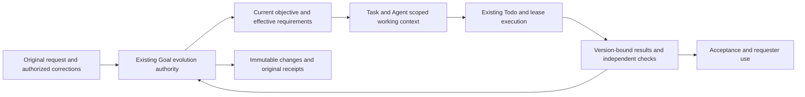

# RFC: Goal contract evolution and bounded working context (v0)

- **RFC status:** Accepted — effective on merge; this PR is a design proposal.
- **Supersedes / closes:** none
- **Delivery maturity:** Proposal
- **Authors / owners:** Core Goal acceptance/alignment (R4), authority storage (R5), context and product owners (R1/R2/R7).
- **Created:** 2026-11-14
- **Last normative revision:** 2026-11-14
- **Implementation baseline:** `1cdd9bbefd1d849ac8aa733bd3d80bc13ad0b722`
- **Language semantic mirror:** [中文](goal-contract-evolution-v0.zh-CN.md)

## 1. Decision and scope

Make acceptance maintenance part of **Goal evolution**, through the existing
Goal authority. The durable unit is a versioned commitment with its source,
applicability and evidence, rather than an ever-growing paragraph or array.
An immutable original request, the currently effective contract, historical
changes and observed results have different lifetimes. Retaining intent does
not require every historical sentence to remain an active obligation forever.

[Goal alignment and governed amendment](shared-goal-alignment-and-governed-amendment-v0.md)
own changes to shared commitments; [outcome refinement](goal-outcome-refinement-v0.md)
owns supporting requirements and reviews. This RFC composes those owners with
operating-objective revision. It defines no independent evolution service,
capability, scheduler, event journal or Python decision owner. The provider is
the selected canonical AuthorityStore; origin is builtin Core.

One source-bound change set may revise the operating objective and affected
requirements together, with explicit work/check impact and one commit result.
Each existing domain validates its own effects and authority. Evidence alone
can motivate a proposal; it cannot weaken user acceptance. Changes to budget,
permissions, stops or root scope still need their existing authority. Existing
explicit authorization is reused without another confirmation round.

The proposal changes neither the installed runtime nor today's limits. Sections
3–10 define the proposed contract, §2 records audited facts, §11 defines delivery
and §12 records decisions still needed. Implementation and live qualification
remain distinct from design acceptance. No experiment, migration or publication
beyond this proposal is authorized here.

## 2. Current behavior and the underlying failure

| Audited owner | What exists | Limit relevant to this proposal |
| --- | --- | --- |
| [Outcome rules](../../../loopx/control_plane/goals/outcome_requirements.ts) | Stable outcome/requirement IDs, sources, work links and current Agent review | Additive only; cannot replace an existing requirement description. At most 24 outcomes per Goal; each outcome permits 32 requirements, 64 sources and 64 work links. All declarations share 131072 UTF-8 JSON bytes; current reviews share another 131072. |
| [Acceptance transaction](../../../loopx/control_plane/goals/acceptance_authority.ts) | CAS, exact-operation replay, canonical readback | Refinement writes `goal_outcomes` inside the whole Goal projection and places the projected acceptance result in its receipt. Moving only prompt text does not remove storage/receipt growth. |
| [Operating objective](../../../loopx/control_plane/goals/goal_objective.ts) | Ordered revisions, owner apply, per-Agent adoption and new-execution guard | Revises objective text, explicitly not acceptance/permissions; history is itself capped at 64 revisions and 256 KiB. |
| [Governed amendment](shared-goal-alignment-and-governed-amendment-v0.md#93-bounded-local-implementation-and-operation) | An explicit local profile commits policy-bound work and keeps root commitments | This bounded implementation is not arbitrary requirement supersession or a general evolution engine. |
| [Native conversation](../../../loopx/chat_loopx_mode.py), [replan](../../../loopx/control_plane/work_items/replan_semantics.ts) | `refine_outcome`, objective preparation/adoption and semantic planning guidance | Ordinary corrections are directed toward additive refinement. Objective preparation is narrowly motivated by material user direction making the objective misleading. |
| [Goal UI](../../../apps/presentation/dashboard/src/features/personal-workspace/goal-outcome-requirements.tsx) | Read requirements/evidence/sources; append a requirement; preserve pending writes | Complete outcomes are loaded even when only three are displayed; there is no requirement revision/retirement journey. |

The capacity failure is a correct refusal under today's contract. Saving the
new request only in Vision does not repair it: Vision owns the execution route,
not acceptance. Raising the cap postpones failure; shortening requirements may
lose meaning; splitting Goals merely to evade capacity loses shared obligations.

The deeper mismatch is **monotonic accumulation used to represent evolving
intent**. A correction can supersede a condition; a recurring condition remains
applicable after one pass; an experiment result changes confidence, not the
commitment; an obsolete source stays historical without remaining in every
working context. These distinctions need explicit semantics before paging.

### Why the model may not use the existing evolution path

The source proves availability, not usage frequency. In particular,
[test_goal_objective_revision.py](../../../tests/control_plane/test_goal_objective_revision.py)
asserts that ordinary context does not proactively direct `prepare-objective`.
The native tool exposes preparation, but the normal correction path points to
outcome refinement; substantive objective judgment sits primarily in replan.
Further, objective revision cannot repair a full requirement declaration.
These are plausible discovery/action-fit gaps, not evidence that a particular
model ignored an available correct operation. Tool absence in a retained host,
unclear applicability, proposal/apply friction and failures after invocation
must be measured separately. More invocation counts are not the objective.

## 3. One evolving contract, several kinds of facts

| Fact | Authoritative meaning | Evolution rule |
| --- | --- | --- |
| Original request/root commitments | Historical origin and applicable authority envelope | Preserve exact source and lifetime; an operating revision cannot silently replace root authorization. A genuine change outside that envelope uses the governed owner or a linked successor lifetime. |
| Current contract | Current objective and effective requirement versions, scope and mandatory/optional applicability | Change only through an authorized, source-bound change set. An outcome remains part of its Goal, not a new budget or execution loop. |
| Plan | Work, dependencies, responsibility and chosen route | Existing Todo/Vision owners may replan within the contract. A different plan need not revise the Goal. |
| Evidence | Agent assessment, independent checks, artifact versions and provenance | Append/replace current observations through their existing owners; failure or staleness does not edit the requirement. |
| Evolution history | What changed, why, from which source, with what authority and impact | Keep immutable versions and original operation receipts; historical text is not automatically an active instruction. |

A requirement needs stable identity within the exact Goal lifetime, a version,
complete text, declared scope, source references and applicable work/check
bindings. An authorized revision links predecessor and successor explicitly.
An authorized withdrawal preserves the prior version and reason. Splits/merges
retain all predecessor identities and explicit coverage; text similarity cannot
establish equivalence. This is a proposed extension of registered Goal vocabulary,
not a new schema or enum shipped by this PR; implementation must register its
versioned contract and migrate every producer/consumer.

Satisfaction and applicability are separate. Passing once does not retire an
ongoing obligation, and retiring an obligation does not turn its failed history
into success. Archival moves storage, not authority or applicability. An outcome
with all current requirements satisfied does not close the root Goal. Independent
check results remain distinct from Agent claims and requester adoption.

Legacy sources are outcome-level: migration must preserve that granularity and
mark per-requirement provenance unknown where necessary. Do not invent which
historical message introduced which requirement. Sources may share exact
immutable content; different provenance identities must not be deduplicated by
similar wording. Natural-language extraction remains an Agent judgment, with
original sources reachable for checking omissions.

## 4. Evolution occurs at meaningful decisions

Use the existing direct-message, material feedback, replan and closeout paths.
There is no new per-Turn form, timer, mandatory proposal or keyword detector.
The Agent reasons from actual host provenance and current facts:

| Observation | Existing-owner response |
| --- | --- |
| New in-scope commitment | Add a requirement to its existing outcome; reuse an identical declared ID/version without generating another revision. |
| User changes a condition while retaining the purpose | Prepare an explicit replacement/withdrawal with preserved history; do not append contradictory active conditions. |
| User changes the operating purpose and its acceptance | Prepare one change set covering both, rather than independently applying a new title and old criteria. |
| New evidence or failed check | Update evidence and replan; propose a contract change only with a valid authority basis. Never make a failed result pass by weakening the criterion. |
| No material contract change | Continue or change the plan; no evolution write or repeated acknowledgement. |
| Scope/permission/budget change | Use the relevant governed authority. Missing authority holds only dependent effects. |

A change set names its original source identity, actor, operation identity,
expected affected record versions, exact additions/replacements/withdrawals,
reason, affected work/checks and retained conditions. The preview shows a readable
before/after and the authority required by each effect. The existing owner-apply
path enforces that authority; preparation cannot grant it. An Agent may record
already-authorized additions to its own outcome as today. A coordinator cannot
rewrite a peer's commitments merely by coordinating. Do not treat an ownerless
CLI spelling as proof of authorization.

The TS owner validates the whole change set, including current Goal lifetime and
shared constraint/index revisions. It atomically publishes objective/requirement
changes, their invalidation references, journal event and receipt. External
execution, peer plan edits and oracle runs are follow-up effects with existing
recovery, not falsely included in that transaction. A partially valid change set
is rejected rather than committing only the new objective. A separate explicitly
selected independent change may still proceed.

Keep the original operation for uncertain effects. A changed intent needs the
existing conflict/rebase path, never a new ID to disguise an ambiguous commit.
No-op identity equality is structural; models must not automatically collapse
semantically similar user requirements.

## 5. Storage and working context follow the semantics

### Durable records, bounded operations

Extend the existing TypeScript AuthorityStore contract to support versioned
record reads/writes and indexed snapshots. Keep the current contract root and
paged indexes separate from immutable requirement/objective versions, sources,
evidence and historical receipts. The root cannot contain an ever-growing list
of all record or segment pointers. A compact receipt references immutable
committed records and preserves a resolvable original result; existing receipt
bytes and replay identities are never rewritten.

SQLite is the first local implementation target; PostgreSQL uses the same logical
transaction under tenant/lifetime isolation. File remains the compatibility and
conformance baseline until a durable segmented publication protocol is qualified.
An unqualified provider must refuse the new write format explicitly, not emulate
atomicity with unrelated JSON files or switch providers automatically. Reuse the
[shared authority persistence work](shared-goal-authority-state-provider-v0.md#preferred-local-direction-and-compatibility-boundary)
instead of building an acceptance-only database. Merely putting the old whole
projection into a SQL row does not complete this migration.

Separate limits for one request, record, response page, decision context, retained
storage and operational disk reserve. Size a migration before cutover, including
backups, receipts and temporary writes. A multi-page change stages bounded chunks
and publishes one validated manifest only after all chunks exist; no prefix
becomes effective. The old 128 KiB ceiling stays authoritative for v0. New limits
need measured workloads and explicit contract approval, not a larger constant
chosen to make the reported failure pass.

### Complete decisions without complete-history prompts

Use the existing context owner and [unified work contract](controller-executor-unified-contract-v0.md).
A snapshot root identifies the exact Goal lifetime, contract revision, source
versions, declared coverage, mandatory shared constraints and resolvable detail.
Task-specific reads include linked requirements, dependencies, affected shared
constraints and contrary evidence. Summaries aid navigation; exact records remain
authoritative. Every page/cursor binds snapshot, query, actor and authorization;
expiry, missing detail or a digest mismatch is explicit, never a partial success.

[outcomeContextNavigation](../../../loopx/control_plane/goals/outcome_requirements.ts)
already uses registered relations and explicitly offers advice, not a reading
gate. Do not silently promote it to a proof of independence. Unknown/unbound
relations require relevant expansion and visible incomplete coverage; privacy
restrictions cannot be reported as zero obligations. Mandatory read obligations
remain with the existing contract owner. A bounded first response must expose
omissions and a usable batch read route. Final contract-wide acceptance uses
complete indexed coverage at one snapshot, including requirements beyond the
first page; a search result or top-k recall cannot prove completeness.

Caches and deltas bind exact baselines and source digests. Stale/missing baselines
fall back to a complete **relevant snapshot**, with explicit full pagination
when necessary, never silent truncation. Reuse already delivered current details;
unchanged turns need no additional read acknowledgement. These context changes
require producer-to-model-to-action qualification before replacing today's
complete outcome context. Smaller output alone does not establish preserved
obligations, lower total cost or better decisions.

## 6. Multi-Agent changes, concurrency and adoption

An evolution commit computes affected work from explicit requirement/work/check
relations. Missing coverage is unknown, not independence. Shared constraints may
legitimately affect every peer; a local condition need not invalidate unrelated
lanes. Responsibility transfer is an explicit authorized change with an existing
handoff and receiver acceptance, never a side effect of paging or compaction.

Maintain record revisions, a Goal-scoped commit cursor and provider revision as
distinct identities. Unrelated storage writes should eventually be retryable
without reauthoring a semantic proposal. The versioned command contract must bind
its immutable domain read/write set, including shared constraint revisions and
index/absence predicates, while the store validates them atomically. This prevents
write skew when two apparently disjoint changes jointly break a shared condition.
Same-record conflicts require rebase. Journal ordering alone is not read-set
validation. M1 may retain the existing global CAS with disclosed contention; M2
must qualify scoped concurrency. Never reinterpret v0 operation digests or
retry them with changed provider-revision arguments.

The existing replan/adoption path carries a durable affected-version checkpoint
for each Agent. At the next relevant execution boundary, that Agent reconciles
its own plan and binds its decision to the exact contract/work basis. Reuse normal
planning/writeback where possible. An unchanged adopted basis needs no repeated
receipt; one peer cannot adopt for another, and unrelated lanes need no unanimous
barrier. A notification or read receipt is not semantic adoption. Lost notifications
are repaired from canonical state, through existing scheduler/outbox mechanisms.

In-flight work retains original Turn/lease/settlement identity. The change set
records the lease impact of each affected work item through the existing R4
policy, including whether its work can continue, needs a revised basis before
its next protected action, or must stop. Missing lease impact holds the affected
change under the existing policy. The lease/Host owners carry out any required
transition; the contract commit itself spends no quota. The original Turn
remains recoverable for its owed effects. Existing stop and authority rules
still apply immediately where their owners require it.
Returned old-version artifacts remain inspectable with their original basis;
they cannot satisfy the new version until the acceptance owner validates current
coverage. Dependency consumers must explicitly adopt the validated revision and
return its result to the original request. A new requirement cannot be hidden by
settling an old Turn or accepting a stale artifact.

## 7. Make evolution discoverable and recoverable

Expose one **change to the Goal contract** journey through the existing
`goal-acceptance`/governed-change surfaces; retain current commands as versioned
compatibility adapters. The model receives a bounded before/after candidate and
callable applicable operation at an actual correction/replan decision. The host
supplies provenance and unresolved operation identity, not an inferred desired
answer. The Agent may conclude that only evidence or the plan changes. Do not add
a permanent long evolution lecture to every heartbeat, or force an amendment
merely to increase tool use.

Use the existing host request envelope/inbox to preserve a pending original
correction before dispatch. That retained request is **not effective acceptance**.
Distinguish known rejection, unconfirmed effect, committed contract and actual
work adoption. If capacity rejects a write, report that acceptance is unchanged;
keep the exact draft/source and recovery route. Vision may record the blocked
route, but cannot acknowledge the requirement as saved. Recover a lost response
from the original receipt first; after migration/rebase, retry or prepare a new
intent only under the appropriate existing operation rules. If no durable copy
exists, recover from authorized source history before asking the user to repeat it.
Dependent actions must not silently proceed against a contradicted contract;
independent authorized work can continue. This does not introduce a Goal-wide
stop or a separate queue of authoritative requirements.

In **Goal Overview → Supporting outcomes** and existing Goal settings, show the
current requirement text and a readable proposed change; disclose history,
sources, affected work/Agents and capacity detail on demand. Preserve unsent text
and original request across failures. Distinguish “saved”, “work needs review”
and independent verification; no optimistic acceptance badge. Show stale basis,
failed save, inaccessible source, conflict and retry on desktop and narrow views.
CLI and Lark native conversations use the same proposal/commit/readback owner;
Lark transport, delivery and original-conversation return need separate evidence.
No additional configuration editor is needed. A mock page does not qualify the
packaged journey against its real owning backend.

## 8. Migration, privacy and rollback

Inventory all current fields and consumers before replacing `goal_outcomes` or
objective history. Preserve `goal_id`, exact `goal_ref`, state/outcome revisions,
IDs, original objective/owner, full requirements, ordered work links, source refs
and summaries, review basis/items; preserve objective original text, complete
ordered revisions/digests, registered Agents and adoptions. Keep check bindings,
proposals, receipts and their historical result shapes. Unsupported fields fail
preflight rather than disappearing. No model-generated summary replaces bytes.

Migration is explicit and resumable: capture one consistent source revision;
stage records/indexes; verify ordered inventory, digests and old/new semantic
readback; briefly fence writes and revalidate the source; atomically select the
new format under the existing lifetime/store lineage. Concurrent source changes
restart the affected preparation. No dual writers, fake fresh Goal or receipt
rewrites. Upgrade alone does not migrate live state or activate new guards.

Old readers receive complete compatible readback only when it fits their honest
contract. Otherwise require an upgrade; do not label a truncated view complete.
After new-format writes exceed old representability, rollback uses a compatible
reader/writer or an explicitly qualified lossless reverse migration. Restoring
an old backup over new commitments is not rollback. Source-byte retention and
same-operation lookup remain required through compaction and restore.

All reads, indexes, counts, change events, caches and artifact resolution retain
existing principal/tenant/Goal lifetime and audience authorization. Shared
summaries cannot reveal private requirements through identifiers or counts.
Local File/SQLite scope does not establish cross-person ACL or cloud permission;
[shared authority](shared-goal-authority-state-provider-v0.md) owns that qualification.

## 9. Decisive acceptance

| ID | Required evidence | Acceptance and limit |
| --- | --- | --- |
| E1 | Real CLI + SQLite, original small state and synthetic state beyond both old aggregate caps and current collection counts; >64 objective revisions | Add a genuine requirement and review without deleting originals; restart/replay once. Old v0 limits still reject; new qualified format preserves exact history. Cover oversized single records, full disk, missing chunks and failed commit without partial authority. |
| E2 | One authorized correction changes objective and a condition; a second retires a condition; one repeating condition remains | Atomic current contract, exact predecessor/source history, untouched other obligations. Old failed evidence stays failed; recurring acceptance never becomes permanent success. |
| E3 | Two peers on dependent work plus an independent lane; competing and same-record changes; an affected active lease | No lost updates/write skew, correct affected sets and lease impact, independent continuation, receiver's own reconciliation, stale artifact rejection and original-result return. Recover the original Turn's owed effects once. Include new peers and ownership transfer. |
| E4 | A decisive constraint/contrary result beyond page one; incomplete relations, expired cursor, denied source and stale delta | Preserved decisions and full final coverage, explicit unknowns, no false completeness. Count all reads and recovery. |
| E5 | Native host correction → proposal/authorized commit → next work → artifact → check → requester use | Exact source and versions throughout; dropped reply, restart, duplicated message, disabled tools and stale host schema recover visibly. Scripted API calls prove transport only. |
| E6 | Matched real-model cases: addition, replacement, objective-plus-criteria change, evidence-only, no-change, malicious quoted instruction and missing authority | Correct operation or justified no-change; no instructions naming the expected tool in the task. Measure missed/false changes, duplicate amendments, preservation, adoption and actual outcome, not call count. |
| E7 | Packaged App desktop/narrow with long repeated text and mixed states; CLI readback; separate Lark return | User can discover, revise, inspect result, recover failure and see which work adopted it. Source, packaged, installed and model evidence remain separate. |
| E8 | Same workload/base/head: small Goal, growing retained history, growing active set; 1/8/32/100 Agent tiers | Measure p50/p95/p99 reads/writes, conflicts/retries, CPU/RSS/IO, total bytes/tokens, recovery and human attention; no small-Goal regression outside frozen allowance. Higher tiers are qualification targets, not launch promises. |
| E9 | File compatibility, SQLite real storage, isolated PostgreSQL tenant; migration failure/restore/old reader and original-receipt replay | Provider-qualified correctness, no automatic promotion or fallback. Unavailable PostgreSQL is untested, not a pass. |

Use the [measurement contract](long-horizon-harness-benchmark-research-program-v0.md#6-measurement-model)
for matched outcomes and complete costs, including context hydration and recovery.
Freeze numerical budgets before a run and preserve negative/unknown results.
Neither this proposal nor deterministic tests claim installed adoption or uplift.

## 10. Operational behavior and rejected shortcuts

Capacity readback separates active declarations, retained history, current reviews,
receipt/index growth, page limits and free-space reserve. Report the exact failing
budget and whether the request was rejected or its result remains unknown. Offer
existing retry/migration routes without suggesting removal of commitments.
Compaction retains resolvable exact versions and replay indexes, with bounded
recovery. Backup covers all referenced records at a consistent snapshot.

Increasing limits alone, lossily summarizing acceptance, archiving still-effective
requirements, creating another Goal to escape a cap, or treating Vision as the
fallback authority all violate the intended contract. Adding only a prompt to
“call evolution more often” leaves unsupported transitions and capacity intact.
A new vector store, CRDT or microservice is not required; conflict resolution
must respect authority and semantics rather than merge prose automatically.

## 11. Delivery through the existing roadmap

| Slice / owner | Complete useful exit | Dependencies and rollback |
| --- | --- | --- |
| M1 · R4 + R5 + S5 | A full existing Goal accepts and recovers one new correction through versioned record storage, bounded complete detail, CLI/native tools and packaged App; preserves v0 and historical receipts. E1/E4/E5/E7 plus local E9. | Reuse existing persistence/context owners; keep global CAS if necessary and disclose remaining concurrency cost. Explicit format cutover; compatible rollback. No isolated serializer-only milestone. |
| M2 · R4 + R2 | One objective-plus-requirement revision, authorized withdrawal and two real peer adoption/return cycles, including an independent lane and failure. E2/E3; scoped concurrency and shared-invariant validation. | M1; extend governed classes in place. No parallel amendment writer; historical operations remain replayable. |
| M3 · S11 + R6/R7 | Trigger-to-action model qualification and matched outcome/complete-cost evidence, plus shared provider and scale tiers. E6/E8 and remaining E9. | M1/M2 producer/consumer parity; existing experiment/provider authorization. No automatic promotion based on tool-call counts. |

Reuse canonical R4/R5 work rather than creating a competing program. These
slices do not postpone M1's UI/recovery or M2's independent acceptance to a final
polish phase. Model behavior qualification runs alongside integration as soon as
its path exists. Leave active Goal state and installation untouched in this PR.

## 12. Decisions before implementation

1. **R4 authority owner:** bind each new replacement/withdrawal effect to the
   existing governed policy or explicit owner direction. Recommend reusing both
   routes, not a blanket manual approval rule. Freeze effect/authority mapping
   before M2 writes; a source reference alone is insufficient.
2. **R5 store owner:** choose the exact indexed record/manifest seam and File
   compatibility profile. Recommend SQLite first with PostgreSQL parity; measure
   request/page/storage/recovery budgets before M1. No limit increase is approved.
3. **Context and S11 owners:** define applicable mandatory-read coverage and
   acceptance workloads before removing full inline declarations. Recommend
   existing relation-based navigation plus explicit unknown coverage and batch
   reads; it does not establish semantic independence or comprehension.

These are recommendations, not recorded maintainer approvals. Later normative
changes keep the Chinese mirror aligned; dated execution evidence belongs in
the owning RFC ledger. Current runtime contracts remain authoritative until each
versioned replacement and its consumers pass their declared gates.
