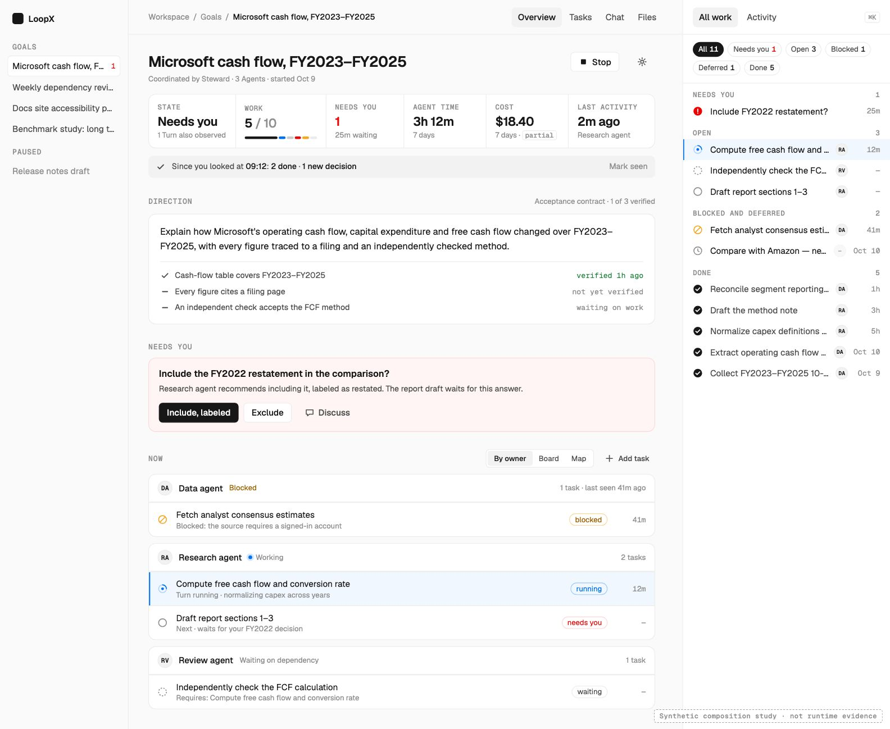
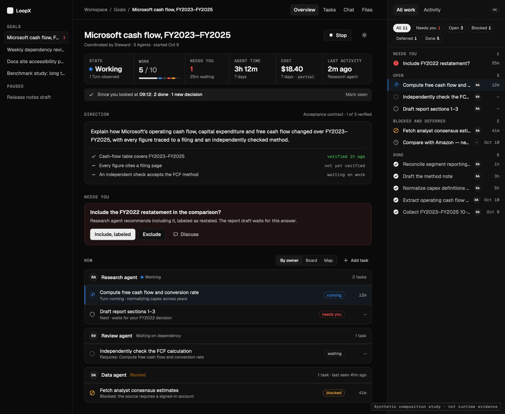
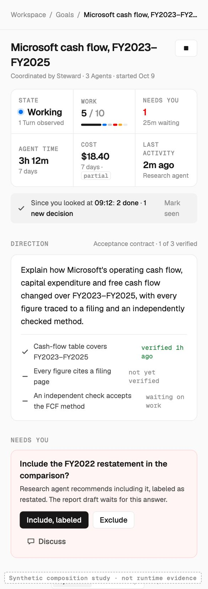

# RFC: Goal Workspace Surface v0

- **RFC status:** Accepted
- **Supersedes / closes:** none
- **Delivery maturity:** M1 merged in [#6191](https://github.com/loopx-project/loopx/pull/6191). M2 merged in [#6255](https://github.com/loopx-project/loopx/pull/6255). M3's since-you-looked delta is proposed (see the 2026-10-15 checkpoint); target declaration and M4 remain unimplemented; installed and live-team qualification is separate.
- **Owners:** existing workspace presentation owner. Data and action owners named in Section 5 keep their authority.
- **Created / normative revision:** 2026-10-11.
- **Implementation baseline:** `5c62c5c03`.
- **Language:** [中文版](goal-workspace-surface-v0.zh-CN.md) is the semantic mirror. Differences are defects.
- **Parent contracts:** [design system](../../development/design.md), [frontend delivery](../../development/frontend-delivery.md), [intelligent presentation](intelligent-review-presentation-surfaces-v0.md) §8 and Stage 4, [live team workspace](live-team-workspace-v0.md) W1–W3, [App conversations](app-conversation-and-async-inbox-v0.md), [usage and cost](goal-usage-token-cost-v0.md), [acceptance observations](../../reference/goal-acceptance-observations.md), [overall roadmap](loopx-overall-roadmap-v0.md) S5, R1–R3 and G0/G1.

Sections 1–10 are the design and acceptance contract; Section 4 records audited
current facts. Section 11 is the delivery plan and Section 12 lists unresolved
decisions. This document owns **the composition of one Goal's page and the
display semantics of its summary figures**. It owns no state, scheduler,
acceptance rule, cost computation or new action.

## 1. Decision summary

1. **One Goal, one composed page.** A persistent masthead (breadcrumb, title,
   team line, Stop/Resume, settings) and a vitals strip sit above every
   Goal view: Overview, Tasks, Chat and Files. Overview becomes the composed
   brief: Direction → Needs you → Now → Results, followed by the existing
   delivery section. A right-hand All-work rail accompanies it on wide screens.
2. **Every figure has one meaning.** Each vital is bound to one existing typed
   owner and declares its window, scope, coverage and unknown behavior
   (Section 5.3). Nothing is shown as a lifetime figure until an owner produces
   one. Done, accepted and adopted stay distinct.
3. **One reducer feeds every count.** A pure TypeScript reducer,
   `goal_workspace_digest_v0`, in the existing presentation boundary composes
   vitals, responsibility groups, rail order and the since-last-look delta from
   already-projected facts. The strip, rail chips, Now groups and Tasks board
   agree for the same snapshot.
4. **Decide in place.** Stop/Resume, gate decisions, task creation and, when
   its owner admits an App path, acceptance-target declaration use existing
   typed actions with preview, one confirmation and recorded readback.
5. **Expressive, never theatrical.** Live treatment requires an observed active
   Turn or worker. Motion is event-local and happens once per observed change.
   A dark theme is the inverse of the same tokens. A command palette launches
   existing projected actions only.

**Unchanged:** Todo, gate, quota, lifecycle, acceptance and usage authority;
the Tasks board, W1 map, Chat, Files and the Stage 4 delivery section keep their
contracts and become lenses or destinations of this page. **Default boundary:**
the Overview composition is a default UI change. M1 follows the repository's
first-screen evidence rule, with the concrete viewport in the PR description
and ordinary refinements within authorized direction requiring no extra confirmation. **Not approved here:**
new Todo fields (including display numbers), a lifetime usage aggregate,
browser authoring of executable acceptance checks, Lark or CLI parity, and any
live-team L1/L2 or G1 claim.

## 2. Problem and motivation

An owner returns to a Goal after a few hours ([GQ09](../../product/use-cases/steward/golden-queries.md):
"Pick up where we left off yesterday. Ask if you need a decision."). They want
five answers at a glance: is anything actually running, what needs me, how far
along is it, what did it cost, and what came back. Today the facts exist but
are scattered. Selecting a Goal often opens Chat. Needs-you items and a 24-hour
usage line live in Overview, lanes live in Tasks, Stop lives on a sidebar row,
outputs live in Files, and the work map sits inside the delivery section. Each
region uses its own window and wording. Nothing says what changed since the
owner last looked.

A familiar goal-page pattern answers these questions with a stat strip, a
brief, current tasks and an all-tasks rail. Copied literally, it would mislead:
a wall-clock "running time" implies work during idle hours; `#47` implies a
stable identity that native Todos deliberately lack; "54 done" reads as
accepted; a spinner derived from stored status implies activity nobody
observed. LoopX needs the legibility of that pattern with its own honesty
rules.

No current owner can solve this locally. The usage RFC owns cost fields, live
team owns the W-track and team scene, intelligent presentation owns item
disclosure and the delivery section, and Tasks owns lanes. None owns the page
as one object, so counts, windows and selection drift between regions.

### Invariants

- Composition reads. Writes happen only through existing typed actions with
  their preview, confirmation, fingerprint and readback.
- One typed classification feeds every count, chip, ribbon segment, group and
  rail section. Counts never come from prose. For one snapshot, all regions
  agree.
- Liveness comes from observation. Stored status, registration, a claim or a
  recent state write is not activity; stale observations show their age.
- Unknown is not zero. Partial coverage is visible. Every metric names its
  window and scope.
- Done, accepted and adopted are separate facts; Todo exhaustion is not Goal
  completion.
- Work is grouped by responsibility. Work without a resolvable owner goes into
  an explicit group and is never dropped.
- Display position is never an identifier.
- Opening, refreshing, switching lenses, opening the palette or replaying never
  starts work, spends quota or calls a validator.
- A failed source makes only its own region unavailable, with the reason; the
  rest of the page still renders.

## 3. Scope and non-goals

### In scope

- Page anatomy and responsive layout for one Goal in the packaged frontend.
- Normative semantics of each vital and of the since-last-look delta.
- The Now lens: responsibility grouping, ordering and row grammar.
- The All-work rail: sections, filters, ordering and coverage disclosure.
- Placement and readback of Stop/Resume, gate decisions, Add task and target
  declaration, all through existing owners.
- One selection model shared by Now, Board, Map, rail and the detail drawer.
- Keyboard map, command palette, glyph set, motion grammar and dark inverse.
- Validation of the above in the packaged frontend with a real backend.

### Non-goals

- New Todo, gate, acceptance or usage fields or stores. Section 12 routes such
  needs to their owners.
- Scheduler, wake, quota or cadence changes.
- Replacing the Tasks board, W1 map, Chat or Files.
- The live-team spatial studio and its L1–L3 journey, which stay in
  [Live Team Workspace](live-team-workspace-v0.md) and remain reachable from
  this page.
- Lark Goal Channel, manager home, public website or README first screens.
- The benchmark study dashboard.

## 4. Current-system contract

Facts at `5c62c5c03`:

| Region | Current owner / entry | Verified behavior | Gap for this RFC |
| --- | --- | --- | --- |
| Goal shell | `ChannelHeader`, `GoalSidebar` in the personal workspace | Title, activity chip, Overview/Tasks/Chat/Files tabs; Stop/Resume on sidebar rows | No breadcrumb or page-level lifecycle control; no persistent summary |
| Lifecycle | `goal.stop` / `goal.resume` from `loopx/control_plane/goals/operator_actions.ts` (`goal_lifecycle`, `requires_confirmation`, state fingerprint) | Stop pauses automatic Turns, leaves active attention and projects effective quota to 0; a running tool call is not killed; Todos, history, evidence and configuration remain; only Resume restores eligibility ([user guide §3.1](../../guides/personal-workspace-user-guide.md)) | Effect and in-flight work are not read back on the Goal page |
| Overview | `GoalOverview` | Progress sentence, Needs-you list, 24h tokens/cost/duration, then the Stage 4 delivery section (`task_graph_projection_v0`, W1 `goal_task_map_v0`, acceptance contract and observation) | No vitals strip; usage window differs from other surfaces |
| Tasks | `GoalTasksView` | Lanes: awaiting confirmation, pending/running, scheduled, completed; agent-lane filter; completed history from `/api/chat/completed-todos` | Not grouped by responsibility; text assignee; no observed elapsed time |
| Usage | `usage_summary` | 24h/7d tokens, `cost_usd`, `duration_ms`; fields absent when unmeasured; `sample_run_count`, `available` | No lifetime aggregate; no explicit per-runtime coverage |
| Acceptance | Goal authority via `goal-acceptance` (preview, provider CAS, exact replay); Dashboard reads only | Objective, criteria, coverage scope, bindings; observation projection is bounded and partial by design | No App declaration path; target absence is silent |
| Goal brief | Status Goal snapshot | Bounded declared Goal-document objective; progress and optional contract stay separate | Missing source content stays unavailable |
| Todo identity | Status `todoItemSchema` | Native Todos are addressed by `todo_id` and intentionally carry no synthetic index; legacy Markdown Todos keep `index` | A numbered rail would invent identity |
| Activity | `goal-activity.ts`, agent-lane `lastActivityAt`, host-thread activity, run timeline | Work-kind chip and per-lane observation | Not summarized as one observed last-activity fact |
| Themes | `workspace-theme.ts` (`loopx`, `paper`, `brutal`) | Light-first presets | No dark inverse of the LoopX theme |

## 5. Proposed architecture

### 5.1 Ownership and placement

Extend the existing personal-workspace presentation in
`apps/presentation/dashboard` and the TypeScript presentation boundary in
`loopx/control_plane/presentation/`, which already hosts typed action review
plans. **Placement:** no capability, extension or provider is added. The page
presents existing built-in owners. Intelligent presentation owns item
disclosure and the delivery section, and live team owns the team scene. Neither
owns cross-region page semantics, so this RFC owns composition only.

| Region | Data owner (unchanged) | Action owner (unchanged) |
| --- | --- | --- |
| Masthead | Goal registry and lifecycle activation | `goal_lifecycle` typed action |
| Vitals | Todo projection, attention queue, `usage_summary`, execution observation | None; each cell focuses its region |
| Direction | Recorded Goal-document objective; separate acceptance contract and progress observation (Section 12 D6) | Acceptance owner configures checks, not the Goal's recorded objective (M3, Section 12 D3) |
| Needs you | Attention and gate owners; action review plan | Existing gate decision actions |
| Now, rail | Todo projection, execution observation, run timeline, `goal_task_map_v0` relations | Todo create dry-run/apply; existing drawer actions |
| Results | Files and Goal-results owner; acceptance owner for badges | Existing open/read actions |
| Conversation | Chat and session owner | Existing composer |

**Forbidden substitutes:** frontend-only status classes that diverge from typed
owners; counts parsed from prose; acceptance inferred from a reviewer name or
artifact hash; activity inferred from `updated_at`, a claim or registration;
lifetime totals summed client-side from windows.

### 5.2 Page anatomy

*Synthetic composition study rendered with LoopX tokens from the public GQ01
example. It is not runtime evidence, not packaged UI and not an approved first
screen.*

| # | Region | Shown when | Earns attention because |
| --- | --- | --- | --- |
| 1 | **Masthead**: breadcrumb (Workspace / Goals / Goal), title, team line (Agent label or count, repository), Stop/Resume, settings | Always, on every Goal view; compacts on scroll | Identity and the one consequential control stay one glance away |
| 2 | **Vitals strip**: at most six cells; each cell is a button that focuses its region | Always | Answers moving / waiting on me / how far / what cost in one line |
| 3 | **Delta line**: "Since you looked at 09:12: 2 done · 1 new decision" | Only for a material delta; cost omitted until its owner qualifies the interval | The return moment the product promises |
| 4 | **Direction**: recorded Goal objective, separate optional acceptance criteria and verification state | Always; criteria only with a contract | What the Goal is for; what its configured checks establish |
| 5 | **Needs you**: decision cards with recommendation, consequence and actions | Only when non-empty | Decisions are the owner's actual work |
| 6 | **Now**: lens switch (By owner / Board / Map) and Add task | Open work exists | Who is doing what, who is blocked |
| 7 | **Results**: returned outputs, with acceptance shown separately | At least one result | What came back and whether it is trusted |
| 8 | **All-work rail**: tabs All work / Activity, filter chips, sections | ≥1200px; drawer below | Complete inventory without leaving the brief |
| 9 | Existing **Delivery and evidence** section | As today | Stage 4 contract unchanged, below Results |

Opening a Goal from the sidebar, workspace home or a Goal URL without a view
starts on Overview. Explicit Tasks, Chat and Results links keep their destination.

Chat remains a direct destination. "Discuss" on a decision or row opens Goal
Chat with that subject attached through the existing composer; it does not
create a second conversation store.

All three studies show work and decision changes without since-last-look spend. The $18.40 vital remains a coverage-marked 7-day total. Work 5/10 excludes the separately listed user decision; these counts have different scopes.

### 5.3 Vital semantics

Every vital is a typed record: `value`, `window`, `scope`, `basis`,
`coverage: complete | partial | unknown`, `availability: ok | loading |
unavailable(reason)`. The table is normative.

| Vital | Source | Display | Unknown / partial | Never |
| --- | --- | --- | --- | --- |
| **State** | Lifecycle activation plus the existing activity presenter (`presentGoalActivity` over `goalExecution`); the reducer adds only the stop-finishing fact | The presenter's state and priority: a waiting decision leads, and an observed run stays visible in the subline ("another run is active"); "Running" carries live treatment only while an active Turn or worker is observed; otherwise quiet / scheduled / stopped. Subline names the basis, such as the observing host and age | Observation unavailable: state without live treatment plus "activity unknown" | Live treatment from status, claim or registration |
| **Work** | Todo projection for this Goal: non-archived Agent advancement Todos; done count from the same snapshot | "done / total" and a ribbon segmented by typed display class (Section 5.6) | Done count unavailable: open count only, labeled | Counting user decisions or wishes as work; presenting done as accepted |
| **Needs you** | Goal-scoped blocking attention items (user gates, run operator gates) | Count and oldest waiting age; danger color plus icon when above zero; zero recedes | Read failure: "unavailable", not 0 | Non-blocking wishes |
| **Agent time** | `usage_summary` duration over the widest available window (7d, else 24h) | "3h 12m · 7 days" | Absent: "—" with "not measured"; owner-signaled sampling gap: "partial" | Wall-clock Goal age; a lifetime figure |
| **Cost** | `usage_summary` `cost_usd` over the same window as Agent time | "$18.40 · 7 days" | Absent: "—", never "$0.00"; a measured zero shows "$0.00"; "partial" only from an owner coverage signal | A budget, a price estimate unless the owner marks it estimated |
| **Last activity** | Most recent observed execution fact: an observed run's last activity, host-thread events, Turn or run events | Relative time and actor | No observation: "—" with "No observed activity" | `updated_at`, agent-lane `last_activity_at` (derived from Todo writes; its producer documents it as a hint, not liveness), a claim, a registration or a configuration write |

Agent time and Cost always share one window. Where the owner provides no
coverage signal, the cell names its window and source and makes no
completeness claim (Section 12 D4). When the Goal owner projects a creation
time, a Goal age such as "started Oct 9" may appear in the masthead line, never
as runtime.

### 5.4 Now: responsibility groups and row grammar

**Membership.** Now shows open work that is running (observed), claimed,
waiting on a dependency, blocked, or next runnable. Done and deferred work
appear in the rail. Decisions appear in Needs you, and the work they hold is
badged in its group.

**Grouping.** One group per responsible member (claim or agent lane), with the
member's observed state summarized in the group header. Work without a
resolvable owner goes into an explicit "Unassigned" group. Group order: groups
that need attention (blocked, failed) first, then observed working, then
waiting, then idle. Within a group: running, held by a decision, next, waiting,
blocked. Ties follow the `goal_task_map_v0` dependency order, then `todo_id`.

**Row.** `glyph · title · one reason line · typed badge · time`.

- The glyph differs by shape and carries a text label; color is secondary.
- The reason line carries exactly one fact: the running step, "Requires: …",
  the public-safe blocked reason, or "deferred until …".
- Time is the elapsed time since the observed Turn start for running work, or
  the waiting age for decisions and blocked work when the owner records it.
  Otherwise it shows "—".

**Lenses.** Board is the existing `GoalTasksView`; Map is the W1
`GoalWorkMapView`. Selecting a Todo anywhere (row, board card, map node, rail,
palette) opens the existing detail drawer, highlights the same Todo in the
other regions and records `todo` in the URL so reload and back restore it.

**Add task.** An inline composer uses the existing Todo dry-run, shows the
preview, applies after one confirmation and reads back the created row in its
group. A failed apply keeps the draft and shows the owner's error.

### 5.5 All-work rail

- **Sections in typed order:** Needs you → Open (running first) → Blocked and
  deferred → Done (newest first, virtualized, paginated by the existing
  completed-history owner).
- **Filter chips** carry counts from the same classification as the strip.
  Search matches titles.
- **Activity tab:** material events only (done, blocked, decision recorded,
  result returned, acceptance changed) from run history and the timeline.
  Routine progress folds.
- **No numbers.** v0 shows no `#n`, because native Todos intentionally have no
  synthetic index and a position counter would read as identity. A copyable
  reference stays in the drawer's diagnostics disclosure (Section 12 D1).
- **Footer** states scope ("Counts cover this Goal"), refresh time and any
  truncation (node limit, bounded history) as partial coverage.

### 5.6 Shared reducer: `goal_workspace_digest_v0`

A pure function in `loopx/control_plane/presentation/` takes already-parsed Goal
snapshot facts: Todos, done count, attention items, usage, execution
observations, lifecycle activation, an acceptance summary, a supplied
`observed_at` and an optional previous digest. It returns vitals (Section 5.3),
typed counts, ordered Now groups, ordered rail sections and the delta. It
performs no I/O and reads no clock.

**Vocabulary.** It reuses Todo status (`open | done | blocked | deferred`),
attention kinds and the existing presentation states. It adds one closed set of
display classes local to the reducer: `running_observed`, `open`,
`waiting_dependency`, `blocked`, `deferred`, `done`. `needs_you` joins in M2,
once a decision-to-work relation is projected; M1 does not infer which work a
decision holds. It also adds the six vital ids. Both sets stay local until a second consumer (CLI or Lark) adopts the
digest. At that point they register with the semantic vocabulary registry
rather than being copied.

### 5.7 Since you looked

- Per (status source, Goal), the browser stores a last-seen digest in local
  storage: typed counts, decision ids, a bounded set of done Todo ids and the
  observation time. It stores no titles, content or cost ledger and makes no
  server write.
- On open, the reducer compares the current digest with that marker: newly
  done, new decisions, newly blocked and results returned. The current usage
  projection cannot establish spend since that marker, so this line omits cost.
- Matching rolling-window labels do not identify the same covered interval.
  If $100 expires from a 7-day window while $5 enters it, totals change from
  $100 to $5: their -$95 difference is neither the new $5 spend nor zero spend.
  Never subtract rolling totals or clamp that difference to zero to report
  since-last-look spend. The scoped/windowed Cost vital remains unchanged.
- Cost may enter this line only after the usage owner supplies spend for the
  exact interval between observations, or a monotonic cumulative counter with
  a stable source, scope, currency and counter generation, plus coverage and
  retention that make that interval valid (D7). Missing data, changed scope or
  coverage, or an owner unable to qualify the interval suppress cost without
  suppressing other known changes. The browser does not create another usage
  authority; an unavailable cost is never zero.
- The line appears only when a delta is material. The marker advances when the
  owner selects "Mark seen" or leaves the Goal after the line was shown.
- The line is not a notification channel and does not touch the attention queue.

For long-horizon research, the proposed [progress reading journey](../../product/use-cases/auto-research/long-horizon-progress-design.md)
uses this page and its shared selection to connect a native outcome/time window,
one episode/branch and inline versioned evidence. The already-open Goal needs
no setup; one selection should expose what changed, its check and subsequent
adoption or the exact gap. An optional comparison preserves window/focus and
labels unmatched or unavailable evidence. A summary or Todo-count delta does
not establish information gain or outcome improvement. Reuse the existing
since-last-look and usage semantics above; do not invent a second cost ledger,
progress percentage, live signal or writable graph. This is a design extension,
not delivered M1/M2 behavior; packaged source/access/recovery and comprehension
qualification remain required.

### 5.8 Direction and measurable target

- Always show the Goal's recorded objective independently of acceptance. Status
  transports the existing Goal document's `objective` metadata through the
  typed workspace digest, with the existing public-safety filter and a 1,000
  character bound. It performs no additional source read. Missing or unreadable
  content stays unavailable; a title, Todo, progress sentence, Agent Vision or
  acceptance contract cannot fill it. Current progress is a separate disclosure.
  An enabled acceptance contract keeps its own scoped objective and criteria.
- Each criterion shows its owner state: verified (with time), failing, not yet
  verified, or waiting on work. A summary reads "1 of 3 verified". Observation
  partiality stays visible; an absence of gaps is not acceptance.
- **No contract:** a quiet "Acceptance criteria are not configured (optional)"
  line when that absence is observed; an older or incomplete source says that
  criteria were not provided. Existing Goal settings own configuration. This
  never denies the Goal's objective, enables a contract or creates a new gate.
- **M3:** declaration goes through the acceptance owner: objective, criteria
  descriptions, coverage scope (`selected_work` or `all_advancement`) and
  bindings. It follows preview, one confirmation, provider CAS and readback, and
  a conflict shows the newer revision. Executable checks stay in the owner's
  local file (Section 12 D3).

### 5.9 Lifecycle control

- Stop/Resume sits in the masthead on every Goal view and uses the existing
  `goal.stop` / `goal.resume` actions with the current state fingerprint. Stop
  confirms in place; Resume opens the owner's existing reviewed preview without
  a second confirmation. The page stays on the Goal after either.
- The confirmation states the owner's effect in plain language: "Stops new
  automatic Turns for this Goal and removes it from active attention. A tool
  call already running finishes. Tasks, history, evidence and configuration are
  kept. Only Resume restarts it."
- After execution, the page reads back activation. While an active Turn is
  still observed, State reads "Stopping · Turn finishing", then "Stopped". A
  stale fingerprint is refused with a refresh prompt, and a repeated click does
  not repeat the effect. Remote sources keep the existing exact-host-alias rule.
- This control is distinct from the live-team "pause animation" control and
  from coordinator pause in the team panel, which does not stop workers.

### 5.10 Keyboard, palette, visual language and motion

**Keyboard.** `j`/`k` move within the focused list, `Enter` opens the drawer,
`Esc` closes it and restores focus, `g` then `o`/`t`/`c`/`f` switches view,
`1`/`2`/`3` switches lens, `/` searches the rail and `?` lists shortcuts. Every
region is reachable in tab order with visible focus.

**Command palette (⌘K / Ctrl-K).** It navigates to Goals, Todos and results.
It also invokes only the actions already projected for the current snapshot,
such as Stop/Resume, open settings, Add task or decide a gate. Each opens its
existing preview. The palette is a launcher, not an executor, and it accepts no
free-text instructions to Agents; that is Chat.

**Glyphs.** Done is a filled check; running is an arc with a core and appears
only when observed; open is a ring; waiting is a dashed ring; needs you is a
filled exclamation; blocked is a slashed ring; deferred is a clock. Shapes
remain distinct in grayscale.

**Color.** The base is monochrome per the design system. Blue is reserved for
observed activity, danger for needs-you, warning for blocked and green for
verified acceptance.

**Motion.** Motion happens once per observed change. A row glyph changes in at
most 200ms when a snapshot shows a transition, a new decision enters in at most
250ms and the delta line fades in. The live indicator is a static halo; an
optional slow pulse appears only for an observed active Turn and stops in
hidden tabs and under reduced motion. An unchanged refresh produces no motion,
and replay is labeled historical.

**Dark.** A workspace theme option inverts the same tokens. It is not a
separate identity.

**Responsive.**

- At 1200px and wider: sidebar, one content frame and the rail.
- From 768px to 1199px: the rail becomes a drawer toggled from the masthead.
- At 640px and narrower: one column in this order: masthead with an icon Stop,
  vitals in a 3×2 grid, the delta line, Needs you and Now. Current progress collapses; the recorded Goal objective stays visible,
  and All work opens from the top bar.

### 5.11 Research Goals: whole-history Explore and on-demand analysis

**Proposed product refinement; not implemented or scientifically qualified.**
The default research view must answer what happened across the whole recorded
research history, including a study lasting well over ten hours. A selected episode
is a detail of that history, not the default unit of the page. This extends
the existing Goal workspace and Explore read model; it adds no graph authority,
scientific score, scheduler or evaluator implementation.

**Layer 1 — default Explore history.** Opening a research Goal requires no
configuration or extra model call. One graph covers its recorded time span,
with questions and competing routes organizing attempts across Turns, explicit
forks, inheritance, reversals, positive/negative evidence and subsequent
decisions or observed adoption. Reuse the native outcome curve, measurement
times and scoring conditions alongside the history. Task dependency edges,
research relationships and outcome attribution retain their distinct meanings.
Chronological neighbors are not causal or adoption links.

Fit the whole covered interval initially. Semantic grouping and progressive
detail may reduce density, but must preserve failed, abandoned and unfinished
routes, later work, old anchors, waiting and observation gaps. State the
requested interval, the interval actually observed and any unloaded pages or
retention limits. A recent page or summary must not be labeled complete
history. Missing attempt timestamps or route bindings remain unknown; a
reader repair or replay does not rewrite the original historical record.
Selecting a route/attempt once exposes its decisive authorized evidence,
artifact/input version, check and next decision inline. Refresh, back and
return to the whole graph preserve scoped focus or explain its invalidation.

When only Explore records are available, label the scope as recorded Explore
history. `recorded_at` is record time, including delayed analysis and historical
backfills, not an established native attempt timestamp or complete route/adoption
coverage. Parent/topic containment remains grouping even when an older projection
encoded it as `supports` with `materialized_from=node_parent_id`; it is not
scientific supporting evidence. Explicit source relationships retain their basis,
without being promoted to independent verification.

**Layer 2 — requested Agent analysis.** This is the product consumer of the
benchmark research owner's deep trajectory evaluation, not a second judge
built into the frontend. Reuse its analysis method and versioned result
sidecar, then generate an explanatory graph and conclusions over the same
history. The whole run and prospectively fixed comparison windows own coverage,
native outcomes and marginal cost; the research owner defines episode
segmentation, including cross-Turn episodes, and its explicit mapping through
source references, submission ids and artifact digests in the same snapshot.
A display grouping does not establish an
evaluation unit. Rubric, calibration and scientific claims remain with the
[long-horizon research program](long-horizon-harness-benchmark-research-program-v0.md#63-long-horizon-control-quality)
and [research evaluation owner](research-exploration-control-plane-v0.md#15-evaluation-and-claim-boundary).

**Current producers, not a completed analysis service.** Existing
[`benchmark_behavior_finding_v0` / `benchmark_behavior_report_v0`](../../reference/benchmark-behavior-findings.md)
support bounded `exploratory_behavior` observations and interpretations, not
scientific scoring. The toolkit's
[`public_trajectory_summary_v0`](../../../loopx/capabilities/benchmark_toolkit/README.md)
is a compact native Goal lifecycle projection, initially for DeepSWE, not a
complete research graph or quality assessment. The existing experiment board
owns native runs, comparability and integrity; its counts do not prove research
progress. The opt-in [trajectory assessment producer](../../reference/trajectory-assessment.md)
now owns a versioned input and result sidecar, source-bound fixed-pack registration,
execution, cancellation and historical readback. The workspace consumes that same
owner through its existing local Chat transport. It does not implement a general
research evaluation service or independently calibrated rubric.

The current product slice discovers a trusted host's registered pack for the
selected owner Goal. Its title names the actual case and episode window before
the single explicit analysis request; a matching result opens without another
model call. The owner Goal, analyzed solver/run and fixed episode need not be the
same history and must remain distinguishable. Unregistered cases are unavailable;
automatic whole-run segmentation is not implemented. Ordinary users never prepare
JSON paths or select an executable. Registration is a host/CLI preparation step,
not a renderer operation or a grant of new source access.

Results have three reading levels: the main question and original-objective
benefit gap; the episode's benefit-test and evidence-adoption explanations;
then optional individual judgments, original cited lines, method, coverage and
separate analysis usage. A useful diagnostic prerequisite can coexist with an
unperformed native utility test. There is no all-green quality summary or total
score. Unknown population, uncalibrated model interpretation and historical
applicability stay explicit. Closing, reopening and refreshing preserve the
Goal-scoped selected pack without launching work. A stored running receipt is
not presented as proof of current model activity.

The numerical reading proposal reuses the same pack selection without opening or
executing analysis. The toolkit's optional complete-session usage projection
supplies the capture window, completed Turns, elapsed and within-Turn time,
uncached/cached input and output. The first reading level names the window and
excluded study costs; input already includes cache, and output already includes
reasoning. A changed or missing capture retains historical values with an explicit
warning, independently of assessment applicability. A pack without this producer
shows unmeasured values, not zero. Case selection keeps the analysis panel closed
when it was closed and remains available while the selected source is loading.

Existing versioned assessment counts are a separate, optional reading level:
yes/eligible, no and unknown for each criterion, with no combined score and no
percentage when eligible is zero. They describe the selected sample, not the whole
run or independent calibration. Native incumbent/best/final values, threshold
time/cost, gain area and late marginal gain remain unavailable until the same
owner supplies comparable source-bound facts. Neither the browser nor model prose
may substitute for that producer. Packaged integration must distinguish this
partial numerical journey from native-outcome qualification and installed adoption.

Product and research must reconcile these existing producer/consumer facts
before choosing a runtime schema; this table is an integration requirement,
not a new protocol or a claim that a producer already supplies every item:

| Shared basis | Product consumption requirement |
| --- | --- |
| Source snapshot | Same Goal/source, revisions, full requested window, observed coverage, episode-to-event/artifact bindings and permitted audience; unknown and unallocated work retained |
| Evaluation basis | Input digest and coverage, method/code revision, model/configuration only if used, assessment time, qualification, actual cost/coverage and comparable controls; proposed or uncalibrated judgments labeled as such |
| Analysis result | One referenced, versioned sidecar and artifact digest with observations, interpretations, checks, adoption, supporting/counterevidence, uncertainty, abstentions and disagreements; generated graph claims point back to it |
| Validity | Input/artifact or method changes leave the prior result readable on its historical basis and mark its current applicability unestablished; a new result does not silently replace the old one |

With intent and scoped authority already present, one optional request should
be enough: reuse a valid matching assessment or let the existing authorized
Agent/execution owner prepare and perform analysis. Do not ask for source ids,
provider selection or graph construction. Any additional decision must follow
from a real missing fact, permission or cost boundary. Opening, refreshing or
selecting history never starts analysis. Show unavailable permissions/budget,
in-progress, cancellation, failure and retry through the existing action owner;
failure leaves Layer 1 usable. Repeated clicks or navigation do not duplicate
the request. Expose execution only when its owning path can actually perform it;
otherwise explain its unavailability. Analysis cannot borrow a frozen solver's
budget, cooldown or feedback opportunities. This RFC neither creates that action
nor grants model/run budget.

Keep the factual graph available while viewing the generated explanation.
Observation, Agent interpretation, independent check and actual adoption remain
separately sourced. A flat native score, many attempts, one review, a graph edge
or an attractive explanation cannot establish benefit. Analysis never changes
native scores or writes conclusions back as observed Explore facts. Only
audience-authorized projections reach the workspace. Protected evaluator
material requires a terminated solver **and** completed scoring, remains under
its existing access boundary and never enters solver context or runtime feedback.
This view does not authorize intervention in a frozen benchmark.

## 6. Alternatives and design choices

| Alternative | Decision | Reason |
| --- | --- | --- |
| Copy the reference pattern literally (flat list, `#n`, lifetime runtime) | Rejected | Breaks the identity, liveness and unknown-is-not-zero invariants |
| A separate Goal page route beside the workspace tabs | Rejected | Duplicates navigation; Overview is already the direct Goal destination |
| A Python-served page projection | Rejected | The TypeScript presentation boundary is the established owner; a Python decision mirror is forbidden |
| The W1 task map as every Overview's hero | Deferred | Ordinary work keeps its responsibility lens; research Goals use the whole-history Explore composition in Section 5.11, without turning task dependencies into research evidence; first-screen PR evidence still applies |
| Vitals on Overview only | Rejected | Owners working in Chat or Tasks would lose stop and needs-you context |
| Lifetime totals summed from windows | Rejected | Double counting and retention gaps; lifetime belongs to the usage owner |

## 7. Safety, privacy and compatibility

- No new authority. Every action reuses its typed owner with the fingerprint,
  confirmation and readback that owner already requires.
- Primary copy shows no protocol ids, machine paths, credentials or provider
  ids; those sit in the diagnostics disclosure. The local delta marker holds
  counts and ids only.
- Progressive loading stays per region. A loading or failed region never
  renders as empty success.
- Remote status sources stay read-only except lifecycle under the existing
  exact host-alias binding.
- Copy is bilingual from one terminology table: Work / 工作, Needs you / 等你决定,
  Agent time / Agent 用时, Cost / 成本, Last activity / 最近活动, Stopped / 已停止,
  Done / 已完成, Accepted / 已验收.
- Default change: while under review, M1 may ship behind a local view toggle.
  After the required PR review and merge authorization it becomes the default,
  with first-screen evidence in the PR description and release notes naming
  the changed Overview and masthead.

## 8. Migration and rollback

This is presentation only, with no state migration. Each milestone reverts on
its own; data, actions and owners are untouched. Existing `goalId`, `view` and
visited-view memory are preserved. The `todo` URL parameter is additive, and
the local delta marker can be deleted at any time without effect.

## 9. Validation and acceptance

| Claim | Test or evidence | Required result | Boundary |
| --- | --- | --- | --- |
| V1 Vital truth | Reducer fixtures written from Section 5.3 before implementation; packaged browser compared with `loopx status --format json` for a disposable Goal | Absent usage renders "—"; measured zero renders $0.00; stale observation has no live treatment; Agent time and Cost share a window | Does not qualify provider cost coverage |
| V2 Count agreement | One snapshot rendered in strip, chips, ribbon, Now, rail and Board; mutation case misclassifies one Todo | Totals equal; the mutation fails the test | Bounded projections disclose truncation |
| V3 Responsibility | Multiple owners, unassigned work, out-of-order timestamps | Correct groups and order; nothing dropped | — |
| V4 Stop journey (GQ08) | Packaged UI with the real Chat server on a disposable Goal | Preview → confirm → readback stopped; "Turn finishing" while observed; Resume; stale fingerprint refused; double click has one effect | Host heartbeat removal is the host's evidence |
| V5 Return journey (GQ09) | Two snapshots with synthetic progress; a no-change pair; same-label window with $100 expiring and $5 entering; changed window/scope/coverage and unavailable data | Known work/decision changes appear and can be dismissed; no change stays absent; cost stays absent until the usage owner qualifies the exact interval or a compatible monotonic counter; window differences never report new spend | Not a notification or spend-coverage guarantee; current usage projection cannot qualify interval spend |
| V6 States and access | Populated, quiet, blocked, stopped, loading, unavailable, partial, long titles; en and zh-CN; 1440/1024/390px; keyboard; reduced motion; dark contrast | All regions readable; AA contrast; full keyboard path; no motion under reduced motion | — |
| V7 Decide in place | Gate decision and Add task through existing actions, including a failed apply | Recorded readback; failure keeps the draft | — |
| V8 Target declaration (M3) | Preview, confirm, CAS conflict, readback; Agent-role invocation | Owner path succeeds; conflict shows the newer revision; Agent role cannot configure | Executable checks out of scope |
| V9 No side effects | Browser network assertions while opening, refreshing, switching lenses and opening the palette | No action, quota or validator request | — |
| V10 Render budget | 200-node Goal (the map node limit) | Threshold frozen before measuring, then met | Not live-team display scale |
| V11 Whole research history | Packaged UI and real read-only owner over an authorized multi-hour history with competing routes and multiple attempts; flat best score, negatives, old/missing anchors, absent timestamps/relations, pagination, duplicates, out-of-order events, disconnect and another Goal | Default zero-configuration whole covered interval; gaps/partiality explicit; one optional selection exposes decisive evidence; refresh/back, 390px, keyboard and reduced motion preserve meaning; no inferred causal edge or execution effect | A synthetic graph qualifies a prototype only; incomplete coverage cannot qualify complete history |
| V12 Shared deep analysis | The same pinned research assessment consumed by the packaged workspace, including uncalibrated/abstaining results, changed inputs/method, denied access/budget, repeated request, cancellation and failed/retried analysis | One authorized request reuses a matching result or executes once; source-linked explanation agrees with the assessment's source/version/coverage; stale results stay historical; Layer 1 survives failure; no scoring/solver-feedback side effect | Product usability and independent benchmark/evaluator qualification require separate evidence; specification or model agreement is not calibration |

Synthetic fixtures may prove composition. Journeys V4, V5, V7 and V8 also need
the real owning backend on disposable state. A skipped row is not green.

## 10. Operational contract

The page reuses progressive status and delivery-review reads; it adds no
polling loop or wake policy. Completed history pages through its existing
owner. Hidden tabs stop animation. Each region shows a typed failure with
retry, and stale observations show their age. No server state is added.
Upgrades follow the packaged Chat bundle window; open tabs reload after a
second upgrade.

## 11. Normative delivery plan

| Milestone | Shipped behavior | Entry gate | Exit evidence | Rollback |
| --- | --- | --- | --- | --- |
| M0 Contract | This RFC, the composition study and roadmap/RFC reconciliation | — | Docs governance smoke; owner review | Revert docs |
| M1 Masthead and vitals | Persistent masthead with Stop/Resume readback on all Goal views; vitals from `goal_workspace_digest_v0`; Overview order Direction (read-only) → Needs you → existing sections | Goal first-viewport evidence in the PR description | V1, V2 (strip), V4, V6, V9 | Revert composition |
| M2 Work lenses and rail | Now by owner with Board/Map lenses; All-work rail and Activity; shared selection and `todo` deep link; inline Add task; Results region | M1 | V2, V3, V6, V7, V9, V10 | Revert to M1 |
| M3 Direction and return | Since-you-looked delta; target declaration through the acceptance owner | M2; D3 decided by its owner | V5, V8 | Hide declaration; delete marker |
| M4 Live and expressive | W2 live state on rows and map from the execution observation owner; event motion; keyboard map and palette; dark inverse | M2; W2 observation available | V6 (motion, dark); live-team W2 acceptance | Disable motion/theme |

**Checkpoint 2026-10-15 (M3 since-you-looked, proposed).**
Section 5.7 is implemented in the packaged page: a browser-local marker per (status source, Goal)
holding typed counts, decision ids, bounded done Todo and result ids and the observation time;
no titles, content or cost, no server write. On open the page compares the current digest with the
marker and shows one line only for a material delta (newly done, new decisions, newly blocked,
results returned), dismissable with "Mark seen". A decision is an item the typed attention lane
classifies as waiting on the owner; an optional user action is listed but never counted. The
comparison waits for an owner refresh still in flight when the Goal opens, so against a real
service it compares the look that lands, not the snapshot it replaces. One refinement of 5.7 is
recorded: "Mark seen" acknowledges what is on screen, while leaving a Goal records only the look
that was compared on that visit, so a visit with nothing new still advances the observation time
and a change that arrived during the visit without being presented is reported next time. A
browser that denies local storage loses only this memory; the Goal stays readable. "Mark seen"
becomes the look the visit stands on and no write moves the marker back behind a newer
acknowledgment. Stored ids are evidence only while they cover the owner's whole set: past the
200-id cap, or for a partially listed set, only growth of the owner's count reports a new decision,
result or completion, and with no done total a capped done history reports nothing, so an unchanged
set never reports a change.
V5 is covered by a node test (no-change pair, trimmed marker, unavailable done count, denied
storage, 201 unchanged decisions past the cap, 201 unchanged completions with no done total,
resolved-and-raised within it), a fixture browser
scenario (first visit silent, no-change return silent, work and decision changes shown and
dismissed, leave-acknowledge, refresh then Mark seen then leave keeps the acknowledgment, 201
unchanged decisions silent, reload, no service write, denied storage getter) and a real-service scenario against a disposable Todo owner (optional user action silent,
CLI completion and gate counted as the lane counts them, Mark seen). Cost stays omitted per D7.
Target declaration (the other half of M3) remains undelivered.

**Checkpoint 2026-10-12 (M2 candidate, #6255).**
The existing TypeScript digest classifies responsibility, unassigned work and recorded decision dependencies;
masthead, Now, rail and Board share it. Map and delivery evidence share the existing snapshot read.
Only current typed dependencies affect waiting: lineage and Monitor generation conditions cannot become
completion prerequisites. Selection is scoped to Goal and source; loss of a current task withdraws actions
while retaining the existing exact-request reader. Inline creation is exercised through the packaged page,
a disposable real HTTP/Todo owner and independent CLI readback, including failed apply, retained draft,
regeneration and exactly one confirmed creation.

Targeted evidence covers V2/V3 classification/order/relation counterexamples, the V7 real write path,
V9 effect-free navigation and V10 local 200-item rendering. The V10 budget was frozen before measurement:
usable Now within 2 seconds after status response and loaded lens changes within 1 second. It qualifies
local packaged rendering, not cross-host latency or W2 live scale. V6 desktop/mobile and keyboard paths
have been inspected; the PR's final validation record owns the full regression result. Activity covers
material observations available in the existing timeline, not a complete audit or independent acceptance.
Results keep their existing readback validators; run summaries cannot prove adoption.
The narrow-screen presentation keeps the Goal objective visible, folds current progress and opens All work from the
masthead in a native dialog. Escape restores launcher focus; selecting a task returns to the existing
inspector. History keeps its loaded state when reads are inactive, and missing remote Todo links
show an unavailable notice without querying local owners.

M3, W2/W3, installed behavior and real L1/G1 delivery/original-route return retain their existing owners.
This candidate does not close those qualification gates.

**Checkpoint 2026-10-11 (M1 proposed at `6c3c0c104` in [#6191](https://github.com/loopx-project/loopx/pull/6191), subsequently merged).**
Verified subset: V1 reducer fixtures written from Section 5.3, mutation checks
and the packaged page on synthetic status; V2 strip and Board sharing the work
predicate; V4 Stop, finishing readback and Resume against isolated real Chat
action service and registry authority, plus rejection when the target disappears
after confirmation without recreating it or showing false success; V6 English/
Chinese, 1440/1024/390px, reduced motion, repeated shortcuts, Esc and focus return;
V9 no action requests before Stop. The packaged candidate includes read-only
Direction and an in-place decision rail; complete M2–M4 remain undelivered.
The owner approved the first-screen preview. This candidate changes default
Overview without a view switch. The PR remains draft: required full Python
validation has unresolved failure signals, and passing selected risk checks
does not clear exact-source qualification.
Untested: V1 against `loopx status --format json`, stale-fingerprint rejection
(the missing-target negative does not substitute for it), double-click
suppression, 200% zoom, dark contrast, installed App and real-model acceptance.
Deferred: scroll compaction, usage partial coverage (D4) and return spend (D7).
The M1 subset does not establish GQ08/GQ09 or live-team L1 completion.

This track runs beside R2/R3, like the W-track. It makes their outcomes legible
and does not pre-empt R1/R2 P0 repairs. It advances no L1, V4 or G1 gate. CLI
and Lark adoption of the digest are separate qualifications.

**Checkpoint 2026-10-16 (research-history refinement, proposed).**
Section 5.11 corrects a selected-episode-first journey: the default is one
whole-history Explore graph, followed by optional detail and requested deep
analysis sharing the benchmark owner's method and result. Deliver the read-only
history prototype and V11 packaged journey first; integrate the existing
authorized analysis action and V12 next, without waiting for every scientific
question to close. Research supplies permitted cases, assessment contracts and
method qualification; product owns rendering, interaction and result consumption.
This documentation establishes neither implementation, an available analysis
provider, evaluator calibration, installed behavior nor scientific benefit.
New first-screen compositions follow the repository evidence rule: concrete
viewport in the PR description, with no repeated approval for authorized refinements.

The current author candidate combines the scoped paginated history reader with
a default record-time lens and optional relationship view. Reading thirds,
density, source labels and explicit decisions remain presentation projections;
repeated decisions and delayed backfills must survive phase selection. Packaged
validation now reads three authorized real research checkpoints (Portfolio,
Graph and Ad placement), selected for actual downstream restoration, with all
315 original Explore records preserved. Complete retained trajectories and
source/restore manifests are pinned externally; the
[reproduction guide](../../../examples/personal-workspace-browser/research-history.md)
records hashes, coverage and redactions. All three sources lack explicit edges
and parent links; date or touch-target grouping does not fill that collection
gap. Independent coincident-point cases qualify precise pointer/keyboard access,
including refresh and narrow screens, without altering the real captures.
This is partial V11 evidence, not installed delivery or a completed V12 service.
The static Lark example discloses its route/decision excerpt limits; it does not
qualify the complete interactive history journey.

**Checkpoint 2026-10-17 (V12 fixed-pack workspace integration, proposed).**
The packaged workspace connects the registered-source producer to an explicit
analysis action, cancellation, retry and cited result reading. Reading or
refreshing an existing result never requests execution. All six analyzer-defined
process judgments are primary: goal alignment, benefit testing, discrimination,
information gain, evidence adoption and avoidable repetition. Each shows its
producer-owned yes/eligible, no and unknown counts; zero eligibility is N/A.
One optional disclosure reveals the episode, reason and citation; the shared
reader opens original source lines. Method, result identity and scope remain
inspectable. Usage and cost are secondary. Utility testing does not imply positive
utility, and finding repetition is not a positive result; there is no total score. Disposable real-HTTP/process checks cover duplicate
requests, cancellation, failed retry, owner isolation and changed sources;
packaged browser checks cover selection races, reload, keyboard and narrow
screens. A separately authorized real model journey exercises the same entry
and reuses its completed job on refresh. This is proposed fixed-scope V12
integration, not installed delivery, automatic preparation of arbitrary runs,
independent scientific calibration or completion of V12. Host registration
remains preparation outside the ordinary reading journey. CLI preparation uses
the producer's existing interface; no new interactive Lark path is qualified.

The follow-up native-readback proposal extends that same trusted registration
with an optional provider outcome capture, scoped to the exact case/run/revision.
The existing source disclosure separates first submission, best valid in capture,
native-retained and final valid values, with original citations and historical/
partial/unknown states. Submission order, not feedback arrival, identifies the
candidate. This is not another scorer or automatic solver feedback. Captured
solver usage and the current analysis attempt's receipt stay separate; full-study
cost and causal benefit remain unknown. No first-viewport/hero/CTA change is
introduced; six uncalibrated process judgments retain their existing role.

**Checkpoint 2026-10-18 (shared Goal source reading, proposed).** Source IO
now lives below presentation in `control_plane/status/goal_source.py`, reusing
native status, strict Explore validation and the shared history projection.
Local/SSH connection and host/container environment compose independently;
prepared scope selects one original Goal or all registered Goals. App, CLI and
Agents share source description, Goal listing, status and paged-history reads.
The thin workspace adapter retains existing UI endpoints. Configuration-derived
source identity binds requests, cursors and selection. Source manifests require
one explicit connection/environment/scope model. A failed source is visible in the main
view on narrow screens, cached contents are withheld and retry keeps that source.
Disposable native-host and real local-container reads, HTTP isolation/recovery
and packaged desktop/narrow journeys are verified; SSH composition has command
tests, not a live remote-host/container qualification. One local reader process
serves multiple source listeners and invokes native IO on cache misses; no CPU or
IO saving is established. This is a read-only increment: no management grant,
new execution Goal/registry, automatic analysis-pack binding or V12 completion.

## 12. Open decisions

| # | Decision | Owner | Options | Recommendation | Needed before |
| --- | --- | --- | --- | --- | --- |
| D1 | Human-speakable Todo reference ("fix #47") | Todo bounded context | None; display-only position; an owner-assigned per-Goal sequence written at creation and never reused | None in M1–M2; adopt the owner sequence only when Chat references to tasks show a repeated need. It is an additive field with a backfill rule | Any numbered UI |
| D2 | Lifetime usage | Usage RFC owner | Window only; an owner aggregate since Goal creation with retention disclosure | Window only until the owner ships a lifetime aggregate with coverage | Any lifetime figure |
| D3 | App authoring scope for acceptance targets | Goal acceptance authority | Descriptions, scope and bindings with checks kept local; full check authoring; none | The first option | M3 |
| D4 | Usage coverage signal | Usage RFC owner | Sample counts only; explicit measured versus observed runtimes | An explicit field before "partial" means more than sampling | M1 "partial" beyond sampling |
| D5 | Dark theme default | Presentation owner | Opt-in; follow system preference | Opt-in until AA review on real data | M4 |
| D6 | Goal objective in status | Goal registry / Vision owner | Recorded Goal-document objective, independent of acceptance and progress; unavailable remains explicit | The additive field, public-safe and length-bounded | A brief for Goals without a contract |
| D7 | Since-last-look spend | Usage RFC owner | Omit cost; owner-qualified interval aggregate or compatible monotonic counter | Omit cost until source/scope/currency/generation, interval coverage and retention are qualified; no rolling-total subtraction | Any cost in the M3 delta line |

## Appendix A: Execution ledger

No entries yet. Dated entries belong in
[`ledger/goal-workspace-surface-v0/`](ledger/README.md).

## Appendix B: Decision log

| Date | Decision | Owner / approval | Alternatives | Sections |
| --- | --- | --- | --- | --- |
| 2026-10-11 | Propose page composition and vital semantics over existing owners | This RFC's pull-request review | Section 6 | 1–12 |
