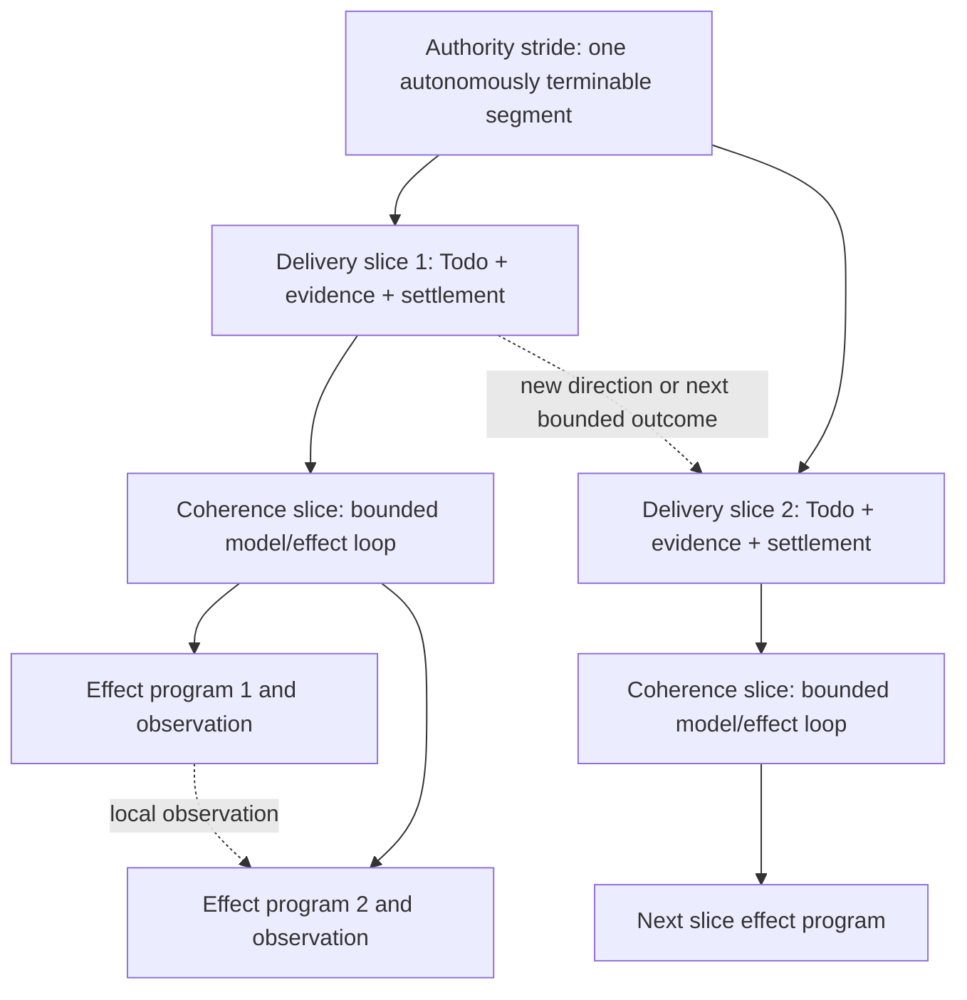

# RFC: Hierarchical Agent Stride Control v0

| Field | Value |
|---|---|
| Status | Accepted |
| Supersedes / closes | none |
| Date | 2026-08-15 |
| Authors | LoopX maintainers |
| Scope | Effect feedback, bounded delivery, research scope, authority escalation, and long-horizon outcome/cost |
| Tracking issue | [#3203](https://github.com/huangruiteng/loopx/issues/3203) |
| Source baseline | LoopX `d03863fd0`; source-level decision followthrough refinement below |

> Language note: the
> [Chinese version](./hierarchical-agent-stride-control-v0.zh-CN.md) and this
> English version are semantic mirrors. A difference between them is a defect.

## 1. Decision Summary

LoopX should treat **stride** as a hierarchical control problem: how much
semantically coherent work should be admitted before the next feedback,
settlement, or authority boundary.

The system has three nested strides:

1. **Effect stride**: work before the next decision-relevant environment
   observation returns to the model. Its target unit is an effect program
   inside one coherence slice.
2. **Delivery stride**: work before the next light control intervention and
   durable settlement. Its target unit is one bounded, evidence-backed delivery
   slice owned by a Todo.
3. **Authority stride**: work before the next heavy intervention that may
   change scope, acceptance, permission, or direction. Its target unit is one
   autonomously terminable segment.

These are not three independent timeouts and not three fixed counts. The inner
stride is owned by the host and effect interpreter, the middle stride by the
LoopX Turn/Todo/settlement lifecycle, and the outer stride by goal, vision,
gate, and human authority. An inner result may force an early delivery
settlement; a delivery result may force an early authority escalation. A
scheduler tick alone must not manufacture either semantic transition.

Research makes delivery stride a **vector**: work-slice size, distance from the
current mechanism, and validation breadth. These coordinates can move
independently. A long
slice can perform many correct local checks without obtaining new information
about the remaining goal gap. Fewer control events cannot fix that failure.
Conversely, a small late gain near a task's attainable limit may be useful;
elapsed time or a flat score alone cannot select a larger experiment.

The delivery controller therefore closes **decision -> actual work -> evidence
-> next decision**, while the existing owners retain execution and settlement.
The current bounded implementation returns the previous accepted Vision path
and subsequent recorded progress to replan, with goal gain explicitly unknown.
This is decision input and Agent guidance, not adaptive scheduling, a result
adoption gate or proof of research utility. Automatic policies remain opt-in
proposals requiring repeated qualification. Research-state branches provide the
counterfactual test without discarding the accumulated work.

The core judgment is:

> Long-horizon efficiency comes from placing semantic boundaries well, not
> from maximizing uninterrupted work or minimizing protocol events in
> isolation.

## 2. Why One "Turn Length" Is Not Enough

Long-running agents are often tuned with one vague variable: make the turn
longer or shorter. That collapses three different questions:

- How many causally related tool effects can execute before the model needs to
  reconsider its next action?
- How much outcome-bearing work can execute before evidence and state must be
  durably settled?
- How long can an agent continue under unchanged authority before a user or
  supervisor must decide anything?

A single setting cannot answer all three. The same model may safely run a large
read-only tool program, require a small checkpoint before modifying a fragile
artifact, and still operate for hours without human attention while its goal
and permission boundary remain stable.

The opposite failure is also common. A host may interrupt every small Todo,
force repeated quota and scheduler ceremonies, and ask the user for progress
without creating new authority. The agent appears controlled, but useful work
density collapses.

The three-stride model explains both sides:

| Boundary | Too short | Too long |
|---|---|---|
| Effect feedback | Excess model roundtrips, context re-entry, and tool-call overhead | Decision-relevant observations are consumed late; errors and side effects compound |
| Delivery settlement | Fragmented Todos, repeated scheduling, local-completion bias | Evidence becomes stale, writeback is delayed, and one Todo hides direction changes |
| Authority intervention | Human attention and supervisor churn without new authority | Scope drift, late steering, permission mistakes, and dishonest non-termination |

The objective is therefore not "larger stride". It is the largest stride that
preserves decision coherence, reversibility, evidence freshness, and authority
correctness for the current model and work class.

## 3. Terminology

### 3.1 Feedback hierarchy

This RFC uses three kinds of external feedback:

1. **Environment feedback**: tool results, repository state, test output,
   remote API responses, or other observations that can change the next action.
2. **Control feedback**: quota decisions, scheduler wakes, Todo state,
   validation results, writeback receipts, and replan obligations.
3. **Authority feedback**: user steering, user gates, protected-operation
   decisions, goal or acceptance changes, and supervisor proposals that a
   legitimate authority accepts or rejects.

Environment feedback informs action. Control feedback qualifies and settles a
bounded slice. Authority feedback may change what work is legitimate.

### 3.2 Coherence slice

A **coherence slice** is the largest local sequence of model decisions and tool
effects for which all of the following remain stable:

- the immediate objective and postcondition;
- the active hypothesis or implementation direction;
- the permission and reversibility boundary;
- the evidence needed to decide whether the slice succeeded.

At the LoopX product boundary, one governed Turn should represent one bounded
delivery slice and one coherence slice. A host may implement it with one native
model turn or a bounded multi-step model/tool loop. Provider-native terminology
is not the contract.

### 3.3 Bounded delivery slice

A **bounded delivery slice** is one scheduled, Todo-anchored outcome with:

- a verifiable postcondition;
- an explicit effect, time, or work budget;
- fresh evidence;
- targeted validation;
- durable writeback and settlement.

One bounded delivery slice should normally align with one coherence slice. It
has one selected Todo as its causal anchor and may, in fine-grained mode, close
a bounded chain of evidence-qualified checkpoint Todos while direction remains
unchanged. A new direction is a new slice. A broad Todo must be split when an
intermediate result is expected to change direction or authority.

### 3.4 Autonomous segment

An **autonomous segment** is a sequence of bounded delivery slices executed
under one stable authority snapshot. It ends honestly with one of:

- accepted goal or milestone outcome;
- coverage-backed exhaustion or no-follow-up;
- a concrete blocker;
- a user or protected-operation gate;
- an explicit scope or acceptance change.

An elapsed timer, a status report, or completion of one local Todo is not by
itself an autonomous-segment terminal.

## 4. Current Truth and Missing Pieces

This section is intentionally maintained as implementation evolves. Shipped
behavior is defined by code and stable protocol references; this RFC records
the research direction.

### 4.1 What exists today

| Layer | Current LoopX truth |
|---|---|
| Effect | The [Agent Loop Effect Interpreter RFC](./agent-loop-effect-interpreter-v0.md) defines typed effect request, interpretation, observation, and settlement semantics. |
| Turn | The [LoopX Turn protocol](../../reference/protocols/loopx-turn-v0.md) governs decide -> execute -> validate -> commit and keeps scheduler handoff outside settlement. |
| Delivery | Execution profiles distinguish standard and fine-grained Todo contracts; fine-grained mode uses a coherent-slice turn budget and evidence-sensitive successor creation. Every admitted heartbeat still performs full durable settlement. |
| Continuation | In addition to same-Turn controller dispositions, a typed delivery-continuity reducer can preserve the latest accountable `outcome_progress` Todo across heartbeat wakes while that same Todo remains open, actionable, capability-ready, and owned by the same agent. |
| Progress | Typed progress observations, repeat detection, semantic replan closure, and evidence projections can distinguish material delta from maintenance. |
| Review feedback | The replan context source implementation can return the last accepted evidence-linked Vision path and subsequent recorded progress references. History append order and Goal/Agent/Turn lineage bind this input; missing execution and goal gains remain unknown. It does not certify that a proposed intervention ran. |
| Research | The [Research Exploration Control Plane RFC](./research-exploration-control-plane-v0.md) defines an optional typed knowledge frontier and composition experiments. |
| Authority | Goal vision, user gates, permission policy, and peer/supervisor boundaries remain separate from execution and scheduling. |

### 4.2 What is missing

| Gap | Consequence |
|---|---|
| Incomplete outcome-linked observations | Read-only M1 counts and review followthrough exist, but they cannot explain task gains, model/tool cost, settlement cost or authority churn without provider evidence. |
| No qualified research-scope policy | Continued local tuning can be mistaken for broad exploration; generic progress identifiers do not establish mechanism novelty or useful information. |
| No model capability profile for stride | A fast tool-using model and a slower protocol-reliable model receive mostly static execution contracts. |
| No semantic split/merge qualification | Todo granularity is configured or prompted, but not evaluated against observed decision changes and settlement cost. |
| No interruption-value model | Periodic reports and genuine authority changes are not measured separately. |
| No qualified adaptive promotion path | Shadow input does not yet establish model adoption, matched continuation benefit or a promoted model/work-class policy. |
| No qualified research-state branch | Code snapshots alone cannot preserve conversation, accumulated evidence and evaluation opportunities for a fair continuation comparison. |

## 5. The Three-Layer Model



The hierarchy is nested, but the inner effect count and the outer delivery
count are not fixed. A governed Turn normally aligns one delivery slice with
one coherence slice, while that slice may contain many model/effect cycles and
a fine-grained causal checkpoint chain. An autonomous segment may contain one
delivery slice or many. Semantic stop conditions dominate numeric ceilings.

### 5.1 Effect stride

**Question:** how much causally dependent environment work should execute
before a decision-relevant observation returns to the model?

**Owner:** host agent loop, tool runtime, and effect interpreter.

**Target unit:** one bounded effect program within a coherence slice.

**Continue when:** every next effect is a causal consequence of the current
decision, intermediate observations can be consumed locally without changing
the governing hypothesis, effects remain within the same permission and
reversibility class, and the program stays inside declared budgets.

**Stop when:** an observation can change the next plan; a permission, safety,
or irreversible boundary appears; the local hypothesis is contradicted; the
output needed for validation is available; or a compute, wall-time, call, or
output ceiling is reached.

DeepSeek Harness **Code Mode** is a concrete public example of widening this
stride. The model writes a Python or TypeScript program that can loop, branch,
fan out, and post-process tool results without returning every intermediate
result to model context. Tool subcalls still traverse the same policy and guard
pipeline. That can reduce model roundtrips without weakening effect authority.

Code Mode does not imply that a Todo should become broader or that human review
should become rarer. It changes one layer only.

### 5.2 Delivery stride

**Question:** how much outcome-bearing work should execute before LoopX
validates, writes evidence, refreshes durable state, and settles the slice?

**Owner:** Todo, Turn, validation, writeback, quota, and settlement contracts.

**Target unit:** one bounded delivery slice and coherence slice with one stable
postcondition.

**Continue when:** the Todo postcondition is unchanged; fresh evidence supports
the same direction; a successor is causally related rather than prewritten;
there is no open replan or authority obligation; and the bounded chain remains
inside its safety ceiling.

**Stop when:** the postcondition is met; evidence changes direction; validation
fails in a way that requires a new hypothesis; a replan obligation opens; a
user or permission gate appears; or further work would make the evidence and
writeback stale.

A scheduler wake is not a delivery closeout. A normally admitted open
advancement Todo starts with an `in_flight_continuation` settlement boundary;
after an accountable `outcome_progress`, the next heartbeat also resumes that
same Todo ahead of a newly reordered sibling while the postcondition, claim,
capability readiness, and authority facts remain stable. A heartbeat receipt,
blocking work lane, autonomous replan, control repair, delivery denial,
`outcome_gap`, Todo completion/blocking, or claim transfer ends that continuity
and returns selection to the ordinary typed frontier.

Continuation does not create a lighter settlement class. Each heartbeat still
validates, durably writes back, and spends quota under the existing accountable
settlement contract. The additive `in_flight_continuation` boundary changes
only vision-checkpoint timing: intermediate progress on the same Todo records a
typed continuation checkpoint without demanding a fresh vision decision.
Completion, durable Next Action changes, replan, gaps, and terminal outcomes
remain `semantic_closeout` boundaries and retain the strict vision contract.
Multi-slice bursts and redundant scheduler-ACK suppression remain separate
experiments; they are not implied by sticky Todo selection.

Todo granularity should be defined by **decision stability**, not line count,
file count, command count, or elapsed minutes:

- a Todo is too broad when a plausible intermediate observation can change the
  direction, acceptance test, or required authority;
- a Todo is too narrow when it records only a mechanically dependent substep
  whose result cannot change the next decision and whose separate settlement
  adds no reusable evidence.

The existing fine-grained contract is a useful experiment, not the final
answer. It already permits several causally related advancement Todos in one
coherence slice after inspecting fresh evidence, while forbidding a prewritten
long runnable chain. This RFC generalizes the measurement problem around that
behavior rather than replacing it.

### 5.3 Authority stride

**Question:** how long may the agent continue before an intervention is allowed
to change scope, acceptance, permission, or direction?

**Owner:** goal and vision acceptance, user gates, protected-action policy, and
human authority. A supervisor may propose; it does not acquire authority by
observing or scheduling work.

**Target unit:** one autonomously terminable segment.

**Continue when:** the authority snapshot is stable; selected work remains
inside accepted scope; no protected operation requires consent; evidence
supports continued autonomy; and one honest terminal remains reachable.

**Stop when:** the goal or acceptance boundary must change; a protected action
requires authorization; ambiguity has material consequence; coverage is
exhausted; a concrete blocker persists; or an accepted milestone is complete.

A human-readable progress report need not be a heavy intervention. Reporting
may be a projection side effect with no steering authority. Conversely, a one-
line user instruction that changes scope is a heavy intervention even if it is
cheap to deliver.

## 6. Cross-Layer Control Laws

### 6.1 Semantic boundaries outrank numeric budgets

Every layer may have hard ceilings for safety and cost, but a ceiling is not a
completion rule. The controller should end early on semantic change and must
not claim success merely because a maximum was reached.

### 6.2 Inner continuation cannot borrow outer authority

A programmatic tool loop may compress many effects, but it cannot cross a
permission boundary, broaden the Todo postcondition, reinterpret acceptance,
or suppress a required user gate.

### 6.3 Outer continuity cannot excuse missing settlement

Stable goal authority does not allow an agent to work for hours without fresh
evidence and durable writeback. Delivery settlement is the memory and replay
boundary of the autonomous segment.

### 6.4 Scheduler cadence is not semantic cadence

A wake signal says that the host may inspect current state. It does not prove
that a new Todo is needed, that a coherence slice ended, or that human
attention is warranted. Missed and duplicate wakes should be recoverable from
durable state.

Observation delivery, direction review and candidate acceptance have different
triggers. Stable continuation does not require another planner/evaluator model
after every tool effect. Event coalescing and unchanged-result suppression must
preserve due periodic reviews, changed authority and outstanding settlement.
A review may retain the current route, but still records the owning obligation's
legal disposition. This refinement changes neither cadence nor discharge rules.

### 6.5 A stronger model does not widen every layer

Model capability is multidimensional:

- reliable tool-program composition may justify a larger effect stride;
- good observation use may justify a larger coherence slice;
- weak typed-protocol compliance may require a smaller delivery packet;
- poor self-evaluation may require earlier validation despite high coding
  throughput;
- stable long-context reasoning may reduce redundant replans but does not grant
  protected-operation authority;
- a risky or irreversible work class may require narrow effect and delivery
  strides regardless of model strength.

The system must qualify a model/task/profile combination rather than attach one
global "long-horizon" score to a model name.

### 6.6 Replanning is a boundary transition, not a fourth stride

Replan consumes evidence from the current slice and selects a new direction.
It usually ends the current delivery slice. It may remain inside the same
authority stride when goal, acceptance, and permissions are unchanged; it
escalates outward only when those boundaries must change.

## 7. Architecture Integration

This RFC does not introduce a second execution engine.

### 7.1 Effect interpreter integration

An inner tool program should compile to, or be interpreted as, the existing
typed effect program. Each sub-effect remains policy-qualified and receipt-
bearing. Programmatic composition changes scheduling and observation return;
it does not make side effects opaque.

If a future policy module selects an effect-stride profile, it should emit a
typed verdict that the effect interpreter enforces. Policy must not become a
parallel executor.

### 7.2 Turn and settlement integration

The current validated Turn receipt remains the middle-layer proof. The
settlement order and stable effect identity continue to protect validation,
durable writeback, and spend. Scheduler handoff remains outside settlement.

The first stride observation should be derived from existing receipts and run
history. It must not require every host to adopt a new execution path.

### 7.3 Todo and replan integration

Todo owns the bounded postcondition. Replan owns direction change. A stride
controller may recommend split, merge, continue, settle, or escalate, but it
must not close a Todo, fabricate evidence, or clear a replan obligation.

Research goals may also consume the typed frontier defined by the Research
Exploration RFC. A composition experiment can be one delivery slice; the
stride model does not create another research graph.

### 7.4 Authority integration

Goal and vision state remain authoritative for acceptance. User gates and
protected-operation policy remain authoritative for permission. Supervisors,
dashboards, and scheduler projections may recommend intervention but cannot
silently convert a proposal into authority.

### 7.5 Long-running work and decision checkpoints (proposed refinement)

This 2026-10-04 refinement is a proposal for M3/M5, not shipped adaptive
scheduling. It separates an **experiment boundary**, a **model decision
checkpoint**, and an **accountable Turn boundary**. One experiment can span
several Turns; every admitted accountable Turn still validates, writes back,
and settles its own identity. Waiting for the experiment does not defer an
owed debit, keep a Turn open indefinitely, or make earlier work free.

The nearest owning capability/provider must define, before launch:

- the question, candidate revision, comparison and bounded postcondition;
- the authorized job identity, resource/time limits and recovery owner;
- which observable result can change the next decision, and how to validate
  that result; a training checkpoint, evaluation or build is meaningful only
  under this declared contract;
- the last consumed result revision, next observation time/deadline and
  stop/cancel behavior; elapsed time and log growth alone are not evidence.

These are capability/provider data. The kernel consumes identity, readiness,
freshness and existing effect/settlement facts; it does not interpret epochs,
benchmark scores, proof counts or process log prose. No generic job scheduler,
worker launcher or new built-in capability is needed for this proposal.

The proposed handoff is:

| Phase | Owner and required behavior |
|---|---|
| Start bounded work | A normal selected Todo/Turn admits the effect. The provider persists job/candidate identity and an operational receipt. Settle that Turn truthfully: accepted launch proves launch, not the final experiment outcome. |
| Observe while waiting | The existing host/runtime or capability observer checks the exact job without a reasoning-model call. Reuse one due monitor or existing observation channel; do not create a Todo per poll. Record observer CPU/IO cost even when no agent slot is spent. |
| Return a decision checkpoint | The provider validates a new result against the declared postcondition, binds its revision/artifact digest and emits a compact observation. Failure, cancellation and deadline expiry must also produce actionable observations. |
| Admit a decision | The existing scheduler/Turn path rechecks Goal lifetime, ownership, quota, capabilities and authority. A ready observation is input, not execution permission. Other runnable work can proceed while this experiment waits. |
| Consume and continue | In the accountable consuming Turn, commit result adoption and the next step through the normal writeback before acknowledging consumption. Replayed/duplicate delivery recovers that receipt without duplicating launch or adoption. Settlement replay is idempotent for the same Turn identity; a newly admitted recovery Turn still settles normally. |

Receipt, pending delivery, context admission and adopted action remain distinct.
Qualify corrections and results arriving during tools, context preparation and
the last intake/idle transition through the existing
[Host consumption boundary](agent-session-execution-modes-v0.md#reusable-agent-operations-and-continuation-ownership)
and [ingress/wake policy](desktop-execution-frontends-v0.md#delivery-intent-does-not-choose-the-wake-policy).
Cancellation before admission preserves recoverable input. A late exact-Turn
steer is not silently retargeted; fallback requires its already permitted policy
or an explicit new delivery choice. A coalesced notification can disappear only
when the durable work remains discoverable. Neither a transport ACK nor entry
into model context proves that later work adopted the result.

Current Todo resume conditions include `monitor_changed` and `resume_at`; an
implementation should use the existing typed monitor generation and timeout
fallback where sufficient. **The missing integration is the provider-result
binding and material-generation update**, not a new arbitrary `job_done` token.
Only a validated decision checkpoint may advance that generation. The monitor
must name the exact job/result source and bound Todo; unrelated log changes
cannot release it. A safety observation deadline catches a lost notification
or crashed process; it is not a periodic request to reinterpret unchanged work.
Unsupported hosts retain current execution and show unavailable readiness,
rather than silently claiming model-wake suppression.

Identity must survive host/Agent restart: Goal lifetime, owning Agent/Todo,
provider/run id, attempt or job generation, candidate revision, result revision
and evidence/artifact refs. Keep raw logs and native job handles with the
provider; expose only bounded authorized references. A PID alone is not a
recoverable identity. Provider absence or an ambiguous external effect remains
unknown under existing recovery rules; it cannot justify an automatic relaunch.
The consumed cursor advances only with validated durable adoption, so a crash
after result delivery re-offers the result. Stopped/revoked Goals and expired
claims fence late results; replacement attempts cannot consume old results.

Persist the incumbent artifact reference and its qualifying result separately
from the running candidate. The provider updates it only after a comparable
valid result satisfies its declared constraints. Recovery verifies reference
availability and content before reuse; a missing candidate artifact does not
silently replace the incumbent or authorize another launch.

The first experiment is a **shadow observation** over one real capability
runtime: report unchanged polls, decision checkpoints, result-to-decision
latency, native outcome and total model/observer cost. Then qualify opt-in
model-admission suppression only for that supported provider/host combination.
Do not change the generic heartbeat prompt or all scheduler defaults. Turning
the policy off restores fixed admission while retaining job/evidence history;
it neither kills work implicitly nor changes acceptance or accounting.

Measure observation cadence, admission latency, user stop-request queueing,
native cancellation acceptance and confirmed drain separately. A polling
interval is not an end-to-end stop deadline. The existing managed ZCode broker
is a concrete measurement candidate: active checks serialize native readback
with validation, Core quota and validation, then schedule another check after
the delay. Slow checks can also delay a queued pause. The
[provider analysis](../long-running-execution-exploration-and-correction.md#loopx-an-existing-native-goal-provider-and-its-recovery-boundary)
records the current caller and timeout boundaries; it does not establish a
performance regression. Coalesce unchanged reads only within a demonstrated
snapshot boundary, preserving fresh admission, due review and revocation checks.

Report each native execution deadline separately from the Goal's cumulative
budget, recovery-attempt limits and evaluator/exploration/child-work costs.
ZCode's one-hour timer requests pause after each explicit start/resume and
shares the operation queue; it is neither a hard end-to-end stop bound nor a
Goal-wide budget reset. Missing native usage remains unknown, not zero. Shared
reads or event-driven observation need same-workload measurements before any
cost or latency benefit is claimed.

Acceptance requires real controlled process execution and recovery, not just
serialized events: duplicate and out-of-order results, changed candidates,
restart, missed notification, deadline, cancellation, unknown effect, competing
claim and owner stop. A packaged frontend journey must show the bound work,
waiting reason, last/next observation, result and stale/unavailable recovery
through existing task/capability surfaces. CLI readback alone is a partial
slice. Scientific usefulness follows the independent qualification in
[research decisions](research-exploration-control-plane-v0.md#115-evidence-conditioned-experiment-decisions-proposed-refinement).

### 7.6 Research scope and evidence-conditioned control

The [execution, exploration and correction integration guide](../long-running-execution-exploration-and-correction.md)
maps this boundary to Host continuation, Explore writeback, recovery and product
readback. It provides source comparisons and one connected qualification episode;
the contracts and milestones in this RFC retain their authority.

Work and research stride have three independently chosen coordinates. The first two are
the main controls; the third bounds the evidence and cost needed to act:

- **Work-slice size:** the coherent outcome, scope and cost admitted before the
  next decision. This includes Todo granularity, splitting a broad experiment
  and continuing a supported route across a larger slice. Todo text length or
  number of files is not size; a larger slice must retain an observable
  postcondition and normal per-Turn settlement.

- **Mechanism distance:** local parameter/implementation tuning versus a
  materially different representation, model, search neighborhood or causal
  explanation. A renamed hypothesis, a new file or more tests is not distance.
- **Evidence breadth:** a cheap discriminating probe, a comparable pilot, then
  the validation needed for actual adoption. More coverage is useful only when
  it resolves an uncertainty that matters to the next decision.

Replan reviews this vector without becoming another authority owner.
Changing an agent-created method or provisional candidate rule inside the
authorized goal is an ordinary research decision. Changing the task, acceptance,
feedback protocol, budget, permission or stop conditions requires its existing
owner. A request to explore more broadly never grants access to hidden data or
permits rewriting the metric after failure.

| Observed basis | Next decision to compare |
|---|---|
| A new result is missing, invalid or incomparable | Repair the observation or choose a probe with known coverage; keep utility unknown. |
| One valid candidate loses or results conflict within uncertainty | Protect the incumbent; scope the negative evidence and compare replication, another uncovered condition and a different mechanism. Do not retire a family from one loss. |
| Local checks succeed but do not explain the authoritative goal gap | Compare a bounded mechanism-changing probe with continued tuning. Name the distinguishing prediction and how it reaches the executed candidate. |
| Known headroom is small or variance dominates the expected effect | Prefer a justified uncertainty reduction or a low-cost improvement; require evidence before spending a large new search budget. A theoretical ceiling is not a feasible optimum. |
| No reasonable in-scope probe remains under the current evidence and stops | Record scoped exhaustion or a concrete hold through the existing owner; do not manufacture activity or claim the goal achieved. |

The model chooses; generic code must not derive these scientific rows from prose
substrings, a score slope, elapsed hours or a fixed failure count. The provider
owns metric meaning, comparison validity, noise and task-specific headroom.
Explore retains explicitly declared mechanism relations and scoped findings.
The existing typed replan owner delivers the goal, evidence and prior path;
ordinary task/successor and Vision writeback own the decision and its adoption.

At each decision boundary:

1. Reconcile the prior path with subsequent work, current artifact and
   authoritative outcomes. Identify what actually ran, what changed knowledge,
   what was adopted and what remains unknown. A progress receipt is insufficient.
2. Compare continuation, a discriminating alternative and justified replication
   when relevant. Rank expected goal/information gain against complete marginal
   cost: model input/output, tool work, validation, control and opportunity cost.
3. Choose one bounded next probe with its distinguishing prediction, comparison,
   incumbent protection, adoption criterion and cost/stop bounds. A larger
   mechanism change can start with a small pilot; it need not start with a large
   validation sweep.
4. Execute through the normal admitted task. Bind evidence to the tested input
   and exact candidate; retain failed, negative and uncertain results distinctly.
5. At the next review, use the new observation to retain, revise or stop the
   scoped route. State why a repeat can resolve a new uncertainty. Do not reset
   other trigger counters merely because the prompt was read.

The source-level `replan_context.decision_followthrough` is the first reusable
feedback slice. It references the last accepted evidence-linked Vision path and
at most six later distinct progress fingerprints, retaining complete recorded
counts and omissions. It uses immutable append order rather than timestamps,
excludes other agents and explicitly retired Goal instances, and resolves refs
through the existing history read. An absent or corrupt basis is not replaced
with invented evidence. The field never qualifies execution, scientific novelty,
utility, effective-Turn counts or acceptance; these remain independent checks.
No new scheduler, selection rule, quota debit or per-result settlement is added.

#### An iterative strategy and engineering boundary

The first strategy is **model-guided, evidence-conditioned work planning**.
It explicitly chooses `grow` (expand a supported route), `switch` (test a
different mechanism) or `verify` (resolve a specific grow-or-switch question),
then describes a concrete plan and reason for each coordinate and a falsifiable
next work slice. It does not optimize a universal novelty score:
mechanism distance is relative to a declared reference method and goal, while
slice size is relative to the next useful postcondition and decision risk.

| Basis | Work slice | Mechanism distance | Evidence breadth |
|---|---|---|---|
| A supported method yields repeatable useful progress | Increase coherent work when decision risk permits | Retain unless a remaining gap justifies alternatives | Keep required checks; avoid redundant sweeps |
| Current method leaves a substantive gap under applicable evidence | Choose a complete experiment that can distinguish routes | Compare a larger departure with continuation | Cover the evidence needed to distinguish and adopt routes |
| Results conflict or expected gains are below uncertainty | Retain or enlarge coherent work needed to resolve uncertainty | Retain or compare alternatives without declaring refutation | Increase only a justified replication/uncertainty probe |
| A larger departure produces attributable useful results | Expand the adopted method's next slice | Retain the useful departure, not novelty for its own sake | Expand validation needed for adoption |
| Decision-relevant failure or an authority boundary appears | End/split the current slice through its owner | Reassess within the existing goal | Validate the specific failure; never widen authority |

This table guides a model decision; it is not a prose classifier or a fixed
numeric policy. The engineering design has four replaceable boundaries:

1. **Observation adapters** produce exact candidate/result, validity/uncertainty,
   coverage and cost facts. Domain providers own their meanings; they cannot
   write generic policy or confer execution permission.
2. **Strategy** consumes one source-bound review basis and proposes the stride
   vector, next probe and expected benefit/cost. Version and record the strategy
   with the experiment. Start with the table above; deterministic heuristics or
   a learned strategy can later replace this function under the same inputs.
   Do not build a plugin registry or train a controller before a second real
   qualified strategy needs that seam.
3. **Admission/adoption** validates the proposal through existing Todo, Vision,
   replan, budget and authority owners. Work-slice changes use normal split/
   continuation/successor operations. A route decision cannot execute a
   successor during an original Turn's outstanding settlement.
4. **Feedback** returns actual execution, results, retained artifact and complete
   cost to the next review. Proposal, adoption and utility remain separately
   replayable; missing feedback never becomes success.

Candidate review may add a critic when the owning capability has a concrete
evidence gap; it is not a mandatory model on every Turn. A verdict, confidence
score or majority vote remains an assessment until the existing acceptance owner
checks the relevant criterion against current attributable evidence. Missing
tools, invalid output or failed review transport remain unavailable, not passed
acceptance or scientific refutation. Preserve unresolved gaps and bind any new
blocker to a current criterion; strategy advice cannot weaken acceptance, and
repeated review cannot invent unrelated requirements or hide a new defect.

The initial TypeScript component remains one selectable strategy,
`evidence_conditioned_v1`, plus `off`. Its current implementation replaces fixed
basis-to-vector mappings with an explicit `grow | switch | verify` action and
three independently declared concrete plans and reasons. There is no `shrink`
or idle `hold` decision option. A route switch names the reference method and changed mechanism;
more tuning cannot establish that change. Basis records the Agent's interpretation,
not a command to resize work. Verification must resolve a named next decision;
repeating unchanged checks is not a default policy. The next probe declares
minimum evidence for a coherent accepted deliverable or interpretable experiment, its prediction, adoption criterion and full cost.

The enabled review now supplies `decision_value_review` questions for the three
existing axes. Identify the remaining authoritative goal gap, its limiting
component and plausible headroom before choosing the next mechanism. Compare
continuation with one feasible different approach that could affect that
component, including complete cost. A changed auxiliary mechanism can be useful,
but its novelty does not establish that it addresses the remaining gap. Local or
synthetic improvement needs applicable transfer evidence; repeated identical
outcomes are not new information. Prefer the smallest coverage that resolves the
choice to another broad sweep, while preserving relevant failure evidence.

These questions guide existing axis plans/reasons and `next_probe`; they add no
decision field, settlement gate, automatic pivot, family ban or strategy version.
Missing headroom remains unknown. Transport and proposal validation establish
delivery of this advice; model adoption, stronger results and net efficiency
still require same-state continuation and full-cost qualification.

Ordinary engineering, organizing and maintenance use the same strategy and
existing Todo/Next Action. `grow` may complete related implementation,
integration, validation and readback as one useful delivery slice, reducing
repeated planning, source reads and control overhead. Size means accepted scope,
not Todo prose, file count or tool calls. Do not bundle independent commitments,
ignore a dependency, widen authority or defer a required settlement merely to
make work larger. Missing evidence can justify a complete verification; it does
not mechanically require finer tasks. Stop or split at real risk, dependency
and authority boundaries through their existing owners.

Qualify ordinary-work adoption with an admitted delivery and subsequent review
of actual artifact, quality and complete marginal cost. Synthetic CLI journeys
prove transport and settlement, not model choice or efficiency improvement.
Measure comparable completed work and repeated control/read overhead before
claiming a gain; keep unavailable measurements unknown.

The existing replan context returns the prior accepted decision and later work.
A fresh proposal explicitly reviews actual adoption, new information and goal
gain against that decision and delivered evidence, retaining unknowns. Co-enabled
Explore contributes references into its existing scoped findings/planner and
omitted-result reads; the proposal binds the revision and considered findings
with an applicability/disposition reason. Typed validation rejects missing
reviews, wrong decision/finding references and stale or unavailable bases.
Revision-bound global result pages can extend considered findings through the
optional v2 `explore_review.result_pages` coordinates. The existing Explore
owner replays at most three pages from its current source before writeback;
these facts do not change the admitted context/basis identity. Changed source
requires rereading within the original Turn. Page coordinates persist with the
decision into subsequent review; node-filtered/planner detail routes remain
outside this bounded citation path. No separate receipt store is introduced.
These are provenance and proposal-shape obligations, not automatic proof that
research was executed or useful. Ordinary Todo/Next Action carries admitted work.

The activation vocabulary and existing Goal/device editor stay unchanged; no
second selectable strategy or policy database is added. Off retains ordinary
projection/review semantics. Both historical v1 decision shapes retain read
compatibility, but cannot discharge a fresh enabled review. Frozen workers retain
their exact source. Pin implementation revisions for comparisons; do not
reinterpret old decisions. The policy seam can evolve when evidence warrants it, without maintaining speculative variants.
For an enabled periodic review, every settlement path now requires a current,
source-bound stride decision. Typed progress, successor and terminal results
remain valid evidence/outcomes, while a bare Todo successor transition cannot
stand in for the review. This closes the decision-recording gap; it does not
establish that the proposed action was adopted or improved the Goal.
The effective review cadence remains owned by the
[Goal Vision/replan contract](../../reference/protocols/goal-vision-replan-contract-v0.md#default-review-cadence)
and Goal/device configuration. Six effective work Turns is the default; enabling
the stride strategy for one Goal inherits its live review cadence, and only an
explicit Goal cadence override pins a separate count or unit. The cadence is not
Todo size, an experiment boundary or a mandatory route switch; this refinement
changes neither counting nor discharge. Matched continuation must qualify actual
adoption, target benefit and full cost before promotion or synergy claims.

Exploratory iteration may run only strategy-enabled test arms and reuse historical
baselines as descriptive references. A fresh concurrent baseline is not required
for every iteration; such runs establish route adoption and useful iteration
signals, not an isolated causal effect or promotion qualification. Reserve
matched continuation and replication for decisions that need those claims.

### 7.7 Research-state branching and matched continuation

Ordinary compaction and session recovery first follow the
[current work/Goal basis contract](shared-goal-alignment-and-governed-amendment-v0.md#37-current-work-and-goal-requirements).
Rebuilding context is not effective work, result adoption or permission to clear
a due review. Preserve the original recovery operation and settlement identity;
fresh work re-enters its current admission boundary. The research-state capture
below adds requirements for a fair comparison, not prerequisites for ordinary
recovery or a second source of execution authority.

A restorable research point combines **conversation position, research evidence,
code/candidate artifacts and observation opportunities**. A code archive or
trajectory prefix alone is not that point. Capture and verification reuse the
existing [backup/recovery owners](complete-state-recovery-v0.md), Host session
owner and artifact provider. This RFC supplies the research experiment's
consistency and comparison requirements, not a second restore authority.

Before capture, declare the point by elapsed research budget or a semantic event;
do not choose it retrospectively for a favorable score. A later point such as
ten hours is an experiment setting, not a product default or automatic pivot.

The proposed automatic capture policy is **off by default; when explicitly
enabled, capture at each fresh replan node before its strategy decision**. Reuse
the canonical replan obligation identity: repeated context reads or retries of
that node do not create another point. Ordinary work Turns do not trigger a full
capture. A successful point records the replan identity, the completed Host
cursor, source revisions and current strategy version; these are evidence
bindings, not authority. Branches can then compare different replan decisions
from the same retained research state, including a decision to keep the route.

The trigger still waits for the settled boundary below and must precede the
replan decision and its new work. A replan can occur inside one Host wake, so an
after-wake hook alone cannot implement this ordering. The replan and Host owners
must provide that handoff without an extra model call or work settlement. If the
boundary cannot be qualified, record the missed point and continue under the
existing execution contract; do not substitute a later state for that node.
Measure capture time and storage per node before choosing compression, shared
immutable members or retention limits. Retention must preserve declared study
points and their branches rather than silently selecting favorable outcomes.

Record the actual boundary and any skew:

- native conversation cursor and a Host-qualified export/fork path, including
  compaction records, paginated history and the session index needed for native
  readback; copied log text does not establish a resumable session;
- settled LoopX research evidence, original goal/priorities, prior decisions,
  scoped negative results and unresolved questions;
- exact working code, necessary authorized untracked files, incumbent artifact
  and its qualifying result, kept separately from unmeasured candidates;
- source/model/tool/evaluator pins and solver-visible feedback already consumed;
- remaining total budget, accepted submission history and next feedback
  opportunity under the original protocol.

Capture belongs at the existing **settled work-Turn boundary**, before the next
work admission. A time-based request waits for that boundary and records its
actual elapsed budget; it cannot interrupt an arbitrary tool operation and
label the resulting files consistent. The runner/Host owns this barrier, while
each existing participant owns its snapshot:

1. Finish owed Turn settlement and reconcile outstanding tool, child-work and
   evaluator effects by their original identities. Unresolved effects make the
   point unqualified; copying their journals does not resolve them.
2. Capture the native completed-turn cursor, canonical research-state revision,
   working-artifact manifest and evaluator opportunity state at that barrier.
   Use the existing SQLite snapshot owner where applicable, not a live database
   file copy. Keep code and incumbent/result bindings independently verifiable.
3. Recheck each participant's revision/cursor and artifact digests before
   publishing one immutable verification unit. Any movement, missing member or
   interrupted capture leaves an incomplete unit, never a usable point. This
   establishes the declared barrier's consistency, not a cross-owner transaction.
4. Restore into an isolated destination, verify its contents, then use the
   existing owners to admit fresh sessions and research work. Restore alone
   cannot start a model, claim work, register a timer or submit a candidate.

The Host adapter must qualify native history reconstruction at its pinned
version, including compaction and paginated storage. For example, Codex's
[native fork protocol](https://learn.chatgpt.com/docs/app-server)
can bound a branch by a completed turn. An exported file still needs the native
store's import/readback path; an arbitrary file path or successful log parse is
insufficient. Compare the reconstructed prefixes and excluded later history,
not just returned session identifiers. Keep provider-specific migration and
storage handling outside the generic consistency decision.

Live native forks need a different qualification from completed-cursor forks.
The real Codex `0.162.0-alpha.2` characterization in
`benchmark/tests/test_native_checkpoint_handoff.py` rejects an explicit
`lastTurnId` while that turn is active. Omitting it can retain the current prefix
as an interrupted branch while the source tool keeps running. Resuming that
branch exposes an aborted tool result; it does not replay the tool automatically.
This avoids requiring a source interruption merely to investigate a fork, but
neither the returned branch nor its history proves source quiescence. The next
joint handoff must bind the withheld original guard and pending tool identity,
reconcile any admitted effects, and verify frozen participant bytes before
qualifying that cursor. Keep the completed-final-cursor production check until
this separate path is implemented and qualified; do not silently drop the active
turn or classify every interrupted session as resumable research state.

The quota transport now has an explicit local pre-output rendezvous. Its real
native/CLI qualification binds a pending command event and the saved original
guard digest, forks without another model call, and releases that same response
without another guard receipt. Lost acknowledgement and altered bytes fail
without manufacturing another point. This closes the response-ordering gap only:
work-subprocess yielding can still return control to the model, so source writer
quiescence, effect reconciliation, automatic worker/controller connection and
isolated useful continuation remain required. The completed-cursor acceptance
check remains unchanged.

The existing CLI execution path now has an explicit interruption/recovery
adapter at the rendezvous: it closes the owned native process group before
selection and capture, requires graceful leader exit, reaps descendants, and
returns the retained original guard only after successful context exit. A real
CLI test exceeds the tool-yield interval and resumes the same source session
without another quota receipt. The aborted tool remains visible; this is a new
native turn, not transparent live-stack recovery. The adapter does not yet prove
that no model action preceded its interruption. The actual heartbeat worker now
installs the rendezvous for an explicit fresh-replan request, deduplicates the
original obligation, and resumes the same source session with the original guard
and remaining wake budget. Ordinary/duplicate guards do not restart the native
CLI. Declared file capture and failed optional capture use this real entrypoint;
full-state mid-wake requests remain explicitly unqualified. The native participant
now binds an explicit interrupted final guard, its parsed routes/Turn identity and
original packet digest, rejects released output/later visible items or duplicate
matching calls, and preserves the full prefix in a native fork. Completed-cursor
checks stay strict. The integrated controller/receiver qualification below now
covers the joined source and isolated destination path; participant reconstruction
by itself still grants no work or destination authority.

The Host profile must also declare path portability. A native index can retain
absolute guest paths: qualification must either preserve those paths inside a
fresh isolated environment or use the Host's supported import/rebinding API.
Editing native database rows by hand does not qualify import. Bind the effective
Host configuration and installed tool/skill versions separately from credentials;
reauthentication remains with the existing owner. Full research state means the
declared participants needed to resume useful work, not a copy of every file or
the model's unobservable internal state.

Historical conversation truncation cannot reconstruct earlier code, research
state or feedback consumption from their terminal versions. Without a qualified
contemporaneous capture of those participants, such a probe establishes Host
feasibility only and must not enter a same-state intervention comparison.

The initial implementation slice is [inert artifact capture](../../../benchmark/README.md#inert-checkpoint-capture).
The benchmark adapter requests it after the existing Turn settlement; the typed
artifact owner seals explicit files/directories and committed SQLite snapshots,
rechecks source witnesses and verifies an isolated materialization. Its manifest
always declares the research point unqualified. The heartbeat adapter also accepts
an explicit fresh-replan trigger: it preloads the original quota guard and captures
an admitted replan projected at wake start before invoking the model, deduplicated
by the existing obligation. It does not cover replans first created inside a running
Host wake. The optional native participant reads complete history through Codex,
checks the session's actual workspace and current source binding/profile, and rechecks them after the byte
probe. A later source Turn in the read-to-probe gap is rejected; the artifact
owner's witness checks cover subsequent writes. It seals rollout/index/paged
stores and verifies native forks at fixed guest paths. These source-basis checks
are qualified separately from research utility. An explicit source-checkout
controller now prepares a verified fork through the existing registry/session
owners, with distinct registered Goal/Agent identities and a matching captured
session profile. The registry fence guards configuration through the binding write;
existing lifetime semantics remain. The lifecycle-only source-session profile
cannot run governed work and is rejected rather than used as a benchmark surrogate.
Replacement, changed configuration/profile and native automatic Goal activation
are refused. Real native CLI/resume qualification uses a local static provider
to carry retained conversation into a new Turn, verify materialized code/negative
evidence and settle the original LoopX guard/writeback/spend. The quiesced fixture
swaps fixed guest paths; the newer joint receiver fixture below uses a fresh Linux
guest instead. This earlier test proves
the conversation participant's adoption and synthetic continuation, not full research/effect adoption, remaining
whole-trial budget, installed frontend recovery or scientific benefit.
An explicit checkpoint-aware native judge also exports released public result
details, accepted counters/clock, remaining cooldown and original trial deadline,
plus the opaque native-selected incumbent archive bound to its released result.
The incumbent can precede the working candidate; native ranking remains the owner.
Missing bytes, changed capture bindings or mismatched file witnesses reject before
publication, without grading or refilling admission; pending or unreconciled grades reject.
The opt-in LoopX-state participant additionally seals a complete paged canonical
Todo read at one promoted provider revision, with byte/revision rechecks. It
retains complete Explore events and indexed vision/checkpoint history, including
stride decisions, as historical context. The source owner validates Explore rows;
framing, source-file digests and absence are checked against the sealed inventory.
Malformed or moved history rejects the optional capture. These retained records
do not activate a destination graph, old vision or historical effects.
Unpromoted coordination retains its previous inert inventory only, explicitly
without canonical context adoption. A controller can
attach this retained context to an already owned destination Todo through the
existing leased continuation prepare/adopt owner and canonical projection
readback. The source population, notes and original negative evidence are
available as private context; current requirements, status, claims and leases
remain current authority. Native profile and complete-history readback precede
both preparation and adoption. A real native fork/resume plus CLI and canonical
owner fixture consumes the captured candidate, negative Todo/Explore evidence and vision, excludes
later source evidence, and settles governed work. Its local deterministic provider
qualifies transport/adoption and mechanical use, not research judgment or benefit;
context-command retries now reuse the original prepare/adopt identities and
revision after lost responses or projection failure, while changed authority,
notes, artifacts and advanced native history still refuse recovery. Canonical
graph/vision/effect activation, full native/Host/evaluator consistency, joint
participant recovery, packaged delivery and useful continued research remain open. Participant/effect reconciliation and complete fresh research-state
adoption cannot be certified by operator metadata or native history equality.

The explicit Docker controller now offers a bounded writer barrier: pause the
owned running worker, archive declared files and its phase clock through the
daemon, capture the native evaluator capsule, then unpause before publishing an
inert joint unit. A live-writer/native-HTTP qualification proves file stability
and original opportunity retention. Standalone SQLite participants also transport
their WAL and rollback journal under that same pause, then use the existing
SQLite snapshot owner: a valid main database alone can omit committed research.
Committed WAL rows survive, uncommitted rows stay excluded, and unavailable or
linked companions reject capture before native publication. Cancellation, lost
pause responses and failed capture exercise cleanup. An existing pause is not
owned or released, and failed
resume prevents publication. This closes the manual provider's file-writer
barrier gap only. No process memory, native cursor eligibility, external writers,
automatic pre-decision handoff or isolated continuation are qualified by it.

The ordinary SForge worker's explicit warm entry is being integrated with these
owners. It uses a fresh current preparation Todo with full retained evidence,
then requires an accepted current replan before restoring the normal cadence.
Its installed-worker path and subsequent useful native-feedback continuation
remain qualification work; standalone participant success does not close this
acceptance. See the [warm entry contract](../../../benchmark/README.md#explicit-warm-worker-composition-qualification-in-progress).

A native fresh registration is not restored admission. In the controlled native
Docker qualification, one of twelve source submissions was consumed and its
cooldown remained active. A same-limit fresh registration admitted `agent-1`
immediately with twelve unused rounds. Regrading the retained archive created a
new result, without restoring the source history or opportunity state. This is
valid new-trial behavior; it cannot substitute for a same-point continuation.
The evaluator owner must separately qualify destination initialization from the
bound history/counters and remaining cooldown duration, together with the Host's
remaining total budget. Copying captured token rows is not admission proof.

The [controller-only native capsule transport](../../../benchmark/README.md#controller-only-native-capsule-transport)
now connects the proposed native initializer to the existing typed artifact owner:
explicit controller authority captures/imports a sealed native bank and requests
fresh native registration. Controller configuration stays out of solver payloads
and exported participants; opaque data remains private and uncertified. This slice preserves native history, selected
archive, counters and cooldown; it does not yet qualify the joint replan barrier,
model/LoopX state adoption or useful research. Its explicit SForge phase-file
participant also seals the declared Host deadline against the native capture
timestamp. Restore recomputes the remaining duration and anchors a new Host phase
file at activation, charging transport rather than offline time or a fresh trial.
The existing work reserve and native opportunity owner remain unchanged. An
uncertain response leaves an unusable phase reservation, not a fresh-budget
fallback. Explicit controller recovery now reads the original native activation
and retains the destination deadline durably bound before the first admission.
Lost replies and partial phase writes recover without a new registration,
round, cooldown or budget reset; exhausted or mismatched attempts refuse.
An isolated real native HTTP/Docker journey verifies recovery, the ordinary
Linux phase-entry shell, candidate production and the next accepted grade.
Model inference is excluded. Full Host provenance/clock alignment and joint
session/research/effect recovery still need their profile's qualification;
this participant transport cannot certify them.

The automatic source-capture boundary composes the held fresh-replan decision,
native cursor and canonical research inventory under the controller Docker writer
barrier. It verifies the exact pending request and prepared source witness before
sealing incumbent, opportunity and remaining phase budget. A changed or expired
boundary is missed, never recaptured after source continuation.

The joint receiver qualification now consumes an actual controller-captured
interrupted point in a fresh Linux guest with no mounted source authority.
Explicit native binding and leased Todo-context adoption retain the pending call
as history; a fresh destination guard owns subsequent work. The same nested
native capsule supplies opportunities and the Host phase deadline. A resumed
native tool reads retained context/code, creates a synthetic candidate and receives
its next grade under that deadline, followed by exactly-once destination settlement.
Lost binding acknowledgment and activation readback reuse their committed identities;
wrong source/digest and advanced history reject. This closes the joined mechanical
continuation gap for the tested profile, not installed campaign admission, packaged
recovery UX, autonomous research quality or a stride-effect claim.

The completed-cursor path is also exercised through the real worker, native Host,
SQLite inventory and Docker controller before the model sees a fresh replan.
Its committed guard may still owe work selection: inert capture preserves that
prohibition instead of fabricating a causal settlement binding. An isolated
receiver resumes the retained code/context under fresh authority. When the sealed
cooldown outlasts its work window, local candidate work succeeds while native
submission returns 429 without consuming a round or invoking a grader. The
separate eligible-cursor fixture receives its next grade. These two lawful states
must remain distinct; restoring a point does not make its next submission eligible.

The completed-source fixture now reaches that review through six actual native
work wakes and exactly-once CLI settlements rather than inserted history rows.
Stride is enabled with Explore planning separately off/on. Capture precedes the
decision; the source records grow with independent axis plans and completes its
larger synthetic next slice. Fresh isolated receivers consume the sealed code and
context while preserving pending cooldown. This qualifies mechanical composition,
not model judgment, automatic destination graph/policy adoption or utility.
The tested Darwin native Host can omit the pending command after interruption;
delayed reads and leader-only signalling do not repair it. That profile refuses
mid-wake native capture before signalling and releases the original tool response.
Linux interrupted and completed-wake capture retain their separate qualification;
strict history, ambiguity, source and deadline predicates remain unchanged.

An explicit destination preparation can reuse the existing cadence owner for
its first review: configure `--execution-replan-after-turns 1`, perform and settle
one actual restoration check, then admit the newly due periodic review. That
check reads retained research/code and public opportunity without changing the
candidate or submitting it. The review uses current Goal/Todo/lease and fresh
context identities; source settlements remain historical evidence. After the
review settles, restore the preregistered normal cadence through
`configure-goal` before admitting research work. The isolated native receiver
qualification records independent grow axes, adopts one two-candidate complete
slice and verifies unchanged deadline, pending cooldown, consumed rounds and
incumbent. The default receiver path is exercised separately. The public
[`qualify_checkpoint_joint.py`](../../../benchmark/tests/qualify_checkpoint_joint.py)
entry reproduces the six-work-wake source with a non-root controller, then runs
ordinary and stride receivers in separate fresh guests; the
[benchmark procedure](../../../benchmark/README.md#controller-only-native-capsule-transport)
pins the checkpoint provider, prepares guest dependencies and lists explicit
native CLI/Node inputs. Missing prerequisites fail rather than skip qualification.
Its private receipt and logs retain input provenance; read-only Git members
exercise the controller boundary. The source now declares its whole workspace
directory with a caller-owned component ID. Non-root receivers select that
directory by the sealed original workspace path and use the typed materialization
owner; retained source registry/state files remain historical beside a fresh
external registry/runtime. Admission of the source Goal through the fresh registry
is rejected, while retained evidence and actual candidate writes remain usable.
This qualifies the directory/writer seam, not a real task dataset or scientific
continuation result. This is an
explicit tested composition, not an automatic restore hook or a new default.
A Todo-successor repair alone is not a spendable periodic strategy review.
Matched branches must declare the same preparation/cadence transition and charge
its full cost. Scripted native-provider execution qualifies transport and
mechanical adoption, not model judgment, restored Explore graph authority or
scientific benefit; later-point selection and real branch admission remain open.

Re-enabling capture on a restored conversation requires a destination decision,
not merely a new Goal/Agent or a locally unseen replan ID. Both pre-model and
mid-wake hooks refuse capture until the canonical current-Goal settlement
contains an accepted semantic replan whose Vision evidence references
`checkpoint:<artifact-sha256>`, and the destination native history has completed
a continuation with the original full history prefix intact. The consumed
obligation itself remains ineligible; a subsequent genuinely new node can be
captured. Retry, restart and a lost admission response preserve the original
source-root/digest binding. This is a machine-enforced capture barrier, not
additional execution or budget authority.

Completed pre-model points now retain the original pending guard as a sealed
participant, as interrupted points already do. The pending packet is read as
historical decision evidence under the destination's current guard; source
commands, claims, identities and effects must not execute again. Older pending
points without that participant cannot re-enable capture. After consumption the
Host stops repeating this context. Continuation reads the digest-bound manifest
basis and verifies the particular pending packet and native history it uses;
it does not rehash large code/incumbent archives every work wake or claim that
this limited read is fresh full-member verification. Native admission still
requires full artifact verification. Capture alone never automatically restores
a branch. An external restore-every-new-point orchestrator must exercise the same
barrier and current admission; its existence or successful scientific outcome
does not follow from this receiver qualification.

The artifact copy also preserves read-only file modes without requesting write
access merely to sync the copied bytes. A non-root controller capture of a
`0444` participant failed before this fix and now succeeds; Git object stores
are an ordinary source of such members. Root-only container qualification was
insufficient for this Host boundary. Source permissions and bytes remain unchanged.

Committed native session admission now retains the captured artifact digest in
the original atomic session binding. Exact controller retries after a lost binding
reply verify that receipt, current Goal/Agent/profile and unchanged complete
native history, then return the same session without a fork or model call.
Ordinary subsequent observations preserve provenance only for that conversation;
replacement identity drops it. Unmarked/foreign bindings and advanced native
history reject old-point admission. Before native fork dispatch, a private
transport attempt retains the source artifact/destination basis and native
identity inventory under the existing process lock. A lost pre-binding reply can
recover the unique new native child, after native parent/workspace and complete
history verification, without dispatching another fork. Missing or ambiguous
outcomes stay unresolved. The pinned native index supplies only opaque lookup
IDs because the interactive listing hides unused forks; native APIs verify their
meaning, and no native rows are rewritten. Tests inject pre- and post-binding
reply loss, recover through the CLI and continue real native governed work with
a deterministic local provider; absent/multiple outcomes and foreign destination
attempts reject. The controller participant recovery above does not yet qualify
automatic joint session/research/evaluator/Host activation recovery.

An inert verification unit grants no execution authority. The destination uses
fresh experiment/Host identities and the existing Goal/session/state admission
paths. Historical leases, quota, timers, pending effects and submission tokens
cannot become destination authority. Reconcile unknown effects by original
identity before any replay. A Host without a qualified fork reports that gap;
an evidence-summary restart is a different treatment, not exact continuation.

Validate digest/cursor/artifact consistency, partial capture, missing files,
changed inputs, duplicate restore, conflicting writer, stopped source and lost
result delivery before running a matched study. Resume must demonstrate actual
use of the captured evidence and code, then useful new work. Successful tar
verification or session opening alone is not acceptance.

For the research ablation, branch the **same** qualified point into unchanged
continuation and evidence-conditioned scope review, with equal continuation
budgets and resources. Change one control factor; preserve feedback opportunity
counts and cooldown timing through the evaluator owner. Label session restart,
summary replacement, source upgrades or policy bundles as additional factors.
The evaluator carries the remaining cooldown and consumed opportunities into
each newly authorized branch; a fresh identity must not create an extra immediate
submission. Wall-clock waiting between capture and admission does not replenish
the checkpoint's opportunity allowance or extend the continuation budget.
Keep all branches and invalid/negative results; compare adopted native outcomes,
information gained and full continuation cost. The result qualifies the scoped
intervention, not all LoopX behavior or an optimal universal stride.

## 8. Measurement Model

The first implementation should measure before it controls.

### 8.1 Candidate read-only observation

The exact wire schema is intentionally deferred until an active caller exists.
A provider-neutral `hierarchical_stride_observation_v0` should be derivable
from existing public-safe receipts and contain concepts equivalent to:

```json
{
  "schema_version": "hierarchical_stride_observation_v0",
  "lineage": {
    "goal_id": "goal-1",
    "agent_id": "agent-1",
    "todo_id": "todo-7",
    "turn_key": "turn-12"
  },
  "effect": {
    "model_steps": 3,
    "tool_effects": 18,
    "model_visible_observations": 4,
    "completion_reason": "decision_relevant_observation"
  },
  "delivery": {
    "coherence_slices": 1,
    "checkpoint_todos_completed": 2,
    "material_deltas": 1,
    "settlement_reason": "postcondition_met",
    "evidence_fresh": true
  },
  "authority": {
    "authority_snapshot_id": "authority-3",
    "bounded_slices_since_change": 6,
    "segment_disposition": "continue"
  }
}
```

This is observation, not authority. Missing host metrics remain unknown; they
must not be guessed from prose or command names.

### 8.2 Core metrics

**Effect layer**

- useful tool effects per model-visible observation;
- intermediate bytes prevented from re-entering model context;
- decision correction latency after a contradictory observation;
- permission or irreversible-boundary violations per effect program;
- effect-program replay and duplicate-side-effect rate.

**Delivery layer**

- qualified material deltas per wake and per settled Turn;
- settlement lag between material evidence and durable writeback;
- Todo split, reopen, supersede, and redundant-successor rates;
- repeated or materially equivalent progress observations;
- control-plane call, token, wall-time, and model-attention share.

**Authority layer**

- human attention minutes per accepted outcome;
- heavy interventions that actually changed authority versus status-only
  interactions;
- work invalidated by late steering;
- autonomous segments ending in accepted outcome, exhaustion, blocker, gate,
  deletion, or timeout;
- scope and permission violations.

**End-to-end**

- task success and acceptance quality;
- wall time, token cost, tool cost, and human attention;
- useful-work density;
- recovery loss after interruption or failure;
- review burden and defect escape rate.

Counts alone are insufficient. A control-plane call and a repository-wide test
do not have equal cost. The evaluator should retain count, time, token, and
semantic-outcome views.

### 8.3 Cross-layer mismatch signals

The evaluator should identify, without changing runtime behavior:

- **observation debt**: effects continue after the first result that should
  have changed the plan;
- **settlement lag**: material evidence exists but durable writeback is delayed;
- **fragmentation tax**: repeated settlements carry no independently useful
  postcondition or evidence;
- **local-completion bias**: Todo completion is mistaken for goal or segment
  terminal;
- **authority churn**: heavy interventions produce no authority delta;
- **authority drift**: work continues under stale goal, acceptance, or
  permission state;
- **cadence coupling**: scheduler frequency, rather than semantic state,
  determines how work is split.

## 9. Model and Work-Class Qualification

### 9.1 Capability vector

A model profile should be empirical and versioned. Relevant dimensions include:

- tool-program construction and local result handling;
- observation use and plan revision;
- typed packet and receipt compliance;
- constraint retention across long context;
- self-evaluation calibration;
- error recovery and replay discipline;
- evidence summarization without semantic loss;
- honest terminal selection.

The profile describes observed capability under one host/tool contract. It does
not grant authority.

### 9.2 Work classes

Stride qualification should distinguish at least:

1. read-heavy investigation with reversible tools;
2. code modification with targeted tests and reviewable diffs;
3. research exploration with hypothesis and coverage changes;
4. external or irreversible operations requiring explicit gates.

A profile promoted for class 1 must not be inherited by class 4.

### 9.3 Initial hypotheses

- **H1:** programmatic tool execution raises useful effects per model-visible
  observation for composable read-heavy work without increasing policy escape
  or duplicate effects.
- **H2:** decision-stable Todo boundaries raise material outcome per settlement
  compared with both tiny mechanical Todos and broad prewritten chains.
- **H3:** event-driven authority intervention reduces human attention without
  increasing late-steering loss compared with periodic steering.
- **H4:** cross-layer mismatch explains more long-horizon failure than any
  single raw turn-length value.
- **H5:** fast high-throughput models benefit more from compact typed control
  packets and host-derived observations than from more frequent protocol
  ceremonies.

## 10. Experiment Program

### 10.1 Fairness requirements

Comparisons must use:

- the same task statement and starting repository state;
- a pinned LoopX release, host, tool catalog, and scheduler implementation;
- no mid-run reinstall or policy change;
- native or equivalently reliable scheduling;
- public-safe result projections rather than raw private trajectories;
- multiple repetitions, with `N >= 5` per promoted comparison cell;
- both success quality and failure-mode classification.

One run may discover a bug. It cannot establish an optimal stride.

### 10.2 Staged matrix

The first study should avoid a full three-dimensional combinatorial grid.

**Stage A: characterize current behavior**

- standard LoopX execution profile;
- fine-grained profile;
- host-native baseline without LoopX control settlement where a fair adapter
  exists.

**Stage B: vary effect stride only**

- native single-tool effect requests;
- bounded programmatic tool execution;
- identical delivery and authority contracts.

**Stage C: vary delivery stride only**

- mechanically small Todo;
- current fixed bounded Todo;
- shadow-recommended decision-stable Todo;
- identical effect and authority contracts.

**Stage D: vary authority stride only**

- periodic reporting/steering;
- event-driven reporting with unchanged authority;
- event-driven authority escalation;
- identical effect and delivery contracts.

**Stage E: compare research scope from the same captured state**

- unchanged continuation versus the §7.6 evidence-conditioned scope review;
- the same qualified §7.7 conversation/evidence/code point and feedback history;
- equal continuation resources, budget and evaluation opportunities;
- distinct native outcome, information/adoption and complete-cost measures;
- a small recovery/adoption pilot first, repeated cells before promotion.

Choose tasks with room for a genuinely different mechanism and retain a
near-ceiling or noisy case as a limit check. Do not select checkpoints or omit
branches after observing their scores.

Only after these stages identify interactions should a factorial experiment
combine promoted profiles.

### 10.3 Behavioral qualification

Deterministic tests should prove projection and transition semantics. Model
behavior tests should separately exercise a real packet, actual tool schemas,
and the model's next action. They should judge whether the action consumed a
decision-relevant observation, selected a bounded postcondition, or escalated
authority correctly. They must not pass merely because output contains a
keyword.

## 11. Smallest Useful Implementation Slice

M1 observation and the source-level feedback slice already exist: the typed
replan projection returns the prior accepted path and later recorded progress;
the opt-in strategy validates a source-bound proposal. Preserve exact-entry,
stale/corrupt-input and feature-off qualification. These facts establish neither
live model adoption nor scientific or cost benefit, and do not justify another
feedback ledger.

The next usable M3 episode connects one real capability/provider result to the
existing task/replan writeback and readback. Deliver its current basis, admit a
bounded continuation or successor, observe actual adopted work, and return its
artifact, outcome and remaining gap to the next review. Include a late correction,
lost/duplicate delivery and ordinary context recovery, retaining current authority
and owed settlement. The packaged task/capability journey must expose waiting,
failure, stale/unavailable and adopted-result facts. A synthetic verdict or CLI
receipt alone remains partial.

Use an already supported execution entry, such as the opt-in managed ZCode
native Goal or scoped Goal Chat continuation, to qualify the Host side of this
episode. Those paths do not supply research-result validity: the experiment
provider and first decision contract remain owned by
[Research §11.5](research-exploration-control-plane-v0.md#115-evidence-conditioned-experiment-decisions-proposed-refinement).
Include unchanged Goal-instance identity with amended criteria/source scope
and a slow-check/stop case. Read back the next protected action's current basis
and actual adoption; binding identity, native active status or a timer value
alone is insufficient.

§7.7 separately qualifies claims requiring the same captured research state and
comparable feedback opportunities; it need not block this bounded integration.
Repeated matched results and full-cost evidence remain prerequisites for M5
promotion. This refinement activates no policy or additional model call.

## 12. Milestones

### M0: RFC and baseline taxonomy

- agree on the three ownership boundaries;
- define current-mode characterization fixtures;
- name public-safe metrics and failure classes.

### M1: Read-only observation and evaluator

- derive observations from existing receipts;
- preserve unknown fields as unknown;
- report effect, delivery, authority, and cross-layer metrics;
- prove no runtime, quota, notification, or authority behavior changes.

### M2: Effect-stride qualification

- add one real host adapter experiment for bounded programmatic tools;
- prove sub-effects retain policy, identity, failure, and replay semantics;
- compare against native tool calls under a fixed delivery profile.

### M3: Delivery-stride shadow recommendations

- recommend split, keep, or merge from typed postcondition and evidence
  transitions;
- validate recommendations against independent acceptance rules;
- retain Todo and replan as the only execution authorities.
- qualify §7.6 decision followthrough at the real replan entry and observe
  whether the next probe changes relevant information, rather than identifiers;
- connect the existing feedback projection to the §11 provider/adoption episode,
  including late correction, context recovery and product readback;
- qualify one §7.7 research-state branch and matched continuation profile;
- qualify the proposed §7.5 provider checkpoint/monitor binding in shadow;
  distinguish model decisions from experiment completion and Turn settlement.

### M4: Authority-stride shadow recommendations

- distinguish reports from authority-changing interventions;
- recommend continue, report, gate, or escalate;
- keep user and protected-operation authority unchanged.

### M5: Opt-in adaptive experiment

- promote only a qualified model/work-class/profile combination;
- retain hard ceilings and rollback;
- compare repeated results against the pinned fixed profile;
- publish limitations and failure modes with any claimed improvement.
- for long-running work, qualify §7.5 lost-result recovery and default-off
  parity before suppressing model admission; observer cost remains measured.

## 13. Validation Criteria

The research program is qualified only when it can prove:

1. each observed interval is attributable to stable goal, agent, Todo, Turn,
   and authority lineage where those identities exist;
2. missing host detail remains unknown rather than inferred from prose;
3. deterministic replay produces the same stride observation and mismatch
   classification;
4. effect-program composition preserves sub-effect policy, receipt, failure,
   cancellation, and replay boundaries;
5. Todo split/merge recommendations are tested against semantic
   postconditions, not string or file-count heuristics;
6. reports with no authority delta are not counted as heavy steering;
7. local Todo completion cannot become goal or autonomous-segment terminal;
8. shadow mode changes no scheduling, quota spend, notification, gate, or
   execution behavior;
9. promoted profiles improve end-to-end quality or cost across repeated runs,
   not only one layer-local count;
10. failure cases remain honestly terminal and recoverable.
11. research scope changes preserve the original task and acceptance; evidence
    breadth is justified by decision value rather than repeated-check count;
12. a restored research point retains conversation/evidence/code and equivalent
    feedback opportunities without reviving source execution authority;
13. prior decision, actual experiment, result interpretation and adopted action
    are distinguishable; missing execution or utility remains unknown;
14. matched continuation comparisons retain incumbent, uncertainty, failures and
    full model/tool/control costs; a local proxy gain is not native goal gain.

## 14. Non-Goals

This RFC does not propose:

- one universal optimal number of tool calls, Todos, turns, or minutes;
- forcing every host to use programmatic tool calling;
- making every Todo exactly one native turn or every turn exactly one Todo;
- replacing EffectProgram, Turn settlement, Todo, replan, goal vision, or user
  gates;
- letting a scheduler, supervisor, model confidence score, or adaptive policy
  acquire human authority;
- parsing prose, command names, or file paths to classify semantic progress;
- widening permission or privacy boundaries for efficiency;
- introducing concurrency, race, or CAS machinery before a real concurrent
  caller exists;
- training a generic reinforcement-learning controller before measurement and
  stable baselines exist;
- publishing raw trajectories, private task content, credentials, or internal
  operational evidence.

## 15. Risks and Mitigations

| Risk | Mitigation |
|---|---|
| Metrics reward large but wrong slices | Pair efficiency with acceptance quality, correction latency, defect escape, and recovery loss. |
| Metrics reward tiny but ceremonial slices | Measure independently useful postconditions, evidence, and fragmentation tax. |
| Model or host versions invalidate a profile | Version profiles by model, host, tool contract, work class, and LoopX release. |
| Adaptive layers fight each other | Promote one layer at a time; preserve semantic stop precedence and hard ceilings. |
| Programmatic tools obscure side effects | Interpret every sub-effect through the existing policy and receipt pipeline. |
| Shadow recommendation becomes hidden authority | Mark it read-only; require existing Todo, replan, gate, and user paths for action. |
| Benchmark-specific assumptions leak into core | Keep observations provider-neutral and put adapter details in qualification fixtures. |
| Public evidence reveals private work | Store bounded public-safe aggregates and keep raw trajectories outside the repository. |

## 16. Open Research Questions

1. Which observations are reliably decision-relevant across hosts without
   requiring model self-report?
2. Can Todo split/merge quality be judged from typed postconditions and
   evidence lineage alone, or is a bounded model proposal required?
3. How should interruption regret be estimated when the counterfactual path is
   unobserved?
4. Which model capability dimensions transfer across repositories and which
   must be requalified per work class?
5. How much scheduler jitter can be normalized before wall-time comparisons
   become misleading?
6. When should an event-driven report remain a projection side effect, and when
   should it open a genuine authority gate?
7. What minimum repeated-run evidence justifies promoting a shadow
   recommendation into opt-in adaptive control?

## 17. References

- [LoopX Turn v0](../../reference/protocols/loopx-turn-v0.md)
- [Agent Loop Effect Interpreter v0](./agent-loop-effect-interpreter-v0.md)
- [Research Exploration Control Plane v0](./research-exploration-control-plane-v0.md)
- [Goal Vision and Replan contract v0](../../reference/protocols/goal-vision-replan-contract-v0.md)
- [DeepSeek Harness Code Mode implementation note](https://github.com/deepseek-ai/deepseek-harness/blob/master/.agents/notes/implemented/feature/2026-06-15-code-mode.md)
- [DeepSeek Harness tool execution pipeline](https://github.com/deepseek-ai/deepseek-harness/blob/master/docs/tool-execution-pipeline.md)
