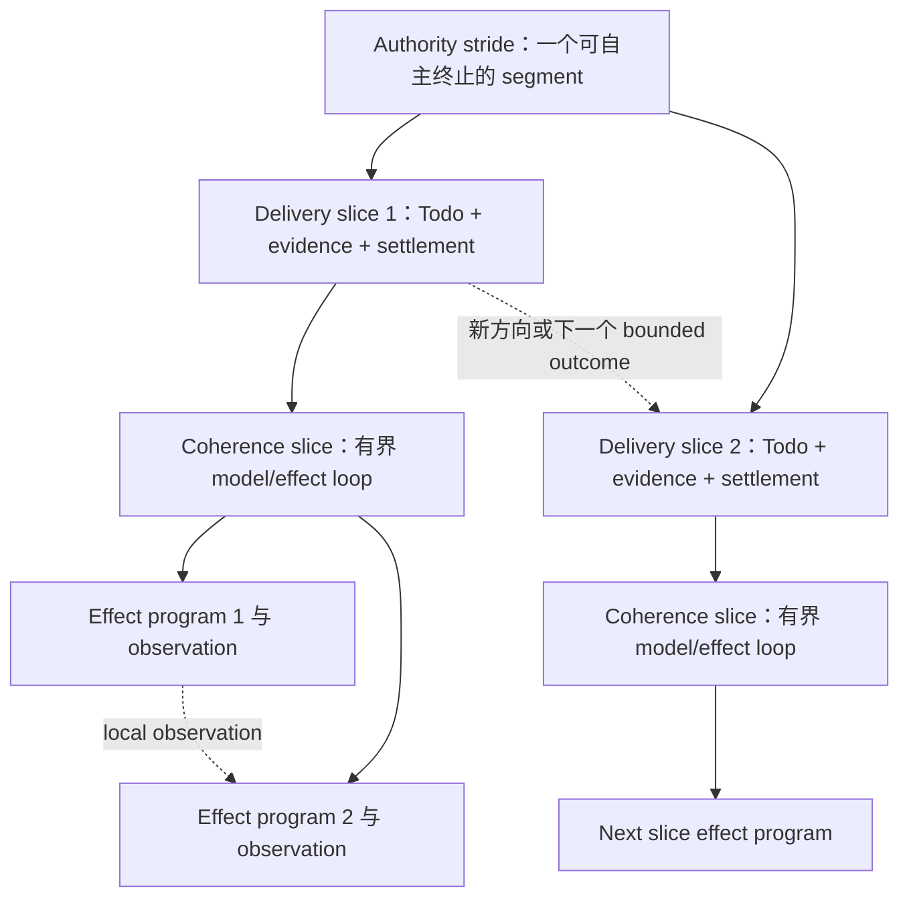

# RFC：长程 Agent 分层步幅控制 v0

| 字段 | 值 |
|---|---|
| 状态 | 已接受 |
| 替代 / 关闭 | 无 |
| 日期 | 2026-08-15 |
| 作者 | LoopX maintainers |
| 范围 | Effect 反馈、有界交付、研究范围、权限升级与长程效果/成本 |
| Tracking issue | [#3203](https://github.com/huangruiteng/loopx/issues/3203) |
| 源码基线 | LoopX `d03863fd0`；下文包含源码层面的决策接续修订 |

> 语言说明：
> [英文版](./hierarchical-agent-stride-control-v0.md)与本文档是语义镜像，
> 二者出现差异即为缺陷。

## 1. 决策摘要

LoopX 应把**步幅（stride）**理解为一个分层控制问题：在下一个反馈、结算或
权限边界到来前，系统应允许 agent 完成多少语义连贯的工作。

系统有三种嵌套步幅：

1. **Effect stride**：在下一个会改变决策的环境 observation 返回模型前完成的
   工作；目标单元是 coherence slice 内的一段 effect program。
2. **Delivery stride**：在下一次轻量控制干预与 durable settlement 前完成的
   工作；目标单元是一个由 Todo 拥有、有证据的 bounded delivery slice。
3. **Authority stride**：在下一次可能改变 scope、acceptance、permission 或
   direction 的重干预前完成的工作；目标单元是一个可自主终止的 segment。

这不是三个彼此独立的 timeout，也不是三个固定计数。内层由 host 与 effect
interpreter 拥有，中层由 LoopX Turn/Todo/settlement 生命周期拥有，外层由
goal、vision、gate 与人类权限拥有。内层结果可以迫使中层提前结算；中层结果
可以迫使外层提前升级权限。一次 scheduler tick 本身不能制造任何一种语义迁移。

研究使 delivery stride 成为**向量**：工作切片大小、相对当前机制的距离与验证
广度。各坐标可独立调节。很长的工作切片可以完成大量正确的局部检查，却未增加关于
目标缺口的信息；减少控制事件不能修好这个问题。反过来，接近题目可达极限时，
中后期的小收益也可能有价值；单凭时长或分数持平不能决定扩大实验。

因此交付控制闭合**决定 -> 实际工作 -> 证据 -> 下一决定**，执行和结算仍归原
owner。当前有界源码实现把上次被接受的 Vision 路线和后续记录进度返回给 replan，
目标收益明确保持 unknown。这是决策输入和 Agent 指引，不是自适应调度、结果
采用门禁或研究收益证明。自动策略仍是需要重复资格验证的 opt-in 提案；研究
状态分支为反事实验证提供起点，而不丢弃已积累的工作。

核心判断是：

> 长程效率来自把语义边界放在正确位置，而不是孤立地最大化连续工作量，或
> 最小化协议事件数量。

## 2. 为什么一个“Turn 长度”不够

长程 agent 常被一个含糊变量调节：把 turn 变长或变短。这把三个不同问题混在
了一起：

- 在模型必须重新考虑下一步前，可以执行多少因果相关的 tool effect？
- 在 evidence 与 state 必须 durable settlement 前，可以执行多少有 outcome 的
  工作？
- 在用户或 supervisor 必须作决定前，agent 可以在不变权限下自主运行多久？

一个配置无法同时回答三者。同一个模型可以安全运行很大的只读 tool program；
修改脆弱 artifact 前仍需要小 checkpoint；同时只要 goal 与 permission boundary
稳定，它又可能数小时都不需要人类注意。

相反的失败也很常见。Host 可以在每个小 Todo 后中断，反复执行 quota 与
scheduler 仪式，并在没有新权限问题时要求用户听取进展。表面上控制更强，实际
useful-work density 却坍塌了。

三层步幅模型能同时解释两端：

| 边界 | 太短 | 太长 |
|---|---|---|
| Effect 反馈 | 过多模型往返、context 回流与 tool-call 开销 | 太晚消费会改变决策的 observation，错误与副作用叠加 |
| Delivery 结算 | Todo 碎片化、重复调度、局部完成偏差 | Evidence 变旧、writeback 延迟、一个 Todo 隐藏方向变化 |
| Authority 干预 | 消耗人类注意和 supervisor 带宽，却没有新权限 | Scope drift、steering 过晚、permission 错误与不诚实的不终止 |

因此目标不是“更大步幅”，而是在当前模型与工作类型下，选择仍能保持决策连贯、
可逆性、evidence freshness 与权限正确性的最大步幅。

## 3. 术语

### 3.1 反馈层级

本文使用三种外界反馈：

1. **环境反馈**：tool result、repository state、test output、remote API response，
   以及其他可能改变下一步动作的 observation。
2. **控制反馈**：quota decision、scheduler wake、Todo state、validation result、
   writeback receipt 与 replan obligation。
3. **权限反馈**：user steering、user gate、protected-operation decision、goal 或
   acceptance change，以及合法权限主体接受或拒绝的 supervisor proposal。

环境反馈告知动作，控制反馈验证并结算有界切片，权限反馈则可能改变哪些工作是
合法的。

### 3.2 Coherence slice

**Coherence slice** 是满足下列条件的最大局部 model decision 与 tool effect
序列：

- immediate objective 与 postcondition 保持稳定；
- active hypothesis 或 implementation direction 保持稳定；
- permission 与 reversibility boundary 保持稳定；
- 判断切片是否成功所需的 evidence 保持稳定。

在 LoopX 产品边界，一个 governed Turn 应同时代表一个 bounded delivery slice
和一个 coherence slice。Host 可用一个原生模型 turn 实现，也可使用有界的多步
model/tool loop。Provider 自己对“turn”的命名不是协议合同。

### 3.3 Bounded delivery slice

**Bounded delivery slice** 是一个由 scheduler 启动、由 Todo 锚定的 outcome，
包含：

- 可验证 postcondition；
- 显式 effect、时间或工作预算；
- fresh evidence；
- targeted validation；
- durable writeback 与 settlement。

一个 bounded delivery slice 通常应与一个 coherence slice 对齐。它以一个
selected Todo 为因果锚点；在 fine-grained mode 下，只要方向未变，也可关闭一串
有界、经过 evidence qualification 的 checkpoint Todo。新方向意味着新 slice。
如果中间结果预期会改变方向或权限，一个 broad Todo 就必须拆分。

### 3.4 Autonomous segment

**Autonomous segment** 是在同一个 stable authority snapshot 下执行的一串
bounded delivery slice。它必须诚实终止于以下之一：

- 已接受的 goal 或 milestone outcome；
- 有 coverage 证明的 exhaustion 或 no-follow-up；
- concrete blocker；
- user 或 protected-operation gate；
- 显式 scope 或 acceptance change。

计时器到期、状态汇报或一个局部 Todo 完成，本身都不是 autonomous segment
的 terminal。

## 4. 当前事实与缺失部分

本节会随实现演进持续更新。Shipped behavior 以代码与 stable protocol reference
为准；本文记录研究方向。

### 4.1 今天已经存在什么

| 层级 | LoopX 当前事实 |
|---|---|
| Effect | [Agent Loop Effect Interpreter RFC](./agent-loop-effect-interpreter-v0.zh-CN.md) 已定义 typed effect request、interpretation、observation 与 settlement 语义。 |
| Turn | [LoopX Turn protocol](../../reference/protocols/loopx-turn-v0.md) 管理 decide -> execute -> validate -> commit，并把 scheduler handoff 留在 settlement 外。 |
| Delivery | Execution profile 已区分 standard 与 fine-grained Todo contract；fine-grained mode 使用 coherent-slice turn budget，并基于 fresh evidence 创建 successor。每个获准 heartbeat 仍执行完整 durable settlement。 |
| Continuation | 除同一 Turn 的 controller disposition 外，typed delivery-continuity reducer 可在 heartbeat wake 之间保留最近一次 accountable `outcome_progress` Todo，前提是同一 Todo 仍 open、actionable、capability-ready，且仍由同一 agent 拥有。 |
| Progress | Typed progress observation、repeat detection、semantic replan closure 与 evidence projection 能区分 material delta 和 maintenance。 |
| 复盘反馈 | replan context 源码实现可返回上次被接受、绑定证据的 Vision 路线与后续进度引用；按历史追加顺序和 Goal/Agent/Turn lineage 绑定输入。缺失的执行与目标收益仍为 unknown，不证明拟议干预实际运行。 |
| Research | [研究型探索控制面 RFC](./research-exploration-control-plane-v0.zh-CN.md) 定义了可选的 typed knowledge frontier 与 composition experiment。 |
| Authority | Goal vision、user gate、permission policy 与 peer/supervisor boundary 和 execution、scheduler 保持分离。 |

### 4.2 还缺什么

| 缺口 | 后果 |
|---|---|
| 缺少与 outcome 绑定的完整观测 | 已有 M1 只读计数和决策接续输入，但仍需 provider 证据解释目标收益、model/tool、结算与权限变化成本。 |
| 研究范围策略尚未资格化 | 持续局部调参可能被误认为广泛探索；通用进度标识不证明机制创新或有效信息。 |
| 没有面向步幅的 model capability profile | 快速 tool-using model 与较慢但协议可靠的模型大体收到静态 execution contract。 |
| 没有语义 split/merge qualification | Todo 粒度由配置或 prompt 决定，却不按真实 decision change 与 settlement cost 评估。 |
| 没有 intervention value model | Periodic report 与真正 authority change 没有分开测量。 |
| adaptive promotion 尚未资格化 | shadow 输入尚不能证明模型采用、匹配接续收益或已 promotion 的 model/work-class 策略。 |
| 研究状态分支尚未资格化 | 单独源码快照不能保留会话、积累证据及评测机会，无法建立公平接续对照。 |

## 5. 三层模型



三层是嵌套关系，但内层 effect 数量与外层 delivery 数量都不固定。一个 governed
Turn 通常让一个 delivery slice 与一个 coherence slice 对齐；该 slice 内可以有
多次 model/effect cycle，也可有一串 fine-grained causal checkpoint。一个
autonomous segment 可以包含一个或多个 delivery slice。语义停止条件优先于数字
上限。

### 5.1 Effect stride

**问题：**在一个会改变决策的 observation 返回模型前，应执行多少因果相关的
环境工作？

**Owner：**host agent loop、tool runtime 与 effect interpreter。

**目标单元：**coherence slice 内的一段 bounded effect program。

**继续条件：**每个 next effect 都是当前决策的因果结果；intermediate
observation 可在局部消费且不改变 governing hypothesis；effect 仍处在同一
permission 与 reversibility class；program 没有超出声明预算。

**停止条件：**observation 可能改变 next plan；出现 permission、safety 或
irreversible boundary；局部 hypothesis 被反驳；validation 所需输出已经得到；
或者 compute、wall-time、call、output ceiling 已到达。

DeepSeek Harness **Code Mode** 是扩大这层步幅的一个公开实例。模型编写一段可
loop、branch、fan out 并 post-process tool result 的 Python 或 TypeScript 程序，
不必让所有中间结果重新进入模型 context。Tool subcall 仍经过同一 policy 与
guard pipeline。因此它可以减少模型往返，又不削弱 effect authority。

Code Mode 不表示 Todo 应该变得更宽，也不表示 human review 应更少。它只改变
一层。

### 5.2 Delivery stride

**问题：**在 LoopX 验证、写 evidence、刷新 durable state 并结算切片前，应执行
多少有 outcome 的工作？

**Owner：**Todo、Turn、validation、writeback、quota 与 settlement contract。

**目标单元：**一个拥有 stable postcondition 的 bounded delivery slice 与
coherence slice。

**继续条件：**Todo postcondition 未变；fresh evidence 仍支持同一方向；successor
具有因果关联而非预先写死；没有 open replan 或 authority obligation；bounded
chain 仍在 safety ceiling 内。

**停止条件：**postcondition 已满足；evidence 改变方向；validation failure 要求
新 hypothesis；replan obligation 打开；出现 user/permission gate；继续工作会
使 evidence 和 writeback 过时。

Scheduler wake 不是 delivery closeout。正常获准执行的 open advancement Todo 从
`in_flight_continuation` settlement boundary 开始；一次 accountable
`outcome_progress` 后，只要 postcondition、claim、capability readiness 与 authority
fact 保持稳定，下一次 heartbeat 也会优先恢复同一个 Todo，而不是因 queue reorder
切换到新 sibling。Heartbeat receipt、blocking work lane、autonomous replan、control
repair、delivery denial、`outcome_gap`、Todo completion/blocking 或 claim transfer
都会结束 continuity，并把 selection 交回普通 typed frontier。

Continuation 不会创建更轻的 settlement class。每个 heartbeat 仍按现有 accountable
settlement contract 完成 validation、durable writeback 与 quota spend。新增的
`in_flight_continuation` boundary 只改变 vision-checkpoint timing：同一 Todo 的
中间进展记录 typed continuation checkpoint，不要求新的 vision decision。
Completion、durable Next Action 变化、replan、gap 与 terminal outcome 仍属于
`semantic_closeout` boundary，并保持严格 vision contract。Multi-slice burst 与
redundant scheduler-ACK suppression 仍是独立实验；sticky Todo selection 不隐含
这些能力。

Todo 粒度应由**决策稳定性**定义，而不是 line count、file count、command count
或 elapsed minute：

- 如果某个可能出现的中间 observation 会改变方向、acceptance test 或所需权限，
  Todo 就太宽；
- 如果 Todo 只记录一个不会改变 next decision 的机械依赖步骤，而且单独结算
  没有新增可复用 evidence，它就太窄。

现有 fine-grained contract 是一个有用实验，而不是最终答案。它已经允许在检查
fresh evidence 后，用一个 coherence slice 完成多个因果相关的 advancement Todo，
同时禁止预写长 runnable chain。本文围绕该行为推广测量问题，而不是替换它。

### 5.3 Authority stride

**问题：**在一次允许改变 scope、acceptance、permission 或 direction 的干预前，
agent 可以持续多久？

**Owner：**goal 与 vision acceptance、user gate、protected-action policy 与人类
权限。Supervisor 可以提出 proposal，但不会因观察或调度工作而获得权限。

**目标单元：**一个 autonomously terminable segment。

**继续条件：**authority snapshot 稳定；selected work 仍在 accepted scope 内；
没有 protected operation 需要同意；evidence 支持继续自主执行；至少一个诚实的
terminal 仍可达。

**停止条件：**goal 或 acceptance boundary 必须改变；protected action 需要授权；
ambiguity 会产生实质后果；coverage 已穷尽；concrete blocker 持续存在；或 accepted
milestone 已完成。

给人看的 progress report 不一定是重干预。Report 可以只是没有 steering authority
的 projection side effect。相反，一句改变 scope 的用户指令即使传递成本很低，
也是重干预。

## 6. 跨层控制律

### 6.1 语义边界优先于数字预算

每层都可有用于安全与成本控制的 hard ceiling，但 ceiling 不是 completion rule。
发生 semantic change 时应提前结束，也不能仅因达到 maximum 就声称成功。

### 6.2 内层 continuation 不能借用外层权限

Programmatic tool loop 可以压缩多个 effect，但不能跨 permission boundary、扩大
Todo postcondition、重新解释 acceptance，或压制 required user gate。

### 6.3 外层 continuity 不能豁免中层 settlement

Goal authority 稳定，不表示 agent 可以数小时工作而没有 fresh evidence 与 durable
writeback。Delivery settlement 是 autonomous segment 的 memory 与 replay boundary。

### 6.4 Scheduler cadence 不是 semantic cadence

Wake signal 只表示 host 可以检查当前状态。它不证明需要新 Todo、coherence slice
已经结束，或 human attention 有价值。Durable state 应使 missed/duplicate wake 可恢复。

### 6.5 更强的模型不会让每层都变宽

模型能力是多维的：

- 可靠的 tool-program composition 可能支持更大的 effect stride；
- 良好的 observation use 可能支持更大的 coherence slice；
- 较弱的 typed-protocol compliance 可能要求更小的 delivery packet；
- 即使编码吞吐很高，较差的 self-evaluation 仍要求更早 validation；
- 稳定的 long-context reasoning 可以减少重复 replan，却不会授予 protected-operation
  authority；
- 风险高或不可逆的工作无论模型多强，都可能要求较窄的 effect 与 delivery stride。

系统必须验证 model/task/profile 组合，不能给一个模型名字附上全局的“长程能力”
分数。

### 6.6 Replan 是边界迁移，不是第四种步幅

Replan 消费当前 slice 的 evidence 并选择新方向，通常会结束当前 delivery slice。
当 goal、acceptance 与 permission 不变时，它可以留在同一个 authority stride；
只有这些边界必须改变时才向外升级。

## 7. 架构集成

本 RFC 不引入第二套 execution engine。

### 7.1 与 effect interpreter 集成

内层 tool program 应编译或解释为现有 typed effect program。每个 sub-effect 仍需
policy qualification 与 receipt。Programmatic composition 改变 scheduling 与
observation return，不会让 side effect 变得 opaque。

如果未来 policy module 选择 effect-stride profile，它应产生由 effect interpreter
执行的 typed verdict。Policy 不能变成 parallel executor。

### 7.2 与 Turn 和 settlement 集成

现有 validated Turn receipt 继续作为中层证明。Settlement order 与 stable effect
identity 继续保护 validation、durable writeback 与 spend。Scheduler handoff 继续
留在 settlement 外。

第一版 stride observation 应从现有 receipt 与 run history 派生，不能要求所有
host 先采用新的 execution path。

### 7.3 与 Todo 和 replan 集成

Todo 拥有 bounded postcondition，replan 拥有 direction change。Stride controller
可以建议 split、merge、continue、settle 或 escalate，但不能关闭 Todo、伪造
evidence 或清除 replan obligation。

Research goal 还可消费研究型探索 RFC 定义的 typed frontier。Composition
experiment 可以成为一个 delivery slice；stride model 不创建第二份 research graph。

### 7.4 与 authority 集成

Goal 与 vision state 继续拥有 acceptance 权限。User gate 与 protected-operation
policy 继续拥有 permission 权限。Supervisor、dashboard 与 scheduler projection
可以建议干预，但不能静默把 proposal 变成 authority。

### 7.5 长作业与决策 checkpoint（修订提案）

这项 2026-10-04 修订属于 M3/M5 提案，不代表 adaptive scheduling 已交付。
需要分开**实验边界**、**模型决策 checkpoint**和**可记账 Turn 边界**。
一个实验可以跨多个 Turn；每个已获准且需要记账的 Turn 仍以自己的 identity
完成 validation、writeback 和 settlement。等待实验不会延后欠付 debit、让
Turn 无限保持打开，或把此前工作变成免费。

最近的 capability/provider owner 应在启动前声明：

- 问题、candidate revision、比较对象和有界 postcondition；
- 已授权的 job identity、资源/时间上限和 recovery owner；
- 什么可观察结果会影响下一决策，以及如何验证；训练 checkpoint、评测或
  构建只有在这份已声明的合同下才有决策意义；
- 已消费 result revision、下次观测时间/deadline、stop/cancel 行为；仅经过
  一段时间或日志增长不是证据。

这些是 capability/provider 数据。Kernel 消费 identity、readiness、freshness
及现有 effect/settlement 事实，不解释 epoch、benchmark 分数、证明数量或进程
日志 prose。本提案不需要新增通用 job scheduler、worker launcher 或 built-in
capability。

拟议 handoff 如下：

| 阶段 | Owner 与必需行为 |
|---|---|
| 启动有界作业 | 普通已选 Todo/Turn 准入 effect。Provider 持久化 job/candidate identity 与 operational receipt。该 Turn 如实结算：启动成功只证明启动，不证明实验最终结果。 |
| 等待中的观测 | 现有 host/runtime 或 capability observer 无需 reasoning-model 调用即可检查精确 job。复用一个 due monitor 或已有 observation channel，不为每次 poll 创建 Todo。即使不消费 agent slot，也记录 observer CPU/IO 成本。 |
| 返回决策 checkpoint | Provider 按已声明的 postcondition 验证新结果，绑定 revision/artifact digest 并返回紧凑 observation。失败、取消和 deadline 到期同样必须形成可操作 observation。 |
| 准入决策 | 现有 scheduler/Turn 路径重新检查 Goal lifetime、ownership、quota、capability 与 authority。Ready observation 是输入，不是执行许可。等待此实验时仍可推进其他 runnable 工作。 |
| 消费并继续 | 在负责消费的可记账 Turn 中，通过普通 writeback 提交 result adoption 与下一步骤，再确认消费。重放/重复交付恢复原 receipt，不重复 launch 或 adoption。同一 Turn identity 的结算重放幂等；新获准 recovery Turn 仍正常结算。 |

当前 Todo resume condition 已有 `monitor_changed` 与 `resume_at`。若足够，
实现应复用 typed monitor generation 与 timeout fallback。
**缺失的是 provider-result binding 和 material-generation 更新集成**，不是
新增任意 `job_done` token。只有通过验证的决策 checkpoint 才能推进 generation。
Monitor 必须绑定精确 job/result source 与 Todo；无关日志变化不能释放等待。
Safety observation deadline 用来发现丢失通知或崩溃进程，不是周期性要求模型
重新解释未变工作。不支持的 host 保持现有执行并显示 readiness unavailable，
不能暗称已抑制模型唤醒。

Identity 必须跨 host/Agent restart 保留：Goal lifetime、owning Agent/Todo、
provider/run id、attempt 或 job generation、candidate revision、result revision
与 evidence/artifact ref。Raw log/native job handle 留在 provider，仅投影有界
且授权的引用。单个 PID 不是可恢复 identity。Provider 缺失或外部 effect 状态
不明确时，按现有 recovery 规则保留 unknown，不能据此自动 relaunch。只有
validated durable adoption 才推进 consumed cursor，因此交付后崩溃会重新提供
结果。Stopped/revoked Goal 和过期 claim 拦截 late result；替换 attempt 不能
消费旧结果。

Incumbent artifact reference 及其 qualifying result 与当前运行 candidate 分开
持久化。Provider 仅在可比有效结果满足已声明 constraint 后更新 incumbent。
Recovery 在复用前验证引用可用性与内容；candidate artifact 缺失不能静默
替换 incumbent，也不授权再次 launch。

先在一个真实 capability runtime 做 **shadow observation**：报告 unchanged poll、
decision checkpoint、result-to-decision latency、原生结果和模型/observer 总成本。
随后仅对该 provider/host 组合资格验证 opt-in model-admission suppression。
不改变通用 heartbeat prompt 或所有 scheduler 默认行为。关闭策略恢复 fixed
admission，保留 job/evidence history，不隐式杀作业，不改变 acceptance 或 accounting。

验收必须覆盖真实受控进程执行与 recovery，不只是 event 序列化：重复与乱序
结果、candidate 改变、restart、丢失通知、deadline、取消、unknown effect、竞争
claim 和 owner stop。Packaged frontend 旅程通过已有 task/capability surface 显示
绑定工作、等待原因、上次/下次观测、结果及 stale/unavailable 恢复；仅 CLI
readback 属于 partial slice。科学效用遵循
[研究决策](research-exploration-control-plane-v0.zh-CN.md#115-由证据驱动的实验决策修订提案)
的独立资格验证。

### 7.6 研究范围与证据驱动控制

普通工作与研究的步幅包含三个独立选择的坐标。前两个是主要控制量，第三个限定采取行动所需
证据与成本：

- **工作切片大小**：下次决定前获准执行的连贯 outcome、范围和成本，包括 Todo
  粒度、拆分过大的实验、在已支持路线上扩大连贯切片。Todo 文本长度和文件数
  不是大小；扩大仍要有可观察 postcondition 和正常逐 Turn 结算。

- **机制距离**：局部参数/实现微调，或明显不同的表示、模型、搜索邻域、因果
  解释。假设改名、新文件和更多测试不构成距离。
- **证据广度**：低成本的判别性探针、可比 pilot，再到真正采用所需的验证。
  只有解决与下一决定有关的不确定性，扩大覆盖才有价值。

replan 复查这个向量，不成为新的权限 owner。在授权目标内改变 Agent 自建方法
或暂定候选规则是正常研究决定；改变题目、验收、反馈协议、预算、权限或停止
条件仍要经过原 owner。扩大探索不授权读取隐藏数据，也不允许失败后重写指标。

| 已观察依据 | 应比较的下一决定 |
|---|---|
| 新结果缺失、无效或不可比 | 修复观测，或选覆盖已知的探针；收益保持 unknown。 |
| 单个有效候选退步，或结果在不确定性内冲突 | 保留 incumbent，限定负证据范围，比较重复测量、未覆盖条件与不同机制；不能因一次失败退休整个 family。 |
| 局部检查通过，却不能解释权威目标缺口 | 比较有界的机制变化与继续微调，说明判别性预测以及它如何进入真实执行候选。 |
| 已知空间很小，或方差大于预期效应 | 优先有理由的不确定性消减或低成本改进；大量新增搜索预算要有依据。理论上界不是可行最优解。 |
| 现有证据与停止条件下已无合理范围内探针 | 通过原 owner 记录有范围的耗尽或具体 hold；不制造活动，也不因此宣布目标达成。 |

由模型选择；通用代码不得根据文案子串、分数斜率、已过小时数或固定失败次数
推导这些科学判断。指标含义、可比性、噪声和题目空间归 provider；显式机制关系
与有范围 finding 归 Explore。既有 typed replan owner 投递目标、证据及上次路线；
正常 task/successor 与 Vision 写回拥有决定和采用。

每个决策边界执行：

1. 将上次路线与后续工作、当前产物和权威结果对照；区分实际运行、知识变化、
   真实采用与 unknown。进度回执不足以证明这些关系。
2. 按需要比较原路线接续、判别性替代与有理由的重复测量，权衡预期目标/信息
   收益及完整边际成本：模型输入输出、工具、验证、控制与机会成本。
3. 选择一个有界探针，说明判别性预测、比较对象、incumbent 保护、采用条件和
   成本/停止界限。较大机制变化可从小 pilot 开始，不必先做大范围验证。
4. 通过正常获准 task 执行，证据绑定到受测输入与精确候选；失败、负结果及
   不确定结果分别保留。
5. 下次复盘用新观测保留、修订或停止有范围路线；重复必须说明能解决什么新
   不确定性。不因 prompt 已读就重置其他触发计数。

源码层面的 `replan_context.decision_followthrough` 是首个可复用反馈切片：引用
上次被接受、绑定证据的 Vision 路线，以及最多六个后续不同进度 fingerprint，
保留完整记录计数与遗漏信息。按不可变追加顺序而非时间戳关联，排除其他 Agent
及显式退休的 Goal 实例；引用由现有 history 入口解析。依据缺失或损坏时不虚构
替代证据。此字段不资格化执行、科学创新、收益、有效 Turn 计数或验收，后者仍
独立验证；不增加 scheduler、选择规则、quota 消耗或逐结果结算。

#### 可迭代策略与工程边界

第一版策略是**模型依据证据规划完整工作**：显式选择 grow（扩大有支持的路线）、
switch（尝试不同机制）或 verify（解决决定扩大或切换的具体不确定性），再为各
坐标给出具体计划、理由和可证伪的下一实验。不优化一个通用 novelty 分数：机制
距离相对于明确的参照方法和目标，切片大小相对于下一有用 postcondition 与决策风险。

| 依据 | 工作切片 | 机制距离 | 证据广度 |
|---|---|---|---|
| 已支持方法持续产生可复现的有用进展 | 决策风险允许时扩大连贯工作 | 保持，除非剩余缺口支持替代方案 | 保留必需检查，避免冗余扫测 |
| 适用证据下当前方法仍有明显目标缺口 | 选择能区分路线的完整实验 | 比较更大偏离与原路线接续 | 覆盖区分和采用路线所需的证据 |
| 结果冲突或预期收益小于不确定性 | 保留或扩大解决不确定性所需的连贯工作 | 保持或比较替代，不宣布已反驳 | 仅扩大有理由的重复/不确定性探针 |
| 较大偏离产生可归因的有用结果 | 扩大已采用方法的下一切片 | 保留有效偏离，不为新颖而新颖 | 扩大采用所需验证 |
| 决策相关失败或权限边界出现 | 经原 owner 结束/拆分当前切片 | 在原目标内重新审视 | 验证具体失败，不扩大权限 |

此表指导模型决定，不是文案分类器或固定数字策略。工程设计保留四个可替换边界：

1. **观测适配器**提供精确候选/结果、有效性/不确定性、覆盖与成本事实；含义归
   垂域 provider，不能写通用策略或授予执行权。
2. **策略**消费一份绑定来源的复盘依据，提出步幅向量、下一探针与预期收益/
   成本；实验记录策略版本。先采用上表，后续确定性启发式或学习策略可在相同
   输入下替换此函数。第二个真实、已资格化策略需要接缝前，不建 plugin registry
   或训练 controller。
3. **准入/采用**通过既有 Todo、Vision、replan、预算和权限 owner 验证提案。
   工作大小变化使用正常 split/continuation/successor；原 Turn 结算未完时，
   路线决定不能执行 successor。
4. **反馈**将实际执行、结果、保留产物与完整成本返回下次复盘。提案、采用和
   收益分别可回放；缺失反馈不能变成成功。

初版 TypeScript 组件仅保留 `evidence_conditioned_v1` 一套可选策略及 off 总开关。
当前实现替换 basis 到整组向量的固定映射：显式选择 `grow | switch | verify`，工作
大小、路线距离、验证广度各自声明具体计划与理由，不再提供 `shrink` 或含糊的 `hold` 选项。
切换必须说明参照方法与改变的机制，继续调参本身不能证明换了路线。basis 是模型
解释；工作量以完整可验收交付或可解释实验所需决定，有支持时扩大。verify 须对应具体后续决策，不把
反复检查作为默认接续。下一实验声明形成可解释结论所需
的最低证据、预测、采用条件和完整成本。

普通工程、整理和维护使用同一策略及既有 Todo/Next Action。grow 可以将相关的
实现、集成、验证和结果回读形成一次连贯交付，减少重复规划、源文件读取和控制开销。
工作大小指可验收范围，不是 Todo 字数、文件数或工具调用数。不为扩大工作而捆绑
独立承诺、忽略依赖、扩大权限或延后必要结算；在真实风险、依赖或权限边界处，经
既有 owner 停止或拆分。缺少证据可以要求完整验证，不机械映射为更碎的任务。

普通工作需要验证实际准入、产物和后续复盘中的质量与完整边际成本。合成 CLI
链路只证明传输及结算，不证明模型会选对或效率提升；收益判断须比较相当的完成
工作及重复控制/读取成本，缺失测量保持未知。

既有 replan context 返回上次被接受的决定及之后工作；新提案必须绑定该决定与已
投递证据，分别评估实际采用、新信息和目标收益，缺证据保持未知。Explore 同时
开启时，复用既有 scoped finding、planner 分支和省略结果的读取路径；提案绑定
revision、考虑的 finding 与适用/暂缓等理由，不建新图或第二个 planner。机器
拒绝缺少复盘、错误引用以及过期或不可用依据的错误声明，校验提案结构和来源，
不能证明研究已执行或有收益。正常 Todo/Next Action 接续已准入的工作。

配置词表和既有 Goal/设备编辑器不变，不加第二个可选版本或策略数据库。off 保持
普通投影/复盘；两种历史 v1 决策保留原义读取兼容，不能完成新的启用策略复盘；
新提案使用 v2 数据格式，仍只有同一个可选策略，冻结 worker 保持确切源码。比较固定
实现 revision，不重释旧决定；有证据后迭代同一组件，避免维护假设性的策略变体。
启用策略的周期复盘到期后，任何结算路径都须留下绑定本次来源的 stride 决定。
类型化进展、后续任务和终止结果仍可作为证据与结果，但单独的 Todo 后续转换不能
代替复盘。这补齐决定记录闭环，不证明提案已被采用或提升了 Goal。
六个有效工作 Turn 仍是默认复盘周期，不是 Todo、实验或路线变化的大小。策略采用、
目标收益、完整成本和交互增益须通过匹配接续等实验验证后再作结论。
对单个 Goal 启用步幅策略时沿用实时复盘周期；只有显式设置 Goal 复盘周期，才固定
该 Goal 的计数依据或数量。

敏捷探索可只跑启用策略的测试组，以历史基线作描述性参照；不要求每次迭代都
重启并发基线。这类运行用于观察路线采用与迭代收益，不单独证明因果净收益或
promotion 资格。需要相应结论时，再执行匹配接续与重复验证。

全局结果分页可通过 v2 的可选 `explore_review.result_pages` 页面坐标补充
`considered_refs`。既有 Explore owner 在写回前从当前来源重放最多三页，不改变
原上下文／证据基础身份；来源变化要求在原 Turn 内重新读取和评估。页面坐标随
决策进入后续复盘，不新增回执库。按节点筛选和 planner 详情仍不属于此引用入口，
来源核验也不证明模型采用或研究收益。

### 7.7 研究状态分支与匹配接续

可恢复研究点包含**会话位置、研究证据、代码/候选产物与观测机会**。单独源码
归档或轨迹前缀不是完整研究点。捕获与验证复用既有[备份/恢复 owner](complete-state-recovery-v0.zh-CN.md)、
Host 会话 owner 和 artifact provider；本 RFC 定义研究实验的一致性及可比性要求，
不新建 restore 权威。

捕获前按已分配研究预算或语义事件声明位置，不事后挑分数有利的点。十小时等
中后期位置属于实验设置，不是产品默认值或自动转向条件。记录实际边界与 skew：

- 原生会话 cursor 和已资格化的 Host export/fork 路径；复制日志不证明能恢复
  session；
- 已结算的 LoopX 研究证据、原目标/优先级、既有决定、有范围负结果及未解问题；
- 精确工作源码、必要且获授权的未跟踪文件、incumbent 与其 qualifying result；
  尚未测量的候选与 incumbent 分开保留；
- source/model/tool/evaluator pins 与已消费的 solver-visible feedback；
- 剩余总预算、已受理提交历史及原协议下的下一次反馈机会。

inert verification unit 不授予执行权。目标侧使用新的实验/Host 身份，通过既有
Goal/session/state admission 进入。历史租约、quota、timer、pending effect 和
submission token 不能变成目标侧权限；未知效果先按原身份 reconcile，再决定
是否 replay。Host 尚无已资格化 fork 就报告缺口；证据摘要重启是另一种 treatment，
不能称为精确接续。

匹配实验前先验证 digest/cursor/artifact 一致性、partial capture、缺失文件、
输入变化、重复恢复、竞争 writer、来源停止和结果丢失投递。恢复要证明实际采用
所保存的证据和代码，并完成新工作；tar 验证或打开 session 本身不是验收。

研究消融从**同一份**已资格化研究点分成原策略接续与证据驱动范围复盘，使用
等额接续预算与资源，只改变一个控制因素；通过 evaluator owner 保留反馈机会数
与冷却时机。Session 重启、摘要替换、版本升级或策略组合属于额外变量。保留
所有分支及无效/负结果，比较实际采用的原生成绩、新信息与完整接续成本。结果
只资格化这项有范围干预，不证明整个 LoopX 或一个通用最优 stride。

## 8. 测量模型

第一版实现应先测量，再控制。

### 8.1 候选只读 observation

在出现 active caller 前，本文有意不锁定最终 wire schema。一个 provider-neutral
的 `hierarchical_stride_observation_v0` 应可从现有 public-safe receipt 派生，并
包含等价于以下概念的信息：

```json
{
  "schema_version": "hierarchical_stride_observation_v0",
  "lineage": {
    "goal_id": "goal-1",
    "agent_id": "agent-1",
    "todo_id": "todo-7",
    "turn_key": "turn-12"
  },
  "effect": {
    "model_steps": 3,
    "tool_effects": 18,
    "model_visible_observations": 4,
    "completion_reason": "decision_relevant_observation"
  },
  "delivery": {
    "coherence_slices": 1,
    "checkpoint_todos_completed": 2,
    "material_deltas": 1,
    "settlement_reason": "postcondition_met",
    "evidence_fresh": true
  },
  "authority": {
    "authority_snapshot_id": "authority-3",
    "bounded_slices_since_change": 6,
    "segment_disposition": "continue"
  }
}
```

这只是 observation，不是 authority。缺失的 host metric 保持 unknown；不能从
prose 或 command name 猜测。

### 8.2 核心指标

**Effect 层**

- 每个 model-visible observation 对应的 useful tool effect；
- 避免重新进入模型 context 的 intermediate byte；
- contradictory observation 出现后的 decision correction latency；
- 每段 effect program 的 permission/irreversible-boundary violation；
- effect-program replay 与 duplicate-side-effect rate。

**Delivery 层**

- 每次 wake 与 settled Turn 产生的 qualified material delta；
- material evidence 到 durable writeback 的 settlement lag；
- Todo split、reopen、supersede 与 redundant-successor rate；
- 重复或物质等价的 progress observation；
- control-plane call、token、wall-time 与 model-attention share。

**Authority 层**

- 每个 accepted outcome 消耗的人类注意分钟数；
- 真正改变 authority 的重干预与 status-only interaction 的比例；
- late steering 使多少工作失效；
- autonomous segment 以 accepted outcome、exhaustion、blocker、gate、deletion
  或 timeout 中哪种方式结束；
- scope 与 permission violation。

**端到端**

- task success 与 acceptance quality；
- wall time、token cost、tool cost 与 human attention；
- useful-work density；
- interruption/failure 后的 recovery loss；
- review burden 与 defect escape rate。

只看次数不够。一次 control-plane call 和一次 repository-wide test 成本不同。
Evaluator 应同时保留 count、time、token 与 semantic-outcome 视图。

### 8.3 跨层 mismatch signal

Evaluator 应在不改变 runtime behavior 的前提下识别：

- **observation debt**：第一个本应改变 plan 的结果出现后，effect 仍继续执行；
- **settlement lag**：material evidence 已存在，durable writeback 却延迟；
- **fragmentation tax**：反复 settlement，却没有独立有用的 postcondition 或 evidence；
- **local-completion bias**：把 Todo completion 当成 goal/segment terminal；
- **authority churn**：重干预没有产生 authority delta；
- **authority drift**：在过时 goal、acceptance 或 permission state 下继续工作；
- **cadence coupling**：工作如何拆分由 scheduler frequency 而非 semantic state 决定。

## 9. 模型与工作类型资格验证

### 9.1 能力向量

Model profile 应来自经验并带版本。相关维度至少包括：

- tool-program construction 与局部 result handling；
- observation use 与 plan revision；
- typed packet/receipt compliance；
- long context 下的 constraint retention；
- self-evaluation calibration；
- error recovery 与 replay discipline；
- 不丢语义的 evidence summarization；
- honest terminal selection。

Profile 描述一个 host/tool contract 下的 observed capability，不授予权限。

### 9.2 工作类型

Stride qualification 至少应区分：

1. 使用可逆 tool 的 read-heavy investigation；
2. 带 targeted test 和 reviewable diff 的 code modification；
3. 发生 hypothesis 与 coverage change 的 research exploration；
4. 需要显式 gate 的 external/irreversible operation。

为第 1 类 promotion 的 profile 不能被第 4 类继承。

### 9.3 初始假设

- **H1：**对 composable read-heavy work，programmatic tool execution 可提高每个
  model-visible observation 的 useful effect，且不增加 policy escape 或 duplicate
  effect。
- **H2：**与 tiny mechanical Todo 和 broad prewritten chain 相比，decision-stable
  Todo boundary 可提高每次 settlement 的 material outcome。
- **H3：**与 periodic steering 相比，event-driven authority intervention 可减少
  human attention，且不增加 late-steering loss。
- **H4：**cross-layer mismatch 比任何单一 raw turn-length 值更能解释长程失败。
- **H5：**快速、高吞吐模型从 compact typed control packet 与 host-derived
  observation 中获得的收益，大于增加协议仪式频率的收益。

## 10. 实验计划

### 10.1 公平性要求

比较必须使用：

- 相同 task statement 与 starting repository state；
- pinned LoopX release、host、tool catalog 与 scheduler implementation；
- 运行中不 reinstall 或修改 policy；
- native 或同等可靠的 scheduling；
- public-safe result projection，而不是 raw private trajectory；
- 每个 promotion comparison cell 多次重复，`N >= 5`；
- 同时记录 success quality 与 failure-mode classification。

一次运行可以发现 bug，不能建立 optimal stride。

### 10.2 分阶段矩阵

第一轮研究应避免直接展开完整的三维组合网格。

**Stage A：刻画当前行为**

- standard LoopX execution profile；
- fine-grained profile；
- 在存在公平 adapter 时，使用没有 LoopX control settlement 的 host-native baseline。

**Stage B：只改变 effect stride**

- 原生 single-tool effect request；
- bounded programmatic tool execution；
- delivery 与 authority contract 保持一致。

**Stage C：只改变 delivery stride**

- mechanically small Todo；
- 当前 fixed bounded Todo；
- shadow-recommended decision-stable Todo；
- effect 与 authority contract 保持一致。

**Stage D：只改变 authority stride**

- periodic reporting/steering；
- authority 不变的 event-driven reporting；
- event-driven authority escalation；
- effect 与 delivery contract 保持一致。

**Stage E：从同一捕获状态比较研究范围**

- 原策略接续与 §7.6 的证据驱动范围复盘；
- 同一份经 §7.7 资格化的会话/证据/代码研究点与反馈历史；
- 等额接续资源、预算与评测机会；
- 原生目标结果、新信息/采用及完整成本分别测量；
- 先做小规模恢复/采用 pilot，重复 cell 之后才 promotion。

选取确有不同机制空间的任务，同时保留接近上界或噪声较大的 case 检查适用界限。
不能在看到分数后挑 checkpoint 或省略分支。

只有这些阶段识别出 interaction 后，factorial experiment 才组合已 promotion 的
profile。

### 10.3 行为资格验证

Deterministic test 应证明 projection 与 transition semantics。Model behavior test
应另外使用真实 packet、真实 tool schema 与模型真实 next action，判断动作是否
消费了 decision-relevant observation、选择 bounded postcondition，或正确升级
authority。测试不能仅因输出包含某个关键词就通过。

## 11. 最小有用实现切片

M1 只读观测仍可用。下一完整、可逆切片把既有被接受的决定与后续证据投递到现有
replan 入口，配合 §7.6 指引；不新增分类器、调度器或验收门。先验证真实 CLI/Host
投影、不可变引用回读、缺失/损坏/陈旧输入及不变的语义 discharge。

随后按 §7.7 资格化一个研究状态捕获/接续 profile，区分归档验证、可执行接续、
模型采用和科学收益。匹配接续 pilot 判断范围复盘能否产生判别性实验与真实采用
的改进；重复研究及完整成本证据先于自适应策略 promotion。部分 Host export 或
只读决定投影都不闭合整项实现计划。

## 12. Milestone

### M0：RFC 与 baseline taxonomy

- 对三层 ownership boundary 达成一致；
- 定义 current-mode characterization fixture；
- 命名 public-safe metric 与 failure class。

### M1：只读 observation 与 evaluator

- 从现有 receipt 派生 observation；
- unknown field 保持 unknown；
- 报告 effect、delivery、authority 与 cross-layer metric；
- 证明 runtime、quota、notification 与 authority behavior 均未变化。

### M2：Effect-stride qualification

- 为 bounded programmatic tool 增加一个真实 host adapter 实验；
- 证明 sub-effect 保留 policy、identity、failure 与 replay semantics；
- 在 fixed delivery profile 下与 native tool call 比较。

### M3：Delivery-stride shadow recommendation

- 从 typed postcondition/evidence transition 建议 split、keep 或 merge；
- 用独立 acceptance rule 验证建议；
- Todo 与 replan 仍是唯一 execution authority。
- 在真实 replan 入口资格化 §7.6 决策接续，观察下一探针是否改变有用信息，
  而非仅改变标识；
- 资格化一个 §7.7 研究状态分支与匹配接续 profile；

- 在 shadow 中验证 §7.5 的 provider checkpoint/monitor binding，区分模型
  决策、实验完成与 Turn settlement。

### M4：Authority-stride shadow recommendation

- 区分 report 与 authority-changing intervention；
- 建议 continue、report、gate 或 escalate；
- user 与 protected-operation authority 不变。

### M5：Opt-in adaptive experiment

- 只 promotion 已验证的 model/work-class/profile 组合；
- 保留 hard ceiling 与 rollback；
- 对 pinned fixed profile 做 repeated comparison；
- 任何 improvement claim 都同时公开 limitation 与 failure mode。

- 长作业抑制 model admission 前，验证 §7.5 的 lost-result recovery 与
  default-off parity；observer 成本继续纳入测量。

## 13. 验证标准

只有证明以下各项，研究计划才算合格：

1. 在相应 identity 存在时，每个 observed interval 都可归因到 stable goal、agent、
   Todo、Turn 与 authority lineage；
2. 缺失的 host detail 保持 unknown，不从 prose 猜测；
3. deterministic replay 产生同样的 stride observation 与 mismatch classification；
4. effect-program composition 保留 sub-effect policy、receipt、failure、cancellation
   与 replay boundary；
5. Todo split/merge recommendation 按 semantic postcondition 测试，不使用 string 或
   file-count heuristic；
6. 没有 authority delta 的 report 不计为 heavy steering；
7. local Todo completion 不能成为 goal 或 autonomous-segment terminal；
8. shadow mode 不改变 scheduling、quota spend、notification、gate 或 execution；
9. promoted profile 在 repeated run 中改善 end-to-end quality/cost，而不只是局部计数；
10. failure case 保持 honest terminal 且可恢复。
11. 研究范围变化保留原题目与验收，证据广度由决策价值而非重复检查数解释；
12. 恢复研究点保留会话/证据/代码及等价反馈机会，不复活来源执行权；
13. 既有决定、真实实验、结果解释与采用动作分别可观察；缺失执行/收益保持 unknown；
14. 匹配接续比较保留 incumbent、不确定性、失败及完整 model/tool/control 成本，
    局部代理指标收益不当作原生目标收益。

## 14. 非目标

本 RFC 不提出：

- 一套 universal optimal tool-call、Todo、turn 或 minute 数量；
- 强制所有 host 使用 programmatic tool calling；
- 强制每个 Todo 等于一个 native turn，或每个 turn 等于一个 Todo；
- 替换 EffectProgram、Turn settlement、Todo、replan、goal vision 或 user gate；
- 让 scheduler、supervisor、model confidence score 或 adaptive policy 获得 human
  authority；
- 用 prose、command name 或 file path 判断 semantic progress；
- 为效率扩大 permission 或 privacy boundary；
- 在出现真实 concurrent caller 前引入 concurrency、race 或 CAS 机制；
- 在测量与 stable baseline 出现前训练 generic reinforcement-learning controller；
- 公开 raw trajectory、private task content、credential 或内部运行证据。

## 15. 风险与缓解

| 风险 | 缓解 |
|---|---|
| Metric 奖励很大但错误的 slice | 同时测量 acceptance quality、correction latency、defect escape 与 recovery loss。 |
| Metric 奖励很小但仪式化的 slice | 测量独立有用的 postcondition/evidence 与 fragmentation tax。 |
| Model/host 版本使 profile 失效 | 按 model、host、tool contract、work class 与 LoopX release 版本化。 |
| Adaptive layer 相互打架 | 一次只 promotion 一层，保留 semantic stop precedence 与 hard ceiling。 |
| Programmatic tool 隐藏副作用 | 每个 sub-effect 都经过现有 policy 与 receipt pipeline。 |
| Shadow recommendation 变成隐含 authority | 标记为只读，所有动作仍走现有 Todo、replan、gate 与 user path。 |
| Benchmark-specific assumption 泄漏到 core | Observation 保持 provider-neutral，adapter detail 留在 qualification fixture。 |
| Public evidence 泄露 private work | 只保存 bounded public-safe aggregate，raw trajectory 留在仓库外。 |

## 16. 开放研究问题

1. 不依赖模型 self-report 时，哪些 observation 能在不同 host 间可靠地被判定为
   decision-relevant？
2. Todo split/merge quality 能否只靠 typed postcondition 与 evidence lineage 判断，
   还是需要 bounded model proposal？
3. 当 counterfactual path 不可观察时，如何估计 interruption regret？
4. 哪些 model capability dimension 可跨 repository 迁移，哪些必须按 work class
   重新验证？
5. Scheduler jitter 多大时仍可 normalization，超过何值后 wall-time 比较会误导？
6. Event-driven report 何时应保持 projection side effect，何时应打开真正的
   authority gate？
7. Shadow recommendation 需要多少 repeated-run evidence 才能 promotion 为 opt-in
   adaptive control？

## 17. 参考资料

- [LoopX Turn v0](../../reference/protocols/loopx-turn-v0.md)
- [Agent Loop Effect Interpreter v0](./agent-loop-effect-interpreter-v0.zh-CN.md)
- [研究型探索控制面 v0](./research-exploration-control-plane-v0.zh-CN.md)
- [Goal Vision and Replan contract v0](../../reference/protocols/goal-vision-replan-contract-v0.md)
- [DeepSeek Harness Code Mode implementation note](https://github.com/deepseek-ai/deepseek-harness/blob/master/.agents/notes/implemented/feature/2026-06-15-code-mode.md)
- [DeepSeek Harness tool execution pipeline](https://github.com/deepseek-ai/deepseek-harness/blob/master/docs/tool-execution-pipeline.md)
