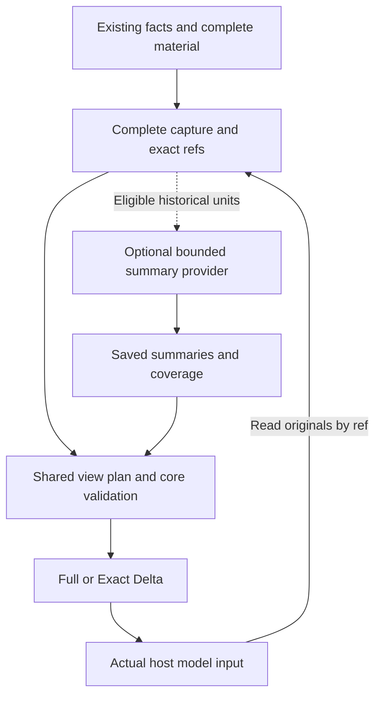

# RFC: Recoverable History Working Sets and Bounded Context-Policy Extensions, Informed by billion-context (v0)

- **RFC status:** Accepted (upon merge)
- **Supersedes / closes:** none
- **Delivery maturity:** Proposal
- **Authors / owners:** Shared context presentation, Turn, continuation, and extension maintainers; maintainers claim individual implementation slices.
- **Created:** 2026-11-09
- **Last normative revision:** 2026-11-09
- **Implementation baseline:** Audited [`241c991794c37627d1bf9e2fa9d83472857c4129`](https://github.com/loopx-project/loopx/commit/241c991794c37627d1bf9e2fa9d83472857c4129); the relevant current-system code was also compared with `701795db237a35b23266588abad6f21857704ccd` and is unchanged.
- **Related contracts:** [Design discussion #8450](https://github.com/loopx-project/loopx/issues/8450), [#4391 / T02 / M1-B](https://github.com/loopx-project/loopx/issues/4391), [Controller/Executor contract][lx-controller], [T02 research program][lx-frontier], and [extension contract][lx-extensions].
- **Language mirror:** [中文版 — semantic mirror](history-working-set-context-policy-v0.zh-CN.md)
- **Design reference:** [`ranxianglei/billion-context@4be21b08ed3da8b69d1800a10a9c0b9c5a707f71`](https://github.com/ranxianglei/billion-context/tree/4be21b08ed3da8b69d1800a10a9c0b9c5a707f71). This RFC explicitly borrows its pipeline, stable original-content references, shared eligibility checks, hierarchical coverage, and cost accounting. It does not claim an existing integration or copy of the whole implementation.

## Document map and maintenance contract

- Sections 1–10 define the design and acceptance contract. Section 4 specifically records the audited current-system baseline and does not present proposed capabilities as implemented.
- Section 11 is the normative delivery plan. Section 12 contains open decisions; recommendations are not approval.
- Appendices contain non-normative audit boundaries, decision records, and evidence. Future dated execution records follow the [ledger contract](ledger/README.md), separately from the normative plan.
- The English document and Chinese semantic mirror remain synchronized. Illustrative interfaces, logical fields, and state descriptions are not published APIs.

The header's Accepted status takes effect when this RFC PR merges. Before merge, it remains a proposal under review. Merge accepts a bounded, claimable design basis. **Design acceptance and delivery maturity remain separate: this RFC has Proposal maturity, ships no runtime feature, and changes no default.** Implementation, live qualification, product promotion, and model experiments require their own evidence and authorization. This document does not close [#8450](https://github.com/loopx-project/loopx/issues/8450), [#4391](https://github.com/loopx-project/loopx/issues/4391), C1/C2 acceptance work, or any existing RFC. [RFC maintenance contract][lx-rfc]

## 1. Decision summary

Add a **bounded, replaceable history-working-set policy** between LoopX's existing complete sources, captures, progressive reads, and exact delta delivery:

1. Existing owners retain complete material and current authoritative facts. A summary is a rebuildable derived view.
2. The core supplies eligible historical units. A policy proposes original content, a valid summary, or deferred reading; the core validates and projects the result.
3. Summary generation runs within existing capability/provider execution boundaries and explicit budgets. Synchronous context hooks consume already prepared results only.
4. The existing shared presentation owner is the integration point for actual input reduction. Appending a summary while continuing to send all originals does not satisfy this input optimization.
5. The new semantic history policy defaults off. Existing Progressive/Delta settings, raw machine consumers, original-identity recovery, and one-settlement boundaries remain distinct.
6. First prove one real model-input path and one historical-material category. Expose the mature contract to extensions afterward; qualify deeper summaries and additional hosts separately.

**Decision boundary:** Treat this owner split, first real consumer, historical eligibility boundary, and validation design as a bounded T02 implementation slice. Merge accepts the design basis; the concrete choices in §12 still require decisions at their dependent milestones. This RFC does not start paid model runs, change defaults, import complete host transcripts, or create a new scheduler.

## 2. Problem, motivation, and the billion-context reference

### 2.1 User outcomes

Long tasks include investigations, failed attempts, fixes, verification, and goal changes. Later execution must know which approaches evidence ruled out, which revision a conclusion applies to, and which conditions remain unmet. Repeatedly sending the whole process increases input and attention costs; a short summary can omit the differences that determine the next decision.

Static review of the fixed baseline confirms existing projection and extension foundations, and the need to verify final input per consumer. **Production waste has not been measured, and this RFC does not claim that current models necessarily fail because summaries are missing.** The following example is synthetic:

> Attempt A at revision R1 exposes a cache-isolation problem. The R2 fix passes some tests, but rollback verification remains incomplete. The next turn must retain the failure reason, current revision, and unfinished check, with evidence available for expansion. It must not reduce the history to “the cache fix is complete.”

The intended outcome is useful history in a subsequent turn or session, with exact expansion when needed: fewer repeated rejected approaches, no reuse of old acceptance results as proof for a new revision, and lower complete cost at comparable task quality.

### 2.2 Explicit upstream design references

| billion-context design | Source | LoopX adaptation |
| --- | --- | --- |
| Ordered pipeline with explicit input, state, and effects | `PipelineNode`, `NodeIO`, `runPipeline` [BC1] | Organize policy within the existing view lifecycle; keep IO at provider/host boundaries, without another encompassing ContextEngine |
| Originals separate from compression state, content deduplication, stable refs | `MessageContentStore`, `storeOriginal`, `retrieveByRef` [BC2] | Reuse captures, artifacts, and read references; establish the retention and recovery conditions required for history |
| Recommendation and application share eligibility | `projectUnit()` [BC3] | One deterministic rule owner governs candidate discovery, proposal validation, and projection; plugins cannot approve themselves |
| Summaries preserve child-block and original coverage | `CompressionBlock` [BC4] | Organize by attempt, work item, or phase with exact coverage; implement one level first |
| Compression accounting includes cache repayment and break-even horizon | `cache-report.ts` [BC5] | Count generation, readback, cache effects, retries, and task outcomes; compression ratio alone cannot justify promotion |

Expandability depends on originals remaining readable; it does not mean a summary is semantically lossless. Upstream message ranges, proxy/fetch interception, DSH-specific host control, and empirical thresholds do not become LoopX core assumptions. The first implementation independently adopts the required design without depending on the whole upstream kernel/proxy. Any later source-code reuse requires a separate interface, version, and actual-license assessment.

### 2.3 Related work

| Work | Audited status | Relationship |
| --- | --- | --- |
| [#4391](https://github.com/loopx-project/loopx/issues/4391) / T02 / M1-B | Open; existing decision-preserving continuation research | This RFC is a bounded proposal with a real caller and acceptance unit; it reuses equal-budget, stale-evidence, goal-change, identity-confusion, and readback-cost requirements |
| [#7768](https://github.com/loopx-project/loopx/pull/7768) | Merged | Reuse shared progressive planning, required-view projection, and full/delta preparation; no new codec or dispatcher |
| [#7868](https://github.com/loopx-project/loopx/pull/7868) | Merged design revision | Preserve the distinctions among Progressive/Delta, file artifacts, visible coverage, retention, and semantic adoption |
| [#7430](https://github.com/loopx-project/loopx/pull/7430) → [#8265](https://github.com/loopx-project/loopx/pull/8265) | C1 merged and was subsequently reverted | `merged=true` alone does not establish that the complete C1 package is present on main |
| [#8266](https://github.com/loopx-project/loopx/pull/8266) | Open, unmerged at audit | Coordinate source/capture/read/recovery with the C1 replacement; candidate-branch capability and performance are not main facts |
| [#8378](https://github.com/loopx-project/loopx/pull/8378) | Open, unmerged at audit | Controller–Worker evolution is related design; the first history view does not depend on a dual-session runtime |

These states come from the 2026-11-09 source and related-work review; they are not live claims about future main. Recheck main and related PRs before implementation. Coordinate parallel work by semantic owner and actual diff, without making a PR number a permanent blocker or bypassing qualification for the behavior being changed.

### 2.4 Invariants

- Summaries must not rewrite or silently remove the semantics of current goals, acceptance, scope, permissions, stop conditions, outstanding required reads, or execution identity.
- Attempt termination, recorded results, passed acceptance, and Goal completion remain distinct existing facts; summaries do not derive them.
- Unsupported schemas, fields, or historical material are not made deletable by keyword heuristics.
- Current dependencies remain available under their original reading contract. A pointer does not fulfill a reading obligation.
- Original readback preserves its trust level. Tool output or retrieved material cannot become system instructions or permission.
- Observe the model-visible view, evidence of host retention, model adoption, and task benefit separately.
- Optional summary failure removes only the optimization. Missing required originals retain existing rules for blocking dependent actions and recovery.

## 3. Scope and non-goals

### In scope

- Shared presentation on one existing model-input or continuation path.
- One category of historical support with recorded results, preferably investigation, test, and process evidence from ended attempts.
- Source binding, coverage, readability, validity, and stable derived views.
- An optional policy contract whose validation remains core-owned, using existing provider and extension lifecycles.
- Observation and acceptance of actual input, readback, recovery, cost, task quality, and product state.

### Non-goals

- Changing authoritative Goal/Todo/claim/lease/quota/settlement state or creating another work-fact ledger.
- A new unified memory database, plugin registry, scheduler, or resident background daemon.
- Managing every host message in v0, unlimited context, or a fixed multiple of cost savings.
- Automatically writing historical summaries into Reward Memory or treating recall as verified experience.
- Recursive multi-level summaries, arbitrary pipeline reordering, or chains of plugins modifying the same payload in v0.
- Deleting originals, disabling native host compaction, or migrating every host together.
- Reimplementing all of C1, dual sessions, or the entire research program as one prerequisite project.

## 4. Current-system contract: audited baseline

The facts below were audited at `241c991794c37627d1bf9e2fa9d83472857c4129`. The relevant current-system code was compared with the documentation PR base `701795db237a35b23266588abad6f21857704ccd` and is unchanged. Fixed source links retain the audited baseline; later main changes require a new check.

| Existing owner or entry | Confirmed behavior | Proposed integration |
| --- | --- | --- |
| `quota/progressive_context.ts` | `progressiveContextPlan()` projects known support deterministically; unknown shapes stay complete; native/stateless preparation shares the plan [LX1] | Add bounded historical candidates and proposal validation in this owner; preserve unknown content and recovery semantics |
| `quota/turn_envelope.ts` | Dispatches `progressive_context_delivery`, `context_delivery`, and `context_recovery` [LX2] | Reuse dispatch and typed transactions, without another orchestration entry |
| `turn_driver/decision_capture.py` | `capture_context_projection()` and `capture_progressive_context()` save complete sources before derived views; digest, selected reads, and same-capture recovery exist [LX3] | Keep host IO here; establish retention before extending historical use |
| `quota/context_delivery.ts` | Exact codec checks scope, session/epoch, digest, baseline, and recovery equivalence; it may choose full delivery when savings are insufficient [LX4] | Encode the validated final view; summaries replace neither complete sources, existing baseline binding, nor retention evidence, and a baseline grants no work authority |
| `capability_hooks.py` / `capability_context.ts` | Synchronous bounded producers, slot-conflict and source-binding checks; default contribution limit is 64 KiB; core fields are reserved [LX5] | Contribute prepared proposals and summary refs; current hooks cannot arbitrarily replace history |
| `capabilities/turn_context.py` | Explicitly composes memory and anti-entropy, rather than an arbitrary discovered transformer chain [LX6] | Explicitly register one optional contribution first; extend existing ports when mature |
| `context_providers/factory.py` / `extensions/*` | Provider registration and extension lifecycle exist; the current manifest hook phase is `capability_action` [LX7] | Do not claim a general context-policy plugin already exists; evolve a narrow port with versioned types and readers |
| `codex_cli.py::_render_prompt()` | Serializes the validated `model_request` directly; final prompt construction here does not uniformly call progressive preparation [LX8] | Candidate first consumer; verify actual shape, reader availability, and benefit during implementation |
| `native_chat/manager_context.py` | Local deferred reading of supporting history already reuses capture/reader with a specialized projection [LX9] | Later converge under the same owner contract; do not claim progressive behavior is entirely absent here |
| `machine_configuration/context_delivery.py` | Defaults are `mode:on`, `delta_delivery:auto`; Progressive and native Delta activation differ [LX10] | The new semantic policy independently defaults off; retain old settings and behavior on unknown hosts |
| `dsh-loopx-plugin/src/driver.ts::readQuota()` | Machine quota calls explicitly set `LOOPX_CONTEXT_DELIVERY: off` [LX11] | Preserve machine-result contracts; migrate only genuinely model-facing output |

**Evidence boundary:** A capture file does not establish long-term retention; a public preparation function does not establish adoption by every model entry; a `work_contract` consumer branch does not establish that reverted C1 is wholly present on main. These distinctions govern implementation and review.

## 5. Proposed architecture and integration contract

### 5.1 One projection owner



D/E are proposed capabilities, not model calls performed during each synchronous view assembly. Current work authority, capture IO, shared TypeScript projection, exact codec, and host delivery remain with their existing owners.

### 5.2 Historical eligibility

V0 candidates come from existing typed attempt/result/evidence facts and bounded sources, not completion inferred from strings such as “done” or “old logs.” A candidate must meet all of the following:

1. Source identity, Goal/Agent/access scope, and exact readable references are known.
2. Its attempt has ended and its result is recorded. Failure is a valid result and must not be presented as success.
3. It is an explicit historical-support range and does not require a complete first read under the current work contract. Any current obligations or unresolved issues it carries are independently retained in existing exact sources, or the typed owner proves this range does not carry them. Uncertainty excludes the candidate; an ended attempt alone is insufficient.
4. Its source retention and recovery qualification has been verified; otherwise retain the existing view.
5. Unknown shapes, missing identity, cross-scope references, or content whose tool pairing or trust level cannot be preserved are excluded from v0.

Existing facts and deterministic rules establish candidates. Policies may rank and propose representations within that set. They cannot expand it or grant permission through their own prose.

### 5.3 Minimal policy and provider boundary

These interfaces illustrate responsibilities; they do not freeze a new public schema:

```ts
interface HistoryViewPolicy {
  propose(input: {
    sourceBinding: ExistingSourceBinding;
    eligibleUnits: readonly EligibleHistoryUnit[];
    currentRelevanceContext: Readonly<CurrentDecisionReadView>;
    preparedSummaries: readonly SourceBoundSummaryArtifact[];
    budget: ContextPresentationBudget;
  }): HistoryViewProposal;
}

// Called through existing provider/runtime boundaries, never by synchronous projection.
interface HistorySummaryProvider {
  prepare(request: BoundHistorySummaryRequest): Promise<SummaryProposal>;
}
```

- Policy input may read current relevance information, but cannot mutate current facts. Output is a declarative original/reference/summary plan for specified candidates, not arbitrary JSON Patch or whole-payload replacement. It cannot define message roles, executable commands, permission conclusions, or host paths; the owner creates final framing and provenance.
- **Plugins have no authoritative `approve` or `validateProposal` callback.** The shared TypeScript owner decides scope, revision, coverage, protection, budget, reference availability, and actual projection.
- Synchronous `propose()` performs bounded planning without external IO. Policy work requiring a model, process, or network prepares source-bound proposals through provider/runtime beforehand. This logical interface does not authorize arbitrary third-party code loading inside the shared projection process.
- V0 selects one historical policy per effective scope, without arbitrary plugin chains or phase reordering.
- Existing `ContextProvider` recall/sync ports do not silently acquire whole-history summarization semantics. If insufficient, add an explicitly versioned narrow port using the existing catalog/runtime.
- Put the initial internal helper at the nearest owner; do not add a capability solely to obtain a lifecycle anchor. Before public registration, apply placement policy to capability_id, provider_id, origin, and the actual caller.
- Python may retain file, process, and host IO. New cross-host decisions belong to the existing TypeScript owner, without a parallel Python decision implementation.

### 5.4 Logical information in a derived summary

| Information | Purpose and constraint |
| --- | --- |
| Original scope and stable source refs | Reuse Goal/Agent/attempt/evidence identities and existing reference types; a path in prose is insufficient |
| Source digest / revision | Bind the content actually observed; a changed original cannot silently reuse an old binding |
| Exact coverage | The owner constructs the manifest from material actually provided to the summarizer; the model may reference only that manifest. Partial input must be labeled selected coverage; truncation or incomplete supply cannot claim full coverage. Noncontiguous sets cannot be represented as continuous min/max ranges |
| Summary and navigation to unresolved issues / contrary evidence | Support current decisions without updating authoritative state or claiming complete semantic preservation |
| Policy / generator / prompt versions | Support reproduction, invalidation, and diagnosis; actual model calls count toward cost |
| Original expansion entry and retention scope | Claim expandability only while the reader and source remain valid |

Reuse registered owners for identity, schema, and state vocabulary. Only genuinely new shared terms required by a cross-provider caller enter registration/version review; this table does not require another work-state schema.

### 5.5 Retention, references, and caching

The following is necessary to extend a current-turn capture into history across turns:

- **Publication order:** Save and validate originals, then save the summary, then publish the selectable summary reference. A crash must not leave a view marked valid and visible without recoverable sources.
- **Retention scope:** Declare whether sources support only this attempt, later sessions on this machine, or a qualified backup/restore profile. Promise only verified scopes; temporary files do not automatically become long-term sources.
- **Existing storage first:** Use capture/artifact lifecycle and cleanup owners. Extend that owner when references require retention, without an independent full-message store. Material without an appropriate durable source cannot participate in cross-session optimization.
- **Deletion and invalidation:** Declare reference validity scope and duration at publication. Normal cleanup must not break that promise early. If the owner cannot honor it, shorten the promise or do not enable that view. Explicit user deletion, revocation, and corruption must immediately affect source and summary visibility; preserving a summary cannot bypass them. An unreadable source cannot remain labeled fully expandable. Remove optional summaries; handle required dependencies under existing rules.
- **Locator limitation:** With the current path-bound reader, a path is the locator for that profile. Do not claim transparent cross-machine recovery or automatic relocation before validating migration.
- **Deduplication boundary:** Equal content hashes do not authorize visible reference reuse across users, Goals, or permission boundaries.
- **Cache key:** Include scope/visibility, exact ordered sources and digests, and policy/generation versions. Do not rewrite stable summaries every turn and cause needless prefix changes.
- **Historical truth versus current applicability:** “R1 failed then” can remain true. Moving the current task from R2 to R3 requires revalidation of selection and applicability, not treating an old failure as current state or rewriting originals merely because time passed.
- **One level first:** Future summaries of summaries must trace coverage to leaves. V0 does not implement a general DAG/GC framework.

### 5.6 Generation lifecycle, races, and failure

Recommended observation points are the existing ended-attempt/recorded-result lifecycle or explicit history preparation. Submit generation through an existing bounded runtime/provider, without a resident scheduler. Current post-settlement callbacks are also synchronous; an asynchronous queue cannot be assumed. Adapt them to submit work only when an existing, verified execution owner can accept it. Otherwise use explicit prepare in v0, without waiting for expensive model work inside a synchronous hook.

- Bind generation requests and artifacts to the same exact sources and generation versions. Artifact publication is idempotent; completed work execution is not settled again. Resolve ambiguous external results through existing owner recovery rules. Where a provider has no idempotency or result-query support, do not promise exactly-once generation; possible duplicate calls and fees must be visible and budgeted.
- Revalidate after generation when the goal, permission, configuration, or source changes. An old result may remain an authorized historical artifact, but a stale selection plan cannot enter a new turn directly.
- Runtime budgets, timeouts, cancellation, and credentials stay with existing execution boundaries. Timeout, unavailability, and excess size do not change current work authority.
- Disabled policy, disabled extension, or unsuccessful doctor state prevents new generation requests and optional-provider imports. In-flight calls follow existing cancellation/result handling; late results do not reactivate the capability.
- With no valid summary, the hook preserves the existing projection. A source conflict rejects that contribution. Missing required facts cannot be dismissed as a harmless optimization failure.

### 5.7 Composition with exact delivery

The order is fixed: complete sources → legal view selection/summary → validated working view → exact full/delta → host.

The exact codec can reconstruct a derived view containing summaries; it cannot prove those summaries equivalent to original facts. A summary file cannot set host retained/complete evidence, and invalidation cannot re-run guard, create a new attempt, or repeat settlement. [LX4]

### 5.8 Existing extension integration

Current `hook_adapters` supports only `capability_action`. External policies therefore require a real narrow port, not an arbitrary pre-request hook named in a manifest. [LX7]

1. Prove one built-in, disableable policy in the existing projection owner.
2. Fix the actual caller's proposal/provider semantics, input limits, output size, and error handling.
3. Extend versioned declarations through `extensions/manifest.py` and existing adapter discovery/runtime; older manifests and runtimes must have interpretable compatibility or rejection behavior.
4. Reuse install/enable/doctor/disable/rollback, permissions, and provider binding; add no registry.
5. The core fixes stages and protection rules. Plugins cannot reorder capture, validation, delivery, or settlement.

## 6. Alternatives and design choices

| Approach | Benefit | Limitation / decision |
| --- | --- | --- |
| Existing Progressive + Delta | Implemented, clearer semantics, no summary call | Required baseline and fallback; migrating a real consumer first may deliver enough benefit |
| Working-brief hook only | Small integration and potentially useful navigation | Does not establish compression and can increase total input; valid only as local advice |
| One-level source-bound historical view | Concrete candidates, expansion, measurement, and disablement | Recommended v0; requires source retention and real-consumer verification |
| Whole billion-context kernel/proxy dependency | Rich session mechanisms | Imports host message, persistence, and interception assumptions; adaptation is required and v0 benefit is unproven |
| Vector retrieval / general memory store first | Useful for some recall problems | Cannot replace source coverage, current obligations, or exact recovery; beyond the first use case |
| Arbitrary plugin pipeline in v0 | Apparent flexibility | Ordering, conflict, and authority become harder to determine; reconsider after a concrete multi-policy need |

## 7. Privacy, permissions, and compatibility

- The semantic policy defaults off. Off preserves existing output semantics, reads, and cost boundaries, without optional-provider imports, external IO, or paid summary calls.
- Do not insert unknown fields into existing `context_delivery` v0/v1 configuration. Persistent enablement or policy selection requires a versioned extension through that registered configuration owner. Old configuration maps to semantic policy off while retaining Progressive/Delta values.
- Originals and summaries share scope and access control. Providers receive only explicitly allowed material. Installing a plugin does not automatically upload an entire Goal, every session, or private operation records.
- Process only material LoopX legitimately holds. Host logs without an existing source boundary require a separate host export/read contract. Packet optimization does not imply whole-host transcript compression.
- Older readers must not interpret unsupported policy/artifact versions as complete facts. Where optional derived records can be ignored, use the existing path; unreadable required sources retain their existing failure rules.
- Raw machine APIs, signed/bound original requests, journals, and historical receipts retain their semantics. A model-visible derived view neither overwrites nor re-signs original facts.
- Examples are public synthetic material. Do not commit user conversations, raw internal logs, private state, credentials, or local paths.

## 8. Migration, enablement, and rollback

1. Fix the implementation main, first caller, provider/profile, and control tasks. Confirm the current path and avoid duplicating C1 slices already merging.
2. Verify originals, references, and shared views on a bounded path. A new consumer reading existing `mode:on` does not automatically qualify an expanded default.
3. Introduce the first semantic policy by explicit opt-in for one material category. Preserve original captures; summaries are separate discardable artifacts.
4. Verify actual final input, expansion, recovery, and outcomes before reviewing supported scope and product entry points.
5. Disablement immediately stops new adoption and generation requests. The next turn takes the original full/progressive path; references already promised to the model remain resolvable within their original lifecycle.
6. Rollback does not delete referenced sources, rewrite historical receipts, or readmit an existing attempt. Already accepted model input cannot be claimed retrospectively withdrawn; later turns use current configuration.

V0 has no destructive migration. A later proposal to delete originals, rewrite historical formats, or expand defaults must separately specify producer/reader/storage compatibility, recovery, and approval conditions.

## 9. Validation and acceptance

### 9.1 Acceptance matrix

| ID | Claim / scenario | Required evidence and result | Does not establish |
| --- | --- | --- | --- |
| A1 | One real model entry adopts the shared view | Observe LoopX output, the current host submission, and observable actual model input separately; retain current obligations and reduce/defer eligible history at the demonstrated layer | A smaller serializer output is not proof it reached the model |
| A2 | Originals expand exactly | The original reader returns matching digest and selected content; decisive tail evidence can affect the decision; input containing only the first half cannot be accepted as whole-unit coverage | A reference or EOF does not prove comprehension |
| A3 | Decision-relevant differences survive | Paired cases change only revision, unfinished check, contrary evidence, or permission; the model must make the corresponding different decision | Summary similarity does not prove task fidelity |
| A4 | Stale plans are not applied | Change source, goal, or permission after generation, or deliver a result late; reject stale selection and preserve original work state | Historical conclusions need not be rewritten into current conclusions |
| A5 | Missing sources and changed permissions | Deletion, expiry, corruption, or revocation never produces false recoverability; optional optimization falls back and required dependencies keep their existing handling | Fail-open optimization does not permit ignoring missing obligations |
| A6 | Scope and identity isolation | Equal text in different Goals/Agents/attempts cannot admit cross-scope refs or incorrect bindings | Equal content hashes grant no access |
| A7 | Original-identity recovery and one effect | Interruption, compaction, repeated reads, recovery, and replay continue the same capture/attempt without duplicate admission, debit, or settlement | A summary cannot restore missing control authority |
| A8 | Off, no benefit, or unsupported shape | No extra provider IO when off; preserve unknown shapes; retain the original path when summary-plus-reference overhead does not pay | Compression targets cannot justify silent truncation |
| A9 | Extension lifecycle | Disabled state, stale doctor result, incompatible versions, provider failure, upgrades, and rollback agree with effective scope and visible status | Successful manifest installation does not prove model adoption |
| A10 | True storage/restart scope | Expand after restart/recovery within the declared scope; provider completion followed by a pre-publication crash and concurrent same-binding completion do not duplicate publication; different attempts do not overwrite each other; duplicate-call costs remain visible | Temporary captures do not establish long-term storage |
| A11 | Numbers, order, and unknown content survive | Independent regressions at existing exact/typed boundaries preserve necessary facts, numbers, and list ordering through view transformation | A TypeScript round trip does not prove semantic equivalence |
| A12 | Usable product journey | Enable through existing configuration, observe real task impact, inspect sources/fallback, and disable; verify the packaged path | A CLI prototype does not deliver every App/Lark host |

Structural checks establish range/reference consistency only; semantic fidelity requires A3 and task acceptance. Extend relevant existing suites with independent semantic counterexamples. Do not add implementation-mirroring tests for every DTO field or raw benchmark trajectories to CI. Static review does not pass runtime or model-qualification rows.

### 9.2 Controls and complete-cost accounting

Reuse [#4391](https://github.com/loopx-project/loopx/issues/4391) T02 and the existing benchmark toolkit, preserving at least:

- **B0:** The best existing legal path at implementation time: Progressive, plus Delta where the host is already qualified.
- **B1:** Original references and deterministic view selection without a semantic-summary model, to determine whether the simpler approach is sufficient.
- **T1:** One-level source-bound summaries; where needed, compare ordinary/structured summaries under the same actual total token budget.

Use complete tasks or continuation episodes as experimental units, not multiple calls within one task as independent samples. Fix task, model/tools/environment, treatment version, and independent verifier. Repeat by scenario and retain failures, no-benefit outcomes, and budget overruns.

Measure separately:

1. Independently accepted outcomes, omitted constraints, incorrect revision references, repeated failed approaches, and human intervention.
2. LoopX projection bytes/estimated tokens, actual host input, and observable coverage; mark invisible portions unknown.
3. Provider usage for every execution/summary/retry call: cached and uncached input, output, and later input caused by readback. Avoid counting the same usage twice.
4. Summary preparation, reads, retries, overall wall time, and tail latency.
5. Source disk use, retention duration, and cleanup/recovery overhead.

Owning reviewers fix budgets and acceptance bounds before experiments: task-quality non-inferiority, complete-cost targets, sample sizes, and stopping rules. Without provider or final-input observations, report only demonstrated projection changes, not billing savings. This RFC does not permit changing a frozen treatment or treating historical experiments as acceptance of this proposal.

## 10. Operational and product contract

### 10.1 User journey

Reuse existing settings, context status, and original-reading entry points:

1. Users discover the optional history policy in existing settings, including supported hosts and whether it uses an external summary provider.
2. They enable it for supported tasks. Current Progressive and Delta settings remain separately visible.
3. They can inspect actual active/inactive state, used summaries, source expansion, and fallback reasons. Saved configuration and adoption in this turn remain distinct.
4. They can expand original evidence, disable the policy, or roll back the provider without a new confirmation every turn.

CLI, App, and applicable Lark entry points share the typed owner and status semantics. If only one host/CLI is verified, record partial delivery. Product promotion of a new caller-facing capability requires the affected existing frontend journey and packaged readback. [LX12]

### 10.2 Observability and capacity

Use existing context/usage/provider observation to record source binding, policy version, actual selection, readback, fallback, and measurable cost. Keep reasons bounded and public-safe; do not put summary text, originals, or private paths in public telemetry.

Initial budgets use current output/provider limits rather than copied upstream token thresholds. If required current material alone exceeds budget, follow existing read/recovery rules; do not convert current obligations into summaries merely to fit. Self-reported reading grants no host-retention authority.

## 11. Normative delivery plan and first PR

| Milestone | Reviewable delivery | Entry gate | Exit evidence | Rollback |
| --- | --- | --- | --- | --- |
| M0: RFC review | Owners, candidates, first caller, source retention, and controls are explicit | Fixed source and related-work audit | Record design acceptance and choices required at this stage; D1–D7 retain their own latest decision points, and unverified items remain unverified | Retain discussion; no runtime change |
| M1: One real consumer | Existing complete source, shared Progressive, and same-capture reader connect to final model input | Check C1 slices then merged; available reader; bounded host | A1/A2/A7/A8/A11 and a complete input baseline; machine interfaces unchanged | Original renderer/projection |
| M2: One category of one-level history | Eligible units → retention → bounded generation → core validation → actual input reduction → expansion | M1; selected source lifecycle, scope, budget, and validity; explicit opt-in | A2–A8/A10; B0/B1/T1 task and complete-cost results | Disable optional policy; preserve originals |
| M3: External policy provider and product adoption | Versioned narrow port, existing extension lifecycle, configuration/readback | M2 proves a real replaceable caller; placement and compatibility review | A9/A12, older-version/disabled parity, packaged failure/recovery | Disable/rollback; original path continues |
| M4: Hierarchy and additional hosts | Multi-generation coverage and broader read/write/continuity qualification | Bounded M2/M3 benefit; a concrete second need | Drift, expansion cost, model outcomes, and independent qualification per host | One-level policy or existing projection |

### Recommended first implementation PR

The candidate is actual prompt construction at `turn run-once → codex_cli`. Investigate these bounded changes first:

- `loopx/control_plane/turn_driver/codex_cli.py`: consume the prepared view at the model-input boundary while preserving the complete original execution request/journal.
- `loopx/control_plane/turn_driver/decision_capture.py`: necessary capture/reader IO adaptation within its original lifecycle.
- `loopx/control_plane/quota/progressive_context.ts` and `turn_envelope.ts`: reuse or narrowly extend known-shape projection, without model IO.
- Existing context-delivery configuration and relevant tests: explicit opt-in/default boundaries and actual caller, off, readback, and recovery checks.

Before implementation, confirm the supporting-history shape and reader for that entry. If current main lacks support, do not force it into a quota schema. Extend an explicit shape at the same owner, or review another supported single-session continuation path. Migrate one real consumer, without bringing every host or a C1 rewrite into scope.

M1 adds no LLM summarizer, external plugin loader, or general hierarchical store. M2's first complete result must reduce future input of eligible material at a demonstrated layer and permit expansion; a registered hook or summary file is insufficient.

### Coordination

Recheck [#8266](https://github.com/loopx-project/loopx/pull/8266) and related owners before the first code PR; identify what main has accepted and what remains candidate work. Independent slices may proceed in parallel. Final source/consumer cutover and default promotion still meet the corresponding original acceptance contract. Normative revisions to this RFC update both semantic mirrors and follow existing typed-vocabulary maintenance rules.

## 12. Open decisions

| ID | Decision and recommendation | Decision owner | Evidence / latest decision point |
| --- | --- | --- | --- |
| D1 | First caller: prefer actual `turn run-once → codex_cli` input; if its supporting shape is unsuitable, select an existing continuation caller | Turn / context owners | Current-main call chain, reader, and input baseline; before M1 |
| D2 | First material: prefer investigation/test process from ended attempts; identify current required reads that cannot be replaced | Context / work owners | Typed completion versus current obligations; before M2 |
| D3 | Durable source location and retention scope: reuse capture/artifact owners without assuming temporary paths survive sessions | Capture / artifact / recovery owners | Restart, cleanup, revocation, and claimed backup/restore evidence; before M2 |
| D4 | Generation: start with one budgeted provider; do not silently redefine existing ContextProvider recall | Capability / provider owners | Cancellation, bounds, late results, credentials, and usage behavior; before M2 |
| D5 | Persistent choice/configuration: version the registered context_delivery namespace; semantic policy defaults off | Configuration / frontend owners | v0/v1 compatibility, scope, packaged readback; before M2 enablement and M3 productization |
| D6 | Public plugin port: establish the built-in helper versus formal provider boundary after the first caller matures | Extension / typed-contract owners | Two interchangeable implementations or equivalent conformance need; before M3 |
| D7 | Non-inferiority and benefit thresholds: prioritize quality and complete costs; freeze before observing results | T02 / benchmark / context owners | Legal tasks, controls, sample design, and complete budget; before any model experiment |

Merge does not automatically approve these recommended implementation choices, assign resources, promise release dates, or start experiments. Keep discussion linked to [#8450](https://github.com/loopx-project/loopx/issues/8450) and [#4391](https://github.com/loopx-project/loopx/issues/4391). Record explicit decisions and affected normative sections as described in Appendix B.

## Appendix A: Research and audit boundary (non-normative)

- **Audit date and baselines:** 2026-11-09; LoopX `241c991794c37627d1bf9e2fa9d83472857c4129`, billion-context `4be21b08ed3da8b69d1800a10a9c0b9c5a707f71`.
- **Completed static work:** Read fixed-version key sources, RFC conventions, and related issues/PRs; map upstream design to existing owners.
- **Baseline comparison:** Relative to earlier research at `cffb53fe`, audited `241c991` adds only three files of native-chat metadata recovery changes, without altering the listed core seams. The relevant current-system code is also unchanged at documentation base `701795db237a35b23266588abad6f21857704ccd`. A later documentation rebase does not automatically expand that audit claim.
- **Corrected status interpretation:** `merged=true` on [#7430](https://github.com/loopx-project/loopx/pull/7430) does not override its [#8265](https://github.com/loopx-project/loopx/pull/8265) revert. At this audit, [#8266](https://github.com/loopx-project/loopx/pull/8266)/#8378 are not treated as shipped main behavior.
- **Not executed:** This RFC's implementation, source/install tests, model experiments, paid summary calls, UI verification, deployment, or default changes. Static sources do not replace A1–A12 implementation evidence.
- **Ownership:** [#8450](https://github.com/loopx-project/loopx/issues/8450) is the discussion and implementation-tracking entry for this design, which remains a bounded [#4391](https://github.com/loopx-project/loopx/issues/4391) T02 subproposal.

There is no implementation or experiment execution record for this RFC yet. When actual delivery evidence first exists, create dated entries and their Chinese mirrors under `ledger/history-working-set-context-policy-v0/`, following the [ledger contract](ledger/README.md). This appendix then maintains pointers only.

## Appendix B: Decision record (non-normative)

The original design discussion is [#8450](https://github.com/loopx-project/loopx/issues/8450), under [#4391](https://github.com/loopx-project/loopx/issues/4391) T02 / M1-B. Merge of this RFC PR records design acceptance; it does not independently approve the concrete §12 choices, model runs, default promotion, or runtime changes.

D1–D7 remain open until their owners explicitly approve them. Subsequent records identify the date, public approval evidence, alternatives, and changed normative sections, synchronized in both languages. Do not infer approval from implementation progress, silence, or a recommended answer. No other RFC is superseded or closed, and no existing schema field is approved for removal.

## Appendix C: Evidence registry and fixed sources (non-normative)

| Evidence | Claim | Fixed baseline / entry | Result and boundary |
| --- | --- | --- | --- |
| E1 | Reusable billion-context mechanisms | `4be21b08...`; BC1–BC5 | Static review only; not LoopX integration, runtime effect, or cost benefit |
| E2 | Existing LoopX owners and seams | `241c991...`; LX1–LX12; relevant code compared unchanged at `701795db...` | Static review only; not adoption of the shared view by every host |
| E3 | Related work and design ownership | [#8450](https://github.com/loopx-project/loopx/issues/8450), [#4391](https://github.com/loopx-project/loopx/issues/4391), and PRs in §2.3 | Read on 2026-11-09; recheck before implementation |
| E4 | Input, readback, task quality, and complete cost for this RFC | A1–A12 and B0/B1/T1 | Unverified; neither static design nor document merge establishes a pass |

### billion-context

- [BC1 — Explicit pipeline][BC1]
- [BC2 — Original ContentStore, stable references, and deduplication][BC2]
- [BC3 — Shared recommendation/application eligibility][BC3]
- [BC4 — Hierarchical summaries and coverage][BC4]
- [BC5 — Cache accounting and compression economics][BC5]

### LoopX

- [LX1 — Shared progressive planner / preparation][LX1]
- [LX2 — Shared typed dispatch and presentation plan][LX2]
- [LX3 — Complete capture, derived views, and original recovery][LX3]
- [LX4 — Exact full/delta encoding][LX4]
- [LX5 — Bounded capability hooks][LX5]; [reserved fields and contribution validation][lx-context-fields]
- [LX6 — Current capability context composition][LX6]
- [LX7 — Extension manifest][LX7]; [provider factory][lx-provider]; [extension placement/lifecycle][lx-extensions]
- [LX8 — Current Codex final prompt construction][LX8]
- [LX9 — Manager's local history projection][LX9]
- [LX10 — Progressive / Delta configuration][LX10]; [general CLI activation][lx-cli-context]
- [LX11 — DSH machine quota consumer][LX11]
- [LX12 — Existing product-delivery contract][LX12]
- [Existing Controller/Executor semantic-compression design][lx-controller]
- [T02 research and acceptance direction][lx-frontier]
- [Overall roadmap][lx-roadmap]

[BC1]: https://github.com/ranxianglei/billion-context/blob/4be21b08ed3da8b69d1800a10a9c0b9c5a707f71/kernel/src/pipeline.ts
[BC2]: https://github.com/ranxianglei/billion-context/blob/4be21b08ed3da8b69d1800a10a9c0b9c5a707f71/kernel/src/content-store.ts
[BC3]: https://github.com/ranxianglei/billion-context/blob/4be21b08ed3da8b69d1800a10a9c0b9c5a707f71/kernel/src/unit-projection.ts
[BC4]: https://github.com/ranxianglei/billion-context/blob/4be21b08ed3da8b69d1800a10a9c0b9c5a707f71/kernel/src/types.ts#L68-L109
[BC5]: https://github.com/ranxianglei/billion-context/blob/4be21b08ed3da8b69d1800a10a9c0b9c5a707f71/kernel/src/cache-report.ts
[LX1]: https://github.com/loopx-project/loopx/blob/241c991794c37627d1bf9e2fa9d83472857c4129/loopx/control_plane/quota/progressive_context.ts
[LX2]: https://github.com/loopx-project/loopx/blob/241c991794c37627d1bf9e2fa9d83472857c4129/loopx/control_plane/quota/turn_envelope.ts
[LX3]: https://github.com/loopx-project/loopx/blob/241c991794c37627d1bf9e2fa9d83472857c4129/loopx/control_plane/turn_driver/decision_capture.py
[LX4]: https://github.com/loopx-project/loopx/blob/241c991794c37627d1bf9e2fa9d83472857c4129/loopx/control_plane/quota/context_delivery.ts
[LX5]: https://github.com/loopx-project/loopx/blob/241c991794c37627d1bf9e2fa9d83472857c4129/loopx/control_plane/capability_hooks.py
[LX6]: https://github.com/loopx-project/loopx/blob/241c991794c37627d1bf9e2fa9d83472857c4129/loopx/capabilities/turn_context.py
[LX7]: https://github.com/loopx-project/loopx/blob/241c991794c37627d1bf9e2fa9d83472857c4129/loopx/extensions/manifest.py
[LX8]: https://github.com/loopx-project/loopx/blob/241c991794c37627d1bf9e2fa9d83472857c4129/loopx/control_plane/turn_driver/codex_cli.py#L347-L430
[LX9]: https://github.com/loopx-project/loopx/blob/241c991794c37627d1bf9e2fa9d83472857c4129/loopx/capabilities/native_chat/manager_context.py
[LX10]: https://github.com/loopx-project/loopx/blob/241c991794c37627d1bf9e2fa9d83472857c4129/loopx/capabilities/machine_configuration/context_delivery.py
[LX11]: https://github.com/loopx-project/loopx/blob/241c991794c37627d1bf9e2fa9d83472857c4129/packages/dsh-loopx-plugin/src/driver.ts#L1073-L1104
[LX12]: https://github.com/loopx-project/loopx/blob/241c991794c37627d1bf9e2fa9d83472857c4129/docs/development/frontend-delivery.md#task-first-delivery--从用户任务开始
[lx-context-fields]: https://github.com/loopx-project/loopx/blob/241c991794c37627d1bf9e2fa9d83472857c4129/loopx/control_plane/turn_driver/capability_context.ts
[lx-provider]: https://github.com/loopx-project/loopx/blob/241c991794c37627d1bf9e2fa9d83472857c4129/loopx/capabilities/context_providers/factory.py
[lx-extensions]: https://github.com/loopx-project/loopx/blob/241c991794c37627d1bf9e2fa9d83472857c4129/docs/reference/extensions.md
[lx-controller]: https://github.com/loopx-project/loopx/blob/241c991794c37627d1bf9e2fa9d83472857c4129/docs/architecture/rfcs/controller-executor-unified-contract-v0.md#controller-intelligence-and-semantic-compression
[lx-frontier]: https://github.com/loopx-project/loopx/blob/241c991794c37627d1bf9e2fa9d83472857c4129/docs/architecture/rfcs/frontier-science-research-program-v0.md#t02-decision-preserving-memory-and-continuation
[lx-roadmap]: https://github.com/loopx-project/loopx/blob/241c991794c37627d1bf9e2fa9d83472857c4129/docs/architecture/rfcs/loopx-overall-roadmap-v0.md
[lx-rfc]: https://github.com/loopx-project/loopx/blob/241c991794c37627d1bf9e2fa9d83472857c4129/docs/architecture/rfcs/README.md
[lx-cli-context]: https://github.com/loopx-project/loopx/blob/241c991794c37627d1bf9e2fa9d83472857c4129/loopx/cli_commands/context_machine.py#L120-L166
