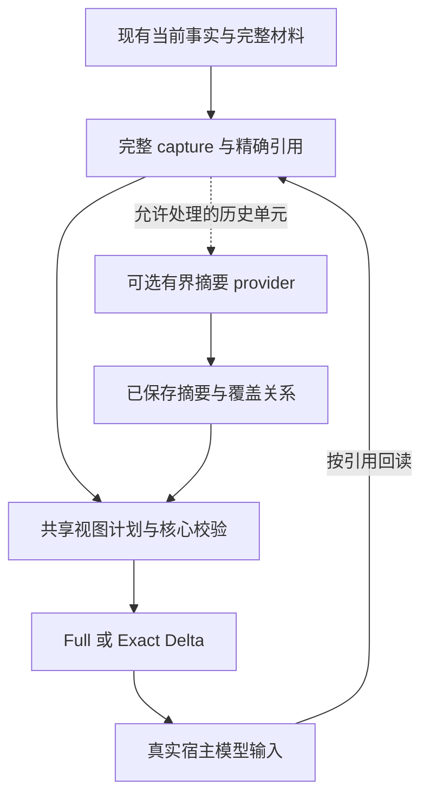

# RFC: 参考 billion-context 的可回读历史工作集与上下文策略插件化（v0）

- **RFC status:** Accepted (upon merge)
- **替代 / 关闭：** 无
- **Delivery maturity:** Proposal
- **Authors / owners:** shared context presentation / Turn / continuation / extension 维护者；具体实施切片由维护者认领。
- **Created:** 2026-11-09
- **Last normative revision:** 2026-11-09
- **Implementation baseline:** 已审阅的 [`241c991794c37627d1bf9e2fa9d83472857c4129`](https://github.com/loopx-project/loopx/commit/241c991794c37627d1bf9e2fa9d83472857c4129)；相关现状代码已与 `701795db237a35b23266588abad6f21857704ccd` 比较，未发生变化。
- **Related contracts:** [设计讨论 #8450](https://github.com/loopx-project/loopx/issues/8450)、[#4391 / T02 / M1-B](https://github.com/loopx-project/loopx/issues/4391)、[Controller/Executor 契约][lx-controller]、[T02 研究计划][lx-frontier]、[extension 契约][lx-extensions]。
- **Language mirror:** [English（语义镜像）](history-working-set-context-policy-v0.md)
- **Design reference:** [`ranxianglei/billion-context@4be21b08ed3da8b69d1800a10a9c0b9c5a707f71`](https://github.com/ranxianglei/billion-context/tree/4be21b08ed3da8b69d1800a10a9c0b9c5a707f71)。明确借鉴其 pipeline、稳定原文引用、统一范围判定、分层 coverage 与成本计量；不主张已集成该项目或复制其全部实现。

## 文档地图与维护契约

- 第 1–10 节定义设计与验收契约，其中第 4 节专门记录已审阅固定基线上的现状，不把提议能力列为已实现。
- 第 11 节是规范性实施计划；第 12 节列出未决选择，推荐答案不是批准。
- 附录为非规范性的研究边界、决定记录与证据索引。未来有日期的执行记录按 [ledger 规范](ledger/README.md) 单独维护，不追加到规范性计划中。
- 英文版与中文版保持语义同步；接口示意、逻辑字段和状态描述不是已发布 API。

Header 中的 Accepted 在本 RFC PR 合并时生效。合并前仍是待评审提案；合并接受的是可认领的有界设计基础。**设计接受与交付成熟度分别记录：本 RFC 的 Delivery maturity 为 Proposal，未交付运行时功能，也不改变默认值。** 实现、现场资格、产品推广和模型实验分别需要对应证据与授权。本文不关闭 [#8450](https://github.com/loopx-project/loopx/issues/8450)、[#4391](https://github.com/loopx-project/loopx/issues/4391)、C1/C2 验收或任何现有 RFC。[RFC 维护规范][lx-rfc]

## 1. 决策摘要

建议在 LoopX 现有完整来源、capture、渐进式读取和精确差量交付之间，增加一个**受控、可替换的历史工作集策略**：

1. 完整材料与当前事实继续由现有 owner 管理；摘要只是可重建的派生视图。
2. 核心先给出允许处理的历史单元，策略提出保留原文、使用有效摘要或延迟读取的计划；核心负责校验与实际投影。
3. 摘要生成放在已有 capability/provider 执行边界，按预算有界运行；同步 context hook 只消费已经准备好的结果。
4. 真正减少输入的接入点是现有 shared presentation owner。只有追加摘要、却继续发送全部原文，不算实现了本提案的输入优化。
5. 新的语义历史策略默认关闭。现有 Progressive / Delta 配置、raw machine consumer、原身份恢复与一次结算边界分别保留。
6. 首先完成一个实际模型入口和一类历史材料的可验证链路，再将成熟契约开放给 extension；多层摘要和更多宿主另行资格化。

**决策边界：** 将上述 owner 划分、首个真实消费者、历史候选边界与验证设计，作为 T02 的一个有界实施切片。合并接受设计基础；§12 的具体选择仍需在相应阶段记录决定。本文不启动付费模型运行、自动修改默认值、导入完整宿主日志或创建新的调度系统。

## 2. 问题、动机与 billion-context 的参考范围

### 2.1 希望改善的用户结果

长任务包含调查、失败尝试、修复、验证和目标调整。后续执行需要知道哪些路径已被证据否定、某个结论适用于哪个版本、下一步有哪些未满足条件。重复发送全部过程会增加输入与注意力成本；只保留一句摘要，则可能丢掉改变决策的差异。

固定基线的静态源码研究确认了已有投影和扩展基础，也确认尚需逐消费者验证最终输入；**尚未测得现网浪费规模，也没有声称当前模型必然因摘要不足而失败。** 下例是设计用的合成场景：

> revision R1 的尝试 A 暴露缓存隔离问题；R2 修复后通过部分测试，但回滚检查尚未完成。下一轮应保留失败原因、当前版本和未完成检查，并能展开证据；不能把这段历史压成“缓存修复完成”。

期待的结果是：新一轮或新 session 能读到足以继续工作的历史，必要时精确展开；不反复尝试已否定路径，不把旧验收结果套用到新版本，并在可比任务质量下减少完整成本。

### 2.2 明确参考的上游设计

| billion-context 的设计 | 源码依据 | LoopX 的适配建议 |
| --- | --- | --- |
| 显式输入/状态/效果的有序 pipeline | `PipelineNode`、`NodeIO`、`runPipeline` [BC1] | 沿既有视图生成生命周期组织策略，IO 保留在 provider/host 边界；不新增总管式 ContextEngine |
| 原文与压缩状态分离、内容去重、稳定 ref | `MessageContentStore`、`storeOriginal`、`retrieveByRef` [BC2] | 复用现有 capture/artifact/read reference，补齐历史使用所需的保留与恢复条件 |
| 推荐范围与实际应用共享 eligibility | `projectUnit()` [BC3] | 候选发现、提案校验、实际投影共用一个确定性规则 owner，插件不能批准自己 |
| 摘要保存下层 block 和原始覆盖关系 | `CompressionBlock` [BC4] | 按 attempt / work item / 阶段组织，保留精确 coverage；首版只做一层 |
| 压缩计量包含缓存重付及回本窗口 | `cache-report.ts` [BC5] | 计入摘要、回读、缓存、重试与任务成果，不以压缩率单独晋升 |

“可展开”依赖原文仍可读取，不能等同于摘要语义无损。上游的消息范围、proxy/fetch 拦截、DSH 特定宿主控制和经验阈值不直接成为 LoopX 的核心假设。第一版独立实现所需设计，不引入整个上游 kernel/proxy 依赖；若后续提出源码复用，另行评估接口、版本与实际许可条款。

### 2.3 与已有工作的关系

| 现有工作 | 本次核查的状态 | 本提案如何承接 |
| --- | --- | --- |
| [#4391](https://github.com/loopx-project/loopx/issues/4391) / T02 / M1-B | Open；已有决策保真接续研究方向 | 本 RFC 作为有实际 caller 和验收单元的有界实现提案；复用其等预算、过期证据、目标变化、身份混淆与回查成本要求 |
| [#7768](https://github.com/loopx-project/loopx/pull/7768) | 已合并 | 复用 shared progressive planning、required-view projection 与 full/delta preparation；不新增 codec/dispatcher |
| [#7868](https://github.com/loopx-project/loopx/pull/7868) | 已合并的设计修订 | 保持 Progressive 与 Delta、文件产物、可见覆盖、retention、语义采用的区别 |
| [#7430](https://github.com/loopx-project/loopx/pull/7430) → [#8265](https://github.com/loopx-project/loopx/pull/8265) | C1 曾合并，随后被回退 | 不能仅依据 `merged=true` 把整包 C1 当作当前主线能力 |
| [#8266](https://github.com/loopx-project/loopx/pull/8266) | Open，未合并 | 与当前 C1 replacement 协调 source/capture/read/recovery；候选分支能力与性能结果不计入 main 现状 |
| [#8378](https://github.com/loopx-project/loopx/pull/8378) | Open，未合并 | Controller–Worker 并行演进是相关设计；首版历史视图不依赖双 session runtime |

上述状态来自 2026-11-09 的源码与关联工作审阅，不代表以后 main 的实时状态。实施前重新核对 main 与相关 PR；并行工作按语义 owner 和实际 diff 协调，不以某个 PR 号永久阻塞本提案，也不绕过被改变行为本身的资格要求。

### 2.4 必须保持的不变量

- 当前目标、验收、范围、权限、停止条件、未完成必读和执行身份的语义不被摘要改写或静默删除。
- “尝试结束”“结果已记录”“验收通过”“Goal 完成”分别来自原有事实，不由摘要推导。
- 未支持的 schema、字段或历史材料不被关键词规则自动认定为可删除。
- 当前依赖材料必须按原读取契约可用；将内容换成 pointer 不代表读义务已完成。
- 原文回读保持原信任层级；工具输出或检索材料不能被升级成 system 指令或权限。
- 模型可见视图、宿主保留证据、模型采用和任务受益分别观测。
- 可选摘要失败只退出该优化；必需原文缺失继续遵守现有阻止依赖动作/恢复规则。

## 3. 范围与非目标

### 范围

- 一条现有模型输入/continuation 路径的 shared presentation 接入。
- 一类结果已记录的历史支持材料：优先考虑已结束 attempt 的调查、测试与过程证据。
- 来源绑定、覆盖关系、可读取性、有效性判断及稳定派生视图。
- 核心掌握校验权的可选策略契约；复用既有 provider 与 extension 生命周期。
- 实际输入、回读、恢复、成本、任务质量和产品状态的观察与验收。

### 非目标

- 改写 Goal/Todo/claim/lease/quota/settlement 等权威状态，或创建第二份工作事实账本。
- 新建统一 memory database、plugin registry、scheduler、后台常驻守护器。
- 首版管理宿主所有消息，或承诺无限上下文/固定倍数的成本节省。
- 把历史摘要自动写入 Reward Memory、把召回直接当作经验证的经验。
- 首版多层递归摘要、任意 pipeline 重排、多插件链式修改同一 payload。
- 删除历史原文、关闭宿主原生 compaction，或要求所有宿主同时迁移。
- 把完整 C1、双 session 或整个研究总纲作为单一先决项目重新实施。

## 4. 当前系统契约：已审阅的固定基线

以下事实在 `241c991794c37627d1bf9e2fa9d83472857c4129` 审阅；相关现状代码已与文档 PR 基线 `701795db237a35b23266588abad6f21857704ccd` 比较，未发生变化。固定源码链接保留已审阅基线；后续 main 变化仍需重新核查。

| 现有 owner / 入口 | 已确认事实 | 本 RFC 的介入方式 |
| --- | --- | --- |
| `quota/progressive_context.ts` | `progressiveContextPlan()` 对已知支持材料做确定性投影；未知 shape 保留完整；native/stateless prepare 入口共享计划 [LX1] | 在现有 owner 内增加受限历史候选/提案验证，保留未知内容与现有恢复语义 |
| `quota/turn_envelope.ts` | 已有 `progressive_context_delivery`、`context_delivery`、`context_recovery` 分派 [LX2] | 复用 dispatch/typed transaction，不加另一个编排入口 |
| `turn_driver/decision_capture.py` | `capture_context_projection()`、`capture_progressive_context()` 保存完整来源，再生成派生视图；有 digest、选读与 same-capture recovery [LX3] | host IO 继续在此边界；先证明来源保留条件，再扩展历史用途 |
| `quota/context_delivery.ts` | exact codec 验证 scope、session/epoch、digest、baseline 和恢复等价；收益不足可用 full [LX4] | 对已验证的最终视图编码；摘要不替代完整来源、既有 baseline 绑定或宿主 retention 证据，baseline 本身不授予工作权威 |
| `capability_hooks.py` / `capability_context.ts` | 有同步 bounded producer、slot 冲突与来源绑定验证；默认贡献上限 64 KiB，核心字段保留 [LX5] | 可提供准备好的建议与摘要引用；当前 hook 不能任意替换历史 |
| `capabilities/turn_context.py` | 当前显式组合 memory 与 anti-entropy；不是任意发现式 context transformer 链 [LX6] | 首版明确注册一个可选贡献；成熟后扩展既有端口 |
| `context_providers/factory.py` / `extensions/*` | 有 provider 注册和 extension 生命周期；manifest 当前 hook phase 为 `capability_action` [LX7] | 不宣称今天已有通用 context-policy plugin；新端口需类型/版本/reader 同步演进 |
| `codex_cli.py::_render_prompt()` | 当前入口直接序列化验证后的 `model_request`；最终 prompt 不在此处统一调用 progressive prepare [LX8] | 候选首个消费者；实际 shape、reader 可用性和收益仍须在实现时验证 |
| `native_chat/manager_context.py` | 已有局部支持历史的延迟读取，复用 capture/reader，但存在专用投影 [LX9] | 后续按同一 owner 合同收敛，不宣称此处完全没有渐进能力 |
| `machine_configuration/context_delivery.py` | 当前默认 `mode:on`、`delta_delivery:auto`；progressive 与 native delta 激活分开 [LX10] | 新语义策略独立默认关闭；旧设置与未知宿主行为不变 |
| `dsh-loopx-plugin/src/driver.ts::readQuota()` | 机器 quota 调用显式 `LOOPX_CONTEXT_DELIVERY: off` [LX11] | 保留机器结果契约；仅迁移确实面向模型的输出 |

**证据边界：** 有 capture 文件不等于已经证明长期保留；有公共 prepare 函数不等于所有模型入口已采用；有 work_contract 消费分支也不等于已回退的 C1 整包仍在 main。上述区分是本提案实施与评审的前提。

## 5. 提议架构与接入契约

### 5.1 单一投影 owner



D/E 为拟新增能力，不在每轮同步视图构建时临时执行模型调用。当前工作权威、capture IO、共享 TypeScript 投影、exact codec、host delivery 分别沿原 owner 实施。

### 5.2 哪些材料允许进入候选集

首版候选来自已存在的 typed attempt/result/evidence 事实与有界来源，不通过“done”“旧日志”等字符串推测完成度。

候选至少满足：

1. 来源身份、Goal/Agent/访问范围明确，内容可按精确引用读取。
2. 所属尝试已结束且结果已记录；结果可以是失败，不要求伪装成成功。
3. 该材料属于明确的历史支持材料范围，未被当前工作契约要求完整首读；其中的当前义务与未决问题须已在现有精确来源中独立保留，或由 typed owner 证明该范围不承载这些信息。无法确定时不进入候选，不能只依据 attempt 已结束。
4. 对该材料的来源保留和恢复资格已验证；未验证时保持原有视图。
5. 未知形状、缺失身份、跨 scope 引用、无法保持工具配对/来源层级的内容不进入首版候选。

候选范围由现有事实与确定性规则生成。策略可以在候选范围内排序和建议展示形式；不能扩大候选范围或从自己的文本授予权限。

### 5.3 策略与 provider 的最小边界

以下是职责示意，不是冻结的新 public schema：

```ts
interface HistoryViewPolicy {
  propose(input: {
    sourceBinding: ExistingSourceBinding;
    eligibleUnits: readonly EligibleHistoryUnit[];
    currentRelevanceContext: Readonly<CurrentDecisionReadView>;
    preparedSummaries: readonly SourceBoundSummaryArtifact[];
    budget: ContextPresentationBudget;
  }): HistoryViewProposal;
}

// 由现有 provider/runtime 边界调用，不能从同步投影函数发起。
interface HistorySummaryProvider {
  prepare(request: BoundHistorySummaryRequest): Promise<SummaryProposal>;
}
```

- 策略输入可读取当前任务相关性信息，但不能修改当前事实。输出是“对指定候选建议原文/引用/摘要”的声明式计划，不是任意 JSON Patch 或整包替换；不能自定义消息 role、可执行命令、权限结论或宿主路径，最终包装与 provenance 标注由 owner 产生。
- **没有插件自有的 `approve` / 权威 `validateProposal` 回调。** scope、revision、coverage、保护规则、预算、引用可用性与实际投影均由 shared TypeScript owner 判定。
- 同步 `propose()` 只进行有界、无外部 IO 的计划计算；需要模型、进程或网络的策略部分提前通过 provider/runtime 生成来源绑定提案。该逻辑接口不授权在共享投影进程内加载任意第三方代码。
- 首版每个生效 scope 只选择一个历史策略；不开放任意插件链与阶段重排。
- `ContextProvider` 的现有 recall/sync 端口不自动获得“总结整段历史”的新语义。若现有端口不足，增加明确版本化的窄端口，仍使用现有 catalog/runtime。
- 第一版内部 helper 放最近 owner，不仅为了生命周期锚点新增 capability。对外注册前按 placement policy 明确 capability_id/provider_id/origin/实际 caller。
- Python 可继续负责文件、进程和宿主 IO；新的跨宿主判定归入现有 TypeScript owner，不维护平行 Python 决策副本。

### 5.4 派生摘要所需的逻辑信息

| 信息 | 用途与约束 |
| --- | --- |
| 原始 scope 与稳定 source refs | 复用当前 Goal/Agent/attempt/evidence 身份和现有 reference 类型；不能仅靠一段路径 prose |
| 来源 digest / revision | 锚定摘要实际观察的内容；原文变化不能静默复用旧绑定 |
| 精确 coverage | 来源清单由 owner 按实际提供给摘要器的材料构造，模型只能引用该清单；只提供部分内容时明确声明选段；截断或未完整供给时不能声称全覆盖；非连续集合不能用 min/max 区间冒充连续覆盖 |
| 摘要与重要未决事项/反面证据的导航 | 服务当前决策；不能更新权威状态，不能证明完整语义保留 |
| policy / generator / prompt 版本 | 用于复现、缓存失效和诊断；实际模型调用计入成本 |
| 原文展开入口及保留范围 | 只有 reader 和来源仍有效时才能对外声称可展开 |

身份、schema、状态词汇优先复用已注册 owner。只有真实跨 provider caller 需要的新增共享词汇才进入注册与版本评审；本表不要求新增一套工作状态 schema。

### 5.5 来源保留、引用与缓存

这是从“本轮 capture”扩展到“跨轮历史”的必要工作：

- **发布顺序：** 先保存并校验原文，再保存摘要，最后发布可选择的摘要引用；崩溃不能留下可见但不可恢复的有效视图。
- **保留范围：** 明确来源只支持本次 attempt、本机后续 session，还是某种已资格化 backup/restore。首版只承诺验证过的范围；临时文件不自动成为长期来源。
- **已有存储优先：** 使用现有 capture/artifact 生命周期与清理规则；如需保留引用，扩展其 owner，不建立独立全量消息库。未找到合适持久来源时，该材料不参与跨 session 优化。
- **原文删除/失效：** 发布时声明引用的有效范围/期限，正常清理不能提前破坏这项承诺；既有 owner 不能保证时，缩短承诺范围或不启用该历史视图。用户显式删除、权限撤销与异常损坏须立即反映到来源和摘要可见性，不能为了保留摘要而绕过。失去可读来源时不得继续标为完整可展开；可选摘要退出，必需材料依赖按原规则处理。
- **引用定位限制：** 复用当前 path-bound reader 时，路径只是该 profile 下的定位方式；未验证迁移前，不宣称跨机器透明恢复或引用可自动重定位。
- **去重边界：** 即使内容哈希相同，也不因此跨用户、Goal 或权限边界复用可见引用。
- **缓存键：** 基于 scope/可见性边界、精确有序来源集合与 digest、策略和生成版本。稳定材料不每轮重写摘要，避免无意义 prefix 变化。
- **历史真实性与当前适用性分开：** “R1 当时失败”可以持续为真；当前任务从 R2 变成 R3 后，要重新验证该历史的选择计划和适用性，不把旧失败当作当前状态，也不必仅因时间流逝重写历史原文。
- **首版只做一层：** 以后增加摘要的摘要时，父摘要仍需能追溯叶子 coverage；不在首版实现通用 DAG/GC 框架。

### 5.6 生成生命周期、竞态与失败

推荐触发观察点是已有“尝试结束且结果已记录”的生命周期，或明确请求的历史整理；生成请求通过既有有界 runtime/provider 执行，不增常驻调度器。当前 post-settlement 也是同步 callback，不能假定已存在异步任务队列：仅在已有且经过验证的执行 owner 能接收该工作时，适配为提交生成请求；否则首版采用显式 prepare，不在同步 hook 中等待高成本模型完成。

- 生成请求与产物使用同一精确来源集合及生成版本绑定；重复产物发布幂等，已完成的工作执行不重新结算。外部调用结果不确定时沿现有 owner 的恢复规则处理；provider 不支持幂等或结果查询时，不宣称生成调用 exactly-once，可能的重复调用及费用必须可见并受预算约束。
- 生成期间目标、权限、配置或来源变化，结果返回后重新验证。旧结果可以保持为有权限的历史产物，但过期选择计划不能直接注入新一轮。
- provider 的运行预算、超时、取消与凭据沿现有执行边界管理。超时/不可用/超限不改变当前工作权威。
- 策略关闭、extension disabled 或 doctor 不通过时，不创建新生成请求，也不导入可选 provider；已在途调用按既有取消/结果处理契约收尾，晚到结果不重新激活能力。
- hook 无有效摘要时返回原有投影；有来源冲突时拒绝该贡献。必需事实缺失不能伪装成“优化失败所以忽略”。

### 5.7 与 exact delivery 的组合

顺序固定为：完整来源 → 合法视图选择/摘要 → 校验后的工作视图 → exact full/delta → 宿主。

exact codec 可以精确重建一份含摘要的派生视图，但不能据此证明摘要等价于原始事实。不能因摘要文件存在就设置宿主 retained/complete，也不能借摘要失效重新 guard、创建新 attempt 或重复 settlement。[LX4]

### 5.8 如何接入现有 extension

当前 `hook_adapters` 只支持 `capability_action`，因此外部插件化需要真实的窄端口，而不是在 manifest 写一个任意 pre-request hook。[LX7]

建议顺序：

1. 在现有投影 owner 内证明一个内置、可关闭的策略有效。
2. 固定该 caller 实际需要的 proposal/provider 语义、输入边界、输出大小和错误处理。
3. 沿 `extensions/manifest.py`、既有 adapter discovery/runtime 扩展版本化声明；旧 manifest 与运行时保持可解释的兼容/拒绝行为。
4. 复用 install/enable/doctor/disable/rollback、permissions 和 provider binding，不新增 registry。
5. 核心规定阶段与保护规则；插件不能重排 capture、validation、delivery 或 settlement。

## 6. 备选方案与取舍

| 方案 | 优点 | 局限 / 本提案选择 |
| --- | --- | --- |
| 继续使用现有 Progressive + Delta | 已有实现、语义较明确、无摘要调用 | 是必须保留的基线与回退路径；先迁移真实消费者可能已取得足够收益 |
| 只加 working brief hook | 接入小，可改善导航 | 不能证明压缩，可能增加总输入；只能作为局部建议能力 |
| 单层来源绑定历史视图 | 有具体候选、可展开、便于测量和禁用 | 推荐首版；需补齐来源保留和真实消费者验证 |
| 直接依赖整个 billion-context kernel/proxy | 可获得丰富会话机制 | 引入宿主消息模型、持久化和拦截假设；需额外适配，首版收益尚未证明 |
| 优先做向量检索 / 通用 memory store | 有利于某些召回问题 | 不能代替来源覆盖、当前义务和精确恢复；超出首个场景 |
| 首版开放任意插件流水线 | 表面灵活 | 难以确定顺序、冲突和权威边界；待具体多策略需求出现后另议 |

## 7. 隐私、权限与兼容

- 新语义策略默认关闭；关闭时保持既有输出语义、读取与成本边界，不增加 provider import、外部 IO 或摘要收费调用。
- 现有 `context_delivery` v0/v1 配置不能被直接塞入未知字段。若需要持久开关/策略选择，沿该注册配置 owner 做版本化扩展；旧配置映射到“语义策略关闭”，现有 Progressive/Delta 值不变。
- 原文与摘要遵循同一 scope 和访问控制。provider 只接收被明确允许的材料；不因安装插件自动上传整个 Goal、全部会话或私有操作记录。
- 只处理 LoopX 已合法持有的材料。宿主原始日志没有既有来源边界时，需要单独明确的 host export/read contract；不从 packet 优化推导出宿主全文压缩能力。
- 未支持的新策略/产物版本不能被旧 reader 误解成完整事实。旧版本能忽略可选派生记录时退回原路径；不能读取的必需来源按原规则报告。
- raw machine API、签名/绑定的原始请求、journal 和历史 receipt 保持原语义；模型可见派生视图不覆盖或重新签名原事实。
- 本 RFC 示例为公开合成材料；不提交用户会话、原始内部日志、私有状态、凭据或本机路径。

## 8. 迁移、启用与回滚

1. 固定实施时 main、首个 caller、provider/profile 和对照任务；先确认当前路径，不重复正在合入的 C1 切片。
2. 在有界路径验证原文/引用与共享视图；新消费者即使读到现有 `mode:on`，也不能自动认为已获得扩大默认行为的资格。
3. 首个语义策略以显式 opt-in 进入，先针对一类材料。原始 capture 保持不变，摘要作为独立可丢弃产物。
4. 验证真实最终输入、展开、恢复和任务结果后，再评审支持范围与产品入口。
5. 禁用策略后立即停止新视图采用/生成请求，下一轮走原有完整或渐进路径；已承诺给模型的引用在原生命周期内保持可解析。
6. rollback 不删除仍被引用的来源、不重写历史 receipt、不重新准入既有 attempt。已接受的模型输入也不能宣称能被事后撤回；后续回合按当前配置恢复。

首版不进行破坏性 migration。若后续提出删除原文、改写历史格式或扩大默认值，必须单独列出 producer/reader/存储兼容、恢复与批准条件。

## 9. 验证与验收

### 9.1 决定性验收矩阵

| ID | 声明 / 场景 | 需要的证据与结果 | 不代表什么 |
| --- | --- | --- | --- |
| A1 | 一个真实模型入口采用 shared view | 分别观察 LoopX 输出、本轮宿主提交内容与可观测的实际模型输入；当前义务保留，eligible 历史在已证明的层次减少或延迟 | serializer 输出小不等于已进入模型 |
| A2 | 原文可精确展开 | 原 reader 返回相同 digest 与选定内容；关键尾部证据能影响判断；只供前半段时不能接受为完整单元覆盖 | 引用存在/EOF 不证明模型理解 |
| A3 | 决策差异不被吞掉 | 成对案例仅改变版本、未完检查、反面证据或授权；模型必须作出相应不同决定 | 摘要文本相似度不证明任务保真 |
| A4 | stale plan 不应用 | 摘要生成后修改当前来源/目标/权限，或异步结果晚到；拒绝过期选择并保持原工作状态 | 历史结论无需被改写成当前结论 |
| A5 | 来源缺失与权限变化 | 删除/过期/损坏/撤权：不提供假“可恢复”，可选优化退回，必需依赖保持原处理规则 | fail-open 不等于忽略缺失义务 |
| A6 | scope 与身份隔离 | 相同文本、不同 Goal/Agent/attempt；跨 scope ref 与错误绑定均不能被接受 | 内容哈希相同不授予访问权 |
| A7 | 原身份恢复与一次效果 | 中断、compaction、重复读取、恢复/重放；同 capture/attempt 继续，无重复准入/扣额/结算 | summary 不能恢复丢失的控制权威 |
| A8 | off / 无收益 / 未支持形状 | 关闭时无额外 provider IO；未知 shape 保留；摘要+引用开销不划算时沿原路径 | 不能为达压缩率静默截断 |
| A9 | extension 生命周期 | disabled、doctor stale、版本不兼容、provider 失败、升级/回滚；有效范围与可见状态一致 | manifest 安装成功不代表模型采用 |
| A10 | 存储与重启范围真实 | 声明范围内重启/恢复后可展开；provider 完成但发布前崩溃、同绑定并发完成均不重复发布，不同 attempt 不相互覆盖，重复调用成本可见 | 临时 capture 不自动成为长期保存 |
| A11 | 数值、顺序与未知内容保留 | 复用当前 exact/typed 边界的独立回归；必要事实、数字、列表顺序不因视图转换改变 | TS 往返成功不证明语义等价 |
| A12 | 产品旅程可使用 | 从既有配置入口启用，实际任务受影响，能查看来源/回退并禁用；packaged 路径验证 | CLI 原型不代表所有 App/Lark 宿主交付 |

结构校验只能证明范围/引用一致，语义保真需要 A3 与任务验收。测试优先扩展现有相关 suite，选独立语义反例；不为每个 DTO 字段堆镜像测试，也不把 raw benchmark trajectories 放入 CI。静态审阅不能使运行时或模型资格验收行通过。

### 9.2 对照设计与成本口径

复用 [#4391](https://github.com/loopx-project/loopx/issues/4391) T02 和现有 benchmark toolkit，至少保留：

- **B0：** 实施时现有最佳合法路径：Progressive，加宿主已经资格化时的 Delta。
- **B1：** 原文引用/确定性视图选择，不调用语义摘要模型，识别简单方案是否足够。
- **T1：** 单层来源绑定摘要策略；必要时再与普通/结构化摘要在相同实际总 token 预算下比较。

实验单位采用完整任务/接续 episode，不把同一任务的多轮调用当成独立样本。固定任务、模型/工具/环境、处理版本和 independent verifier；按场景重复，保留失败、无收益与超预算结果。

分别统计：

1. 独立验收成果、约束遗漏、错误版本引用、重复失败路径和人工介入。
2. LoopX projection bytes/estimated tokens、实际 host input 与可观测覆盖；不可见部分标 unknown。
3. 所有执行/摘要/重试调用的 provider usage，cached 与 uncached 输入、输出、回读引起的后续输入；避免同一 usage 重复计费。
4. 摘要构建、读取、重试和整体 wall time / tail latency。
5. 来源磁盘量、保留期限和清理/恢复开销。

预算与接受界限必须在试验前由 owning reviewers 固定，包括任务质量非劣界限、完整成本目标、样本/停止规则。未取得 provider 或最终输入观察时，只报告可证明的投影变化，不外推账单节省。不得借本提案修改已冻结的 treatment 或把历史实验当成本次通过。

## 10. 运行与产品契约

### 10.1 用户路径

复用现有设置、上下文状态和原文读取入口，避免新建独立“上下文控制台”：

1. 用户在已有设置中发现可选历史策略，了解支持宿主和是否使用外部摘要 provider。
2. 对被支持的任务启用；当前 Progressive 与 Delta 的开关和值独立显示。
3. 查看当前实际生效/未生效、已使用摘要、展开来源和回退原因；“配置已保存”与“本轮已采用”分开。
4. 能展开原始证据、关闭策略或回滚 provider；不要求每轮额外确认。

CLI、App、适用的 Lark 入口共用 typed owner 与同一状态语义。首版若只验证一个 host/CLI，按 partial delivery 记录；对外新增 caller-facing 能力的产品推广必须完成受影响的现有 frontend journey 与 packaged readback。[LX12]

### 10.2 可观测性与容量

沿既有上下文/usage/provider 观察记录贡献的来源绑定、策略版本、实际选择、回读、fallback 和可测成本。使用有界、公开安全的原因信息，不把摘要正文、原文或私有路径塞进公共遥测。

初始预算沿当前输出和 provider 限制配置；不照搬上游固定 token 阈值。若当前必需材料本身超过预算，执行原读取/恢复规则，不能把当前义务转成摘要以满足上限。自报“已读”不增加 host retention 权限。

## 11. 分阶段实施与首个 PR 范围

| 阶段 | 可审查交付 | 进入条件 | 退出证据 | 回滚 |
| --- | --- | --- | --- | --- |
| M0：本 RFC 评审 | 明确 owner、候选、首个 caller、来源保留与对照方案 | 固定源码与相关工作核查 | 记录设计接受及本阶段必须决定的选择；D1–D7 按各自最晚决定点处理，未验证项保持未验证 | 保留讨论，不改运行时 |
| M1：一个真实消费者 | 现有完整来源、shared progressive、同 capture reader 到最终模型输入连通 | 核对当时已合入 C1 切片；reader 可用；限定 host | A1/A2/A7/A8/A11 与完整输入基线；未改变机器接口 | 原有 renderer/投影路径 |
| M2：一类单层历史视图 | 允许历史单元 → 来源保留 → 有界生成 → 核心校验 → 实际减少输入 → 展开 | M1；选定来源生命周期、scope、预算和有效性；显式 opt-in | A2–A8/A10；B0/B1/T1 的任务与完整成本结果 | 禁用可选策略，保留原文 |
| M3：外部策略 provider 与产品采用 | 版本化窄端口、已有 extension lifecycle 和配置/readback | M2 证明真实可替换 caller；placement 与兼容契约评审 | A9/A12、旧版本/disabled parity、packaged failure/recovery | disable/rollback，原路径继续 |
| M4：分层与更广宿主 | 多代 coverage 与更广读写/连续性资格 | M2/M3 的有界收益；明确第二个实际需求 | 漂移/展开成本/模型成果与每个 host 的独立资格 | 单层策略或既有投影 |

### 建议的首个实施 PR

候选入口是 `turn run-once → codex_cli` 的真实 prompt 构建，优先研究如下有限改动：

- `loopx/control_plane/turn_driver/codex_cli.py`：模型输入边界使用已准备的视图；原始 execution request/journal 保持完整。
- `loopx/control_plane/turn_driver/decision_capture.py`：必要的 capture/reader IO 适配，沿原生命周期。
- `loopx/control_plane/quota/progressive_context.ts` 与 `turn_envelope.ts`：复用或有限扩展已知 shape 的投影，不放模型 IO。
- 现有 context delivery 配置和相关测试：明确 opt-in/default 边界，验证实际 caller、关闭路径、读回和恢复。

实施前必须确认该入口所需的 supporting-history shape 与 reader；若当前 main 不支持，不强行套入 quota schema，应在相同 owner 扩展明确 shape，或经评审选另一条已支持的单 session continuation 路径。只迁移一个明确使用者，不连带全部宿主或重写 C1。

M1 不加入 LLM 摘要、外部 plugin loader、通用层级 store；M2 的首个完整结果必须在已证明的层次减少允许材料的未来输入并能展开，不以“注册了 hook / 创建了摘要文件”结束。

### 工作协调

首个代码 PR 前重新检查 [#8266](https://github.com/loopx-project/loopx/pull/8266) 和相关 owner，说明哪些改动已被 main 接受、哪些仍属候选。独立切片可以并行；最终 source/consumer 切换与默认推广仍满足对应原验收。本 RFC 的后续规范性修订须同步更新英中语义镜像，并遵守既有 typed-vocabulary 维护规则。

## 12. 需要评审的开放决定

| ID | 决定及推荐 | 责任边界 | 需要的证据 / 最晚决定点 |
| --- | --- | --- | --- |
| D1 | 首个 caller：推荐一个 `turn run-once → codex_cli` 实际输入；如其 supporting shape 尚不适合，选择一条现有 continuation caller | Turn / context owners | 当前 main 的完整调用链、reader 和输入基线；M1 前 |
| D2 | 首类材料：推荐已结束 attempt 的调查/测试过程，明确哪些当前必读材料不可替换 | context / work owners | typed completion 与 current obligation 对照；M2 前 |
| D3 | 长期来源位置与保留范围：优先复用已有 capture/artifact owner，不假设临时路径跨 session 可用 | capture / artifact / recovery owners | 重启、清理、权限撤销、所声明 backup/restore 实证；M2 前 |
| D4 | 摘要生成方式：先一个受预算控制的 provider；不把现有 ContextProvider recall 端口静默改义 | capability / provider owners | 可取消、有界、晚到结果、凭据与usage行为；M2 前 |
| D5 | 持久选择/配置：建议沿 context_delivery 注册命名空间版本化扩展，语义策略默认关闭 | configuration / frontend owners | v0/v1 兼容、作用范围、packaged readback；M2 启用与 M3 产品化前 |
| D6 | 公共插件端口：等第一个 caller 成熟后，决定内置 helper 与正式 provider contract 的边界 | extension / typed contract owners | 两个可替换实现或等价 conformance 需求；M3 前 |
| D7 | 非劣界限与收益门槛：质量优先、完整成本计入；预先固定，不根据结果反改 | T02 / benchmark / context owners | 合法任务、对照、样本和完整预算；任何模型试验前 |

这些推荐不因 RFC 合并而自动成为已批准的实施选择；不指派资源、承诺发布时间或启动实验。相关讨论继续关联 [#8450](https://github.com/loopx-project/loopx/issues/8450) 与 [#4391](https://github.com/loopx-project/loopx/issues/4391)；明确决定及其影响的规范章节记录在附录 B 所述的决定记录中。

## 附录 A：研究与验证边界（非规范性）

- **审阅日期与基线：** 2026-11-09；LoopX `241c991794c37627d1bf9e2fa9d83472857c4129`，billion-context `4be21b08ed3da8b69d1800a10a9c0b9c5a707f71`。
- **已完成的静态工作：** 固定版本关键源码、RFC 规范及关联 Issue/PR 读取；上游设计到现有 owner 的映射。
- **基线比较：** 相对前次研究的 `cffb53fe`，已审阅的 `241c991` 仅增加 native chat metadata recovery 相关 3 文件变化，不影响本文列出的核心接入点。相关现状代码在文档基线 `701795db237a35b23266588abad6f21857704ccd` 仍未变化。文档 PR 的后续基线更新不自动扩大这项审阅声明。
- **已修正的状态判断：** [#7430](https://github.com/loopx-project/loopx/pull/7430) 的 `merged=true` 不能忽略 [#8265](https://github.com/loopx-project/loopx/pull/8265) 的回退；在本次审阅时，[#8266](https://github.com/loopx-project/loopx/pull/8266)/#8378 均未当作 main 已交付。
- **未执行：** 本 RFC 的代码实现、源码/安装测试、模型实验、付费摘要调用、UI 验证、部署或默认切换。静态来源不能替代 A1–A12 的实现证据。
- **工作归属：** [#8450](https://github.com/loopx-project/loopx/issues/8450) 是本设计的讨论与实施跟踪入口；本 RFC 仍是 [#4391](https://github.com/loopx-project/loopx/issues/4391) T02 的有界子方案。

尚无本 RFC 的实现或实验执行记录。首次有实际交付证据时，再按 [ledger 规范](ledger/README.md) 创建 `ledger/history-working-set-context-policy-v0/` 下的日期记录及中文镜像；这里仅维护指针。

## 附录 B：决定记录（非规范性）

原始设计讨论位于 [#8450](https://github.com/loopx-project/loopx/issues/8450)，研究归属为 [#4391](https://github.com/loopx-project/loopx/issues/4391) 的 T02 / M1-B。本 RFC PR 的合并记录设计接受；它不单独批准 §12 的具体选择、模型运行、默认推广或运行时修改。

D1–D7 在对应 owner 明确批准前保持未决。后续决定记录日期、公开批准依据、备选方案及受影响的规范章节，并在两种语言中同步；不能从实现进度、沉默或推荐答案推导批准。没有替代或关闭其他 RFC，也没有删除既有 schema 字段的决定。

## 附录 C：证据登记与固定来源（非规范性）

| 证据 | 声明 | 固定基线 / 入口 | 结果与边界 |
| --- | --- | --- | --- |
| E1 | billion-context 的可借鉴机制 | `4be21b08...`；BC1–BC5 | 已静态审阅；不证明 LoopX 集成、运行效果或成本收益 |
| E2 | LoopX 已有 owner 与接入点 | `241c991...`；LX1–LX12；相关代码到 `701795db...` 未变 | 已静态审阅；不是所有宿主已消费 shared view 的声明 |
| E3 | 相关工作与设计归属 | [#8450](https://github.com/loopx-project/loopx/issues/8450)、[#4391](https://github.com/loopx-project/loopx/issues/4391) 及 §2.3 的关联 PR | 2026-11-09 读取结果；实施前重新核对 |
| E4 | 本 RFC 的输入、回读、任务质量与完整成本 | A1–A12、B0/B1/T1 | 未验证；不得从静态设计或文档合并推导通过 |

### billion-context

- [BC1 — 显式 pipeline][BC1]
- [BC2 — 原文 ContentStore、稳定引用与去重][BC2]
- [BC3 — 推荐/应用共享的范围判定][BC3]
- [BC4 — 分层摘要与覆盖关系][BC4]
- [BC5 — 缓存计量与压缩经济性][BC5]

### LoopX

- [LX1 — shared progressive planner / preparation][LX1]
- [LX2 — shared typed dispatch 与 presentation plan][LX2]
- [LX3 — 完整 capture、派生视图与原文恢复][LX3]
- [LX4 — exact full/delta encoding][LX4]
- [LX5 — bounded capability hooks][LX5]；[保留字段与贡献验证][lx-context-fields]
- [LX6 — 当前 capability context composition][LX6]
- [LX7 — extension manifest][LX7]；[provider factory][lx-provider]；[extension placement/lifecycle][lx-extensions]
- [LX8 — 当前 Codex 最终 prompt 构建][LX8]
- [LX9 — manager 局部历史投影][LX9]
- [LX10 — Progressive / Delta 配置][LX10]；[通用 CLI 激活][lx-cli-context]
- [LX11 — DSH 机器 quota consumer][LX11]
- [LX12 — 现有产品交付契约][LX12]
- [现有 Controller/Executor 的 semantic compression 设计][lx-controller]
- [T02 研究与验收方向][lx-frontier]
- [当前总体 roadmap][lx-roadmap]

[BC1]: https://github.com/ranxianglei/billion-context/blob/4be21b08ed3da8b69d1800a10a9c0b9c5a707f71/kernel/src/pipeline.ts
[BC2]: https://github.com/ranxianglei/billion-context/blob/4be21b08ed3da8b69d1800a10a9c0b9c5a707f71/kernel/src/content-store.ts
[BC3]: https://github.com/ranxianglei/billion-context/blob/4be21b08ed3da8b69d1800a10a9c0b9c5a707f71/kernel/src/unit-projection.ts
[BC4]: https://github.com/ranxianglei/billion-context/blob/4be21b08ed3da8b69d1800a10a9c0b9c5a707f71/kernel/src/types.ts#L68-L109
[BC5]: https://github.com/ranxianglei/billion-context/blob/4be21b08ed3da8b69d1800a10a9c0b9c5a707f71/kernel/src/cache-report.ts
[LX1]: https://github.com/loopx-project/loopx/blob/241c991794c37627d1bf9e2fa9d83472857c4129/loopx/control_plane/quota/progressive_context.ts
[LX2]: https://github.com/loopx-project/loopx/blob/241c991794c37627d1bf9e2fa9d83472857c4129/loopx/control_plane/quota/turn_envelope.ts
[LX3]: https://github.com/loopx-project/loopx/blob/241c991794c37627d1bf9e2fa9d83472857c4129/loopx/control_plane/turn_driver/decision_capture.py
[LX4]: https://github.com/loopx-project/loopx/blob/241c991794c37627d1bf9e2fa9d83472857c4129/loopx/control_plane/quota/context_delivery.ts
[LX5]: https://github.com/loopx-project/loopx/blob/241c991794c37627d1bf9e2fa9d83472857c4129/loopx/control_plane/capability_hooks.py
[LX6]: https://github.com/loopx-project/loopx/blob/241c991794c37627d1bf9e2fa9d83472857c4129/loopx/capabilities/turn_context.py
[LX7]: https://github.com/loopx-project/loopx/blob/241c991794c37627d1bf9e2fa9d83472857c4129/loopx/extensions/manifest.py
[LX8]: https://github.com/loopx-project/loopx/blob/241c991794c37627d1bf9e2fa9d83472857c4129/loopx/control_plane/turn_driver/codex_cli.py#L347-L430
[LX9]: https://github.com/loopx-project/loopx/blob/241c991794c37627d1bf9e2fa9d83472857c4129/loopx/capabilities/native_chat/manager_context.py
[LX10]: https://github.com/loopx-project/loopx/blob/241c991794c37627d1bf9e2fa9d83472857c4129/loopx/capabilities/machine_configuration/context_delivery.py
[LX11]: https://github.com/loopx-project/loopx/blob/241c991794c37627d1bf9e2fa9d83472857c4129/packages/dsh-loopx-plugin/src/driver.ts#L1073-L1104
[LX12]: https://github.com/loopx-project/loopx/blob/241c991794c37627d1bf9e2fa9d83472857c4129/docs/development/frontend-delivery.md#task-first-delivery--从用户任务开始
[lx-context-fields]: https://github.com/loopx-project/loopx/blob/241c991794c37627d1bf9e2fa9d83472857c4129/loopx/control_plane/turn_driver/capability_context.ts
[lx-provider]: https://github.com/loopx-project/loopx/blob/241c991794c37627d1bf9e2fa9d83472857c4129/loopx/capabilities/context_providers/factory.py
[lx-extensions]: https://github.com/loopx-project/loopx/blob/241c991794c37627d1bf9e2fa9d83472857c4129/docs/reference/extensions.md
[lx-controller]: https://github.com/loopx-project/loopx/blob/241c991794c37627d1bf9e2fa9d83472857c4129/docs/architecture/rfcs/controller-executor-unified-contract-v0.md#controller-intelligence-and-semantic-compression
[lx-frontier]: https://github.com/loopx-project/loopx/blob/241c991794c37627d1bf9e2fa9d83472857c4129/docs/architecture/rfcs/frontier-science-research-program-v0.md#t02-decision-preserving-memory-and-continuation
[lx-roadmap]: https://github.com/loopx-project/loopx/blob/241c991794c37627d1bf9e2fa9d83472857c4129/docs/architecture/rfcs/loopx-overall-roadmap-v0.md
[lx-rfc]: https://github.com/loopx-project/loopx/blob/241c991794c37627d1bf9e2fa9d83472857c4129/docs/architecture/rfcs/README.md
[lx-cli-context]: https://github.com/loopx-project/loopx/blob/241c991794c37627d1bf9e2fa9d83472857c4129/loopx/cli_commands/context_machine.py#L120-L166
