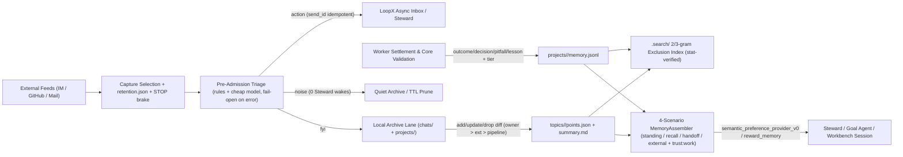

# RFC: Local File-First Project Memory, Four-Scenario Privacy Assembler, and Pre-Admission Inbox Triage (v0)

- **RFC status:** Accepted
- **Supersedes / closes:** none
- **Delivery maturity:** Proposal
- **Authors / owners:** LoopX maintainers, memory & steward engineering owners
- **Created:** 2026-11-23
- **Last normative revision:** 2026-11-23
- **Implementation baseline:** `49881d5a3`
- **Related contracts:** [Post-outcome memory utility attribution](post-outcome-memory-utility-attribution-v0.md), [Mechanism convergence and experience reuse](mechanism-convergence-and-learning-loop-v0.md), [Capable manager and semantic handoff](capable-manager-semantic-handoff-v0.md), [App conversations and async inbox](app-conversation-and-async-inbox-v0.md), [Reward memory capability](../../../loopx/capabilities/reward_memory/README.md), [Semantic preference capability](../../../loopx/capabilities/semantic_preference/README.md), [Material lifecycle capability](../../../loopx/capabilities/material_lifecycle/README.md)
- **Language mirror:** [中文版](local-file-project-memory-v0.zh-CN.md)

## Document map and maintenance contract

- Sections 1–10 are the normative design and acceptance contract.
- Section 11 is the normative delivery plan.
- Section 12 contains unresolved decisions; proposed answers are not approval.
- Appendices A–E contain the non-normative execution ledger, decision log, evidence registry, rejected alternatives, and generalized operational lessons.

LoopX already defines provider-neutral memory and preference seams—`reward_memory` (`candidate-review`, `ingest-event`, `utility-project`), `semantic_preference_provider_v0`, `material_lifecycle`, and `app-conversation-and-async-inbox-v0`. Today, however, practical recall relies on configuring an external OpenViking server (`>=0.4.19`), extensions lack a single cross-scenario privacy gate before injecting context into prompts or group/public surfaces, human-edited summaries lack field-level overwrite protection, and high-volume external feeds lack a pre-Steward noise filter. This RFC defines a **default-off, zero-external-dependency local file-first memory provider (`local_file_memory_v0`), a four-scenario privacy assembler, a rebuildable CJK/ASCII 2/3-gram exclusion index, and a fail-open pre-admission inbox funnel** over existing LoopX owners. The English and Chinese documents are semantic mirrors.

---

## 1. Decision summary

1. **Zero-ceremony local file-first provider (`local_file_memory_v0`) under existing LoopX seams.** Plain Markdown and JSONL files under ignored local-private state (`<runtime_root>/local_memory/`) implement `semantic_preference_provider_v0` and `reward_memory` provider bindings without requiring an external vector database or OpenViking server. Project execution memories (`memory.jsonl`: `outcome | decision | pitfall | lesson`) carry mandatory provenance and verification tiers (`agent_reported | accepted | owner`), preserving `recall != application != helpful` utility attribution.
2. **Single four-scenario memory & privacy assembler + `machine.trust = "work"` boundary.** Memory sources and extensions are forbidden from writing raw text into repository `AGENTS.md` or `CLAUDE.md`. One deterministic `MemoryAssembler` governs all memory injection across four scenarios: `standing` (project-scoped non-sensitive only, hard cap `≤ 1,536 B`), `recall` (owner-private query match), `handoff` (sensitive tags require explicit user plan-card **Start** confirmation + audit receipt), and `external` (group chats, shared Goal channels, and public PRs/artifacts hard-block all sensitive tags plus personal `view`/`inference` entries). Hosts configured with `machine.trust = "work"` block personal-category ingestion and recall fail-closed.
3. **Field-level ownership lock (`owner > extension > pipeline`) and `add / update / drop` diff distillation.** Human edits to `summary.md` or `points.json` automatically stamp `owner` authority via digest detection so background distillation (`pipeline`) and extensions can never overwrite human-curated facts (`409 locked_by_higher_authority`). Topic distillation (`topics/<slug>/points.json`) applies bounded `add | update | drop` diffs with pre-write `.intent.json` crash logs rather than rewriting whole files.
4. **Rebuildable CJK 2-gram / ASCII 3-gram / cross-script 2-gram exclusion index (`.search/`).** A pure candidate-file exclusion cache verified by `stat(path, mtime_ns, size)` accelerates substring and 1–2 character CJK queries across millions of local lines with `0` database WAL amplification and `100%` raw-scan recall parity—even if `.search/` is stale or deleted.
5. **Pre-admission external inbox funnel (`action / fyi / noise`) with fail-open safety.** Scoped capture rules (DMs, `@owner`, `±50`-message reply windows, per-rule `retention.json`, stoppable historical backfill) feed a lightweight pre-Steward `action | fyi | noise` filter: `noise` archives with `0` Steward wakes, `fyi` updates digests quietly, and `action` enters `app-conversation-and-async-inbox-v0` (`send_id` / `in_doubt` idempotent), failing open to `action` whenever classification errors.
6. **Default-off isolation and unchanged Core authority.** `local_file_memory` and pre-admission inbox triage default off (`enabled=false`); LoopX Core remains sole authority for Goals, Todos, `Vision/Replan`, and `reward_memory` utility attribution, and OpenViking remains fully supported for multi-peer/cloud bindings.
7. **Not approved here:** automatic cross-user memory sharing without explicit `goal_shared` corpus ACLs, embedding/vector-store dependencies in Core, or silent background modification of tracked repository files.

## 2. Problem and motivation

| User / operator failure | Audited baseline cause (`49881d5a3`) | Architectural gap |
| --- | --- | --- |
| "Single-user local sessions repeat the same repo pitfalls because enabling memory requires standing up an external OpenViking server, or unverified worker claims get treated as ground truth" | `reward_memory` and `semantic_preference` have clean protocols, but the primary shipped peer adapter targets OpenViking (`>=0.4.19`); non-Goal Workbench sessions have no zero-dependency local file provider | **High local setup threshold & missing `agent_reported` vs. `accepted` file provenance** |
| "Extensions stuff prose into `CLAUDE.md` / `AGENTS.md`, bloating every turn's prompt prefix and risking private views or personal facts leaking into group chats or public PRs" | No unified scenario-graded assembler sits between local memory extensions and prompt/handoff/external-output surfaces; work laptops lack a machine-level personal-memory block | **Missing scenario privacy gate (`standing / recall / handoff / external`) & work-host boundary** |
| "Hand-editing a project summary gets overwritten by the next LLM summary pass, full-file rewrites drop older decisions, and searching 300k+ local files takes seconds or bloats Postgres WAL" | Naive LLM summarization rewrites whole files without per-field ownership locks; SQLite FTS / `pg_trgm` struggle on 1–2 char CJK terms and mid-token substrings at multi-million-line scale | **Overwrite hazards, full-rewrite truncation, & CJK/substring scan cost** |
| "Connecting external IM/GitHub feeds wakes Steward on every group-chat noise message" | External hooks deliver raw events directly toward conversation intake without rule-based selection or `action / fyi / noise` pre-filtering | **Missing pre-admission noise funnel** |

**Concrete scenario.** A developer finishes debugging a flaky timezone test in `repo-a`; the worker's verified fix (`accepted`) records a `pitfall` in `projects/repo-a/memory.jsonl`, and the developer manually edits one deployment constraint (`owner`) in `topics/release-gate/summary.md`. Next week:
- On a new `repo-a` coding task, `standing` injects `< 1.5 KB` of verified repo pitfalls, avoiding the timezone bug without an external memory server; later `topics` distillation adds a new `practice` via `add` diff while leaving the `owner`-locked deployment note untouched.
- When the developer delegates a subtask carrying a `credentials`-tagged staging hint, `handoff` pauses on a plan card for explicit **Start** approval and logs an audit receipt; when drafting a public GitHub PR review (`external`), personal `view` and sensitive entries are hard-blocked (`0` leaks).
- Meanwhile, 400 incoming group messages are filtered locally: 396 `noise`/`fyi` items archive with `0` Steward model wakes, 3 `action` items enter the async inbox, and 1 classifier timeout fails open as `action` rather than disappearing.

### Reference adaptation

Adapted from [nwverse/persona](https://github.com/nwverse/persona) (`docs/assistant/knowledge.md`, `memory_assemble.go`, `search_index_grams.go`): LoopX adopts file-first Markdown/JSONL storage, `agent_reported / accepted / owner` verification tiers, the 4-scenario privacy assembler, `trust: "work"` host isolation, `owner > extension > pipeline` locks with `add/update/drop` diffs, the `stat`-verified 2/3-gram `.search/` exclusion index, and `action / fyi / noise` pre-triage—while binding them strictly under LoopX's `semantic_preference_provider_v0`, `reward_memory` utility attribution (`post-outcome-memory-utility-attribution-v0.md`), and `app-conversation-and-async-inbox-v0.md` rather than creating a parallel runtime.

### Invariants

1. **Files are inspectable truth; `.search/` is a disposable cache:** Deleting `.search/` at any time never loses data or reduces search recall relative to a direct file scan (`100%` recall parity).
2. **Verification tier is mandatory and non-escalating without proof:** An `agent_reported` entry never auto-promotes to `accepted` without passing `completion_validation` / verified turn checks, and never promotes to `owner` without a direct authenticated user write/edit.
3. **Scenario & host privacy gates are enforced in code, never prompt prose:** Extensions cannot bypass `MemoryAssembler`; `standing` never exceeds `1,536` UTF-8 bytes; `handoff` never forwards sensitive categories without user **Start** confirmation + receipt; `external` never emits sensitive categories or personal `view`/`inference` entries; `machine.trust = "work"` never ingests or recalls personal categories.
4. **Human edits win (`owner > extension > pipeline`):** Automated distillation and extensions never overwrite or delete an `owner`-locked section or point.
5. **Fail-open inbox safety, fail-closed public privacy:** Pre-admission inbox classification errors fail open to `action` (`0` lost actionable messages), whereas missing/ambiguous privacy metadata fails closed by withholding the memory entry from `standing`, `handoff`, and `external`.

## 3. Scope and non-goals

### In scope

- **Local file-first memory layout & LoopX provider adapter (`local_file_memory_v0`):** Ignored local-private `projects/<slug>/memory.jsonl` and `topics/<slug>/points.json` + `summary.md` implementing `semantic_preference_provider_v0` and `reward_memory` candidate/ingest/recall seams.
- **Four-scenario `MemoryAssembler` & `machine.trust` policy:** Deterministic filtering, byte-budget enforcement, `handoff` confirmation + audit receipts, `external` hard-blocking, and `trust: "work"` host enforcement.
- **Ownership locks & incremental distillation lanes:** `owner > extension > pipeline` write precedence, digest-based manual-edit lock detection, atomic `.intent.json` crash recovery, and `add | update | drop` topic diffs across decoupled background lanes (`archive`, `topics`, `index`).
- **`.search/` 2/3-gram exclusion index:** CJK 2-gram / ASCII 3-gram / cross-script 2-gram segmented exclusion index with `stat(path, mtime_ns, size)` validation.
- **Pre-admission external inbox funnel:** Capture-selection rules + `retention.json` + stoppable backfill (`STOP` file) + fail-open `action | fyi | noise` pre-triage feeding LoopX's async inbox.

### Non-goals

- Replacing OpenViking for multi-tenant, remote, or cloud-hosted Goal peers (`loopx/capabilities/reward_memory/`).
- Changing Core Goal/Todo schemas, `Vision/Replan` rules, or `post-outcome-memory-utility-attribution-v0.md` ranking gates.
- Introducing mandatory vector databases, embedding APIs, or Postgres `pg_trgm` indexes.
- Silently mutating tracked repository files (`AGENTS.md`, `CLAUDE.md`, docs) from background memory lanes.

## 4. Current-system contract

Audited against `main` baseline `49881d5a3`.

| Existing surface | Authoritative owner / location | Shipped baseline behavior on `49881d5a3` | Remaining gap |
| --- | --- | --- | --- |
| Reward Memory & post-outcome utility | `loopx/capabilities/reward_memory/`, `post-outcome-memory-utility-attribution-v0.md` | Provider-neutral Stage 1–3 contracts, per-`(goal_id, agent_id)` opt-in config + canary write/exact-readback receipt, and outcome-bound utility observations (`#3280`) | Primary peer implementation requires external OpenViking (`>=0.4.19`); no zero-dependency local file provider |
| Semantic preference recall | `loopx/capabilities/semantic_preference/` (`semantic_preference_provider_v0`) | Module-owned surface recall via extension manifest or subprocess `argv`, optional `corpus_inventory`, zero raw memory leaked into receipts | No built-in local file/topic store, human-edit lock, or 4-scenario privacy assembler |
| Material lifecycle & history working sets | `loopx/capabilities/material_lifecycle/`, `history-working-set-context-policy-v0.md` | Typed local material registration and source-bound historical views | No CJK/substring `.search/` exclusion index for multi-hundred-thousand file trees |
| Async conversation inbox & turn-start hook | `app-conversation-and-async-inbox-v0.md`, `provider-neutral-turn-start-inbox-hook-v0.md` | `send_id` / `in_doubt` idempotent inbox delivery and opt-in turn-start Lark ACK/replay (`#3678`, `#3733`) | No pre-admission capture selection or `action / fyi / noise` filter before Steward wake |

## 5. Proposed architecture

### 5.1 Ownership, file layout, and LoopX provider bridge



All storage lives under an ignored local-private root (`<runtime_root>/local_memory/`, never inside tracked repository paths):

```text
<runtime_root>/local_memory/
├── projects/<slug>/       # meta.json + summary.md + memory.jsonl (execution memories)
├── topics/<slug>/         # points.json + summary.md (cross-project distilled knowledge)
├── chats/<source_id>/     # YYYY-MM-DD.md + summary.md + retention.json + .ingest.json
├── inbox_funnel/          # selection_rules.json + triage_receipts.jsonl + history/STOP
└── .search/               # manifest.json + seg-*.idx (safe to rm -rf and rebuild)
```

| Concern | Single authoritative owner | Forbidden parallel path |
| --- | --- | --- |
| Goal/Todo state & post-outcome utility attribution | LoopX Core + `reward_memory` utility reducer | Local memory files claiming Todo completion or inflating retrieval rank without verified outcomes |
| Recall protocol & enablement verification | `semantic_preference_provider_v0` & `reward_memory` canary write/exact-readback | Extensions injecting text directly into `AGENTS.md`, `CLAUDE.md`, or raw system prompts |
| Scenario privacy filtering & `machine.trust` enforcement | `MemoryAssembler` (host code) | Relying on LLM prompt instructions to "please not mention private facts" |
| File truth vs. search acceleration | Markdown/JSON/JSONL files (truth) vs. `.search/` (disposable exclusion filter) | Unrecoverable binary/vector index as sole source of truth |

### 5.2 State model, verification tiers, and field-level ownership locks

**Project execution memory (`projects/<slug>/memory.jsonl`):**

```ts
type ProjectMemoryEntryV0 = {
  schemaVersion: "local_project_memory_entry_v0";
  entryId: string;
  projectSlug: string;
  kind: "outcome" | "decision" | "pitfall" | "lesson";
  entryClass: "fact" | "decision" | "lesson" | "view" | "inference";
  categories: Array<
    | "engineering" | "preference" | "schedule"
    | "health" | "finance" | "relationships" | "credentials" | "private_view"
  >;
  summary: string;
  verificationTier: "agent_reported" | "accepted" | "owner";
  authorityTier: "owner" | "extension" | "pipeline";
  provenance: {
    goalId: string | null;
    todoId: string | null;
    sessionRef: string;
    turnId: string;
    artifactOrCommitRef: string | null;
  };
  createdAt: string;
  supersededBy: string | null;
};
```

- **Verification rules:** Worker self-reports write `verificationTier: "agent_reported"` (rendered with an explicit `[unverified: agent_reported]` prefix on recall). Entries upgrade to `"accepted"` only when linked to a passed Core `completion_validation` or verified supervisor evidence check, and to `"owner"` only on direct authenticated user input or manual file edit.
- **Field-level ownership lock (`owner > extension > pipeline`) & `add / update / drop` diffs:**
  - Each item in `topics/<slug>/points.json` (`concept | decision | practice | pitfall | fact | question`) and each headed block in `summary.md` records `(authorityTier, lastPipelineDigest)`. Before any `pipeline` or `extension` write, host code hashes the current file block: if the live bytes differ from `lastPipelineDigest`, the block upgrades to `authorityTier: "owner"` in-place and rejects lower-tier mutations (`409 locked_by_higher_authority`).
  - Topic distillation prompts emit compact `{ op: "add" | "update" | "drop", pointId, ... }` JSON patches validated against ownership locks and written behind an atomic `.intent.json` write-ahead receipt so crashes never leave half-written files or silently drop older points.
- **Vocabulary registration:** Register `verificationTier`, `authorityTier`, `categories`, and scenario enums under the [semantic vocabulary diff advisory](../../../CONTRIBUTING.md#check-new-semantic-vocabulary-while-developing) before implementation.

### 5.3 Four-scenario privacy assembler and `machine.trust = "work"` boundary

Every memory producer (built-in lanes and third-party `memory_sources` extensions) must emit typed entries into `MemoryAssembler.assemble(request)`:

| Scenario | Caller surface | Allowed categories & `entryClass` | Hard budget / confirmation gate |
| --- | --- | --- | --- |
| `standing` | Per-turn background preamble for a bound project | Project-scoped `engineering`, `preference` only (`accepted` or `owner` tiers only) | Hard cap **`≤ 1,536 bytes` (`1.5 KB`)** UTF-8; `0` sensitive tags; `0` `agent_reported` unverified claims |
| `recall` | Explicit `semantic_preference` / `reward_memory` lookup in verified `trusted_owner` private session | Matched categories permitted on current host (`agent_reported` labeled explicitly) | Bounded by surface `limit` (default `≤ 4 KB`); blocked on `restricted` sessions |
| `handoff` | Context package passed to a child worker, cross-session `session_handoff`, or external tool | Project-scoped non-sensitive pass automatically; **any** sensitive category (`health`, `finance`, `relationships`, `credentials`, `private_view`) holds | Sensitive entries require **explicit user plan-card `Start` click** naming the exact categories + target, writing an immutable `handoff_privacy_receipt` |
| `external` | Group chats, shared Goal channels, public GitHub PR descriptions/reviews/issues/releases | Public-safe `engineering` facts (`accepted` / `owner`) explicitly scoped to the target repo only | **Hard code block** (`0` items allowed) on all sensitive categories **and** all personal `view` / `inference` entries |

- **Work-machine boundary (`machine.trust = "work"`):** When local host policy sets `machine.trust = "work"`, ingestion, sync, indexing, and recall of personal categories (`health`, `finance`, `relationships`, `private_view`) and personal chat/recording folders are rejected fail-closed (`403 blocked_by_work_host_policy`).
- **Missing-tag fail-closed rule:** Any entry lacking valid `categories` or `entryClass` is treated as sensitive `private_view` and excluded from `standing`, `handoff`, and `external`.

### 5.4 Rebuildable `.search/` CJK/ASCII 2/3-gram exclusion index

To keep `local_file_memory_v0`, `material_lifecycle`, and session-transcript substring search sub-200ms across multi-million-line local trees without external databases or Postgres `pg_trgm` WAL overhead:

1. **Mixed-script gram extraction:** Over NFC-normalized, lowercased text streams, the indexer emits **2-grams for wide/CJK/Emoji codepoints**, **3-grams for narrow ASCII runs**, and **cross-script 2-grams at wide↔narrow boundaries** into immutable sorted segment files (`seg-*.idx` + `manifest.json`). Single-character CJK queries execute an ordered prefix range scan over 2-gram keys.
2. **Exclusion-only correctness contract:** On query, the engine extracts query grams, intersects posting lists to eliminate files that **cannot** contain the substring, and verifies `stat(path, mtime_ns, size)` on every indexed file:
   - Any file whose `(mtime_ns, size)` matches `manifest.json` and is absent from the gram intersection is skipped without opening it.
   - Candidate hits, newly created files, or files with changed `(mtime_ns, size)` or unreadable segments fall back to exact streaming substring/regex scan.
   - Consequently, `rm -rf .search`, partial index lag, or power loss never produces false negatives (`100%` recall parity with raw scan).
3. **Decoupled background lanes:** File writes separate into three non-blocking background lanes serialized only per target directory—`archive` (capture & retention), `topics` (incremental `add/update/drop` distillation), and `index` (zero-model `.search/` compaction)—so slow LLM summarization never blocks search indexing or foreground turns.

### 5.5 Pre-admission external inbox funnel (`action / fyi / noise`)

Before external connectors wake Steward or enqueue async inbox notifications (`app-conversation-and-async-inbox-v0.md`):

1. **Rule-based capture selection & stoppable backfill:**
   - Priority rules (`selection_rules.json`) default to admitting direct messages, explicit `@owner` mentions, and bounded context windows (`±50` messages) around owner replies while dropping unselected high-noise broadcast groups; `retention.json` enforces per-rule TTL pruning.
   - Historical backfill runs on a separate rate-limited worker (with jitter, quiet hours, slow-response backoff, pre-run archive snapshot, and an immediate file brake `inbox_funnel/history/STOP`) that writes only to `archive` and emits **`0` notifications or Steward wakes**.
2. **Rules-first + lightweight `action | fyi | noise` pre-triage:**
   - Deterministic rules classify known bots, CI heartbeats, and explicit `@owner` requests first; remaining ambiguous items pass through one bounded lightweight classification (`action | fyi | noise` + `reason`).
   - `noise` stops at local TTL archive (`0` Steward wakes); `fyi` appends to project/chat rollups for later on-demand recall; `action` forwards into LoopX's async inbox using the source event's deterministic `send_id` (`in_doubt` reconciliation preserved).
   - **Fail-open guarantee:** If the lightweight classifier times out, errors, or returns invalid output, the item is tagged `action` (`triage_fallback: true`) and forwarded—guaranteeing `0` dropped actionable messages.

## 6. Alternatives and design choices

| Alternative | Strengths | Why rejected or bounded | Verdict |
| --- | --- | --- | --- |
| **A. File-first `local_file_memory_v0` provider + 4-scenario `MemoryAssembler` + `.search/` gram exclusion index + fail-open inbox funnel (`this RFC`)** | Zero external server setup; human-editable files with overwrite locks; code-enforced privacy across group/public surfaces; `0` WAL substring index; reuses `reward_memory` & `semantic_preference` contracts | Local single-machine scope (cloud/multi-peer continues to use OpenViking) | **Adopted** |
| **B. Require OpenViking or a local vector database for all single-user memory** | Rich semantic vector similarity | Heavy operational dependency for local CLI/Workbench users; opaque binary store prevents `rg`/human edits; vector similarity misses exact CJK/identifier substrings | **Rejected** as mandatory prerequisite (kept optional) |
| **C. Let extensions append memories into `AGENTS.md` / `CLAUDE.md` directly** | Zero runtime code | Breaks repository cleanliness, bloats every prompt past host caps (`24 KB` / `32 KiB`), bypasses scenario privacy, and leaks private context into PRs | **Rejected** |
| **D. Postgres `pg_trgm` GIN / SQLite FTS5 trigram as primary substring store** | Standard SQL | Multi-GB WAL/index amplification on multi-million-line histories, poor 1–2 char CJK selectivity, and couples search to DB availability instead of plain files | **Rejected** |

## 7. Safety, privacy, and compatibility

- **Default-off parity:** With `local_file_memory.enabled=false` and `inbox_funnel.enabled=false` (shipped defaults), `reward_memory`, `semantic_preference`, OpenViking bindings, `AGENTS.md` loading, and external conversation hooks behave identically to `49881d5a3`.
- **Tracked-repo & public-artifact safety:** Configs and `<runtime_root>/local_memory/` must reside outside tracked Git paths (tracked configs are rejected at admission, matching `semantic_preference`). `MemoryAssembler` strips raw paths, credentials, private `view`/`inference` items, and sensitive categories from all `external` surfaces and LoopX receipts.
- **Multi-Goal / multi-Agent isolation:** Under `reward_memory` bindings, private Agent memories remain scoped by `(goal_id, agent_id)` unless explicitly written to a configured project/topic corpus with declared reader scope; sibling Agents never implicitly read another Agent's `private_view`.
- **Backward compatibility:** Existing `semantic_preference_hook_config_v0` and `reward_memory` OpenViking configs continue unchanged; `local_file_memory_v0` registers as an additional selectable provider implementation.

## 8. Migration and rollback

1. **Opt-in activation (`preview -> apply -> canary write/exact-readback`):** Enabling `local_file_memory_v0` reuses `reward_memory` / `semantic_preference` preview and non-recallable canary write + exact-readback verification before marking `effective_available=true`.
2. **Non-destructive rollback:** Setting `local_file_memory.enabled=false` or `inbox_funnel.enabled=false` immediately stops background lanes, prompt injection, and pre-triage while leaving plain Markdown/JSONL files intact on disk for human reading or `rg`.
3. **Index & backfill emergency stops:** Removing `.search/` cleanly falls back to direct file scan while rebuilding in background; touching `inbox_funnel/history/STOP` halts historical import before the next batch with zero partial-write corruption (`.ingest.json` reconciled on startup).

## 9. Validation and acceptance

| Claim | Test or evidence | Required result | Boundary / exclusions |
| --- | --- | --- | --- |
| **A1 · Zero-server provider conformance & verification tiers** | Run `semantic_preference` recall + `reward_memory` canary write/exact-readback & `ingest-event` against `local_file_memory_v0` with `agent_reported`, `accepted`, and `owner` fixtures | `100%` byte-exact readback; `agent_reported` excluded from `standing` and labeled `[unverified]` in `recall`; failed validation never upgrades tier | Local single-host provider; does not replace multi-tenant OpenViking tests |
| **A2 · Four-scenario privacy gate & `machine.trust = "work"`** | Adversarial injection suite across `standing`, `recall`, `handoff`, and `external` (group chat + PR body) with all sensitive tags, `view`/`inference` items, missing-tag items, oversized `standing` inputs, and `trust: "work"` host policy | `standing ≤ 1,536 B` (`0` sensitive); `handoff` blocks sensitive items until user **Start** click + writes audit receipt; `external` leaks `0 / N` sensitive or `view`/`inference` items; `trust: "work"` rejects personal categories (`403`); direct `AGENTS.md`/`CLAUDE.md` extension write attempts rejected | Deterministic gate proof; does not certify downstream user copy-paste |
| **A3 · `owner > extension > pipeline` lock & `add/update/drop` crash safety** | Hand-edit `summary.md` and `points.json`, then run `pipeline` and `extension` `add/update/drop` distillation + inject mid-write crash | `0` human-edited sections/points overwritten (`409`); non-locked points apply incremental `add/update/drop` without truncating untouched points; restart recovers cleanly from `.intent.json` | — |
| **A4 · `.search/` 2/3-gram recall parity & performance** | Benchmark + differential oracle over a synthetic `≥ 500k`-line mixed CJK/ASCII corpus (1-char CJK, 2-char CJK, mid-word ASCII, cross-script terms) across warm index, mutated `mtime`, corrupt segment, and `rm -rf .search` | `100%` exact result-set parity vs. raw file scan across all four states; warm query p95 `< 200 ms`; `0` SQLite/Postgres WAL writes | Synthetic scale fixture; SSD hardware disclosed |
| **A5 · Pre-admission inbox noise reduction & fail-open safety** | Replay `≥ 200` mixed external events (DMs, `@owner`, noisy groups, historical backfill with `STOP` brake, and injected classifier timeout/500 errors) | Unselected broadcast noise & `noise`-triaged items trigger `0` Steward turns; `STOP` halts backfill within 1 batch with `0` pushes; `100%` of classifier errors fail open to `action` (`0` dropped `action` items) with `send_id` idempotency preserved | Live connector rate limits qualified per platform |
| **A6 · Feature-off parity against `49881d5a3`** | Existing `reward_memory`, `semantic_preference`, `material_lifecycle`, and async-inbox test suites with `local_file_memory.enabled=false` and `inbox_funnel.enabled=false` | `0` behavioral, receipt, or schema regressions on `main` | — |

## 10. Operational contract

- **Lane isolation & resource caps:** `archive`, `topics`, and `index` lanes enforce bounded queue depth, per-directory file locks, and quiet-hour/rate budgets; `index` uses zero model calls.
- **Observability:** `loopx doctor` and capability status report `local_file_memory` binding health, `standing` byte utilization, `.search/` segment count/lag, ownership-lock conflict counts, and inbox funnel `action / fyi / noise / fallback_action` counters (metadata counts only, zero private text).
- **Backup & export:** Because files under `<runtime_root>/local_memory/` (excluding `.search/`) are canonical UTF-8 Markdown/JSON/JSONL, standard directory backup (`backup-state`) captures complete state without database dumps.

## 11. Normative delivery plan

| Milestone | Shipped behavior | Entry gate | Exit evidence | Rollback |
| --- | --- | --- | --- | --- |
| **M1 · `local_file_memory_v0` provider, verification tiers & ownership locks** | File-first `projects/<slug>/memory.jsonl` + `topics/<slug>/points.json` & `summary.md`, `owner > extension > pipeline` digest locks, `add/update/drop` `.intent.json` writer, and `semantic_preference_provider_v0` / `reward_memory` local adapter | Accepted RFC & registered vocabularies | A1, A3, A6 | Disable `local_file_memory` provider; plain files remain readable on disk |
| **M2 · Four-scenario `MemoryAssembler` & `machine.trust = "work"` gate** | Mandatory `MemoryAssembler` across `standing` (`≤ 1.5 KB`), `recall`, `handoff` (plan-card **Start** + audit receipt), and `external` (hard block), plus `trust: "work"` host policy and extension write guard | M1 merged | A2, A6 | Disable memory assembly hook; callers receive empty recall cleanly |
| **M3 · `.search/` 2/3-gram exclusion index** | Segmented CJK 2-gram / ASCII 3-gram / cross-script 2-gram exclusion cache with `stat(path, mtime_ns, size)` verification and background `index` lane shared by `local_file_memory` and session/material search | M1 merged | A4, A6 | Delete `.search/` and set `local_search_index=off`; queries use direct scan |
| **M4 · Pre-admission external inbox funnel** | `selection_rules.json` + `retention.json` + `STOP`-interruptible backfill + rules-first / fail-open `action | fyi | noise` pre-triage wired into `app-conversation-and-async-inbox-v0` | M2 merged | A5, A6 | Set `inbox_funnel.enabled=false`; external hooks revert to baseline intake |

## 12. Open decisions

Recommendations below are non-authoritative until recorded in Appendix B; normative v0 defaults in §§5–11 govern until then.

1. **D1 · Default `standing` memory byte cap** (*Owner:* memory & context owner; *Depends on:* M2)
   - *Normative M2 default:* `1,536 bytes` (`1.5 KB`) UTF-8 per project turn.
   - *Alternative:* `3,072 bytes` (`3 KB`). Evaluate prompt-cache hit ratio vs. pitfall recall utility on real coding tasks before raising.
2. **D2 · Automatic vs. manual promotion from `accepted` project pitfalls into cross-project `topics/`** (*Owner:* memory engineering owner; *Depends on:* M1/M2)
   - *Normative M1 default:* Keep `projects/<slug>/memory.jsonl` repo-local by default; distill into cross-project `topics/<slug>/` only when `≥ 2` projects exhibit the same verified pattern or the owner explicitly promotes it.
   - *Alternative:* Distill every `accepted` lesson into `topics/` immediately. Revisit after measuring cross-repo false-transfer noise.
3. **D3 · Sharing one `.search/` engine package between Steward session lookup and `local_file_memory`** (*Owner:* Workbench & core tooling owners; *Depends on:* M3)
   - *Recommendation:* Extract one shared TypeScript/native module implementing the 2/3-gram segment format so Workbench `steward_sessions_find` and `local_file_memory` maintain a single exclusion-index implementation.

---

## Appendix A: Execution ledger (non-normative)

Dated delivery checkpoints live in [`ledger/local-file-project-memory-v0/`](ledger/README.md), with paired `.md` and `.zh-CN.md` entries recording exact baseline commits, delivered slices, validation artifacts, and remaining gaps.

## Appendix B: Decision log

| Date | Decision | Owner / approval | Alternatives | Normative sections changed |
| --- | --- | --- | --- | --- |
| 2026-11-23 | Initial RFC proposing zero-server `local_file_memory_v0` provider, four-scenario `MemoryAssembler`, `owner > extension > pipeline` locks with `add/update/drop` diffs, `stat`-verified 2/3-gram `.search/` exclusion index, and fail-open `action/fyi/noise` inbox funnel | Proposal author (pending maintainer merge review) | B, C, D in §6 | §§1–12 |

## Appendix C: Evidence registry

| Evidence id | Claim | Baseline / environment | Artifact or command | Result | Privacy / validity boundary |
| --- | --- | --- | --- | --- | --- |
| E1 | Baseline `reward_memory`, `semantic_preference_provider_v0`, `material_lifecycle`, and async-inbox contracts verified in source | `49881d5a3` source audit | `loopx/capabilities/reward_memory/README.md`, `loopx/capabilities/semantic_preference/README.md`, `docs/architecture/rfcs/post-outcome-memory-utility-attribution-v0.md` | pass | Source audit only; does not certify new runtime implementation |
| E2 | RFC header, status index, bilingual mirror, and public-boundary premerge checks | `codex/local-file-memory-rfc` on `49881d5a3` | `uv run --extra test python scripts/generate_rfc_status_index.py --check` and `uv run --extra test loopx canary premerge --from-git-diff --git-diff-base origin/main` | pass | Documentation and static governance checks only |

## Appendix D: Rejected or superseded alternatives

1. **Allowing memory extensions to mutate `AGENTS.md` / `CLAUDE.md` directly:** Rejected because shared instruction files have strict host discovery caps (`24 KB` / `32 KiB`), pollute `git status`, cannot enforce `handoff`/`external` redaction, and risk committing private facts into public PRs.
2. **Full-document LLM rewrites for topic and project summaries:** Rejected because output-token limits silently drop older verified decisions as topics grow, and unguarded rewrites erase human corrections.
3. **Fail-closed pre-admission inbox filtering on classifier error:** Rejected because dropping an external message when a cheap classifier times out silently loses human requests; inbox pre-triage must fail open to `action`, whereas public/cross-boundary memory assembly must fail closed on privacy tags.

## Appendix E: Incident and review lessons

1. **Separating "recallable locally" from "safe to emit externally":** Treating personal preferences, candid stakeholder `views`, and engineering facts as a single undifferentiated memory blob causes group-chat and PR leaks the moment an agent drafts external text. *Resulting rules:* §5.2 mandatory `categories` + `entryClass` and §5.3 four-scenario `MemoryAssembler` + `machine.trust = "work"` host block.
2. **Exclusion indexes beat heavyweight full-text DBs for plain-file corpora:** At multi-million-line scale, `stat(mtime_ns, size)`-verified 2/3-gram exclusion segments keep files authoritative, handle 1–2 char CJK and arbitrary ASCII substrings uniformly, incur `0` WAL writes, and tolerate `rm -rf .search` without correctness loss. *Resulting rules:* Invariant 1 and §5.4.
