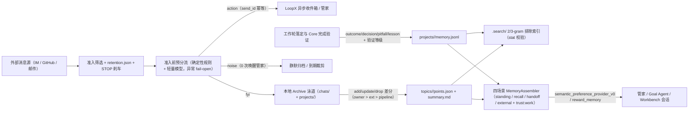

# RFC：本地文件优先项目记忆、四场景隐私汇编器与准入前收件箱分流（v0）

- **RFC 状态：** 已接受
- **替代 / 关闭：** none
- **交付成熟度：** Proposal
- **作者 / 责任人：** LoopX 维护者、记忆与管家工程负责人
- **创建：** 2026-11-23
- **最近规范修订：** 2026-11-23
- **实现基线：** `49881d5a3`
- **相关契约：** [结果后记忆效用归因](post-outcome-memory-utility-attribution-v0.zh-CN.md)、[机制收敛与经验复用闭环](mechanism-convergence-and-learning-loop-v0.zh-CN.md)、[强能力管家与语义交接](capable-manager-semantic-handoff-v0.zh-CN.md)、[App 对话与异步收件箱](app-conversation-and-async-inbox-v0.zh-CN.md)、[Reward Memory 能力契约](../../../loopx/capabilities/reward_memory/README.zh-CN.md)、[语义偏好能力契约](../../../loopx/capabilities/semantic_preference/README.md)、[材料生命周期契约](../../../loopx/capabilities/material_lifecycle/README.zh-CN.md)
- **语言镜像：** [English](local-file-project-memory-v0.md)

## 文档地图与维护约定

- 第 1–10 节是规范性设计与验收契约。
- 第 11 节是规范性交付计划。
- 第 12 节是待决事项；推荐答案不等于批准。
- 附录 A–E 为非规范性的执行台账、决策日志、证据登记表、被拒备选方案与泛化运行教训。

LoopX 主干已经定义了与具体存储解耦的记忆与偏好契约——包括 `reward_memory`（`candidate-review`、`ingest-event`、`utility-project`）、`semantic_preference_provider_v0`、`material_lifecycle` 与 `app-conversation-and-async-inbox-v0`。但在日常本机使用中仍存在四处断层：启用记忆默认依赖额外部署 OpenViking 服务端（`>=0.4.19`）；第三方或本地记忆源缺少统一的分场景隐私门禁来拦截群聊/公开 PR 外泄；人工手改的项目总结缺少防覆盖锁；外部高频消息流在唤醒管家前缺少规则筛选与降噪漏斗。本文在既有 LoopX owner 之上定义一套**默认关闭、零外部依赖的本地文件优先记忆 provider（`local_file_memory_v0`）、四场景隐私汇编器、可随时删掉重建的中英文 2/3-gram 排除索引，以及失败安全（fail-open）的准入前收件箱分流漏斗**。中英文互为语义镜像。

---

## 1. 决策摘要

1. **在既有 LoopX 契约下提供零门槛本地文件 provider（`local_file_memory_v0`）。** 以 git 忽略的本机私有目录（`<runtime_root>/local_memory/`）下的纯文本 Markdown 与 JSONL 文件作为唯一存储真相，直接实现 `semantic_preference_provider_v0` 与 `reward_memory` 读写接口，单机使用无需部署向量库或 OpenViking 服务端。项目执行记忆（`memory.jsonl`：`outcome | decision | pitfall | lesson`）强制携带出处与三级验证标签（`agent_reported | accepted | owner`），严格保持 `recall != application != helpful` 的效用归因边界。
2. **统一的四场景记忆与隐私汇编器 + `machine.trust = "work"` 办公机边界。** 严禁任何记忆扩展私自往业务仓库 `AGENTS.md` 或 `CLAUDE.md` 塞文本；所有记忆条目必须经单一确定性 `MemoryAssembler` 按四类场景裁剪：`standing`（常驻前缀，仅限当前项目非敏感工程/偏好项，硬上限 `≤ 1,536 B`）、`recall`（owner 私聊按需召回）、`handoff`（跨会话/子任务交接，凡含敏感分类标签必须经用户计划卡点击 **Start** 确认并落盘审计回执）、`external`（群聊、共享 Goal 频道、公开 PR/评论/发布说明，代码级硬拦截全部敏感分类及个人 `view`/`inference` 评价推断）。标记为 `machine.trust = "work"` 的办公主机在准入层 fail-closed 禁止个人生活类记忆入库与召回。
3. **字段级归属权写锁（`owner > extension > pipeline`）与 `add / update / drop` 增量差分蒸馏。** 用户手动编辑 `summary.md` 或 `points.json` 时，通过摘要比对自动升级并锁定为 `owner` 权威，后台蒸馏流水线（`pipeline`）与扩展绝不能覆盖人工修订（返回 `409 locked_by_higher_authority`）。跨项目主题库（`topics/<slug>/points.json`）采用带写前 `.intent.json` 崩溃日志的 `add | update | drop` 增量补丁更新，杜绝全文重写导致的截断与漂移。
4. **可随时重建的中英 2-gram / ASCII 3-gram / 跨界 2-gram 文件排除索引（`.search/`）。** 基于 `stat(path, mtime_ns, size)` 实时校验的纯候选文件排除器，零数据库 WAL 写放大，在百万行规模下实现 `< 200 ms` 任意子串与单双汉字检索，且索引落后、损坏或被 `rm -rf .search` 删除时与原始全扫保持 `100%` 召回等价。
5. **准入前多源外部收件箱漏斗（`action / fyi / noise`，异常 fail-open）。** 先由确定性采集规则（私聊、`@我`、本人发言前后 `±50` 条上下文、按规则配置 `retention.json` 过期天数、支持 `STOP` 刹车的静默历史导入）做源头限流，再在唤醒管家前做轻量 `action | fyi | noise` 分流：`noise` 静默归档（`0` 次唤醒管家），`fyi` 归入摘要，仅 `action` 按 `send_id` / `in_doubt` 幂等投递进 `app-conversation-and-async-inbox-v0`；分类器超时或报错时一律 fail-open 归为 `action`，确保 `0` 漏单。
6. **默认关闭隔离且核心权威不变。** `local_file_memory` 与收件箱预分流默认关闭（`enabled=false`）；LoopX Core 仍是 Goal、Todo、`Vision/Replan` 与 `reward_memory` 效用归因的唯一权威；OpenViking 继续作为多租户/云端协作的完整可选 provider。
7. **本文不批准：** 未经显式 `goal_shared` ACL 授权的跨用户记忆共享、在 Core 内引入必选向量库/Embedding 依赖，或由后台记忆流水线静默修改受 Git 跟踪的仓库文件。

## 2. 问题与动机

| 用户 / 运营痛点 | 已核对的基线根因（`49881d5a3`） | 架构缺口 |
| --- | --- | --- |
| “本机开新会话总在同一仓库反复踩同一个坑，但为了记几条踩坑还得先搭一套外部 OpenViking 服务；而且 worker 自报的未核验结论容易混成事实” | `reward_memory` 与 `semantic_preference` 协议很干净，但主干默认外部适配器面向 OpenViking（`>=0.4.19`），缺少开箱即用的本地文件 provider 与 `agent_reported / accepted / owner` 分级 | **本机启用门槛高，缺少文件级验证分级与出处绑定** |
| “记忆插件直接往 `CLAUDE.md`/`AGENTS.md` 追加长文，每轮白烧前缀 token，还可能把私人评价或敏感信息带进群聊和公开 PR” | 记忆源与提示词/交接/对外输出之间缺少统一的场景分级隐私汇编器；公司办公机也缺少机器级个人记忆隔离 | **缺少四场景隐私闸门（`standing / recall / handoff / external`）与办公机边界** |
| “人工手改过的项目总结下一轮就被模型总结覆盖掉；主题大了全文重写会丢旧决策；文件涨到几十万个后子串检索变慢或把数据库 WAL 撑爆” | 朴素摘要直接整篇覆写文件，无字段归属锁；SQLite FTS / `pg_trgm` 对 1–2 字中文与词中子串在百万行规模下选择性差或写放大严重 | **人工修改被覆盖、全文重写截断、百万行中英子串检索成本高** |
| “接上外部群聊/GitHub 通知后，无关群消息每条都把管家吵醒” | 外部事件直接进入会话入口，缺少规则化准入筛选与唤醒前的 `action / fyi / noise` 降噪漏斗 | **缺少准入前降噪与静默归档漏斗** |

**具体场景。** 开发者在 `repo-a` 修好一个时区 flaky 测试，验收通过（`accepted`）后自动在 `projects/repo-a/memory.jsonl` 沉淀一条 `pitfall`；开发者又手改 `topics/release-gate/summary.md` 写下一条发布红线（自动锁定为 `owner`）。下周：
- 在 `repo-a` 新开改码会话时，`standing` 自动注入 `< 1.5 KB` 的已核验项目踩坑，无需任何外部记忆服务就避开了时区坑；后台 `topics` 泳道通过 `add` 增量补丁写入新实践，但对 `owner` 锁定的发布红线零触碰。
- 派发子任务需携带一条含 `credentials` 标签的测试环境说明时，`handoff` 停在计划卡等待用户点 **Start** 确认并记下审计回执；而在生成公开 GitHub PR 评审（`external`）时，所有个人 `view` 与敏感条目被代码硬拦截（外泄数 `0`）。
- 同期涌入 400 条外部消息：396 条 `noise`/`fyi` 在本地静默归档（唤醒管家 `0` 次），3 条 `action` 进入异步收件箱，1 条分类器超时自动 fail-open 按 `action` 放行、绝不静默吞信。

### 参照设计与 LoopX 适配

借鉴自 [nwverse/persona](https://github.com/nwverse/persona)（`docs/assistant/knowledge.md`、`memory_assemble.go`、`search_index_grams.go`）：采纳纯文本文件为唯一真相、`agent_reported / accepted / owner` 三级核验、四场景隐私汇编器、`trust: "work"` 办公机隔离、`owner > extension > pipeline` 写锁与 `add/update/drop` 增量蒸馏、`stat` 校验的 2/3-gram `.search/` 排除器以及 `action / fyi / noise` 预分流；但**全部收敛挂载在 LoopX 既有的 `semantic_preference_provider_v0`、`reward_memory` 效用归因（`post-outcome-memory-utility-attribution-v0.zh-CN.md`）与 `app-conversation-and-async-inbox-v0.zh-CN.md` 契约之下**，不另造平行控制面。

### 不变量

1. **纯文本文件是唯一真相，`.search/` 只是随时可删的排除缓存：** 任何时刻执行 `rm -rf .search` 绝不丢失业务数据，且查询结果与直接全量扫盘保持 `100%` 召回一致。
2. **验证等级强制标注且无证据不升档：** `agent_reported` 条目未经 Core `completion_validation` 或督办证据核验通过绝不升为 `accepted`，未经已认证用户直接输入或手改文件绝不升为 `owner`。
3. **场景与主机隐私门禁由宿主代码强制执行，绝不靠提示词自觉：** 任何扩展不得绕过 `MemoryAssembler`；`standing` 绝不超过 `1,536` UTF-8 字节；`handoff` 未经用户点击 **Start** 并落盘回执绝不透传敏感标签；`external` 绝不输出任何敏感分类或个人 `view`/`inference`；`machine.trust = "work"` 绝不入库或召回个人生活类记忆。
4. **人工修改永远优先（`owner > extension > pipeline`）：** 后台自动蒸馏与扩展绝不能覆盖或删除任何带 `owner` 锁的段落或知识点。
5. **收件箱分流失败放行（fail-open），隐私裁剪缺失拦截（fail-closed）：** 准入前分类器异常一律按 `action` 放行（确保 `0` 漏掉正事），而记忆条目一旦缺失合法 `categories` 或 `entryClass` 则一律按敏感项在 `standing`、`handoff`、`external` 中 fail-closed 拦截。

## 3. 范围与非目标

### 范围内

- **本地文件记忆目录契约与 LoopX provider 适配（`local_file_memory_v0`）：** git 忽略私有目录下的 `projects/<slug>/memory.jsonl` 与 `topics/<slug>/points.json` + `summary.md`，完整对接 `semantic_preference_provider_v0` 与 `reward_memory` 候选/入库/召回接口。
- **四场景 `MemoryAssembler` 与 `machine.trust` 主机策略：** 确定性分类过滤、`standing` 字节硬上限、`handoff` 确认与审计回执、`external` 硬阻断及办公机 `trust: "work"` 拦截。
- **归属权写锁与增量蒸馏多泳道：** `owner > extension > pipeline` 优先级、基于内容摘要的手改自动加锁、写前 `.intent.json` 崩溃恢复，以及按目录互斥的 `archive`、`topics`、`index` 独立后台泳道与 `add | update | drop` 补丁协议。
- **`.search/` 中英 2/3-gram 排除索引：** 宽字符 2-gram / ASCII 3-gram / 中英跨界 2-gram 分段索引及 `stat(path, mtime_ns, size)` 校验。
- **准入前外部收件箱分流漏斗：** 采集选择规则 + `retention.json` 分级保留 + `STOP` 可刹车历史导入 + fail-open 的 `action | fyi | noise` 预分流，对接 LoopX 异步收件箱。

### 非目标

- 替代面向多租户、远端或云端协作的 OpenViking provider（`loopx/capabilities/reward_memory/`）。
- 修改 Core Goal/Todo 存储协议、`Vision/Replan` 规则或 `post-outcome-memory-utility-attribution-v0.zh-CN.md` 的排序晋升门禁。
- 在 Core 中引入必选向量数据库、在线 Embedding 调用或 Postgres `pg_trgm` 索引。
- 由后台记忆泳道静默修改仓库内受 Git 跟踪的文件（`AGENTS.md`、`CLAUDE.md`、文档等）。

## 4. 当前系统契约

以下事实基于 `main` 基线 `49881d5a3` 核对。

| 既有能力面 | 权威 owner / 代码位置 | `49881d5a3` 主干已交付行为 | 当前缺口 |
| --- | --- | --- | --- |
| Reward Memory 与结果后效用归因 | `loopx/capabilities/reward_memory/`、`post-outcome-memory-utility-attribution-v0.zh-CN.md` | 与 provider 解耦的 Stage 1–3 契约、按 `(goal_id, agent_id)` 启用的配置摘要与金丝雀写读回执，以及绑定验证结果的效用观测（`#3280`） | 主力外部实现依赖 OpenViking（`>=0.4.19`）；缺少零外部依赖的本地文件 provider |
| 语义偏好召回 | `loopx/capabilities/semantic_preference/`（`semantic_preference_provider_v0`） | 按模块 surface 触发的扩展/子进程召回与可选 `corpus_inventory`，回执零隐私正文泄漏 | 缺少内置本地项目/主题文件存储、手改防覆盖锁与四场景隐私汇编器 |
| 材料生命周期与历史工作集 | `loopx/capabilities/material_lifecycle/`、`history-working-set-context-policy-v0.zh-CN.md` | 类型化本地材料登记与绑定原始出处的历史视图 | 面对数十万本地文件缺少零 WAL 的中英子串排除索引 |
| 异步对话收件箱与轮首钩子 | `app-conversation-and-async-inbox-v0.zh-CN.md`、`provider-neutral-turn-start-inbox-hook-v0.md` | `send_id` / `in_doubt` 幂等异步投递与轮首飞书 ACK/重放（`#3678`、`#3733`） | 外部事件唤醒管家前缺少规则准入筛选与 `action / fyi / noise` 预分流 |

## 5. 架构设计

### 5.1 归属、文件布局与 LoopX Provider 桥接



所有文件统一存放在 git 忽略的本机私有根目录下（`<runtime_root>/local_memory/`，严禁落入受跟踪仓库目录）：

```text
<runtime_root>/local_memory/
├── projects/<slug>/       # meta.json + summary.md + memory.jsonl（项目执行记忆）
├── topics/<slug>/         # points.json + summary.md（跨项目蒸馏主题知识）
├── chats/<source_id>/     # YYYY-MM-DD.md + summary.md + retention.json + .ingest.json
├── inbox_funnel/          # selection_rules.json + triage_receipts.jsonl + history/STOP
└── .search/               # manifest.json + seg-*.idx（随时可 rm -rf 自动重建）
```

| 关注点 | 唯一权威 owner | 禁止的平行路径 |
| --- | --- | --- |
| Goal/Todo 状态与记忆效用归因 | LoopX Core + `reward_memory` 效用归约器 | 用本地记忆文件冒充 Todo 完成证据，或未经验证结果抬升检索权重 |
| 召回协议与启用核验 | `semantic_preference_provider_v0` 与 `reward_memory` 金丝雀写读校验 | 扩展直接改写 `AGENTS.md`、`CLAUDE.md` 或原始系统提示词 |
| 场景隐私裁剪与办公机限制 | `MemoryAssembler`（宿主确定性代码） | 依赖提示词嘱咐模型“不要在群里说隐私” |
| 存储真相 vs. 检索加速 | Markdown/JSON/JSONL 原文件（唯一真相） vs. `.search/`（可丢弃排除缓存） | 把不可逆的二进制/向量库当作唯一数据源 |

### 5.2 数据模型、三级验证标签与字段级归属锁

**项目执行记忆（`projects/<slug>/memory.jsonl`）：**

```ts
type ProjectMemoryEntryV0 = {
  schemaVersion: "local_project_memory_entry_v0";
  entryId: string;
  projectSlug: string;
  kind: "outcome" | "decision" | "pitfall" | "lesson";
  entryClass: "fact" | "decision" | "lesson" | "view" | "inference";
  categories: Array<
    | "engineering" | "preference" | "schedule"
    | "health" | "finance" | "relationships" | "credentials" | "private_view"
  >;
  summary: string;
  verificationTier: "agent_reported" | "accepted" | "owner";
  authorityTier: "owner" | "extension" | "pipeline";
  provenance: {
    goalId: string | null;
    todoId: string | null;
    sessionRef: string;
    turnId: string;
    artifactOrCommitRef: string | null;
  };
  createdAt: string;
  supersededBy: string | null;
};
```

- **验证升档规则：** Worker 完工自报仅写入 `verificationTier: "agent_reported"`（召回时强制带 `[unverified: agent_reported]` 前缀）；仅当关联的 Core `completion_validation` 或督办完成证据核验通过时才可记为 `"accepted"`；仅当来自已认证 owner 的直接陈述或手改原文件时才记为 `"owner"`。
- **字段级归属权写锁（`owner > extension > pipeline`）与 `add / update / drop` 增量补丁：**
  - `topics/<slug>/points.json` 中的每条知识点（`concept | decision | practice | pitfall | fact | question`）及 `summary.md` 的每个标题段落均记录 `(authorityTier, lastPipelineDigest)`。任何 `pipeline` 或 `extension` 写入前先算当前文件块哈希：一旦发现实盘内容偏离 `lastPipelineDigest`（说明人工手改过），立即原地将其锁定为 `authorityTier: "owner"`，并以 `409 locked_by_higher_authority` 拒绝低优先级覆写。
  - 主题蒸馏只允许模型输出结构化 `{ op: "add" | "update" | "drop", pointId, ... }` 增量 diff，经写锁校验后先落 `.intent.json` 预写意图日志再原子替换，崩溃重启自动对齐，防止主题变大后输出截断误删历史沉淀。
- **语义词汇登记：** 实现前按 [语义词汇 diff advisory](../../../CONTRIBUTING.md#check-new-semantic-vocabulary-while-developing) 登记 `verificationTier`、`authorityTier`、`categories` 与场景枚举。

### 5.3 四场景隐私汇编器与 `machine.trust = "work"` 边界

所有记忆生产者（内置泳道与声明 `memory_sources` 的扩展）必须输出带标签条目，统一由 `MemoryAssembler.assemble(request)` 裁剪：

| 场景 | 调用入口 | 允许的分类标签与 `entryClass` | 硬预算 / 确认门禁 |
| --- | --- | --- | --- |
| `standing` | 已绑定项目每轮常驻背景前缀 | 仅限当前项目的 `engineering`、`preference`，且仅限 `accepted` / `owner` 等级 | UTF-8 硬上限 **`≤ 1,536 字节`（`1.5 KB`）**；`0` 敏感分类；`0` 未核验 `agent_reported` |
| `recall` | 已验证 `trusted_owner` 私聊中的 `semantic_preference` / `reward_memory` 按需召回 | 当前主机策略允许的匹配分类（`agent_reported` 显式打未核验标） | 受调用方 surface `limit` 约束（默认 `≤ 4 KB`）；`restricted` 会话一律禁止 |
| `handoff` | 向子 worker、跨会话 `session_handoff` 或外部工具传递的上下文包 | 当前项目非敏感项自动放行；**凡含任一敏感分类**（`health`、`finance`、`relationships`、`credentials`、`private_view`）一律挂起 | 敏感条目必须经**用户在计划卡显式点击 `Start` 确认**（列明分类与接收方）并写入不可变 `handoff_privacy_receipt` 审计记录 |
| `external` | 群聊、共享 Goal 频道、公开 GitHub PR 描述/评论/Issue/Release | 仅限明确归属目标仓库的公开级 `engineering` 事实（`accepted` / `owner`） | **代码级硬阻断**（允许数为 `0`）：拦截全部敏感分类**以及**全部个人主观评价 `view` 与推断 `inference` |

- **办公机隔离（`machine.trust = "work"`）：** 当本机配置声明 `machine.trust = "work"` 时，所有个人生活分类（`health`、`finance`、`relationships`、`private_view`）及私人聊天/录音归档在入库、同步、建索引和召回四处入口全部 fail-closed 拦截（`403 blocked_by_work_host_policy`）。
- **缺标签默认拦截：** 任何缺少合法 `categories` 或 `entryClass` 的条目一律视作 `private_view`，禁止进入 `standing`、`handoff` 与 `external`。

### 5.4 可随时重建的 `.search/` 中英 2/3-gram 排除索引

为支撑 `local_file_memory_v0`、`material_lifecycle` 与本机会话记录在数百万行规模下的 `< 200 ms` 子串检索，同时保持零外部数据库与零 WAL 开销：

1. **中英混合 gram 切分：** 对 NFC 归一化后的小写字符流，**宽字符（中日韩/Emoji）提取 2-gram，窄字符（ASCII 连续段）提取 3-gram，中英交界处提取跨界 2-gram**，写入有序不可变分段文件（`seg-*.idx` + `manifest.json`）；单汉字查询走有序 2-gram 键前缀范围扫描。
2. **只做“排除器”的正确性契约：** 查询时提取查询串 gram 集求交，结合 `stat(path, mtime_ns, size)` 做实时校验：
   - 仅当某文件的 `(mtime_ns, size)` 与 `manifest.json` 完全一致且不在倒排交集内时，才直接排除跳过。
   - 候选命中文件、新建文件、`(mtime_ns, size)` 已变更或索引段损坏的文件，一律回退流式精确子串/正则扫描。
   - 因此执行 `rm -rf .search`、索引滞后或断电半写均零漏检，与原始全量扫盘保持 `100%` 结果等价。
3. **三泳道写文件解耦：** 后台按写目录互斥拆为 `archive`（采集与到期清理）、`topics`（增量 `add/update/drop` 蒸馏）与 `index`（零模型 `.search/` 增量合并）三条独立泳道，慢模型摘要绝不卡死检索与前台对话。

### 5.5 准入前多源外部收件箱分流漏斗（`action / fyi / noise`）

在外部消息源唤醒管家或写入异步收件箱（`app-conversation-and-async-inbox-v0.zh-CN.md`）之前，先经本地两级漏斗：

1. **规则化采集筛选与可刹车历史导入：**
   - 优先级规则（`selection_rules.json`）默认只收私聊、显式 `@我`，以及本人发言前后各 `±50` 条上下文窗口，源头过滤大群刷屏噪音；不同规则命中的内容由 `retention.json` 独立计算保留天数并自动裁剪。
   - 历史回溯导入运行在独立限速 worker 上（带随机抖动、静默时段、慢响应自动降速、跑前快照备份及文件级急刹开关 `inbox_funnel/history/STOP`），只入 `archive` 归档，**触发 `0` 次通知与 `0` 次管家唤醒**。
2. **规则优先 + 轻量 `action | fyi | noise` 预分流：**
   - 确定性规则先处理已知机器人、CI 心跳与明确 `@我` 指令；剩余模糊消息经一次有界轻量分类产出 `action | fyi | noise` 及原因。
   - `noise` 仅做短期归档（`0` 次唤醒管家）；`fyi` 沉淀入会话/项目滚动摘要供后续按需检索；`action` 携带源事件确定性 `send_id`（保留 `in_doubt` 对账）送入 LoopX 异步收件箱。
   - **Fail-open 不丢信保证：** 一旦轻量分类器超时、报错或返回非法结构，该消息立即标记为 `action`（`triage_fallback: true`）放行，确保真实待办漏单数为 `0`。

## 6. 备选方案与设计取舍

| 备选方案 | 优点 | 为何拒绝或设限 | 结论 |
| --- | --- | --- | --- |
| **A. 文件优先 `local_file_memory_v0` + 四场景 `MemoryAssembler` + `.search/` gram 排除器 + fail-open 收件箱漏斗（本文）** | 本机零外部服务开箱即用；纯文本可手改且有防覆盖锁；代码级封死群聊/PR 隐私泄漏；零 WAL 子串检索；完整复用 `reward_memory` 与 `semantic_preference` 协议 | 面向单机本地范围（跨人/云端继续复用 OpenViking） | **采纳** |
| **B. 强制所有单机用户先部署 OpenViking 或本地向量库才能用记忆** | 具备向量语义相似度 | 单机 CLI/Workbench 用户运维门槛过高；黑盒二进制库无法 `rg`/手改；向量检索对精确汉字名与代码标识符子串易漏召回 | **拒绝**作为必选前提（保留为可选 provider） |
| **C. 允许各记忆插件直接往 `AGENTS.md` / `CLAUDE.md` 追加文本** | 几乎不用写宿主代码 | 弄脏 Git 工作区、迅速撑爆宿主规则上限（`24 KB` / `32 KiB`）、绕过分场景脱敏，极易随 PR 泄露内部隐私 | **拒绝** |
| **D. 用 Postgres `pg_trgm` GIN 或 SQLite FTS5 trigram 存百万行全文索引** | 标准 SQL 语法 | 数百万行下产生数 GB 索引与 WAL 写放大，1–2 个汉字选择性退化，且把纯文件可用性绑死在数据库实例上 | **拒绝** |

## 7. 安全、隐私与兼容性

- **默认关严格等价：** 当 `local_file_memory.enabled=false` 且 `inbox_funnel.enabled=false`（默认出厂值）时，`reward_memory`、`semantic_preference`、OpenViking 绑定、`AGENTS.md` 加载与外部会话钩子与基线 `49881d5a3` 完全一致。
- **受跟踪仓库与公开产物安全：** 配置文件与 `<runtime_root>/local_memory/` 必须位于 git 忽略的私有路径（受跟踪配置在准入时直接拒绝，对齐 `semantic_preference`）。`MemoryAssembler` 在所有 `external` 出口与 LoopX 回执中强制剥离本地路径、凭证、个人 `view`/`inference` 及敏感分类。
- **多 Goal / 多 Agent 隔离：** 在 `reward_memory` 绑定下，Agent 私有记忆继续按 `(goal_id, agent_id)` 隔离；除非显式写入声明了读取范围的项目/主题语料库，同 Goal 兄弟 Agent 绝不隐式共享 `private_view`。
- **向后兼容：** 既有 `semantic_preference_hook_config_v0` 与 OpenViking 配置原样可用；`local_file_memory_v0` 作为新增可选 provider 注册。

## 8. 迁移与回滚

1. **显式准入（`preview -> apply -> 金丝雀写读核验`）：** 启用 `local_file_memory_v0` 复用 `reward_memory` / `semantic_preference` 的预览与不可召回金丝雀写入 + 逐字节回读校验，通过后才标为 `effective_available=true`。
2. **无损回滚：** 将 `local_file_memory.enabled` 或 `inbox_funnel.enabled` 设为 `false` 立即停止后台泳道、记忆注入与预分流；磁盘上的纯文本 Markdown/JSONL 原地保留，随时可 `rg` 或人工查阅。
3. **索引与历史导入急刹：** 删除 `.search/` 自动无损回退直接扫盘并在后台重建；创建 `inbox_funnel/history/STOP` 在下一批前立即停下历史导入，重启按 `.ingest.json` 幂等对齐、零半写残留。

## 9. 验证与验收

| 主张 | 测试或证据 | 要求结果 | 边界与排除项 |
| --- | --- | --- | --- |
| **A1 · 零外部服务 provider 契约一致性与验证分级** | 在无外部服务环境下对 `local_file_memory_v0` 跑 `semantic_preference` 召回、`reward_memory` 金丝雀写读与 `ingest-event`（含 `agent_reported`、`accepted`、`owner` 夹具） | 写读逐字节 `100%` 一致；`agent_reported` 不进 `standing` 且在 `recall` 带 `[unverified]` 标；验证未通过绝不升档 | 单机本地范围，不替代多租户 OpenViking 集成测试 |
| **A2 · 四场景隐私闸门与 `machine.trust = "work"` 拦截** | 覆盖 `standing`、`recall`、`handoff` 与 `external`（群聊 + PR 描述）的对抗注入集：遍历全部敏感分类、`view`/`inference`、缺标签条目、超长 `standing` 输入、`trust: "work"` 主机及扩展直写 `AGENTS.md`/`CLAUDE.md` | `standing ≤ 1,536 B`（敏感项 `0`）；`handoff` 遇敏感项必停在 **Start** 确认并落审计回执；`external` 敏感项与 `view`/`inference` 泄漏数 `0 / N`；`trust: "work"` 拒绝个人分类（`403`）；直写仓库规则文件被拒 | 证明宿主确定性门禁，不涵盖用户在终端手动复制粘贴 |
| **A3 · `owner > extension > pipeline` 写锁与增量差分崩溃安全** | 人工手改 `summary.md` 与 `points.json` 后运行 `pipeline` 和 `extension` 的 `add/update/drop` 蒸馏，并在写入中途注入崩溃重启 | 人工手改段落/条目被覆盖数为 `0`（返回 `409`）；未加锁条目正确应用增量补丁且未触碰历史点零丢失；重启按 `.intent.json` 完整恢复 | — |
| **A4 · `.search/` 2/3-gram 召回等价性与性能** | 在 `≥ 50 万行` 中英混合语料上（单汉字、双汉字、英文词中子串、中英跨界词）对比热索引、`mtime` 变更、损坏分段与 `rm -rf .search` 四种状态下的结果集与耗时 | 四种状态下相对原始全量扫盘结果集 `100%` 精确一致；热索引查询 p95 `< 200 ms`；数据库 WAL 写入为 `0` | 合成规模基准，披露测试磁盘类型 |
| **A5 · 准入前收件箱降噪与 fail-open 不丢信** | 回放 `≥ 200` 条混合外部事件（私聊、`@我`、大群噪音、带 `STOP` 刹车的历史导入，以及注入分类器超时/500 报错） | 未命中筛选的大群噪音与 `noise` 项触发管家轮次数为 `0`；`STOP` 在 1 批内停住导入且推送数为 `0`；`100%` 分类器异常均 fail-open 转为 `action`（真实待办漏单 `0`）且保留 `send_id` 幂等 | 各外部平台连接器配额另行按渠道验收 |
| **A6 · 相对 `49881d5a3` 的默认关严格等价** | `local_file_memory.enabled=false` 且 `inbox_funnel.enabled=false` 下跑 `reward_memory`、`semantic_preference`、`material_lifecycle` 与异步收件箱回归集 | 主干既有行为、回执与存储结构零回归 | — |

## 10. 运行契约

- **泳道隔离与资源上限：** `archive`、`topics`、`index` 设队列上限、单目录文件锁与静默时段/限速预算；`index` 泳道零模型调用。
- **可观测性：** `loopx doctor` 与能力状态页输出 `local_file_memory` 绑定健康度、`standing` 字节占用、`.search/` 分段数与滞后量、写锁冲突次数及收件箱漏斗 `action / fyi / noise / fallback_action` 计数（仅统计数字，零隐私正文）。
- **备份与导出：** `<runtime_root>/local_memory/`（不含 `.search/`）全部为标准 UTF-8 Markdown/JSON/JSONL，既有目录级 `backup-state` 即可完整备份，无需数据库导出。

## 11. 规范交付计划

| 里程碑 | 交付行为 | 准入条件 | 退出证据 | 回滚路径 |
| --- | --- | --- | --- | --- |
| **M1 · `local_file_memory_v0` provider、三级验证与归属写锁** | 落地 `projects/<slug>/memory.jsonl` + `topics/<slug>/points.json` & `summary.md`、`owner > extension > pipeline` 摘要写锁、`add/update/drop` `.intent.json` 原子写入，以及 `semantic_preference_provider_v0` / `reward_memory` 本地适配器 | RFC 合入且完成词汇登记 | A1、A3、A6 | 关闭 `local_file_memory` provider，纯文本文件原地保留可读 |
| **M2 · 四场景 `MemoryAssembler` 与 `machine.trust = "work"` 门禁** | 落地覆盖 `standing`（`≤ 1.5 KB`）、`recall`、`handoff`（计划卡 **Start** + 审计回执）与 `external`（代码硬拦截）的统一汇编器、`trust: "work"` 办公机策略及扩展直写拦截 | M1 已合入 | A2、A6 | 关闭记忆汇编钩子，调用方平稳回退为空召回 |
| **M3 · `.search/` 中英 2/3-gram 排除索引** | 落地带 `stat(path, mtime_ns, size)` 校验的 2/3-gram 分段排除索引与后台 `index` 泳道，供 `local_file_memory` 与本机会话/材料检索共用 | M1 已合入 | A4、A6 | 删除 `.search/` 并设 `local_search_index=off`，无缝回退直接扫描 |
| **M4 · 准入前外部收件箱分流漏斗** | 落地 `selection_rules.json` + `retention.json` + `STOP` 可刹车历史导入 + 规则优先/异常 fail-open 的 `action | fyi | noise` 预分流，接入 `app-conversation-and-async-inbox-v0` | M2 已合入 | A5、A6 | 设 `inbox_funnel.enabled=false`，外部钩子退回基线直通入口 |

## 12. 待决事项

以下推荐项在写入附录 B 批准前不改变 §§5–11 中已确立的首版规范默认行为。

1. **D1 · `standing` 常驻记忆单轮字节上限默认值**（*责任人：* 记忆与上下文负责人；*依赖里程碑：* M2）
   - *M2 规范默认：* 单项目每轮 `1,536 字节`（`1.5 KB`）UTF-8。
   - *备选项：* `3,072 字节`（`3 KB`）。待实测前缀缓存命中率与踩坑召回收益后再评估是否放宽。
2. **D2 · 项目内 `accepted` 踩坑何时自动提炼进跨项目 `topics/`**（*责任人：* 记忆工程负责人；*依赖里程碑：* M1/M2）
   - *M1 规范默认：* `projects/<slug>/memory.jsonl` 默认留在单项目内；仅当 `≥ 2` 个项目出现同类已核验模式或用户显式提炼时才合入跨项目 `topics/<slug>/`。
   - *备选项：* 每条 `accepted` 教训立即进入 `topics/`。待评估跨仓库误迁移噪音后再定。
3. **D3 · 管家找会话与本地文件记忆是否共用同一个 `.search/` 索引内核包**（*责任人：* Workbench 与核心工具负责人；*依赖里程碑：* M3）
   - *推荐方向：* 抽成单一共享模块维护 2/3-gram 分段格式，供 Workbench `steward_sessions_find` 与 `local_file_memory` 复用同一套排除器与单测。

---

## 附录 A：执行台账（非规范性）

带日期的交付检查点存放在 [`ledger/local-file-project-memory-v0/`](ledger/README.zh-CN.md) 目录下，按 `.md` 与 `.zh-CN.md` 成对记录精确基线提交、已交付切片、验证产物与剩余缺口。

## 附录 B：决策日志

| 日期 | 决策 | 责任人 / 批准 | 备选方案 | 变更的规范章节 |
| --- | --- | --- | --- | --- |
| 2026-11-23 | 初版提案：提出零外部服务 `local_file_memory_v0` provider、四场景 `MemoryAssembler`、`owner > extension > pipeline` 写锁与 `add/update/drop` 增量蒸馏、`stat` 校验的 2/3-gram `.search/` 排除索引及 fail-open 的 `action/fyi/noise` 收件箱漏斗 | 提案作者（待维护者合入评审） | §6 中的 B、C、D | §§1–12 |

## 附录 C：证据登记表

| 证据编号 | 主张 | 基线 / 环境 | 产物或命令 | 结果 | 隐私 / 有效性边界 |
| --- | --- | --- | --- | --- | --- |
| E1 | 主干 `reward_memory`、`semantic_preference_provider_v0`、`material_lifecycle` 与异步收件箱契约源码核对 | `49881d5a3` 源码审计 | `loopx/capabilities/reward_memory/README.zh-CN.md`、`loopx/capabilities/semantic_preference/README.md`、`docs/architecture/rfcs/post-outcome-memory-utility-attribution-v0.zh-CN.md` | pass | 仅限源码事实核对，不证明新运行时已实现 |
| E2 | RFC 头部、状态索引、中英文成对镜像与公开边界合入前门禁检查 | 基于 `49881d5a3` 的 `codex/local-file-memory-rfc` | `uv run --extra test python scripts/generate_rfc_status_index.py --check` 与 `uv run --extra test loopx canary premerge --from-git-diff --git-diff-base origin/main` | pass | 仅限文档与静态治理门禁验证 |

## 附录 D：被拒或已替代方案

1. **允许记忆扩展直接修改 `AGENTS.md` / `CLAUDE.md`：** 拒绝，因为共享指令文件受严格宿主字节上限约束（`24 KB` / `32 KiB`），会弄脏 Git 状态、无法按 `handoff`/`external` 做出口脱敏，且极易把内部隐私随 PR 提交公开。
2. **用模型整篇重写方式维护项目总结与主题库：** 拒绝，因为主题变大后输出长度限制会静默丢弃早期已核验决策，且无保护的全文重写会抹掉人工修订。
3. **收件箱准入前分类报错时 fail-closed 丢弃消息：** 拒绝，因为分类器偶发超时若直接丢信会漏掉真人的关键指令；收件箱分流必须 fail-open 按 `action` 放行，而跨边界/对外记忆裁剪则必须对缺标签条目 fail-closed 拦截。

## 附录 E：事故与评审教训

1. **把“本机可召回”与“对外可发送”混为一谈会导致群聊/PR 泄密：** 一旦把工程事实、个人生活偏好与对合作方的主观评价（`view`）混成无标签长文本注入上下文，Agent 在群聊回复或起草公开 PR 时极易顺带说出内部评价或隐私。*由此沉淀的设计规则：* §5.2 强制 `categories` + `entryClass` 标签与 §5.3 四场景 `MemoryAssembler` + `machine.trust = "work"` 办公机硬拦截。
2. **面向纯文本语料，“带 `stat` 校验的排除索引”优于重型全文库：** 在百万行纯文本规模下，`stat(mtime_ns, size)` 校验的中英 2/3-gram 排除段既保住纯文本文件作为唯一可编辑真相，又同时解决 1–2 字中文与任意 ASCII 子串检索，零 WAL 写放大且随时可删掉重建。*由此沉淀的设计规则：* 不变量 1 与 §5.4。
