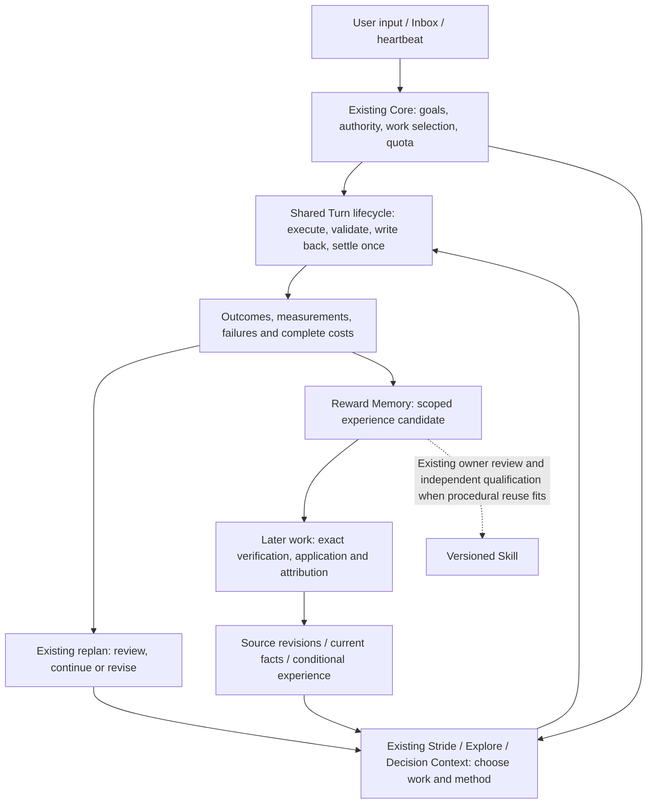

# RFC: Mechanism Convergence and the Experience Reuse Loop (v0)

- **RFC status:** Accepted (effective upon merge; a discussion proposal before merge)
- **Supersedes / closes:** none
- **Delivery maturity:** Proposal; this document delivers a source audit and design, with no runtime change.
- **Authors / owners:** LoopX maintainers; AI-assisted audit and proposals, with key choices pending maintainer confirmation.
- **Created / last normative revision:** 2026-11-14
- **Implementation baseline:** `bd2718a485c86fe4f0ad4d1356fe9aeeccfed1ba`; every reference to `main` below means this revision.
- **Semantic mirror:** [中文版](mechanism-convergence-and-learning-loop-v0.zh-CN.md)
- **Related:** [roadmap](loopx-overall-roadmap-v0.md), [small kernel](monorepo-distribution-split-v0.md), [Controller/unified contract](controller-executor-unified-contract-v0.md), [Target/Yardstick/Stride](target-yardstick-stride-decisions-v0.md), [research exploration](research-exploration-control-plane-v0.md), [memory utility](post-outcome-memory-utility-attribution-v0.md).

## Document map and maintenance contract

Section 4 records facts at a fixed source revision; 4.3 separates unmerged work. The other sections propose design, trade-offs and acceptance, rather than describing shipped or owner-confirmed product decisions. Section 12 retains unresolved choices. This RFC does not amend existing authority, defaults or promotion gates, and creates no parallel roadmap or execution queue. Implementation evidence stays with the owning RFC/task; historical records belong in its ledger.

## 1. Decision summary

Define mechanism refinement as **reducing duplicate production, transport and interpretation of a decision, getting verified feedback into subsequent choices, and qualifying the resulting outcomes**. The small kernel addresses loading, dependencies and runtime boundaries; this work addresses effective choices within those boundaries. They can deliver independently.

1. **Converge execution paths.** Continue Controller C1/C4/C9 to replace duplicate ordinary quota, Turn and heartbeat contracts and orchestration. Quota retains budget, admission and observation; heartbeat retains wakeup; Turn owns governed work execution. A unified runtime entry remains in flight.
2. **Compose methods over shared evidence and seams.** Target, Yardstick, Stride, Explore and progress-review retain their distinct questions. Reuse existing replan obligations, context, measurements and result writeback; do not collapse signals into one progress score.
3. **Reuse the existing feedback chain.** Connect evidence, decisions, subsequent execution, outcomes, experiences and later applications under their original identities. Expose missing links through existing projections first. Parts already exist; composition, adoption and benefit qualification remain incomplete.
4. **Trigger on actual decisions.** Ordinary Turns without a new decision or evidence add no model call, human confirmation or mandatory record. Review can justify continuing the current route; successful experiences need not all become Skills.

This RFC authorizes no implementation, experiment execution, capability activation, Skill publication or production-default change.

## 2. Problem and motivation

Users need better accepted outcomes under comparable resource constraints, with less repeated research and human intervention. Mechanism counts, receipts, read acknowledgements and architectural layers do not establish those outcomes.

Three problems bound the refactor:

- **Execution:** the same work entering through heartbeat or Turn still encounters distinct packet, result and recovery paths. Callers can diverge when reinterpreting shared decisions.
- **Choice:** tests keep passing or a proxy keeps improving while acceptance does not improve. Repeat detection, external assessment, fidelity and Stride cover different failures; similar names do not establish redundancy.
- **Reuse:** a better method found today may later appear only as a recalled summary, without applicability checks, adoption into actual work or a linked subsequent outcome. Saving a trajectory is a starting point.

Ask which owner makes a decision and which evidence actually reaches it before choosing what to delete. A new unifying framework adds dependencies, contracts and maintenance, so first demonstrate a gap in existing owners.

### Invariants

Execution legality, outcome acceptance, method quality and experience utility remain separate judgments. Advice and memory grant no authority. Preserve original Goal/Agent/Todo/Turn/effect identities, claim/lease, Stop and once-only settlement. Separate facts, claims, adoption and causal benefit, retaining negative results and unknowns. Every deletion needs identified consumers and recovery paths; moved lines do not establish completion.

## 3. Scope

Inventory mechanisms affecting continuation, choice, feedback and experience reuse; identify replacements, combinations, existing owners and the smallest useful qualification slice. Cover engineering and research work without requiring numeric evaluation for every task.

Do not add a mechanism manager, workflow DSL, global score, universal event store or Python decision owner. Full TypeScript migration, two models, cloud teams and a particular memory provider are not prerequisites. Multi-Agent acceptance continues through existing request, receiver-adoption and result-return contracts.

## 4. Current-system contract: mechanism inventory

Implemented means a code path exists, not that every host, product journey or long-horizon benefit is qualified. Rows describe decisions, not a count of capabilities.

### 4.1 Execution, context and recovery

| Mechanism | Current responsibility / source | Relationship |
| --- | --- | --- |
| Goal / Vision / acceptance / Todo | Distinct owners for objective, route, work and acceptance; [Goal owner](../../../loopx/control_plane/goals/acceptance_authority.ts), [interaction contract](../../../loopx/control_plane/work_items/interaction_contract.ts). | Compose them; a local research Target cannot replace accepted criteria. |
| Claim / lease / effect / authority store | Ownership, concurrency fences and idempotent effects; [lease](../../../loopx/control_plane/work_items/task_lease_acquire_decision.ts), [Effect](../../../loopx/control_plane/effect_program.ts). | Execution foundations that controller advice or experience cannot replace. |
| Quota / should-run | Read sources, prepare work and compose admission/recovery; [should_run.py](../../../loopx/control_plane/quota/should_run.py), [run_decision.ts](../../../loopx/control_plane/quota/run_decision.ts). | Turn already reuses this owner; these are not two independent budget engines. |
| Heartbeat / scheduler / automatic cadence | Wakeup, trigger conditions, start intervals and observation; [task body](../../../loopx/control_plane/heartbeat/task_body.py), [cadence](../../../loopx/control_plane/quota/automation_cadence.ts). | Converge shared lifecycle; a due clock grants no execution authority. |
| Public Turn / host adapter / settlement | One bounded execution, independent validation, writeback and settlement; [run-once](../../../loopx/cli_commands/turn_run_once.py), [executor](../../../loopx/control_plane/turn_driver/executor.py), [settlement](../../../loopx/control_plane/turn_driver/settlement.ts). | Ordinary paths overlapping heartbeat are replacement candidates; native differences stay in adapters. |
| Turn Loop Controller | Derive disposition from a qualified receipt and fresh decision; [loop_controller.ts](../../../loopx/control_plane/turn_driver/loop_controller.ts). | Deterministic continuation, separate from a model Controller session. |
| Quota packet / TurnEnvelope / work context | Projections, execution obligations and exact context over admission sources; [quota emitter](../../../loopx/cli_commands/quota.py), [envelope](../../../loopx/control_plane/quota/turn_envelope.ts). | Replace duplicate normal producers/interpreters; diagnostic views and historical decoders have separate boundaries. |
| Capture / Progressive / Delta / history working set | Source preservation, selective delivery, delta transport and recoverable history; [native lifecycle](../../../loopx/control_plane/quota/native_context_lifecycle.ts), [Progressive](../../../loopx/control_plane/quota/progressive_context.ts). | Share a pipeline; selection, encoding and recovery are complementary. |
| Request / Inbox / peer handoff / return | Steering, revisions, receiver work and original-audience return; [request_control](../../../loopx/control_plane/collaboration/request_control.ts), [return_delivery](../../../loopx/control_plane/collaboration/return_delivery.ts). | Controller reuses the chain; delivery does not establish receiver adoption. |

### 4.2 Judgment, verification and experience

| Mechanism | Current responsibility / source | Relationship |
| --- | --- | --- |
| Progress observation / semantic delta | Record typed progress and qualify acceptable semantic changes; [progress_delta.ts](../../../loopx/control_plane/work_items/progress_delta.ts), [replan_semantics.ts](../../../loopx/control_plane/work_items/replan_semantics.ts). | Writeback qualification, not independent outcome evaluation. |
| Repeat/stall fuse / periodic review / monitor repeat | Detect repetition, stalls and due review from recorded work; [replan_history.ts](../../../loopx/control_plane/work_items/replan_history.ts). | Triggers already share obligations; retain their evidence and different blind spots. |
| External progress-review | Consume revision-bound external assessments; shadow observes, assist may form the existing obligation; [policy](../../../loopx/control_plane/work_items/progress_review_policy.py). | Complements typed repetition; default off, not another replanner. |
| Autonomous replan / staged read / ACK | Compose obligations, deliver staged reads and qualify discharge; [obligation](../../../loopx/control_plane/work_items/autonomous_replan_obligation.py), [semantics](../../../loopx/control_plane/work_items/replan_semantics.ts). | Staged delivery belongs to the same decision flow, not a new strategy owner. |
| Stride / previous review / followthrough | Choose work scope, method changes and validation breadth; review prior adoption; [stride_policy](../../../loopx/control_plane/work_items/stride_policy.ts), [replan_context](../../../loopx/control_plane/work_items/replan_context.ts). | A local feedback chain already exists; more review is not more useful work. |
| Target / Yardstick | Bind task target, authoritative/proxy measurements, counterevidence and next method; [yardstick_decision.ts](../../../loopx/control_plane/work_items/yardstick_decision.ts). | Compose with Stride; proxy scores do not establish acceptance. |
| Explore graph / findings / harness planning | Questions, findings, measurements, coverage and candidate planning; [turn context](../../../loopx/control_plane/capabilities/explore_turn_context.ts), [result writeback](../../../loopx/capabilities/explore/result_writeback.py). | Research evidence and advice; Todo/quota still govern execution. |
| Decision Context | Revisioned scanning, exact reads, conflict handling and proposal/review/outcome; [runtime](../../../loopx/capabilities/decision_context/runtime.py), [contract](../../../loopx/capabilities/decision_context/README.md). | Share source-reading primitives; not a mandatory global arbiter for all Turns. |
| Material Lifecycle / authority registry | Material revisions, inventory, ranking, migration and rollback; [material contract](../../../loopx/capabilities/material_lifecycle/README.md). | Supply sources to Decision Context/Explore; material rank is not work choice or experience utility. |
| Agent Turn Recall | Build situation and query from selected work; [contract](../../../loopx/capabilities/agent_turn_recall/README.md). | An adapter into Reward Memory, sharing corpus/provider rather than creating a store. |
| Reward Memory / procedural experience | Scoped candidates, activation, recall, current-artifact checks and application; [application.py](../../../loopx/capabilities/reward_memory/application.py). | Conditional guidance; working state, hard policies and soft preferences remain distinct. |
| Post-outcome utility | Link applications to subsequent outcomes, validate attribution and reduce observations; [memory_utility.py](../../../loopx/capabilities/reward_memory/memory_utility.py), [reducer](../../../loopx/capabilities/reward_memory/utility_reducer.py). | Implemented seams exist; applied and helpful differ, and success alone gives no utility credit. |
| Skill / project skill delivery | Distribute versioned procedures and supporting files; [delivery contract](../../../loopx/capabilities/project_skill_delivery/README.md). | A reusable-process delivery format; distribution proves no automatic learning, applicability or benefit. |
| Anti-Entropy / change-quality / task validation | Retirement oracles, final-diff qualification and task outcome validation; [Anti-Entropy](../../../loopx/capabilities/anti_entropy/README.md), [change-quality](../../../loopx/capabilities/change_quality/README.md). | Compose specialized oracles; code removal, quality qualification and task success remain different conclusions. |

### 4.3 Call paths, defaults and in-flight boundaries

The verified path is `build_quota_should_run`: prepare sources, compose route/guards, then construct the payload. `resolveQuotaRunDecision` owns a set of typed admission judgments. `live_decision.py` additionally handles original receipt binding and re-entry. `turn_run_once.py` consumes the quota decision and calls `run_loopx_turn_once`, rather than creating another budget system. The quota CLI still captures before CLI/native projection; Turn planning retains current/historical envelope branches.

Repeat detection, periodic review and external progress-review already converge in `autonomous_replan_obligation.py`, with typed repetition taking precedence. `replan_semantics.ts` already reuses Stride and progress delta. `replan_context.ts::decisionFollowthrough` already connects a prior decision, planned Todos and subsequent records. Reuse those boundaries rather than proposing them again as missing infrastructure.

Trace inherited defaults: [`machine_defaults.py`](../../../loopx/capabilities/todo_replan_cadence/machine_defaults.py) defaults Goals without an explicit cadence override to review every **6 effective work Turns** and `evidence_conditioned_v1` Stride when machine configuration has not overridden them. Machine settings, explicit off and legacy configurations retain their respective meanings. The underlying Stride schema's off value is not the whole product default. Yardstick independently defaults to false; Explore resolves to off without explicit or machine configuration. Progress-review, Reward Memory, Decision Context and Material Lifecycle retain their own optional activation contracts; composition here enables none of them.

These PRs were **OPEN** at audit time. They are not facts about this main revision, and their reported checks are not this RFC's validation:

| In-flight work / inspected head | Useful direction | Not established |
| --- | --- | --- |
| [C1 #8266](https://github.com/loopx-project/loopx/pull/8266) · `2a863df8e7af` | One work source, capture/reader and recovery contract. | Complete ordinary writer/consumer cutover. |
| [Turn roles/entry #8484](https://github.com/loopx-project/loopx/pull/8484) · `b7e4e01cc423` | Single Worker/dual roles share admission and settlement; proposes one runtime entry for heartbeat, products and benchmark. | Shipped `loopx turn run`, general dual-session feedback benefit or default replacement. |
| [Method operators #8516](https://github.com/loopx-project/loopx/pull/8516) · `5afb98cf8ea8` | Five stages organize six methods with shared measurement/summary primitives. Stages describe a methodology contract; operators remain advisory. | Merged main implementation, or execution authority merely because stage names resemble the Turn lifecycle. |

## 5. Proposed architecture and convergence decisions

### 5.1 One execution lifecycle, several scoped judgments

Decision/admission ordering and permissions stay with actual callers and owners. This is not a new runtime graph, parallel-work authorization or stage gate.

### 5.2 Replace, combine or preserve

| Objects | Recommendation | Reason / retirement boundary |
| --- | --- | --- |
| Ordinary quota execution packet versus Turn contract; duplicate result/recovery orchestration | **Replacement: converge normal paths through C1/C4/C9.** | The same work should not have two semantic producers. Migrate consumers and original-receipt recovery before deletion. Quota policy, outer wakeup, native transport and historical decoders retain their owners. |
| Heartbeat / benchmark / Managed / Chat common execution | **Share lifecycle, preserve entry adapters.** | Common admission, validation and settlement; reuse existing session bindings instead of launching another Worker at every entry. Preserve native/plain benchmark controls. |
| Repeat / periodic / external review / capability-specific signals | **Reuse existing obligation convergence; combine only duplicate context and discharge interpretation.** | Keep provenance, coverage, priorities and distinct discharge conditions. Unknown external assessment cannot cancel a formed obligation. Add no generic review engine. |
| Target / Yardstick / Stride / Explore methods | **Compose without semantic collapse.** | Target, measurement, work shape and candidate search answer different questions. Following #8516, share digest, comparison scope, bounded views and method stages; numerical oracles stay outside the generic kernel. |
| Work context / Decision Context / Turn Recall | **Share reading, identity and provenance primitives; preserve semantic adapters.** | Current work facts, external evidence qualification and conditional experience differ. Reuse existing hooks; Decision Context does not take over Core. |
| Capture / Progressive / Delta | **Independent composition within one delivery pipeline.** | Capture is a recovery source, Progressive selects initial/detail reads, Delta encodes transport. Disabling one must not silently disable the others or drop unread evidence. |
| Explore finding / working context / procedural experience / Skill | **Connect lifecycles without substituting one for another.** | Task findings, session continuation, transferable lessons and executable procedures have different scope and invalidation. One success does not justify a published Skill. |
| Progress-review / Yardstick / task validation / memory utility | **Share evidence references, preserve judgments.** | Drift, proxy fidelity, accepted outcomes and helpful experience are different questions. |
| Anti-Entropy / change-quality | **Compose specialized oracles into existing qualification.** | Anti-Entropy already disclaims its own delivery-receipt store. Preserve the final qualification owner rather than adding a parallel ledger. |
| Model Controller / pure Turn Loop Controller | **Collaborate with distinct responsibilities.** | One selects content and methods; the other qualifies legal continuation. A stronger model cannot replace deterministic fences. |

### 5.3 Connect existing records into an inspectable evidence chain

Do not first define a universal episode schema or another journal. Compose these existing identities in current projections; missing links remain unknown rather than being invented by a summary.

| Question | Reused owner / record |
| --- | --- |
| What facts triggered this judgment? | Source revision, quota capture, replan obligation/context; Explore measurement/finding. |
| What was chosen, and why continue or change? | Stride decision, Vision/path delta, Explore work-yardstick finding, or an already-needed Decision Context proposal. |
| Did subsequent work adopt it? | Actual work and acceptance references on the original Todo, `decisionFollowthrough`, subsequent Turn/settlement; bounded views retain full-detail navigation. |
| What outcome and cost followed? | Authoritative task acceptance, original measurement scope, failures, provider/host usage and human intervention; missing coverage stays unknown. |
| What can transfer? | Reward Memory procedural-experience candidate, applicability, source revision, counterexamples and existing activation policy. |
| Was it used and helpful later? | Recall/application receipt and current-artifact verification, followed by verified outcome and utility observation. Success plus applied is not automatically helpful. |

Experience explains conditions, a method choice, observed success/failure and how to verify it next time; an event summary is insufficient. Only stable, verifiable procedures worth repeating become Skill candidates under existing content/publication authority. Preserve provenance, disable and rollback; publication needs separate authorization. Current project-skill delivery distributes sources and does not supply automatic distillation.

### 5.4 Placement and deletion candidates

- **Execution:** C1/C4 owners migrate `cli_commands/quota.py::_publish_quota_result`, `quota/cli_projection.py`, `turn_driver/driver.py::build_loopx_turn_plan` and heartbeat rendering. Do not add a third serializer here.
- **Judgment:** reuse `replan_history.ts`, `replan_context.ts`, `replan_semantics.ts`, `stride_policy.ts` and `capabilities/explore_*`. Adopt reviewed #8516 primitives if merged; do not copy an unmerged implementation.
- **Reuse:** retain `agent_turn_recall`, `reward_memory/application.py`, `memory_utility.py` and existing post-settlement hooks. Add a missing lineage reference and real consumer at the original owner before considering another queue.
- **Product readback:** existing Goal workspace, research history, work details and CLI show evidence, choice, actual adoption, outcome, reuse and gaps. Users need not configure five internal stages. Changed interactions still require App/CLI and supported Lark qualification.

These are candidate boundaries. Recheck main, open PRs and canonical Todos before implementation. Delete only proven duplicate producers/interpreters with equivalent obligations; historical recovery contracts and native differences do not become redundant through visual similarity.

## 6. Alternatives, external references and principal costs

| Option | Trade-off |
| --- | --- |
| Only unify turn/quota entrypoints | Necessary to reduce divergence and maintenance, but alone proves no better method choice or cross-task reuse. |
| Universal mechanism engine/global score | Reject: another owner, protocol and migration burden, conflating legality and quality. |
| Only shorten prompts | A bounded optimization; lost obligations or extra detail reads can increase total cost, and this does not establish semantic convergence. |
| Existing-owner convergence plus feedback-adoption qualification | Recommended; locally reversible, but field/source/consumer mapping and subsequent outcome qualification require substantial initial audit. |

External references inform boundaries, not LoopX benefit claims. [LangGraph persistence](https://docs.langchain.com/oss/python/langgraph/persistence) separates thread checkpoints from cross-thread stores, informing the separation of recovery state and durable experience. [Voyager](https://voyager.minedojo.org/) separates curriculum, composable code Skills and environment feedback, informing qualification before procedural reuse. Its Minecraft results do not predict LoopX research gains. These mappings are this proposal's inference.

Initial scenarios are existing single-Agent engineering and budgeted research, then peer receiver adoption. Costs include judgment/verification model tokens, exact source reads, real evaluation, failed exploration, capture/history retention, language/RPC crossings, recovery and human review. Multiple sessions add context and coordination cost. Cloud scaling additionally needs tenant isolation, shared-resource metering and operations under existing authority/quota contracts; this RFC does not claim to solve them.

Record complete cost and coverage for each arm; unknown charges are not zero. Default added remote calls for an unchanged ordinary Turn are zero. Optional evaluation and distillation use explicit bounded policies. Compare actual-workload p50/p95 latency, delivery/detail bytes and tokens, model/tool calls, accepted outcomes and interventions. No new performance or benefit measurement is reported here, and no savings percentage is assumed.

## 7. Safety, privacy and compatibility

Public projections contain only necessary typed facts, opaque references and scope, excluding chat bodies, raw trajectories, credentials and private paths. Do not automatically merge experiences/results across Goal, Agent, corpus or revision. Stale experience can be rejected, revoked or superseded without widening authority.

Preserve published meanings for public contracts, explicit off, legacy inheritance, original receipts and pending transactions. Optional observer/memory failure retains its existing fail-open behavior; original hard gates and prerequisites remain enforced. A common failure handler must not turn every failure into continuation.

## 8. Migration and rollback

Pin concrete base/head, callers and clause mappings first, reusing completed evidence under matching conditions. Each slice migrates a real producer/consumer/recovery combination and names deletions and retained readers. Retire duplicate normal writers after qualification; necessary historical readers need separate exit conditions.

On interruption or rollback, settle pending work under its original identity before routing new work to the qualified old path. Disabling an optional method/observer must not re-admit, redo an outcome or spend twice. Preserve sources, negative results and prior readback. Unavailable or ambiguous recovery remains failed/unknown rather than inventing session success.

## 9. Validation and acceptance

| Scenario | Required observation |
| --- | --- |
| Same work through quota/Turn/heartbeat | Equal obligations for ordinary work, wait, replan, Stop, interruption and replay; original Todo/Turn/effect binding, once-only settlement and no duplicate host execution. |
| Concurrent review signals | Original sources, coverage, precedence and discharge conditions remain; unknowns do not cancel formed obligations, and justified continuation remains legal. |
| Improving proxy, flat authoritative outcome | Scoped measurements inform the decision; subsequent actual work adopts calibration/method choice and receives independent outcome observation. A fidelity record alone is not adoption. |
| Claimed progress consisting only of renaming | Keep typed claims and external assessment separate; handle the qualified original obligation, then perform work serving original acceptance. |
| Cross-task experience reuse | Inspect evidence, candidate/activation, later exact read, current-artifact check, actual method and outcome; reject revoked, expired and wrong-scope experience. |
| Skill candidate | Independently qualified procedure, applicability/counterconditions and rollback; distinguish generation, publication, installation and capability activation. |
| Unchanged/off/provider unavailable | Preserve original obligations, results and defaults; no mandatory evaluation/distillation or invented benefit. |

First qualify semantics, failures and product readback on isolated File/SQLite production entrypoints. A separate experiment protocol then compares original/candidate paths from matched starting state, task, model, budget and observation window. Isolate topology, context delivery and learning policy; retain native/plain. Freeze sample size, noise handling and analysis before outcomes. One case, fewer tokens, PR counts or receipts do not establish benefit. This RFC runs no such experiments.

## 10. Success criteria

Structurally, each real caller has one owning semantic producer and duplicate interpretation is retired, while distinct questions retain owners. Behaviorally, subsequent work adopts feedback and independent acceptance succeeds; experience has attributable value in applicable new work. Economically, improve accepted outcomes under comparable constraints or achieve equivalent outcomes at lower complete cost. Report these dimensions independently; none offsets failure in another.

## 11. Smallest useful delivery and existing work

| Slice | Concrete delivery / existing owner | Exit evidence |
| --- | --- | --- |
| This RFC | Audit, replacement/composition mapping and unresolved choices; no runtime code. | Checkable sources and distinct facts/proposals/in-flight work; maintainer review. |
| First local loop | Within existing Target/Stride/Explore work, select a task with actual counterevidence; use findings, prior decision and followthrough to expose gaps. Add only a demonstrated missing consumer/link. | Subsequent legal work actually adopts or justifiably rejects feedback, with authoritative outcome and complete cost; records alone do not qualify. |
| Execution convergence | Continue C1/C4/C9 and #8266/#8484 to replace real entry/recovery paths under accepted contracts. | Single-session semantics, outcomes/cost against ordinary quota, off and recovery qualification; dual-session qualification separately. Order relative to the local loop only by real dependency. |
| Cross-task reuse | Carry the lesson to a similar new task through existing authorized Reward Memory scope, retaining counterexamples. | Separate application, subsequent execution and utility evidence; optional Skill is a content change only when stable repeated procedure warrants it. |

Assign through original tasks/owners without a fixed PR count. Discussion/design starts no experiment, spends no other lane's quota and copies no unmerged operator implementation into main.

## 12. Open choices: AI proposals pending maintainer confirmation

| Choice | Recommendation and reason | Decision point |
| --- | --- | --- |
| RFC boundary | Keep cross-mechanism relationships and composition acceptance here; concrete rules remain with Controller, Target/Stride/Explore and Reward Memory. If maintainers prefer no separate RFC, absorb relevant sections into those owners to avoid durable duplication. | Before accepting this proposal. |
| First task | Prefer an existing, evidenced proxy/authoritative disagreement or prior decision not adopted. Without evidence, begin with bounded diagnosis rather than inventing a failure. | Task owner selects before implementation. |
| Record shape | Compose existing records/UI first. Extend the original versioned schema only for a demonstrated linkage gap; no universal episode yet. | After field/consumer mapping. |
| Controller / learned Meta Model | First qualify existing single-session judgment and actual feedback adoption. Independent Controller follows its RFC; a learned policy needs matched data and counterfactual evaluation before a separate experiment. | Before execution-profile or policy changes. |
| Skill creation | Candidate only when a stable, verifiable repeated process justifies maintenance; preserve existing review/publication authority and avoid mandatory distillation after each success. | When a named candidate exists. |
