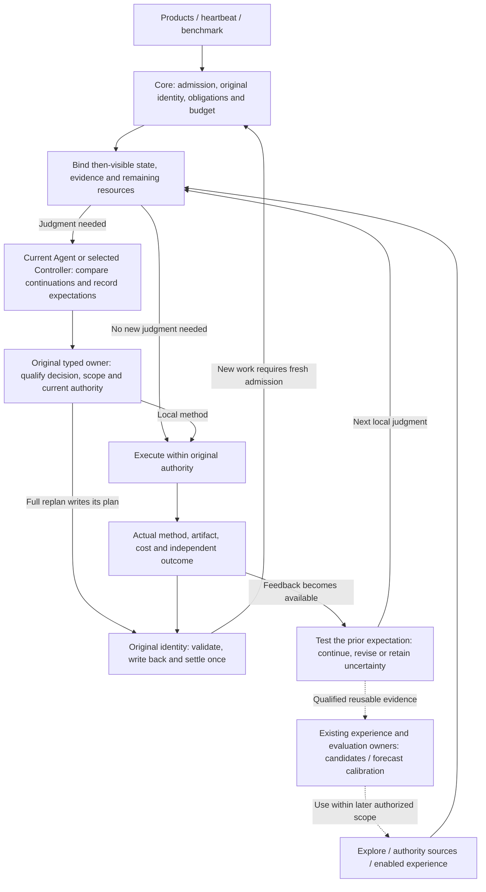

# RFC: Mechanism Convergence and the Experience Reuse Loop (v0)

- **RFC status:** Accepted (effective upon merge; a discussion proposal before merge)
- **Supersedes / closes:** none
- **Delivery maturity:** Partial upon merge: ordinary-execution linkage in the existing source reader; method benefit and the remaining target architecture are unqualified.
- **Authors / owners:** LoopX maintainers; source facts have code references, while the target architecture and trade-offs are AI-assisted proposals pending maintainer review and confirmation.
- **Created / last normative revision:** 2026-11-14 / 2026-11-15
- **Implementation baseline:** `8d7d234c6f55fa45fa5db0ad5a156dcaaf726d32`; references to `main` in section 4 mean this revision.
- **Semantic mirror:** [中文版](mechanism-convergence-and-learning-loop-v0.zh-CN.md)
- **Related:** [roadmap](loopx-overall-roadmap-v0.md), [small kernel](monorepo-distribution-split-v0.md), [Controller/unified contract](controller-executor-unified-contract-v0.md), [Target/Yardstick/Stride](target-yardstick-stride-decisions-v0.md), [research exploration](research-exploration-control-plane-v0.md), [memory utility](post-outcome-memory-utility-attribution-v0.md), [Goal contract evolution](goal-contract-evolution-v0.md).

## Document map and maintenance contract

Section 4 describes the pinned implementation; 4.3 separates unmerged work. Sections 5–11 propose the converged structure, calls, migration and composition acceptance; only the explicit implementation checkpoint qualifies source behavior. This RFC owns cross-mechanism composition; individual schemas, authority, defaults and promotion gates remain in their owning specifications. Amend those specifications together when changing them rather than overriding them here. Implementation evidence stays in existing RFCs/tasks and ledgers, without a parallel roadmap or execution queue. Maintainers must verify and confirm consequential design choices; this document assumes neither a human contribution ratio nor ownership of unconfirmed ideas.

## 1. Decision summary

Mechanism refactoring should deliver **better accepted outcomes within comparable complete budgets, or equivalent outcomes at lower complete cost**. This design follows task state and remaining budget → method choice and prior expectations → execution → feedback testing those expectations → revised continuation. The small kernel addresses loading and runtime boundaries; mechanism convergence makes that infrastructure support more effective method choices.

Propose the following structure:

1. **One governed execution path.** Quota retains policy/admission, a unified Turn lifecycle owns execution, validation, settlement and recovery, heartbeat supplies wake/continuation, and products retain Host adapters. Converge normal paths through C1/C4/C9 and retire duplicates, allowing internal API changes with coordinated caller migration.
2. **One current method chooser per admitted work item.** The Agent judges in a single session; the Controller judges in an explicitly selected dual-role profile. It compares feasible conditional continuations within the remaining budget. Stride defines work scale/review, Yardstick/Explore supply measurements and candidates, Decision Context qualifies relevant facts, and Core checks legality.
3. **Connect feedback through decision episodes.** At meaningful judgment boundaries, relate the then-visible state, expectation, actual method, cost, observation and next choice. Feedback must revise expectations, candidates or continuation, or support justified continuation; artifacts, messages and receipts alone are not method benefit.
4. **Improve policy through the same decision ownership.** First qualify feedback adoption by the current model, then calibrate forecasts, and use evidence to decide whether to learn value estimates or allocation. Reward Memory carries scoped experience, Skills carry qualified procedures, and application receipts verify adoption; they serve this decision path.

This document delivers a target design without starting experiments, training models, publishing Skills, activating capabilities or changing production defaults. Consequential choices are AI-assisted proposals pending maintainer confirmation.

## 2. Problem, objective and decision model

Consider improving proxy scores without improving authoritative results. Continued search, proxy calibration, a method change and direct authoritative evaluation have different prerequisites, durations and later opportunities. The right choice depends on current evidence and remaining resources; an action has no fixed value across stages.

**Compare feasible conditional continuations.** Each candidate explains the first action, expected observations, continuation under important results, and whether acceptance can finish in time. Accepted artifacts, pending work, evaluation resources and confirmation time belong in the state. Numerical tasks compare expected outcomes under frozen terminal rules against a strong continuing baseline; non-numerical tasks compare deliverable outcomes and risks under their original acceptance without inventing a universal score. Wall time, tokens and tool/evaluation resources remain separate constraints, including preparation, reads, failures and final confirmation.

Refactoring must therefore explain who judges from what evidence, which testable expectation supports a choice, what feedback supports or refutes, how subsequent real work responds, and whether it beats the original continuation at the same budget. Unifying entries alone cannot answer this; building a new model or receipt first cannot substitute for it.

Compose the existing [budgeted-planning](target-yardstick-stride-decisions-v0.md#budgeted-planning) and [action-value evidence](../../research/budgeted-research-planning.md#action-value-evidence) contracts rather than creating another optimization theory or decision specification. Without reliable benefit estimates, retain uncertainty and use bounded discriminating checks. Confident probabilities or immediate gain/cost ratios do not constitute optimal planning.

## 3. Scope and invariants

Cover execution, method feedback and cross-task reuse in engineering and budgeted research. Preserve original Goal/Agent/Todo/Turn/effect identities, claim/lease, Stop, once-only settlement and acceptance authority. Execution legality, accepted outcomes, method quality and experience utility remain distinct; retain unknown, failed, rejected, cancelled and negative outcomes.

Hold authorized inputs, accepted outcomes and failure/recovery boundaries stable while changing internal modules and interfaces for convergence. Reuse correct rule ownership rather than freezing the current code shape. Convergence requires migrating real callers and retiring replaced normal producers. Public contracts and durable state need explicit migration; historical readers remain only for actual consumers.

Add no universal orchestrator, workflow DSL, global score, universal episode store or Python decision owner. Full TypeScript migration, dual models, a separate Meta Model and a particular memory provider are not prerequisites for the first useful feedback loop.

## 4. Current architecture: responsibilities and real paths

### 4.1 Seven responsibility boundaries

These are implementation roles, not a new capability catalog or seven services to build. A file may expose several adapters; consolidation depends on duplicate ownership of a fact or rule.

| Responsibility | Current mechanisms and actual ownership | Excluded responsibility |
| --- | --- | --- |
| Goals and execution authority | Goal/Vision/acceptance/Todo; [acceptance authority](../../../loopx/control_plane/goals/acceptance_authority.ts), [quota decision](../../../loopx/control_plane/quota/run_decision.ts), [lease](../../../loopx/control_plane/work_items/task_lease_acquire_decision.ts), [effect](../../../loopx/control_plane/effect_program.ts). | Experience, scores and model suggestions grant no execution authority. |
| Runtime and recovery | Heartbeat/scheduler, [public Turn](../../../loopx/cli_commands/turn_run_once.py), [executor](../../../loopx/control_plane/turn_driver/executor.py), [settlement](../../../loopx/control_plane/turn_driver/settlement.ts), [pure continuation controller](../../../loopx/control_plane/turn_driver/loop_controller.ts); [requests/steering](../../../loopx/control_plane/collaboration/request_control.ts) and [return](../../../loopx/control_plane/collaboration/return_delivery.ts) retain original identities. | Wakeup is not admission, process exit is not acceptance, and continuation control does not select methods for the model. |
| Context composition and delivery | [Quota emitter](../../../loopx/cli_commands/quota.py), [TurnEnvelope](../../../loopx/control_plane/quota/turn_envelope.ts), Capture/Progressive/Delta/[native lifecycle](../../../loopx/control_plane/quota/native_context_lifecycle.ts); [capability hooks](../../../loopx/control_plane/capability_hooks.py) and [contribution validation](../../../loopx/control_plane/turn_driver/capability_context.ts) bind selected work. | Content selection, encoding and recovery differ; a projection is neither a new fact store nor a method chooser. |
| Method choice and its specification | The hosted Agent judges; [Stride](../../../loopx/control_plane/work_items/stride_policy.ts) specifies work shape/review, [Yardstick](../../../loopx/control_plane/work_items/yardstick_decision.ts) specifies local target/measurement/next method, and [replan semantics](../../../loopx/control_plane/work_items/replan_semantics.ts) qualifies existing obligations. | A TypeScript codec does no research; structured declarations prove neither execution nor goal gain. |
| Evidence, triggers and fact qualification | [Explore context](../../../loopx/control_plane/capabilities/explore_turn_context.ts) and [result writeback](../../../loopx/capabilities/explore/result_writeback.py) manage findings/measurements; [repeat/cadence triggers](../../../loopx/control_plane/work_items/replan_history.ts) and [external review policy](../../../loopx/control_plane/work_items/progress_review_policy.py) form scoped signals; [Decision Context](../../../loopx/capabilities/decision_context/README.md) and [Material Lifecycle](../../../loopx/capabilities/material_lifecycle/README.md) manage sources and qualification. | Do not normalize every signal into one score. Enabled assist policy can form an obligation; not all external assessments are ignorable advice. |
| Experience and procedural reuse | [Turn Recall](../../../loopx/capabilities/agent_turn_recall/core.py), [Reward Memory application](../../../loopx/capabilities/reward_memory/application.py), [procedural experience](../../../loopx/capabilities/reward_memory/experience_quality.py), [utility](../../../loopx/capabilities/reward_memory/memory_utility.py)/[reducer](../../../loopx/capabilities/reward_memory/utility_reducer.py), and [Skill delivery](../../../loopx/capabilities/project_skill_delivery/README.md). | Context construction, method adoption, benefit and procedural publication are different facts; no automatic provider-ranking update. |
| Independent validation and quality | Original task validators/acceptance, [change-quality](../../../loopx/capabilities/change_quality/README.md), and specialized [Anti-Entropy](../../../loopx/capabilities/anti_entropy/README.md) oracles. | Quality qualification proves neither task success nor useful experience; Anti-Entropy owns no separate delivery-receipt store. |

### 4.2 Five existing paths

1. **Admission to execution.** [`build_quota_should_run`](../../../loopx/control_plane/quota/should_run.py) prepares sources, composes routes/guards and builds the payload; [`live_decision.py`](../../../loopx/control_plane/quota/live_decision.py) handles original receipts and re-entry. `turn_run_once.py` consumes that decision and calls `run_loopx_turn_once`. Quota CLI still projects after capture; [`build_loopx_turn_plan`](../../../loopx/control_plane/turn_driver/driver.py) retains current/historical contract branches. Shared admission exists; ordinary output and execution orchestration are not fully converged.
2. **Replan to subsequent observation.** [`autonomous_replan_obligation_from_runs`](../../../loopx/control_plane/work_items/autonomous_replan_obligation.py) prioritizes typed repetition, then a pinned assist-policy assessment, then the ordinary trigger. Staged reads and ACK belong to that obligation; `replan_semantics.ts` and [`progress_delta.ts`](../../../loopx/control_plane/work_items/progress_delta.ts) qualify Stride and recorded semantic change, not independent outcome quality. [`decisionFollowthrough`](../../../loopx/control_plane/work_items/replan_context.ts) links the original choice, planned Todos and later records while retaining `execution_and_goal_gain: unknown`.
3. **Local method to execution record.** `normalizeWorkYardstickDecision` already has `next_action.method_id/reason/cost_bound` and `prior_finding_id`; `projectWorkYardstickCue` has `previous_decision_followthrough`, comparing planned and executed methods. Explore's [`execution_observation`](../../../loopx/control_plane/capabilities/explore_execution_observation.ts) carries candidate digest, actual method, deviation reason, costs and result references. These are validated record relations; independent acceptance still belongs to the original evaluator.
4. **External facts to a scoped decision.** Decision Context's [`runtime`](../../../loopx/capabilities/decision_context/runtime.py) assembles sources/recall; [`review_settlement`](../../../loopx/capabilities/decision_context/review_settlement.py) requires the original user-gate event for a proposal and has a separate lawful `no_change` route without a proposal; [`outcome_feedback`](../../../loopx/capabilities/decision_context/outcome_feedback.py) links later results. Its complete review lifecycle must not become mandatory for ordinary Turns.
5. **Memory to current context.** `run_agent_turn_recall::apply_guidance` uses `outcome=applied` to insert experience into private context; its `artifact_ref` is the situation fingerprint. Applicability is explicitly left to the Agent. This application concerns a context artifact and alone proves neither host reading, method adoption nor execution. Generic `apply_reward_memory_recall` already supports caller-owned application, but a Boolean assertion cannot replace independent artifact inspection. [`turn_hooks.py`](../../../loopx/capabilities/reward_memory/turn_hooks.py) has recall and post-outcome ingestion; its current automatic result field is an experience reflection, not generic method-adoption proof.

### 4.3 Defaults and in-flight boundaries

[`machine_defaults.py`](../../../loopx/capabilities/todo_replan_cadence/machine_defaults.py) gives Goals without an explicit cadence override review every **6 effective work Turns** and `evidence_conditioned_v1` Stride when machine configuration has not overridden them. Explicit off, machine settings and legacy configuration retain their meanings; the underlying schema's off is not the complete product default. Yardstick independently defaults to false; Explore is off without explicit/machine configuration. Progress-review, Reward Memory, Decision Context and Material Lifecycle retain their activation boundaries.

| In-flight work / inspected head | Reusable direction | Not a fact about this main revision |
| --- | --- | --- |
| [C1 #8266](https://github.com/loopx-project/loopx/pull/8266) · `c3cb8b2fe7bf` | Unified work source, capture/reader and recovery. | Complete ordinary writer/consumer cutover. |
| [Turn #8484](https://github.com/loopx-project/loopx/pull/8484) · `b7e4e01cc423` | Single/dual roles and a unified runtime entry. | Shipped `loopx turn run`, dual-session benefit or default promotion. |
| [Method operators #8516](https://github.com/loopx-project/loopx/pull/8516) · `5afb98cf8ea8` | Five stages organize six advisory methods over shared measurements/summaries. | Merged operators or Turn execution authority for methodology stages. |

All three were OPEN when checked. Their reported tests are not this RFC's validation.

### 4.4 Composition this design adds

Execution convergence belongs to C1/C4/C9. Stride already has `next_probe` predictions/adoption conditions and `previous_review`; local choices, execution observations and followthrough also exist. The gap cannot simply be described as having no loop. Inspect real callers to establish whether prior expectations inform work, feedback tests them, the next decision consumes the result, and multiple modules still interpret the same rule.

This proposal centers method-decision feedback, specifying composition order, structural migration and policy evolution. Linking context application to an actual decision is one verification seam, not a unified decision model or mandatory new infrastructure. Source availability, actual model adoption and matched-budget benefit require separate evidence.

## 5. Converged target design: AI proposal pending maintainer confirmation

### 5.1 Execution, method feedback and experience reuse

These are target calls, not shipped unified-entry or calibration-model claims. Original work/evidence records hold current task state; current feedback does not detour through long-term memory. Reusable evidence still requires original outcome qualification, enablement and authority; dotted edges trigger neither automatic training nor publication.

The current judgment uses the existing model response without a fixed extra evaluator session. Local feedback creates no second Turn or work-quota charge; model/tool usage still counts against its original budget. Full replan writes its plan and settles the original work; subsequent work needs fresh admission. Without relevant change, continue the original work while preserving due obligations.

Session/attempt binding identifies the current chooser. In dual roles, Worker observations return to the original Controller; multiple Agents retain request, receiver-adoption and result-return contracts. Inspect artifacts through the same authorized environment and original tools when needed. A Worker summary alone cannot establish adoption, and a shared workspace grants no uncoordinated second writer.

### 5.2 What one method judgment needs

This relates existing records, not a universal packet or per-Turn form. Detailed planning and causal-evidence rules remain in the joint RFC.

| Content | Ownership, record and consumer |
| --- | --- |
| Objective and executable scope | Original Goal acceptance, work source/capture, Todo, lease, budget and stop conditions. Core determines admissible work; method advice cannot override it. |
| Then-visible state | Explore candidates/valid artifacts, measurement scope, prerequisites/counterevidence, pending results, remaining resources and confirmation windows; bind revisions and availability times, preserving missing coverage. |
| A few feasible continuations | The current chooser compares concrete methods, prerequisites, observations, important branches and terminal confirmation. Continuing the original route is a candidate; `grow/switch/verify` labels alone do not define a treatment. |
| Pre-choice expectations | Original Stride `next_probe` or local reasoning/findings hold key predictions, basis/ranges, cost bounds and what would change the next step. Read details through references rather than overfilling bounded short fields or inventing precise probabilities. |
| Choice | When enabled, Yardstick uses `work_yardstick_decision.next_action`; otherwise use original task/path records. Full review uses Stride/Vision and absorbs the same evidence without a competing local plan or implicit Yardstick activation. |
| Actual work and feedback | Original `execution_observation`, measurements and independent validators record actual methods, candidates, deviations, costs, outcomes and availability times. Followthrough compares prior expectations; a plan cannot manufacture execution. |
| Next decision and terminal outcome | Original `previous_review`, followthrough and findings explain the supported/refuted expectation and actual continuation. Relate outcomes under frozen horizons/rules without crediting all delayed gains to the last action. |

Context composition deduplicates by original identity/revision while retaining distinct evidence meanings. Existing typed owners qualify structure and ownership; the current model judges methods. Python retains necessary IO/adapters without copying semantic rules. Missing historical forecasts stay missing rather than being backfilled from hindsight.

### 5.3 Complete order from trigger to feedback

1. **Resolve work and obligations.** Core handles admission, refusal, wait, Stop and recovery under the original identity. Relevant findings, refuted expectations, resource/source changes or probe boundaries may trigger local reconsideration; local choice does not discharge full replan obligations.
2. **Assemble then-available evidence.** Explore owns measurement/candidate provenance. Decision Context qualifies configured facts and retains its own formal-proposal review. Compare authoritative/proxy measurements and experience by their questions, separate incomparable scopes, and handle operations missing authority facts through their original gates.
3. **Compare complete continuations and record expectations.** The current chooser considers prerequisites, information value, candidate improvement and final confirmation, selecting a feasible first slice and subsequent conditions. A probe without immediate score gain may be worthwhile, but must explain which later judgment it could change. A candidate whose confirmation cannot finish is not an accepted outcome.
4. **Qualify and execute the first coherent slice.** Original owners check references/scope; effectful operations recheck current authority. Invalid methods/data require rereading or reconsideration, and actual deviations require a reason. Preserve valid artifacts and complete cost rather than ignoring counterevidence to keep the plan.
5. **Test prior expectations with results.** Match the exact candidate, workload, evaluator and horizon. Supporting evidence can justify continuation; counterevidence changes candidates, applicability, validation order or investment. Late results belong to their original experiment; pending/failure/cancellation does not become zero gain. The next choice uses only evidence available then.
6. **Separate settlement from policy evaluation.** Original acceptance governs outcomes and once-only settlement. Improvement after switching does not prove an advantage over continuing. Matched continuation and new-task evaluations belong to the original experiment owner. Failed evaluation retains uncertainty without blocking completed outcomes or reopening execution; replay restores original records/relations without new work or spend.

Out-of-scope changes to objectives, acceptance or budgets still use original Goal/Vision/authority operations. Feedback supplies reasons for amendment, not permission.

### 5.4 Two feedback timescales and policy evolution

Current-task feedback directly informs the next method choice. Cross-task improvement turns conditions, expectations, observations and limitations into reusable knowledge. Follow the existing [action-value evidence](../../research/budgeted-research-planning.md#action-value-evidence) stages:

| Stage | How it affects the next choice | Cost and qualification |
| --- | --- | --- |
| Current model uses feedback | Revise candidates, validation order or investment, or continue with evidence; reuse the existing response and decision records. | First qualify actual subsequent-work adoption, then matched-budget outcomes; a new model/field is not a prerequisite. |
| Calibrate verifiable forecasts | Use prior forecasts and matching outcomes to correct duration, probe results, confirmation feasibility and benefit ranges; retain unknown for mismatched scopes. | Needs coverage, missingness handling and holdouts separated by task/source run. Better calibration does not automatically improve choice. |
| Learn value estimates or allocation | An optional Meta Model estimates terminal value conditional on state, remaining budget, concrete action and continuation policy for the original chooser. | Adds data, training/inference, version maintenance and distribution-shift costs. Requires behavior coverage, matched comparisons and frozen-policy new-task evaluation; authority/acceptance stay with Core. |

One trajectory is not a counterfactual label for unchosen actions; adjacent episodes and shared prefixes are not independent samples. Future outcomes cannot enter decision-time features. Evaluate the inexpensive current-model approach first, then use observed prediction errors and outcome/cost evidence to decide whether later stages justify investment. Diagnostic records do not authorize training.

**Experience and procedures are carriers.** Reward Memory uses `procedural_experience_contract_v0` for applicability, observations, attribution limits and `future_behavior.trigger/action/validation/stop_condition`. Original validators qualify the exact reflection/evidence before enabled ingestion. Later recall checks current applicability before adoption, ignoring or refutation. Stable procedures may become Skill candidates, with separate publication/installation/activation authority. Experience neither stores current work state nor automatically changes provider ranking.

**Adoption verification is an optional seam.** First inspect experience use through existing decision, execution and outcome references. Only if a concrete caller cannot relate original recall to its decision, consider optional `reward_memory_application_json` in `reward_memory/turn_hooks.py`: reference the original recall set, actual decision revision and judgment; the original application owner independently inspects the artifact and creates a distinctly namespaced receipt idempotent on original recall/decision revision. Typed boundaries qualify identity/structure, Python remains IO/adaptation, and the original Turn journal retains results without another queue.

Old context-applied receipts still describe context artifacts only. Missing original recall, wrong work/revision, revoked sources or self-asserted verification cannot become adoption; a new query cannot impersonate original recall. Registration retains original budgets; strict hosts return an empty string without relevant judgment, while older hosts/unregistered fields require no fabricated value. A receipt covers only the inspected decision revision, proving neither internal causality, execution nor helpfulness; those require subsequent work and attribution evidence. The concrete caller and owning specifications confirm field name/version, **without making this extension a mandatory first-loop deliverable**.

### 5.5 Structural convergence, code placement and retirement

| Change | Existing placement and target responsibility | Evidence of completed convergence |
| --- | --- | --- |
| Ordinary execution and recovery | `quota.py::_publish_quota_result`, `quota/cli_projection.py`, `turn_driver/driver.py::build_loopx_turn_plan` and heartbeat callers enter one lifecycle through C1/C4/C9. | One owner maintains common post-admission rules/result writeback; callers migrate, duplicate normal writers/failure interpreters retire, and historical readers have explicit consumers. |
| Input for one method judgment | `explore/turn_context.py`, `work_items/replan_context.ts`, `yardstick_decision.ts` and capability hooks deliver evidence from the same then-visible sources. | Duplicate reading/scope interpretation has one typed owner; no capability chain produces competing next actions or makes Decision Context a mandatory global entry. |
| Expectations, execution and the next choice | `stride_policy.ts`, `explore/result_writeback.py`, `explore_execution_observation.ts`, `projectWorkYardstickCue` and `decisionFollowthrough`. | A real caller traces expectations, actual methods, results and next work. Repair missing producers/consumers and retire replaced summary reconstruction or parallel judgments rather than only adding fields. |
| Cross-task knowledge and calibration | Reward Memory's `experience_quality.py`, `turn_hooks.py`, `application.py` and `memory_utility.py`; forecast evaluation remains with research experiments and Target/Stride ownership. | Experience references, forecast calibration and policy benefit have separate consumers/evidence. Add needed relations without making recall, the utility reducer or Core another policy scheduler. |
| Product readback | Existing Goal workspace, work details, research history and CLI. | Original records explain then-visible basis, expectations, feedback, next actual work and unknowns; changed journeys qualify App/CLI and supported Lark. |

Reshape internal APIs for this target and migrate real callers together rather than indefinitely adding adapters to preserve old code. Independently evolving rules keep separate owners. Temporary coexistence must name callers, exit conditions and recovery purposes; a common rule has one owner at completion. Respect #8516's review/merge boundary for its in-flight primitives rather than copying an implementation or prebuilding a mechanism-composer.

### 5.6 Complete example: budget changes should change the method

The following times are **synthetic design assumptions**, not measured costs. A valid incumbent exists; a new candidate improves the proxy but not authoritative results. Ninety minutes remain, final confirmation is expected to take 25 minutes, and another 20 minutes is reserved for reading/control/recovery.

| Boundary | Judgment, execution and original record |
| --- | --- |
| State and candidates | Preserve matching candidate/workload/revision measurements and the valid incumbent. Plan A spends 45 minutes tuning; plan B first spends 15 minutes on a discriminating check, leaving 30 for conditional repair or switching. Both also reserve confirmation and other costs. |
| Prior expectation | B justifies its cost only if the check can affect continuation: a tail-constraint counterexample stops expansion of search against that proxy; absence of that counterexample retains the route while narrowing uncertainty. Preserve expectations/conditions in original `next_probe`/findings before results. |
| Choice and execution | The example selects B within original authority, recording actual method, candidate, duration and deviations. An overrun triggers reconsideration against the remaining confirmation window rather than a new Turn extending the deadline. |
| Feedback changes next work | Suppose the check finds a tail counterexample, refuting the premise that tuning can simply expand. The next real work repairs that constraint and revises proxy applicability. Merely recording that reflection occurred is insufficient. |
| Confirmation and terminal outcome | Suppose the repaired artifact passes checks but matches the incumbent's authoritative score. Retain a valid outcome under frozen rules, full costs and the lack of improvement. This does not prove B beats A; A's counterfactual remains unknown. |
| Same state, different budget | With only 20 minutes initially, expected 25-minute confirmation cannot finish. Do not copy B or substitute an unconfirmed candidate as the outcome. Retain the accepted artifact and perform only feasible authorized work, or end under original stop conditions. |
| Next task and calibration | Qualified experience carries the tail condition/counterexample; an applicable new task can validate earlier. Corresponding prior duration/result forecasts support scoped calibration, while choices still compare remaining budget and alternatives. Neither a Skill nor a Meta Model is a prerequisite. |
| Whether policy improved | Use the original pilot for matched continuations from equivalent recoverable states, then frozen-policy new-task evaluation. Compare terminal outcomes and complete costs, retaining failures; this example only explains how feedback changes work. |

## 6. Alternatives, references and principal costs

| Option | Trade-off and selection |
| --- | --- |
| Unify execution entries only, or only add memory/receipts | Improves runtime consistency or traceability respectively, but alone does not explain how feedback corrects expectations. Implement these specific seams when needed. |
| Method feedback in the current session, followed by staged calibration | **Recommended.** Reuses the authorized session, model response and records to first qualify changed real choices; extra cost is bounded reading, judgment, validation and relation maintenance. |
| Immediately add a separate Controller, Meta Model or full training store | Can study independent judgment/value prediction, but adds calls, data/model maintenance, deployment and recovery costs. Proceed only with evidence from prior stages and original authority. |
| Preserve all old paths behind one facade | Cheap initial migration leaves duplicate rules, tests and compatibility costs growing. Allow only a transition with exit conditions, not the target. |

Initial scale is one Agent doing engineering or budgeted research, followed by receiver-adoption qualification under the existing peer contract. Without a new relevant judgment, add no model call, mandatory record or remote evaluation relative to existing configuration; original recall keeps its activation policy. Judge feedback in the existing response rather than reflecting after every tool call. Reconsideration after source changes or arriving evidence still consumes the original budget.

Account separately for admission/delivery, judgment, execution/validation and subsequent experience/calibration: latency, tokens, tool/provider calls, storage and human intervention, including p50/p95 and complete coverage. Unknown is not zero. Reuse revision-bound sources, bounded views and deduplication rather than rereading full histories, adding per-field RPCs or eagerly loading every capability. Before introducing a predictor, establish whether gains cover training/inference, evaluation, distribution-shift maintenance and deployment requirements. This design requires no new service or model dependency.

The [budgeted-research rationale](../../research/budgeted-research-planning.md) owns objectives, theoretical conditions and staged learning; the [Controller RFC](controller-executor-unified-contract-v0.md) owns execution convergence. External references include [LangGraph persistence](https://docs.langchain.com/oss/python/langgraph/persistence) for separating recovery state from cross-task experience, and [Voyager](https://voyager.minedojo.org/) for environmental feedback and qualified procedural reuse. These mappings are design inferences, not LoopX benefit evidence. Cloud isolation, metering and operations retain original authority/quota contracts. No new performance or benefit measurements are reported here.

## 7. Safety, privacy and compatibility

Public projections retain necessary facts, opaque references and scope. Raw chat, trajectories, credentials, provider bodies and private paths stay within original boundaries. No automatic merge across Goal/Agent/corpus/revision; revoked, expired and counterexample-bearing experience remains inspectable.

Existing context application receipts retain their artifact meaning. A concrete caller adding decision relations cannot backfill or reinterpret old records. Register optional fields only for qualified opt-in callers; absence proves neither non-adoption nor failure. Older hosts cannot claim evidence for an unsupported relation. Existing effectful operations, strict schemas and independently deployed consumers retain their compatibility requirements.

Optional advice failures retain original fail-open behavior without swallowing authority, hard gates, acceptance or original replan obligations. Missing evidence for an authority-dependent operation follows its original owner rather than being bypassed as provider unavailability.

## 8. Migration and rollback

Pin base/head, real callers, old obligations and evidence, reusing matching-condition results. First select a real feedback need on the existing single-session path and connect prior expectation, actual work, feedback and next judgment, identifying duplicate rules and missing consumers. C1/C4/C9 migrate execution producers, consumers and recovery before retiring old normal branches. Sequence these paths by actual dependencies rather than waiting for each to finish completely.

Migrate callers with interface changes and retain explicit public/durable-format compatibility. Select a qualified profile for new admissions; pending attempts recover under their original identity, Host and receipt instead of changing sessions to hide uncertainty. Optional memory/calibration failure preserves original lawful judgment. Disabling a new consumer stops future adoption relations without reversing outcomes, rewriting predictions/negative results or repeating work/spend. Later model versions use original evaluation/promotion, never automatic promotion from a recalled success.

## 9. Composition validation and acceptance

Qualify real cross-owner behavior while retaining individual specifications. First show that feedback affects actual work, then separately qualify forecast quality and policy benefit.

| Scenario | Required composition evidence |
| --- | --- |
| Same work across entries | Ordinary, wait, replan, Stop, interruption/replay retain obligations, original identity, once-only settlement and no duplicate Host work. Common rules change in one place after migration; native/plain controls remain. |
| Changed budget or evidence | Reconsider choice/confirmation for the same state with a different remaining budget. Refuted key expectations affect real work; supporting evidence may justify continuation. |
| Multiple signals and optional capabilities | Preserve original trigger/discharge rules; full review absorbs local evidence without another mandatory Controller, global user gate or per-tool reflection. |
| Stale, conflicting, late and unknown evidence | Reject wrong scopes/revisions. Forecasts precede results and revisions retain history; late evidence belongs to the original experiment, pending is not zero, and future facts are not backfilled. |
| Decisions and real execution | Original choice, method/candidate, cost, independent outcome and next decision correspond. Declarations, renaming and context injection do not replace adoption. Any application extension separately qualifies original recall and actual decision revision. |
| Cross-task reuse and learning | Trace evidence/applicability; reject revoked/expired/wrong-scope sources and retain counterexamples. Separate evaluation by task/source run, preserve unknown unchosen outcomes, and do not infer training authority from records. |
| Off, failure, older Hosts and recovery | Preserve lawful work and obligations without new mandatory fields/evaluation calls. Replay neither rewrites old forecasts nor double-writes/spends; old context-applied retains unknown method adoption. |
| Utility and procedural publication | Report forecast calibration, experience adoption and matched-budget policy benefit separately. Success is not automatically helpful; Skill qualification/publication/installation/activation each has readback. |

Qualify implementation through isolated File/SQLite real entrypoints, retaining original required qualification for other affected backends. Product readback covers current basis, prior expectations, negative feedback, next work and unknowns through App/CLI and affected Lark. Semantic tests do not establish benefit.

Effect evaluation reuses the [existing pilot and decision-episode acceptance](long-horizon-harness-benchmark-research-program-v0.md#action-value-episode), freezing task/model, budget/start state, visible information, horizon, arms and analysis. Change execution topology, feedback guidance or learned policy separately, retaining strong continuing controls, failures and complete costs. Distinguish forecast calibration, same-checkpoint continuation contrasts and frozen-policy new-task gains. Single successes, token reduction or receipt growth establish none of these. This RFC runs no such experiments.

## 10. Success criteria

**Structure:** common rules have one owner, real callers have migrated, and duplicate normal producers retire. **Behavior:** prior expectations, execution, feedback and next work correspond; supporting and refuting evidence are used without recovery breaking original identity. **Outcomes:** better accepted results at comparable complete budgets, or lower complete cost for equivalent results. Correct structure, complete evidence and more accurate predictions do not individually establish policy benefit.

## 11. Smallest complete delivery and evolution order

| Slice | Concrete delivery / existing ownership | Exit evidence |
| --- | --- | --- |
| This RFC | Organize objectives, responsibilities, calls, convergence and learning around budgeted method feedback. | Distinct source/proposal/in-flight facts; the complete example explains both choice and feedback's effect on continuation. |
| First real method-feedback loop | Target/Stride/Explore owners connect state, expectations, first-slice execution, results and next judgment on a named task. | Existing-model/record readback of actual adoption, including counterevidence or justified continuation. Repair real missing producers/consumers together without requiring a new model, receipt or framework. |
| Matched outcomes and forecast calibration | Original research experiments first compare complete-budget outcomes under the existing pilot; qualifying prior forecasts separately test duration/results and other subpredictions. | Frozen conditions, missingness handling and holdout boundaries. Without benefit evidence, improve the design rather than labeling more accurate forecasts better allocation. |
| Evidence-supported cross-task improvement | Reward Memory carries conditional experience; the original policy owner decides whether to use calibrated/learned values; Skills qualify separately. | Real choices, execution and outcomes in new tasks, including mismatch/counterexamples/revocation and complete cost. Extend application only for callers missing the needed relation. |
| Execution convergence | C1/C4/C9 and #8266/#8484 migrate entries, results and recovery. | Original single-session semantic/outcome/cost/recovery controls; remove duplicate normal paths and qualify dual roles separately. |

**Source checkpoint: ordinary execution linkage (2026-11-15).** The existing
[`work Yardstick reader`](../../../loopx/control_plane/work_items/yardstick_decision.ts)
consumes confirmed ordinary execution findings without requiring a repeated
decision. It reuses canonical history ordering and the existing measurement
work-window rule, retains the original choice and links prior execution after
the next choice. The existing Explore adapter supplies missing source ordinals
only to the opted-in work reader; public history and disabled behavior retain
their wire. [File/SQLite CLI regression](../../../tests/control_plane/test_work_yardstick_cli.py)
covers the original omission failure, independent candidate readback, a later
choice, replay and disable; typed checks reject foreign, tentative, stale and
late-visible attribution. This qualifies source transport and record linkage,
not current-model adoption, prediction calibration, cross-task benefit or
matched-budget gains. Those requirements and C1/C4/C9 integration remain open;
there is no new decision owner, execution entry, schema or default activation.

The first task needs an actual feedback or method-choice requirement. Reuse complete existing paths; real consumers must demonstrate gaps before repairing them rather than manufacturing a failure for the example. Experiments, training and procedural publication retain original authority. This document allocates neither another lane's quota nor a prescribed PR count.

## 12. Consequential choices to confirm

Recommend current-session method feedback and real structural convergence. Details remain in owning specifications and maintainers must verify consequential choices; AI additions are not attributed as someone's prior views.

| Choice | Recommendation and reason | Decision point |
| --- | --- | --- |
| First-stage policy and task | Use the current model on an actual evidence disagreement or budget trade-off, completing section 5 through the existing pilot. | Confirm real caller, acceptance and budget before implementation, without first building a Meta Model. |
| Internal convergence and compatibility | Permit necessary internal API reshaping with coordinated callers, explicit producer retirement and public/durable-state migration. | Confirm actual consumers/recovery for each slice; permanent dual paths are not the target. |
| Further learning and adoption protocol | Inspect behavior, outcomes and data coverage before deciding whether calibration/learning justify cost. Specify application fields/versions only if original records are insufficient. | Update original policy/Reward Memory specifications together and confirm independent validation, training/inference budgets and promotion conditions. |
