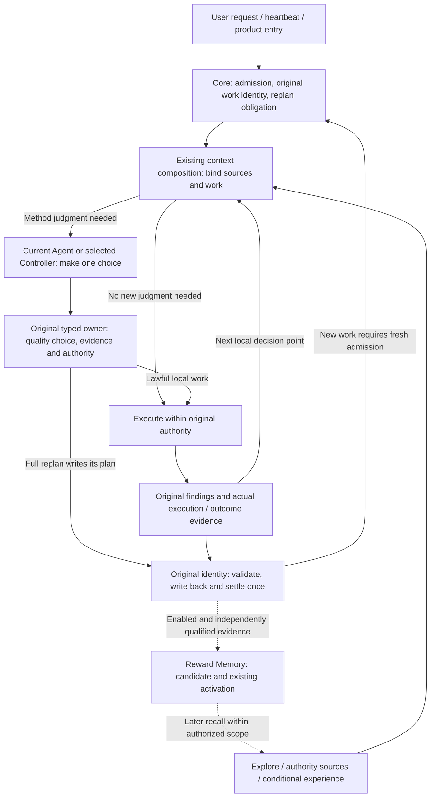

# RFC: Mechanism Convergence and the Experience Reuse Loop (v0)

- **RFC status:** Accepted (effective upon merge; a discussion proposal before merge)
- **Supersedes / closes:** none
- **Delivery maturity:** Proposal; this document delivers a source audit and target architecture, with no runtime change.
- **Authors / owners:** LoopX maintainers; source facts have code references, while the target architecture and trade-offs are AI-assisted proposals pending maintainer review and confirmation.
- **Created / last normative revision:** 2026-11-14
- **Implementation baseline:** `45cfd0c86d8f24d630ab66ad7f76784faa21c3f6`; references to `main` in section 4 mean this revision.
- **Semantic mirror:** [中文版](mechanism-convergence-and-learning-loop-v0.zh-CN.md)
- **Related:** [roadmap](loopx-overall-roadmap-v0.md), [small kernel](monorepo-distribution-split-v0.md), [Controller/unified contract](controller-executor-unified-contract-v0.md), [Target/Yardstick/Stride](target-yardstick-stride-decisions-v0.md), [research exploration](research-exploration-control-plane-v0.md), [memory utility](post-outcome-memory-utility-attribution-v0.md), [Goal contract evolution](goal-contract-evolution-v0.md).

## Document map and maintenance contract

Section 4 describes the pinned implementation; 4.3 separates unmerged work. Sections 5–11 propose the converged structure, calls, migration and composition acceptance, not shipped behavior. This RFC owns cross-mechanism composition; individual schemas, authority, defaults and promotion gates remain in their owning specifications. Amend those specifications together when changing them rather than overriding them here. Implementation evidence stays in existing RFCs/tasks and ledgers, without a parallel roadmap or execution queue. Maintainers must verify and confirm consequential design choices; this document assumes neither a human contribution ratio nor ownership of unconfirmed ideas.

## 1. Decision summary

Mechanism refactoring should **make evidence from one investigation change subsequent method choices, carry useful experience into applicable new tasks, and reduce duplicate execution and interpretation costs**. The small kernel addresses loading and runtime boundaries; this design addresses judgment, feedback and reuse within them.

Propose the following structure:

1. **One governed work lifecycle.** Quota determines admissible work, Turn owns execution, validation and settlement, and heartbeat/Chat/benchmark retain entry adapters. Ordinary work contracts and recovery converge through C1/C4/C9.
2. **One current method chooser per admitted work item.** It is the current Agent in a single session, or the Controller in an explicitly selected dual-role profile, using the same decision semantics. Stride specifies work shape and review, Explore supplies evidence and candidates, and Decision Context qualifies scoped facts with its own review lifecycle. They are not three competing commanders.
3. **Separate fact projection, model choice, deterministic qualification and execution observation.** Local decisions use existing Yardstick/findings; full replans use Stride/Vision. Share sources and subsequent observations without introducing a universal decision record.
4. **Apply experience to an inspectable decision artifact.** Distinguish context construction, method adoption, actual execution and later utility. Experience may change candidate methods, validation order and investment within scope; it does not change acceptance, authority or total budget.

This RFC starts no experiment, activates no capability, publishes no Skill and changes no production default. New composition and fields below are design proposals.

## 2. Problem and motivation

Consider a task whose cheap proxy keeps improving while authoritative evaluation does not. The system must choose whether to continue searching, calibrate the proxy, change method or evaluate authoritatively. It must then inspect whether execution adopted that choice and decide which lesson deserves transfer to a later task.

Evaluation, review, method records, memory and utility already exist. Their existence does not answer three composition questions:

- When the same evidence reaches ordinary work, full replan and capability context, who assembles input, who makes the final method choice, and which duplicate interpretations can retire?
- How does the original choice connect to actual execution, authoritative results and complete costs, exposing renaming, non-adoption or lack of benefit?
- After later recall, how is experience shown to influence the next method choice rather than merely appearing in a prompt?

Duplicate execution paths and incomplete feedback adoption are separate problems. Entry convergence reduces divergence but does not itself improve research strategy; feedback design need not wait for every host migration. Sequence them by real dependencies.

## 3. Scope and invariants

Cover execution, judgment, evidence and experience for engineering and budgeted research. Non-numerical tasks retain their acceptance and qualitative evidence without invented scores.

Preserve original Goal/Agent/Todo/Turn/effect identities, claim/lease, Stop, once-only settlement and acceptance authority. Execution legality, accepted outcomes, method quality and experience utility remain distinct. Retain unknown, failed, rejected, cancelled and negative outcomes; justified continuation can be valid adoption.

Add no mechanism manager, workflow DSL, global score, universal episode store or Python decision owner. Full TypeScript migration, dual models and a particular memory provider are not prerequisites. An existing owner may gain a relation with a real consumer; reuse is not a reason to preserve a demonstrably wrong responsibility boundary.

## 4. Current architecture: responsibilities and real paths

### 4.1 Seven responsibility boundaries

These are implementation roles, not a new capability catalog or seven services to build. A file may expose several adapters; consolidation depends on duplicate ownership of a fact or rule.

| Responsibility | Current mechanisms and actual ownership | Excluded responsibility |
| --- | --- | --- |
| Goals and execution authority | Goal/Vision/acceptance/Todo; [acceptance authority](../../../loopx/control_plane/goals/acceptance_authority.ts), [quota decision](../../../loopx/control_plane/quota/run_decision.ts), [lease](../../../loopx/control_plane/work_items/task_lease_acquire_decision.ts), [effect](../../../loopx/control_plane/effect_program.ts). | Experience, scores and model suggestions grant no execution authority. |
| Runtime and recovery | Heartbeat/scheduler, [public Turn](../../../loopx/cli_commands/turn_run_once.py), [executor](../../../loopx/control_plane/turn_driver/executor.py), [settlement](../../../loopx/control_plane/turn_driver/settlement.ts), [pure continuation controller](../../../loopx/control_plane/turn_driver/loop_controller.ts); [requests/steering](../../../loopx/control_plane/collaboration/request_control.ts) and [return](../../../loopx/control_plane/collaboration/return_delivery.ts) retain original identities. | Wakeup is not admission, process exit is not acceptance, and continuation control does not select methods for the model. |
| Context composition and delivery | [Quota emitter](../../../loopx/cli_commands/quota.py), [TurnEnvelope](../../../loopx/control_plane/quota/turn_envelope.ts), Capture/Progressive/Delta/[native lifecycle](../../../loopx/control_plane/quota/native_context_lifecycle.ts); [capability hooks](../../../loopx/control_plane/capability_hooks.py) and [contribution validation](../../../loopx/control_plane/turn_driver/capability_context.ts) bind selected work. | Content selection, encoding and recovery differ; a projection is neither a new fact store nor a method chooser. |
| Method choice and its specification | The hosted Agent judges; [Stride](../../../loopx/control_plane/work_items/stride_policy.ts) specifies work shape/review, [Yardstick](../../../loopx/control_plane/work_items/yardstick_decision.ts) specifies local target/measurement/next method, and [replan semantics](../../../loopx/control_plane/work_items/replan_semantics.ts) qualifies existing obligations. | A TypeScript codec does no research; structured declarations prove neither execution nor goal gain. |
| Evidence, triggers and fact qualification | [Explore context](../../../loopx/control_plane/capabilities/explore_turn_context.ts) and [result writeback](../../../loopx/capabilities/explore/result_writeback.py) manage findings/measurements; [repeat/cadence triggers](../../../loopx/control_plane/work_items/replan_history.ts) and [external review policy](../../../loopx/control_plane/work_items/progress_review_policy.py) form scoped signals; [Decision Context](../../../loopx/capabilities/decision_context/README.md) and [Material Lifecycle](../../../loopx/capabilities/material_lifecycle/README.md) manage sources and qualification. | Do not normalize every signal into one score. Enabled assist policy can form an obligation; not all external assessments are ignorable advice. |
| Experience and procedural reuse | [Turn Recall](../../../loopx/capabilities/agent_turn_recall/core.py), [Reward Memory application](../../../loopx/capabilities/reward_memory/application.py), [procedural experience](../../../loopx/capabilities/reward_memory/experience_quality.py), [utility](../../../loopx/capabilities/reward_memory/memory_utility.py)/[reducer](../../../loopx/capabilities/reward_memory/utility_reducer.py), and [Skill delivery](../../../loopx/capabilities/project_skill_delivery/README.md). | Context construction, method adoption, benefit and procedural publication are different facts; no automatic provider-ranking update. |
| Independent validation and quality | Original task validators/acceptance, [change-quality](../../../loopx/capabilities/change_quality/README.md), and specialized [Anti-Entropy](../../../loopx/capabilities/anti_entropy/README.md) oracles. | Quality qualification proves neither task success nor useful experience; Anti-Entropy owns no separate delivery-receipt store. |

### 4.2 Five existing paths

1. **Admission to execution.** [`build_quota_should_run`](../../../loopx/control_plane/quota/should_run.py) prepares sources, composes routes/guards and builds the payload; [`live_decision.py`](../../../loopx/control_plane/quota/live_decision.py) handles original receipts and re-entry. `turn_run_once.py` consumes that decision and calls `run_loopx_turn_once`. Quota CLI still projects after capture; [`build_loopx_turn_plan`](../../../loopx/control_plane/turn_driver/driver.py) retains current/historical contract branches. Shared admission exists; ordinary output and execution orchestration are not fully converged.
2. **Replan to subsequent observation.** [`autonomous_replan_obligation_from_runs`](../../../loopx/control_plane/work_items/autonomous_replan_obligation.py) prioritizes typed repetition, then a pinned assist-policy assessment, then the ordinary trigger. Staged reads and ACK belong to that obligation; `replan_semantics.ts` and [`progress_delta.ts`](../../../loopx/control_plane/work_items/progress_delta.ts) qualify Stride and recorded semantic change, not independent outcome quality. [`decisionFollowthrough`](../../../loopx/control_plane/work_items/replan_context.ts) links the original choice, planned Todos and later records while retaining `execution_and_goal_gain: unknown`.
3. **Local method to execution record.** `normalizeWorkYardstickDecision` already has `next_action.method_id/reason/cost_bound` and `prior_finding_id`; `projectWorkYardstickCue` has `previous_decision_followthrough`, comparing planned and executed methods. Explore's [`execution_observation`](../../../loopx/control_plane/capabilities/explore_execution_observation.ts) carries candidate digest, actual method, deviation reason, costs and result references. These are validated record relations; independent acceptance still belongs to the original evaluator.
4. **External facts to a scoped decision.** Decision Context's [`runtime`](../../../loopx/capabilities/decision_context/runtime.py) assembles sources/recall; [`review_settlement`](../../../loopx/capabilities/decision_context/review_settlement.py) requires the original user-gate event for a proposal and has a separate lawful `no_change` route without a proposal; [`outcome_feedback`](../../../loopx/capabilities/decision_context/outcome_feedback.py) links later results. Its complete review lifecycle must not become mandatory for ordinary Turns.
5. **Memory to current context.** `run_agent_turn_recall::apply_guidance` uses `outcome=applied` to insert experience into private context; its `artifact_ref` is the situation fingerprint. Applicability is explicitly left to the Agent. This application concerns a context artifact and alone proves neither host reading, method adoption nor execution. Generic `apply_reward_memory_recall` already supports caller-owned application, but a Boolean assertion cannot replace independent artifact inspection. [`turn_hooks.py`](../../../loopx/capabilities/reward_memory/turn_hooks.py) has recall and post-outcome ingestion; its current automatic result field is an experience reflection, not generic method-adoption proof.

### 4.3 Defaults and in-flight boundaries

[`machine_defaults.py`](../../../loopx/capabilities/todo_replan_cadence/machine_defaults.py) gives Goals without an explicit cadence override review every **6 effective work Turns** and `evidence_conditioned_v1` Stride when machine configuration has not overridden them. Explicit off, machine settings and legacy configuration retain their meanings; the underlying schema's off is not the complete product default. Yardstick independently defaults to false; Explore is off without explicit/machine configuration. Progress-review, Reward Memory, Decision Context and Material Lifecycle retain their activation boundaries.

| In-flight work / inspected head | Reusable direction | Not a fact about this main revision |
| --- | --- | --- |
| [C1 #8266](https://github.com/loopx-project/loopx/pull/8266) · `26a7480a3b4b` | Unified work source, capture/reader and recovery. | Complete ordinary writer/consumer cutover. |
| [Turn #8484](https://github.com/loopx-project/loopx/pull/8484) · `b7e4e01cc423` | Single/dual roles and a unified runtime entry. | Shipped `loopx turn run`, dual-session benefit or default promotion. |
| [Method operators #8516](https://github.com/loopx-project/loopx/pull/8516) · `5afb98cf8ea8` | Five stages organize six advisory methods over shared measurements/summaries. | Merged operators or Turn execution authority for methodology stages. |

All three were OPEN when checked. Their reported tests are not this RFC's validation.

### 4.4 Composition this design adds

Execution convergence already belongs to C1/C4/C9; local decisions, replans and method execution observations also have concrete implementations. This proposal supplies **the input/responsibility contract for one judgment and the link from context application to an actual decision artifact**. Grouping modules in a diagram does not complete the former; the latter has the specific semantic gap above. This does not assert that every caller lacks functionality: inspect each real consumer before implementation.

## 5. Converged target design: AI proposal pending maintainer confirmation

### 5.1 Runtime invokes, the model chooses, existing owners qualify

These are target calls, not a claim that the unified entry has shipped. Local feedback inside admitted work creates no second Turn or work-quota charge; model/tool usage still counts against its original budget. Full replan produces a plan and settles its original identity; Core admits subsequent work. The host supplies models/tools; runtime composition does not invoke a research model itself or run every capability in sequence.

Existing session/attempt binding identifies the current method chooser. Enabling Explore, Decision Context or experience does not start another Controller. Dual roles enter only through the original Controller RFC profile; Worker observations return to that Controller. Multi-Agent work retains request, receiver-adoption and result-return contracts without a global method commander.

### 5.2 Inputs and outputs of one judgment

This maps existing records semantically rather than defining a universal packet. Ordinary work without a relevant change need not fill this table.

| Input / output | Source, consumer and constraint |
| --- | --- |
| Admitted work and hard constraints | Original work source/capture, Goal acceptance, Todo, lease, scope and budget. Context composition reads them; capabilities cannot override them. Effectful operations still recheck current authority. |
| Decision trigger | Original replan obligation, or a relevant new finding, scope/source change, probe boundary or Agent reconsideration. Due review enters its original flow; a local choice cannot discharge a full obligation. |
| Decision evidence | Explore measurements/candidates with matching scope, prior decisions and execution observations; exact external reads when needed; enabled experience as conditional advice. Preserve each revision, missing coverage and detail entry. |
| Local choice output | When Yardstick is enabled, existing `work_yardstick_decision` records target, authoritative/proxy profiles, counterevidence, `next_action` and prior finding. Otherwise use original task/path records; composition does not enable Yardstick or invent numerical evaluation. |
| Full replan output | Existing Stride/Vision: action, work shape, `next_probe`, `previous_review` and necessary Todo delta. Do not maintain a competing local plan. |
| Adoption and outcome output | Current decision reference, actual method/candidate, deviation, independent outcome and costs enter existing findings/work history; experience application references enter existing Reward Memory receipts and Turn results without duplicating work state. |

Composition uses qualified sources. Deduplicate projections by original identity/revision, not by collapsing semantically different scores. Shared reading and scope comparison remain in existing TypeScript owners; Python retains necessary provider IO and adapters.

### 5.3 Trigger, conflict and writeback order

1. **Resolve work and obligations first.** Preserve Core refusal, wait, Stop and recovery. Work whose original identity remains valid continues within its contract. Method advice bypasses no gate; optional provider failure does not stop the entire Goal.
2. **Assemble decision-relevant evidence.** Explore owns measurement scope and candidate provenance. Decision Context participates only for configured authority-source qualification. Its evidence may inform the current judgment; invoking its formal proposal workflow still requires its own review, without making that gate the ordinary method-choice entry.
3. **Resolve conflicts by their question.** Original owners define authoritative acceptance; proxies guide search. Recheck old experience against current counterevidence and display incomparable scopes separately. Conflicting authority sources that affect an operation follow its original authority/user-gate path; independent authorized work need not stop. Existing review-signal precedence and discharge rules remain.
4. **The current model makes one method choice.** Compare applicable continuation, calibration, method change and direct validation with a reason, bounded investment and next decision condition. Without reliable comparison, choose bounded investigation or preserve uncertainty rather than inventing a benefit ranking. Experience influences candidates, reasons or validation, not a competing next action.
5. **Original typed owners qualify and record.** Check work binding, read-source revisions, evidence and scope; stale input returns to the original reader. Calling something advisory cannot bypass method/schema rejection. Local choices enter original findings; due replan absorbs the same evidence and writes the original Stride/Vision decision once.
6. **Observe real adoption.** Original execution observations link planned/executed method and artifact; independent acceptance judges outcomes and usage covers complete cost. Declarations, renamed identifiers or context injection alone leave adoption/benefit unknown. Replay repairs missing relations without repeating execution, creating work or settling again.

Changes to target, dependencies, acceptance or budget beyond scope use original Todo/Vision/authority operations. Do not infer permission from `grow/switch/verify` action words.

### 5.4 How experience changes the next investigation

Retain two feedback timescales: current-task findings and execution observations inform the next local choice/replan; transferable lessons enter later tasks through Reward Memory's existing candidate, activation and scope rules. Long-term memory does not synchronize current work state.

Use existing `procedural_experience_contract_v0` for applicability, observed outcome, attribution limits and `future_behavior.trigger/action/validation/stop_condition`. Experience may propose candidate methods, change validation order, narrow unproductive search or suggest investment within scope. The current Agent checks new task facts and applies, ignores or refutes it. This choice changes the method policy; historical success must not automatically update policy parameters or provider ranking.

**Add application to a decision artifact while preserving context receipts.** Existing `agent_workflow.turn_admission` application continues to describe its context artifact; historical meanings do not change. Within an already authorized recall surface, register an optional capability result field in the original host response, provisionally `reward_memory_application_json`, for the caller's adoption/ignore/refutation judgment. Reuse original activation and budgets without a global switch. The field carries original recall/application references, the current decision artifact reference/revision, selected opaque experience references and the judgment, not private provider bodies or executable commands.

The consumer belongs in `reward_memory/turn_hooks.py` and the existing application owner. Read the exact captured recall binding and qualified reference/digest set, inspect the actual decision artifact and sources, and reuse the application schema to produce **another receipt bound to that decision artifact**. Derive a distinct namespaced `application_id` stably from original recall and decision-artifact revision; `artifact_ref` names the actual decision, not its situation fingerprint. Existing Yardstick/Stride/task records hold the choice and its experience-related reason; the result field links them rather than copying the plan. Shared identity/revision qualification belongs in the existing typed boundary; Python hooks remain IO/caller adapters, without a parallel semantic owner.

This is a proposed caller-adapter extension, not current main behavior. Implementation must define the field version and consumer compatibility in the owning specifications; retain receipts in the Turn journal/result capture without another application queue. Reject references outside the original recall set, wrong work/revision, missing artifacts and a bare `current_artifact_verified=true` without independent verification. Lost original recall evidence stays unknown; a newer provider query cannot reconstruct it. Without relevant judgment, omit an unregistered field or return an empty string when a strict host requires every registered property. The first caller qualifies one actual decision revision per result; earlier/unobserved decisions remain unknown rather than being silently covered by that receipt. Old context-only application remains readable.

Artifact inspection verifies that the recorded choice incorporates or rejects the cited experience. It proves neither the model's internal causal process nor later execution; those must not be inferred from a citation or receipt alone.

Link the decision receipt to subsequent `execution_observation` and verified outcome before existing utility processing. Adoption and successful execution alone do not establish helpfulness; absent attribution remains unknown. Optional evaluators use existing bounded budgets/deduplication after outcome settlement, neither blocking completed outcomes nor reopening execution. Stable procedures may become Skill candidates; publication, installation and activation retain separate authority.

### 5.5 Placement, consolidation and retirement

| Change | Concrete placement | Preserve / retire boundary |
| --- | --- | --- |
| Unify ordinary execution contract/lifecycle | `quota.py::_publish_quota_result`, `quota/cli_projection.py`, `turn_driver/driver.py::build_loopx_turn_plan` and heartbeat rendering through C1/C4/C9. | Retire duplicate normal producers/result interpreters; retain quota policy, entry adapters and historical decoders with real consumers. A facade alone is insufficient. |
| Compose input with one method chooser | `explore/turn_context.py`, `work_items/replan_context.ts`, `yardstick_decision.ts` and existing capability hooks. | Consolidate duplicate reads, scope comparison and detail references; local choice and full replan keep suitable records. Decision Context is not a mandatory global entry. |
| Trace choice to actual method | `explore/result_writeback.py`, `explore_execution_observation.ts`, `projectWorkYardstickCue` and `decisionFollowthrough`. | Reuse existing fields and repair demonstrated missing consumers; later summaries cannot fabricate historical execution. |
| Trace contextual experience to decision adoption | Preserve original receipts in `agent_turn_recall/core.py`; register optional results in `reward_memory/turn_hooks.py`, create artifact receipts in `application.py`, and consume qualified lineage in `memory_utility.py`. | Caller verifies artifacts; typed boundaries qualify identity/structure. Generic Core does not become a memory chooser, and context-applied does not mean method-adopted. |
| Product readback | Existing Goal workspace, work details, research history and CLI. | Explain evidence, choice, actual work, outcome and experience adoption together; show unknowns and link original detail. Changed journeys require App/CLI and supported Lark qualification. |

Do not copy the unmerged #8516 implementation; reuse reviewed primitives once merged. Extract only demonstrated duplicate consumers, not a speculative mechanism-composer directory. Migrate consumers and retire old normal branches together, qualifying recovery compatibility separately.

### 5.6 Complete walkthrough: improving proxy, flat authoritative result

This is a design example, not an executed experiment or a claim that current tasks generally suffer this failure.

| Stage | Converged behavior and original record |
| --- | --- |
| Detect disagreement | Retain current admitted task acceptance/budget. Explore records proxy and authoritative measurements for matching candidate, workload and revision; missing or incomparable results cannot manufacture disagreement. |
| Choose | The current Agent reads disagreement and prior method, comparing continued search, proxy calibration/replacement and direct authoritative evaluation. The example chooses bounded verification of the misleading scope, recording method/reason/cost in `next_action`; if full review is due, fold it into that Stride/Vision decision. |
| Execute | Run the chosen validation within original lawful scope; record actual method, candidate, input, duration, stop reason and independent result. Preserve deviations; a receipt is not the artifact. |
| Feed back within the task | The next judgment reads the prior decision and execution. Supported counterevidence narrows proxy applicability or changes validation; disproven counterevidence may justify continuing. A flat authoritative outcome can supply useful negative evidence without proving benefit. |
| Form experience | Under enabled ingestion/candidate qualification, record the task conditions where the proxy misled, the validation to use and the limits. The validator must inspect the exact reflection and evidence. A single success publishes no Skill. |
| Adopt in later work | Recall within the authorized corpus/scope and check the new task. If applicable, move the relevant validation before search; cite experience in the decision artifact, produce the distinct decision application, then inspect actual execution. Otherwise ignore/refute while preserving lawful work. |
| Assess utility | Original acceptance observes the new task's outcome and complete cost; independent matched comparison determines support for utility. Report delivery, adoption and single successes separately without inventing positive attribution. |

The structural changes are evidence entering the existing chooser, a choice linked to actual execution, and experience linked to the next decision artifact. No scheduler or automatic policy write is added.

## 6. Alternatives, external references and principal costs

| Option | Trade-off and selection |
| --- | --- |
| Unify quota/Turn only; methods assemble context separately | Reduces execution divergence but leaves duplicate method inputs and context-only experience. Retain as an independently deliverable execution migration. |
| Compose evidence and choose in the current session; form experience after outcomes | **Recommended.** Reuses existing response/binding; extra cost is source reading, artifact qualification and bounded memory IO. Composition and reference validation need maintenance. |
| Add an independent Controller/evaluator session to every judgment | May provide independent judgment but adds model calls, context synchronization and recovery. Qualify only under the original optional dual-role profile; not a convergence prerequisite. |
| Summarize offline and recall next time only | Low intrusion into current execution but omits current-task correction and decision-adoption evidence. Useful for candidates, insufficient for this design alone. |
| Universal engine, score or event store | Adds a second owner and collapses acceptance, quality and utility. No necessary current consumer; reject. |

Initial scale is one Agent doing engineering or budgeted research, followed by receiver-adoption qualification under the existing peer contract. Without a new relevant judgment, add no model call, mandatory record or remote assessment **relative to existing configuration**; enabled original recall retains its policy. Real judgments use the existing response. Qualification and exact reads still cost resources and must be measured even in one session.

Account separately for admission/delivery, judgment, execution/validation and post-outcome memory: latency, bytes/tokens, provider/tool calls, retained storage and human intervention. Report p50/p95 and complete charge coverage; unknowns are not zero. Reuse source revisions, bounded views and deduplication; add neither per-field RPCs, full-history scans every Turn nor eager loading of all optional capabilities. Preserve existing call/output/replay budgets; excess uses original bounded-read or unavailable semantics. No new performance or benefit measurement is reported here.

External references inform responsibility choices, not LoopX benefit: [LangGraph persistence](https://docs.langchain.com/oss/python/langgraph/persistence) separates thread checkpoints from cross-thread stores, supporting recovery-state/experience separation; [Voyager](https://voyager.minedojo.org/) separates curriculum, code Skills and environment feedback, informing qualified procedural reuse. These mappings are proposal inferences, not imported architecture or experimental outcomes. Cloud isolation, metering and operations remain under existing authority/quota contracts rather than being declared solved here.

## 7. Safety, privacy and compatibility

Public projections retain necessary facts, opaque references and scope. Raw chat, trajectories, credentials, provider bodies and private paths stay within original boundaries. No automatic merge across Goal/Agent/corpus/revision; revoked, expired and counterexample-bearing experience remains inspectable.

Existing context application receipts retain their artifact meaning. New decision receipts neither backfill nor reinterpret old records. Register the new field only for qualified opt-in callers; absence proves neither non-adoption nor failure. Older hosts without the field cannot claim method-adoption evidence. Existing effectful operations, strict schemas and independently deployed consumers retain their compatibility requirements.

Optional advice failures retain original fail-open behavior without swallowing authority, hard gates, acceptance or original replan obligations. Missing evidence for an authority-dependent operation follows its original owner rather than being bypassed as provider unavailability.

## 8. Migration and rollback

Pin base/head, real callers, old obligations and evidence; reuse still-applicable matching-condition results. C1/C4/C9 migrate execution producers, consumers and recovery together before retiring old normal paths. Method composition first uses existing local/replan records; decision application starts with one authorized caller before other adapters.

Each slice preserves disabled paths and historical reads. Disabling the new application consumer stops new adoption relations without reversing accepted outcomes, redoing work or spending again. Reconcile unresolved original receipts under their original identity; a new session cannot hide unknown recovery. Revoked sources reject related new applications without rewriting history. Rollback retains negative results and unknowns.

## 9. Composition validation and acceptance

These qualify cross-owner seams; individual rules remain in owning specifications without parallel gates.

| Scenario | Required composition evidence |
| --- | --- |
| Same work across entries | Ordinary, wait, replan, Stop, interruption and replay preserve obligations, original identity, once-only settlement and no duplicate host work; retain native/plain controls. |
| Concurrent signals/methods | Existing trigger precedence; one choice by the current chooser; full review absorbs local evidence. Optional capabilities introduce neither another Controller nor an ordinary user gate. |
| Stale, conflicting or incomparable evidence | Binding/scope validation rejects wrong relations; rereading is not execution; only operations depending on missing authority facts are held. |
| Context-applied without method adoption | Old receipt remains readable with adoption/utility unknown; it cannot satisfy decision-artifact application acceptance. |
| Decision adoption and execution | Original recall set, decision revision, method/candidate and independent result correspond. Other tasks, tampered artifacts, self-asserted verification and renaming alone cannot qualify. |
| Cross-task experience | Trace original evidence, candidate/activation, later applicability, decision, execution and outcome. Reject expired/revoked/wrong-scope input and retain negative outcomes. |
| Unchanged/off/provider failure/older host | No extra mandatory judgment, record or remote assessment; original work and obligations remain. Missing new evidence stays unknown; replay does not double-write or double-spend. |
| Utility and Skill | Adoption/success does not automatically produce helpfulness; attribution follows the utility contract. Skill qualification, generation, publication, installation and activation have separate readback. |

First qualify implementation on isolated File/SQLite production entrypoints. Changes affecting other authority backends retain their original required qualification. Product readback uses current work, prior choices, negative and unknown outcomes through App/CLI and affected Lark paths. Semantic tests do not establish learning benefit.

A separate effect protocol freezes task/model/budget/starting state/window, arms, sample size and analysis. Change execution topology, context delivery or experience policy separately; include failures and complete costs. Single-case improvement, fewer tokens, receipts and PR counts do not qualify benefit. This RFC runs no such experiments.

## 10. Success criteria

Structurally, common execution has one owning semantic producer, method choice has a current responsible actor, and duplicate normal interpreters retire. Behaviorally, evidence reaches choices, choices reach real work and experience reaches applicable new choices, with refusal and recovery at each stage. For outcomes, improve authoritative results within comparable complete budgets or reduce complete cost for equivalent results. Report these separately; sound structure and complete records do not establish benefit.

## 11. Smallest complete delivery and existing work

| Slice | Concrete delivery / existing ownership | Exit evidence |
| --- | --- | --- |
| This RFC | Correct role inventory; specify the chooser, composition order, decision application and complete example. | Distinct source/proposal/in-flight facts; inspectable inputs/outputs, costs, recovery and authority. |
| One complete within-task method loop | Target/Stride/Explore owners connect scoped counterevidence, one choice, actual method, independent result and next judgment for a named task. | Reuse complete existing paths without rewriting for code volume; repair a real gap with its producer, consumer and failure readback together. A finding alone is insufficient. |
| One cross-task experience adoption | Reward Memory and that caller add decision-artifact application, from qualified prior experience to a new applicable task's choice, execution and result. | Context and decision receipts remain distinct; wrong scope, expiry, artifact mismatch, off and replay qualify. Utility stays unknown without attribution evidence. |
| Execution-contract convergence | C1/C4/C9 and #8266/#8484 continue entry/recovery migration. | Original-quota single-session semantics, outcomes/cost and recovery; qualify dual sessions separately. Order relative to feedback only by real dependency. |

The first implementation task needs actual counterevidence or reuse demand. Selecting it prepares execution rather than substituting for the target design above. When a supposed gap is unsupported, record that existing capability suffices and reuse it. Full benefit experiments and Skill content changes keep their own scope; prescribe no PR count or other lane's quota.

## 12. Choices requiring maintainer confirmation

Recommend current-session composition, one current method chooser and original-owner qualification. Keep this document for cross-mechanism seams and reference owning specifications for detail. AI proposals are not prior approvals:

| Choice | Recommendation and reason | Decision point |
| --- | --- | --- |
| Decision application extension | Reuse the application schema for a receipt on the actual decision artifact; carry it through opt-in capability results and the original Turn journal, retaining old context receipts. This follows the real consumer more closely than a new episode or memory queue. | On design acceptance and corresponding Reward Memory/host-result specification updates, confirm field version and independent-verification contract. |
| First caller/task | Choose an evidenced proxy/authoritative disagreement or a real need to reuse an existing lesson in engineering/research; confirm scope through the original task owner. | Before implementation; do not invent a failure to fit the example. |
| Stronger policy/topology | Qualify current-session evidence adoption first; dual roles follow the Controller RFC, and learned policy/ranking changes require matched data and counterfactual evaluation. | Before changing profiles, policy implementation or provider ranking. |
