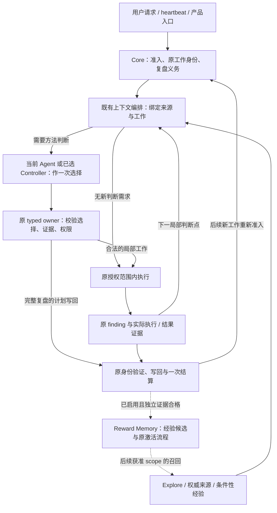

# RFC：机制收敛与经验复用闭环（v0）

- **RFC 状态：** Accepted（合并后生效；合并前是讨论提案）
- **替代 / 关闭：** 无
- **交付成熟度：** Proposal；本文交付源码盘点与目标架构，不改变运行行为。
- **作者 / 归属：** LoopX maintainers；源码事实由路径支持，目标架构和取舍为 AI 辅助提案，待维护者审阅确认。
- **创建日期 / 最近规范修订：** 2026-11-14
- **实现基线：** `45cfd0c86d8f24d630ab66ad7f76784faa21c3f6`（第 4 节的 `main` 均指此版本）。
- **语义镜像：** [English](mechanism-convergence-and-learning-loop-v0.md)
- **关联：** [总体路线](loopx-overall-roadmap-v0.zh-CN.md)、[小内核](monorepo-distribution-split-v0.zh-CN.md)、[Controller/统一契约](controller-executor-unified-contract-v0.zh-CN.md)、[Target/Yardstick/Stride](target-yardstick-stride-decisions-v0.zh-CN.md)、[研究探索](research-exploration-control-plane-v0.zh-CN.md)、[记忆效用](post-outcome-memory-utility-attribution-v0.zh-CN.md)、[Goal 契约演化](goal-contract-evolution-v0.zh-CN.md)。

## 文档地图与维护契约

第 4 节记录固定版本的实现，4.3 单列未合入工作。第 5–11 节定义拟议的收敛后结构、调用关系、迁移和组合验收；它们不是当前已交付行为。本文持有跨机制的组合设计，单个能力的 schema、权限、默认值和晋升门仍归原规范；涉及改变时须同步修订所属规范，不能用本文覆盖。实施证据沿原 RFC/任务及 ledger 记录，不另建路线图或执行队列。维护者须核实并确认关键设计选择；本文不推定人工贡献比例或未确认观点的归属。

## 1. 决策摘要

机制重构的目标是：**让一次研究的证据改变后续方法选择，并让有效经验在适用的新任务中发挥作用，同时减少重复执行和解释成本。** 小内核解决加载与运行边界；本设计解决边界内的判断、反馈与复用。

建议采用以下结构：

1. **一个受治理工作生命周期。** quota 决定可做什么，Turn 承接执行、验证和结算，heartbeat/Chat/benchmark 保留入口适配。普通工作契约及恢复沿 C1/C4/C9 收敛。
2. **每个已准入工作只有一个当前方法选择者。** 单会话时是当前 Agent，已选择的双角色 profile 中是 Controller；二者共用决策语义。Stride 是工作尺度与复盘规格，Explore 提供证据和候选，Decision Context 提供有范围的事实核验及其独立审阅流程，它们不是三个并列指挥者。
3. **事实投影、模型选择、确定性校验、执行观察分别负责。** 局部选择使用现有 Yardstick/finding，完整复盘使用 Stride/Vision；二者共享输入来源和后续观察，不合成一个万能决策记录。
4. **经验作用于可审查的决策产物。** 区分上下文构造、方法采用、真实执行和后续效用。经验可以改变候选方法、验证顺序和范围内的投入选择；它不改变验收、权限或预算总额。

本 RFC 不启动实验、启用能力、发布 Skill 或改变生产默认值。本文中的新增组合和字段均为设计提案。

## 2. 问题与动机

考虑一个任务：便宜的代理评测持续改善，权威评测却没有改善。系统需要决定继续搜索、校准代理、换方法还是直接做权威验证；随后应检查实际执行是否采用该决定，再决定什么经验值得带到下一任务。

当前已有评测、复盘、方法记录、记忆和效用组件，但“组件存在”不能回答三个组合问题：

- 同一证据经过普通工作、完整复盘和能力上下文时，谁组织输入、谁作最终方法选择，哪些解释可以删除？
- 方法选择后，怎样把原决定与实际执行、权威结果和完整成本连接，识别只改名、未采用或没有收益？
- 下一任务召回经验后，怎样证明它进入了方法选择，而不只证明提示词里出现过？

执行入口重复与反馈采用不足是两类问题。统一入口降低分叉，却不会自行产生更好的研究策略；反馈设计也不应等待所有宿主完成迁移。二者按真实依赖实施。

## 3. 范围与不变量

覆盖工程与预算受限研究的执行、判断、证据和经验闭环；非数值任务继续使用原验收及定性证据，不强制发明分数。

原 Goal/Agent/Todo/Turn/effect、claim/lease、Stop、一次结算和验收权限保持。合法执行、成果验收、方法质量和经验效用分别判断。未知、失败、拒绝、取消和负结果保留；有证据支持原路线时，继续也可以是有效采用。

不新增机制管理器、workflow DSL、全局评分、通用 episode 库或 Python 决策 owner。不以完整 TS 迁移、双模型或特定记忆 provider 为前置。允许在原 owner 增加有实际消费者的关联；复用原模块不是禁止调整错误职责的理由。

## 4. 当前架构盘点：按责任与真实路径划分

### 4.1 七个责任边界

下表是实现角色，不是新 capability 清单或七个待建服务。一个文件可以提供多个适配入口；是否合并取决于是否重复维护同一事实或规则。

| 责任 | 当前机制及实际归属 | 不承担什么 |
| --- | --- | --- |
| 目标与执行权威 | Goal/Vision/验收/Todo；[acceptance authority](../../../loopx/control_plane/goals/acceptance_authority.ts)、[quota decision](../../../loopx/control_plane/quota/run_decision.ts)、[lease](../../../loopx/control_plane/work_items/task_lease_acquire_decision.ts)、[effect](../../../loopx/control_plane/effect_program.ts) | 不由经验、评测分数或模型建议授予执行权。 |
| 运行与恢复 | heartbeat/scheduler、[公开 Turn](../../../loopx/cli_commands/turn_run_once.py)、[executor](../../../loopx/control_plane/turn_driver/executor.py)、[settlement](../../../loopx/control_plane/turn_driver/settlement.ts)、[纯 continuation controller](../../../loopx/control_plane/turn_driver/loop_controller.ts)；[请求/纠偏](../../../loopx/control_plane/collaboration/request_control.ts)及[返回](../../../loopx/control_plane/collaboration/return_delivery.ts)沿原身份接入 | 唤醒不是准入；进程退出不是验收；接续控制器不替模型选择方法。 |
| 上下文编排与交付 | [quota emitter](../../../loopx/cli_commands/quota.py)、[TurnEnvelope](../../../loopx/control_plane/quota/turn_envelope.ts)、Capture/Progressive/Delta/[native lifecycle](../../../loopx/control_plane/quota/native_context_lifecycle.ts)；[capability hooks](../../../loopx/control_plane/capability_hooks.py)及[贡献校验](../../../loopx/control_plane/turn_driver/capability_context.ts)绑定已选工作 | 选择内容、编码和恢复职责不同；投影不是新的事实库或方法决策者。 |
| 方法选择及其规格 | 宿主中的 Agent 作判断；[Stride](../../../loopx/control_plane/work_items/stride_policy.ts)规范尺度/复盘，[Yardstick](../../../loopx/control_plane/work_items/yardstick_decision.ts)规范局部目标/尺子/下一方法，[replan semantics](../../../loopx/control_plane/work_items/replan_semantics.ts)校验既有义务 | TS codec 不会自行研究；结构化声明不证明方法执行或目标收益。 |
| 证据、触发与事实核验 | [Explore context](../../../loopx/control_plane/capabilities/explore_turn_context.ts)及[result writeback](../../../loopx/capabilities/explore/result_writeback.py)管理 findings/measurement；[重复/周期触发](../../../loopx/control_plane/work_items/replan_history.ts)、[外部 review policy](../../../loopx/control_plane/work_items/progress_review_policy.py)形成有范围信号；[Decision Context](../../../loopx/capabilities/decision_context/README.md)、[Material Lifecycle](../../../loopx/capabilities/material_lifecycle/README.md)管理来源及核验 | 不把所有证据归一为一个分数。外部 assist 可按已启用策略形成义务，不能一概当作可忽略提示。 |
| 经验及过程复用 | [Turn Recall](../../../loopx/capabilities/agent_turn_recall/core.py)、[Reward Memory application](../../../loopx/capabilities/reward_memory/application.py)、[procedural experience](../../../loopx/capabilities/reward_memory/experience_quality.py)、[utility](../../../loopx/capabilities/reward_memory/memory_utility.py)及[reducer](../../../loopx/capabilities/reward_memory/utility_reducer.py)、[Skill delivery](../../../loopx/capabilities/project_skill_delivery/README.md) | 构造上下文、采用方法、带来收益和发布过程是不同事实；不自动改 provider 排名。 |
| 独立验证与质量 | 原任务 validator/验收、[change-quality](../../../loopx/capabilities/change_quality/README.md)、[Anti-Entropy](../../../loopx/capabilities/anti_entropy/README.md)专项 oracle | 质量通过不证明任务成功或经验有效；Anti-Entropy 不另持有 delivery receipt store。 |

### 4.2 五条已经存在的链路

1. **准入到执行。** [`build_quota_should_run`](../../../loopx/control_plane/quota/should_run.py)准备来源、组合 route/guard、构造 payload；[`live_decision.py`](../../../loopx/control_plane/quota/live_decision.py)处理原回执和重入。`turn_run_once.py`消费该决定并调用`run_loopx_turn_once`。quota CLI 仍在 capture 后分投影；[`build_loopx_turn_plan`](../../../loopx/control_plane/turn_driver/driver.py)保留当前/历史契约分支。共享准入已经存在，正常输出与执行编排尚不能统称完成收敛。
2. **复盘到后续观察。** [`autonomous_replan_obligation_from_runs`](../../../loopx/control_plane/work_items/autonomous_replan_obligation.py)让 typed repeat 优先，再按 pinned assist policy 处理外部评价，最后采用普通触发。分阶段读取及 ACK 属于该义务；`replan_semantics.ts`与[`progress_delta.ts`](../../../loopx/control_plane/work_items/progress_delta.ts)校验 Stride 及记录的语义变化，不是独立成果评测。[`decisionFollowthrough`](../../../loopx/control_plane/work_items/replan_context.ts)关联原决定、计划 Todo 和后续记录，仍明确保留`execution_and_goal_gain: unknown`。
3. **局部方法到执行记录。** `normalizeWorkYardstickDecision`已有`next_action.method_id/reason/cost_bound`和`prior_finding_id`；`projectWorkYardstickCue`已有`previous_decision_followthrough`，比较计划与执行方法。Explore 的[`execution_observation`](../../../loopx/control_plane/capabilities/explore_execution_observation.ts)已有候选摘要、实际方法、变更原因、成本及结果引用。它们是可校验的记录关联，独立验收仍需原 evaluator。
4. **外部事实到有范围的决定。** Decision Context 的[`runtime`](../../../loopx/capabilities/decision_context/runtime.py)组织来源与召回；[`review_settlement`](../../../loopx/capabilities/decision_context/review_settlement.py)对提案要求原 user-gate 事件，无提案的合法`no_change`有独立路径；[`outcome_feedback`](../../../loopx/capabilities/decision_context/outcome_feedback.py)连接后续结果。不能把这个完整审阅生命周期强加给每个普通 Turn。
5. **记忆到当前上下文。** `run_agent_turn_recall::apply_guidance`以`outcome=applied`把经验放入当前私有 context，`artifact_ref`是 situation fingerprint；代码明确把适用性判断留给 Agent。因此这里的 application 证明作用于上下文产物，单凭它不能证明宿主阅读、方法采用或真实执行。通用`apply_reward_memory_recall`已支持 caller-owned application，但其布尔声明也不能代替独立产物检查。[`turn_hooks.py`](../../../loopx/capabilities/reward_memory/turn_hooks.py)已有 recall 与结果后 ingest；当前自动结果字段是经验 reflection，不是通用的方法采用证明。

### 4.3 默认值与在途边界

[`machine_defaults.py`](../../../loopx/capabilities/todo_replan_cadence/machine_defaults.py)在 Goal 无显式 cadence override、机器配置也未覆盖时，继承每 **6 个有效工作 Turn** 复盘及`evidence_conditioned_v1` Stride。显式 off、机器设置和旧配置各保留原意；底层 schema 的 off 不是产品整体默认。Yardstick 独立默认 false；Explore 无显式/机器配置时为 off。progress-review、Reward Memory、Decision Context、Material Lifecycle 保留各自启用边界。

| 在途工作 / 核对 head | 可复用方向 | 不属于上述 main 事实 |
| --- | --- | --- |
| [C1 #8266](https://github.com/loopx-project/loopx/pull/8266) · `26a7480a3b4b` | 统一 work source、capture/reader、恢复。 | 全部普通 writer/consumer 已切换。 |
| [Turn #8484](https://github.com/loopx-project/loopx/pull/8484) · `b7e4e01cc423` | 单/双角色及统一 runtime entry。 | `loopx turn run`已发布、双会话收益或默认晋升已成立。 |
| [方法算子 #8516](https://github.com/loopx-project/loopx/pull/8516) · `5afb98cf8ea8` | 五阶段组织六类 advisory 方法，复用测量与摘要。 | 算子已合入，或方法阶段可取得 Turn 执行权。 |

三个 PR 在核对时均为 OPEN。本文不借用其测试声明作为本次验证。

### 4.4 本次设计要补的组合边界

执行契约统一已有 C1/C4/C9 归属；局部选择、复盘和方法执行观察也已有具体实现。本提案补的是：**同一次判断的输入与责任如何组合，以及上下文 application 如何继续关联到真实决策产物。** 前者不能靠把多个模块画在一个框里完成；后者存在上文可定位的语义缺口。本文不据此宣称所有调用方都缺功能，实施时逐个核对真实消费者。

## 5. 收敛后的目标设计（AI 提案，待维护者确认）

### 5.1 运行负责调用，模型负责选择，原 owner 负责校验

这是目标调用关系，不声称统一入口已交付。当前工作内的局部反馈不新建 Turn 或重复扣工作配额，模型/工具耗费仍计入原预算；完整 replan 形成计划并按原身份结算，新任务再由 Core 准入。宿主提供模型和工具；运行编排不自行调用“研究模型”，也不把所有 capability 依次跑一遍。

当前方法选择者由已有 session/attempt 绑定决定，不能因为启用 Explore、Decision Context 或经验就多启动一个 Controller。双角色只沿原 Controller RFC 的 profile 进入，Worker 观察返回原 Controller；多 Agent 仍沿原请求、接收方采用和结果返回契约，不产生全局方法指挥者。

### 5.2 同一次判断的输入与输出

以下是现有记录的语义映射，不是新增万能 packet；普通工作无相关变化时不要求填写整张表。

| 输入 / 输出 | 来源、消费者和约束 |
| --- | --- |
| 已准入工作及硬约束 | 原 work source/capture、Goal 验收、Todo、lease、范围和预算。上下文编排读取；任何能力都不能覆盖。每次有副作用的操作仍核对当前权限。 |
| 判断触发 | 原 replan obligation，或新相关 finding、scope/来源变化、probe 到边界、Agent 主动重估。到期复盘优先进入其原流程；局部选择不解除完整义务。 |
| 判断依据 | Explore 的同 scope 测量/候选、前次决定与执行观察；需要时精读外部来源；已启用的经验只提供条件性建议。每组保留 revision、缺失项和详情入口。 |
| 局部选择输出 | Yardstick 已启用时，沿`work_yardstick_decision`记录 target、权威/代理 profile、反证、`next_action`和前序 finding；其他情况沿原任务/路径记录。组合不自动启用 Yardstick，也不发明数值评测。 |
| 完整复盘输出 | 沿 Stride/Vision 记录 action、工作尺度、`next_probe`、`previous_review`及必要 Todo delta；不要同时维护一份独立局部计划。 |
| 采用与结果输出 | 当前决定引用、实际方法/候选、偏离原因、独立结果与成本进入原 finding/工作历史；经验应用引用进入原 Reward Memory 回执与 Turn 结果，不复制工作状态。 |

编排只组合有资格的来源；投影去重以原身份/revision 为依据，不能把不同语义的“评分”合成一个值。共享读取与范围比较留在既有 TS owner，Python 保留必要 provider IO 和适配。

### 5.3 触发、冲突与写回顺序

1. **先确定工作与义务。** Core 的拒绝、等待、Stop 和恢复决定保持；原身份仍有效的范围内工作按原合同继续。方法建议不能跳过 gate，也不能把可选 provider 故障升级成整个 Goal 的停止。
2. **再组织决策相关证据。** Explore 负责测量 scope 与候选来源；Decision Context 仅在已配置的权威来源核验需求上参与。其证据可以供当前判断读取；若调用其正式提案流程，仍完成它原有的审阅，不能把该 gate 偷换成普通方法选择的统一入口。
3. **按问题处理冲突。** 权威验收由原 owner 定义，代理只引导搜索；旧经验遇到当前反证须重新核对。不可比 scope 分开呈现。权威来源互相矛盾且会影响拟执行操作时，沿原 authority/user-gate 路径解决该操作；不阻塞无依赖的已授权工作。多个复盘信号仍沿现有优先级和解除语义。
4. **当前模型形成一个方法选择。** 比较继续、校准、换方法、直接验证等适用候选，给出理由、有限投入和下次判断条件。没有可靠比较依据时选择有界验证或保留未知，不编造收益排序。经验只改变候选、理由或验证安排，不另产一份竞争的 next action。
5. **原 typed owner 校验并记录。** 校验工作绑定、已读来源版本、证据引用和范围；过时输入回到原 reader 重读。方法/schema 拒绝不能被“建议态”措辞绕过。局部选择进入原 finding；到期复盘吸收同一证据，只写原 Stride/Vision 决定。
6. **观察真实采用。** 原执行观察关联 planned/executed method 和产物；独立验收判断结果，usage 记录完整成本。只有声明、名称变化或上下文注入时，采用/收益仍未知。回放只补缺失关联，不重新执行、创建工作或结算。

跨范围改目标、依赖、验收或预算时，沿原 Todo/Vision/authority 流程取得相应合法变化；不以`grow/switch/verify`动作词推断权限。

### 5.4 经验怎样改变下一次研究

保留两个反馈时间尺度：本任务的 findings 和执行观察进入下一次局部选择/复盘；跨任务教训通过 Reward Memory 的原候选、激活和 scope 规则进入后续任务。当前工作状态不通过长期记忆同步。

可复用经验沿现有`procedural_experience_contract_v0`表达适用条件、观察结果、归因限制，以及`future_behavior.trigger/action/validation/stop_condition`。它在下一任务可以提出候选方法、调整验证顺序、缩小无效搜索或建议范围内的投入；当前 Agent 对照新任务事实选择采用、忽略或反驳。方法策略变化由这次选择产生，不能从“历史成功”直接自动改策略参数或 provider 排名。

**补充决策产物上的 application，保留原上下文回执。** `agent_workflow.turn_admission`现有 application 继续描述 context 产物，历史含义不改。在已获授权的 recall surface 内，为 caller 的采用/忽略/反驳判断注册可选的 capability result 字段，拟名`reward_memory_application_json`，随原宿主回复返回；复用原启用条件与预算，不增全局开关。它只携带原 recall/application 引用、当前决策产物引用/版本、所选经验的 opaque 引用及判断，不携带 provider 私有正文或新的执行命令。

该字段的消费者放在`reward_memory/turn_hooks.py`及原 application owner：读取原 capture 的精确 recall 绑定和合格引用/摘要集合，检查实际决策产物和来源，复用现有 application schema 生成**另一条绑定决策产物的回执**。`application_id`按原 recall 与决策产物版本在不同命名空间稳定产生；`artifact_ref`指向真实决定，不能继续使用 situation fingerprint 充当决定。选择及其与经验相关的理由由既有 Yardstick/Stride/任务记录承载，结果字段只关联它，不复制计划。共享身份/版本校验落在既有 typed 边界，Python hooks 保持 IO/caller 适配，不另持有一份语义规则。

这是拟议的 caller adapter 扩展，不是主干已有行为。实现须在原规范中明确字段版本及消费者兼容；复用 Turn journal/结果捕获保存回执，不新建 application 队列。消费时拒绝不属于原召回集的引用、错误工作/revision、缺失产物，以及仅自报`current_artifact_verified=true`而无独立核验依据的输入。原 recall 证据丢失时保留未知，不能重新查询 provider 后冒充原召回。无相关判断时，未注册字段不出现；严格宿主要求所有已注册属性时返回空字符串。首个 caller 的每次结果只核验一个实际决定版本；更早或未观察到的决定仍未知，不能被该回执一并覆盖。旧 context-only 结果仍可读取。

产物检查核实的是记录中的选择是否落实或拒绝了所引经验；它不能证明模型内部的因果过程或后续执行，引用及回执本身都不足以作这些推断。

后续将决策回执与`execution_observation`及已验证 outcome 关联，再由已有 utility owner 处理。方法被采用、执行成功都不足以推出 helpful；没有归因证据就保留 unknown。可选 evaluator 使用原有有界预算与去重，后置于成果结算；它不阻塞已完成成果，也不反向重开执行。稳定过程才形成 Skill 候选，发布、安装和激活分别走原权限。

### 5.5 代码归属、合并与退役

| 变化 | 具体落点 | 保留 / 删除的边界 |
| --- | --- | --- |
| 统一普通执行契约与生命周期 | `quota.py::_publish_quota_result`、`quota/cli_projection.py`、`turn_driver/driver.py::build_loopx_turn_plan`、heartbeat renderer；沿 C1/C4/C9 实施 | 退役重复正常 producer/结果解释器；保留 quota policy、入口适配和有真实消费者的历史 decoder，不能只增加门面。 |
| 组合输入，保留单一方法选择者 | `explore/turn_context.py`、`work_items/replan_context.ts`、`yardstick_decision.ts`及现有 capability hooks | 合并重复读取、scope 比较和详情引用；普通选择与完整 replan 仍用各自合适的记录。Decision Context 不成为强制总入口。 |
| 从选择追到实际方法 | `explore/result_writeback.py`、`explore_execution_observation.ts`、`projectWorkYardstickCue`和`decisionFollowthrough` | 已有字段先复用；修复真实缺失消费者。旧历史不能从后来的摘要补造执行证据。 |
| 从上下文经验追到决策采用 | `agent_turn_recall/core.py`保留原回执；`reward_memory/turn_hooks.py`注册可选结果，`application.py`生成决策产物回执，`memory_utility.py`消费合格 lineage | 原 caller 负责产物核验，typed 边界负责身份/结构；不把通用 Core 改成记忆决策器，不把 context-applied 当方法采用。 |
| 产品回读 | 既有 Goal 工作区、工作详情、研究历史和 CLI | 同屏说明“基于什么、选了什么、实际做了什么、结果怎样、经验是否采用”；缺项显示未知，详情沿原记录读取。改变交互时验收 App/CLI 和受支持 Lark。 |

不复制 #8516 的在途实现；其合入后直接采用已审阅的共用原语。任何抽取须有真实重复消费者；不先创建“机制组合器”目录。每次迁移同步改消费者并退役旧正常分支，恢复兼容单独验证。

### 5.6 完整场景走读：代理改善而权威结果不变

以下是设计示例，未执行实验，也不宣称当前任务普遍存在此问题。

| 阶段 | 收敛后的行为与原记录 |
| --- | --- |
| 发现分歧 | 当前已准入任务保留验收与预算。Explore 保存同候选、同 workload/revision 的代理和权威测量；缺失或不可比的结果不能制造分歧。 |
| 作出选择 | 当前 Agent 读取分歧和原方法，比较继续搜索、校准/替换代理、直接权威验证。示例选择先验证代理误导的范围，在`next_action`写方法、理由和成本界限；若完整复盘已到期，合入该次 Stride/Vision。 |
| 真实执行 | 在原合法范围内运行选定验证；记录实际方法、候选、输入、耗时、终止原因及独立结果。执行改用了其他方法时保留原因；回执不能替代产物。 |
| 本任务反馈 | 下次判断读取前次决定与执行结果。若反证成立，缩小代理适用范围或改验证方式；反证不成立则有依据地保留原方法。未改善权威成果可以形成有用负证据，但不宣称收益。 |
| 形成经验 | 经已启用的原 ingest/候选资格，把“何种任务条件下代理误导、应怎样验证、何时停止适用”写入经验；validator 必须核验该 reflection 及证据。一次成功不自动发布 Skill。 |
| 后续任务采用 | 相似新任务在原获准 corpus/scope 召回，核对当前条件。适用时把前述验证提前到搜索前；决策产物引用经验，生成独立的决策 application，随后核对实际执行。条件不同则忽略/反驳，仍保留原合法工作。 |
| 判断是否有用 | 原验收观察新任务结果及完整成本；独立匹配对照决定是否支持经验效用。只有投递、采用或单次成功时分别报告，效用不补成正值。 |

此场景的结构变化是证据进入原方法选择、决定关联到实际执行、经验关联到下次决策产物；没有新增调度器或自动政策写入。

## 6. 备选方案、外部参照与主要代价

| 方案 | 取舍与选择 |
| --- | --- |
| 只统一 quota/Turn，其他方法各自组织上下文 | 降低执行分叉，不能解决方法输入重复和经验只到上下文的问题；保留为执行迁移的独立切片。 |
| 当前会话组合证据并选择，结果后独立沉淀经验 | **本提案推荐。** 复用原回复与绑定，额外成本主要是来源读取、结果核验及有界记忆 IO；组合契约和引用校验需要维护。 |
| 每次判断都增加独立 Controller/评估会话 | 可增加独立判断，但增加模型调用、上下文同步和故障恢复；只按原可选双角色 profile 验证，不作为机制收敛前置。 |
| 仅离线总结并在下次召回 | 对当前执行侵入小，但缺少本任务纠偏和决策采用证据；可用于经验候选，不能单独完成本设计。 |
| 通用引擎、统一分数或事件总库 | 引入第二 owner 并抹平验收、质量和效用差异；无当前必要消费者，不采用。 |

初始规模是单 Agent 的工程或预算受限研究，再按原 peer 合同验证接收方采用。无新相关判断时，**相对原配置不增加**模型调用、强制记录或远程评估；已启用的原 recall 行为仍按原策略执行。真实判断在既有回复中完成；核验与精读有成本，必须计量，不能因同会话就算免费。

分开计量准入/交付、判断、执行/验证、结果后记忆四段的延迟、bytes/token、provider/工具调用、保留空间与人工介入。记录 p50/p95 及完整费用覆盖；未知不记零。先复用来源 revision、bounded view 和原去重；不增加每字段 RPC、不每轮全历史扫描、不为普通静默工作加载所有可选能力。原调用、输出及回放预算保留，超限时按原受限读取或不可用语义处理。本文没有新增性能或收益实测。

外部参照支持职责选择，不证明 LoopX 收益：[LangGraph persistence](https://docs.langchain.com/oss/python/langgraph/persistence)的 thread checkpoint/跨 thread store 分工支持恢复状态与经验分离；[Voyager](https://voyager.minedojo.org/)的课程、代码 Skill 和环境反馈分工支持验证后的过程复用。映射是本提案推论；没有照搬其架构或实验结果。云端规模的隔离、计量与运维沿原 authority/quota 合同处理，不在此宣称已解决。

## 7. 安全、隐私与兼容

公开投影只保留必要事实、opaque 引用和 scope；原始聊天、轨迹、凭据、provider 正文及私有路径留在原边界。跨 Goal/Agent/corpus/revision 不自动合并，经验的撤销、过期和反例必须可读。

既有 context application 回执保持其产物含义；新决策回执不得回填或重解释旧记录。新字段只在合格 opt-in caller 注册，缺失不等于未采用或失败；不支持该字段的旧宿主不宣称具备方法采用证据。现有有副作用的 operation、严格 schema 校验及独立部署消费者仍各守原兼容要求。

可选建议失效保留原 fail-open 行为；不能吞掉权限、硬门、验收或原复盘义务。需要 authority 核验的操作缺证据时按原 owner 处理，不以 provider 不可用绕过它。

## 8. 迁移与回退

先固定 base/head、真实 caller、旧义务和证据；复用仍适用的同条件结果。执行收敛沿 C1/C4/C9 同时迁移 producer、consumer 和恢复，再删除旧正常路径。方法组合先采用既有局部/replan 记录；决策 application 先限于一个已授权 caller，再增加其他适配。

每个切片保留关闭路径和旧历史读取。禁用新 application 消费者只停止新增采用关联，不撤销已完成成果、重做工作或重复扣额。原回执尚未解决时按原身份恢复；不能启动新 session 掩盖未知结果。来源被撤销时拒绝相关新应用，历史事实不改写；回退保留负结果及未知项。

## 9. 组合验证与验收

这里验证跨 owner 接缝；单模块细则沿所属规范，不另设平行门禁。

| 场景 | 组合必须证明的结果 |
| --- | --- |
| 相同工作跨入口 | 普通、wait、replan、Stop、中断与重放保持同义务、原身份、一次结算和无重复宿主执行；保留 native/plain 对照。 |
| 多种信号/方法同时适用 | 原触发优先级保留；当前选择者作一个决定，完整复盘吸收局部证据；可选能力不会新增 Controller 或普通 user gate。 |
| 过时、矛盾或不可比证据 | 绑定和 scope 校验拒绝错误关联；重新读取不冒充执行；只阻塞依赖缺失权威事实的操作。 |
| context-applied 但没有方法采用 | 旧回执可回读，采用与效用仍未知；它不能满足决策产物 application 的验收。 |
| 决策采用及实际执行 | 原 recall 集、决定产物版本、方法/候选及独立结果相互对应；别的任务、篡改产物、仅自报核验和只改名均不能充当证据。 |
| 跨任务经验 | 第一次证据、候选/激活、下一任务适用性、决策、执行和结果均可追踪；过期/撤销/错 scope 拒绝，负结果不丢。 |
| 无变化/off/provider 故障/旧宿主 | 不新增强制判断、record 或远程评估，原工作与义务保持；缺少新证据报告未知，回放不双写/双扣。 |
| 经验效用与 Skill | 采用和成功不自动产生 helpful；归因按原 utility 合同。Skill 的验证、生成、发布、安装和激活各有真实读回。 |

实现资格先在隔离 File/SQLite 的真实生产入口验证；涉及其他 authority backend 时执行其原必需资格。产品验证使用当前工作、前次决定、负结果和未知结果的真实回读，覆盖 App/CLI 及受影响 Lark。语义测试不证明学习收益。

效果对照另行冻结 task/model/预算/起点/观察窗、分组、样本量及分析方案；分别改变执行拓扑、上下文交付或经验策略，包含失败及完整成本。单题改善、token 下降、回执数和 PR 数都不完成收益验收。本 RFC 未运行这些实验。

## 10. 成功标准

结构上，公共执行只有一个所属语义 producer，方法选择有明确当前责任人，重复正常解释器退役。行为上，证据进入决定、决定进入真实工作、经验进入适用的新决定，且每个阶段可拒绝和恢复。结果上，在可比完整预算下改善权威成果，或降低同等成果的完整成本。三者分别报告；结构正确和记录完整不能代替收益。

## 11. 最小完整交付与现有工作的关系

| 切片 | 具体交付 / 原归属 | 退出证据 |
| --- | --- | --- |
| 本 RFC | 修正角色盘点，给出选择者、组合顺序、决策 application 及完整示例。 | 源码/提案/在途分开，维护者能审查输入输出、代价、恢复和所有权。 |
| 一次任务内的完整方法反馈 | Target/Stride/Explore owner 在一个具名任务上贯通同 scope 反证、一次选择、实际方法、独立结果及下一判断。 | 已有链完整时复用，不为新增代码而改写；有缺口则一次补完对应 producer、consumer 和失败读回。仅添加 finding 不算交付。 |
| 一次跨任务经验采用 | Reward Memory 与上述 caller 增加决策产物 application；从合格旧任务经验到一个适用的新任务的选择、执行和结果。 | 上下文回执与决定回执分开，错 scope/过期/产物不符/off/重放均成立；没有归因证据时效用保持未知。 |
| 执行契约收敛 | C1/C4/C9、#8266/#8484 继续迁移真实入口与恢复。 | 原 quota 单会话的语义、成果/成本和恢复资格；双会话独立验收。与反馈切片仅按真实依赖排序。 |

第一个实施任务须确有相关反证或复用需求。选择任务是执行准备，不再代替上面的目标设计；没有证据支持某个缺口时，记录现有能力已满足并复用它。完整收益实验和 Skill 内容变更仍需各自范围，不预设 PR 数或占用其他 lane 配额。

## 12. 需维护者确认的选择

本文建议以现有会话内组合、单一当前方法选择者和原 owner 校验作为目标；保留独立文档维护跨机制接缝，细则引用原规范。以下选择不以 AI 提案冒充既有批准：

| 选择 | 推荐及理由 | 决策点 |
| --- | --- | --- |
| 决策 application 扩展 | 复用原 application schema，为真实决策产物另建回执；通过 opt-in capability result 和原 Turn journal 传递，保留旧 context 回执。比新 episode/记忆队列更接近实际消费者。 | 接受本设计并同步原 Reward Memory/宿主结果规范时，确认字段版本及独立核验合同。 |
| 第一个 caller / 任务 | 先选已有明确代理/权威分歧或需要复用既有教训的工程/研究任务，沿原任务 owner 确认范围。 | 实施前；不为示例虚构运行失败。 |
| 更强的策略与拓扑 | 当前会话先完成证据采用资格；双角色沿 Controller RFC，学习型策略/排名变更在匹配数据与反事实评价成立后另作决定。 | 改 profile、策略实现或 provider 排名前。 |
