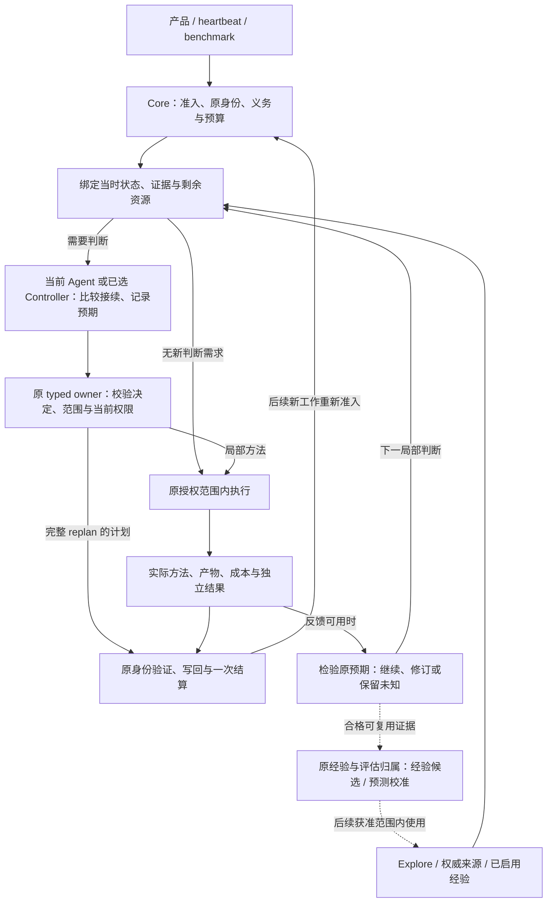

# RFC：机制收敛与经验复用闭环（v0）

- **RFC 状态：** Accepted（合并后生效；合并前是讨论提案）
- **替代 / 关闭：** 无
- **交付成熟度：** 合并后 Partial：既有源码读取链路支持普通执行关联；方法收益及剩余目标架构尚未取得资格。
- **作者 / 归属：** LoopX maintainers；源码事实由路径支持，目标架构和取舍为 AI 辅助提案，待维护者审阅确认。
- **创建日期 / 最近规范修订：** 2026-11-14 / 2026-11-15
- **实现基线：** `8d7d234c6f55fa45fa5db0ad5a156dcaaf726d32`（第 4 节的 `main` 均指此版本）。
- **语义镜像：** [English](mechanism-convergence-and-learning-loop-v0.md)
- **关联：** [总体路线](loopx-overall-roadmap-v0.zh-CN.md)、[小内核](monorepo-distribution-split-v0.zh-CN.md)、[Controller/统一契约](controller-executor-unified-contract-v0.zh-CN.md)、[Target/Yardstick/Stride](target-yardstick-stride-decisions-v0.zh-CN.md)、[研究探索](research-exploration-control-plane-v0.zh-CN.md)、[记忆效用](post-outcome-memory-utility-attribution-v0.zh-CN.md)、[Goal 契约演化](goal-contract-evolution-v0.zh-CN.md)。

## 文档地图与维护契约

第 4 节记录固定版本的实现，4.3 单列未合入工作。第 5–11 节定义拟议的收敛后结构、调用关系、迁移和组合验收；只有显式实施 checkpoint 说明已取得资格的源码行为。本文持有跨机制的组合设计，单个能力的 schema、权限、默认值和晋升门仍归原规范；涉及改变时须同步修订所属规范，不能用本文覆盖。实施证据沿原 RFC/任务及 ledger 记录，不另建路线图或执行队列。维护者须核实并确认关键设计选择；本文不推定人工贡献比例或未确认观点的归属。

## 1. 决策摘要

机制重构要改善的是：**在可比完整预算内取得更好的验收成果，或以更低完整成本交付同等成果。** 本设计以“任务状态与剩余预算 → 方法选择与事前预期 → 执行 → 反馈检验预期 → 修订后续选择”为主线。小内核解决加载与运行边界；机制收敛让这些基础设施支持更有效的方法选择。

建议采用以下结构：

1. **一条受治理执行链。** quota 保留策略与准入，统一 Turn 生命周期承接执行、验证、结算及恢复，heartbeat 保留唤醒/续跑，产品保留宿主适配。沿 C1/C4/C9 融合正常路径并退役重复实现，允许同步迁移调用方所需的内部接口变更。
2. **每个已准入工作有一个当前方法选择者。** 单会话由 Agent 判断，显式双角色 profile 由 Controller 判断。它比较在剩余预算内可完成的条件接续；Stride 定义尺度和复盘，Yardstick/Explore 提供测量与候选，Decision Context 核验所需事实，Core 校验合法性。
3. **以决策片段连接反馈。** 在有意义的判断边界，关联当时状态、预期、实际方法、成本、观察和下一决定。反馈须改变预期、候选或后续安排，或有依据地支持继续；产物、消息和回执本身不是方法收益。
4. **沿同一决策归属逐步改进策略。** 先验证当前模型的反馈采用，再校准预测，最后按证据决定是否学习价值估计或预算分配。Reward Memory 承载有范围的经验，Skill 承载合格过程，application 回执承担采用验证；它们服务于这条决策链。

本文交付目标设计，不启动实验、训练模型、发布 Skill、启用能力或改变生产默认值。关键选择为 AI 辅助提案，待维护者确认。

## 2. 问题、目标与决策模型

考虑便宜的代理评测持续改善、权威结果却不变的任务。继续搜索、先校准代理、换方法、直接权威验证，各有前置条件、耗时和后续机会。正确选择取决于当前证据与剩余预算；同一动作在不同阶段不具有固定价值。

**比较对象是可行的条件接续。** 每个候选需说明首先做什么、获得什么观察、重要结果分别如何继续，以及是否来得及完成验收。已验收产物、待返回工作、验证资源及确认时间都进入状态。数值任务比较冻结终点规则下、相对强续跑基线的预期成果；非数值任务按原验收比较可交付结果与风险，不发明统一分数。墙钟、token、工具/评测资源分别约束，准备、读取、失败和最终确认均计入预算。

因此重构需要回答：谁在什么证据下作判断；选择依赖哪项可检验预期；反馈推翻或支持了什么；下一段实际工作如何响应；同预算下是否比原接续更好。只统一执行入口不能回答这些问题，先造新模型或回执也不能替代它们。

本设计组合已有[预算规划](target-yardstick-stride-decisions-v0.zh-CN.md#budgeted-planning)与[动作价值证据](../../research/budgeted-research-planning.zh-CN.md#action-value-evidence)合同，不另建一套优化理论或决策规范。没有可靠收益估计时，保留未知，以有界区分性检查缩小关键不确定性；不能用自信的概率或即时涨分/成本比冒充最优规划。

## 3. 范围与不变量

覆盖工程与预算受限研究中的执行、方法反馈及跨任务复用。原 Goal/Agent/Todo/Turn/effect 身份、claim/lease、Stop、一次结算和验收权限保持。合法执行、成果验收、方法质量、经验效用分别判断；未知、失败、拒绝、取消和负结果保留。

固定任务的授权输入、验收结果及失败恢复边界，内部模块和接口可因融合而改变。复用的是正确的规则归属，不是冻结现有代码形状；迁移真实调用方并删除被替代的正常 producer 才完成收敛。公开契约和持久状态须有明确迁移，历史 reader 只因真实消费者保留。

不新增万能编排器、workflow DSL、全局评分、通用 episode 库或 Python 决策 owner。完整 TS 迁移、双模型、独立 Meta Model 与特定记忆 provider 均不作为首个有用反馈闭环的前置。

## 4. 当前架构盘点：按责任与真实路径划分

### 4.1 七个责任边界

下表是实现角色，不是新 capability 清单或七个待建服务。一个文件可以提供多个适配入口；是否合并取决于是否重复维护同一事实或规则。

| 责任 | 当前机制及实际归属 | 不承担什么 |
| --- | --- | --- |
| 目标与执行权威 | Goal/Vision/验收/Todo；[acceptance authority](../../../loopx/control_plane/goals/acceptance_authority.ts)、[quota decision](../../../loopx/control_plane/quota/run_decision.ts)、[lease](../../../loopx/control_plane/work_items/task_lease_acquire_decision.ts)、[effect](../../../loopx/control_plane/effect_program.ts) | 不由经验、评测分数或模型建议授予执行权。 |
| 运行与恢复 | heartbeat/scheduler、[公开 Turn](../../../loopx/cli_commands/turn_run_once.py)、[executor](../../../loopx/control_plane/turn_driver/executor.py)、[settlement](../../../loopx/control_plane/turn_driver/settlement.ts)、[纯 continuation controller](../../../loopx/control_plane/turn_driver/loop_controller.ts)；[请求/纠偏](../../../loopx/control_plane/collaboration/request_control.ts)及[返回](../../../loopx/control_plane/collaboration/return_delivery.ts)沿原身份接入 | 唤醒不是准入；进程退出不是验收；接续控制器不替模型选择方法。 |
| 上下文编排与交付 | [quota emitter](../../../loopx/cli_commands/quota.py)、[TurnEnvelope](../../../loopx/control_plane/quota/turn_envelope.ts)、Capture/Progressive/Delta/[native lifecycle](../../../loopx/control_plane/quota/native_context_lifecycle.ts)；[capability hooks](../../../loopx/control_plane/capability_hooks.py)及[贡献校验](../../../loopx/control_plane/turn_driver/capability_context.ts)绑定已选工作 | 选择内容、编码和恢复职责不同；投影不是新的事实库或方法决策者。 |
| 方法选择及其规格 | 宿主中的 Agent 作判断；[Stride](../../../loopx/control_plane/work_items/stride_policy.ts)规范尺度/复盘，[Yardstick](../../../loopx/control_plane/work_items/yardstick_decision.ts)规范局部目标/尺子/下一方法，[replan semantics](../../../loopx/control_plane/work_items/replan_semantics.ts)校验既有义务 | TS codec 不会自行研究；结构化声明不证明方法执行或目标收益。 |
| 证据、触发与事实核验 | [Explore context](../../../loopx/control_plane/capabilities/explore_turn_context.ts)及[result writeback](../../../loopx/capabilities/explore/result_writeback.py)管理 findings/measurement；[重复/周期触发](../../../loopx/control_plane/work_items/replan_history.ts)、[外部 review policy](../../../loopx/control_plane/work_items/progress_review_policy.py)形成有范围信号；[Decision Context](../../../loopx/capabilities/decision_context/README.md)、[Material Lifecycle](../../../loopx/capabilities/material_lifecycle/README.md)管理来源及核验 | 不把所有证据归一为一个分数。外部 assist 可按已启用策略形成义务，不能一概当作可忽略提示。 |
| 经验及过程复用 | [Turn Recall](../../../loopx/capabilities/agent_turn_recall/core.py)、[Reward Memory application](../../../loopx/capabilities/reward_memory/application.py)、[procedural experience](../../../loopx/capabilities/reward_memory/experience_quality.py)、[utility](../../../loopx/capabilities/reward_memory/memory_utility.py)及[reducer](../../../loopx/capabilities/reward_memory/utility_reducer.py)、[Skill delivery](../../../loopx/capabilities/project_skill_delivery/README.md) | 构造上下文、采用方法、带来收益和发布过程是不同事实；不自动改 provider 排名。 |
| 独立验证与质量 | 原任务 validator/验收、[change-quality](../../../loopx/capabilities/change_quality/README.md)、[Anti-Entropy](../../../loopx/capabilities/anti_entropy/README.md)专项 oracle | 质量通过不证明任务成功或经验有效；Anti-Entropy 不另持有 delivery receipt store。 |

### 4.2 五条已经存在的链路

1. **准入到执行。** [`build_quota_should_run`](../../../loopx/control_plane/quota/should_run.py)准备来源、组合 route/guard、构造 payload；[`live_decision.py`](../../../loopx/control_plane/quota/live_decision.py)处理原回执和重入。`turn_run_once.py`消费该决定并调用`run_loopx_turn_once`。quota CLI 仍在 capture 后分投影；[`build_loopx_turn_plan`](../../../loopx/control_plane/turn_driver/driver.py)保留当前/历史契约分支。共享准入已经存在，正常输出与执行编排尚不能统称完成收敛。
2. **复盘到后续观察。** [`autonomous_replan_obligation_from_runs`](../../../loopx/control_plane/work_items/autonomous_replan_obligation.py)让 typed repeat 优先，再按 pinned assist policy 处理外部评价，最后采用普通触发。分阶段读取及 ACK 属于该义务；`replan_semantics.ts`与[`progress_delta.ts`](../../../loopx/control_plane/work_items/progress_delta.ts)校验 Stride 及记录的语义变化，不是独立成果评测。[`decisionFollowthrough`](../../../loopx/control_plane/work_items/replan_context.ts)关联原决定、计划 Todo 和后续记录，仍明确保留`execution_and_goal_gain: unknown`。
3. **局部方法到执行记录。** `normalizeWorkYardstickDecision`已有`next_action.method_id/reason/cost_bound`和`prior_finding_id`；`projectWorkYardstickCue`已有`previous_decision_followthrough`，比较计划与执行方法。Explore 的[`execution_observation`](../../../loopx/control_plane/capabilities/explore_execution_observation.ts)已有候选摘要、实际方法、变更原因、成本及结果引用。它们是可校验的记录关联，独立验收仍需原 evaluator。
4. **外部事实到有范围的决定。** Decision Context 的[`runtime`](../../../loopx/capabilities/decision_context/runtime.py)组织来源与召回；[`review_settlement`](../../../loopx/capabilities/decision_context/review_settlement.py)对提案要求原 user-gate 事件，无提案的合法`no_change`有独立路径；[`outcome_feedback`](../../../loopx/capabilities/decision_context/outcome_feedback.py)连接后续结果。不能把这个完整审阅生命周期强加给每个普通 Turn。
5. **记忆到当前上下文。** `run_agent_turn_recall::apply_guidance`以`outcome=applied`把经验放入当前私有 context，`artifact_ref`是 situation fingerprint；代码明确把适用性判断留给 Agent。因此这里的 application 证明作用于上下文产物，单凭它不能证明宿主阅读、方法采用或真实执行。通用`apply_reward_memory_recall`已支持 caller-owned application，但其布尔声明也不能代替独立产物检查。[`turn_hooks.py`](../../../loopx/capabilities/reward_memory/turn_hooks.py)已有 recall 与结果后 ingest；当前自动结果字段是经验 reflection，不是通用的方法采用证明。

### 4.3 默认值与在途边界

[`machine_defaults.py`](../../../loopx/capabilities/todo_replan_cadence/machine_defaults.py)在 Goal 无显式 cadence override、机器配置也未覆盖时，继承每 **6 个有效工作 Turn** 复盘及`evidence_conditioned_v1` Stride。显式 off、机器设置和旧配置各保留原意；底层 schema 的 off 不是产品整体默认。Yardstick 独立默认 false；Explore 无显式/机器配置时为 off。progress-review、Reward Memory、Decision Context、Material Lifecycle 保留各自启用边界。

| 在途工作 / 核对 head | 可复用方向 | 不属于上述 main 事实 |
| --- | --- | --- |
| [C1 #8266](https://github.com/loopx-project/loopx/pull/8266) · `c3cb8b2fe7bf` | 统一 work source、capture/reader、恢复。 | 全部普通 writer/consumer 已切换。 |
| [Turn #8484](https://github.com/loopx-project/loopx/pull/8484) · `b7e4e01cc423` | 单/双角色及统一 runtime entry。 | `loopx turn run`已发布、双会话收益或默认晋升已成立。 |
| [方法算子 #8516](https://github.com/loopx-project/loopx/pull/8516) · `5afb98cf8ea8` | 五阶段组织六类 advisory 方法，复用测量与摘要。 | 算子已合入，或方法阶段可取得 Turn 执行权。 |

三个 PR 在核对时均为 OPEN。本文不借用其测试声明作为本次验证。

### 4.4 本次设计要补的组合边界

执行统一已有 C1/C4/C9 归属；Stride 已有 `next_probe` 的预测/采用条件及 `previous_review`，局部选择、执行观察和后续读回也已有实现。缺口不能一概描述为“没有闭环”。需要在真实调用方上核对：当时的预期是否进入工作、反馈是否检验它、下一决定是否消费结果，以及重复解释是否仍由多个模块维护。

因此本文以方法决策反馈为核心，给出组合顺序、结构迁移及策略演进。上下文 application 与实际决策的关联是其中一个验证接缝，不是统一决策模型，也不是必须先建的新基础设施。源码存在、模型实际采用和同预算收益各需独立证据。

## 5. 收敛后的目标设计（AI 提案，待维护者确认）

### 5.1 执行、方法反馈与经验复用如何协作

这是目标调用关系，不声称统一入口或校准模型已交付。本任务状态由原工作/证据记录保持，当前反馈不经长期记忆绕一圈。可复用证据仍须经过原结果核验、启用条件及授权；图中虚线不触发自动训练或发布。

当前判断在既有模型回复中完成，不增固定的评估会话。局部反馈不新建 Turn 或重复扣工作配额，模型/工具耗费仍计原预算。完整 replan 写计划并结算原工作，新工作重新准入。无相关变化时按原工作继续；到期义务仍须完成。

当前选择者沿 session/attempt 绑定。双角色的 Worker 观察返回原 Controller；多 Agent 沿请求、接收方采用及结果返回契约协作。需要直接检查产物时使用同一获准工作环境和原工具，不能仅凭 Worker 摘要认定采用，也不因共享工作区新增未协调写入方。

### 5.2 一次方法判断需要什么

下表是已有记录间的语义关系，不是新增万能 packet 或每 Turn 表单。详细规划与因果证据规则沿原联合 RFC。

| 内容 | 归属、记录与消费者 |
| --- | --- |
| 目标与可执行范围 | 原 Goal 验收、work source/capture、Todo、lease、预算和停止条件。Core 决定可做什么，方法建议不能覆盖。 |
| 当时状态 | Explore 的候选/有效产物、测量范围、前提与反证、待返回结果、剩余资源和确认窗口；绑定版本及当时可见时间，缺失项显式保留。 |
| 少量可行接续 | 当前选择者比较具体方法及前置、观察、重要分支和终点确认；继续原路线也是候选。`grow/switch/verify` 标签本身不是一个完整处理。 |
| 选择前的预期 | 原 Stride `next_probe` 或局部 reasoning/finding 保存关键预测、依据/范围、成本界限及什么结果会改变下一步；细节沿引用读取，不挤进受限短字段或虚构精确概率。 |
| 选择 | Yardstick 已启用时沿 `work_yardstick_decision` 的 `next_action`；其他情况沿原任务/路径记录。完整复盘沿 Stride/Vision，吸收同一证据，不重复维护局部计划或自动启用 Yardstick。 |
| 实际工作与反馈 | 原 `execution_observation`、测量及独立 validator 记录实际方法、候选、偏离、成本、结果和可用时刻；后续读回对照原预期，不能由计划补造执行。 |
| 下一决定与终点 | 原 `previous_review`、followthrough 和 findings 说明哪项预期被支持/推翻、实际如何继续；关联冻结期限/规则下的终局结果，延迟收益不全归最后动作。 |

上下文编排按原身份/revision 去重，保留不同证据语义；既有 typed owner 校验结构与归属，当前模型负责方法判断。Python 保留必要 IO/适配，不复制语义规则。历史没有事前预测时记为缺失，不能用事后解释补写。

### 5.3 从触发到反馈的完整顺序

1. **确定工作与义务。** Core 处理准入、拒绝、wait、Stop 及原身份恢复。新相关 finding、预期被推翻、资源/来源变化或 probe 到边界可引起局部重估；局部选择不能解除完整 replan 义务。
2. **组织当时可用证据。** Explore 维护测量与候选来源；Decision Context 仅对已配置需求核验事实，正式提案仍走自身审阅。权威/代理测量和历史经验按各自问题比较；不可比范围分开，依赖缺失权限事实的操作按原 gate 处理。
3. **比较完整接续并留下预期。** 当前选择者考虑前置工作、信息价值、候选改进和最终确认，选择一个可行的首段及后续条件。短期没有涨分的探针可能有价值，但必须说明它将改变什么后续判断；确认来不及时不能把未验收候选算作成果。
4. **校验并执行首个连贯切片。** 原 owner 校验引用/范围，effectful 操作重查当前权限。方法或数据失效就重读/重估；实际方法偏离计划时记录原因。保留有效产物和完整开销，不为了匹配计划忽略反证。
5. **用结果检验原预期。** 对照精确候选、workload、评测器及时间窗。结果支持预期时可继续；反证改变候选、适用范围、验证顺序或投入；迟到结果归原实验，pending/失败/取消不伪造成零收益。下一决定只使用当时已可见证据。
6. **分开结算与策略评价。** 原验收决定成果及一次结算。换方法后的上涨不证明优于继续原路线；匹配接续比较和新任务评价由原实验 owner 承担。评估失败保留未知，不阻塞已完成成果或重开执行；回放只恢复原记录与关联，不重新工作/扣额。

跨范围修改目标、验收或预算仍沿原 Goal/Vision/authority 流程；反馈只提供修改理由，不授予修改权限。

### 5.4 两个反馈时间尺度与策略演进

本任务的反馈直接进入下一方法选择；跨任务改进则要把条件、预期、观察及局限转成可复用知识。沿已有[动作价值证据](../../research/budgeted-research-planning.zh-CN.md#action-value-evidence)分阶段推进：

| 阶段 | 如何影响下一选择 | 代价与资格 |
| --- | --- | --- |
| 当前模型利用反馈 | 依据新证据调整候选、验证顺序、投入或有据继续；复用现有回复和决策记录。 | 首先验证真实后续工作采用，再比较匹配预算成果；不以新模型/字段为前置。 |
| 校准可核验预测 | 用事前预测与对应结果修正耗时、探针结果、确认可行性及收益范围；范围不匹配时保留未知。 | 需要覆盖、缺失处理和按任务/来源运行隔离的留出数据；校准更准不自动证明选择更好。 |
| 学习价值估计或预算分配 | 可选 Meta Model 估计给定状态、剩余预算、具体行动及后续策略的终局价值，供原选择者比较。 | 增加数据、训练/推理、版本维护与分布变化成本；须有行为覆盖、匹配比较及冻结策略后的新任务评价，权限/验收仍归 Core。 |

单条轨迹不是未选行动的反事实标签；相邻片段与共享前缀不能冒充独立样本。未来结果不得进入决策时特征。先验证成本较低的当前模型方案，再按观察到的预测误差及成果/成本决定后续阶段是否值得投入；记录可诊断不等于获准训练。

**经验和过程是载体。** Reward Memory 沿 `procedural_experience_contract_v0` 保存适用条件、观测、归因限制和 `future_behavior.trigger/action/validation/stop_condition`；原 validator 核验精确 reflection/证据后才按启用策略摄入。后续召回先核对当前条件，再采用、忽略或反驳。稳定过程可成为 Skill 候选，发布/安装/激活各沿原权限；经验不充当当前工作状态或自动改 provider 排名。

**采用验证是可选接缝。** 先从已有决定、执行与结果引用核实经验如何被使用。仅当具体 caller 无法关联原 recall 与决策时，再考虑 `reward_memory/turn_hooks.py` 中可选的 `reward_memory_application_json`：引用原召回集、实际决定版本和判断，由原 application owner 独立检查产物，生成命名空间独立、按原 recall 与决定版本幂等的回执。typed 边界校验身份/结构，Python 只作 IO/适配，原 Turn journal 保留结果，不新建队列。

旧 context-applied 继续只描述上下文产物。缺失原 recall、错工作/版本、撤销来源、仅自报核验都不能补成采用；新查询不能冒充原召回。注册字段受原预算约束，无相关判断时严格宿主返回空字符串；旧宿主/未注册字段不强填。一个回执仅覆盖所检查的决定版本，不证明内部因果、实际执行或 helpful；这些仍需后续工作及归因证据。字段名/版本留给具体 caller 与原规范共同确认，**不作为首个反馈闭环的必选交付**。

### 5.5 结构融合、代码落点与退役条件

| 变化 | 现有落点与目标责任 | 融合完成的证据 |
| --- | --- | --- |
| 普通执行与恢复 | `quota.py::_publish_quota_result`、`quota/cli_projection.py`、`turn_driver/driver.py::build_loopx_turn_plan` 及 heartbeat 调用方沿 C1/C4/C9 进入同一生命周期。 | 一处维护共同准入后规则及结果写回；调用方已迁移，重复正常 writer/失败解释器退役，历史 reader 有明确消费者。 |
| 一次方法判断的输入 | `explore/turn_context.py`、`work_items/replan_context.ts`、`yardstick_decision.ts` 及 capability hooks 交付同源、当时可见的证据。 | 重复读取/范围解释归同一 typed owner；没有各自产生竞争 next action 的能力链，也不把 Decision Context 变成总入口。 |
| 预期、执行与下一决定 | `stride_policy.ts`、`explore/result_writeback.py`、`explore_execution_observation.ts`、`projectWorkYardstickCue`、`decisionFollowthrough`。 | 真实 caller 可追踪预期、实际方法、结果与下一工作；修复缺失 producer/consumer 后删除被替代的摘要重建或平行判断，不只增加字段。 |
| 跨任务知识与校准 | Reward Memory 的 `experience_quality.py`、`turn_hooks.py`、`application.py`、`memory_utility.py`；预测评价沿原研究实验与 Target/Stride 归属。 | 经验引用、预测校准、策略收益分别有消费者和证据；按需补关联，不把 recall、utility reducer 或 Core 变成新策略调度器。 |
| 产品回读 | 既有 Goal 工作区、工作详情、研究历史及 CLI。 | 可沿原记录看清当时依据、预期、反馈、下一实际工作及未知；改变交互时验证 App/CLI 和受支持 Lark。 |

允许为这个终态重塑内部 API，并同步迁移真实调用方；不为保留旧代码而永久加 adapter。独立演进的规则仍分别负责。临时共存必须写明调用方、退出条件和恢复用途；完成时修改共同规则只有一个 owner。#8516 的在途原语先按其自身审阅与合入边界处理，不复制另一份实现或预建“机制组合器”。

### 5.6 完整场景：预算改变，方法也应改变

以下时间均为**合成设计假设**，不是实测成本。已有有效 incumbent；新候选代理更好，但权威结果不变。剩余预算 90 分钟，最终确认预计需 25 分钟，读取/控制/恢复另留 20 分钟。

| 边界 | 判断、执行及原记录 |
| --- | --- |
| 状态与候选 | 保留相同候选/workload/revision 的测量和有效 incumbent。方案 A 用 45 分钟继续调参；方案 B 先用 15 分钟做区分性检查，再留 30 分钟按结果修复或换路。两者均另留确认及其他开销。 |
| 事前预期 | B 只在检查能影响后续选择时值得其成本：若尾部约束反例成立，停止扩大该代理上的搜索；若没有该反例，保留原路线并缩小不确定范围。把预期和条件留在原 `next_probe`/finding，不能事后补写。 |
| 选择与执行 | 示例选择 B，按原权限执行；记录实际方法、候选、耗时和偏离。若耗时超出预估，立即按剩余确认窗口重估，不借新 Turn 延长期限。 |
| 反馈改变下一工作 | 假设检查发现尾部反例。该结果推翻“可以直接扩大调参”的前提；下一实际工作转向修复该约束，并修订代理适用范围。仅写“已反思”不能完成这一步。 |
| 确认与终点 | 假设修复后的产物通过检查，但权威分数与 incumbent 相同；按冻结规则保留有效结果，记录全成本及未改善。不能据此宣称 B 优于 A，A 的反事实仍未知。 |
| 同状态、不同预算 | 若起初只剩 20 分钟，预计 25 分钟的确认来不及；不得照搬 B 或把未确认候选替换成成果。保留已验收产物，仅做仍可行的获准工作，或按原停止条件结束。 |
| 下一任务与校准 | 合格经验携带该尾部条件及反例，适用的新任务可提前验证；对应事前耗时/结果预测用于其范围内校准，任务选择仍比较剩余预算和替代路线。Skill 或 Meta Model 并非此步前置。 |
| 判断策略是否更好 | 沿原 pilot 对恢复等价的起点做匹配接续，后续按冻结策略评估新任务。比较终局成果与完整成本，保留失败；本例只说明反馈如何改变工作。 |

## 6. 备选方案、参照与主要代价

| 方案 | 取舍与选择 |
| --- | --- |
| 只统一执行入口，或只增加记忆/回执 | 分别改善运行一致性或可追踪性，不能单独说明预期如何被反馈校正；作为具体接缝按需实施。 |
| 当前会话内完成方法反馈，再逐步校准 | **推荐。** 复用已授权会话、模型回复和原记录，先验证真实选择变化；额外成本是有界读取、判断、验证与关联维护。 |
| 立即新增独立 Controller、Meta Model 或全量训练库 | 可研究独立判断/价值预测，但增加调用、数据/模型维护、部署与恢复成本；仅在前阶段证据及原授权支持时推进。 |
| 保留所有旧路径并包统一门面 | 迁移初期成本低，但重复规则、测试和兼容负担持续增长；只允许有退出条件的过渡，不作为目标。 |

初始规模是单 Agent 工程或预算受限研究，再沿原 peer 合同验证接收方采用。无新相关判断时，相对原配置不增加模型调用、强制记录或远程评估；原 recall 保留既有启用策略。反馈在原回复中判断，不每个工具调用追加反思。来源变化或证据到达后的重估仍消耗原预算。

分开计量准入/交付、判断、执行/验证及后续经验/校准的延迟、token、工具/provider 调用、存储与人工介入；关注 p50/p95 和完整覆盖，未知不记零。复用版本化来源、有界视图和去重，不全历史重读、不每字段 RPC、不预加载全部能力。引入预测模型前需证明收益覆盖训练/推理、评估、分布变化维护及部署门槛；当前设计不要求新服务或模型依赖。

[预算研究说明](../../research/budgeted-research-planning.zh-CN.md)提供目标、理论条件与逐步学习依据；[Controller RFC](controller-executor-unified-contract-v0.zh-CN.md)持有执行融合。外部参照中，[LangGraph persistence](https://docs.langchain.com/oss/python/langgraph/persistence)支持恢复状态与跨任务经验分离，[Voyager](https://voyager.minedojo.org/)启发环境反馈与合格过程复用。这些映射是设计推论，不证明 LoopX 收益；云端隔离、计量及运维仍沿原 authority/quota 合同。本文没有新增性能或收益实测。

## 7. 安全、隐私与兼容

公开投影只保留必要事实、opaque 引用和 scope；原始聊天、轨迹、凭据、provider 正文及私有路径留在原边界。跨 Goal/Agent/corpus/revision 不自动合并，经验的撤销、过期和反例必须可读。

既有 context application 回执保持其产物含义；若具体 caller 增加决策关联，不能回填或重解释旧记录。可选字段只在合格 opt-in caller 注册，缺失不等于未采用或失败；不支持该字段的旧宿主不宣称具备对应关联证据。现有有副作用的 operation、严格 schema 校验及独立部署消费者仍各守原兼容要求。

可选建议失效保留原 fail-open 行为；不能吞掉权限、硬门、验收或原复盘义务。需要 authority 核验的操作缺证据时按原 owner 处理，不以 provider 不可用绕过它。

## 8. 迁移与回退

固定 base/head、真实 caller、旧义务及证据，复用同条件结果。先沿现有单会话决策路径选一个真实反馈需求，贯通事前预期、实际工作、反馈与下一判断；同时定位重复规则和缺失消费者。执行融合沿 C1/C4/C9 迁移 producer、consumer 与恢复，再退休旧正常分支；两条工作只按真实依赖排序，不互相等待全部完成。

接口改变时同步迁移调用方，保留公开/持久格式的明确兼容读回。为新准入选择已验收 profile；待处理 attempt 按原身份、Host 和回执恢复，不换 session 掩盖未知。可选记忆/校准失效回到原合法判断，禁用新增消费者只停止未来采用关联，不能撤销成果、改写预测/负结果或重复工作/扣额。后续模型更新须按原版本评价与晋升，不因召回一条成功经验自动推广。

## 9. 组合验证与验收

验证跨 owner 的真实行为，单模块细则仍沿原规范。先证明反馈改变实际工作，再分别证明预测质量和策略收益。

| 场景 | 组合必须证明的结果 |
| --- | --- |
| 相同工作跨入口 | 普通、wait、replan、Stop、中断/重放保持原义务、身份、一次结算和无重复宿主执行；迁移后共同规则只改一处，native/plain 对照保留。 |
| 预算或证据改变 | 相同状态但剩余预算不同，选择与确认计划重新判断；关键预期被推翻时有真实工作响应，支持原路线时允许有据继续。 |
| 多信号与可选能力 | 原触发/解除规则保留，完整复盘吸收局部证据；无新强制 Controller、全局 user gate 或逐工具反思。 |
| 过时、矛盾、迟到与未知 | 拒绝错范围/版本关联；预测先于结果且修订留历史，迟到证据归原实验，pending 不填零，未来事实不回填。 |
| 决策与真实执行 | 原决定、方法/候选、成本、独立结果和下一决定相互对应；声明、改名、上下文注入不能替代采用。若扩展 application，另验证原召回集与实际决定版本。 |
| 跨任务复用与学习 | 原证据及适用条件可追踪；拒绝撤销/过期/错 scope，保留反例。按任务/来源运行隔离评价，未选动作结果未知，记录不自动授权训练。 |
| 关闭、故障、旧宿主与恢复 | 原合法工作和义务保持，无新增必需字段或评估调用；回放不重写旧预测、不双写/双扣；旧 context-applied 的方法采用仍未知。 |
| 效用与过程发布 | 预测校准、经验采用、同预算策略收益分别报告；成功不自动等于 helpful，Skill 的验证/发布/安装/激活分别读回。 |

实现先在隔离 File/SQLite 真实入口验收，涉及其他 backend 时执行其原必需资格。产品回读覆盖当前依据、原预期、负反馈、下一工作及未知，通过 App/CLI 和受影响 Lark 验证；语义测试不证明收益。

效果验证复用[既有 pilot 与决策片段验收](long-horizon-harness-benchmark-research-program-v0.zh-CN.md#action-value-episode)，冻结 task/model、预算/起点、可见信息、时间窗、分组与分析。分别改变执行拓扑、反馈指导或学习策略；保留强续跑对照、失败和完整成本。预测校准、同 checkpoint 接续差异、冻结后新任务收益分别判断；一题成功、token 下降或回执增长均不能替代它们。本 RFC 未运行这些实验。

## 10. 成功标准

**结构：** 共同规则一处维护，真实调用方已迁移，重复正常 producer 退役。**行为：** 事前预期、执行、反馈和下一工作对应，支持/反证均能被使用，恢复不破坏原身份。**结果：** 可比完整预算下验收成果更好，或同等成果的完整成本更低。结构正确、证据完整与预测更准都不单独证明策略收益。

## 11. 最小完整交付与演进顺序

| 切片 | 具体交付 / 原归属 | 退出证据 |
| --- | --- | --- |
| 本 RFC | 以预算内方法反馈组织目标、职责、调用、融合与学习路径。 | 源码/提案/在途分开，完整例子能解释为什么选择以及反馈如何改变下一步。 |
| 首个真实方法反馈闭环 | Target/Stride/Explore owner 在具名任务中贯通状态、预期、首段执行、结果与下一判断。 | 用既有模型/记录读回实际采用，包含反证或有据继续；一次补齐实际缺失的 producer/consumer，不以新模型、回执或框架为前置。 |
| 匹配成果与预测校准 | 原研究实验 owner 先按既有 pilot 比较完整预算成果；有合格事前预测时分别检验耗时/结果等子预测。 | 冻结条件、缺失处理与留出边界；没有收益证据时改进方案，不把更准的预测称作更好的分配。 |
| 有证据支持的跨任务改进 | Reward Memory 传递条件性经验，原策略 owner 决定是否采用校准/学习值；Skill 另行资格化。 | 新任务中的真实选择、执行与结果，包含失配/反例/撤销及完整成本；application 扩展仅为缺失关联的 caller 实施。 |
| 执行融合 | C1/C4/C9、#8266/#8484 迁移入口、结果及恢复。 | 对照原单会话的语义、成果/成本和恢复；删除重复正常路径，双角色独立验收。 |

**源码 checkpoint：普通执行关联（2026-11-15）。** 既有
[`work Yardstick 读取模块`](../../../loopx/control_plane/work_items/yardstick_decision.ts)
直接消费 confirmed 的普通执行 finding，无需重复声明决策。复用 canonical 历史
排序和既有测量工作窗口规则，保留原选择，并在下一选择后关联此前执行。
既有 Explore 适配器只向显式启用的工作读取模块补充缺失来源序号；公开历史及
关闭状态保留原 wire。[File/SQLite CLI 回归](../../../tests/control_plane/test_work_yardstick_cli.py)
覆盖原省略失败、独立候选回读、后续选择、重放及关闭；typed 检查拒绝其他归属、
tentative、过时和迟到证据的错误关联。这只取得源码传输和记录关联资格，尚不证明
当前模型采用、预测校准、跨任务收益或可比预算下的效果提升。对应要求与
C1/C4/C9 集成继续开放；没有新增决策 owner、执行入口、schema 或默认启用。

首个任务须确有反馈或方法选择需求。已有链完整时直接复用；有缺口时由真实消费者证明并修复，不为配合示例制造失败。运行实验、训练模型和发布过程各沿原权限，本文不占用其他 lane 配额或预设 PR 数。

## 12. 待确认的关键选择

主线建议是当前会话内的方法反馈与真实结构融合；细则沿所属规范，关键设计仍需维护者核实，不把 AI 补充写成个人既有观点。

| 选择 | 推荐及理由 | 决策时点 |
| --- | --- | --- |
| 第一阶段策略与任务 | 使用当前模型，在已有证据分歧或预算取舍任务上完成 §5 的闭环，沿现有 pilot 验证。 | 实施前确认实际 caller、验收和预算；不先建 Meta Model。 |
| 内部融合与兼容 | 允许必要的内部接口重塑，同步迁移调用方；明确旧 producer 退役及公开/持久状态迁移。 | 各实施切片确认真实消费者与恢复条件，不把永久双路径当终态。 |
| 进一步学习与采用协议 | 先看行为、成果与数据覆盖证据，再决定校准/学习是否值得成本；原记录确实不足时才定 application 字段/版本。 | 原策略/Reward Memory 规范同步变更，确认独立验证、训练/推理预算和晋升条件。 |
