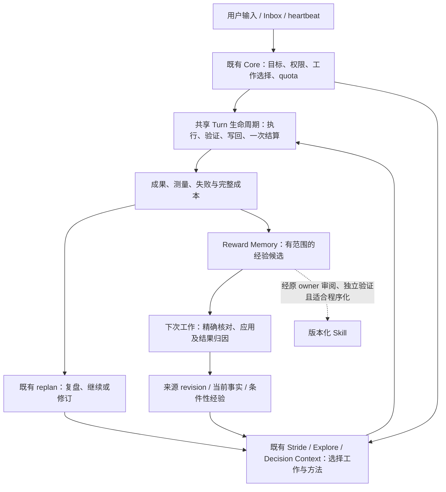

# RFC：机制收敛与经验复用闭环（v0）

- **RFC 状态：** Accepted（合并后生效；合并前是讨论提案）
- **替代 / 关闭：** 无
- **交付成熟度：** Proposal；本文只交付源码盘点与设计，不改变运行行为。
- **作者 / 归属：** LoopX maintainers；AI 辅助盘点和方案，关键选择待维护者确认。
- **创建日期 / 最近规范修订：** 2026-11-14
- **实现基线：** `bd2718a485c86fe4f0ad4d1356fe9aeeccfed1ba`（下文 `main` 均指此版本）。
- **语义镜像：** [English](mechanism-convergence-and-learning-loop-v0.md)
- **关联：** [总体路线](loopx-overall-roadmap-v0.zh-CN.md)、[小内核](monorepo-distribution-split-v0.zh-CN.md)、[Controller/统一契约](controller-executor-unified-contract-v0.zh-CN.md)、[Target/Yardstick/Stride](target-yardstick-stride-decisions-v0.zh-CN.md)、[研究探索](research-exploration-control-plane-v0.zh-CN.md)、[记忆效用](post-outcome-memory-utility-attribution-v0.zh-CN.md)。

## 文档地图与维护契约

第 4 节是固定源码版本上的事实，4.3 单列尚未合入的工作。其余正文是本提案的设计、取舍和验收，不能当作已实现或已确认的产品决定。第 12 节保留待决选择。本文不修改关联 RFC 的既有权限、默认值或晋升条件，不建立第二份路线图或执行队列。后续实现证据沿用所属 RFC/任务，历史记录进入 ledger。

## 1. 决策摘要

建议把“机制打磨”定义为：**减少同一决策的重复生产、传输和解释，使已验证反馈能进入后续选择，并证明采用后的结果。** 小内核解决加载、依赖和运行边界；这项工作解决在这些边界内如何作出更有效的选择。两者可以分别交付。

1. **执行路径收敛。** 沿现有 Controller C1/C4/C9 合并普通 quota、Turn 和 heartbeat 的重复契约及执行编排。quota 保留预算、准入和观察；heartbeat 保留唤醒；Turn 承担受治理工作生命周期。统一入口仍是在途设计。
2. **方法组合共用证据和接缝。** Target、Yardstick、Stride、Explore 和 progress-review 保留各自回答的问题；复用现有 replan obligation、上下文、测量及结果写回。不同信号不压成一个“进展分”。
3. **复用现有反馈链。** 把本次证据、决策、后续执行、结果、经验及下次应用按原身份连接，先用现有投影暴露断点。现有链路已经有部分实现；缺少的是组合采用与收益资格，不能声称要从零建闭环。
4. **按真实决策触发。** 没有新决策或新证据的普通 Turn 不增加模型调用、人工确认或必填记录。复盘可以有依据地继续原方向；成功经历也不必都变成 Skill。

本 RFC 不批准实现、运行实验、启用能力、发布 Skill 或改变生产默认值。

## 2. 问题与动机

用户需要的是在相同资源约束下更好的可验收成果，以及更少的重复研究和人工介入。机制数量、回执数量、记录已读和架构层次都不能代替这些结果。

三个具体问题决定重构范围：

- **执行问题：** 相同工作从 heartbeat 或 Turn 进入，仍需处理不同 packet、结果和恢复入口；公共决策被调用方重新解释时容易分叉。
- **选择问题：** 测试持续通过、代理指标持续变好，实际验收却没有改善。重复检测、外部评估、fidelity 和 Stride 分别发现不同问题，不能仅凭名字相似删除。
- **复用问题：** 本次已经找到更好的方法，但下次可能只召回一段总结，没有核对适用条件、采用到实际工作或关联后续结果。保存轨迹只是起点。

因此先问“哪个决定由谁负责，哪些证据真的进入了它”，再决定删除什么。新增一个统一框架会增加依赖、协议和维护成本，必须先证明现有 owner 不够用。

### 不变量

合法执行、成果验收、方法质量和经验效用分别判断；建议和记忆不能授予权限。原 Goal/Agent/Todo/Turn/effect 身份、claim/lease、Stop 和一次结算保持。事实、声明、采用和因果收益分别呈现；负结果及未知值保留。每项删除须找到实际消费者和恢复路径，不能以迁移代码行数宣称完成。

## 3. 范围

盘点影响持续执行、选择、反馈和经验复用的机制，给出替代/合并关系、现有 owner 和最小验证切片。包括工程和研究工作；数值评测不是所有任务的前提。

不新建机制管理器、workflow DSL、全局分数、事件总库或 Python 决策 owner；不把完整 TS 迁移、双模型、云端团队或特定记忆 provider 设为前置条件。多 Agent 沿原请求、接收方采用与结果返回契约验证。

## 4. 当前系统契约：有哪些机制

“已有”表示代码路径存在，不表示所有宿主、产品旅程或长程收益已资格确认。下表按决定划分，不能按行数计算 capability 数量。

### 4.1 执行、上下文和恢复

| 机制 | 当前负责什么 / 源码 | 关系判断 |
| --- | --- | --- |
| Goal / Vision / acceptance / Todo | 目标、路径、待办和验收分别有 owner；[Goal owner](../../../loopx/control_plane/goals/acceptance_authority.ts)、[interaction contract](../../../loopx/control_plane/work_items/interaction_contract.ts) | 关联使用；研究的局部 Target 不能替代原验收。 |
| Claim / lease / effect / authority store | 所有权、并发围栏和幂等副作用；[lease](../../../loopx/control_plane/work_items/task_lease_acquire_decision.ts)、[Effect](../../../loopx/control_plane/effect_program.ts) | 是执行基础，不能被 controller 建议或经验替代。 |
| Quota / should-run | 读取状态、准备工作、组合准入与恢复；[should_run.py](../../../loopx/control_plane/quota/should_run.py)、[run_decision.ts](../../../loopx/control_plane/quota/run_decision.ts) | Turn 已复用它；并非两套独立预算引擎。 |
| Heartbeat / scheduler / automatic cadence | 唤醒、触发条件、启动间隔及观察；[task body](../../../loopx/control_plane/heartbeat/task_body.py)、[cadence](../../../loopx/control_plane/quota/automation_cadence.ts) | 可收敛公共生命周期；时间到期不等于有执行权限。 |
| Public Turn / host adapter / settlement | 一次有界执行、独立验证、写回和结算；[run-once](../../../loopx/cli_commands/turn_run_once.py)、[executor](../../../loopx/control_plane/turn_driver/executor.py)、[settlement](../../../loopx/control_plane/turn_driver/settlement.ts) | 与 heartbeat 存在待替换的普通路径；原生会话差异保留在 adapter。 |
| Turn Loop Controller | 从合格回执和新鲜决定产生 disposition；[loop_controller.ts](../../../loopx/control_plane/turn_driver/loop_controller.ts) | 确定性接续判断，不是模型 Controller 会话。 |
| Quota packet / TurnEnvelope / work context | 相同准入源的不同投影、执行义务和精确上下文；[quota emitter](../../../loopx/cli_commands/quota.py)、[envelope](../../../loopx/control_plane/quota/turn_envelope.ts) | 重复正常 producer/解释分支是替代候选；诊断视图和历史 decoder 另论。 |
| Capture / Progressive / Delta / history working set | 保存来源、按需交付、差分传输和历史可恢复性；[native lifecycle](../../../loopx/control_plane/quota/native_context_lifecycle.ts)、[Progressive](../../../loopx/control_plane/quota/progressive_context.ts) | 共用管线，语义不同：选什么、如何编码、如何恢复不相互替代。 |
| Request / Inbox / peer handoff / return | 纠偏、请求修订、接收方工作和原受众返回；[request_control](../../../loopx/control_plane/collaboration/request_control.ts)、[return_delivery](../../../loopx/control_plane/collaboration/return_delivery.ts) | Controller 复用既有链；送达不等于接收方采用。 |

### 4.2 判断、验证与经验

| 机制 | 当前负责什么 / 源码 | 关系判断 |
| --- | --- | --- |
| Progress observation / semantic delta | 记录有类型的进展，验证可接受的语义变化；[progress_delta.ts](../../../loopx/control_plane/work_items/progress_delta.ts)、[replan_semantics.ts](../../../loopx/control_plane/work_items/replan_semantics.ts) | 合法写回判断，不是独立成果评测。 |
| Repeat/stall fuse / periodic review / monitor repeat | 从已记录工作发现重复、停滞和复盘到期；[replan_history.ts](../../../loopx/control_plane/work_items/replan_history.ts) | 多个触发器已共用 obligation；保留触发依据和不同盲点。 |
| External progress-review | 消费绑定版本的外部评估回执；shadow 只观察，assist 可形成既有 obligation；[policy](../../../loopx/control_plane/work_items/progress_review_policy.py) | 与 typed repeat 互补，默认 off；不是第二套重规划器。 |
| Autonomous replan / staged read / ACK | 组合义务、分阶段读取并验证解除；[obligation](../../../loopx/control_plane/work_items/autonomous_replan_obligation.py)、[semantics](../../../loopx/control_plane/work_items/replan_semantics.ts) | “分阶段交付”属于同一决策流程，不另建策略 owner。 |
| Stride / previous review / followthrough | 选择工作规模、方法变化、验证范围，审视前次采用；[stride_policy](../../../loopx/control_plane/work_items/stride_policy.ts)、[replan_context](../../../loopx/control_plane/work_items/replan_context.ts) | 已有局部反馈链；不能把增加复盘次数当作扩大有效工作。 |
| Target / Yardstick | 绑定任务目标、权威/代理测量、反证和下一方法；[yardstick_decision.ts](../../../loopx/control_plane/work_items/yardstick_decision.ts) | 与 Stride 组合，不能把代理分数当验收。 |
| Explore graph / findings / harness planning | 管理问题、发现、测量、覆盖和候选规划；[turn context](../../../loopx/control_plane/capabilities/explore_turn_context.ts)、[result writeback](../../../loopx/capabilities/explore/result_writeback.py) | 提供研究证据及建议；Todo/quota 仍负责实际执行。 |
| Decision Context | 按来源 revision 扫描、精确阅读、冲突处理和 proposal/review/outcome；[runtime](../../../loopx/capabilities/decision_context/runtime.py)、[contract](../../../loopx/capabilities/decision_context/README.md) | 共用事实读取原语；不是所有 Turn 都必须经过的全局裁决器。 |
| Material Lifecycle / authority registry | 材料版本、清单、排名、迁移与回滚；[material contract](../../../loopx/capabilities/material_lifecycle/README.md) | 可向 Decision Context/Explore 供源；材料排名不能替代工作选择或经验效用。 |
| Agent Turn Recall | 用已选择工作构造情境和查询；[contract](../../../loopx/capabilities/agent_turn_recall/README.md) | Reward Memory 的入口适配器，共用 corpus/provider，不另建记忆库。 |
| Reward Memory / procedural experience | 有范围的候选、激活、召回、当前产物核对和应用；[application.py](../../../loopx/capabilities/reward_memory/application.py) | 经验是条件性指导；工作状态、硬规则和软偏好不能混成一种记忆。 |
| Post-outcome utility | 把应用回执与后续结果关联，验证归因并归约；[memory_utility.py](../../../loopx/capabilities/reward_memory/memory_utility.py)、[reducer](../../../loopx/capabilities/reward_memory/utility_reducer.py) | 已有实现接缝；applied 与 helpful 分开，不能从成功自动推断效用。 |
| Skill / project skill delivery | 分发版本化流程及其支持文件；[delivery contract](../../../loopx/capabilities/project_skill_delivery/README.md) | 是可复用过程的交付形式；分发机制不证明自动学习、适用性或收益。 |
| Anti-Entropy / change-quality / task validation | 退役验证、最终 diff 质量资格与任务成果验证；[Anti-Entropy](../../../loopx/capabilities/anti_entropy/README.md)、[change-quality](../../../loopx/capabilities/change_quality/README.md) | 专项 oracle 可组合；删了代码、质量通过、任务成功仍是不同结论。 |

### 4.3 调用链、默认值和在途边界

已核对的真实路径是：`build_quota_should_run` 先准备来源、组合 route/guard，再构造 payload；`resolveQuotaRunDecision` 负责一组类型化准入判断。`live_decision.py` 还处理原回执绑定及重入。`turn_run_once.py` 使用 quota 决定并进入 `run_loopx_turn_once`，不是新建预算系统；quota CLI 仍先 capture、再做 CLI/native 投影，Turn plan 保留 current/历史 envelope 分支。

重复检测、周期复盘与外部 progress-review 已在 `autonomous_replan_obligation.py` 合流；typed repeat 优先。`replan_semantics.ts` 已复用 Stride 和 progress delta。`replan_context.ts::decisionFollowthrough` 已连接前次决策、计划 Todo 与后续记录。这些共享边界应复用，不能重新计作待建基础设施。

默认值要沿继承链核对：[`machine_defaults.py`](../../../loopx/capabilities/todo_replan_cadence/machine_defaults.py) 在机器配置也未覆盖时，为无显式 cadence override 的 Goal 默认继承每 **6 个有效工作 Turn** 复盘、`evidence_conditioned_v1` Stride；机器配置、显式 off 和旧配置保持各自含义。底层 Stride schema 的 `off` 不是完整产品默认。Yardstick 独立默认 false；Explore 缺少显式/机器配置时为 off。progress-review、Reward Memory、Decision Context 和 Material Lifecycle 的可选行为各有原启用边界，不能因本文组合而自动激活。

以下工作在审计时仍 **OPEN**，不属于本节 main 事实，也不引用其测试声明作为本文验证：

| 在途工作 / 核对 head | 可借鉴之处 | 不能提前宣称 |
| --- | --- | --- |
| [C1 #8266](https://github.com/loopx-project/loopx/pull/8266) · `2a863df8e7af` | 一个 work source、capture/reader 和恢复契约。 | 全部普通 writer/consumer 已切换。 |
| [Turn 角色/入口 #8484](https://github.com/loopx-project/loopx/pull/8484) · `b7e4e01cc423` | 单 Worker/双角色复用准入和结算；提议 heartbeat、产品、benchmark 共用运行入口。 | `loopx turn run` 已发布、双会话反馈普遍有效或可替换默认。 |
| [方法算子 #8516](https://github.com/loopx-project/loopx/pull/8516) · `5afb98cf8ea8` | 五阶段组织六类方法，共用测量/摘要原语。五阶段是方法合同，六算子仍 advisory。 | 已合入 main，或与 Turn 生命周期同名即可共用执行权。 |

## 5. 提议架构与合并决策

### 5.1 一个执行生命周期，多种有范围的判断

图中的决策与准入仍遵守实际调用顺序和各自权限；它不是新运行图、并行任务授权或新增阶段门。

### 5.2 哪些替代、哪些合并、哪些保留

| 对象 | 建议 | 为什么 / 退役边界 |
| --- | --- | --- |
| 普通 quota 执行 packet 与 Turn 契约、重复结果/恢复编排 | **替代关系：沿 C1/C4/C9 收敛正常路径。** | 相同工作不应有两个语义 producer；先迁消费者及原回执恢复，再删分支。quota policy、外层唤醒、原生 transport 和历史 decoder 各守原 owner。 |
| Heartbeat / benchmark / Managed / Chat 的公共执行 | **合并公共生命周期，保留入口适配。** | 共享准入、验证、结算；复用已绑定会话，不能从每个入口再启动一个 Worker。Native/plain benchmark 对照保留独立。 |
| Repeat / periodic / external review / capability-specific signal | **已有 obligation 合流；只合并重复上下文和解除解释。** | 保留信号 provenance、覆盖、优先级和各自解除条件。一个未知的外部评价不能抵消已形成的义务；不增设“通用复盘引擎”。 |
| Target / Yardstick / Stride / Explore 方法 | **组合，不折叠语义。** | 目标、尺子、工作尺度与候选搜索是正交判断。沿 #8516 可共用 digest、可比 scope、bounded view 和方法阶段；数值 oracle 不进入 generic kernel。 |
| Work context / Decision Context / Turn Recall | **合并共享读取/身份/来源处理，保留语义 adapter。** | 当前工作事实、外部证据核验和条件性经验不同；本就存在的共享 hook 不再复制。Decision Context 不接管 Core。 |
| Capture / Progressive / Delta | **一个交付管线内独立组合。** | Capture 是恢复源，Progressive 选择首读/详情，Delta 是编码。关闭一项不应隐式关闭其他项，也不能丢失未读证据。 |
| Explore finding / working context / procedural experience / Skill | **生命周期可衔接，不相互替代。** | 本次发现、会话接续、可迁移教训和可执行过程的适用范围及失效条件不同；成功一次不意味着值得发布 Skill。 |
| Progress-review / Yardstick / task validation / memory utility | **共享证据引用，保留不同评价。** | 是否空转、代理是否可信、成果是否达标、经验是否有帮助不是同一个评分问题。 |
| Anti-Entropy 与 change-quality | **专项验证器进入现有质量流程。** | Anti-Entropy 已声明不另存 delivery receipt。保持单一最终资格 owner，不能再建平行质量账本。 |
| 模型 Controller 与纯 Turn Loop Controller | **协作，保留双重职责。** | 前者选择内容和方法；后者验证合法接续。更强模型不能代替确定性围栏。 |

### 5.3 用现有记录接成可检查的证据链

不先定义万能 episode schema 或新 journal。以当前投影连接以下已有身份；缺链显示未知，不能用摘要补造事实。

| 要回答的问题 | 复用的 owner / 记录 |
| --- | --- |
| 什么事实触发这次判断？ | 来源 revision、quota capture、replan obligation/context；Explore measurement/finding。 |
| 选择了什么，为什么继续或改变？ | Stride decision、Vision/path delta、Explore 的 work-yardstick finding，或本来就需要的 Decision Context proposal。 |
| 后续是否真的采用？ | 原 Todo 的实际工作与验收引用、`decisionFollowthrough`、后续 Turn/settlement；有界视图保留完整详情入口。 |
| 结果和成本是什么？ | 任务权威验收、原 measurement scope、失败、provider/host usage 及人工介入；缺项保持未知。 |
| 哪些内容可迁移？ | Reward Memory 的 procedural-experience 候选、适用条件、来源版本、反例及原激活策略。 |
| 下次是否使用且有帮助？ | Recall/application receipt 加当前产物核对，再关联 verified outcome 与 utility observation。成功且 applied 仍不自动等于 helpful。 |

经验需说明“在什么条件下，选择什么方法，为何有效或失败，下次如何验证”，不能只有事件摘要。仅当过程稳定、可验证、值得重复执行时，经现有内容/发布权限生成 Skill 候选。保留经验到 Skill 的来源关系、禁用和回滚；发布另行授权。当前 project-skill delivery 只负责分发，不补造自动蒸馏能力。

### 5.4 现有代码放置与删除候选

- **执行收敛：** `cli_commands/quota.py::_publish_quota_result`、`quota/cli_projection.py`、`turn_driver/driver.py::build_loopx_turn_plan` 和 heartbeat renderer 由 C1/C4 owner 迁移；本文不另写第三个 serializer。
- **判断组合：** 复用 `replan_history.ts`、`replan_context.ts`、`replan_semantics.ts`、`stride_policy.ts` 及 `capabilities/explore_*`。若 #8516 合入，直接采用其已审阅原语；未合入时不复制一份。
- **经验复用：** 复用 `agent_turn_recall`、`reward_memory/application.py`、`memory_utility.py` 与既有 post-settlement hook。缺少某段 lineage 时先在原 owner 补最小引用及消费者，不新建队列。
- **产品回读：** 现有 Goal 工作区、研究历史、工作详情和 CLI 显示“依据→选择→实际采用→结果→复用”及缺口；不要求用户配置内部五阶段。改变操作体验时仍验收 App/CLI 及受支持 Lark 路径。

以上是候选边界，实施前重查 main、开放 PR 和 canonical Todo。只有真实重复且义务等价的 producer/解释器可删；历史恢复协议和宿主差异不能因外观相似被清除。

## 6. 备选方案、外部参照与主要代价

| 方案 | 取舍 |
| --- | --- |
| 只做 turn/quota 入口统一 | 必须做，能降低分叉和维护成本；单独不能证明方法选择或跨任务复用改善。 |
| 新建万能机制引擎/全局评分 | 不采用：引入第二 owner、协议和迁移成本，还会混淆合法性与质量。 |
| 仅把提示词改短 | 可作有界优化；若丢义务或后续增加补读，净成本可能更高，不能代替语义收敛。 |
| 本提案：现有 owner 收敛＋反馈采用资格 | 推荐；局部可回退，但必须核对每个字段、来源、消费者和后续成果，前期审计成本较高。 |

外部参照只支持边界选择，不作为 LoopX 效果证据：[LangGraph persistence](https://docs.langchain.com/oss/python/langgraph/persistence) 区分 thread checkpoint 和跨 thread store；由此借鉴恢复状态与长期经验的分工。[Voyager](https://voyager.minedojo.org/) 分开探索课程、可组合代码 Skill 与环境反馈；由此借鉴“验证后形成可复用过程”，不能把其 Minecraft 结果外推为 LoopX 研究收益。以上映射是本提案的判断。

初始适用场景是已有单 Agent 的工程工作及预算受限研究，再验证 peer 接收采用。新增成本包括判断/核验的模型 token、来源精确读取、真实评测、失败探索、capture 和历史保留、跨语言/RPC、恢复及人工审阅。多会话会增加上下文和协调成本；云端扩大规模还涉及租户隔离、共享资源计量及运维，沿原 authority/quota 合同处理，本文不宣称已解决。

所有组记录完整成本与覆盖，未知费用不是零。普通无变化 Turn 的默认新增远程调用为零；可选评估和蒸馏使用显式有界策略。按真实 workload 比较 p50/p95 延迟、传输及补读 bytes/token、模型和工具调用、验收成果和人工介入。本文无新增性能或收益实测，不给出虚构的节省比例。

## 7. 安全、隐私与兼容

公开投影只保留必要的类型化事实、opaque 引用和范围，不进入聊天正文、原始轨迹、凭证或私有路径。跨 Goal/Agent/corpus/revision 的经验与结果不自动合并。失效经验应能被拒绝、撤销或替代，不能扩张权限。

公共契约、显式 off、旧配置继承、原回执及未完成事务都须保留已发布含义。可选 observer/memory 失效保留其原 fail-open 行为；原硬门和执行前提仍由原 owner 强制，不能把所有失败统一吞成“继续”。

## 8. 迁移与回退

先冻结具体 base/head、调用方和条款映射，复用已完成同条件证据。每个切片迁移一个真实 producer/consumer/恢复组合，并明确删除项及兼容 reader。重复正常 writer 应在资格成立后退役；必要历史 reader 有单独退出条件。

发生中断或能力回退时，先按原身份结算在途工作，再为新工作恢复合格旧路径。关闭可选方法/observer 不触发重新准入、重做成果或第二次扣额。保留来源、负结果和迁移前 readback；不可用或歧义的恢复显示失败/未知，不能新造 session 成功。

## 9. 验证与验收

| 场景 | 必须观察到什么 |
| --- | --- |
| 相同工作跨 quota/Turn/heartbeat | 普通、wait、replan、Stop、中断和重放下义务相等，原 Todo/Turn/effect 绑定、一次结算和无重复宿主执行成立。 |
| 多个复盘信号同时到达 | 保留各自来源、覆盖、既有优先级和解除条件；未知不抵消已形成义务，复盘可有依据地继续原方法。 |
| 代理上升、权威结果不升 | 同 scope 的测量进入决策；后续真实工作采用校准/方法选择，并独立观察新结果。只产生 fidelity 记录不算采用。 |
| 声明进展、实际只改名 | typed 声明与外部评估分开；合格的原 obligation 被处理，随后工作服务原验收。 |
| 经验跨任务复用 | 本次证据→候选/激活→下次精确读取→当前产物核对→实际方法→结果的链可读；撤销、过期和错误 scope 均拒绝。 |
| Skill 候选 | 过程独立验证、适用/不适用条件和回退齐全；生成、发布、安装和能力激活分别回读。 |
| 无变化/off/provider 不可用 | 保留原义务、返回及缺省行为；不增加强制模型评估或蒸馏，也不伪造未知收益。 |

先用隔离 File/SQLite 的真实生产入口验证语义、故障和产品回读，再由独立实验协议比较同起点、同 task/model/预算/观察窗的原路径和候选路径。拓扑、上下文交付与学习策略分开对照；保留 native/plain。样本量、噪声和统计方案在看结果前确定，不以单题、token 下降、合并 PR 数或回执数量宣称收益。本文未运行这些实验。

## 10. 成功标准

结构上，真实调用方只有一个所属语义 producer，重复解释已退役；不同问题仍有独立 owner。行为上，反馈被后续工作采用，独立验收成立；经验能在适用的新任务发挥可归因价值。成本上，在可比约束内提高验收成果，或以更低完整成本交付同等成果。三者分别报告，不能互相抵消。

## 11. 最小有用交付与现有工作的关系

| 切片 | 具体交付及现有归属 | 退出证据 |
| --- | --- | --- |
| 本 RFC | 审计、替代/合并映射和待决选择；无运行代码。 | 来源路径可查，事实/提案/在途工作分开；维护者审阅。 |
| 首个局部闭环 | 在既有 Target/Stride/Explore 工作中，选一个有真实反证的任务，复用 finding、前次决策和 followthrough 回读断点；仅补已证实缺失的消费者或关联。 | 下一次合法工作实际采用或有依据地拒绝反馈，并观察权威结果与完整成本；不是只添加记录。 |
| 执行收敛 | 继续 C1/C4/C9 与 #8266/#8484，按已接受合同替换真实入口和恢复。 | 单会话相对原 quota 语义、成果/成本、off 和恢复资格；双会话独立验收。与首个局部闭环只按真实依赖排序。 |
| 跨任务复用 | 在既有 Reward Memory 生命周期和已授权 scope 内，把上述教训带到相似新任务，保留反例。 | application、后续执行和 utility 的证据分别成立；可选 Skill 仅在确有稳定重复过程时另立内容变更。 |

不预设负责人或固定 PR 数；认领沿原任务及 owner。仅讨论/设计不启动实验、不消费其他 lane 配额，也不把尚未合入的算子实现复制到主线。

## 12. 待决选择（AI 建议，尚待维护者确认）

| 选择 | 建议及理由 | 何时需要决定 |
| --- | --- | --- |
| RFC 边界 | 本文保留跨机制关系和组合验收；具体规范继续归 Controller、Target/Stride/Explore、Reward Memory。若维护者认为无需独立 RFC，可将对应章节吸收到原文，避免长期重复规范。 | 接受本提案前。 |
| 第一个任务 | 优先选已经存在明确“代理/权威分歧”或“前次决定未采用”的真实任务；没有证据时先做有界诊断，不发明问题。 | 实现前，由任务 owner 选择。 |
| 记录形态 | 先组合已有记录和 UI；只有无法稳定关联的具体缺项才在原 schema 版本内扩展，暂不新建通用 episode。 | 字段与消费者映射完成后。 |
| Controller/学习型 Meta Model | 先验证已有单会话判断及真实反馈采用；独立 Controller 沿原 RFC 验收，学习型策略须有匹配数据和反事实评价后再立实验。 | 更改执行 profile 或策略前。 |
| 何时生成 Skill | 稳定、可验证且重复使用收益值得维护的过程才成为候选；保留原内容审阅/发布权限，不对每次成功强制蒸馏。 | 出现具名候选时。 |
