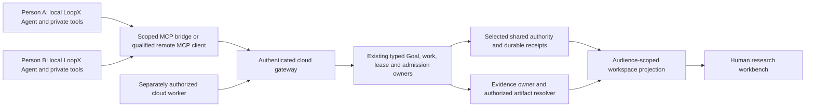

# RFC: Multi-LoopX Agent Cloud Collaboration v0

- **RFC status:** Accepted
- **Supersedes / closes:** none
- **Delivery maturity:** Proposal; existing remote task service is a source candidate, not a delivered team service
- **Authors / owners:** LoopX contributors; shared-authority, collaboration, host and workspace owners
- **Created:** 2026-11-14
- **Last normative revision:** 2026-11-14
- **Implementation baseline:** `f17ce83544f8b0420b6cb13dfdd086ca23cf6646`
- **Related contracts:** [roadmap R6](loopx-overall-roadmap-v0.md#r6-localcloud-convergence), [shared authority](shared-goal-authority-state-provider-v0.md), [remote task service](../../reference/remote-authority-task-service-v0.md), [Goal identity](goal-instance-identity-and-orphan-recovery-v0.md), [Goal alignment](shared-goal-alignment-and-governed-amendment-v0.md), [Live Team Workspace](live-team-workspace-v0.md)
- **Language mirror:** [中文版](multi-loopx-agent-cloud-collaboration-v0.zh-CN.md)

## Document map and maintenance contract

Sections 1–10 define design and acceptance; §4 is the audited baseline, not a
delivery claim. §11 defines implementation gates; §12 records open decisions.
Merge accepts a design basis only. No deployment, local execution, shared-data
publication, provider promotion or paid experiment is authorized by this RFC.
Future measured checkpoints belong in the existing bilingual RFC ledger.

## 1. Decision summary

Let people connect their own LoopX Agents to one explicitly shared Goal through
a cloud control-plane gateway. Their computers retain model/runtime/tool
execution and private projects. The selected shared authority owns shared
intent, work, leases, admission and receipts. MCP and App/CLI are callers of the
same typed service semantics.

The complete journey is: join an authorized scope → discover the question and
available work → accept a scoped commitment → investigate locally → return a
portable, versioned result → independent check → receiver adoption → continued
research → readable human result. Connection or a successful tool call alone
does not deliver collaboration.

Cloud participation is optional and default-off. A team connection neither
merges private Goals nor exposes local shell tools. Shared research presentation
extends Live Team Workspace and the existing [long-horizon reading journey](../../product/use-cases/auto-research/long-horizon-progress-design.md).
Finance interpretation belongs to its domain capability; shared collaboration
and evidence semantics remain domain-neutral.

## 2. Problem and motivation

Two people can each run a research Agent but cannot safely cooperate by copying
their local Goal directories. Both may use the alias `market-research`; their
requirements, permissions and lifetimes can differ. An evidence reference that
opens a file on one laptop does not identify accessible bytes on the other.
Two Agents repeating the same source do not provide two independent checks.

The desired result is visible cooperation: one investigates a hypothesis,
another challenges its source, a revised artifact is checked and adopted, and a
person can see the changed conclusion and its limits. This requires a common
authority and resolvable evidence, then a human reading surface over those facts.

Invariants:

- One selected authority per shared Goal; local caches are read-only projections.
- Person, Agent, host, Goal lifetime, provider incarnation and execution epoch
  remain distinct identities.
- Every write uses current authorization and the existing transactional fence.
- Submission, verification, acceptance, adoption and downstream benefit remain
  distinct facts; a model claim or hash does not establish correctness.
- Private membership and sources do not become visible merely through joining.
- Coordination cost and human attention count toward long-horizon efficiency.

## 3. Scope and non-goals

In scope: bounded team onboarding/discovery, authenticated gateway/MCP access,
shared work and recovery, portable evidence delivery, original-request return,
and a packaged research reading journey across computers.

Non-goals: merging independent writable stores, peer-to-peer consensus, arbitrary
runtime RPC, remote shell exposure, a second scheduler/evaluator, automatic
publication or trading, general cross-tenant Goal federation, and hundred-Agent
qualification. R7 retains its independent scale gate. This proposal does not
lift existing Goal-identity, amendment or provider-promotion holds.

## 4. Current-system contract

| Existing owner at the baseline | Present behavior | Remaining team boundary |
| --- | --- | --- |
| `loopx/goal_mode_mcp.py`; `loopx/collaboration_mcp.py` | Host-bound Goal lifecycle tools and explicitly scoped stdio collaboration/delegation | Complete authenticated remote MCP access, team discovery and portable result delivery are not established |
| `control_plane/coordination/remote_authority_service.ts`; remote task service reference | Candidate HTTPS read/claim/progress/renew/release and receipt recovery; PostgreSQL, scoped credentials, hard leases and incarnation fences | No shipped App/CLI team route, complete research result submission, two physical hosts, shared budget or cloud-worker qualification |
| Goal instance and shared-alignment owners | Goal lifetime identity foundations; alignment/proposal admission | Activation, complete old-writer exclusion and governed intent amendment retain their existing gates |
| Explore, acceptance and collaboration owners | Questions/findings, input revisions, artifact checks, receiver decisions and original-return lineage | Remote artifact resolution and observed adoption-to-continuation need qualification |
| Live Team/Goal Workspace and long-horizon reading design | Bounded team inspection, readable Goal Chat result/comparison; broader reading designs | Complete cross-person research reading and live spatial streaming remain unqualified |

The remote service currently admits a task-scoped request, not a full remote
Goal API. Its one-host independent-process tests must not be presented as
cross-computer delivery. Extend these owners rather than rebuilding a store.

## 5. Proposed architecture

### Identity and Goal placement

The following is a semantic mapping to existing owners, not a new wire schema
or an instruction to send additional fields to current strict endpoints.

| Identity | Meaning and owner | Cross-computer rule |
| --- | --- | --- |
| Authenticated principal and tenant | Service admission binds a person/service to explicit scopes | Caller-supplied Agent names cannot impersonate another member |
| `goal_id` + `goal_instance_id` | Alias plus immutable Goal lifetime, through the Goal identity owner | Same alias on another computer does not imply the same Goal; recreated lifetimes remain distinct |
| `store_identity` and provider revision | Physical authority lineage and observed version, through the store owner | Restore/cutover is an explicit operation; a provider incarnation is not the Goal lifetime |
| Agent binding and host/session identity | Durable collaborator versus current execution location, through registered identity/host owners | A person may own several Agents/devices; changing devices cannot inherit another live execution |
| Todo/request, lease and execution epoch | Work responsibility and current permission to execute | An old laptop returning after takeover cannot write or settle the new execution |

A shared Goal has one selected cloud authority. Local registration retains an
authorized route to it; it does not create another writable copy. A private Goal
can perform an explicitly delegated subproblem and return a permitted artifact
to the shared Goal. Preserve both GoalRefs, request lineage and acceptance;
sharing a result does not copy the private Goal or its membership. Existing
same-Goal Explore edge restrictions remain. Cross-Goal intake uses the owning
artifact/result boundary; never manufacture a cross-Goal edge or merge history.

Shared intent changes continue through the alignment/amendment owner. Until its
governed commit path is qualified, collaboration uses a fixed accepted intent
and exposes proposed amendments without silently applying them.

### Gateway and MCP placement

Gateway admission authenticates, checks tenant/Goal/actor/host scope, negotiates
supported operations and delegates to existing TS owners. It owns no second
business ledger. The existing PostgreSQL service is the first candidate backend;
clients receive no database credential or raw commit interface.

Start with an explicitly configured local stdio MCP bridge to the authenticated
HTTPS service, reusing trusted host identity binding. A native remote MCP profile
can follow when its host/authentication compatibility is qualified. Both use
the same business operations, immutable request identity and recovery receipts.
Transport discovery is not work authorization; model arguments cannot choose
an arbitrary principal, local root or return audience.

Placement: reuse existing collaboration, Explore/result, Goal and workspace
contracts; no new built-in capability ID is approved. Reuse the PostgreSQL
authority provider. Independently installed gateway/client credentials and
transport lifecycle belong to an optional extension provider; its provider ID
and registered contract binding are an implementation decision before coding.
The gateway never supplies a model or assumes ownership of local runtime tools.

### Storage-independent access credentials

Every cross-computer client authenticates at the LoopX service boundary,
whether the backend is PostgreSQL, a NAS-backed qualified provider or another
store. Backend choice does not change the client credential or permission
contract. The gateway retains backend/database/NAS credentials; clients cannot
bypass admission by mounting writable authority files. This defines no new NAS
provider or permission to use an unqualified network filesystem as authority.
Same-account local stdio/filesystem access keeps its existing OS boundary;
this rule does not add a network key to local-only operation.

The first profile uses separately revocable, high-entropy API keys for client
bindings, with distinct device keys when independent revocation is required.
Do not distribute one team-wide key. The server binds each key to an authenticated
principal and its allowed Goal/actor/host/operation scopes and stores a verifier
digest, following the existing remote service pattern. Keys stay in trusted
local credential configuration and travel only through verified TLS transport,
outside prompts and model tool arguments. Rotation/revocation preserves historical
receipts and does not itself release, reacquire or transfer execution leases.
A bearer key authenticates its configured binding; it does not attest a physical
device or truthful Agent behavior. The current candidate does not establish a
complete multi-device credential-management product.

An API key is a shared secret, not an asymmetric private key. A later key-pair
profile may register a public key with the service while the client keeps its
private key locally and proves possession with a request-bound, freshness-checked
signature. Qualify replay rejection and key rotation/revocation before enabling
that profile. Authentication alone never grants Goal/evidence access, acceptance
or a task lease; both profiles use the same authorization and receipt owners.

### Resource ACL after authentication

Successful authentication supplies a principal, not unrestricted access.
The existing typed service admission and resource owners enforce one
provider-neutral authorization contract with default deny:

`allowed = principal grants ∩ credential scope ∩ resource ACL ∩ applicable delegation/source permissions`

| Resource | Permissions must distinguish |
| --- | --- |
| Exact Goal lifetime | Discover/read versus propose/amend intent or administer membership |
| Todo/request | Read versus claim, update or complete the authorized work |
| Evidence/artifact/version | Metadata versus content/download, submit, independently accept or share to another audience |

Use exact Goal/resource identities, not an alias or path substring. Inheritance
is explicit and child/source restrictions can narrow it; Goal membership does
not make every source visible. A coordinator role or an accepted result cannot
grant membership, expand an evidence audience or impersonate the verifier.

Authorize discovery/list/search, metadata, download, result return and sharing
through their owning boundaries, filtering unauthorized identities and metadata
from projections. Caches and URLs do not confer ongoing permission. Apply current
policy to new service accesses; qualify the lifetime/revocation boundary of any
download capability. Revocation cannot reclaim already downloaded bytes, and
already admitted operations retain the §7 snapshot/stop boundary.

ACL permission is necessary but execution still requires current work ownership,
lease, budget and acceptance preconditions. PostgreSQL/NAS access controls may
provide storage defense but do not replace the LoopX ACL. The current candidate
has Goal/actor/operation grants; general resource ACL and evidence-sharing
qualification are future work in these existing owners, not a second policy ledger.

### Work and feedback lifecycle

1. An operator grants scope; the person connects and reads the selected Goal,
   acceptance, team commitments and available operations through bounded pages.
2. A registered Agent accepts work through existing Todo/request and hard-lease
   owners. The host separately checks its local execution/tool grant and budget.
3. The host performs admitted work; progress and result writeback retain the
   original request, tested input and execution fence.
4. The evidence owner admits a scoped immutable artifact/version. Independent
   checking and acceptance use the exact version and existing acceptance owner.
5. The receiver records its decision and actual subsequent use separately. The
   original request receives the result once, including rejected or incomplete
   results. A coordinator role grants no additional authority.
6. A sourced challenge may justify revising the result or next investigation.
   Retain rejected versions, uncertainty and the subsequent action/outcome;
   recording a feedback edge alone does not establish benefit.

Quota/admission remains with the existing owner. Team reservations, per-member
limits and debit/settlement identities must be qualified before shared-budget
execution. Local model credentials and personal spend are never pooled by
connecting. A cloud worker needs a separate execution grant and provider budget.

### Evidence identity, storage and resolution

| Layer | Required distinction | Delivery rule |
| --- | --- | --- |
| Reference | Authority/Goal-scoped record identity, immutable version and content digest | Bind the exact tested inputs and result; filenames and mutable URLs are insufficient |
| Origin | Producer principal/Agent, execution host, source/experiment and observation time | Attribute authenticated submission separately from independent observation; repeated copies retain common origin |
| Bytes | Private origin, explicitly shared replica or authorized external source | The resolver opens permitted exact bytes from another computer; local paths never become shared addresses |
| Judgment | Claim, checker/verifier revision, acceptance, receiver adoption and outcome | Retain each owner's record and uncertainty; checksum equality is byte identity only |
| Audience | Source permission intersected with Goal/result audience | Sharing may narrow access; joining cannot widen source permission |

Reuse the existing evidence/result and material owners for stored bytes and
retention. Evidence content and its authority metadata can have different
physical stores. Initial portable delivery should use small, explicitly shared
immutable artifacts or licensed resolvable sources. A private local source may
stay local; an approved derived result retains reproducible permitted lineage
and marks unavailable raw-source verification. It cannot be presented as an
independently verified shared source.

An expiring URL is a locator, not identity. Permission denial, deleted bytes,
hash/version mismatch, offline origin and missing provenance remain explicit.
The resolver must not replace unavailable evidence with a newer version. Digest
deduplication cannot transfer permissions or assert independent corroboration.
Shared projections omit local paths, credentials, private conversations and
unauthorized origin details. Two submitted artifacts may conflict; preserve both
and their scope instead of selecting a winner from arrival time or vote count.

## 6. Alternatives and design choices

| Choice | Assessment |
| --- | --- |
| Synchronize writable Goal directories | Reject: duplicate authority, path-dependent evidence and lease/budget split-brain |
| Connect Agents only through chat/MCP messaging | Useful transport precursor; lacks canonical commitments, portable evidence and observed adoption |
| Centralize every model/tool and private project in cloud | Optional execution profile later; unnecessary for shared control and inappropriate as the entry default |
| Cloud authority with local execution and scoped evidence | Selected: preserves runtime choice and private work; requires service operation and honest offline behavior |

## 7. Safety, privacy and compatibility

Disabled participation preserves local behavior and starts no listener, network
read, registration, upload or model call. Joining specifies the Goal/audience
and permission consequences; use the existing configuration/action owner.

No bearer credential in prompts, tool arguments, artifacts or public receipts.
Bind authenticated identity to grants and current policy; roles and source text
cannot mint grants. Revoke subsequent admissions promptly. Already admitted
effects may finish under the retained policy snapshot; expose that boundary
and qualify host stop/drain instead of promising instantaneous cancellation.

Negotiate versions and operations. An unsupported result, lifetime fence or
quota operation is unavailable, not a local-write fallback. Mixed-version
clients that cannot preserve required identity/fences remain read-only. Shared
participation cannot bypass the Goal identity owner's activation/old-writer gate.

## 8. Migration and rollback

First provision a new isolated shared scope. Existing private Goals remain in
their current authorities; explicit artifact intake is the first sharing route.
Moving an existing Goal uses its provider/identity migration contract: preview,
backup, old-writer drain, fenced cutover, authorization and exact readback. No
automatic directory import, same-alias reconciliation or receipt rewrite.

Disable remote admission, drain authorized executions and retain committed
receipts/results. Disconnect local clients without converting their caches to
writable Goals. Restoring shared authority rotates/verifies its incarnation;
reconcile ambiguous operations before resuming. Returning to local authority
requires reviewed export/cutover rather than a silent failover.

## 9. Validation and acceptance

| ID / claim | Decisive evidence | Required result / limit |
| --- | --- | --- |
| C1 Scoped access | Two people on two physical computers; wrong/missing key or principal/tenant/Goal, valid key with denied Goal/work/evidence ACL, forbidden discovery/download/share, same alias/different lifetime, per-client rotation/revocation and mixed-version cases; provider-neutral admission conformance | Only granted scopes and metadata discoverable; stale/unauthorized writes have no effect; revoking one client's key preserves another granted client and historical receipts; ACL cannot bypass lease/budget checks; one-host processes or an unqualified NAS provider are insufficient |
| C2 Complete collaboration | Real request → local investigation → portable artifact → independent exact-version check → receiver's next action → original-route return | Recoverable commitments and observed adoption; submission/message count does not pass |
| C3 Portable evidence | Second computer opens exact bytes; denied/offline/deleted source, conflicting version/digest and common-origin copies | Permitted bytes reproducible, failures visible, no permission transfer or false corroboration |
| C4 Failure and cost | Lost response after commit, reconnect, service restart/restore, lease expiry/takeover, stop/drain and budget contention | Reconcile the same intent once; no duplicate effect/debit, stale completion or hidden local-write fallback |
| C5 Human research reading | Packaged workspace backed by actual shared owners, desktop/narrow views, long repeated content and mixed failed/disputed/private states | Reader finds conclusion, source/version, challenge/revision, check, actual adoption, gaps and next decision; selected evidence opens its own record |
| C6 Default-off and entry parity | Local-only comparison plus App/MCP/CLI read/action/recovery paths and authorized Lark summary | Disabled local behavior preserved; entrypoints share owner facts and never start work on passive read |
| C7 Long-horizon value | Matched single-Agent/team workload and complete budget under the [measurement contract](long-horizon-harness-benchmark-research-program-v0.md#6-measurement-model) | Compare accepted outcomes, duplicate effort, model/service/storage cost and human attention; preserve negative results and uncertainty |

C1–C6 establish the bounded team journey; C7 qualifies strategic benefit rather
than promising it. Full G3/R6 also requires a real cloud worker, shared resource
admission and provider/operational qualification. Published docs, screenshots,
mock tests and green source tests do not close those gates.

## 10. Operational and human-reading contract

Service observations expose scoped connection/permission, supported operations,
current authority revision, lease/admission state, receipt recovery and evidence
availability. Presence is not active execution; loss of observation is not task
failure. Order accepted events through authoritative cursors; host timestamps
cannot establish a global causal order. Preserve event/observation time and
explicit dependencies, including delayed arrivals and history coverage gaps.

Freeze bounded pages, subscriptions, artifact limits, retention, restore and
latency/load targets before qualification. Reuse the service's bounded admission
and pooling, plus existing scheduler backoff; no per-member full-history poll
each Turn. Audit/content retention and deletion follow the relevant owners and
source rights; retained metadata does not promise deleted bytes remain readable.

The workbench's primary question is: **what do we currently conclude, what
supports or challenges it, and what needs a human decision?** Compose the
existing Goal/Live Team surface: readable conclusion and uncertainty, actual
research changes, scoped source/verification detail, then optional team execution
detail. Preserve the existing whole-history Explore/native-outcome journey for
research history; do not replace it with a roster, activity wall or new score.
Selection, replay and download are passive. Requests for deeper analysis use
the existing authorized capability/budget owner.

Investment research adds domain-owned thesis, assumptions, scenarios, data
freshness and risk to that presentation. Generic state cannot classify research
as a trade instruction. Human feedback returns through the original
conversation and existing proposal/work owners; it cannot amend accepted intent
or grant protected execution by editing a display. C5 extends Live Team L1/L2;
research rubric calibration remains with its research owner.

## 11. Normative delivery plan

| Milestone | Complete slice | Entry / exit | Rollback |
| --- | --- | --- | --- |
| M1 Shared reading | Two computers connect to an isolated scope and read its question/work plus one portable evidence version in App/MCP/CLI | Resolve provider binding and identity fences; C1/C3 read cases and passive-reading parity; explicitly read-only precursor | Remove grants/connection; preserve shared records |
| M2 Collaborative research | Two people use local Agents for the complete C2 journey, failure recovery and readable shared result | Existing intent/lease/budget and result owners ready; C1–C6 including packaged failure/recovery, first-screen PR evidence and original receiver continuation | Stop admission, drain and retain receipts/results |
| M3 Local/cloud qualification | Add a separately granted real cloud worker and sustained cross-host recovery | M2; full G3/R6 and provider/operations gates, C4 plus measured C7 pilot | Reduce remote admission; retain history and accepted artifacts |

M1 removes an access/evidence gap but does not deliver collaboration. Reuse
existing R6 tasks and Live Team L1/L2 successors; keep assignments and checkpoint
results in canonical Todos/ledgers. M2 cannot stop at a serializer or MCP demo.

## 12. Open decisions

1. **Deployment and identity profile — service/identity owners, before M1:**
   operator-managed API keys versus key-pair/federated identity profiles. Start
   with the API-key profile in §5 and a small operator-provisioned cohort; keep
   asymmetric signing and public enrollment unapproved until their custody,
   rotation/revocation, replay and host compatibility are qualified.
2. **Evidence hosting/retention — evidence/material and source owners, before M1:**
   authorized source resolution versus consented immutable replica. Recommend
   small shareable artifacts first; choose limits from source rights, second-host
   readback, complete cost and deletion/recovery needs.
3. **Research reading refinement — workspace and research owners, before M2:**
   choose the existing Goal/Live Team composition using a real disputed finding
   and long history. Qualify comprehension and source/adoption fidelity; broader
   scientific rubric or spatial streaming is not a prerequisite for the bounded
   readable result. Record consequential changes in the owning bilingual design.
