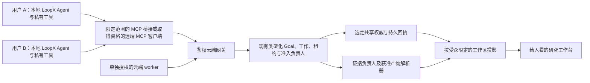

# RFC：Multi-LoopX Agent 云端协同 v0

- **RFC 状态：** 已接受
- **替代 / 关闭：** 无
- **交付成熟度：** 提案；现有远端任务服务是源码候选，不是已交付的团队服务
- **作者 / 负责人：** LoopX 贡献者；共享权威、协作、宿主与工作区负责人
- **创建日期：** 2026-11-14
- **最后规范修订：** 2026-11-14
- **实现基线：** `f17ce83544f8b0420b6cb13dfdd086ca23cf6646`
- **关联契约：** [路线图 R6](loopx-overall-roadmap-v0.zh-CN.md#r6本地与云端汇合)、[共享权威](shared-goal-authority-state-provider-v0.zh-CN.md)、[远端任务服务](../../reference/remote-authority-task-service-v0.md)、[Goal 身份](goal-instance-identity-and-orphan-recovery-v0.zh-CN.md)、[Goal 对齐](shared-goal-alignment-and-governed-amendment-v0.zh-CN.md)、[团队实时工作区](live-team-workspace-v0.zh-CN.md)
- **语言镜像：** [English](multi-loopx-agent-cloud-collaboration-v0.md)

## 文档地图与维护契约

第 1–10 节定义设计和验收；第 4 节是审计基线，不是交付声明。第 11 节定义
实施门槛，第 12 节记录待决事项。合入只接受设计依据。本 RFC 不授权部署、
本地执行、共享数据发布、provider 晋升或付费实验。后续实测 checkpoint
归入现有双语 RFC 台账。

## 1. 决策摘要

让不同的人通过云端控制面网关，把各自的 LoopX Agent 接入一个显式共享的 Goal。
各台电脑保留模型、runtime、工具执行和私有项目。选定的共享权威负责共享意图、
工作、租约、准入和回执。MCP 与 App/CLI 调用同一套类型化服务语义。

完整旅程是：加入获准范围 → 发现研究问题和可用工作 → 接受有范围的承诺 →
本地研究 → 返回可跨设备解析、带版本的结果 → 独立核验 → 接收方采用 →
继续研究 → 给人看的可读成果。连接成功或一次工具调用不能代表协作交付。

云端参与可选且默认关闭。连接团队不会合并私有 Goal，也不会暴露本地 shell
工具。共享研究呈现扩展团队实时工作区与现有[长程阅读旅程](../../product/use-cases/auto-research/long-horizon-progress-design.zh-CN.md)。
投研解释属于领域能力；共享协作和证据语义保持领域中立。

## 2. 问题与动机

两个人都可以运行研究 Agent，但复制本地 Goal 目录不能让它们安全合作。
双方可能都使用别名 `market-research`，但要求、权限和生命周期不同。
一台电脑上能打开的文件引用，不能标识另一台电脑可访问的确定字节。
两个 Agent 重复使用同一来源，也不等于两次独立核验。

目标是可见的合作：一方研究假设，另一方质疑来源，修订后的产物被核验、采用，
人能看到结论变化和适用限制。这需要统一权威和可解析证据，以及基于这些事实的
人类阅读界面。

不变量：

- 每个共享 Goal 只有一个选定权威；本地缓存是只读投影。
- 人、Agent、宿主、Goal 生命周期、provider incarnation 和执行 epoch 分别标识。
- 每次写入使用当前授权及现有事务 fence。
- 提交、验证、验收、采用与后续收益是不同事实；模型声明或哈希不证明正确性。
- 加入团队不会自动公开私有成员关系和来源。
- 协调成本与人工注意力计入长程效率。

## 3. 范围与非目标

范围：有界的团队接入与发现、鉴权网关/MCP、共享工作与恢复、可跨设备交付的
证据、原始请求返回，以及跨电脑的打包研究阅读旅程。

非目标：合并独立可写存储、P2P 共识、任意 runtime RPC、远端 shell 暴露、
第二套调度器/评估器、自动发布或交易、通用跨租户 Goal 联邦和百 Agent 资格。
R7 保留独立规模门槛。本提案不解除既有 Goal 身份、意图修订和 provider 晋升 hold。

## 4. 当前系统契约

| 基线上的现有负责人 | 已有行为 | 团队边界的缺口 |
| --- | --- | --- |
| `loopx/goal_mode_mcp.py`；`loopx/collaboration_mcp.py` | 宿主绑定的 Goal 生命周期工具，以及显式限定的 stdio 协作/委派 | 完整鉴权远端 MCP、团队发现及可跨设备结果交付尚未成立 |
| `control_plane/coordination/remote_authority_service.ts`；远端任务服务参考 | 候选 HTTPS read/claim/progress/renew/release 和回执恢复；PostgreSQL、限定凭证、hard lease 与 incarnation fence | 尚无已交付 App/CLI 团队入口、完整研究结果提交、两台物理宿主、共享预算或云端 worker 资格 |
| Goal 实例与共享对齐负责人 | Goal 生命周期身份基础；对齐/提案准入 | 激活、完整排除旧 writer 和受治理意图修订仍受原门槛约束 |
| Explore、验收和协作负责人 | 问题/发现、输入版本、产物核验、接收方决策与原始返回谱系 | 远端产物解析与真实采用后的继续执行待资格验证 |
| 团队/Goal 工作区与长程阅读设计 | 有界团队检查、可读 Goal Chat 结果/对比；更广泛的阅读设计 | 完整跨个人研究阅读与实时空间流仍未取得资格 |

远端服务目前接收任务范围的请求，不是完整远端 Goal API。单机独立进程测试
不能作为跨电脑交付。扩展这些现有负责人，不重建存储。

## 5. 提议架构

### 身份与 Goal 放置

下表是对现有负责人的语义映射，不是新 wire schema，也不要求向当前严格端点
发送额外字段。

| 身份 | 含义与负责人 | 跨电脑规则 |
| --- | --- | --- |
| 鉴权 principal 与 tenant | 服务准入把人/服务绑定到显式范围 | 调用方提供的 Agent 名称不能冒充其他成员 |
| `goal_id` + `goal_instance_id` | Goal 身份负责人提供别名与不可变生命周期 | 另一台电脑的同名 Goal 不等于同一 Goal；重建的生命周期不同 |
| `store_identity` 与 provider revision | 存储负责人提供物理权威谱系与观察版本 | 恢复/切换是显式操作；provider incarnation 不等于 Goal 生命周期 |
| Agent 绑定与 host/session 身份 | 注册身份/宿主负责人区分持久协作者和当前执行位置 | 一人可有多个 Agent/设备；更换设备不能继承其他活跃执行 |
| Todo/request、lease 与执行 epoch | 工作责任和当前执行许可 | 接管后旧电脑回来，不能写入或结算新执行 |

共享 Goal 使用一个选定云端权威。本地注册保留通往它的获准路由，不建立第二个
可写副本。私有 Goal 可以执行显式委派子问题，向共享 Goal 返回获准产物。
保留双方 GoalRef、请求谱系与验收；分享结果不复制私有 Goal 或其成员关系。
现有 Explore 的同 Goal 连边限制继续适用。跨 Goal 接入走所属产物/结果边界，
不能制造跨 Goal 边或合并历史。

共享意图变化仍归对齐/修订负责人。在受治理提交路径取得资格之前，协作使用
固定已接受意图，展示修订提案而不悄悄应用。

### 网关与 MCP 放置

网关准入负责鉴权、检查 tenant/Goal/actor/host 范围、协商支持的操作，然后
调用现有 TS 负责人，不拥有第二套业务台账。现有 PostgreSQL 服务是首个候选
后端；客户端不获得数据库凭证或原始 commit 接口。

先做显式配置的本地 stdio MCP 桥接到鉴权 HTTPS 服务，复用可信宿主身份绑定。
原生远端 MCP profile 在宿主/鉴权兼容性取得资格后跟进。两条路径使用相同
业务操作、不可变请求身份和恢复回执。传输发现不等于工作授权；模型参数不能
选择任意 principal、本地根目录或返回受众。

放置：复用现有协作、Explore/result、Goal 和工作区契约；不批准新 builtin
capability ID。复用 PostgreSQL authority provider。独立安装的网关/客户端
凭证及传输生命周期属于可选 extension provider；provider ID 和注册契约绑定
在编码前决定。网关不提供模型，也不获得本地 runtime 工具所有权。

### 工作与反馈生命周期

1. 操作者授予范围；用户连接后，通过有界分页读取选定 Goal、验收、团队承诺
   与可用操作。
2. 注册 Agent 通过现有 Todo/request 和 hard-lease 负责人接受工作；宿主
   单独检查本地执行/工具授权与预算。
3. 宿主执行已准入工作；进度和结果写回保留原始请求、测试输入及执行 fence。
4. 证据负责人接收限定范围的不可变产物/版本。独立核验和验收使用精确版本与
   现有验收负责人。
5. 接收方分别记录决策和真实后续使用。结果向原请求返回一次，包括被拒绝或
   不完整的结果。协调者身份不授予额外权限。
6. 有来源的质疑可支持修订结果或下次研究。保留被拒绝版本、不确定性及后续
   行动/结果；只记录反馈边不证明收益。

Quota/准入仍归现有负责人。共享预算执行前，必须验证团队 reservation、
成员限额及 debit/settlement 身份。本地模型凭证和个人支出不会因为连接而合并。
云端 worker 需要独立执行授权及 provider 预算。

### Evidence 身份、存储与解析

| 层次 | 必须区分 | 交付规则 |
| --- | --- | --- |
| 引用 | authority/Goal 范围的记录身份、不可变版本与内容摘要 | 绑定精确测试输入和结果；文件名和可变 URL 不足以标识 |
| 来源 | producer principal/Agent、执行宿主、来源/实验与观察时间 | 鉴权提交与独立观察分别归属；重复副本保留共同来源 |
| 字节 | 私有原始材料、显式共享副本或获准外部来源 | 解析器在另一台电脑打开获准精确字节；本地路径不成为共享地址 |
| 判断 | claim、checker/verifier 版本、验收、接收方采用和结果 | 保留各负责人的记录与不确定性；校验和相同只说明字节相同 |
| 受众 | 来源权限与 Goal/结果受众的交集 | 分享可收窄权限；加入不能扩大来源权限 |

复用现有 evidence/result 与 material 负责人管理字节和保留。证据内容及其
权威元数据可以使用不同物理存储。首批跨设备交付采用小型、显式共享的不可变
产物或有许可的可解析来源。私有本地来源可留在本地；获准派生结果保留可复现的
许可谱系，标明原材料验证不可用，不能呈现成已独立核验的共享来源。

临时 URL 是位置，不是身份。无权限、字节已删除、hash/版本不符、原宿主离线
和谱系缺失分别显式呈现。解析器不能用新版本替代不可用证据。按摘要去重不能
转移权限，也不能声称独立佐证。共享投影不包含本地路径、凭证、私有会话及
未获准来源细节。两份提交可以冲突；保留双方及适用范围，不按到达时间或票数
决定胜者。

## 6. 备选与设计选择

| 方案 | 判断 |
| --- | --- |
| 同步可写 Goal 目录 | 拒绝：重复权威、依赖本地路径的证据及 lease/预算 split-brain |
| 只通过聊天/MCP 消息连接 Agent | 可作传输前置，缺少规范承诺、可跨设备证据和真实采用 |
| 把全部模型/工具和私有项目集中到云端 | 后续可选执行 profile；共享控制不需要，不能作为默认入口 |
| 云端权威 + 本地执行 + 限定证据 | 选择：保留 runtime 选择和私有工作；需要服务运维与诚实的离线行为 |

## 7. 安全、隐私与兼容性

关闭团队参与时保留本地行为，不启动 listener、网络读取、注册、上传或模型调用。
加入时说明 Goal/受众与权限后果；使用现有配置/动作负责人。

Bearer 凭证不进入 prompt、工具参数、产物或公开回执。鉴权身份绑定授权和当前
策略；角色和来源文本不能产生授权。及时撤销后续准入。已准入操作可能依据保留
策略快照完成；展示该边界，并验证宿主 stop/drain，不承诺瞬时取消。

协商版本和操作。不支持的结果、生命周期 fence 或 quota 操作显示不可用，
不能退回本地写入。不能保留必要身份/fence 的混合版本客户端保持只读。共享
参与不能绕过 Goal 身份负责人的激活/旧 writer 排除门槛。

## 8. 迁移与回滚

先建立新的隔离共享范围。现有私有 Goal 保留当前权威；显式产物接入是首条
分享路径。移动已有 Goal 遵循 provider/身份迁移契约：预览、备份、旧 writer
drain、fenced cutover、授权与精确读回。不自动导入目录、对齐同名 Goal 或改写回执。

关闭远端准入，drain 获准执行，保留已提交回执/结果。断开本地客户端，不把
缓存改成可写 Goal。恢复共享权威时轮换/验证 incarnation；恢复执行前对账
模糊操作。返回本地权威需要已审查的 export/cutover，不能悄悄 failover。

## 9. 验证与验收

| ID / 声明 | 决定性证据 | 必须结果 / 限制 |
| --- | --- | --- |
| C1 限定访问 | 两个人、两台物理电脑；错误 principal/tenant/Goal、同名不同生命周期、撤权和混合版本 | 只能发现获准范围；陈旧/未授权写入无效果；单机多进程不足 |
| C2 完整协作 | 真实请求 → 本地研究 → 可跨设备产物 → 独立精确版本核验 → 接收方下一动作 → 原始路由返回 | 承诺可恢复且观察到采用；提交/消息数量不构成通过 |
| C3 可跨设备证据 | 第二台电脑打开精确字节；无权限/离线/已删除来源、冲突版本/摘要与共同来源副本 | 获准字节可复现、失败可见，不转移权限或制造佐证 |
| C4 失败与成本 | 提交后响应丢失、重连、服务重启/恢复、租约过期/接管、stop/drain 和预算争用 | 同一意图对账一次，无重复 effect/debit、陈旧完成或隐藏本地写 fallback |
| C5 人类研究阅读 | 真实共享负责人支撑的打包工作区、桌面/窄屏、长重复内容及失败/争议/私有混合状态 | 能找到结论、来源/版本、质疑/修订、核验、真实采用、缺口与下一决策；所选证据打开自身记录 |
| C6 默认关闭与入口一致性 | 纯本地对比，App/MCP/CLI 读/动作/恢复及获准 Lark 摘要 | 关闭时保持本地行为；入口共用负责人事实，被动读取不启动工作 |
| C7 长程价值 | 按[测量契约](long-horizon-harness-benchmark-research-program-v0.zh-CN.md#6-测量模型)进行条件匹配的单 Agent/团队任务和完整预算比较 | 比较已验收成果、重复工作、模型/服务/存储成本和人工注意力；保留负结果与不确定性 |

C1–C6 建立有界团队旅程；C7 验证战略收益而不预先承诺。完整 G3/R6 还要求
真实云端 worker、共享资源准入及 provider/运维资格。公开文档、截图、mock 测试
与绿色源码测试不能关闭这些门槛。

## 10. 运维与人类阅读契约

服务观察提供限定连接/权限、支持操作、当前 authority revision、lease/准入
状态、回执恢复及证据可用性。在线不等于正在执行；观察丢失不等于任务失败。
通过权威 cursor 排序已接收事件；宿主时间戳不能建立全局因果顺序。保留事件/
观察时间和显式依赖，包括延迟到达与历史覆盖缺口。

资格验证前冻结有界分页、订阅、产物限制、保留、恢复和延迟/负载目标。复用
服务的有界准入/连接池及现有调度 backoff；不能每个 Turn 对每个成员全量轮询
历史。审计/内容保留与删除遵循对应负责人和来源权利；保留元数据不保证已删除
字节继续可读。

工作台首先回答：**目前结论是什么，什么支持或挑战它，什么需要人来决策？**
组合现有 Goal/团队界面：可读结论与不确定性、实际研究变化、限定来源/核验
细节，再按需查看团队执行。研究历史保留既有完整 Explore 历史/原始结果旅程，
不用成员列表、活动墙或新分数替换。选择、回放和下载是被动操作；深层分析
请求使用现有获准能力/预算负责人。

投研在该呈现上增加领域负责的投资论点、假设、情景、数据时效与风险。
通用状态不能把研究分类成交易指令。人的反馈通过原会话及现有提案/工作负责人
返回；编辑显示不能修改已接受意图或授权受保护执行。C5 扩展团队工作区 L1/L2；
研究 rubric 校准仍归研究负责人。

## 11. 规范性交付计划

| 里程碑 | 完整切片 | 进入 / 退出 | 回滚 |
| --- | --- | --- | --- |
| M1 共享阅读 | 两台电脑连接隔离范围，通过 App/MCP/CLI 读取问题/工作与一份可跨设备证据版本 | 确定 provider 绑定和身份 fence；C1/C3 读取及被动阅读一致性；明确为只读前置 | 移除授权/连接，保留共享记录 |
| M2 协同研究 | 两个人用本地 Agent 完成 C2 旅程、失败恢复与可读共享结果 | 既有意图/租约/预算及结果负责人就绪；C1–C6，含打包失败/恢复、PR 首屏证据和原接收方继续执行 | 停止准入、drain，保留回执/结果 |
| M3 本地/云端资格 | 加入单独授权的真实云端 worker，持续跨宿主恢复 | M2；完整 G3/R6 和 provider/运维门槛、C4 及实测 C7 pilot | 收窄远端准入，保留历史与已验收产物 |

M1 消除访问/证据缺口，但未交付协作。复用现有 R6 任务和团队工作区 L1/L2
后继；分工与 checkpoint 结果放在规范 Todo/台账。M2 不能停在 serializer 或 MCP demo。

## 12. 待决事项

1. **部署与身份 profile — 服务/身份负责人，M1 前：** 操作者管理的限定凭证
   或联邦身份。建议先做小范围人工配置成员；公开接入服务前验证凭证保管、
   撤权和宿主兼容性。
2. **证据托管/保留 — evidence/material 与来源负责人，M1 前：** 获准来源
   解析或经同意的不可变副本。建议先用小型可分享产物；按来源权利、第二宿主
   读回、完整成本与删除/恢复需求决定限制。
3. **研究阅读改进 — 工作区与研究负责人，M2 前：** 用真实争议发现和长历史
   选择现有 Goal/团队构图，验证理解和来源/采用忠实度；更广泛的科学 rubric
   或空间流不是有界可读结果的前置。重大变化记录到所属双语设计。
