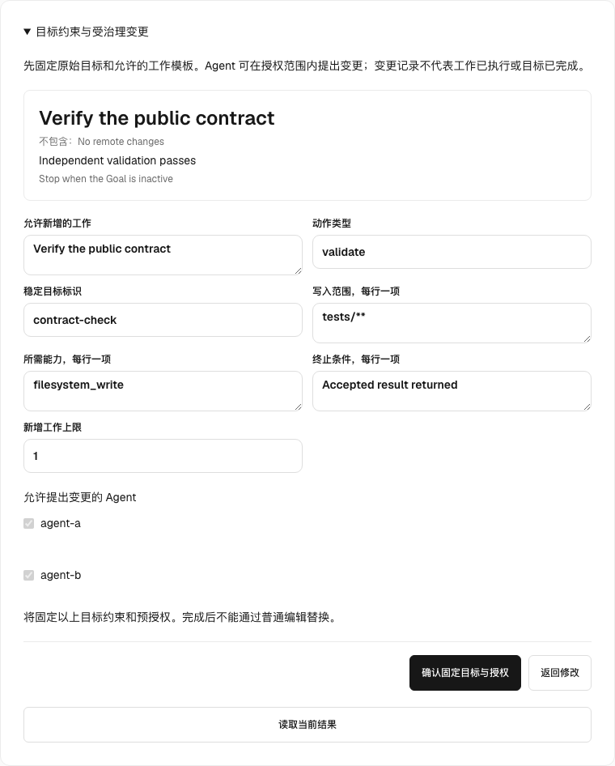

# RFC：共享 Goal 对齐与受治理 Amendment 协议（v0）

- 状态：已接受
- 替代 / 关闭：无
- 跟踪 Issue：[#3836](https://github.com/huangruiteng/loopx/issues/3836)
- 日期：2026-09-02
- 最后更新：2026-10-13
- 范围：多个对等 Agent 围绕同一个共享 Goal 协作，同时保留 canonical
  intent、每个 Agent 的执行 frontier、claim/lease 所有权，以及可审计的
  replan/amendment 决策
- 相关契约：
  [Goal Vision 与 Replan](../../reference/protocols/goal-vision-replan-contract-v0.md)、
  [共享控制面 Authority 与可插拔状态 Provider](./shared-goal-authority-state-provider-v0.zh-CN.md)，
  以及 [Decision Context](../../reference/protocols/decision-context-architecture-v0.zh-CN.md)
- 语言说明：
  [英文版](./shared-goal-alignment-and-governed-amendment-v0.md)与本中文版是语义镜像；
  二者存在实质差异即为缺陷。

---

## 1. 摘要与决策

§9.3 已实现显式本地 profile 的不可变 root、固定模板 commit、同操作恢复与 peer/replan 回读；
通用运行和自动采纳仍保持边界，不能据此声称全部 Stage 3–5 完成。

既有 Stage 1/2 读取与 admission 路径：alignment 与 amendment admission 共用一份完整 Todo/lease
来源快照。Promotion 前仍为 legacy 读取；之后 canonical 空状态和 provider 失败都不
回退 Markdown 或逐 Todo lease 文件。TS 筛选排除非 open、归档和恢复条件未满足的
工作；Agent eligibility 还遵守 exclusion，但 amendment 影响范围可包含其他 Agent
持有或当前 executor 被排除的开放工作。Source digest 通过 `source_basis.todo_basis`
绑定 canonical provider revision。有 state event log 时，`revision_basis=state_event_log`
仍只表示事件轴；没有时，promoted 读取使用 `canonical_todo_snapshot`、事件序号 0 和
unbound Agent frontier。即使事件序号为 0，canonical digest 变化也要求 `needs_rebase`。
Legacy Markdown 现在也绑定 typed reader 使用的已解析 Todo/lease 事实，按稳定 Todo id
排序，不包含 compatibility prose 和 observation time。因此即使 `updated_at` 未变，peer claim
变化也会改变 basis。此前该路径遗漏这些事实，且在序号 0 时接受任意 digest；现在
新提交的提案若绑定不同的观测 digest，会要求 `needs_rebase`。应重新读取 alignment，
用新的 proposal id 提交修订内容；精确重放仍返回原始历史 admission，不是重新判定
当前 basis。旧 producer 生成但尚未提交的提案，升级后可能需要刷新 basis。
这不等于完整 Goal intent envelope 已版本化，不推断 Agent 已确认，也不把 admission
变成审批或 CAS commit；Stage 3 仍须重新验证自己的精确提交时 basis。

LoopX 将区分四类不能坍缩为一份可变计划的状态：

1. **canonical 共享 Goal intent envelope**；
2. **共享 eligible work graph**；
3. 每个已注册 peer 各自的 **per-Agent frontier**；
4. 用于治理共享 amendment 的 **proposal 与 receipt 记录**。

Agent 可以在 canonical intent 内修正自己的 frontier。当证据推翻共享假设时，
它可以提出共享 amendment。Proposal 不会改变 Goal、阻塞无关工作，也不会赋予
提出者单方面 commit authority。只有 LoopX `GoalAmendmentAuthority` 根据预授权 policy
和精确 base revision 校验、通过 compare-and-set（CAS）提交并生成 durable receipt
后，共享 amendment 才会生效；此后所有 Agent 都必须把自己的 frontier 重新绑定到
新的 canonical revision。

正常路径是自动化的，不要求所有 peer 投票，也不要求人审批日常 Goal 演化。
`peer_v1` 表示执行层级平等，不代表每个 Agent 都能越过 root user intent 或取得新
permission。Goal 创建时会冻结 `root_intent` 与 amendment-policy envelope。在该
envelope 内，policy check 以及高风险 class 所需的独立 verifier Agent 授权自动
commit；超出 envelope 时，旧 Goal 继续有效，proposal 被 reject 或结构化 blocked，
只有 Goal 显式配置时才升级给人。

```text
canonical 共享 Goal intent envelope
  (objective, non-goals, acceptance, permissions, stop conditions, revision)
                 |
                 v
共享 eligible work graph
                 |
        +--------+--------+
        |                 |
        v                 v
per-Agent frontier A   per-Agent frontier B
        |                 |
claim + lease/fence    claim + lease/fence
        |                 |
bounded evidence       bounded evidence
        +--------+--------+
                 |
       lane replan 或 amendment proposal
                 |
      自动 policy + 可选 verifier
                 |
          base-revision CAS commit
                 |
      committed shared amendment + receipt
                 |
          每个 frontier rebase 或被 gate
```

- 检查点已移至执行账本：[已核验交付与管家衔接检查点（2026-09-13）](ledger/shared-goal-alignment-and-governed-amendment-v0/2026-09-13-verified-delivery-and-manager-integration.zh-CN.md)。
- 检查点已移至执行账本：[所有者授权验收检查点](ledger/shared-goal-alignment-and-governed-amendment-v0/2026-09-17-owner-authorized-acceptance.zh-CN.md)。

## 2. 问题与当前边界

LoopX 已经能较好地协调执行：

- 已注册 peer identity 与 Agent-scoped Todo lane；
- 可见、可选择的 unclaimed Todo，以及 work 前必须 claim 的提示；
- soft claim 与 hard lease/fence 所有权；
- per-Agent vision 与 checkpoint 状态；
- typed autonomous-replan obligation 与 settlement；
- action-scoped cross-owner Todo lifecycle grant；
- provider-neutral coordination CAS 与 receipt 基础。

[#3693](https://github.com/huangruiteng/loopx/pull/3693) 是这一层的正向、
边界明确的修复：它避免共享 `Next Action` prose 遮蔽精确 settlement-bound 或当前
Agent 的 Todo。它没有定义共享 Goal 对齐，也没有定义共享语义 amendment authority。

当多个 Agent 独立发现共享计划或 acceptance boundary 有误时，缺失的 seam 就会
出现：各个 per-Agent vision 可以各自自洽，但合并后的工作已经无法证明原始 Goal。
反过来，如果允许每个 Agent 直接重写共享 prose，最后写入者就会意外成为 authority。

类型系统无法证明任意自然语言修改保留了用户原意。LoopX 能做到的是让静默重解释
变得不可能：amendment 必须说明 retained、changed、stopped，引用 evidence，绑定
精确 base revision 与 digest，通过显式 authority policy，并留下可恢复 receipt。

## 3. 状态分区与不变量

### 3.1 Canonical intent envelope

`shared_goal_intent_v0` 包含：

- `goal_id`、`goal_revision` 与 `intent_digest`；
- objective 与 non-goals；
- acceptance conditions；
- permission/write scope；
- stop 与 terminal conditions；
- Agent 不能 amendment 的 root intent；
- 治理每种 amendment class 的 authority policy；
- out-of-policy proposal 的配置处置方式（`reject`、`block` 或显式
  `human_escalation`）。

它是 semantic authority，不是 status projection。`Next Action`、Agent vision、聊天
消息、scheduler hint 和 provider head 都不能覆盖它。

### 3.2 Shared work graph

共享 work graph 包含 Todo、dependency、eligibility、blocking gate 和 lifecycle
state。它描述候选工作，而不是谁现在可以执行。Work-graph 变更必须可追溯到它希望
推进的 canonical intent revision。

### 3.3 Per-Agent frontier

每个注册 Agent 获得一份有界 `shared_goal_alignment_v0` projection：

- canonical Goal revision/digest；
- 当前 Agent 的 frontier 与 `based_on_goal_revision`；
- 它的 claim 与 lease/fence facts；
- eligible unclaimed work；
- open lane replan 或 shared amendment obligation；
- conflict 或 stale-basis facts。

当 route 变更仍在当前 objective、non-goals、acceptance、permission 与 stop
condition 内，且不修改另一 Agent 已 claim 的工作时，Agent 可以 replan 自己的
route，而不需要 shared amendment。

### 3.4 Proposal 与 receipt

Proposal 是 advisory、durable input；receipt 证明 canonical transition。二者不能
互相替代。Pending 或 approved proposal 都不会生效，直到成功的 commit receipt
明确记录新的 Goal revision。

### 3.5 Host session locator 与 advisory context

任务深度链接可以让 peer 精确进入本协议，而不成为第五类共享状态。对 Codex 而言，
`codex://threads/<thread-id>` 标识一个本地聊天。LoopX 可以通过当前项目 registry
解析该 locator，并把来源 session 绑定到现有 Agent 与 Goal identity。返回的
provider-neutral `host-session:codex:<thread-id>` scope 随后可由显式启用的 Decision
Context provider 用来选择该 session。

它是可选、临时的 **advisory context input**，位于
`shared_goal_intent_v0`、`goal_amendment_proposal_v0`、
`goal_amendment_receipt_v0` 和 provider CAS head 之外。它帮助 peer：

- 精确定位发现 gap 或 evidence pointer 的任务；
- 审阅当前事实时召回一组有界的来源任务消息；
- 把 amendment proposal 路由给独立 verifier 或受影响 peer；
- commit 后回到相关任务读取 receipt 并完成 frontier reconciliation。

```text
host task deep link -> project-local binding -> normalized host-session scope
        | explicitly configured, read-only ContextProvider
        v
local-private transient recall -> verify against current authority sources
        | explicit promotion to durable typed evidence
        | base Goal revision + intent digest
        v
governed amendment proposal -> authority decision -> canonical receipt
```

这个顺序是规范要求。深度链接不是 `evidence_ref`，召回消息不是 amendment
decision，extension lifecycle revision 也不是 `base_goal_revision`、
`authority_revision`、`provider_generation` 或 `lease_epoch`。Amendment 需要的任何
session-derived conclusion，必须先对照当前 authority 检查，再显式提升到现有 Todo
evidence、Agent evidence log 或 registered material owner；proposal 再引用这些
durable typed reference，并独立绑定当前 Goal revision 与 intent digest。

Locator 也不授予 read access、permission、claim、lease、lifecycle authority、
verifier independence 或 amendment commit authority。如果链接无法解析、无权读取，
或 extension 被禁用或不可用，只有可选的 context-enrichment 步骤 fail open；
canonical Goal 和无关工作继续有效。Decision Context 记录 provider degradation，
并继续使用仍可用的 authority sources。Receipt recovery 仍使用 `operation_id` 和
`readReceipt`，因此 host session 丢失不能让已提交 amendment 变得不可恢复。
Cross-Goal rendezvous 可以帮助两个 peer 协调，但每个 Goal 仍需要各自的 proposal、
policy decision、CAS commit 和 receipt。

Core 只解析一次 host-specific 深链语法，并只向 provider 暴露 normalized scope。
可选的 `loopx-obelisk` extension 把该 scope 映射到 Obelisk 公开的只读 query
接口；它不读取 Obelisk 存储 schema，不 build 或 attune 索引，也不打开、恢复或向
live task 发消息。其他 harness 可以实现相同的 Decision Context provider 协议，无需
把 host 语法或 transcript 存储引入 Goal authority。

### 3.6 Peer agent directory 与有界观察

per-Agent frontier 告诉一个 Agent 自己的路线。peer 之间也需要彼此具备同样的三种
能力，而管家需要对它被问到的每个 Agent 都具备这些能力：发现有哪些 Agent 存在、哪些
正在运行，在有界范围内观察其中一个，以及把一条有界请求交给其中一个。这条可复用契约
就是
[`peer_agent_directory_v0`](../../reference/protocols/peer-agent-directory-and-observation-v0.md)。

它不新增第六种共享状态。身份、工作、claim、lease 与规范修订仍然留在本文已经安排的
位置；该契约贡献的是一个**面向 Agent 的视图**，以及读取与投递的规则。其中三条规则在
这里最关键：

- **presence 是 advisory 且按 provider 划定范围的。** live session 从不创造身份，
  没有 live session 的 Agent 仍然已注册、仍然拥有它的 claim、仍然是投递目标。provider
  用自己的 session-scoped handle 报告自己的位置，用自己的 liveness 词表；无法分类某个
  目标的读取方报告 `unknown` 并点名覆盖缺口，而不是推断"已完成"或"没有进展"。
- **观察与投递不授予任何东西。** 读取一个 peer、或把上下文交给它，都不是 claim、lease、
  优先级、计划变更或修订。投递仍然是 `context_handoff`；Goal 要什么仍然只经
  `GoalAmendmentAuthority` 改变，工作状态仍然只经 canonical Todo、quota 与 lane owner
  改变。
- **terminal-space provider 是 provider，不是契约本身。** 拥有终端的宿主面可以提供
  presence 与有界的实时输出，且必须声明：调用方如何证明自己在空间之内、detach 或重启
  之后什么会保留、以及它无法恢复什么。没有这类 provider 时，directory 退化为"已注册
  身份 + 持久工作状态"——这正是 prompt-only transport 的常态。

有三条规则把同一契约从单一 provider、单一管家场景推广为可复用契约：

- **一个空间、三个层次、两类调用方。** 空间是这个 Goal 的执行空间，宿主面只是空间内
  的 transport。同一契约可以在三个层次抵达：typed state 与受治理命令、运行中的 Agent
  加载的 in-space skill、以及只提供 presence 的 provider 面；层次只能收窄权限，不能
  放大权限。管家（manager channel）与 peer Agent（`peer_v1`）是同一契约的两类调用方，
  前者由 channel 的 Goal 绑定划定范围、后者由该 Goal 已注册的 Agent 划定范围；调用方
  只从自己抵达时所用的绑定解析自身，目标则来自 directory。
- **有界等待要 pin 身份，并要求状态向前推进。** 一次等待、或"投递是否真的产生了 turn"
  的读回，都要 pin 已解析的 Agent、工作身份（`todo_id`）与 provider 位置，使同一位置的
  替代者无法满足它；同时要求观察到的状态在请求开始之后确实变过，否则一次陈旧重读什么
  也证明不了。这与本文对受治理写入结算所要求的绑定形状一致。
- **attention rollup 是 typed 的，且不分配任何东西。** "现在谁需要决策"的视图可以按
  typed state 排序和标注行；它不创造 claim、lease 或优先级，也不是自动分配的输入。

### 3.7 当前工作与 Goal 要求

当前 Agent 集中处理的工作，与整个 Goal 仍须满足的要求必须分开。反馈视图可以
将既有事实组织成 `work`、`obligations`、`reflection`、`continuation`；这四项是
投影分区，不是新的持久 schema，也不是模型可直接改写的权威源：

| 分区 | 含义与既有 owner |
| --- | --- |
| `work` | 当前 Todo/frontier、局部验收及精确原文入口。 |
| `obligations` | Goal 验收条件及保留承诺，独立于当前 Todo 和 Agent。 |
| `reflection` | 有证据的解释与未决问题；owner 接受证据前只作 advisory。 |
| `continuation` | 后续可执行工作、等待/停止原因及其范围；复用 frontier 与 settlement owner。 |

目标合同须保留稳定 ID、来源 criterion ID、Goal revision/digest、状态与证据绑定。
每项已声明的结构化 criterion 都要有明确覆盖关系；切换焦点不能删除或改写已登记
要求。这只能证明已声明合同的覆盖，不能证明任意自然语言意图已被完整提取。
复用 `acceptance_contract.ts` 与 `acceptance_authority.ts`；lane replan obligation
保留自己的生命周期，不能成为第二套 Goal 验收账本。

承诺在同一 revision 内保持稳定；授权 amendment 可以保留历史并显式处理
lease/frontier 影响后替代旧要求，不能禁止合法目标变更。代码、范围或合同变化后
证据可能过期，因此 satisfied 不单调。引用非空只是结构有效；验收还须检查证据
可解析、范围相关、时效有效及 owning validator 的结果，保留失败和未测试的区别。
现有 selected-work acceptance 不等于全局 Goal acceptance。

全局收口须对账当前 revision 的全部适用要求、跨 Agent 剩余工作和待处理 amendment。
一个 Agent 的 `no_followup` 或一个 Todo 完成，不能推出 `achieved`。压缩投影须保留
身份及无损详情入口，不能用展示前缀替代源承诺。

**交付边界：** 既有 typed interaction owner 在准入后生成 Goal 原文、已启用的
canonical acceptance 与当前 Todo 精确详情读取。普通产品 heartbeat 与 TurnEnvelope
消费同一清单；短包只传输并签名，不另行制定读取规则。Goal 文档恢复完整意图和停止
条件，canonical acceptance 与 Todo reader 保留各自权威和范围；selected-work 验收
文档不能替代完整目标。共享 host adapter 保留选中任务。须一起验证默认 heartbeat
生成→guard→来源回读与短包传输，不能用一条路径替另一条验收。尚未
实现完整义务账本、全局收口门禁、读取执行的自动证明或模型遵循资格。这些继续归
R1/R4/R5 与 S11，本 RFC 不隐式开启新的 acceptance policy。下一完整切片应让既有
结构化 criterion 穿过任务切换和重启，在同一 owner 拒绝覆盖丢失并使过期证据失效。

### 3.8 失效证据与受影响消费者

本节是既有 acceptance 与显式 result-use owner 的待实现资格合同，不新增全局错误
状态、taint graph 或自动 amendment 政策。历史完成与当前证据使用资格是不同事实。
保留原 receipt、声明依据与结果，重新检查当前适用性；不能靠改写已完成 Todo 让
历史看起来一致。

来源不可用、版本/范围改变、owner 确认结论错误，含义不同。来源读不到只能说明
当前证据不可得，不能说明内容为假。语义反驳须有当前 criterion 与可归属反证，由
所属 validator 或获授权评审确认；字节一致和传输成功无法单独解决。可选评估遵循
[检测衔接合同](optional-semantic-assistance-jev-v0.zh-CN.md#检测结果与所属规则的衔接)。

对合同要求当前证据的显式关系：

1. 指明 source operation/artifact version、criterion 和实际声明的 consumer input，
   保留原因与影响范围。不能从消息送达、共同关键词或 workspace 全部文件推断消费。
2. 在新的验收、adoption 或所属受保护执行边界之前重验依据。Consumer 输出不变且
   本地 validator 通过，并不能独立证明声明来源链仍有效。决定须在实际准入边界绑定
   观察到的版本，不能用较早的 UI 读取或缓存成功授权后续使用。无关工作继续，
   不因一个 source 缺失就停止全部 Agent。
3. 通过现有 typed readback/guard 表达当前使用不可用。读取不修改历史、释放 lease、
   撤回消息或启动修复。不能把任意来源失效塞进 `goal_acceptance_stale`：其现有
   owner 表达的是 acceptance/work binding 改变。
4. 恢复时取得当前证据，恢复精确获准依据或经既有 owner 验证替代版本，再检查
   consumer eligibility。字节恢复只证明版本可得；已确认的语义失败还须重新验证
   相关 criterion。模型说“修好了”、新 ACK 或新 evidence ID 均不足以解除。

发送者 context 记录此前推理。受影响工作恢复或交接时，既有 context owner 须带入
失效依据、未解决问题、当前证据与下一项必要检查。这证明新的 context delivery，
不代表清除全部旧 session，也不证明模型理解了纠正。已经提交的外部 effect 继续
服从自己的对账或显式授权补偿合同。

**本地实现检查点：** 在 `44931b6d22a50b949d43354e6ea498fb6b68d231`
观察到的直接来源检查缺口，已有候选实现：
[`delegation_result_use.ts`](../../../loopx/control_plane/collaboration/delegation_result_use.ts)
拥有判定，[`delegation_results.py`](../../../loopx/control_plane/collaboration/delegation_results.py)
采集 host 观察。read、start、adoption 与 settlement 资格化 requester 范围内的
显式来源链，保留历史 accepted/done 记录。每次准入独立缓存来源观察并检测循环，
界限为 64 个 operation、16 层、15 秒经过时间预算；预算停止后续检查，不中止已
运行的 validator。缺失与未访问证据均 unavailable；不跨准入缓存成功，不声称原子
文件快照。准入与采用消费整体验证结果；逐项检查之后预算耗尽，也会撤回此前
的 link 成功，避免读回与准入分歧。

[`test_delegation_result_use.py`](../../../tests/test_delegation_result_use.py)
通过真实本机 worker、独立 validator 和 File/SQLite 存储验证 source → A → B：
A input 变化时撤回当前使用，拒绝下游 start/adoption，保留历史，修复后恢复且不重复
派发 accepted worker。typed 测试覆盖共享来源、循环与预算耗尽。打包 team/evidence
经真实 HTTP 读回，撤下受影响报告、显示原因，并在修复后复验。CLI/MCP/Chat 共用
owner；操作见[本地委派](../../reference/local-delegation.md#repair-and-recheck)。
这是本地验证的候选实现，不等于已安装行为；全 Goal 反向传播、全部 session 纠正、
业务回滚与跨主机 HA 仍在边界之外。

## 4. Authority matrix

### 4.1 `GoalAmendmentAuthority` 到底是什么

`GoalAmendmentAuthority` 不是人、leader Agent、模型或存储服务。它是 LoopX 对
canonical Goal amendment 的唯一 typed write boundary。具体实现应拆成：

```text
proposal + current Goal + policy + lease impact + optional verifier decision
                                  |
                                  v
                 GoalAmendmentAuthority.decide()
                       reject | needs_rebase | commit
                                  |
                                  v
                  provider CAS + canonical receipt
```

Decision reducer 执行 deterministic policy、identity、digest、revision 与 impact
规则。可选 verifier Agent 只为语义问题提供 typed input，不能 commit；transaction
executor 通过 provider-neutral store 持久化已接受 decision，但不能扩张 decision。
称它为 authority，含义是所有 canonical writer 都必须经过这个边界，而不是某个高位
Agent 替 peers 做决定。

### 4.2 Amendment class

| Amendment class | 示例 | Proposal authority | 自动 commit 规则 | Pending 时的默认影响 |
| --- | --- | --- | --- | --- |
| `lane_route` | 调整一个 Agent 的未认领本地步骤顺序 | owning Agent | deterministic lane policy | lane 外无影响 |
| `shared_work_graph` | 新增不改变 intent 的 Todo 或 dependency | registered Agent | policy validation + impact check | 无关工作继续 |
| `shared_acceptance` | 在 root intent 内细化 acceptance condition 或 non-goal | registered Agent | policy validation + independent verifier Agent | gate 受影响的 acceptance path |
| `protected_authority` | 取得新 permission 或越出 root intent | registered Agent | 除非 immutable envelope 已精确委托该 class，否则绝不自动 commit | 受影响工作 fail closed |

`GoalAmendmentAuthority` 是正常 commit boundary。Verifier Agent 返回绑定 evidence 的
typed decision；它不会成为 durable leader，也不能编辑它所验证的 proposal。Policy
要求独立性时，proposer 与 verifier identity 必须不同。Deterministic check 始终是
第一道 gate；model judgment 不能覆盖 permission、scope、stop condition 或 stale base。

Scheduler、Supervisor、latest writer、lease holder 或 provider operator 的身份都不
授予 semantic commit authority。Out-of-policy proposal 会被 reject 或保持结构化
blocked，旧 Goal 继续运行；只有显式启用 `human_escalation` 才询问人，而不是把每次
Goal 变更变成人工审批队列。

## 5. Amendment lifecycle：proposal 最终如何生效

```text
draft -> submitted -> admitted -> policy_check -> verified -> committing
  |          |            |             |             |
  +--------> rejected <----+-------------+-------------+
                             stale/conflict -> needs_rebase

committing --CAS success--> committed + receipt -> frontier reconciliation
          \--unknown------> ambiguous -> readReceipt/reconcile
          \--CAS conflict-> needs_rebase
```

完整生效路径如下：

1. **Propose。** 任一有 proposal 权限的 actor 提交
   `goal_amendment_proposal_v0`，其中包含 base revision/digest、amendment
   class、retained/changed/stopped intent、evidence references、affected Todos
   与关联的 replan obligation。由请求派生的 proposal 还必须绑定不可变的来源
   request id 与 revision。可选的 host-session rendezvous 可以帮助发现或审阅 gap，
   但只有经过提升的 durable evidence 才能进入 proposal。
2. **Admit。** LoopX 校验 schema、actor identity、有界 evidence pointer、
   amendment class 与影响范围。Host locator 不能证明 actor identity，也不能充当
   evidence。Admission 不等于 approve 或 apply。
3. **Policy decision 与可选 verification。** LoopX 检查 deterministic invariant
   与预授权 amendment envelope。较高风险但仍在 envelope 内的 class 可调用独立
   verifier Agent，由其返回绑定精确 proposal digest 的 typed decision。Policy 可以
   reject 或要求 rebase；verifier decision 不能复用于被编辑过的内容。
4. **Impact decision。** Commit 前，authority 必须决定如何处理在途 claimed/leased
   Todo：不受影响、允许基于旧 revision 完成、通过新 fence epoch 显式取消，或由
   policy 阻塞。Semantic amendment 不能静默使 lease 已授权的工作失效。
5. **Commit。** `GoalAmendmentAuthority` transaction 带 `operation_id`、期望的
   `base_goal_revision` 与 `base_intent_digest` 提交 policy-authorized digest，
   再次校验 policy 并执行一次 CAS。对于 request-derived proposal，必须使用第 5.1 节
   的精确来源 reservation 与 operation 终局协议；远端读一次有效性再做 Goal CAS 不够。
   Goal 基线过期，或来源 revision 已被替代且没有 reservation，均 fail closed。
   日常 in-envelope amendment 不等待人。
6. **Receipt。** 同一事务记录 proposal digest、actor、authority source、旧/新
   revision、retained/changed/stopped delta、evidence references、affected Todos、
   lease disposition 与精确 replan obligation settlement。
7. **Reconcile。** Projection 旋转到新 revision。每个 Agent 要么 rebind frontier、
   要么打开 lane replan，或者在当前工作不兼容时被 gate。旧 revision 上的 semantic
   write 会被拒绝。

只有第 5 步会让 amendment 成为 canonical。第 6 步保证响应丢失时仍能恢复这一事实；
第 7 步让它对所有 peer 真正产生运行时影响。

### 5.1 来源请求预留与取消顺序

这是 request-derived Stage 3 commit 的拟议验收要求，不是已交付 API，也不是新分布式事务。
复用[协作请求 fence](capable-manager-semantic-handoff-v0.zh-CN.md#510-最小契约与合法-observation)
和已验收 amendment owner 的 operation/receipt 事务；请求与 Goal 仍由各自 owner 管理。

1. **在请求 owner 预留。** 同一请求事务校验来源 revision 当前有效及其权限，取得独占
   effectful attempt fence，并持久化 reservation，绑定 request/revision、attempt/fence epoch、
   目标 Goal 与 authority source、proposal digest、预期 Goal 基线、actor 和 `operation_id`。
   Amendment owner 必须认证该 reservation；调用方自填 token 不构成权限。
   预留重放返回同一绑定，任何绑定输入改变均冲突。预留与生效的取消/替代使用同一
   请求 owner 的 CAS，检查来源 revision、lifecycle 和 fence epoch，先胜出者决定资格。
   记录后来的纠正不会撤销已预留 operation，也不会使其不可变来源绑定失效。
2. **排序后来的控制请求。** 预留后仍立即记录取消或纠正，但不能只改请求 store 就撤销
   该在途 operation。将其标为待结算，阻止后续效果/改派，并要求 amendment owner 中止
   这一次精确 operation。Reservation 只覆盖该不可变 operation，不覆盖被替代请求的其他
   工作或新 proposal。实际 effect owner 的权限与 policy 校验仍必须满足。Abort 需要
   请求 owner 出具的取消/恢复回执，绑定 reservation、原因与 operation；只知道 operation ID 没有此权限。
3. **在 Goal owner 结算。** 已认证的 commit 与 abort 在 `GoalAmendmentAuthority` 竞争
   同一个持久终局 operation record。Commit 校验 reservation、当前 policy 和预期 Goal
   基线，原子写入 Goal delta 与 `committed` 回执。Abort 仅在尚未提交时原子写入
   `aborted` 无效果回执。两者使用相同 operation identity 和串行化边界；abort 是终局
   tombstone，不是另起重试身份。已提交不可被 abort 撤销，已中止永远不能再 commit。
   重放读回原结果，digest/绑定漂移冲突。确定的 policy 或基线拒绝也以无 Goal 修改关闭 operation。
   在此串行化边界内校验已认证绑定；新 operation ID 必须重新取得 reservation，不能绕过旧
   tombstone。终局回执区分 `committed`、`aborted`、`rejected`，携带 reservation/attempt 引用，
   明确本 operation 是否修改 Goal。无效果回执没有产生的新 Goal revision，也不代表整个请求
   的其他外部效果不存在。
4. **恢复后才释放。** 将 Goal owner 的精确终局回执关联到不可变请求 attempt 后，才能
   释放 fence 或确认取消结果。该关联/结算是请求 owner 的独立幂等事务：结算精确 attempt，
   对剩余工作应用待处理控制变化，再释放；绝不回滚已提交的 Goal delta。
   回执缺失、超时或 worker lease 过期均不能证明无效果：
   在相同 operation identity 下读回，或让条件 abort 与 commit 竞争。Owner 不可用时
   保持 pending/unknown，允许无关工作，但不改派该效果。终局记录必须保留到可证明旧
   attempt 不可能再提交，包括重启或来源迁移之后。晚到 worker 必须命中此持久边界，
   不能仅靠 token TTL。Reservation 不独立于结算自行过期；deadline 触发恢复，不授权遗忘
   未决 operation。未支持该协议的 profile 不能提交 request-derived amendment；
   仍可准入 proposal 并继续独立工作。

Reservation CAS 决定来源资格先后；Goal owner 的终局事务决定已预留 commit 与 abort
的胜负。这是两个明确的本地决定，不声称来源读取和 Goal 写入原子。首个 Stage 3 class
仍限于 `shared_work_graph`；该协议不扩大 amendment 权限。

管家 A7/A16 联合 fixture 必须经过两个 owner 验证以下交错，不能用两套独立单测替代：

| 交错 | 必须结果 |
| --- | --- |
| 取消/纠正在预留前胜出 | 没有 reservation，旧 proposal 不修改 Goal |
| 已预留；取消的 abort 在 Goal owner 胜出 | 只有一份 `aborted` 回执；晚到原 commit 被拒绝；取消可以结算 |
| 已预留 commit 先于 abort 胜出 | 只有一份 `committed` 回执；取消报告已提交效果并停止剩余工作，不声称回滚 |
| 预留/校验后崩溃，尚不知 Goal 结果 | 保留 fence；同 operation 恢复/条件 abort 产生唯一终局，即使旧 worker 恢复也如此 |
| Goal CAS 成功，但响应或请求侧关联丢失 | 读回原 committed 回执，关联旧 attempt，绝不重复应用 delta |
| 结果未知时 lease 过期或宿主重启 | 不因超时启动替代效果；终局 abort 拦住晚到 commit，或对账既有 commit |

前端、飞书、CLI 共用投影，区分已请求取消、待结算、已结算且有/无既有提交效果。
超时不能显示“已取消、没有修改”。实现 PR 必须先在选定 authority profile 验收该路径，
再启用它。

## 6. 提议的 schema

示意 `goal_amendment_proposal_v0`：

```json
{
  "schema_version": "goal_amendment_proposal_v0",
  "proposal_id": "gap_...",
  "goal_id": "goal-1",
  "proposer_agent_id": "agent-a",
  "amendment_class": "shared_acceptance",
  "base_goal_revision": 17,
  "base_intent_digest": "sha256:...",
  "retained": ["original outcome remains unchanged"],
  "changed": ["acceptance now requires the recovered receipt"],
  "stopped": [],
  "evidence_refs": ["evidence:..."],
  "affected_todo_ids": ["todo-a", "todo-b"],
  "replan_obligation_id": "replan:...",
  "source_request_ref": {"request_id": "req_...", "revision": 1}
}
```

示意 `goal_amendment_receipt_v0` 额外包含：

```json
{
  "schema_version": "goal_amendment_receipt_v0",
  "operation_id": "op_...",
  "proposal_id": "gap_...",
  "proposal_digest": "sha256:...",
  "decision": "committed",
  "authority_actor_id": "goal-amendment-authority",
  "authority_source": "goal_amendment_policy_v0",
  "verifier_decision_digest": "sha256:...",
  "previous_goal_revision": 17,
  "new_goal_revision": 18,
  "new_intent_digest": "sha256:...",
  "lease_dispositions": [],
  "settled_replan_obligation_id": "replan:..."
}
```

只读 `shared_goal_alignment_v0` projection 必须区分 pending、approved、conflicting
与 committed proposal，不能把任何 pre-commit 状态当成 canonical intent。

## 7. 并发、恢复与多 Agent 行为

同一 base 上可以并存多个 proposal。Policy/verifier decision 与 commit 绑定精确 proposal digest。
Canonical commit 按 Goal revision 串行化：一个 proposal commit 后，另一个基于旧
base 的 proposal 进入 `needs_rebase`；绝不静默合并，也不采用 last-writer-wins。

Proposal pending 时，独立 lane work 继续，除非 typed impact gate 明确覆盖该 Todo
或 acceptance path。Agent 只能通过现有 atomic claim，并在配置要求时获取
lease/fence 后，才能执行 eligible unclaimed work。提出 proposal 不会预留 Todo，
拥有 Todo claim 也不会授权 Goal amendment。

如果 provider commit 成功但响应丢失，调用方不会用新 operation identity 盲目重试。
它使用相同 `operation_id` 调用 `readReceipt`。找到 receipt 即证明 canonical
revision；receipt 缺失且 head 已变化时必须 reconciliation，不能把 ambiguous 当作
failure。File、NoKV 或 PostgreSQL 的 provider-specific 行为继续留在
provider-neutral authority store contract 后面。

## 8. Replan 集成

Replan 在选择 writer 前先分类发现的 gap：

- intent 不变时的检查失败或证据失效，先走既有 task/acceptance/result-use 修复或
  重验路径；读取失败证据不授予新权限，也不一定需要修改共享工作图；
- 完全位于 canonical intent 内的 route correction 打开或结算 Agent-scoped
  replan obligation；
- cross-lane dependency/work-graph gap 打开 shared amendment obligation；
- 会在 root-intent envelope 内改变 acceptance、non-goals 或 operational objective
  的证据打开 automatically governed amendment obligation；
- 超出 delegated permission 或 root intent 的变更按配置被 reject 或保持结构化
  blocked。

每个 obligation 都有 stable id。仅 ACK proposal 不会结算它。Settlement 必须是：
该精确 obligation 对应的 committed receipt；被 policy 接受的 reject/no-change
结构化 rationale；或显式保留因果链的 superseding obligation。

证据导致的 obligation 在修复和复验中保留 source/version 与受影响 criterion。
结算 replan 证明路径决策已接受，不能顺带解除失败的业务 criterion 或 unknown
effect；这些仍由各自 owner 要求当前恢复证据。

Commit 后，`based_on_goal_revision` 已过期的 Agent 可以观察，但在 rebase 或取得
显式 grandfathered-work disposition 前，不能执行 controlled semantic write。
这样 shared change 就能连接现有 per-Agent Goal Vision，同时不会把一个 Agent 的
vision 变成 peer authority。

## 9. Provider 与 projection 边界

Semantic authority 决定 proposal 是否合法、谁可以 commit。File、NoKV 与
PostgreSQL provider 只持久化 normalized transaction、CAS head 与 receipt；它们不
解释 Goal prose，也不选择 amendment policy。

本 RFC 的第一个实现切片不扩大当前 coordination aggregate。现有 shared-authority
RFC 继续拥有 Todo/claim/lease/receipt 持久化。Goal semantic amendment 首先以只读
projection 与 proposal contract 交付；把 commit 映射进 provider-neutral aggregate
需要单独评审的 transaction boundary。

`Next Action` 继续是 compatibility prose 与 read projection。它永远不是 claim、
lease、Goal amendment、replan settlement 或 authority decision。

融合 recommendation checkpoint：`refresh-state --next-action` 演进现有
recommendation receipt，记录绑定当前 agent/Todo 的任务内步骤，不再覆盖兼容文本。
单 peer 和多 peer 使用同一规则：先由现有 lane selector 选任务，再由 TS
recommendation owner 附加仍有效的步骤，保留任务原文及 claim/lease 前置条件。
各 peer 的汇总复用这些派生路线，不增加独立计划库。来源、任务和当前 agent 步骤
的读取依据检查拒绝过期写入，并在读时丢弃过期步骤。详见
[写回合同](../../quota-allocation.md)。

这推进 advisory continuity，不代表 Stage 3 amendment commit 已交付。来源事实
摘要不是 canonical intent revision；run history 不是共享 Todo/claim/lease 事务库。
普通任务修改、受保护意图、验收、Vision 和 replan settlement 继续由原 owner 负责。

### 9.1 语义交接与执行路线衔接

用既有 alignment 投影给接收方提供真实工作基线。意图内的路线重规划仍走接收方
Vision/Replan；共享改变走本文分类与准入。Stage 2 可以保留来自请求的 proposal、
来源/context 引用与明确未结义务，但不能报告共享 Goal 已改变。缺完整 intent
authority，不能靠从 Todo provider head 或事件序号合成 revision 来补。

下一步 amendment 实现仍是**一个有界 Stage 3 work-graph commit class**，
不是广泛改验收/权限。先建立真实 canonical intent/policy 基线和经审阅事务映射，
再证明精确基线准入、lease 影响、CAS 回执恢复、peer frontier rebase。复用
[shared authority](shared-goal-authority-state-provider-v0.zh-CN.md) 的存储保证与
[TS 事务迁移](typescript-control-plane-migration-v0.zh-CN.md) owner；两者存在不等于
已经提供 amendment 语义。

管家 M1 和普通 M2 handoff 可以先于此 commit class 交付。此前明确呈现
proposal/admission 与提交不可用边界，无关工作继续。验收后，管家按已有 policy
调用未来 Stage 3 `GoalAmendmentAuthority` commit owner，不添加永久管家超级用户、强制 peer 投票或重复主人确认。管家结果
关联已提交 amendment 回执与 peer/在途处置。跨 Goal handoff 不合并不同 Goal
意图，也不授权修改任一 Goal。

管家 RFC 的 A16 复用既有 alignment/amendment fixture 验路线/提案/过期基线负例，
随后验证已支持 commit 路径。本文保留 Stage 3–5 的实现与晋级责任；管家就绪不能
悄悄把这些阶段标为完成。

### 9.2 首个 commit 事务：一个受 policy 约束的工作项

这是 §9.1 要求的具体事务映射；§9.3 记录有界本地实现和启用边界，不激活通用
runtime profile。Stage 1/2 仍只接纳 proposal。首个 Stage 3 操作属于
`shared_work_graph`：从 **owner 预授权的固定 template 创建一个未认领 Agent Todo**。
不编辑 acceptance、权限、既有 Todo 语义、依赖或其他 Agent 的工作。普通 Todo 创建
仍使用原 writer；只有 admitted proposal 需要在该 policy 下记录共享 Goal revision
及精确 replan settlement 时，才使用 amendment 路径。

固定 template 是有意收窄的首个 policy，不是任意自然语言是否保持 intent 的分类器。
owner 一次性选择其有界用途及完整 authority-relevant Todo 字段。proposer 只选择 id
并提供 operation/causal identity，不能替换正文、write scope、capability、recipient、
claim/lease、审批结果、验证结果或 template revision。其他 amendment 操作需要各自
经过评审的 policy；此选择不扩大 Agent 现有权限，也不要求 owner 为所有普通 Todo
预写 template。

#### 根意图、policy 与生命周期

操作可用前必须存在 §3.1 的完整 canonical envelope：objective、non-goals、acceptance、
permission/write boundary、stop/terminal condition、不可变 root intent、policy、
Goal revision 和 intent digest。source Goal lifecycle 拥有准确的 `goal_instance_id`；
provider identity、Todo digest、state-event sequence 或既有 acceptance contract 都
不能代替它。初始化是该准确 Goal 上显式的 trusted-owner 操作，不是 Agent 字段更新，
也不是从 Markdown 自动导入。legacy Goal 保留原路径，直到 lifecycle owner 接纳明确
迁移；amendment 模块不能另造一个无关 id。

intent 和 amendment receipt 保存在**既有 canonical Goal projection 与原子 journal**，
不在旁边新建文件/store。复用 source/lifetime owner 的 admission 与 retirement fence，
使 Goal recreation 不能与 commit 竞态；提交前读一次 identity 不足以保证这一点。
当前 generic registry 路径拒绝仅生命周期用途的 `source_session_v1` profile；本提案不
豁免该门，也不授予所有 business effect。选定 profile 必须先验证这个明确 owner，
才可 commit。

policy 标明允许的操作、固定 template 与 revision、合格 registered proposer、有界
创建范围/容量及显式 out-of-policy disposition。缺失 policy 表示不可用，不能隐式放行。
该确定性 class 可按配置采用准确 template/authority 校验自动决定；需要独立 verifier
的 class 仍遵循 §4 的独立 actor 与准确 proposal digest。policy membership 不替代当前
runtime permission、capability、lease 或 stop 校验。本操作不能修改 root intent。
初始化和 retirement 必须通过既有 lifecycle owner 可重试；丢响应不能新建第二个 root，
也不能重新激活已退役 root。

#### 事务与读回归属

| 边界 | 复用的既有 owner | 必须实现的行为与可观察结果 |
| --- | --- | --- |
| intent/policy 编写 | Goal lifecycle 与 canonical Goal authority；`acceptance_authority.ts` 仅提供事务模式，不是完整 intent 语义 | owner 编写完整 root/policy，绑定准确 source lifetime/provider revision，不能从 acceptance document 或 team receipt 推断 root |
| proposal | `goal_amendment_proposal.ts` / `.py` 与已有 durable admission journal | 绑定真实 intent revision/digest、template revision 和完整 work basis；历史 Stage 2 source-only proposal 可读，但不能静默升级为可 commit |
| 当前 source/actor | 当前 Goal source/lifetime 与 canonical writer fence | 同 Goal instance、当前 registered proposer 和支持的 profile 必须保持 admitted 直到提交边界；stale source、recreation 或 unsupported owner 拒绝 |
| 工作项 planning | `todo_create.ts::planCoordinationTodoCreate` 与既有 Todo domain normalizer | 从固定 template 规划 active、未认领 Agent record，复用 role/scope/duplicate/record 规则；不能先调用独立 create 事务再单独更新 Goal |
| 在途工作 | 完整 canonical Todo/lease snapshot 与既有 lease owner | 既有 Todo/lease 一律不变，记录适用的 `unaffected` disposition 与准确观察 basis；stale basis 冲突。需要取消/fence rotation 的操作不属于该 policy，不能伪装成 unaffected |
| canonical effect | `prepareCoordinationProjectionCommit`、既有 `AuthorityStore` CAS 与 `CoordinationCommandReceipt` recovery | 同一个已接纳事务写入新 Todo、Goal revision/basis 变化、amendment event 和不可变 receipt，共用 operation/proposal identity；不能出现单独 Todo 或单独 revision 成为 authority 的中间状态 |
| replan settlement | 既有 autonomous-replan semantic observation/acknowledgement owner | canonical receipt 绑定准确 obligation 与已提交结果，由 owning reader 验证并消费；未经校验的字符串、普通 ACK 或新旁路账本不能结算 |
| peer/projection | shared alignment、Agent Vision/frontier 与既有 projection delivery owner | 显示新 Goal basis 及各 peer 是否已采纳；仅按明确兼容 disposition 保留在途工作；基于旧 revision 的新 semantic write 拒绝或 rebase |
| 操作者结果 | 既有 Goal/Agent interaction、proposal detail/readback，CLI 与打包前端共用类型化结果 | 区分 submitted、canonical committed、历史 replay 和仍待 replan/peer adoption；receipt 不是 claim、lease 或当前执行 grant |

amendment owner 必须组合既有 **planner**，不能在第二个事务里嵌套一次独立 Todo
commit。已有相同/等价 Todo 遵循原 semantic-duplicate 规则，不伪造一次 Goal 推进。
operation replay 返回原历史结果，operation 内容变化则冲突。当前 authority projection
单独读回，不能把 replay 的旧证据重新标成最新 Goal 状态。

原子单元包含 canonical amendment 及其准确 settlement fact。replan history、UI
projection delivery 和 peer adoption 是各自 owner 的读回，不是 provider CAS 内虚构的
跨 store 写入。如果 reader 尚不能消费已提交证据，必须显示该 pending 边界并保持受影响
continuation 的 hold。用同一 receipt/operation 恢复交付，不能重做 Todo 或独立写成功 ACK
让投影变绿。实现变更只有证明真实 consumer 路径后才能声称 Stage 3 replan settlement
完成。

provider dispatch 后的异常在读回原 receipt 前保持 ambiguous。保留 operation identity
和 fence，不能生成替代 id，也不能从 timeout 推断无效果。request-derived proposal 还
必须满足 §5.1 全部 reservation、commit/abort ordering 与 request-side linkage。
profile 不支持时必须拒绝 request-derived commit，同时保留 proposal admission 和无关
工作；不能删除 source context，把它改称直接 Goal proposal。

#### 一个实现包与决定性验收

以下形成一个有用的阶段实现包，不拆成相互独立的 serializer、registry 或 receipt-only
PR。首个支持的本地 profile 必须执行真实 owning backend 与打包交互；模拟 provider
不能证明事务。

1. owner 能检查完整 root/policy，显式授权有界 template 操作，并在同一 Goal lifetime
   读回。普通 Agent 不能初始化、替换或扩大它。off/legacy 行为不变。
2. registered proposer 生成 in-envelope proposal，看到准确当前 basis，无需逐提案人工
   审批即可 commit template 工作项，并读回新未认领 Todo 与不可变 amendment receipt。
3. 覆盖错误/缺失 lifetime、不支持 profile、stale Goal/provider revision、编辑过的
   template/proposal、未注册 actor、protected field、已停止 Goal 及不兼容 lease impact。
   每项均无部分变更；无关 Goal/Agent 工作保留原路径。
4. 在真实 provider commit 前后丢响应并重启 caller。同一 operation 只能有零或一个
   canonical transaction 和一个原结果，并分别读回 Todo、Goal basis 与 receipt。
   过期并发 proposal rebase；已提交 replay 保持历史性质；普通 retry 不能产生第二项工作。
5. 完成精确 obligation settlement，让两个 peer 读取新 basis：一个继续兼容 leased work，
   另一个经普通 claim/lease admission 接纳新未认领工作。证明 stale semantic write 不能
   继续，并观察真实 adoption，不能用消息发送代替。
6. 在打包 Goal/Agent 流程中检查 unavailable/stale 状态、修正 proposal、丢响应后 reload，
   读回已提交结果及剩余 adoption hold；CLI 读取相同 owner 状态。Lark 在实际交互验收前
   单独未资格。若改动共享 PostgreSQL authority 代码，运行隔离真实 server suite；
   File/SQLite fixture 不能代替它。

激活前可以移除尚无 consumer 的 candidate 回退。root 或 amendment 已提交后，必须保留
历史 reader 和 fence；禁用入口不能删除 intent、回滚已提交工作或允许旧 writer。
继续使用原 owner 的 forward reconciliation/retirement。这个包为更广 Stage 4/5 和
manager 验收提供前置，不证明这些 milestone 或 G1 两轮真实协作已完成。

### 管家执行衔接（2026-09-16）

[统一路线](loopx-overall-roadmap-v0.zh-CN.md) R1 修复团队计划的源基线约束，R4 拥有本 RFC Stage 3–5 的产品接续。当前 team-plan receipt 的 `intent_basis` 仅复用 `source_basis_digest`；后者是来源事实摘要，不覆盖完整 objective/non-goals/acceptance/permissions/stop envelope。该字段可缺失且不是 CAS precondition；不得声称计划已绑定完整 canonical intent revision。

先把现有承诺/工作基线与 commit-time 校验接好，再在本 owner 版本化 intent 和一个保持 intent 的 work-graph amendment class，验证 policy/verifier、lease impact、冲突与 receipt recovery。普通 Todo 编辑继续走自己的 writer，不被强行升级为 amendment。管家可组织和综合 peer 工作，但不因此拥有 leader 写权威。Stage 1/2 以及本地 24 行 directory 已有实现；§9.3 增加有界本地 commit owner。自动 frontier/Turn 采纳、presence/lease epoch 和分页仍显式列缺口。

### 9.3 有界本地实现与操作

`goal_amendment_authority.ts` 在既有 canonical head 内拥有不可变
`shared_goal_intent_v0`，实现新的 `goal_work_graph_amendment_v0` proposal 与
§9.2 的固定模板操作。Stage 2 journal 保持历史事实，只有来源摘要的旧 proposal
不能升级为可提交提案。操作名称归 TS dispatcher 本地所有；Python CLI/HTTP 不另建
决策 owner。

支持精确、活跃的 `source_session_v1` Goal 与 File/SQLite authority。新项目可在
原有完整项目/Goal 声明参数之外，显式使用 `project register
--goal-instance-profile source_session_v1 --operation-id ID --registered-agent AGENT
--canonical-storage sqlite`（也可选 `file`）。它复用新 Goal 创建 owner，固定硬租约，
要求空来源；不迁移现有工作、不授予执行权。省略 `--canonical-storage` 保留仅生命周期
创建。初始化中断后重试原注册操作及原目标，由保留的注册和存储回执恢复。缺少原始创建
承诺的旧 Goal 需要 source owner 迁移，不能从可变 Markdown 重建原始声明。

打包工作区入口：**选择 Goal → Goal 设置 → 任务所有权 → 目标约束与受治理变更**。
查看原始 objective/non-goals/acceptance/stop condition，填写允许的工作模板、权限和
终止条件，检查后明确固定。HTTP 配置入口不能冒充 peer。当前回读展示真实基线确认和
replan 待处理/已结算观察；固定 root、提交 Todo 均不代表执行或整 Goal 验收。
来源元数据可发现，通用状态、聊天执行和未验证的相邻配置仍保留原拒绝边界。

打包界面的合成示例，不代表真实 Goal 或模型运行证据：



[响应未知与原操作恢复](../../assets/goal-amendment/unknown-response.png) · [窄屏查看当前版本、peer 采纳及 replan 回读](../../assets/goal-amendment/mobile-readback.png)

CLI 与界面复用同一 owner；写操作默认仅预览，须显式 `--execute`：

```sh
loopx --registry REGISTRY --format json goal-amendment-proposal \
  --governed inspect --goal-id GOAL --goal-instance-id INSTANCE
loopx --registry REGISTRY --format json goal-amendment-proposal \
  --governed adopt --goal-id GOAL --goal-instance-id INSTANCE \
  --agent-id AGENT --operation-id ADOPTION --request-json basis.json --execute
```

`basis.json` 包含当前 inspect 的 `base_goal_revision`、`base_intent_digest`、
`base_work_digest`。`propose` 还要求新的 `proposal_id`、授权模板 `template_id`、
当前精确 `replan_obligation_id` 和有界 `evidence_refs`（`evidence:ID` 或
`sha256:HEX`，原始证据留在其 owner）；不能替换 Todo 文本、权限、验收或携带未支持的
request-derived 来源。`commit` 只接受保留的 `proposal_id`、`proposal_digest`。
每个 mutation 使用独立稳定的 `--operation-id`；同 id 改变内容会冲突。

成功 commit 在一次 CAS 中创建未认领工作并推进 Goal revision，保留原 Todo/lease。
Peer 须 inspect 并 adopt 新基线。`claim` 接受当前 basis、`todo_id`、
`expected_provider_revision`、既有 `lease_request` 的 `idempotency_key`、
`expected_version`、`ttl_seconds`；现有 claim owner 执行硬租约规则。因果绑定已记录后，再次确认 claim 或在租约过期后
重新取得租约仍走这个 owner，不要求重新打开已经结算的 replan。只有原提案者的
精确因果绑定能满足它的 source-derived replan，另一 peer 的 claim 不能替它结算。
这是 replan 消费，不是新工作终局验收。原 amendment 回执保留历史 pending 字段，
当前采纳/结算观察单独读取。

Root/proposal/adoption/commit 历史用 `--governed receipt`，JSON 请求包含
`receipt_operation_id`；claim 恢复使用原 claim 操作/回执。响应丢失后重试原 mutation，
不新建 id。界面刷新保留已审阅请求，可读取原回执或重试同一操作。缺回执不证明没有提交；
过期 basis 需要重新读取和检查。两种 transport 都使用 TS Goal owner 给出的操作结果：
`no_change` 是成功的无变更操作；当前 authority 缺失不能算读取或写入成功，须先恢复原存储。

验证涵盖真实 File/SQLite 的原生注册/CLI/HTTP、其他 peer 的既有租约、过期/退休实例、
原始承诺保持、语义损坏、响应丢失、同操作恢复和 claim/replan 隔离。共享 claim 变更另需
隔离真实 PostgreSQL 套件。打包浏览器证据须区分这个具名设置流程和仍不可用的通用运行
状态。Lark、自动 Turn/Vision 采纳、request-derived reservation/abort、受保护/验收
amendment 和真实模型协作仍单独待验。禁用入口只停止新操作；保留历史 reader/fence，
使用既有生命周期 owner 前向退休，不能删除 intent 来恢复旧 writer。

### 9.4 本地来源请求变更与取消恢复

本地候选已将 §5.1 接到既有请求与 Goal owner。首个 profile 要求精确的
`source_session_v1` Goal、配置的本地 runtime、既有 canonical File/SQLite、已固定的
目标意图和策略，以及交给注册接收者的本地私有请求。独立绑定的 Host 执行和外部
来源尚未获此 profile 资格；这些入口不激活 Goal、不启动模型，也不扩展工作权限。

原请求条目保留最初的消息、brief 和身份，其 `collaboration_request_control_v0`
字段保存有序修正、各修订的读取/判断、唯一未决 effect 预留和操作回执。
`request_control_contract.ts` 统一 Goal owner 与前端的有界 wire 值；它们属于请求
领域契约，不扩张原 26 项词表验收，也不新增其形式证明声明。

`goal_request_work_graph_amendment_v0` 提案携带 `source_request` 的
`request_id`、`request_revision`、`request_digest`。提交前，请求 owner 将原操作、
接收者、提案、Goal/work/intent basis 和实际 authority source 身份固定为预留；
Goal 仍复用既有工作规划规则。提交和来源授权的条件中止竞争同一持久终态回执。
丢响应、缺回执或换一个操作 ID 都不能释放预留；必须读取并关联原终态。明确过期
的 Goal basis 写入 `rejected` 终态但不修改工作。当前请求状态与历史 Goal 结果分开。

预留后仍可修正请求。记录修正后，来源入口对旧预留尝试条件中止；旧绑定保持不变，终态关联前不能开始第二个 effect。预留前
取消关闭准入；预留后取消保持待核对。若提交先赢，显示已发生的目标变更并保留
新增工作，不声称回滚、取消独立 Goal 工作或完成其执行/验收。来源或 provider
身份变化会保留恢复缺口，不在另一个 store 中伪造中止。

**用户路径：** 打开原私有对话中的交办详情，就地修改 brief 或取消；无需重填
Goal、接收者或来源标识。保存以一次用户操作完成校验和写入。读取失败清除当前
控制视图；未知写入结果跨刷新保留原请求，重试仍用同一操作。类型化 basis 过期
拒绝会重新读取当前版本供编辑。取消待核对与已提交/已中止/已拒绝分别展示。
历史 Goal 实例在此只读，不授予恢复后的运行权。

**接收者路径：** `manager-inbox read` 提供当前 brief、修订、摘要和
`source_request`。判断使用 `--request-revision N --request-digest DIGEST`，结果
回传使用 `--request-revision N`；MCP `assess_request`、`return_result` 支持同一
修订字段。省略修订仍指原始版本 1，迟到证据不会被重绑到新版本；新修订的首次
结论自动使用既有不可变结果更新链。同伴和原对话回读都标识来源修订。

为此请求提出固定模板变更时，在既有 governed proposal 字段中保留
`source_request`。提交使用原 `proposal_id`、`proposal_digest`、`source_request`
及稳定 `--operation-id`；适配器贯通真实预留与回执关联。删除提案来源上下文不能
把来源请求变更伪装成独立提交。

原发起者通过以下命令查询、修正、取消或恢复：

```sh
loopx --registry REGISTRY --runtime-root RUNTIME --format json manager-inbox control \
  --goal-id GOAL --goal-instance-id INSTANCE --agent-id REQUESTER \
  --peer-agent-id RECEIVER --request-id REQUEST --control-operation inspect
```

`revise`/`cancel` 携带 `--operation-id` 和 `--control-file`，JSON 包含
`expected_revision`、`expected_digest`、`reason`，修正另含完整 `brief`；写入需要
`--execute`。只有原本地对话的已验证 owner 可省略 `--agent-id`。`recover --execute`
读取原终态，可条件中止已取消或已被修正取代的预留，不能重派未知 effect。绑定同伴的 MCP
`control_peer_request` 复用同一 owner；浏览器不能模拟接收者或同伴。

容量为八个修订、十六个 effect 预留、六十四个请求操作回执，并保留既有
128,000 字节条目读取边界。新工作准入按合法取消说明的最大 JSON 编码成本和
终态关联预留空间，超限在落盘前拒绝；重放不新增容量占用。来源正文/产物沿用
原 owner 和边界，没有新的私有 locator 自动发现服务。

验收覆盖真实来源注册、请求 IO、File/SQLite Goal 事务、独立 CLI/MCP 消费者、
原对话 HTTP 和打包界面；共享 Goal 事务还须经过隔离真实 PostgreSQL。合成进度
不是模型行为。通用重派、任意 Host effect、真实飞书/模型、恢复后 writer 激活和
完整 M2/G1 仍未获资格。飞书 tracking 复用相同修订/控制事实和受众过滤，不能把
回读测试当成真实发送证据。

使用前可回退代码；产生新控制/提案记录后，应停止新准入并保留 reader、原请求与
Goal 回执及 fence。不能删除 control 字段或只回滚其中一个 owner 来恢复可执行性。
恢复与更广 runtime/profile 的推广仍遵循原 owner 和资格门限。

## 10. 分阶段交付

1. **Stage 0 — characterization 与 RFC。** 记录 own-lane、unclaimed、
   peer-claimed、replan、并发 proposal 与 in-flight lease 场景。
2. **Stage 1 — read-only alignment。** 增加 `shared_goal_alignment_v0`，包含
   canonical revision binding、per-Agent frontier basis、unclaimed work 与
   drift/conflict facts；可选 Decision Context extension 可以把精确 host-session scope
   与有界 advisory recall 配对；不改变 writer。
3. **Stage 2 — proposal only。** 校验并保留 `goal_amendment_proposal_v0`；
   proposal 不产生 canonical effect。
4. **Stage 3 — 一个有界 commit class。** 实现保留 intent 的 shared work-graph
   amendment 自动治理 commit，覆盖 policy、CAS、receipt、replan settlement 与
   lease impact。
5. **Stage 4 — provider-neutral shadow/parity。** 把经过评审的 transaction 映射到
   file reference provider 与可选 NoKV/PostgreSQL candidate；在不改变默认 authority
   的情况下比较 projection 与 recovery。
6. **Stage 5 — TEST ONLY shared canary。** 在 authority-source promotion 前验证两个
   peer、并发 proposal、unclaimed claim、响应丢失恢复、stale base 与 protected
   change。

Acceptance 与 operational-objective commit 不是第一个 runtime 切片；它们需要真实
需求证据和单独评审的 automated policy/verifier contract。Permission 扩张或越出
root intent 不能自动 commit，除非 Goal 创建时已经精确委托该 class。

## 11. 验证矩阵

测试至少必须证明：

- 工作切换、压缩、重启与交接保留已声明要求的身份和覆盖关系；
- 末尾验收条件可通过精确详情取回，不能替换为别的 Todo 或旧展示；
- 删除或改写 criterion 须经过授权 amendment；缺失、无关或过期引用不能满足验收；
- 另一 Agent 仍有未完成要求时，局部完成不能结清整个 Goal；
- own-lane replan 不能改变 canonical intent；
- unclaimed work 可见，但 claim/lease 前不能执行；
- pending proposal 不影响无关 peer；
- policy 与 verifier decision 绑定精确 proposal digest；
- 同一 base 的两个冲突 proposal 最多只能有一个 canonical commit；
- stale revision/digest commit fail closed；
- 响应丢失恢复返回原始 receipt；
- protected change 不能仅凭 proposer、scheduler、lease holder、verifier 或 provider
  operator 身份提交；
- 日常 in-envelope amendment 无需人审批即可完成，而 out-of-policy proposal 永不
  静默扩大 authority；
- in-flight leased work 获得显式 disposition；
- canonical revision 改变后，所有 Agent projection 都会 rotate 或 gate；
- host-task locator 只能通过当前项目 binding 解析，且不授予 claim、lease、
  lifecycle、verifier 或 amendment authority；
- 禁用或移除 advisory provider 不会阻断 authority-source collection，而 amendment
  submission 仍必须独立绑定当前 Goal revision 与 intent digest。

Durable proposal、receipt recovery 与 cross-Goal commit isolation 仍由既有 Goal
amendment 和 authority-store conformance tests 负责。可选 locator/provider 的测试
不得重复这些状态机测试。

## 12. 非目标

本版本不定义自动投票或共识、CRDT/offline multi-writer merge、omniscient planner、
permanent leader、Agent 直写 storage provider、LoopX 状态的广泛迁移，也不允许自动
越出 immutable root user intent。Human approval 不是正常 amendment lifecycle 的
必需步骤。Host-session locator、深度链接和 transcript 也不属于 Goal aggregate 或
durable evidence store。

最小有用结果是一份清晰的只读 alignment projection，以及一份显式不具 authority
的 proposal。只有这条边界在真实多 Agent 工作中证明有价值后，runtime commit 才
继续推进。

## 附录 A：执行账本

本 RFC 带日期的检查点记录存于
[逐条 ledger](ledger/shared-goal-alignment-and-governed-amendment-v0/)，每个已实测
切片一个文件。上文第 1–12 节仍是规范合同；ledger 条目只记录交付了什么、没有确立
什么，不改变该合同。
