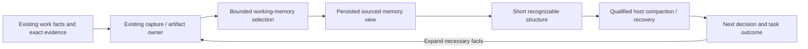

# RFC: Sparse Working Memory at Context Compaction (v0)

- **RFC status:** Accepted (upon merge)
- **Supersedes / closes:** none
- **Delivery maturity:** Proposal
- **Authors / owners:** AI-assisted proposal; context presentation, native-host, history-working-set and T02 maintainers.
- **Created:** 2026-11-16
- **Last normative revision:** 2026-11-16
- **Implementation baseline:** [`0c3b2fd21800a536ccaa61bad85c4dd8257aad8e`](https://github.com/loopx-project/loopx/commit/0c3b2fd21800a536ccaa61bad85c4dd8257aad8e).
- **Related contracts:** [History working sets](history-working-set-context-policy-v0.md), [unified work contract](controller-executor-unified-contract-v0.md), [explicit continuation](cross-session-memory-substrate-v0.md), [required work context](../../reference/required-work-context.md), [T02 research](long-horizon-harness-benchmark-research-program-v0.md).
- **Language mirror:** [中文版 — semantic mirror](sparse-compaction-working-memory-v0.zh-CN.md).

## Document map and maintenance contract

Sections 1–12 define this bounded proposal; §4 records audited code facts. The appendices contain sources and decision attribution. Accepted status takes effect only upon merge and accepts a design basis, not implemented behavior or measured benefit. This PR ships documentation only. Future execution records follow the [ledger contract](ledger/README.md); maintain both language mirrors together.

**Request versus proposal:** The requester asks to retain LoopX-recognizable structured information during context compaction, expects a sparser representation, identifies **FSoft-AI4Code/CodeWiki** as a reference, and raises Manus's use of compression as memory as a research lead. These are the requested direction, not approval of the schema, integration or claimed improvement below. All concrete design choices and experimental targets in this RFC are AI proposals pending review. “Compaction” here means conversation-context reduction, not model-weight compression.

## 1. Decision summary

Investigate **compaction as a working-memory consolidation point**: retain a small, versioned, source-bound representation of decision-relevant knowledge; keep originals and detail outside the active context; let LoopX recognize and expand that representation after compaction.

Recommend a two-part design within existing owners:

1. A persisted working-memory view contains sourced findings, rejected approaches, decision rationale and unresolved questions that are useful to continued work. It is derived material, not another Goal/Todo or permission ledger.
2. A short model-facing structure identifies that view and exposes its current decision frontier. The host retains it during compaction where a qualified integration permits, or the existing recovery adapter restores it afterward. An ordinary summary that mentions LoopX does not qualify as a recognized structure.

Begin with one local native-host profile and existing capture/read infrastructure. The feature defaults off. First compare deterministic selection with current delivery; add semantic consolidation only if it yields additional benefit. This RFC starts no paid runs, changes no runtime default, approves no source deletion and promises no cost reduction.

## 2. Problem and motivation

Current durable work state answers what is required and who owns it. A conversation also accumulates why an approach failed, which observation changed a hypothesis, and which apparent success still lacks verification. Some of that knowledge may not yet have an appropriate durable source. Losing it can change the next decision even when Todo state survives.

Synthetic example: R1 failed cache isolation; an R2 fix passes the targeted check but rollback remains unverified. After compaction, “cache fix complete” loses both a rejected approach and unfinished acceptance. Replaying the whole investigation preserves more evidence but adds input and recovery cost. The desired memory is the discriminating conclusion and its exact evidence, not a shorter activity log.

**Sparser** means fewer always-visible facts and fewer repeated canonical bodies. It does not mean less recoverable source coverage or silently weaker obligations. A smaller initial block that causes repeated full reads can be worse.

### Invariants

- Preserve complete current intent, requirements, stops and original execution/settlement identity through their existing owners and reading contracts. Unrecorded direct-user corrections must be captured as exact sources before their surrounding context is eligible for removal.
- Historical observations, model interpretations, accepted decisions and current authority remain distinguishable. A memory never grants permission, claims a Todo, passes acceptance or refreshes an old fact.
- Preserve negative evidence and unresolved distinctions that affect the next decision. No keyword-based inference of completion, rejection, trust or authority.
- A reference establishes neither reading nor comprehension, model retention or a Delta baseline. Missing essential facts retain existing dependent-action stops; independent authorized work may continue.
- An optimization can fall back; it cannot erase a missing required source or change an existing work/settlement operation.

## 3. Scope and reference designs

Scope is Goal-scoped working memory across context compactions on one machine. Cross-session expansion is qualified only within a demonstrated retention profile. Global user memory, automatic long-term experience promotion, cross-Goal recall, full-transcript ingestion, new schedulers and a new memory database are outside v0.

| Primary reference | Verified public description | What to borrow / boundary |
| --- | --- | --- |
| [FSoft-AI4Code/CodeWiki README][CW1], pinned at `7fcf9354` | Dependency graph → module hierarchy → module pages and overview | Use relationships and layered navigation rather than a chronological transcript. Its repository-documentation design does not prove conversation-compaction benefit. |
| [CodeWiki incremental updates][CW2], same revision | Saved graph/tree/build metadata; component changes drive affected-page updates | Bind memories to sources and update affected views. Reuse LoopX's work/evidence relationships; do not introduce a code dependency analyzer or copy upstream thresholds. |
| [Manus context-engineering article][M1], published 2025-07-18 | File-based externalized memory and recoverable compression retaining locators; task recitation and failure evidence | Borrow externalization, retrieval and useful failures. This source does **not** establish a fixed structured-memory schema or that every compaction performs a memory write. That specific claim remains unverified. |

This proposal applies CodeWiki's navigation idea to changing work knowledge, rather than generating a repository wiki at every compaction. The comparison is a design inference, not an existing integration.

## 4. Current-system contract: audited baseline

At the implementation baseline, source inspection confirms:

| Existing owner | Observed behavior | Remaining gap for this proposal |
| --- | --- | --- |
| [`native_context_lifecycle.ts`][LX1], `updateNativeContextLifecycle()` | Pre/PostCompact invalidates continuity evidence idempotently; SessionStart/resume and verified selected reads have separate handling | Epoch invalidation does not itself consolidate semantic working memory. |
| [`codex_context.py`][LX2], `codex_context_hook()` and `_context_continuation_instructions()` | Journals exact recovery refs; SessionStart can deliver recovery instructions; baseline loss does not invalidate the admitted Turn or require full rereading | No fixed sparse working-memory object is produced by these functions. Host-generated summary retention is not proved by hook output. |
| [`codex_context_history.py`][LX3] | Qualifies supported native replay metadata and observed read intervals; rejects unsupported/incomplete histories | A recognized memory object cannot replace these checks or extend the host qualification list. |
| [`progressive_context.ts`][LX4] and [`context_delivery.ts`][LX5] | Deterministic selected views and exact, source-bound full/Delta delivery, including saved-file continuity | A smaller representation is already possible; compare against this path, not an invented always-full baseline. Exact delivery does not prove summary fidelity. |
| [History-working-set RFC](history-working-set-context-policy-v0.md), §§5/9/11 | Accepted design for source-bound historical views, retention, optional generation and full-cost controls; Proposal maturity | Reuse its owners and gates. This RFC narrows the consolidation trigger and post-compaction representation; it does not replace that RFC or complete its milestones. |

These are static code/design findings, not installed-host, final-model-input or task-effectiveness measurements. The current-source audit and [related open work](https://github.com/loopx-project/loopx/pull/8266) must be refreshed before implementation; candidate changes are not main facts.

## 5. Proposed architecture



### 5.1 Ownership and representation

The shared TypeScript presentation boundary owns selection and validation. Existing capture/artifact IO owns persistence and exact readers; native-host adapters own event translation and delivery. Goal, request, Todo, claim/lease, admission, authorization and settlement retain their current owners. Placement is an internal extension of existing context delivery: **no new capability id, provider id or extension distribution in v0**. Later semantic generation reuses the history-working-set provider boundary rather than adding model IO to synchronous hooks.

The persisted memory view reuses existing source identities, revisions, scope and trust. Bind it to the original Goal/Agent, execution/capture, session/profile, observed compaction generation and schema/producer version. Store that binding once in the capture metadata rather than repeating all fields in the short block. A digest proves byte identity, not authorship or authorization; the reader must resolve an owner-issued reference under current access checks.

Retain only useful sourced increments: a conclusion plus its applicability basis, why a rejected attempt should not be retried unchanged, a changed assumption and contrary evidence, or an unresolved distinction. Canonical goals, Todo bodies, permissions and completed tool transcripts are referenced through their existing sources. A current decision is not inferred from a remembered historical one. Where the source has no typed classification, retain it verbatim or leave it in the ordinary context; do not classify prose as authority.

Illustrative model-facing shape; **not a shipped schema, URI scheme or CLI**:

```json
{
  "schema_version": "loopx_compaction_memory_v0",
  "memory_ref": "example-memory-17",
  "focus": "Verify R2 cache isolation; rollback is still unverified.",
  "frontier": [
    {"ref": "example-finding-4", "note": "R1 failed isolation; retain the failing condition."},
    {"ref": "example-question-2", "note": "Does R2 survive rollback?"}
  ],
  "needed_reads": ["example-original-capture:selected_todo"]
}
```

| Part | Why it exists |
| --- | --- |
| `schema_version`, `memory_ref` | Deterministic recognition and owner-validated expansion; a user/tool-supplied lookalike is untrusted content. |
| `focus`, `frontier` | Enough meaning to choose the next useful read or decision. Notes are advisory; original source refs retain provenance and distinctions. |
| `needed_reads` | Discover pending dependencies from the original contract. This is a view, not a replacement list that can silently clear or narrow that contract. |

The five top-level fields are a starting proposal, not a field-count target. Empty optional arrays can be omitted under the eventual versioned schema. Required immediate controls stay in the existing mandatory delivery. Preserve any obligation not safely representable under that contract; if the candidate exceeds budget, keep the existing view instead of clipping it. Do not reintroduce full Goal/Todo/authority snapshots merely to make the memory “structured.”

### 5.2 Compaction lifecycle

1. **Prepare:** Resolve existing sources and exact coverage while available. Consolidate only observed material; record unread/partial coverage. Persist any otherwise-unrecorded user correction through the owning source adapter, preserving trust and ordering.
2. **Publish:** Save recoverable originals, then the bound derived memory, then its selectable ref. Reuse original capture/operation identity for retries; a partial write cannot advertise a valid memory. Memory publication settles no work and spends no work quota by itself; generation costs still count.
3. **Compact:** Where a supported host exposes a qualified preservation mechanism, request verbatim retention of the short structure. A pre-compaction hook alone does not establish the ability to replace the host's compactor or customize its output. Otherwise use the existing post-compaction recovery boundary to restore the same persisted representation.
4. **Recognize and resume:** Parse only the supported version and validate the reference against its owner and expected scope. Resolve the original Turn/capture rather than silently selecting a newer one. Recheck current authority only when the existing action contract requires it; compaction alone neither readmits work nor forces a full read. Expand missing decision-relevant detail before dependent effects.
5. **Revise:** Update only affected sourced findings/frontier entries. Preserve supersession and contrary evidence in the underlying sources; do not recursively summarize yesterday's summary without leaf coverage. Repeated compactions must not grow the block into a second journal.

Repeated Pre/PostCompact and SessionStart events map to one observed boundary. Missing events, reordered events, abrupt context loss or invalid output fall back through existing recovery. A parseable object in a disk transcript proves neither that the host replayed it nor that the model saw it. Record persistence, host submission, observed model-visible delivery, decision adoption and accepted outcome separately; mark unobservable layers unknown.

### 5.3 Extraction and sparsity policy

First use deterministic selection of existing typed findings and exact references, without an extra model call. This establishes what selection and structure alone buy. Where relevant knowledge exists only in conversation, a later bounded model/host-compactor contribution can propose sourced memory, with exact input coverage and explicit observation-versus-interpretation attribution. It cannot manufacture a canonical decision or edit authorization.

Do not call another LLM synchronously from a compaction hook. Reuse a verified existing preparation/execution boundary or the host compactor only after its actual contract is qualified. If no legal source or execution boundary exists, that semantic mode remains unavailable and the original context path continues. Critical missing meaning is not repaired by pretending an empty deterministic view is sufficient.

## 6. Alternatives and trade-offs

| Alternative | Benefit | Cost / recommendation |
| --- | --- | --- |
| Existing native summary + current Progressive/Delta | No new memory lifecycle | Required baseline; may already be sufficient. |
| Full structured snapshot at every compaction | Easy schema recognition | Repeats state, costs input and can confuse stale snapshots with authority; not the preferred first experiment. |
| Sparse refs and deterministic frontier | Smallest new mechanism; no extra model generation | May require extra reads or miss conversational knowledge. Recommended first treatment, not a proven winner. |
| Sparse semantic working memory + originals | Can retain causal findings absent from task records | Extraction/drift, coverage, cost and host-integration risks; qualify only for incremental value over deterministic selection. |
| Generate a complete CodeWiki-style wiki | Rich long-lived repository navigation | Different scope and substantially more lifecycle/dependency work; reuse navigation ideas without importing the product. |

## 7. Safety, privacy and compatibility

Default-off means no new extraction, model calls, memory writes, parser-dependent continuation or extra required reads on existing paths. Existing raw machine consumers and historical capture readers keep their formats. The proposed schema is a new derived view, not removal of any stored field; register shared vocabulary and verify old/new readers before implementation. Unknown versions or fields cannot be silently treated as equivalent or eligible for deletion.

Keep private conversation and sources in their original access scope. No raw reasoning traces, secrets or new cross-Goal sharing; equal hashes do not authorize reuse. Retrieved text remains data. Resolve references through existing readers, not arbitrary file paths or shell commands embedded in memory. Revocation/deletion/source loss invalidates expansion and any affected derived view; a retained summary cannot bypass that boundary.

An unavailable optional memory falls back to ordinary delivery. An unavailable required original blocks only its dependent action under the existing contract. Rollback, stale-Goal changes and same-source/different-Agent cases must not create new admission, ownership, lease, accounting or settlement authority.

## 8. Migration and rollback

Opt in one explicitly qualified local host/profile without rewriting existing sources. During shadow inspection, persist the candidate but do not reduce model input; that phase validates bindings, not effectiveness. Then replace eligible active-context material with the short representation on that profile, retaining required controls and exact expansion.

Disablement stops new consolidation and adoption; later input uses existing delivery. Already promised references remain readable for their declared lifecycle, subject to explicit deletion/revocation. Retention must survive compaction, process restart and normal cleanup for every claimed scope; current temporary captures are not automatically durable memory. Extend the existing retention owner if necessary. No destructive migration or source GC change is authorized here.

## 9. Validation and acceptance

### 9.1 Conformance and real-path evidence

| ID | Scenario | Required result / boundary |
| --- | --- | --- |
| A1 | Real supported host compacts, then resumes through the production entry | Supported structure is validated and delivered or restored; show actual available input evidence, not just hook stdout or a saved file. |
| A2 | Two further compactions; interruption between source save and publication; duplicate/reordered events | Same original work/settlement identity, bounded view growth, recoverable publication and no repeated completed effect or debit. |
| A3 | Only revision, failed condition, unresolved check or user correction differs | Continued decisions preserve the distinction; ending an attempt is not passing acceptance. Originals and decisive tail evidence expand exactly. |
| A4 | Source missing/changed, access revoked, forged ref, foreign Goal/Agent or unknown schema | Reject affected reuse; ordinary fallback or existing dependent-action stop, with no authority escalation. |
| A5 | Hook omitted, object truncated/rewritten or host preservation unsupported | Existing recovery remains usable; no claim of structure retention or model continuity from unobserved events. |
| A6 | Off, no-benefit and mixed-version paths | Feature-off parity; no new model IO when off; preserve unknown material and existing machine/capture contracts. |
| A7 | Declared restart/cleanup scope | Promised sources remain resolvable; invalidate visibly when an explicit deletion/revocation supersedes retention. |
| A8 | Packaged enable → compact → inspect source/failure → disable | Existing settings and readback share the typed owner; qualify affected frontend/Lark/CLI entrypoints before product promotion. A single-host prototype is partial delivery. |

Structural conformance cannot prove semantic usefulness. No A-row is passed by this documentation PR.

### 9.2 Does it actually help?

Reuse [T02 / #4391](https://github.com/loopx-project/loopx/issues/4391) and the [history-working-set measurement contract](history-working-set-context-policy-v0.md#92-controls-and-complete-cost-accounting). Freeze controls, task sample, budgets, independent acceptance and decision thresholds before observing outcomes:

- **B0:** Best current legal host path, including qualified Progressive/Delta and its ordinary native summary.
- **T1:** Same tasks and compaction points, with deterministic sparse structure and exact original refs; no additional semantic generation.
- **T2, conditional:** Same sparse budget plus sourced semantic consolidation, to test memory extraction's incremental value. Do not run it merely to add an experimental arm.

Use complete continuation episodes as units: include rejected attempts, late corrections, revision changes, long-tail evidence, multiple compactions and unavailable sources. Match model/tools/environment and **total** resource limits; count preparation and readback against the same budget. Repeated calls/compactions in one episode are not independent samples. Predefine paired repetitions and a sample size appropriate to the claim; a small feasibility pilot cannot establish general superiority.

Measure independently accepted task outcomes and critical-constraint omissions first, then repeated failed approaches, human intervention, post-compaction recovery time, actual/estimated input at each observable layer, all model generation and cached/uncached usage, detail reads/retries, wall time and retained disk. Preserve every failure, fallback, no-benefit episode and budget overrun; invisible provider/model layers remain unknown.

Promote only with predeclared quality non-inferiority and material **complete-cost** improvement, or better accepted outcomes at comparable complete cost. A smaller bootstrap block, parser pass, retrieval relevance or a memory file is insufficient. If readback or cache invalidation offsets savings, retain B0 and report the negative result. This RFC contains no measured effect size or frozen numerical promotion threshold.

## 10. Operational cost and product contract

Expected first scale is one local Goal/session with many tool observations and repeated compactions; no fleet-scale demand is assumed. Deterministic mode adds bounded view selection, capture metadata and local reads, with no new model dependency. Semantic mode adds generation/input/output, retries and possible cache disruption. Storage follows retained source coverage, not just the small block; quantify lifecycle and disk growth before making long-term-memory claims.

Keep the stable prefix stable and update only changed view content. Charge extra extraction, regeneration and expansion to the complete task. Break-even depends on later input actually avoided after preparation, reads and cache effects, not an upstream compression percentage. Existing source/capture failure handling and usage observation remain the owners; no resident worker, graph database or CodeWiki install is needed.

Expose effective enablement and supported host, current source binding/coverage, restore/fallback reason, available originals and measured cost through existing context settings/readback. Users can inspect, disable or remove memory under existing data controls. Do not expose raw memory text or private locators in public telemetry. Enabling this optional path does not need per-compaction confirmation; existing scope and paid-execution authority still apply.

## 11. Normative delivery plan

| Milestone | Reviewable outcome | Entry / decisive exit evidence | Rollback |
| --- | --- | --- | --- |
| M0: Review | Agreed compaction-memory hypothesis, owner split and bounded profile | Current-source audit; D1–D3 decisions at their dependent boundaries; design acceptance does not start execution | Documentation only |
| M1: One real compaction path | Deterministic sparse view survives or is restored and expands exact originals on one supported host | Qualified host contract and retention; A1–A7 plus observed final delivery and original-identity recovery | Existing host/recovery delivery |
| M2: Utility comparison | B0/T1 outcome and full-cost comparison; T2 only for demonstrated missing semantic knowledge | Frozen sample/budgets/thresholds; §9.2 evidence, including negative results | Keep B0 or T1; no forced promotion |
| M3: Product qualification | Enablement, inspection, failure/recovery and disablement through affected surfaces | A8, mixed-version/off parity; separately qualify broader hosts and retention | Disable optional view; preserve valid refs |

First implementation candidates are narrow changes to `quota/progressive_context.ts` and `native_context_lifecycle.ts` for view/lifecycle semantics; `turn_driver/decision_capture.py`, `codex_context.py` and its history adapter for capture and host IO; existing context configuration/readback and their tests. Confirm the actual first caller before editing; reuse current source/reader contracts rather than a second memory service. No implementation or migration is part of this PR.

## 12. Open decisions

| ID | Options and AI recommendation | Owner / decision point |
| --- | --- | --- |
| D1 | Native-compactor structured output versus persisted view with post-compaction restoration: prefer existing recovery integration first; qualify actual host ability to preserve a structure before claiming native retention | Native-host / context maintainers, before M1 |
| D2 | Which findings, source coverage, retention scope and sparse budget: start with typed investigation results and unresolved distinctions on one Goal; exact unrecorded corrections remain mandatory. Choose schema/limits from measured workload, not field-count aesthetics | Context / history / source owners, before M1 |
| D3 | Whether semantic extraction is needed and when it runs: deterministic T1 first; reuse a bounded verified execution boundary for T2 if conversation-only knowledge makes T1 insufficient | History / runtime owners, before semantic implementation or runs |
| D4 | Task sample, non-inferiority margin and material benefit: predeclare complete-cost and outcome criteria; do not import CodeWiki/Manus numbers or infer success from fewer bytes | T02 / evaluation owners, before any model experiment |

## Appendix A: Evidence and decision record

- Static audit: named LoopX sources at `0c3b2fd21800`; CodeWiki README/update guide at `7fcf9354f70a5468bc739d849055f8cbab9d46aa`; Manus's dated primary article. This does not certify current proprietary Manus internals or upstream implementation quality.
- Request-confirmed direction: recognizable, sparser structure at compaction; AI4Code reference. Manus's exact compression-time memory-write behavior remains a lead, not a verified premise.
- Proposed, unapproved: schema, field selection, host profile, lifecycle details, thresholds and implementation sequence. No runtime/default change, paid/model experiment, measured saving, host-install acceptance or product promotion has been performed.
- No RFC is superseded, stored field removed or existing acceptance milestone closed. Future dated execution evidence belongs in the ledger only after real work exists.

[CW1]: https://github.com/FSoft-AI4Code/CodeWiki/blob/7fcf9354f70a5468bc739d849055f8cbab9d46aa/README.md
[CW2]: https://github.com/FSoft-AI4Code/CodeWiki/blob/7fcf9354f70a5468bc739d849055f8cbab9d46aa/guides/incremental-updates.md
[M1]: https://manus.im/blog/Context-Engineering-for-AI-Agents-Lessons-from-Building-Manus
[LX1]: https://github.com/loopx-project/loopx/blob/0c3b2fd21800a536ccaa61bad85c4dd8257aad8e/loopx/control_plane/quota/native_context_lifecycle.ts
[LX2]: https://github.com/loopx-project/loopx/blob/0c3b2fd21800a536ccaa61bad85c4dd8257aad8e/loopx/control_plane/turn_driver/codex_context.py
[LX3]: https://github.com/loopx-project/loopx/blob/0c3b2fd21800a536ccaa61bad85c4dd8257aad8e/loopx/control_plane/turn_driver/codex_context_history.py
[LX4]: https://github.com/loopx-project/loopx/blob/0c3b2fd21800a536ccaa61bad85c4dd8257aad8e/loopx/control_plane/quota/progressive_context.ts
[LX5]: https://github.com/loopx-project/loopx/blob/0c3b2fd21800a536ccaa61bad85c4dd8257aad8e/loopx/control_plane/quota/context_delivery.ts
