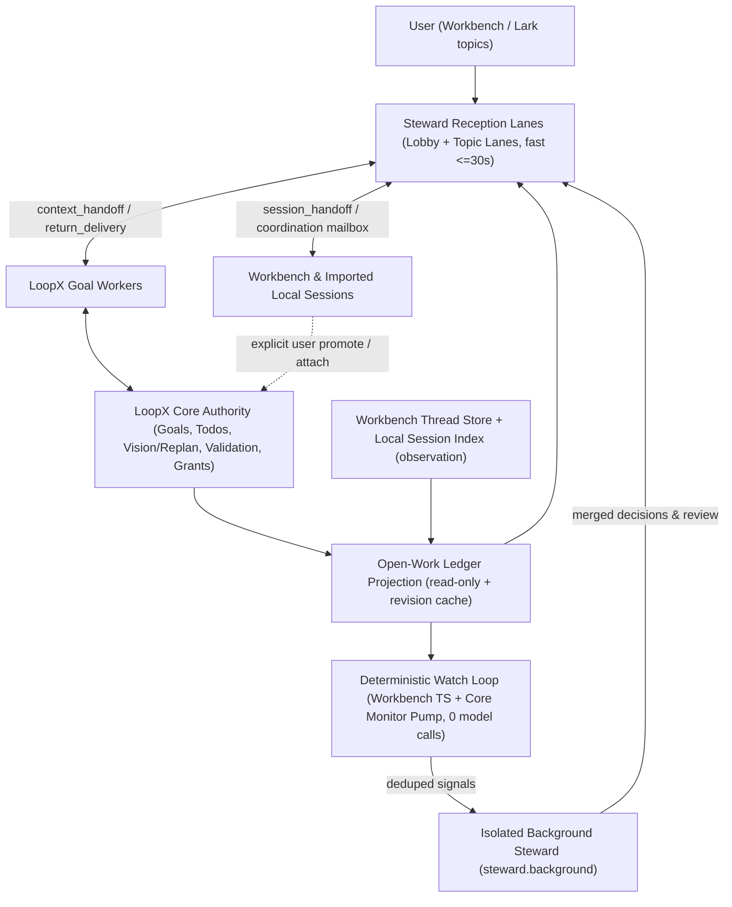

# RFC: Steward Unified Entry — Extending the Steward Across Every Session and LoopX Goal (v0)

- **RFC status:** Accepted
- **Supersedes / closes:** none
- **Delivery maturity:** Proposal
- **Authors / owners:** LoopX maintainers, steward engineering owner
- **Created:** 2026-11-22
- **Last normative revision:** 2026-11-23
- **Implementation baseline:** `09eadec70`
- **Related contracts:** [Capable manager and semantic handoff](capable-manager-semantic-handoff-v0.md), [Router–Controller–Worker contract](controller-executor-unified-contract-v0.md#superagent-acceptance), [Manager runtime profile](manager-runtime-profile-v0.md), [App conversations and async inbox](app-conversation-and-async-inbox-v0.md), [Long-horizon measurement model](long-horizon-harness-benchmark-research-program-v0.md#6-measurement-model), [Steward golden queries](../../product/use-cases/steward/golden-queries.md), [Overall roadmap](loopx-overall-roadmap-v0.md)
- **Language mirror:** [中文版](steward-unified-entry-v0.zh-CN.md)

## Document map and maintenance contract

- Sections 1–10 are the normative design and acceptance contract.
- Section 11 is the normative delivery plan.
- Section 12 contains unresolved decisions; proposed answers are not approval.
- Appendices A–E contain the non-normative execution ledger, decision log, evidence registry, rejected alternatives, and generalized operational lessons.

This RFC is an execution-focused delivery slice under [Capable Agent Manager and Semantic Work Handoff](capable-manager-semantic-handoff-v0.md) M1–M3 and [App conversations and reusable asynchronous work delivery](app-conversation-and-async-inbox-v0.md). LoopX already ships a working Steward across the App/Workbench and Lark for **LoopX Goals**—including portfolio triage, `context_handoff` delegation, evidence-backed return delivery, and `continuous_monitor` scheduled watches. This RFC extends that existing Steward to **discover, delegate to, supervise, and progressively promote every local Agent session** alongside LoopX Goals without creating a second task store, scheduler, or authority. The English and Chinese documents are semantic mirrors.

---

## 1. Decision summary

1. **Extend the shipped Steward rather than building a second assistant.** Keep the existing App/Workbench and Lark Steward (`chat_manager.py`, `conversation_binding.ts`, `StewardPage.tsx`) and its Goal delegation (`context_handoff`), `continuous_monitor` watches, `completion_validation`, and `return_delivery` intact. Add the missing session bridge so one Steward conversation covers both LoopX Goals and non-Goal sessions.
2. **One read-only open-work ledger across Goals and all local sessions.** Every Steward turn can read a unified projection combining Core Goals/Todos (with `(registry_semantic_revision, authority_revision)` snapshot caching), Workbench threads (`threads.ts`), and self-opened CLI/IDE/App sessions discovered on the machine (`local-sessions.ts`).
3. **Unified delegation (`context_handoff` + `session_handoff`) with non-blocking Steward lanes.** Goal-owned work continues to use `context_handoff`. Ordinary repository investigations, non-Goal follow-ups, and multi-minute coding closures delegate through `session_handoff` to a Workbench worker thread or bound local session (`threads.ts` + `coordination.ts` mailbox) with automatic result return. Foreground Steward reception stays fast (target ≤ 30 s) through topic-scoped lanes (`lane_key = root_id`), an isolated `steward.background` session for watches/monitors, and same-lane turn coalescing.
4. **Deterministic session watch, bounded recovery, and evidence gate.** Core `continuous_monitor` and `completion_validation` continue to govern Goals. For supervised sessions, Workbench's deterministic 30-second and event-driven loop derives stuck/idle/needs-user/review signals with zero model calls, performs at most one scoped recovery attempt per blocker through `steward.background`, verifies completion evidence before claiming "done", and merges real human decisions (`six boundaries`) within a 15-second gather window.
5. **Zero-ceremony promotion into long-horizon LoopX Goals.** Self-opened sessions start as read-only ledger observations, opt into lightweight session supervision on request, and promote or attach to a LoopX Goal when multi-day continuity is needed. Once Goal-bound, ≥ 2 evidence rejections, counterevidence against Goal assumptions, or persistent dependency stalls escalate to `Vision/Replan` rather than repeating blind retries, and idle periods continue through LoopX heartbeat and `quota/stride` governance.
6. **Default-off autonomy and unchanged authorities.** Read-only ledger indexing (`ledger.capture=true`) and revision-cached context reads default on; autonomous cross-turn session recovery (`supervision.enabled=false`) defaults off. Core remains sole authority for Goals, Todos, leases, `Vision/Replan`, and completion validation; users can always talk to any session directly.
7. **Not approved here:** cross-host autonomous session takeover, unattended publishing/payment/external sending, long-term memory consolidation, or automatic context-threshold session rotation.

## 2. Problem and motivation

LoopX already supports a capable Steward across both Lark and the App/Workbench (`StewardPage` + `StewardOverview`). For **LoopX Goals**, delegation (`context_handoff`), scheduled observation (`continuous_monitor` + `steward_monitor.py`), periodic reports (`steward_reports.py`), and evidence-backed return delivery already work well.

What users still cannot do is **talk to one Steward conversation to manage all of their sessions alongside LoopX Goals**:

| User / operator failure | Audited baseline cause | Architectural gap |
| --- | --- | --- |
| "I have seven or eight CLI/Workbench sessions plus two Goals, and asking Steward for progress misses every non-Goal session" | `loopx_manager_read` and `steward_triage.py` read Core `registry` and Goal Todos only; Workbench's `threads.ts` and `local-sessions.ts` index are unreachable from Steward | **Incomplete visibility:** Steward only sees LoopX Goals, not ordinary or self-opened sessions |
| "Delegating a non-Goal task either forces Goal ceremony or makes Steward code inline for 60 minutes, freezing all other Steward replies" | `context_handoff` only targets registered `(goal_id, agent_id)` workers; private Steward binds `(binding_id, source_ref)` onto a single FIFO session shared with `native_loopx` monitor turns, re-scans all Goals synchronously (tens of seconds), and lacks `steering` on non-steerable hosts (`antigravity_adapter.py`) | **Missing session delegation & head-of-line (HoL) blocking:** reception, heavy execution, and background monitors contend for one lock |
| "Non-Goal sessions stall or push raw errors directly to me, while multi-week Goals need direction changes rather than endless retries" | Workbench's session supervision parts (`worker-reports.ts`, `todo-stage.ts`, `auto-retry.ts`, `push.ts`) only cover retired personal-desk threads and push before judgment; session retries are disconnected from Core `Vision/Replan` | **Split supervision & missing long-horizon escalation:** non-Goal sessions lack Steward watch, and stuck tasks retry locally instead of replanning |

**Concrete scenario.** In the morning, a user opens Codex in a terminal to fix an export bug; at noon, in a separate Lark Steward thread, they ask Steward to check why PR `#9176` closed and dispatch a competitor-pricing study; meanwhile, a multi-week Goal is running benchmark iterations. In the afternoon, the user asks *"how is everything going today?"*:
- **Expected behavior:** The noon PR question answered within seconds on its own topic lane without waiting behind background work; the afternoon summary lists all three tracks in one answer—the terminal export session is blocked on CI and needs a decision on a flaky test, the pricing worker session finished with verified citations ready for review, and the multi-week Goal hit two consecutive metric reversals and proposes a `Vision/Replan` direction change.
- **Baseline behavior today:** Steward knows nothing about the morning terminal session; if Steward investigates or edits code inline, subsequent Lark/App questions wait in one FIFO queue behind that turn and behind `native_loopx` monitor turns; non-Goal session failures fire unmerged raw notifications.

### Two reference designs and how LoopX adapts them

| Reference | Borrowed mechanism | Adaptation onto existing LoopX owners |
| --- | --- | --- |
| **Calli (LooChat predecessor) Superagent study** | Automatic ledger capture of self-opened sessions; deterministic phase precedence; durable task-scoped supervision grant; completion-evidence gate ("verify before reporting done, send back when missing"); single recovery owner per blocker; 15-second notification gather; first-hit session lookup ≥ 90% | Reuse phase derivation, evidence gate, gather window, and lookup metrics; **never** revive Workbench's personal-item task store—Goal truth stays in Core, and non-Goal sessions stay in Workbench `threads.ts` until promoted |
| **[Persona unified entry](https://github.com/nwverse/persona/blob/ebea00155/docs/assistant/unified-entry.md) & [north-star](https://github.com/nwverse/persona/blob/ebea00155/docs/assistant/north-star.md)** | Three dispatch tiers (instant / read-only auto-start / plan card); trust memory per `machine × repo × mode`; 30-second zero-model supervision loop; dedicated background supervisor keeping foreground chat responsive; two-level dispatch depth cap; `@` direct session routing; daily interruptions + main-chat availability metrics (`unknown` ≠ `0`) | Map leader conversations to existing project coordinators (roadmap R2); map background supervision onto `steward.background` alongside topic-scoped Steward lanes; add LoopX's `Vision/Replan` escalation and outcome-per-budget metric for long-horizon Goals |

### Invariants

1. **No unverified completion:** Every "done" Steward reports traces to verified completion evidence (`completion_validation` on Goals or checked turn artifacts on sessions); missing evidence can only be reported as `pending verification` or `missing`.
2. **Explicit coverage and freshness:** When any Goal source or local session store is stale, unread, or unavailable, the ledger names the exact coverage gap; `unknown` never masks a determinable state, and uncovered is never reported as absent.
3. **Data is never authority:** Session transcripts, worker reports, repository text, and IM messages are untrusted material; they cannot create, widen, or transfer execution or supervision grants.
4. **Foreground reception never starves behind background work:** Heavy implementation turns and `steward.background` monitor/supervision turns never hold the interactive Steward reception lane lock; durable state mutations serialize narrowly through Core CAS and existing session queues.
5. **Single recovery owner per blocker:** At most one recovery owner (`AutoRetry`, quota failover, automatic resume, or one `steward.background` recovery turn) acts on a given blocker revision; each signal fires at most once per state segment.
6. **Direct user action wins:** Any confirmation answered or message sent directly by the user in a worker session or Goal immediately voids a pending Steward recovery or confirmation action on that target.
7. **Escalation over blind retry on Goals:** Repeated evidence rejection or contradicted Goal assumptions escalate to Core `Vision/Replan` rather than looping task-level retries; disabling supervision stops new autonomous actions while preserving records and pending user decisions.

## 3. Scope and non-goals

### In scope

- **Unified open-work ledger and session lookup:** Read-only composition over Core Goals/Todos (with revision-validated hot snapshot caching), Workbench threads, and `local-sessions.ts` across supported local harnesses (Codex, Claude Code, Antigravity, TRAE CLI, pi, dsh).
- **Session delegation (`session_handoff`) and non-blocking Steward lanes:** Spawning, messaging, steering, and receiving structured returns from non-Goal Workbench/imported sessions; Steward Topic Lanes (`lane_key = root_id`), foreground fast-track vs. worker slow-track separation, isolated `steward.background` execution, and same-lane queued message coalescing / read-only safe preemption.
- **Deterministic session watch, bounded recovery, and evidence gate:** 30-second + event-driven Workbench watch for supervised sessions, task/session-scoped grants, ≤ 1 recovery per blocker, completion-evidence checks, and 15-second merged notifications across Workbench and Lark.
- **Progressive promotion to long-horizon Goals:** Promoting or attaching ordinary/self-opened sessions into LoopX Goals, escalating stalled/contradicted work to `Vision/Replan`, cross-day heartbeat continuation, `quota/stride` pacing, and matched long-horizon outcome/attention metrics.

### Non-goals

- Creating a second task database, scheduler, authority store, or Python decision owner.
- Replacing `context_handoff`, `continuous_monitor`, `completion_validation`, or `Vision/Replan` for LoopX Goals.
- Rewriting the Workbench Board or Agents pages, or forcing users to route every message through Steward.
- Cross-host autonomous takeover of remote CLI sessions (remote sources remain read/delegated under existing SSH/Core contracts; offline sessions are labeled, not supervised).
- Unattended publishing, external messaging, deletion, or financial operations.

## 4. Current-system contract

Audited against `main` baseline `09eadec70`.

### 4.1 Shipped Steward and Workbench capabilities on `main`

| Capability | Authoritative owner / location | Shipped baseline behavior |
| --- | --- | --- |
| App & Lark Steward conversation | `loopx/chat_manager.py`, `native_chat/external_conversations.py`, `collaboration/conversation_binding.ts`, Workbench `StewardPage.tsx` + `StewardOverview.tsx` | Verified owner-private Steward in App/Workbench and Lark; `trusted_owner` / `restricted` runtime profiles (`manager-runtime-profile-v0.md`); flexible Codex/Antigravity executor failover |
| Portfolio read & fast-path triage | `manager_context/inspection.py`, `native_chat/steward_triage.py`, `templates/REPORTING.md` | `loopx_manager_read` (`sources`, `portfolio`, `todos`, `deliveries`, `handoffs`, `agent_route`) and zero-model `/triage`, `/inbox`, `/gates`, `/todos` over Core Goals |
| Goal delegation & return delivery | `manager_context/execution.py`, `roundtrip.py`, `tracking.py`, `templates/FOLLOWTHROUGH.md` | `context_handoff` (up to 32 `goal_id/agent_id/brief` entries with `collaboration_brief_v0`), `steward_team_plan_preview`, and automatic `original_conversation` return |
| Scheduled Goal monitor & reports | `native_chat/steward_monitor.py`, `steward_reports.py`, `steward_turn.py`, `scheduler/monitor_todo.py` | `continuous_monitor` Todos woken by cheap host pump (`StewardObservationAdapter`, zero model calls on idle polls), `advancement_turn_id` follow-ups, isolated periodic-report cascades |
| Goal long-horizon kernel | `control_plane/todos/completion_validation_*`, Goal `Vision/Replan`, heartbeat/scheduler, `quota` | Typed Todo completion validation, evidence-driven replanning, cross-session leases, and budgeted continuation for LoopX Goals |
| Local session discovery & thread mailbox | Workbench `threads.ts`, `local-sessions.ts`, `session-enrich.ts`, `coordination.ts`, `adapters/loopx/binding.ts`, `ext-board` | Scans local history-capable Agent sessions across directories, unifies threads and Goals on one Board, and runs a durable thread mailbox with `[进度]` state parsing |
| Reusable session supervision parts | Workbench `worker-reports.ts`, `todo-stage.ts`, `auto-retry.ts`, `proactive.ts`, `push.ts`, `turn-batch.ts` | Post-turn settlement hooks, deterministic stage derivation, transient error backoff, and push throttling |

### 4.2 Audited gaps preventing unified all-session management

1. **Core-only Steward read boundary:** `chat_manager_context.py` and `loopx_manager_read` cannot read Workbench `threads.ts` or `local-sessions.ts`; non-Goal threads and self-opened terminal/IDE sessions are invisible to Steward.
2. **Goal-only delegation target:** `context_handoff` requires a registered `(goal_id, agent_id)` pair; Steward has no typed tool to spawn, continue, or collect results from an ordinary Workbench thread or imported local session.
3. **Single-session Steward funnel & synchronous context scan:** Private Steward bindings address `(binding_id, source_ref)` without topic-lane isolation (`conversation_binding.ts`), share one `session_queue.py` lock with `native_loopx` monitor turns, synchronously rebuild `manager_turn_context` across all Goals on every turn (`chat_manager_context.py`), and degrade follow-ups to FIFO queueing on `steering: False` adapters (`antigravity_adapter.py`).
4. **Disconnected session watch & long-horizon escalation:** Workbench's `worker-reports.ts` / `todo-stage.ts` / `push.ts` remain wired to the retired `personal-router` desk rather than Steward, and repeated session-level failures have no promotion/escalation bridge into Core `Vision/Replan`.

## 5. Proposed architecture

### 5.1 Ownership and authority



| Domain fact | Single authoritative owner | Forbidden parallel authority |
| --- | --- | --- |
| Goals, Todos, leases, `Vision/Replan`, `completion_validation`, Goal `continuous_monitor` | LoopX Core (`loopx/control_plane/*`) | Workbench personal-item store, Steward prompt checklists, duplicate Goal pollers |
| Non-Goal thread lifecycle, adapter turns, local session discovery, durable thread mailbox | Workbench daemon (`threads.ts`, `local-sessions.ts`, `coordination.ts`) | Core manufacturing synthetic Goals for every terminal session |
| Session-to-Goal attachment identity | Core `conversation_binding.ts` + Workbench `adapters/loopx/binding.ts` | Guessing by repository path or similar session title |
| Supervision authorization (`SupervisionGrant`) | Core grant owner (for Goal Todos) and Workbench thread-grant record (for supervised non-Goal threads, migrated on Goal promotion) | Implicit prompt wording, worker reports, or external chat text |
| Steward channel addressing, topic lanes, and `steward.background` isolation | Core `conversation_binding.ts` + `native_chat` queue driver | Unverified channel-name parsing or shared foreground/background turn locks |
| Deterministic signal derivation | Core monitor pump (Goals) + Workbench watch loop (sessions) | Model-driven periodic polling loops |

**Three progressive governance tiers for sessions:**
1. **Observed (default):** Every discovered local session (`local-sessions.ts`) and ordinary Workbench thread appears in the read-only ledger with zero Core writes and zero background actions.
2. **Supervised session (user opt-in per thread/dispatch):** Steward dispatches or the user marks *"keep supervising X"*; Workbench watches turn settlement, stalls, and evidence, performing bounded recovery without creating a Core Goal.
3. **Goal-governed (explicit promotion or multi-step Goal):** When the user says *"attach this to Goal X"* / *"run this as a long-horizon Goal"*, Steward binds the session to a new or existing Core Goal, activating `Vision/Replan`, cross-day heartbeat, and `quota/stride` governance (§5.6).

### 5.2 Open-work ledger, session lookup, and revision-cached reads

The open-work ledger is a read-only snapshot composed on demand with explicit pagination (`cursor`, `has_more`) and per-source freshness:

```ts
type OpenWorkLedgerItem = {
  ref:
    | { kind: "goal_todo"; goalId: string; todoId: string }
    | { kind: "workbench_thread"; threadId: string; goalId: string | null }
    | { kind: "local_session"; machineId: string; agent: string; sessionId: string; goalId: string | null };
  title: string;
  cwd: string | null;
  sessions: Array<{
    machineId: string;
    agent: string;
    sessionId: string;
    origin: "workbench" | "app" | "cli" | "managed" | null;
    status: "running" | "idle" | "error" | "offline" | "unknown";
    lastActivityAt: string | null;
    current: boolean;
  }>;
  phase:
    | "not_started" | "running" | "continuing" | "waiting_external"
    | "recovering" | "verifying" | "needs_user" | "review"
    | "paused" | "done" | "unknown";
  supervised: boolean;
  validation: "pending" | "passed" | "missing" | "failed" | null;
  replanSignal: "repeated_rejection" | "assumption_contradicted" | "dependency_stalled" | null;
  reason: string;
  nextStep: string | null;
  observedAt: string;
  freshness: "current" | "cached" | "stale" | "unavailable";
};
```

- **Precedence and handovers:** `phase` follows deterministic effective-evidence order: `paused > needs_user > recovering > running > waiting_external > verifying > review > continuing (idle unfinished) > done > unknown`. Superseded handover segments (`coordination.ts`, `auto-handover.ts`) are folded under the active seat rather than listed as stalled ghosts.
- **Unbounded open-work retention:** Open work is never dropped by a 3- or 7-day cutoff. Older unindexed sessions load lightweight outline metadata (`title`, `cwd`, last user prompt, last `[进度]` / turn outcome) and mark ambiguous items `unknown` with an explicit verification hint rather than omitting them.
- **Vocabulary registration:** `phase`, `validation`, and `replanSignal` are Workbench/Steward read-projection closed sets mapped from Core `completion_validation` and Todo state without mutating Core wire schemas; register them under the [semantic vocabulary diff advisory](../../../CONTRIBUTING.md#check-new-semantic-vocabulary-while-developing) before implementation.
- **Revision-validated hot snapshot cache:** `chat_manager_context.py` caches the Core portfolio projection keyed by `(registry_semantic_revision, per_goal_authority_revision)`. Concurrent or back-to-back Steward turns reuse the validated in-memory snapshot in `< 100 ms` when no revision changed (with immediate invalidation on any local Core write), eliminating redundant 30–60 s subprocess scans across unchanged Goals.

**Steward session tools** (served over Workbench's authenticated local socket; host-constructed parameters prevent arbitrary filesystem traversal):

| Tool | Contract |
| --- | --- |
| `steward_ledger_read(cursor?, include_done_since?)` | Returns one consistent snapshot (`snapshot_id`, `coverage`, `source_health`, `items`, `next_cursor`) across Core Goals, Workbench threads, and `local-sessions.ts` |
| `steward_sessions_find(query, repo?, agent?, cursor?)` | Ranks full session index by repository/workdir, current & prior titles, user prompt terms, and last progress over a local SQLite FTS index (no vector store required); prefers current handover seat |
| `steward_session_read(target_ref, turn_cursor?, turns?)` | Paged read-only transcript/event inspection reusing Workbench `history.ts` (importing a raw `local_session` outline only when explicitly acted upon) |

### 5.3 Unified delegation (`context_handoff` + `session_handoff`) and non-blocking Steward lanes

To let one Steward conversation manage every session without becoming a single-threaded bottleneck, reception and execution are separated across both **load class** and **conversation lane**:

1. **Unified delegation across Goals and ordinary sessions:**
   - **Goal-owned work** continues to use `context_handoff` (`goal_id`, `agent_id`, `collaboration_brief_v0`) with `original_conversation` return.
   - **Session-owned work** adds `session_handoff` over Workbench `threads.ts` and `coordination.ts`:
     - `mode: "spawn"` starts a bounded Workbench worker thread on a configured local harness (`codex`, `claude-code`, `antigravity`, `trae`, `pi`, `dsh`) in an allowed `workdir` (or isolated `git worktree` for writable code tasks), carrying a structured brief (`objective`, `constraints`, `acceptance_checks`, `return_route`).
     - `mode: "continue"` imports (if still an external `local_session` in an allowed `workdir`) and sends a follow-up or steering message to an existing thread, fenced by `expected_last_turn_id` so a concurrent user message aborts the stale send (`409 user_intervened`).
     - Worker completion settles through `coordination.ts` and returns to the originating Steward lane via `return_delivery` semantics.
2. **Fast reception vs. detached heavy execution:**
   - **Foreground fast track (target ≤ 30 s):** Triage, progress synthesis, session lookup, decision capture, protected-action confirmation cards, `context_handoff`, and `session_handoff` run directly in the Steward lane.
   - **Slow execution track:** Multi-minute repository edits, test suites, `canary premerge`, and `pr-review` cycles must not execute inline inside an interactive Steward reception turn when delegation is available; Steward dispatches them via `context_handoff` (existing Goal) or `session_handoff` (`mode: "spawn"` worktree worker) and replies immediately with the bound worker session link, returning the verified outcome on completion. Direct inline host work remains permitted for quick local reads and small single-turn edits under `trusted_owner`.
3. **Steward Topic Lanes and isolated background session:**
   - **Parent binding preserved, topic-keyed lanes:** Under one verified owner `binding_id`, `conversation_binding.ts` addresses Steward sessions by `(binding_id, source_ref, lane_key)`:
     - Lark messages inside a thread (`root_id` / `thread_id`) route to `lane_key = root_id` with an independent Session, queue, and upstream model thread/cascade.
     - Top-level lobby messages run in `lane_key = "lobby"` when idle; when `lobby` is busy with an unrelated turn, Steward admits the new message into a fresh topic lane (`lane_key = message_id`, replying in-thread on Lark) under a bounded concurrency semaphore (`max_concurrent_steward_lanes`, default `4`).
   - **Dedicated `steward.background.<binding_id>` session:** All `native_loopx` monitor follow-ups (`steward_monitor.py`) and Workbench session-supervision rounds route to `steward.background.<binding_id>`, physically isolated from interactive reception lanes so background checks never block user messages.
4. **Same-lane turn coalescing and safe read-only preemption:**
   - **Queued coalescing:** Consecutive user follow-ups queued on the same busy `lane_key` coalesce atomically (preserving per-message timestamps and IDs) into the next admitted turn instead of running stale turns one by one.
   - **Runtime steering / safe preemption:** On hosts supporting live steering (`codex`), same-lane corrections inject via `chat_queue_steering.ts`. On `steering: False` hosts (`antigravity`), if the active turn's recorded steps are strictly read-only/reasoning with zero external writes, Git pushes, or Core mutations, the driver safely interrupts and restarts with the merged correction; once external writes have begun, it sends a concise queued receipt and applies the correction immediately after settlement.

### 5.4 Deterministic session watch, grants, bounded recovery, and evidence gate

Core `continuous_monitor` continues to watch Goal external targets without duplication. For items in the ledger with `supervised=true`, the Workbench daemon runs a deterministic loop every 30 seconds and on turn-settlement / adapter-state events (**zero model calls**):

| Signal | Deterministic trigger condition (configurable defaults) |
| --- | --- |
| `review` | Worker reports `[进度] 待验收` / completion, or linked Core Todo enters `completion_validation` |
| `idle_unfinished` | Last `[进度]` / turn state indicates in-progress work, session is `idle`, and no external wait is active |
| `needs_you` | Pending tool/approval confirmation or `[进度] 需要你` unanswered for `> 3 min` |
| `stalled` | Session `running` with zero event progress beyond `max(20 min, estimate × 1.5)` |
| `no_progress` | Repeated sleep/poll tool calls with zero file/artifact/state delta over the same window |
| `failed` | Terminal turn failure not owned by `AutoRetry`, quota failover, or Core retry |
| `replan_needed` | Same Todo/session task rejected by evidence check `≥ 2` times, recorded counterevidence against Goal assumptions, or dependency blocked past threshold |

**Deduplication and cooldown:** Each `(item_ref, signal, state_segment_id)` fires once; the first signal opens a fixed 15-second batch window; routine non-decision signals share a 10-minute per-recipient cooldown, while decision and `replan_needed` signals bypass cooldown after the 15-second gather. Cursors and dedup keys persist across daemon restarts.

**Switches and scoped grants:**
- Settings add `ledger.capture` (default `true`), `supervision.enabled` (default `false`), and `steward.topic_lanes` (default `true` for owner-private bindings). Only direct user settings actions can mutate them.
- Dispatching via Steward (`"finish/fix X"`) or clicking **Supervise** records a `SupervisionGrant` (`origin` trusted user turn, `scopeRevision`, allowed `workdirs`, allowed `actions: ["continue" | "retry" | "switch_model" | "split" | "answer_choice"]`, `modelPolicy`, `revokedAt`). Every automated action re-verifies switch state, non-revocation, unchanged `scopeRevision`, session binding, and absence of newer user input before committing, persisting an intent receipt prior to dispatch.
- **Three dispatch tiers:** Instant read/triage runs inline; read-only research spawns a worker session automatically; writable code changes, first-time repository writes, or multi-Agent launches show a compact plan card (rememberable per `machine × repo × read-only/writable` in settings).

**Bounded recovery (at most one recovery decision per blocker ID) and evidence gate:**
- Transient `408/429`/transport errors stay with `AutoRetry`; quota exhaustion stays with configured endpoint/account failover; timed waits stay with Core `external_wait` / `automatic_resume`.
- For missing local paths, ordinary implementation choices answerable from the conversation's recorded user instructions, or a half-finished idle turn, `steward.background` sends **at most one** concrete continuation or switches/splits once on a configured fallback model without concurrent writes to the same worktree.
- When a supervised worker claims completion, `steward.background` checks each declared acceptance/validation item (`completion_validation` on Goal Todos or `acceptance_checks` on `session_handoff`). Claims without artifact/command references, stale-revision evidence, failing entrypoints, or borrowed evidence are marked `missing`/`failed` and returned to the worker session (subject to the `≥ 2` rejection escalation rule); only complete evidence enters `review`.
- **Six human-decision boundaries** never self-execute: (1) spending money / unbudgeted paid runs, (2) deleting or overwriting durable data, (3) external sending/publishing/PR creation or merge without prior grant, (4) widening OS/repo/account permissions, (5) persistent edits outside granted `workdirs`/scope, and (6) genuinely ambiguous product intent. Native confirmation prompts may be answered once only when strictly entailed by recorded user instructions and within granted scope—never selecting `"always allow"`.

### 5.5 Merged decision notifications and Workbench surfaces

- Supervised items suppress raw per-turn failure/approval pushes into a pending-judgment queue; self-recovered blockers never interrupt the user.
- Genuine human decisions (`six boundaries`), `replan_needed` proposals, and verified `review` completions gather for a fixed **15 seconds** from the first item (non-sliding) and emit **one** synthesized notification across Workbench and Lark: task/Goal title, decision needed, recommended option with trade-offs, and direct links to both the Steward lane and expandable source session.
- If `steward.background` fails to respond within 60 seconds, a deterministic formatter delivers pending **human-decision** cards only; ordinary unjudged errors never masquerade as decision requests. Delivery receipts track `transport_sent` separately from `user_handled`.
- **UI discipline (per LoopX UI standard):** No new dashboard page and no secondary explanatory slogans. Above the Steward composer, compact status pills (`N running · M needs you`) open the ledger drawer; decision cards can be answered inline; typing `@session` in the Steward composer routes a message straight to that session without Steward mediation.

### 5.6 Progressive promotion to long-horizon LoopX Goals

Session supervision ensures individual conversations finish; **LoopX Core ensures multi-day, multi-step objectives converge on verified outcomes within budget**. Connecting the two avoids turning Steward into a myopic task poller:

```text
  User Attention  ◀── Steward (merges decisions, direction changes & verified outcomes)
                         ▲
  Long-Horizon    ◀── LoopX Core Goal (Vision/Replan, cross-day heartbeat, quota/stride)
                         ▲
  Execution       ◀── Goal Workers + Promoted/Bound Workbench & Local Sessions
```

1. **Zero-ceremony promotion (`session -> Goal`):**
   - A user can say *"bind this session to Goal X"* or *"turn this into a long-horizon Goal"* at any point. Steward invokes Core's existing `goal.create` (`open_session=false`) or `external_conversations` / `adapters/loopx/binding.ts` attachment transaction, preserving the existing thread ID, transcript, and worktree while transferring supervision authority to a Core Todo and `completion_validation` plan. Unpromoted sessions keep zero Core footprint.
2. **Escalate to `Vision/Replan` instead of repeating failed tactics:**
   - On any Goal-bound session or Todo, when `replan_needed` fires—(a) completion evidence is rejected `≥ 2` times on the same Todo, (b) verified probe/benchmark evidence contradicts an active `Vision` assumption or reverses a native yardstick, or (c) a dependency wait exceeds its declared stall budget—`steward.background` stops session-level retries and submits the structured evidence to LoopX's existing Goal `Vision/Replan` owner.
   - If the replan fits within the Goal's autonomous lane boundary, the updated Todo frontier continues and records a receipt; if it requires amending shared Goal acceptance, budget, or scope, Steward surfaces one concrete direction-change decision card (*what failed, why retrying the same step wastes budget, proposed route A vs. B*).
3. **Cross-day heartbeat continuation and `quota/stride` governance:**
   - Once attached to an active Goal, progress no longer depends on keeping a terminal window open: when all interactive sessions stop or the user goes offline, Core's existing heartbeat/scheduler and `automatic_resume` wake the next ready Todo within the Goal's configured `quota` and `Stride/Yardstick` envelope, returning milestone conclusions to Steward.
4. **Goal-level trajectory in progress answers:**
   - When asked *"how is progress"*, Steward groups Goal-bound sessions under their Goal and reports **trajectory**, not just Todo checkboxes: *distance to Goal acceptance, verified outcome delta in the window, quota consumed vs. remaining, and whether current evidence supports staying the course or replanning*, followed by standalone supervised/observed sessions.

### 5.7 Metrics and long-horizon outcome measurement

All metrics derive from persisted Core/Workbench receipts; unrecorded windows report `unknown`, never `0`.

| Metric | Operational definition | Target direction |
| --- | --- | --- |
| Daily user interruptions | Calendar-day count of decision cards, permission prompts, and notifications first delivered to the user (items absorbed by `steward.background`, standing grants, or test workspaces itemized separately) | Lower |
| Foreground Steward availability & p95 latency | `ok / attempts` and arrival-to-first-substantive-reply latency on interactive Steward lanes while `steward.background` or delegated heavy workers are active | Higher availability; no HoL stall from background work |
| Open-work ledger coverage | Fraction of open Goals and local sessions in a point-in-time human truth set listed with accurate `phase` and valid jump links | `100%` (with explicit `source_health` for offline stores) |
| First-hit session lookup | Share of lookup queries whose top-1 returned session is in the human-accepted set (self-opened subset reported separately with Wilson 95% CI) | `≥ 90%` |
| Manual non-Steward session opens | Active-day count of sidebar/search/direct-link opens of non-Steward sessions (metadata count only, zero transcript capture) | Down ≥ 30% vs. 7-day baseline |
| Long-horizon verified outcome efficiency | Independently verified Goal/task outcomes divided by complete cost (model tokens + tool/validation + Steward/control overhead + human-attention events) under matched conditions per [benchmark measurement model](long-horizon-harness-benchmark-research-program-v0.md#6-measurement-model) | Non-inferior or higher verified outcome per unit complete cost |

## 6. Alternatives and design choices

| Alternative | Strengths | Why rejected or bounded | Verdict |
| --- | --- | --- | --- |
| **A. Extend shipped Steward with Workbench session ledger/handoff + topic/`steward.background` lanes + Core Goal promotion (`this RFC`)** | 100% reuses Core Goal/monitor/validation/replan owners and Workbench's local session scanner & thread mailbox; eliminates HoL blocking; bridges quick sessions to long-horizon Goals | Requires a typed local socket contract between Python Steward host and Workbench daemon | **Adopted** |
| **B. Build a standalone Calli personal-assistant desk and store all tasks in Workbench's personal-item DB** | Reuses legacy Calli desk code directly | Creates a split-brain second task authority alongside Core Goals/Todos; duplicates Goal monitoring and completion validation | **Rejected** (reuse stateless/daemon supervision helpers only) |
| **C. Force every user request and terminal session to become a Core Goal upfront** | Single Core data model from minute zero | Violates zero-ceremony progressive entry; pollutes Core registry with ephemeral chats; conflates read-only discovery with execution authority | **Rejected** (keep 3-tier progressive promotion) |
| **D. Periodic LLM polling over all open sessions inside the single Steward session** | Minimal daemon code | $O(N)$ token burn per tick, misses transitions between polls, and worsens single-session FIFO head-of-line blocking | **Rejected** |

## 7. Safety, privacy, and compatibility

- **Default-off parity:** With `supervision.enabled=false` (the shipped default), no automated session continuation, retry, confirmation answer, or notification interception runs; existing Goal `context_handoff`, `continuous_monitor`, Board, Agents page, and direct thread conversations behave identically to baseline `09eadec70`.
- **Strict authority provenance:** `SupervisionGrant` and Goal promotions require an authenticated owner turn or explicit UI confirmation. Session transcripts, tool outputs, repository files, and forwarded messages are untrusted data and can never synthesize grants, disable boundaries, or trigger `always allow`.
- **Audience and lane isolation:** Topic lanes inherit their parent verified `binding_id` audience proof (`trusted_owner` for verified owner-private bindings; `restricted` for external/group bindings). Cross-lane reads reuse only the same owner's authorized portfolio/ledger scope; group bindings never gain access to local `local-sessions.ts` or private Steward lanes.
- **Metadata-only telemetry and public boundary:** Ledger caches and usage metrics persist only session IDs, titles, directory digests/paths within local private state, timestamps, and typed statuses—never raw conversation text, credentials, or private transcripts in public artifacts.
- **Additive storage compatibility:** `lane_key` (defaulting to `"lobby"` when absent), `SupervisionGrant`, and Workbench thread supervision metadata are additive; legacy readers and older Sessions continue to resolve unchanged.

## 8. Migration and rollback

1. **Preflight and admission:** Each feature slice (`ledger.capture`, `steward.topic_lanes`, `session_handoff`, `supervision.enabled`, Goal promotion) is gated behind an independent configuration switch with `preview -> apply -> readback`.
2. **Quiescent lane & background cutover:** Enabling `steward.topic_lanes` keeps the existing owner Session as `lane_key = "lobby"` (preserving full history) while routing new Lark `root_id` threads to child lanes and `native_loopx` monitors to `steward.background.<binding_id>`. Disabling `steward.topic_lanes` drains active child lanes to terminal settlement and routes subsequent turns back to `lobby` while keeping child-lane transcripts readable.
3. **Supervision rollback:** Turning `supervision.enabled=false` immediately halts new `steward.background` recovery/confirmation actions, restores raw Workbench notification routing, and preserves all recorded grants, receipts, and unresolved user decision cards without data loss or export migration.
4. **Irreversibility boundary:** Promoting a session into a Core Goal commits canonical Goal/Todo records; rolling back supervision leaves that Goal intact under normal Goal lifecycle controls (`Stop` / `Archive`).

## 9. Validation and acceptance

Development fixtures, packaged Workbench/App journeys, and live host/Lark qualifications are tracked separately; a passing unit fixture never certifies live host or multi-day qualification.

| Claim | Test or evidence | Required result | Boundary / exclusions |
| --- | --- | --- | --- |
| **A1 · Unified ledger accuracy** (`GQ09/GQ10`) | Point-in-time truth-set test spanning active/stopped Core Goals, Workbench threads, self-opened CLI sessions, >30-day open sessions, handover chains, and offline sources | `100%` open-item recall, exact `phase` derivation, valid session/Goal links, consistent multi-page totals, and `< 100 ms` warm revision-cache hit when `authority_revision` is unchanged | Does not certify live model prose quality |
| **A2 · Session lookup hit rate** (`GQ02`) | Time-sliced replay of `≥ 50` real lookup queries (`≥ 20` self-opened CLI/IDE sessions) with zero future-turn leakage | Overall and self-opened top-1 hit rates both `≥ 90%` (reported with sample count and Wilson 95% CI); ambiguous queries return 2–3 contrasted candidates | Single-machine index; excludes unmounted remote disks |
| **A3 · Non-blocking reception & session delegation** (`GQ03/GQ08`) | Concurrent harness test: dispatch a multi-minute `session_handoff` coding task + run `steward.background` monitor while sending a new factual query and a same-topic correction | Foreground query replies on its lane without waiting for the coding worker or monitor (`0` HoL lock contention); same-lane queued messages coalesce; `steering: False` read-only turn safely preempts while post-write turn queues cleanly; worker conclusion returns to origin lane | Host-specific upstream API latency remains bounded by provider |
| **A4 · Bounded recovery & six boundaries** (`GQ07/GQ08`) | Daemon + controlled Agent fault injection (`429`, quota exhaustion, missing path, derivable choice, half-done idle, plus all six protected boundaries and concurrent user reply) | Recoverable faults self-recover at most once before any user push; routine progress emits `0` pushes; all six boundaries halt and emit a recommendation-first decision card; prior user action cancels pending Steward send (`409`) | Synthetic/controlled faults do not prove cross-week PMF |
| **A5 · Completion-evidence gate** (`GQ07`) | Six defective-completion fixtures (prose-only "tests pass", missing file, stale commit evidence, failing entrypoint, partial Todo, cross-task borrowed receipt) + valid completion fixtures | `6 / 6` defective claims rejected as `missing/failed` and returned to worker without user review push; valid claims enter `review` | Does not re-execute multi-hour suites inside the supervisor |
| **A6 · 15-second notification merge & fallback** (`GQ09`) | Virtual-clock batch test across simultaneous tasks, 60s supervisor timeout, restart mid-window, and user-answers-first race | Multiple decisions within 15s emit exactly `1` merged notice; 60s fallback emits only genuine human decisions; zero duplicate sends across daemon restart | Live Lark mobile push latency qualified separately |
| **A7 · Progressive Goal promotion & `Vision/Replan` escalation** | Multi-turn integration test: promote an active Workbench session into a Core Goal, inject `2` consecutive evidence rejections and a contradicted metric, then idle all interactive sessions across a scheduled heartbeat | Session binds to Goal without losing history; second rejection stops blind retry, invokes `Vision/Replan`, and surfaces a route-change card; subsequent ready Todo resumes via Goal heartbeat within `quota` envelope | Single-Goal integration does not replace multi-task benchmark study |
| **A8 · Feature-off parity** | Regression suite over `context_handoff`, `continuous_monitor`, `steward_triage`, Workbench Board, Agents page, and `AutoRetry` with `supervision.enabled=false` | Zero behavioral or schema regression on all existing Goal and Workbench paths | — |
| **A9 · One-week daily-use dogfood** | 7-day baseline vs. 7-day enabled trial on real daily workload | Manual non-Steward session opens per active day drop `≥ 30%` while A1/A2/A3 hold; full workload and active days disclosed | Single-operator before/after usage signal, not randomized causal proof |
| **A10 · Matched long-horizon cost/outcome check** | Matched task cohort under [measurement contract](long-horizon-harness-benchmark-research-program-v0.md#6-measurement-model) comparing task-only retries vs. Goal-promoted `Vision/Replan` escalation | Report verified outcomes, complete token/tool/control overhead, and human-attention count with uncertainty; preserve negative or neutral findings | Promotion to default requires separate maintainer sign-off |

## 10. Operational contract

- **Bounded loop overhead:** On an empty or unchanged supervised set, the 30-second watch tick performs in-memory/indexed revision checks only and spawns zero subprocesses or model calls; per-tick session inspection is capped and paged with explicit backlog telemetry.
- **Revision-cache safety:** Any Core write through the local server invalidates the affected Goal's cached snapshot immediately; cross-process CLI writes are caught by lightweight `authority_revision` stat/header checks before reuse, failing closed to a fresh read on mismatch.
- **Crash & restart recovery:** Signal cursors, 15-second gather windows, per-blocker recovery attempt counters, `session_handoff` delivery receipts, and `steward.background` session bindings persist on disk; daemon restart reconciles in-flight deliveries before emitting new actions. If `steward.background` loses its upstream thread past a 2-minute grace window, a fresh background thread is initialized from persisted signals without replaying settled actions.
- **Typed failure visibility:** Unavailable local session stores (`LOOCHAT_LOCAL_SCAN=off` or adapter error), exhausted `max_concurrent_steward_lanes`, and revoked grants surface typed reason codes and repair actions in CLI and Workbench `StewardOverview`.

## 11. Normative delivery plan

Four independently reviewable, reversible slices—each shippable without waiting for later slices:

| Milestone | Shipped behavior | Entry gate | Exit evidence | Rollback |
| --- | --- | --- | --- | --- |
| **S1 · Unified visibility, lookup & hot context cache** | Workbench local `steward_ledger_read` / `steward_sessions_find` / `steward_session_read` endpoints; Steward tool integration; `(registry_semantic_revision, authority_revision)` snapshot cache in `chat_manager_context.py`; composer status pills, `@session` direct send, and baseline telemetry | Accepted RFC & registered projection vocabulary | A1, A2, A8 | Disable `ledger.capture` and cache flag; Steward reverts to uncached Core-only reads |
| **S2 · Session delegation & non-blocking Steward lanes** | `session_handoff` (`spawn` & fenced `continue`) over `threads.ts` + `coordination.ts` with origin return; `steward.background.<binding_id>` isolation for `native_loopx` monitors; Steward Topic Lanes (`lane_key = root_id`, bounded pool); same-lane turn coalescing and read-only safe preemption | S1 merged | A3, A8 | Disable `steward.topic_lanes` and `session_handoff`; traffic drains back to `lobby` and Goal-only `context_handoff` |
| **S3 · Deterministic session watch, recovery & merged decisions** | 30s/event Workbench watch loop wired to `steward.background`, `SupervisionGrant`, three dispatch tiers + trust memory, ≤ 1 scoped recovery per blocker, completion-evidence gate, and 15s merged Workbench/Lark decision notifications | S2 merged | A4, A5, A6, A8, then A9 | Set `supervision.enabled=false`; halts autonomous actions and restores direct notifications |
| **S4 · Progressive Goal promotion & long-horizon `Vision/Replan` bridge** | Zero-ceremony `session -> Goal` promotion/attachment (`open_session=false` + `adapters/loopx/binding.ts`), `replan_needed` escalation (`≥ 2` rejections / contradicted yardstick / stalled dependency) into Core `Vision/Replan`, cross-day Goal heartbeat & `quota/stride` readback, and trajectory reporting | S3 merged | A7, A8, A10 | Disable automatic `replan_needed` escalation; promoted Goals continue under standard Core Goal controls |

## 12. Open decisions

Recommendations below are non-authoritative until recorded in Appendix B.

1. **D1 · Bulk vs. explicit supervision enrollment for self-opened sessions** (*Owner:* steward product/engineering owner; *Depends on:* S3)
   - *Options:* **A (Recommended):** Index all local sessions read-only by default; attach supervision only when dispatched by Steward or when the user says/clicks *"Supervise"* (or *"Promote to Goal"*). **B:** When `supervision.enabled=true`, auto-supervise every self-opened session inside allowed `workdirs`.
   - *Trade-off & evidence needed:* A keeps authority explicit and avoids surprising interventions in manual terminal sessions; B saves one sentence per terminal session. Revisit after A9 measures how often self-opened sessions need supervision.
2. **D2 · Default breadth of `SupervisionGrant` recovery actions** (*Owner:* steward engineering owner; *Depends on:* S3)
   - *Options:* **A (Recommended):** Allow `continue`, `retry`, `switch_model` (configured fallbacks only), `split`, and single-shot derivable `answer_choice`, all fenced by the six boundaries. **B:** Allow `continue` and `retry` only in initial rollout.
   - *Trade-off & evidence needed:* Compare interruption reduction vs. unwanted fallback spend on A4 fault-injection fixtures before enabling `switch_model`/`split` by default.
3. **D3 · Automatic Lark thread creation when `lobby` is busy** (*Owner:* Lark & steward owner; *Depends on:* S2)
   - *Options:* **A (Recommended):** When `lobby` has an active turn and a top-level message is unrelated, automatically reply-in-thread (`lane_key = message_id`) to run concurrently. **B:** Keep top-level messages queued in `lobby` unless the user explicitly replies inside a Lark thread.
   - *Trade-off & evidence needed:* Validate in live Lark P2P chat whether replying-in-thread creates clean visual separation in the Feishu client on desktop and mobile.
4. **D4 · Fixed Notification Gather Window** (*Owner:* steward product owner; *Depends on:* S3)
   - *Options:* **A (Recommended):** Fixed `15 s` non-sliding window. **B:** `60 s` window. **C:** `0 s` immediate push.
   - *Trade-off & evidence needed:* Measure batching ratio vs. perceived decision latency in A6/A9.
5. **D5 · Threshold for escalating session/Todo rejections to `Vision/Replan`** (*Owner:* Core control-plane & steward owner; *Depends on:* S4)
   - *Options:* **A (Recommended):** Escalate on `2` consecutive evidence rejections on the same Todo, immediate counterevidence against a declared `Vision` assumption, or dependency block exceeding `2×` expected wait. **B:** Escalate on `3` rejections.
   - *Trade-off & evidence needed:* Evaluate wasted retry tokens vs. premature replan churn in A7/A10.

---

## Appendix A: Execution ledger (non-normative)

Dated delivery checkpoints live in [`ledger/steward-unified-entry-v0/`](ledger/README.md), with paired `.md` and `.zh-CN.md` entries recording exact baseline commits, delivered slices, validation artifacts, and remaining gaps.

## Appendix B: Decision log

| Date | Decision | Owner / approval | Alternatives | Normative sections changed |
| --- | --- | --- | --- | --- |
| 2026-11-22 | Initial delivery-slice proposal combining open-work ledger, deterministic supervision loop, bounded recovery, and merged notifications | Proposal author (pending maintainer merge review) | B, D in §6 | §§1–12 |
| 2026-11-23 | Reconcile against shipped Goal Steward capabilities (`context_handoff`, `continuous_monitor`, `completion_validation`); add `session_handoff`, Steward Topic Lanes, `steward.background` isolation, revision-cached portfolio reads, and S4 progressive Goal promotion / `Vision/Replan` escalation | Proposal author (pending maintainer merge review) | B, C, D in §6 | §§1–12 |

## Appendix C: Evidence registry

| Evidence id | Claim | Baseline / environment | Artifact or command | Result | Privacy / validity boundary |
| --- | --- | --- | --- | --- | --- |
| E1 | Baseline Steward, Goal monitor, triage, Workbench local-session scanner, and unified Board ownership verified in source | `09eadec70` source audit | `loopx/chat_manager.py`, `loopx/capabilities/native_chat/steward_*.py`, `apps/workbench/packages/daemon/src/local-sessions.ts` | pass | Source audit only; does not certify new runtime behavior |
| E2 | RFC header, status index, bilingual mirror, and public-boundary premerge checks | `codex/steward-unified-entry-rfc` rebased on `09eadec70` | `uv run --extra test python scripts/generate_rfc_status_index.py --check` and `uv run --extra test loopx canary premerge --from-git-diff --git-diff-base origin/main` | pass | Documentation and static governance checks only |

## Appendix D: Rejected or superseded alternatives

1. **Re-implementing Goal monitoring and Todo storage inside Workbench (`Calli personal-router` revival):** Rejected because LoopX Core already ships `continuous_monitor`, `completion_validation`, `context_handoff`, and `Vision/Replan` for Goals. Duplicating them in Workbench creates competing task authorities and inconsistent completion semantics.
2. **Executing multi-minute coding work and `native_loopx` monitors inside the single interactive Steward session:** Rejected because one 60-minute coding turn or burst of background monitor turns blocks every unrelated question and correction behind one FIFO session lock (`session_queue.py`), and `steering: False` adapters cannot inject mid-turn corrections once side effects begin.
3. **Endless task-level retries without `Vision/Replan` escalation:** Rejected because repeating local retries when an architectural assumption or metric yardstick has reversed burns quota without advancing the underlying long-horizon Goal.

## Appendix E: Incident and review lessons

1. **Single-funnel Steward head-of-line blocking (generalized operational lesson):** Routing cross-topic factual questions, same-topic corrections, hour-long repository coding turns, `native_loopx` background monitor turns, and worker returns through `1 binding -> 1 session -> 1 FIFO queue -> 1 upstream cascade`—combined with synchronous multi-Goal context scans on every turn and non-steerable host adapters—causes hour-scale queueing delays and forces late corrections to arrive after outdated code has already run. *Resulting design rules:* Invariant 4, §5.2 revision-validated hot snapshot cache, and §5.3 Steward Topic Lanes + fast/slow track split + `steward.background` isolation + read-only safe preemption.
2. **Distinguishing shipped Goal stewardship from missing all-session stewardship:** Treating "cannot supervise arbitrary CLI/Workbench sessions" as "LoopX has no Steward" leads to reinventing delegation, timers, and evidence return that Core already owns for Goals. *Resulting design rules:* §4.1/§4.2 explicit split, reuse of `context_handoff`/`continuous_monitor`/`completion_validation` for Goals, and scoped addition of `steward_ledger_read` + `session_handoff` + progressive Goal promotion (§5.6).
