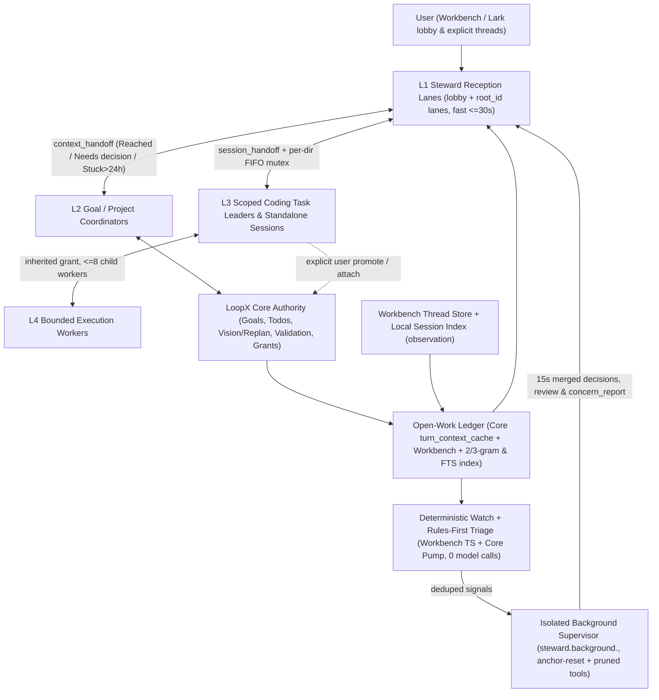

# RFC: Steward Unified Entry — Extending the Steward Across Every Session and LoopX Goal (v0)

- **RFC status:** Accepted
- **Supersedes / closes:** none
- **Delivery maturity:** Proposal
- **Authors / owners:** LoopX maintainers, steward engineering owner
- **Created:** 2026-11-22
- **Last normative revision:** 2026-11-23
- **Implementation baseline:** `49881d5a3`
- **Related contracts:** [Capable manager and semantic handoff](capable-manager-semantic-handoff-v0.md), [Router–Controller–Worker contract](controller-executor-unified-contract-v0.md#superagent-acceptance), [Manager runtime profile](manager-runtime-profile-v0.md), [App conversations and async inbox](app-conversation-and-async-inbox-v0.md), [Long-horizon measurement model](long-horizon-harness-benchmark-research-program-v0.md#6-measurement-model), [Steward golden queries](../../product/use-cases/steward/golden-queries.md), [Overall roadmap](loopx-overall-roadmap-v0.md)
- **Language mirror:** [中文版](steward-unified-entry-v0.zh-CN.md)

## Document map and maintenance contract

- Sections 1–10 are the normative design and acceptance contract.
- Section 11 is the normative delivery plan.
- Section 12 contains unresolved decisions; proposed answers are not approval.
- Appendices A–E contain the non-normative execution ledger, decision log, evidence registry, rejected alternatives, and generalized operational lessons.

This RFC is an execution-focused delivery slice under [Capable Agent Manager and Semantic Work Handoff](capable-manager-semantic-handoff-v0.md) M1–M3 and [App conversations and reusable asynchronous work delivery](app-conversation-and-async-inbox-v0.md). On baseline `49881d5a3`, LoopX already ships a working Steward across the App/Workbench and Lark for **LoopX Goals**—including portfolio triage, authority-revision-validated turn-context caching (`turn_context_cache.py`), `context_handoff` delegation, evidence-backed return delivery, and isolated background `continuous_monitor` execution (`steward.background.<binding_id>` in `steward_monitor.py`). This RFC extends that existing Steward to **discover, delegate to, supervise, and progressively promote every local Agent session** alongside LoopX Goals without creating a second task store, scheduler, or authority. The English and Chinese documents are semantic mirrors.

---

## 1. Decision summary

1. **Extend the shipped Steward rather than building a second assistant.** Keep the existing App/Workbench and Lark Steward (`chat_manager.py`, `conversation_binding.ts`, `StewardPage.tsx`), its shipped Core turn-context cache (`turn_context_cache.py`), its isolated Goal monitor session (`steward.background.<binding_id>`), `context_handoff`, `completion_validation`, and `return_delivery` intact. Add the missing session bridge so one Steward conversation covers both LoopX Goals and non-Goal local sessions.
2. **One read-only open-work ledger and fast CJK/ASCII session search.** Every Steward turn can read a unified projection combining Core Goals/Todos (reusing `turn_context_cache.py`), Workbench threads (`threads.ts`), and self-opened CLI/IDE/App sessions (`local-sessions.ts`), paired with SQLite FTS and a rebuildable CJK 2-gram / ASCII 3-gram / cross-script 2-gram file-exclusion index for fast session lookup.
3. **Unified delegation (`context_handoff` + `session_handoff`), multi-tier reporting discipline, and non-blocking Steward lanes.** Goal-owned work continues to use `context_handoff` (with L2 Goal Coordinators reporting upward only on `Reached`, `Needs decision`, or `Stuck > 24h`, and authorized L3 coding `Task Leader` sessions allowed to spawn/review `≤ 8` bounded child workers inside their granted repo). Non-Goal tasks delegate through `session_handoff` (`threads.ts` + `coordination.ts` mailbox, per-directory FIFO write mutex when not using a worktree, caller-credential socket ACL, and dynamic supervisor-only prompt injection). Foreground Steward reception stays fast (target `≤ 30 s`) through explicit Lark thread lanes (`lane_key = root_id`), fenced soft preemption, and reuse of `steward.background.<binding_id>` with first-turn anchor reset and pruned supervisor tools.
4. **Deterministic session watch, hard `question`-only auto-answer redline, exact-quote triage, and `concern` closure.** Workbench's zero-model 30-second and event-driven watch loop handles transport/quota/progress rules first, uses a lightweight exact-substring-verified triage pass only for trailing free-text agent questions (failing open to raw tail text), enforces a hard code boundary forbidding `steward.background` from ever auto-approving `permission`, `plan`, `screen`, `secret_run`, or external-send prompts (`0/N` auto-approvals), closes conversational follow-ups via durable `concern -> concern_report` receipts, verifies completion evidence before reporting "done", and batches human decisions within a fixed 15-second window.
5. **Zero-ceremony promotion into long-horizon LoopX Goals.** Self-opened sessions start as read-only ledger observations, opt into session supervision on request, and promote or attach to a LoopX Goal when multi-day continuity is needed. Once Goal-bound, `≥ 2` evidence rejections, counterevidence against Goal assumptions, or persistent dependency stalls escalate to `Vision/Replan` rather than repeating blind retries, and idle periods continue through LoopX heartbeat and `quota/stride` governance.
6. **Default-off autonomy, conservative initial grants, and non-regressing rollbacks.** Read-only ledger indexing (`ledger.capture=true`) defaults on; autonomous cross-turn session recovery (`supervision.enabled=false`) defaults off; initial `SupervisionGrant` defaults conservatively to `["continue", "retry", "answer_choice"]` (`question`-only) until D2 promotion. Rolling back new ledger or topic-lane switches preserves `main`'s shipped `LOOPX_MANAGER_CONTEXT_CACHE` and `steward.background.<binding_id>` Goal monitor isolation.
7. **Not approved here:** cross-host autonomous session takeover, unattended publishing/payment/external sending, auto-approving permission/plan cards, long-term memory consolidation (covered in a separate local-memory RFC), or automatic context-threshold session rotation.

## 2. Problem and motivation

LoopX already supports a capable Steward across both Lark and the App/Workbench (`StewardPage` + `StewardOverview`). For **LoopX Goals**, delegation (`context_handoff`), authority-revision turn-context caching (`turn_context_cache.py`), scheduled observation on an isolated background session (`steward_monitor.py` -> `steward.background.<binding_id>`), periodic reports (`steward_reports.py`), and evidence-backed return delivery already ship on `main` (`49881d5a3`).

What users still cannot do is **talk to one Steward conversation to manage all of their non-Goal sessions alongside LoopX Goals** without head-of-line blocking or unsafe supervision failure modes:

| User / operator failure | Audited baseline cause (`49881d5a3`) | Architectural gap |
| --- | --- | --- |
| "I have seven or eight CLI/Workbench sessions plus two Goals, and asking Steward for progress misses every non-Goal session" | `loopx_manager_read`, `turn_context_cache.py`, and `steward_triage.py` read Core `registry` and Goal Todos only; Workbench's `threads.ts` and `local-sessions.ts` index are unreachable from Steward | **Incomplete visibility:** Steward only sees LoopX Goals, not ordinary or self-opened sessions |
| "Delegating a non-Goal task either forces Goal ceremony or makes Steward code inline for 60 minutes, blocking interactive Lark/App turns" | `context_handoff` only targets registered `(goal_id, agent_id)` workers; interactive Steward turns across Lark threads still share one `(binding_id, source_ref)` foreground session, and `steering: False` hosts (`antigravity_adapter.py`) lack effect-fenced preemption | **Missing session delegation & interactive lane contention:** non-Goal sessions have no typed handoff, and unrelated Lark threads contend for one foreground lock |
| "Unsupervised sessions stall or spam raw errors, while naive auto-supervisors risk clicking permission prompts, hallucinating choice cards, colliding in shared directories, or snowballing supervisor tokens" | Workbench's `worker-reports.ts` / `todo-stage.ts` / `push.ts` remain wired to the retired `personal-router` desk; `steward.background.<binding_id>` only runs Goal `native_loopx` monitors without Workbench watch routing, first-turn anchor reset, or `question`-only confirmation guards; session retries cannot escalate to Core `Vision/Replan` | **Disconnected session supervision, missing safety/cost guardrails, & missing Goal replan escalation** |

**Concrete scenario.** In the morning, a user opens Codex in a terminal to fix an export bug; at noon, inside a Lark thread, they ask Steward why PR `#9176` closed, ask Steward to *"let me know once the export test passes"*, and dispatch a competitor-pricing study; meanwhile, a multi-week Goal is running benchmark iterations. In the afternoon, the user asks *"how is everything going today?"*:
- **Expected behavior:** The noon Lark thread question answers within seconds on its own `lane_key = root_id` lane while the pricing study runs in a detached worker session; when the export session pauses on a test-flag clarification, `steward.background` renders a verified exact-quote choice card (never auto-clicking any permission prompt) and later closes the user's follow-up `concern` with a `concern_report`; the afternoon summary covers the terminal session, the verified pricing report, and a `Vision/Replan` proposal after two Goal metric reversals.
- **Baseline behavior on `49881d5a3`:** Core Goal monitors and cached Goal reads work, but Steward knows nothing about the morning terminal session, cannot delegate non-Goal work without creating a Goal or running inline on the foreground session, and cannot route Workbench session blockers or escalate stalled sessions into `Vision/Replan`.

### Two reference designs and how LoopX adapts them

| Reference | Borrowed mechanism | Adaptation onto existing LoopX owners |
| --- | --- | --- |
| **Calli (LooChat predecessor) Superagent study** | Automatic ledger capture of self-opened sessions; deterministic phase precedence; durable task-scoped supervision grant; completion-evidence gate ("verify before reporting done, send back when missing"); single recovery owner per blocker; 15-second notification gather; first-hit session lookup `≥ 90%` | Reuse phase derivation, evidence gate, gather window, and lookup metrics; **never** revive Workbench's personal-item task store—Goal truth stays in Core, and non-Goal sessions stay in Workbench `threads.ts` until promoted |
| **[Persona unified entry & SuperAgent](https://github.com/nwverse/persona)** | Three dispatch tiers + `machine × repo × mode` workspace policy; 30s rules-first supervision loop + exact-quote choice triage; hard `question`-only auto-answer boundary (`0` permission/plan auto-approvals); first-turn anchor reset + pruned supervisor tools; per-directory FIFO write mutex + caller-credential tool ACL + dynamic supervisor prompt injection; `concern -> concern_report` closure; L1–L4 reporting silence & bounded `Task Leader` autonomy; CJK 2-gram / ASCII 3-gram exclusion index; daily interruptions + availability metrics (`unknown` ≠ `0`) | Reuse `steward.background.<binding_id>` (`#9320`) with anchor reset and pruned tools; map L2 to Core Goal Coordinators and L3 to scoped `Task Leader` sessions; pair SQLite FTS with the 2/3-gram exclusion filter; add LoopX's `Vision/Replan` escalation and outcome-per-budget metric |

### Invariants

1. **No unverified completion:** Every "done" Steward reports traces to verified completion evidence (`completion_validation` on Goals or checked turn artifacts on sessions); missing evidence can only be reported as `pending verification` or `missing`.
2. **Explicit coverage and freshness:** When any Goal source or local session store is stale, unread, or unavailable, the ledger names the exact coverage gap; `unknown` never masks a determinable state, and uncovered is never reported as absent.
3. **Data is never authority, and permissions are never auto-approved:** Session transcripts, worker reports, repository text, and IM messages are untrusted material; they cannot create or widen grants, worker processes cannot invoke supervisor socket tools (`403`), and `steward.background` never auto-approves `permission`, `plan`, `screen`, `secret_run`, or external-send prompts (`0/N`).
4. **Foreground reception never starves or duplicates effects:** Heavy worker turns and `steward.background` rounds never hold interactive Steward lane locks; soft preemption on non-steerable hosts requires either a host-enforced read-only turn or atomic effect-admission closure with zero committed effects before restart; non-worktree shared-directory writes serialize via a per-directory FIFO mutex.
5. **Single recovery owner & bounded supervisor context:** At most one recovery owner acts on a given blocker revision; each `steward.background` supervision round resets to its cached first-turn anchor with a pruned supervision toolset so supervisor context never snowballs across rounds.
6. **Direct user action wins:** Any confirmation answered or message sent directly by the user in a worker session or Goal immediately voids a pending Steward recovery or confirmation action on that target (`409 user_intervened`).
7. **Escalation over blind retry & non-regressing rollback:** Repeated evidence rejection or contradicted Goal assumptions escalate to Core `Vision/Replan` rather than looping task-level retries; disabling any new switch preserves `main`'s shipped background Goal monitor isolation and turn-context cache.

## 3. Scope and non-goals

### In scope

- **Unified open-work ledger and fast session lookup:** Read-only composition over Core Goals/Todos (extending shipped `turn_context_cache.py` without altering its Goal cache invariants), Workbench threads, and `local-sessions.ts` across Codex, Claude Code, Antigravity, TRAE CLI, pi, and dsh, backed by SQLite FTS + a rebuildable CJK 2-gram / ASCII 3-gram / cross-script 2-gram exclusion index.
- **Session delegation (`session_handoff`), multi-tier coordination, and non-blocking Steward lanes:** Spawning, fenced continuing, and receiving structured returns from non-Goal Workbench/imported sessions; per-directory FIFO write mutex; caller-credential socket ACL; dynamic supervisor prompt injection; explicit Lark thread lanes (`lane_key = root_id`) with deterministic `lobby` default; effect-fenced read-only preemption; L2 Goal Coordinator silence discipline and L3 `Task Leader` bounded child-worker dispatch (`≤ 8`).
- **Deterministic session watch, supervision guardrails, and merged decisions:** 30-second + event-driven rules-first watch loop wired into `steward.background.<binding_id>` (with first-turn anchor reset and pruned tools), conservative `SupervisionGrant` defaults, hard `question`-only auto-answer boundary, exact-substring-verified choice triage (fail-open to raw tail excerpt), durable `concern -> concern_report` closure, completion-evidence gate, and 15-second merged notifications.
- **Progressive promotion to long-horizon Goals:** Zero-ceremony `session -> Goal` promotion/attachment, `replan_needed` escalation to Core `Vision/Replan`, cross-day heartbeat continuation, `quota/stride` pacing, and matched long-horizon outcome/attention metrics.

### Non-goals

- Creating a second task database, scheduler, authority store, or Python decision owner.
- Replacing or regressing `context_handoff`, `continuous_monitor`, `turn_context_cache.py`, `steward.background.<binding_id>`, `completion_validation`, or `Vision/Replan` for LoopX Goals.
- Rewriting the Workbench Board or Agents pages, mutating repository `AGENTS.md` / `CLAUDE.md` with supervisor prompts, or forcing users to route every message through Steward.
- Cross-host autonomous takeover of remote CLI sessions, or local long-term project/topic memory distillation (covered in a companion local-file memory RFC).
- Unattended publishing, external messaging, deletion, financial operations, or automated approval of permission/plan prompts.

## 4. Current-system contract

Audited against `main` baseline `49881d5a3` (including `#9320` and `#9328`).

### 4.1 Shipped Steward and Workbench capabilities on `main` (`49881d5a3`)

| Capability | Authoritative owner / location | Shipped baseline behavior on `49881d5a3` |
| --- | --- | --- |
| App & Lark Steward conversation | `loopx/chat_manager.py`, `native_chat/external_conversations.py`, `collaboration/conversation_binding.ts`, Workbench `StewardPage.tsx` + `StewardOverview.tsx` | Verified owner-private Steward in App/Workbench and Lark; `trusted_owner` / `restricted` runtime profiles (`manager-runtime-profile-v0.md`); flexible Codex/Antigravity executor failover |
| Portfolio read, fast-path triage & authority-revision turn-context cache | `manager_context/inspection.py`, `manager_context/turn_context_cache.py` (`LOOPX_MANAGER_CONTEXT_CACHE`, `is_manager_turn_context_cache_enabled`), `native_chat/steward_triage.py` | `loopx_manager_read`, zero-model `/triage`, `/inbox`, `/gates`, `/todos`, and bounded 30s authority-revision-validated `manager_turn_context` snapshot caching across Core stores, Goal projections, state digests, and SSH/evidence guards (`#9320`) |
| Goal delegation & return delivery | `manager_context/execution.py`, `roundtrip.py`, `tracking.py`, `templates/FOLLOWTHROUGH.md` | `context_handoff` (up to 32 `goal_id/agent_id/brief` entries with `collaboration_brief_v0`), `steward_team_plan_preview`, and automatic `original_conversation` return |
| Isolated background Goal monitor & periodic reports | `native_chat/steward_monitor.py` (`STEWARD_BACKGROUND_SESSION_PREFIX = "steward.background."`, `ensure_steward_background_session`, `pump_steward_monitors`), `steward_turn.py`, `steward_reports.py` | `continuous_monitor` Todos woken by cheap host pump (zero model calls on idle polls) and dispatched onto dedicated `steward.background.<binding_id>` sessions (`#9320`) so Goal monitor turns do not contend with interactive foreground Steward turns |
| Goal long-horizon kernel | `control_plane/todos/completion_validation_*`, Goal `Vision/Replan`, heartbeat/scheduler, `quota` | Typed Todo completion validation, evidence-driven replanning, cross-session leases, and budgeted continuation for LoopX Goals |
| Local session discovery & thread mailbox | Workbench `threads.ts`, `local-sessions.ts`, `session-enrich.ts`, `coordination.ts`, `adapters/loopx/binding.ts`, `ext-board` | Scans local history-capable Agent sessions across directories, unifies threads and Goals on one Board, and runs a durable thread mailbox with `[进度]` state parsing |
| Reusable session supervision parts | Workbench `worker-reports.ts`, `todo-stage.ts`, `auto-retry.ts`, `proactive.ts`, `push.ts`, `turn-batch.ts` | Post-turn settlement hooks, deterministic stage derivation, transient error backoff, and push throttling |

### 4.2 Audited gaps preventing unified all-session management

1. **Core-only Steward read and cache boundary:** `turn_context_cache.py` and `loopx_manager_read` cover Core Goals only; Steward cannot read Workbench `threads.ts` or `local-sessions.ts`, and lacks a CJK/substring-capable local session lookup index.
2. **Goal-only delegation target & missing workspace/socket isolation:** `context_handoff` requires a registered `(goal_id, agent_id)` pair; Steward has no `session_handoff` tool to spawn or continue non-Goal Workbench/local sessions, no per-directory FIFO write mutex for non-worktree dispatches, and no caller-credential ACL separating supervisor socket tools from worker processes.
3. **Interactive foreground lane sharing & unfenced non-steerable preemption:** While `#9320` isolated background Goal monitors onto `steward.background.<binding_id>`, interactive Lark threads (`root_id`) still share a single foreground `(binding_id, source_ref)` session lock, inline multi-minute coding turns block that foreground session, and `steering: False` hosts (`antigravity_adapter.py`) lack atomic effect-admission fencing for safe mid-turn preemption.
4. **Goal-only `steward.background` scope, unbounded multi-round context, and missing `Vision/Replan` bridge:** `steward.background.<binding_id>` currently receives Core `continuous_monitor` work only—not Workbench session watch signals or foreground `concern` follow-ups—and lacks first-turn anchor reset / toolset pruning for high-frequency session supervision, hard `question`-only auto-answer guards, exact-quote choice verification, and promotion/escalation from stalled sessions into Core `Vision/Replan`.

## 5. Proposed architecture

### 5.1 Ownership, authority, and four-tier autonomy hierarchy



| Domain fact | Single authoritative owner | Forbidden parallel authority |
| --- | --- | --- |
| Goals, Todos, leases, `Vision/Replan`, `completion_validation`, Goal `continuous_monitor` | LoopX Core (`loopx/control_plane/*`) | Workbench personal-item store, Steward prompt checklists, duplicate Goal pollers |
| Core portfolio turn-context snapshot cache | `manager_context/turn_context_cache.py` (`LOOPX_MANAGER_CONTEXT_CACHE`) | Ad-hoc unvalidated prompt caches or disabling Core cache when rolling back ledger UI |
| Non-Goal thread lifecycle, adapter turns, local session discovery, per-directory FIFO write mutex, durable mailbox | Workbench daemon (`threads.ts`, `local-sessions.ts`, `coordination.ts`) | Core manufacturing synthetic Goals for every terminal session |
| Session-to-Goal attachment identity | Core `conversation_binding.ts` + Workbench `adapters/loopx/binding.ts` | Guessing by repository path or similar session title |
| Supervision authorization (`SupervisionGrant`) & foreground `concern` records | Core grant owner (Goal Todos) + Workbench supervision store (non-Goal threads & `concern` receipts, migrated on promotion) | Implicit prompt wording, worker reports, or external chat text |
| Steward channel addressing, topic lanes, and `steward.background.<binding_id>` | Core `conversation_binding.ts` + `native_chat/steward_monitor.py` & `steward_turn.py` | Unverified channel-name parsing, worker-callable supervisor sockets, or rolling `steward.background` back onto `lobby` |

**Four-tier coordination & upward-reporting silence discipline:**
- **L1 Steward (foreground reception + `steward.background`):** Triages user intent, answers read queries, dispatches work, and delivers merged human decisions, verified completions, and `concern_report` closures.
- **L2 Goal / Project Coordinator (LoopX Goal coordinator, roadmap R2):** Owns multi-step Goal execution and reports upward to Steward **only** on `Reached` (verified milestone/completion), `Needs decision` (six boundaries or Goal-scope `Vision/Replan`), or `Stuck > 24h`—never emitting routine "still working" chatter.
- **L3 Coding `Task Leader` (authorized repository session):** When a user grants a coding task on a repository (`SupervisionGrant` with `allowChildWorkers: true`, cap `≤ 8`), the L3 `Task Leader` session may spawn, review, and retry bounded read-only or same-worktree/child-worktree L4 subtasks within that exact `workdir` and budget envelope without re-prompting plan cards per subtask; dispatch depth beyond `L1 -> L2/L3 -> L4` is rejected.
- **L4 Execution Worker:** Executes one bounded brief, cannot call `steward_*` or widen scope, and reports completion with artifact/command evidence to its parent.

**Three progressive governance tiers for sessions:**
1. **Observed (default):** Every discovered local session (`local-sessions.ts`) and ordinary Workbench thread appears in the read-only ledger with zero Core writes and zero background actions.
2. **Supervised session (user opt-in per thread/dispatch):** Steward dispatches or the user marks *"keep supervising X"*; Workbench watches turn settlement, stalls, and evidence, performing bounded recovery without creating a Core Goal.
3. **Goal-governed (explicit promotion or multi-step Goal):** When the user says *"attach this to Goal X"* / *"run this as a long-horizon Goal"*, Steward binds the session to a Core Goal, activating `Vision/Replan`, cross-day heartbeat, and `quota/stride` governance (§5.6).

### 5.2 Open-work ledger, CJK/ASCII exclusion-indexed lookup, and socket ACL

The open-work ledger is a read-only snapshot composed on demand with explicit pagination (`cursor`, `has_more`) and per-source freshness:

```ts
type OpenWorkLedgerItem = {
  ref:
    | { kind: "goal_todo"; goalId: string; todoId: string }
    | { kind: "workbench_thread"; threadId: string; goalId: string | null }
    | { kind: "local_session"; machineId: string; agent: string; sessionId: string; goalId: string | null };
  title: string;
  cwd: string | null;
  sessions: Array<{
    machineId: string;
    agent: string;
    sessionId: string;
    origin: "workbench" | "app" | "cli" | "managed" | null;
    status: "running" | "idle" | "error" | "offline" | "unknown";
    lastActivityAt: string | null;
    current: boolean;
  }>;
  phase:
    | "not_started" | "running" | "continuing" | "waiting_external"
    | "recovering" | "verifying" | "needs_user" | "review"
    | "paused" | "done" | "unknown";
  supervised: boolean;
  validation: "pending" | "passed" | "missing" | "failed" | null;
  replanSignal: "repeated_rejection" | "assumption_contradicted" | "dependency_stalled" | null;
  reason: string;
  nextStep: string | null;
  observedAt: string;
  freshness: "current" | "cached" | "stale" | "unavailable";
};
```

- **Precedence and handovers:** `phase` follows deterministic effective-evidence order: `paused > needs_user > recovering > running > waiting_external > verifying > review > continuing (idle unfinished) > done > unknown`. Superseded handover segments (`coordination.ts`, `auto-handover.ts`) fold under the active seat.
- **Unbounded open-work retention:** Open work is never dropped by a 3- or 7-day cutoff. Older unindexed sessions load lightweight outline metadata (`title`, `cwd`, last user prompt, last `[进度]` / turn outcome) and mark ambiguous items `unknown` with an explicit verification hint.
- **Vocabulary registration:** `phase`, `validation`, and `replanSignal` are Workbench/Steward read-projection closed sets mapped from Core `completion_validation` and Todo state without mutating Core wire schemas; register them under the [semantic vocabulary diff advisory](../../../CONTRIBUTING.md#check-new-semantic-vocabulary-while-developing) before implementation.
- **Reusing shipped `turn_context_cache.py` + Workbench revision stamp:** Core Goal portfolio reads reuse `#9320`'s `turn_context_cache.py` (`LOOPX_MANAGER_CONTEXT_CACHE`, keyed by Core `registry_semantic_revision`, Goal state signatures, and SSH/evidence guards) unchanged, composed with Workbench's in-memory `(threads_revision, local_sessions_index_revision)` so unchanged warm ledger reads finish in `< 100 ms` without altering Core cache invalidation semantics.
- **Rebuildable CJK 2-gram / ASCII 3-gram / cross-script 2-gram exclusion index + SQLite FTS:** Because SQLite FTS tokenizers miss arbitrary mid-token substrings (e.g., `uild` in `build`) and single/two-character CJK terms across large transcript trees, `steward_sessions_find` pairs SQLite FTS ranking with a pure local candidate-exclusion cache (`.search/`): NFC-normalized lowercased text emits **2-grams for CJK/wide characters, 3-grams for ASCII/narrow runs, and cross-script 2-grams at CJK↔ASCII boundaries** (with ordered prefix range scan for 1-character CJK queries). Every query checks `stat(path, mtime_ns, size)` and uses the gram index strictly to **exclude** files that cannot match before exact verification—so deleting `.search/` or crashing mid-build never drops recall (`0` WAL amplification, automatic background rebuild).

**Steward session tools & caller-credential socket ACL:**
All `steward_*` and `session_handoff` endpoints on Workbench's local socket require a host-minted supervisor capability credential bound to verified Steward / authorized L3 `Task Leader` process lineage; calls from L4 worker processes or untrusted local shells are rejected fail-closed (`403 unauthorized_caller_role`).

| Tool | Milestone | Contract |
| --- | --- | --- |
| `steward_ledger_read(cursor?, include_done_since?)` | S1 | Read-only snapshot (`snapshot_id`, `coverage`, `source_health`, `items`, `next_cursor`) across Core Goals (`turn_context_cache.py`), Workbench threads, and `local-sessions.ts` |
| `steward_sessions_find(query, repo?, agent?, cursor?)` | S1 | Read-only search over SQLite FTS + 2/3-gram exclusion index by repo/workdir, current & prior titles, user prompt terms, and last progress; prefers current handover seat |
| `steward_session_read(target_ref, turn_cursor?, turns?)` | S1 | Paged read-only transcript/event inspection reusing Workbench `history.ts` (zero session import or mutation in S1) |
| `session_handoff(mode, target_ref?, workdir, brief, expected_last_turn_id?)` | S2 | Authenticated spawn or fenced continue over `threads.ts` + `coordination.ts` with `workdir` policy check, per-dir FIFO write mutex, and `return_delivery` back to the originating Steward lane |

### 5.3 Unified delegation (`context_handoff` + `session_handoff`), Steward lanes, and anchor-reset background supervision

1. **Unified delegation, shared-workdir FIFO write mutex, and dynamic prompt injection:**
   - **Goal-owned work** continues to use `context_handoff` (`goal_id`, `agent_id`, `collaboration_brief_v0`) with `original_conversation` return.
   - **Session-owned work** uses `session_handoff` (shipped in **S2**):
     - `mode: "spawn"` starts a bounded Workbench worker thread on a configured local harness (`codex`, `claude-code`, `antigravity`, `trae`, `pi`, `dsh`) in an allowed `workdir`, carrying `objective`, `constraints`, `acceptance_checks`, and `return_route`.
     - **Worktree-first + per-directory FIFO write mutex:** Writable coding dispatches default to an isolated `git worktree`. Whenever two writable dispatches must target the **same non-worktree `workdir`** (e.g., non-Git folder or explicit user instruction to work in-place), Workbench enqueues the second turn in a durable **per-canonical-realpath FIFO write queue** (`0` concurrent writable turns on the same directory) rather than allowing overlapping edits.
     - `mode: "continue"` verifies `workdir` allowlist policy, imports an external `local_session` on demand if needed, and sends a follow-up fenced by `expected_last_turn_id` (`409 user_intervened` if the user spoke or acted since that turn).
     - **Dynamic supervisor prompt injection:** Role instructions for `steward.background` and L3 `Task Leader` sessions are injected dynamically per process/turn (`--append-system-prompt` / `developerInstructions`) and **never** written into repository `AGENTS.md` or `CLAUDE.md` files.
2. **Fast reception vs. detached heavy execution:**
   - **Foreground fast track (target `≤ 30 s`):** Triage, progress synthesis, session lookup, decision capture, `concern` registration, confirmation cards, `context_handoff`, and `session_handoff` run in the Steward lane.
   - **Slow execution track:** Multi-minute repository edits, test suites, `canary premerge`, and `pr-review` cycles dispatch via `context_handoff` or `session_handoff` (`mode: "spawn"`) and immediately return the worker session link, delivering verified outcomes back on completion. Quick local reads and small single-turn edits remain allowed inline under `trusted_owner`.
3. **Steward Topic Lanes (with deterministic S2 `lobby` default) and anchor-reset `steward.background`:**
   - **Deterministic lane routing (`(binding_id, source_ref, lane_key)`):**
     - **Explicit Lark thread replies (`root_id` present):** Route to `lane_key = root_id` with an independent Session, queue, and upstream model thread under `max_concurrent_steward_lanes` (default `4`), replying inside that same Lark thread; all subsequent user follow-ups in that thread route to `lane_key = root_id`.
     - **Top-level P2P messages (no `root_id` — normative S2 default):** Always route to `lane_key = "lobby"` (`steward.auto_thread_on_busy = false` by default). When `lobby` is busy, top-level messages stay in `lobby`—using same-lane queued coalescing or effect-fenced read-only preemption below—and reply in `lobby`. Automatic thread spawning on busy `lobby` (`lane_key = message_id`) remains disabled behind `steward.auto_thread_on_busy` until D3 qualifies desktop and mobile Feishu client UX.
   - **Extending shipped `steward.background.<binding_id>` (`#9320`) with first-turn anchor reset & tool pruning:**
     - Reuse `ensure_steward_background_session` (`steward_monitor.py`) so both Core `native_loopx` Goal monitors and Workbench session-supervision batches run off interactive lanes.
     - **First-turn anchor reset & pruned toolset:** To prevent `steward.background` prompt history from growing unboundedly over hundreds of supervision rounds, `steward.background` maintains a cached **first-turn epoch anchor** containing stable system instructions and a **pruned supervision-only toolset** (`steward_ledger_read`, `steward_session_read`, `session_handoff`, `context_handoff`, decision/`concern_report` emit—no broad shell/file-edit/browser tools). Each supervision round forks/resets from that anchor (`--resume-session-at` on supported CLI hosts or clean turn-state reset on app-server hosts) with structured current-batch state only, keeping prefix KV cache warm and uncached input token drift `< 10%` at round 200.
4. **Same-lane turn coalescing and effect-fenced read-only preemption:**
   - **Queued coalescing:** Consecutive user follow-ups queued on the same busy `lane_key` coalesce atomically (preserving individual message IDs and timestamps) into the next admitted turn.
   - **Runtime steering & effect-fenced preemption (fixing TOCTOU between step check and interrupt):** On hosts with live steering (`codex`), same-lane corrections inject via `chat_queue_steering.ts`. On `steering: False` hosts (`antigravity`), mid-turn interrupt-and-restart is permitted **only** when:
     1. the active Turn was admitted from the start under a host-enforced read-only profile (`effect_admission = "read_only"`), **or**
     2. on a write-capable Turn, the existing effect-admission owner **atomically closes/revokes effect admission for the active `turn_id` first**, reads back the fence state proving **zero** external writes, Git pushes, handoffs, or Core mutations were admitted or committed prior to closure (rejecting any late effect attempt from the retiring worker fail-closed), and only then interrupts and restarts with the merged user input.
     Whenever the host cannot atomically fence and prove zero committed effects, it **must not** preempt; it emits a concise queued receipt and runs the correction immediately after the active Turn settles (matching parent RFC A18/A23).

### 5.4 Deterministic session watch, conservative grants, `question`-only redline, exact-quote triage, and `concern` closure

Core `continuous_monitor` continues to watch Goal external targets without duplication. For items with `supervised=true` (and active foreground `concern` watches), the Workbench daemon runs a **rules-first** deterministic loop every 30 seconds and on turn-settlement / adapter-state events (**zero model calls**):

| Signal | Deterministic trigger condition (configurable defaults) |
| --- | --- |
| `review` | Worker reports `[进度] 待验收` / completion, or linked Core Todo enters `completion_validation` |
| `idle_unfinished` | Last `[进度]` / turn state indicates in-progress work, session is `idle`, and no external wait is active |
| `trailing_question` | Session stops `idle` with an unanswered trailing question or native `kind: "question"` prompt |
| `needs_you` | Native `permission` / `plan` / `screen` / `secret_run` prompt, protected boundary, or `[进度] 需要你` unanswered (`> 3 min` for non-urgent status, immediate 15s gather for blocking permission/plan cards) |
| `stalled` / `no_progress` | Session `running` with zero event progress or only sleep/poll calls with zero file/artifact/state delta beyond `max(20 min, estimate × 1.5)` |
| `failed` | Terminal turn failure not owned by `AutoRetry`, quota failover, or Core retry |
| `replan_needed` | Same Todo/session task rejected by evidence check `≥ 2` times, recorded counterevidence against Goal assumptions, or dependency blocked past threshold |

**Rules-first, cheap-model-second triage with exact-substring quote verification:**
- `408/429/503` transport errors (`AutoRetry`), quota failover, running/stalled timers, and structured `[进度]` / `completion_validation` outcomes are classified `100%` by deterministic code with **zero model calls**.
- Only when a session stops `idle` on free-text output without a structured `[进度]` tag (`trailing_question` candidate) does Workbench run one bounded structured triage call on the configured lightweight tier to classify `completed_claim | ordinary_question | human_decision | idle_unfinished` and optionally extract 2–4 tappable reply options.
- **Exact-quote anti-hallucination check (fail-open):** Code verifies that the extracted `question_quote` is a **verbatim character substring** of the agent's final message before rendering a choice card. If the triage call errors, times out, or fails exact-substring verification, Workbench discards the synthesized options and **fails open** by attaching the raw final message excerpt directly so `0` blocked sessions are silently dropped or misrepresented.

**Expressible `SupervisionGrant` schema vs. conservative S3 v0 default grant:**
- Settings add `ledger.capture` (default `true`), `supervision.enabled` (default `false`), `steward.topic_lanes` (default `true` for owner-private bindings), and `steward.auto_thread_on_busy` (default `false`). Only direct user settings actions can mutate them.
- **Expressible action enum (`SupervisionAction`):** `"continue" | "retry" | "switch_model" | "split" | "answer_choice"`.
- **Conservative S3 v0 default grant (`supervision.default_actions`):** Before D2 promotion, an ordinary `"finish/fix X"` dispatch or clicking **Supervise** writes a `SupervisionGrant` whose `grantedActions` set is **`["continue", "retry", "answer_choice"]` only** (with `allowChildWorkers: false` unless dispatched as an explicit L3 repo `Task Leader`). `switch_model` and `split` are **excluded by default** unless the user explicitly enables `supervision.allow_model_switch_and_split=true` (or selects an expanded preset on the plan card) specifying allowed fallback endpoints and token/cost cap.
- Every automated action re-verifies at commit time: `supervision.enabled=true`, non-revocation, unchanged `scopeRevision`, **membership of the specific action in `grantedActions`**, allowed `workdir` / endpoint / remaining budget, and absence of newer user input (`expected_last_turn_id`), persisting an intent receipt before dispatch.
- **Three dispatch tiers:** Instant read/triage runs inline; read-only research spawns a worker session automatically; writable code changes, first-time repository writes, or L3 multi-worker launches show a compact plan card (rememberable per `machine × repo × read-only/writable` in settings).

**Hard confirmation redline (`question`-only auto-answer) & six human boundaries:**
- Native adapter prompts are typed as `kind: "question" | "permission" | "plan" | "screen" | "secret_run" | "external_send"`.
- **Hard code invariant:** Even when `"answer_choice"` is in `grantedActions`, `steward.background` may **only** answer `kind: "question"` (ordinary implementation clarifications strictly entailed by recorded user instructions in scope). Host code unconditionally rejects automated answers to `permission`, `plan`, `screen`, `secret_run`, or `external_send` (`0/N` auto-approvals; never `"always allow"`). Reducing permission prompts relies solely on direct user approval or explicit user-saved `machine × repo × mode` workspace policy.
- **Six human-decision boundaries** always halt and surface a recommendation-first card: (1) spending money / unbudgeted paid runs, (2) deleting or overwriting durable data, (3) external sending/publishing/PR creation or merge without prior grant, (4) widening OS/repo/account permissions, (5) persistent edits outside granted `workdirs`/scope, and (6) genuinely ambiguous product intent.
- **Bounded recovery & completion-evidence gate:** At most one recovery action executes per blocker revision. Completion claims without artifact/command references, stale-commit evidence, failing entrypoints, or cross-task borrowed receipts are marked `missing`/`failed` and returned to the worker (escalating to `replan_needed` at `≥ 2` rejections); only verified claims enter `review`.
- **Durable foreground `concern -> concern_report` closure:** When a user says in Steward chat *"watch session X and tell me when Y"* or *"remind me if CI fails on X"*, Steward records a compact persisted `ConcernRecord` (`concernId`, `originLaneKey`, `targetRef`, `conditionSummary`, `createdAt`, `closedByReportId: null`). The deterministic watch loop evaluates target settlements/signals against open `ConcernRecord`s and closes a concern **only** when `steward.background` delivers an explicit `concern_report` receipt back to `originLaneKey` (or the user cancels it), surviving restarts with zero LLM polling loops.

### 5.5 Merged decision notifications, `@session` staged routing, and Workbench surfaces

- Supervised items route raw per-turn failure/question events into the pending-judgment queue; self-recovered blockers never interrupt the user.
- Genuine human decisions (`six boundaries`, `permission`/`plan` prompts), `replan_needed` proposals, verified `review` completions, and triggered `concern_report` closures gather for a fixed **15 seconds** from the first item (non-sliding) and emit **one** synthesized notification across Workbench and Lark: task/Goal title, exact-quoted prompt or verified outcome, recommended option with trade-offs, and direct links to both the Steward lane and source session.
- If `steward.background` fails to respond within 60 seconds, a deterministic formatter delivers pending **human-decision** cards (with raw tail excerpts) and triggered `concern` alerts only; ordinary unjudged errors never masquerade as decision requests. Delivery receipts track `transport_sent` separately from `user_handled`.
- **UI discipline & staged `@session` boundary (S1 locate/open vs. S2 fenced send):**
  - No new dashboard page and no secondary explanatory slogans. Above the Steward composer, compact status pills (`N running · M needs you`) open the ledger drawer; decision cards support inline one-tap answers.
  - **In S1 (read & navigation only):** Typing `@session` in the Steward composer searches via `steward_sessions_find` and **opens/jumps to** that Workbench thread or local session view (or opens an already-bound Goal conversation through its existing shipped entrypoint). S1 performs **zero** message sends or imports into unbound local sessions or non-Goal threads.
  - **In S2 (fenced direct send & return):** Typing `@session <message>` dispatches through `session_handoff(mode="continue")`, enforcing `workdir` allowlist checks, on-demand `local_session` import, `expected_last_turn_id` turn fencing, per-directory FIFO write serialization, and result return to the originating Steward lane.

### 5.6 Progressive promotion to long-horizon LoopX Goals

Session supervision ensures individual conversations finish; **LoopX Core ensures multi-day, multi-step objectives converge on verified outcomes within budget**:

```text
  User Attention  ◀── L1 Steward (merges decisions, concern_reports, route changes & verified outcomes)
                         ▲
  Long-Horizon    ◀── L2 LoopX Core Goal (Vision/Replan, cross-day heartbeat, quota/stride; quiet unless Reached/Decision/Stuck>24h)
                         ▲
  Execution       ◀── L3 Scoped Task Leaders (<=8 L4 workers) + Promoted/Bound Workbench & Local Sessions
```

1. **Zero-ceremony promotion (`session -> Goal`):** Saying *"bind this session to Goal X"* or *"turn this into a long-horizon Goal"* invokes Core's `goal.create` (`open_session=false`) or `external_conversations` / `adapters/loopx/binding.ts` attachment transaction, preserving thread ID, transcript, and worktree while migrating supervision authority to a Core Todo and `completion_validation` plan. Unpromoted sessions keep zero Core footprint.
2. **Escalate to `Vision/Replan` instead of repeating failed tactics:** On any Goal-bound session or Todo, when `replan_needed` fires (`≥ 2` consecutive evidence rejections, counterevidence against `Vision`/yardstick, or dependency stall past budget), `steward.background` halts session-level retries and submits structured evidence to Core `Vision/Replan`, surfacing a concrete route-change card when shared Goal scope, acceptance, or budget requires user approval.
3. **Cross-day heartbeat continuation and `quota/stride` governance:** Once Goal-bound, Core's heartbeat/scheduler and `automatic_resume` wake ready Todos across days within `quota` and `Stride/Yardstick` budgets even when all interactive terminals are closed.
4. **Goal-level trajectory in progress answers:** Progress replies group Goal-bound sessions under their Goal and report *distance to acceptance, verified delta, quota consumed vs. remaining, and stay-the-course vs. replan assessment*, followed by standalone supervised/observed sessions and open `concern` watches.

### 5.7 Metrics and long-horizon outcome measurement

All metrics derive from persisted Core/Workbench receipts; unrecorded windows report `unknown`, never `0`.

| Metric | Operational definition | Target direction |
| --- | --- | --- |
| Daily user interruptions | Calendar-day count of decision cards, permission prompts, and notifications first delivered to the user (items absorbed by `steward.background`, workspace policies, or test workspaces itemized separately) | Lower (`0` silent permission auto-approvals) |
| Foreground Steward availability & p95 latency | `ok / attempts` and arrival-to-first-substantive-reply latency on interactive Steward lanes while `steward.background` or heavy workers are active | Higher availability; `0` HoL lock stall from background work |
| Supervisor token stability | Ratio of uncached input tokens on `steward.background` at round 200 vs. round 1 under anchor reset | `< 10%` uncached drift |
| Open-work ledger coverage & lookup hit rate | Point-in-time recall across open Goals and local sessions (`100%` with explicit `source_health`); top-1 session lookup hit rate (overall and self-opened subset with Wilson 95% CI `≥ 90%`) | `100%` recall; `≥ 90%` top-1 lookup |
| Manual non-Steward session opens | Active-day count of sidebar/search/direct-link opens of non-Steward sessions (metadata count only, zero transcript capture) | Down `≥ 30%` vs. 7-day baseline |
| Long-horizon verified outcome efficiency | Independently verified Goal/task outcomes divided by complete cost (model tokens + tool/validation + Steward/supervisor overhead + human-attention events) per [benchmark measurement model](long-horizon-harness-benchmark-research-program-v0.md#6-measurement-model) | Non-inferior or higher verified outcome per unit complete cost |

## 6. Alternatives and design choices

| Alternative | Strengths | Why rejected or bounded | Verdict |
| --- | --- | --- | --- |
| **A. Extend shipped Steward (`#9320` cache + `steward.background`) with Workbench ledger/2-3-gram search, fenced `session_handoff`, anchor-reset `question`-only supervision, and Core Goal promotion (`this RFC`)** | 100% reuses Core Goal/monitor/cache/validation/replan owners and Workbench's local scanner & mailbox; prevents permission mis-clicks, context snowballing, TOCTOU preemption races, and shared-dir write collisions | Requires authenticated local socket + typed effect/turn fences between Python Steward host and Workbench daemon | **Adopted** |
| **B. Revive standalone Calli personal-assistant desk and personal-item DB** | Reuses legacy desk code | Creates split-brain task authority alongside Core Goals/Todos; duplicates Goal monitoring and validation | **Rejected** |
| **C. Force every chat and terminal session to become a Core Goal upfront** | Single Core record from second zero | Violates zero-ceremony progressive entry; pollutes Core registry with ephemeral chats; conflates discovery with execution authority | **Rejected** |
| **D. Long-running un-reset LLM supervisor session or auto-approving permission cards** | Fewer daemon rules | Context snowballs linearly over hundreds of rounds, and LLM auto-approval of `permission`/`plan` cards risks irreversible workspace/external damage | **Rejected** |

## 7. Safety, privacy, and compatibility

- **Per-switch feature-off parity with `49881d5a3`:** With `supervision.enabled=false` (shipped default), zero automated session continuations, retries, `question` answers, or notification interceptions occur. Disabling `ledger.capture` or `steward.topic_lanes` leaves shipped Core Goal `context_handoff`, `LOOPX_MANAGER_CONTEXT_CACHE`, `steward.background.<binding_id>` Goal monitor isolation, Board, Agents page, and `AutoRetry` identical to baseline `49881d5a3`.
- **Hard authority, socket ACL, and prompt-hygiene boundaries:** `SupervisionGrant` and Goal promotions require an authenticated owner turn or explicit UI confirmation. `steward.background` is hard-blocked in code from approving `permission`, `plan`, `screen`, `secret_run`, or `external_send` prompts. Worker processes receive `403` on supervisor socket endpoints, and supervisor prompts inject dynamically without modifying repository `AGENTS.md` or `CLAUDE.md`.
- **Audience and lane isolation:** Explicit Lark thread lanes (`lane_key = root_id`) inherit their parent verified `binding_id` audience proof (`trusted_owner` for verified owner-private bindings; `restricted` for external/group bindings). Group bindings never access `local-sessions.ts`, `.search/`, or private Steward lanes.
- **Metadata-only telemetry and public boundary:** Ledger caches, `.search/` gram segments, and usage metrics stay inside ignored local-private state; public artifacts never record raw transcripts, credentials, or local paths.
- **Additive storage compatibility:** `lane_key` (defaulting to `"lobby"`), `SupervisionGrant`, `ConcernRecord`, and thread supervision metadata are strictly additive.

## 8. Migration and rollback

1. **Independent switches (`preview -> apply -> readback`):** `ledger.capture`, `steward.topic_lanes`, `steward.auto_thread_on_busy`, `session_handoff`, `supervision.enabled`, `supervision.allow_model_switch_and_split`, and Goal promotion each have an independent switch; changing one never implicitly toggles another.
2. **Non-regressing ledger & cache rollback:** Turning `ledger.capture=false` stops reading Workbench `threads.ts` and `local-sessions.ts` from Steward while **preserving** `main`'s shipped `LOOPX_MANAGER_CONTEXT_CACHE` (`turn_context_cache.py`) configuration and Core Goal caching unchanged. Deleting `.search/` triggers clean background rebuild or raw-scan fallback with zero data loss.
3. **Non-regressing topic-lane rollback (preserving `steward.background`):** Enabling `steward.topic_lanes` keeps the owner's main P2P Session as `lane_key = "lobby"` while routing explicit Lark `root_id` threads to child lanes. Disabling `steward.topic_lanes` drains active `root_id` child lanes to settlement and routes subsequent interactive turns back to `lobby` (preserving child-lane readback), while **keeping `steward.background.<binding_id>` active and isolated for `native_loopx` Goal monitors (`#9320`)** so rollback never reintroduces foreground/monitor lock contention.
4. **Supervision rollback:** Setting `supervision.enabled=false` immediately halts Workbench watch dispatches to `steward.background` (while leaving Core `native_loopx` Goal monitors on `steward.background` intact), restores direct Workbench notifications, and preserves all grants, `ConcernRecord`s, receipts, and open user decision cards.
5. **Irreversibility boundary:** Sessions explicitly promoted into a Core Goal remain normal Core Goals (`Stop` / `Archive`) if session supervision is later disabled.

## 9. Validation and acceptance

Development fixtures, packaged Workbench/App journeys, and live host/Lark qualifications are tracked separately; a passing fixture never certifies live multi-day qualification.

| Claim | Test or evidence | Required result | Boundary / exclusions |
| --- | --- | --- | --- |
| **A1 · Unified ledger, S1 locate-only `@session` & cache composition** (`GQ09/GQ10`) | Point-in-time truth-set test across active/stopped Core Goals, Workbench threads, self-opened CLI sessions, >30-day open sessions, handover chains, and offline sources + S1 `@session` composer action check | `100%` open-item recall, exact `phase`, valid jump links, consistent multi-page totals, `< 100 ms` warm hit composing `turn_context_cache.py` + Workbench revision; in S1 `@session` locates/opens target (or existing bound Goal chat) and makes `0` writes/imports to unbound sessions | Does not certify live model prose quality |
| **A2 · CJK/ASCII session lookup hit rate & `.search/` exclusion parity** (`GQ02`) | Replay of `≥ 50` lookup queries (`≥ 20` self-opened sessions, including 1–2 char CJK terms and mid-word ASCII substrings) + `rm -rf .search` / stale-`mtime` fault injection | Overall and self-opened top-1 hit rates both `≥ 90%` (with Wilson 95% CI); `100%` recall parity between `.search/` exclusion + scan and raw scan across deleted/stale index states | Single-machine index; excludes unmounted remote disks |
| **A3 · Non-blocking lanes, deterministic `lobby` routing, effect-fenced preemption, FIFO dir mutex & anchor-reset supervisor** (`GQ03/GQ08`) | Concurrent harness test: run `session_handoff` tasks (including two writable dispatches to the same non-worktree directory and a worker calling `steward_*` socket) + 200 mocked `steward.background` rounds + explicit Lark `root_id` thread query + busy-`lobby` top-level message + interleaved write-between-check-and-interrupt race on `steering: False` host | Explicit `root_id` thread replies without HoL wait; busy-`lobby` top-level message stays deterministically in `lobby` and coalesces follow-ups; interleaved first-write race either fences/rejects old Turn's write before restart or queues safely with `0` duplicate effects; same-dir non-worktree writes serialize (`0` overlap); worker socket call gets `403`; `@session <msg>` in S2 enforces `workdir` + `expected_last_turn_id` and returns to origin lane; round-200 `steward.background` uncached input drift `< 10%` | Upstream provider network latency bounded by host |
| **A4 · Conservative grants, `question`-only redline, exact-quote triage & six boundaries** (`GQ07/GQ08`) | Daemon + fault injection: `429`, quota exhaustion, missing path, `20` native `permission`/`plan`/`secret_run` prompts, `20` trailing free-text questions (including injected hallucinated non-substring triage output), all six boundaries, concurrent user reply, and conservative continuation-only grant (`["continue", "retry"]` without `switch_model`/`split`/`answer_choice`) | `0 / 20` permission/plan/secret prompts auto-approved; conservative grant leaves `switch_model`, `split`, and `answer_choice` pending (`0` unauthorized executions); `100%` rendered choice cards match exact agent substring and corrupted triage fails open to raw excerpt (`0` dropped items); recoverable faults act `≤ 1` time; prior user action aborts Steward send (`409`) | Controlled faults do not prove cross-week PMF |
| **A5 · Completion-evidence gate** (`GQ07`) | Six defective-completion fixtures (prose-only "tests pass", missing file, stale commit evidence, failing entrypoint, partial Todo, borrowed receipt) + valid fixtures | `6 / 6` defective claims rejected as `missing/failed` and returned to worker without user review push; valid claims enter `review` | Does not re-run multi-hour suites inside supervisor |
| **A6 · 15-second gather, 60s fallback & `concern -> concern_report` closure** (`GQ09`) | Virtual-clock batch test across simultaneous blockers, foreground `concern` registration + target settlement, L2 coordinator routine status suppression, 60s supervisor timeout, and mid-window daemon restart | Decisions + `concern_report` within 15s emit `1` merged notice; open `concern` closes only on `concern_report` receipt and survives restart; L2 routine progress emits `0` Steward wakes; 60s fallback emits only human decisions & triggered concerns (`0` duplicates) | Live Lark mobile push latency qualified separately |
| **A7 · Progressive Goal promotion & `Vision/Replan` escalation** | Promote an active Workbench session into a Core Goal, inject `2` consecutive evidence rejections and a contradicted metric, then idle all interactive sessions across a scheduled heartbeat | Session binds to Goal preserving history; second rejection stops blind retry, invokes `Vision/Replan`, and surfaces a route-change card; subsequent ready Todo resumes via Goal heartbeat within `quota` | Single-Goal integration does not replace benchmark cohort |
| **A8 · Per-switch feature-off parity against `49881d5a3`** | Independent toggle matrix testing `supervision.enabled=false`, `steward.topic_lanes=false`, `session_handoff` disabled, and `ledger.capture=false` across `context_handoff`, `continuous_monitor`, `turn_context_cache.py`, `steward_triage`, Board, Agents page, and `AutoRetry` | Disabling `steward.topic_lanes` keeps `steward.background.<binding_id>` Goal monitor isolation active; disabling `ledger.capture` keeps `LOOPX_MANAGER_CONTEXT_CACHE` active; `0` behavioral or schema regressions vs. `49881d5a3` | — |
| **A9 · One-week daily-use dogfood** | 7-day baseline vs. 7-day enabled trial on real daily workload | Manual non-Steward session opens per active day drop `≥ 30%` while A1–A4 hold; workload and active days disclosed | Single-operator signal, not randomized causal proof |
| **A10 · Matched long-horizon cost/outcome check** | Matched task cohort under [measurement contract](long-horizon-harness-benchmark-research-program-v0.md#6-measurement-model) comparing task-only retries vs. Goal-promoted `Vision/Replan` escalation | Report verified outcomes, complete token/tool/supervisor overhead, and human-attention count with uncertainty; preserve negative/neutral results | Default promotion requires separate maintainer sign-off |

## 10. Operational contract

- **Bounded loop & anchor-reset overhead:** On an empty or unchanged supervised set, the 30-second watch tick checks in-memory/indexed revisions only (`0` subprocesses, `0` model calls). When `steward.background` wakes, first-turn anchor reset + pruned tools bound per-round prompt tokens regardless of total lifetime rounds.
- **Cache & `.search/` safety:** Core writes invalidate `turn_context_cache.py` via its shipped signature checks; `.search/` gram segments validate `stat(path, mtime_ns, size)` on every lookup and fall back to direct scan on mismatch or rebuild.
- **Crash & restart recovery:** Signal cursors, 15-second gather windows, per-blocker recovery counters, per-directory FIFO write queues, `ConcernRecord`s, `session_handoff` receipts, and `steward.background` anchor metadata persist on disk; restart reconciles in-flight turns and fences before new dispatches.
- **Typed failure visibility:** Unavailable session stores (`LOOCHAT_LOCAL_SCAN=off`), `403 unauthorized_caller_role` socket rejections, exhausted `max_concurrent_steward_lanes`, and revoked grants surface typed reason codes and repair hints in CLI and `StewardOverview`.

## 11. Normative delivery plan

Four independently reviewable, reversible slices—each shippable without waiting for later slices:

| Milestone | Shipped behavior | Entry gate | Exit evidence | Rollback |
| --- | --- | --- | --- | --- |
| **S1 · Unified read-only ledger, 2/3-gram + FTS lookup & locate-only `@session`** | Workbench authenticated read-only `steward_ledger_read` / `steward_sessions_find` (SQLite FTS + rebuildable 2/3-gram `.search/` exclusion index) / `steward_session_read` with caller-credential ACL; Steward tool integration composing shipped `turn_context_cache.py` (`#9320`) with Workbench revisions; composer status pills, locate/open-only `@session` navigation (plus existing bound-Goal chat jump), and baseline telemetry | Accepted RFC & registered projection vocabulary | A1, A2, A8 | Set `ledger.capture=false`; Steward reverts to Core-only reads while keeping shipped `LOOPX_MANAGER_CONTEXT_CACHE` intact |
| **S2 · Fenced `session_handoff`, explicit Lark thread lanes & anchor-reset `steward.background` routing** | `session_handoff` (`spawn` & `expected_last_turn_id`-fenced `continue`) with `workdir` policy, per-directory FIFO write mutex, dynamic prompt injection, and S2 `@session <message>` direct send + origin return; explicit Lark `root_id` Topic Lanes (`lobby` deterministic default for top-level messages, `steward.auto_thread_on_busy=false`); same-lane coalescing + atomic effect-fenced preemption; first-turn anchor reset & pruned toolset on `steward.background.<binding_id>` (`#9320`); L2 silence & L3 `Task Leader` (`≤ 8` workers) bounds | S1 merged | A3, A8 | Disable `steward.topic_lanes` and `session_handoff`; child lanes drain to `lobby` while shipped `steward.background.<binding_id>` Goal monitor isolation stays active |
| **S3 · Rules-first session watch, `question`-only guardrails, exact-quote triage & `concern` closure** | 30s/event Workbench watch loop wired into `steward.background.<binding_id>`, conservative `SupervisionGrant` (`["continue", "retry", "answer_choice"]` default), three dispatch tiers + `machine × repo × mode` policy, hard `0/N` permission/plan auto-approval block, exact-substring-verified choice triage (fail-open), completion-evidence gate, `concern -> concern_report` closure, and 15s merged notifications | S2 merged | A4, A5, A6, A8, then A9 | Set `supervision.enabled=false`; halts session supervision while preserving Core Goal monitors and all open cards/concerns |
| **S4 · Progressive Goal promotion & long-horizon `Vision/Replan` bridge** | Zero-ceremony `session -> Goal` promotion/attachment (`open_session=false` + `adapters/loopx/binding.ts`), `replan_needed` escalation (`≥ 2` rejections / contradicted yardstick / stalled dependency) into Core `Vision/Replan`, cross-day Goal heartbeat & `quota/stride` readback, and Goal trajectory reporting | S3 merged | A7, A8, A10 | Disable automatic `replan_needed` escalation; promoted Goals continue under standard Core Goal controls |

## 12. Open decisions

Recommendations below are non-authoritative until recorded in Appendix B; normative v0 defaults in §§5–11 govern until then.

1. **D1 · Bulk vs. explicit supervision enrollment for self-opened sessions** (*Owner:* steward product/engineering owner; *Depends on:* S3)
   - *Normative S3 default:* Option **A** (index all local sessions read-only; attach supervision only when dispatched by Steward or explicitly marked *"Supervise"* / *"Promote to Goal"*).
   - *Alternative B:* Auto-supervise all self-opened sessions inside allowed `workdirs` when `supervision.enabled=true`. Revisit after A9 measures manual enrollment friction.
2. **D2 · Promoting `switch_model` and `split` into the default `SupervisionGrant` profile** (*Owner:* steward engineering owner; *Depends on:* S3)
   - *Normative S3 default:* Conservative profile **`["continue", "retry", "answer_choice"]`** (`answer_choice` strictly `kind: "question"`), keeping `switch_model` and `split` opt-in (`supervision.allow_model_switch_and_split=false` by default) behind configured fallback endpoints and budget caps.
   - *Candidate promotion:* Enable `switch_model` and `split` in the default grant once A4/A9 quantify interruption savings vs. fallback spend.
3. **D3 · Opt-in automatic Lark thread creation (`steward.auto_thread_on_busy`) when `lobby` is busy** (*Owner:* Lark & steward owner; *Depends on:* post-S2 UX qualification)
   - *Normative S2 default:* `steward.auto_thread_on_busy=false`—explicit Lark threads (`root_id`) run concurrently in `lane_key = root_id`, while all top-level P2P messages stay deterministically in `lane_key = "lobby"` with queued coalescing / fenced read-only preemption.
   - *Candidate promotion:* Enable `steward.auto_thread_on_busy=true` (`lane_key = message_id` reply-in-thread for unrelated top-level messages) only after desktop and mobile Feishu client readback confirms clean thread discoverability and unambiguous follow-up routing.
4. **D4 · Fixed Notification Gather Window** (*Owner:* steward product owner; *Depends on:* S3)
   - *Options:* **A (S3 default):** Fixed `15 s` non-sliding window. **B:** `60 s`. **C:** `0 s` immediate push. Evaluate batching ratio vs. perceived latency in A6/A9.
5. **D5 · Threshold for escalating session/Todo rejections to `Vision/Replan`** (*Owner:* Core control-plane & steward owner; *Depends on:* S4)
   - *Options:* **A (S4 default):** `2` consecutive evidence rejections on the same Todo, immediate counterevidence against a `Vision` assumption, or dependency wait `> 2×` budget. **B:** `3` rejections. Evaluate retry waste vs. replan churn in A7/A10.

---

## Appendix A: Execution ledger (non-normative)

Dated delivery checkpoints live in [`ledger/steward-unified-entry-v0/`](ledger/README.md), with paired `.md` and `.zh-CN.md` entries recording exact baseline commits, delivered slices, validation artifacts, and remaining gaps.

## Appendix B: Decision log

| Date | Decision | Owner / approval | Alternatives | Normative sections changed |
| --- | --- | --- | --- | --- |
| 2026-11-22 | Initial delivery-slice proposal combining open-work ledger, deterministic supervision loop, bounded recovery, and merged notifications | Proposal author (pending maintainer merge review) | B, D in §6 | §§1–12 |
| 2026-11-23 | Reconcile against `49881d5a3` (`#9320` background monitor session & `turn_context_cache.py`); add `session_handoff`, deterministic Lark lanes, effect-fenced preemption, conservative `question`-only supervision guardrails, anchor-reset `steward.background`, exact-quote triage, per-dir FIFO write mutex, socket ACL, `concern` closure, 2/3-gram exclusion index, and S4 Goal `Vision/Replan` escalation | Proposal author (pending maintainer merge review) | B, C, D in §6 | §§1–12 |

## Appendix C: Evidence registry

| Evidence id | Claim | Baseline / environment | Artifact or command | Result | Privacy / validity boundary |
| --- | --- | --- | --- | --- | --- |
| E1 | Shipped Steward, `#9320` `steward.background` & `turn_context_cache.py`, triage, Workbench local-session scanner, and unified Board ownership verified in source | `49881d5a3` source audit | `loopx/chat_manager.py`, `loopx/capabilities/native_chat/steward_monitor.py`, `loopx/capabilities/manager_context/turn_context_cache.py`, `apps/workbench/packages/daemon/src/local-sessions.ts` | pass | Source audit only; does not certify new runtime behavior |
| E2 | RFC header, status index, bilingual mirror, and public-boundary premerge checks | `codex/steward-unified-entry-rfc` rebased on `49881d5a3` | `uv run --extra test python scripts/generate_rfc_status_index.py --check` and `uv run --extra test loopx canary premerge --from-git-diff --git-diff-base origin/main` | pass | Documentation and static governance checks only |

## Appendix D: Rejected or superseded alternatives

1. **Re-implementing Goal monitoring, turn caching, or Todo storage inside Workbench (`Calli personal-router` revival):** Rejected because LoopX Core already ships `continuous_monitor` on `steward.background.<binding_id>`, `turn_context_cache.py`, `completion_validation`, `context_handoff`, and `Vision/Replan`.
2. **Allowing LLM supervisors to auto-approve `permission`/`plan` prompts or accumulate unbounded multi-round transcripts:** Rejected because a single misjudged permission approval can execute destructive commands or external sends, and un-reset supervisor histories degrade latency, KV-cache hit rates, and judgment quality across hundreds of rounds.
3. **Step-log-only soft preemption without atomic effect-admission fencing:** Rejected because a write-capable Turn can commit its first external write between step-log inspection and interrupt delivery, risking duplicate side effects on restart.

## Appendix E: Incident and review lessons

1. **Single-funnel interactive blocking & TOCTOU preemption hazards:** Sharing one foreground lock across unrelated Lark threads causes head-of-line stalls, while interrupting a `steering: False` Turn based solely on prior step logs leaves a race window before `interrupt` arrives. *Resulting rules:* §5.3 explicit `root_id` lanes + deterministic `lobby` default + atomic effect-admission closure before preemption (tested in A3).
2. **Operational guardrails from real multi-agent supervision:** Production supervision loops fail in predictable ways when left unconstrained: supervisors click through permission prompts, hallucinate choice options not asked by the worker, collide when two workers edit one non-worktree directory, leak supervisor tools to worker shells, or bloat context past 100k tokens. *Resulting rules:* §5.2 caller-credential socket ACL + 2/3-gram exclusion index, §5.3 per-directory FIFO write mutex + first-turn anchor reset + dynamic prompt injection, and §5.4 hard `question`-only auto-answer block + exact-substring quote verification + `concern -> concern_report` closure.
3. **Preserving shipped baseline isolation across feature rollbacks:** Tying `#9320`'s shipped `steward.background` Goal monitor or `turn_context_cache.py` to new feature switches would cause rolling back new slices to regress `main`. *Resulting rules:* §4.1/§8/A8 explicit baseline separation and non-regressing per-switch rollback.
