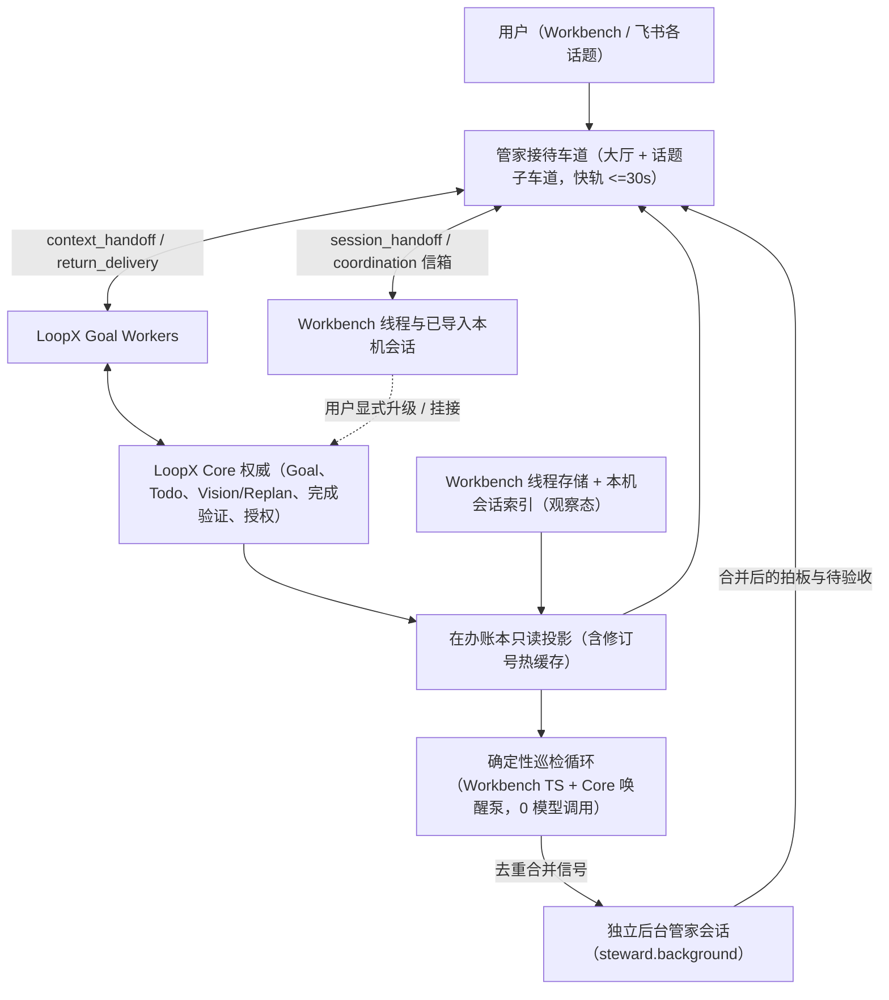

# RFC：管家统一入口——让既有管家同时管住所有会话与 LoopX Goal（v0）

- **RFC 状态：** 已接受
- **替代 / 关闭：** none
- **交付成熟度：** Proposal
- **作者 / 责任人：** LoopX 维护者、管家工程负责人
- **创建：** 2026-11-22
- **最近规范修订：** 2026-11-23
- **实现基线：** `09eadec70`
- **相关契约：** [强能力管家与语义交接](capable-manager-semantic-handoff-v0.zh-CN.md)、[Router–Controller–Worker 统一契约](controller-executor-unified-contract-v0.zh-CN.md#superagent-acceptance)、[管家运行时 profile](manager-runtime-profile-v0.zh-CN.md)、[App 对话与异步收件箱](app-conversation-and-async-inbox-v0.zh-CN.md)、[长程测量模型](long-horizon-harness-benchmark-research-program-v0.zh-CN.md#6-测量模型)、[管家 golden queries](../../product/use-cases/steward/golden-queries.md)、[整体路线图](loopx-overall-roadmap-v0.zh-CN.md)
- **语言镜像：** [English](steward-unified-entry-v0.md)

## 文档地图与维护约定

- 第 1–10 节是规范性设计与验收契约。
- 第 11 节是规范性交付计划。
- 第 12 节是待决事项；推荐答案不等于批准。
- 附录 A–E 为非规范性的执行台账、决策日志、证据登记表、被拒备选方案与泛化运行教训。

本文是[强能力管家与语义交接](capable-manager-semantic-handoff-v0.zh-CN.md) M1–M3 与 [App 对话与可复用异步工作投递](app-conversation-and-async-inbox-v0.zh-CN.md) 下聚焦落地的交付切片。LoopX 主干**已经具备面向 LoopX Goal 的管家能力**（同时覆盖 App/Workbench 与飞书入口，支持全局分拣、`context_handoff` 跨 Goal 委派、带证据的原路回传与 `continuous_monitor` 定时巡检）。本文不重造第二套助手，而是补齐既有管家通往**本机全部会话**的桥梁：让用户只跟一个管家对话，就能同时看全、委派、督办所有普通/自开会话与 LoopX Goal，并在需要时平滑接上 LoopX 长期目标推进，不新增第二套任务库、调度器或权限权威。中英文互为语义镜像。

---

## 1. 决策摘要

1. **在既有管家之上扩边界，不另起炉灶。** 完整保留并复用主干已交付的 App/Workbench 与飞书管家（`chat_manager.py`、`conversation_binding.ts`、`StewardPage.tsx`）及其针对 Goal 的 `context_handoff` 委派、`continuous_monitor` 定时巡检、`completion_validation` 完成验证和 `return_delivery` 原路回传；补齐面向非 Goal 会话的发现、委派与督办桥接。
2. **一份只读“在办账本”打通 Goal 与全部本机会话。** 管家每轮可读一份统一投影：合成 Core Goal/Todo（带 `(registry_semantic_revision, authority_revision)` 热快照缓存）、Workbench 会话线程（`threads.ts`）以及本机扫描到的所有自开 CLI/IDE/App 会话（`local-sessions.ts`）。
3. **统一委派（`context_handoff` + `session_handoff`）与不阻塞的管家分道接待。** Goal 工作继续走 `context_handoff`；不建 Goal 的仓库排查、已有会话追问与分钟级改码闭环通过 `session_handoff` 派给 Workbench 工作线程或已绑定本机会话（复用 `threads.ts` + `coordination.ts` 持久信箱）并自动原路回传。前台接待通过话题级并发车道（`lane_key = root_id`）、独立的 `steward.background` 后台巡检会话与同车道消息合并保持快速响应（目标 ≤ 30 秒）。
4. **确定性会话巡检、有界自恢复与证据门禁。** LoopX Goal 继续由 Core `continuous_monitor` 与 `completion_validation` 负责；对已开启督办的会话，由 Workbench 确定性循环（30 秒 + 事件驱动，零模型调用）推导卡住/闲置未完/等你/待验收信号，交 `steward.background` 对每个阻塞最多执行一次范围内恢复，声称完成前逐项核验完成证据，并将真实人工拍板（六类边界）在 15 秒窗口内合并成一条通知。
5. **零仪式感升级到 LoopX 长期目标推进。** 自开会话默认只做只读登记，按需开启单会话督办，需要跨天/多步推进时一键挂接或升级为 LoopX Goal。一旦进入 Goal 治理，同一任务证据打回 ≥ 2 次、实测推翻 Goal 假设或依赖长期阻塞时不再盲目重试，而是升级给 Core `Vision/Replan` 重规划，并在所有交互会话闲置时通过既有心跳与 `quota/stride` 预算机制跨天续跑。
6. **自主督办默认关，核心权威不变。** 账本只读收录（`ledger.capture=true`）与修订号热缓存默认开启；跨轮自主恢复（`supervision.enabled=false`）默认关闭。Core 仍是 Goal、Todo、租约、`Vision/Replan` 与完成验证的唯一权威；用户随时可绕过管家直接操作任一会话。
7. **本文不批准：** 跨主机无人值守接管远端会话、无人值守的发布/付款/对外发送、长期记忆夜间整理、按上下文占用自动轮转会话。

## 2. 问题与动机

LoopX 今天已经支持飞书与 App/Workbench 双入口管家（`StewardPage` + `StewardOverview`），并且在 **LoopX Goal 范围内**，跨 Goal 委派（`context_handoff`）、定时巡检（`continuous_monitor` + `steward_monitor.py`）、周期汇报（`steward_reports.py`）和证据回收回传已经可用。

用户真正卡住的地方是：**管家目前只能管 LoopX Goal，管不了日常大量存在的其他会话**，同时重活和巡检容易把单会话管家堵死：

| 用户 / 运营痛点 | 已核对的基线根因 | 架构缺口 |
| --- | --- | --- |
| “我开了七八个终端/Workbench 会话外加两个 Goal，问管家今天进度，非 Goal 会话全漏掉” | `loopx_manager_read` 与 `steward_triage.py` 只读 Core `registry` 与 Goal Todo；Workbench 的 `threads.ts` 与 `local-sessions.ts` 会话索引对管家不可见 | **视野不完整：** 管家只看得见 LoopX Goal，看不见普通会话与自开会话 |
| “想让管家顺手派个非 Goal 活，要么逼我先建 Goal，要么管家自己下场改码一小时把整个聊天窗堵死” | `context_handoff` 只能派给已注册 `(goal_id, agent_id)`；私聊管家把 `(binding_id, source_ref)` 焊死在单条 FIFO 会话队列上，与 `native_loopx` 后台巡检争抢同一把锁，每轮同步全扫所有 Goal（动辄数十秒），且在 `steering: False` 宿主（`antigravity_adapter.py`）上无法中途插话纠偏 | **缺少会话级委派与队头阻塞（HoL）：** 前台接待、重型执行与后台巡检混在同一单线程漏斗 |
| “普通会话停了没人盯、报错直接刷屏推给我；而跨周长期目标反复失败时只会原地重试，不会换路线” | Workbench 继承的督办部件（`worker-reports.ts`、`todo-stage.ts`、`auto-retry.ts`、`push.ts`）仍绑在已下线的 `personal-router` 上且先推送后判断；会话级重试与 Core `Vision/Replan` 脱节 | **督办割裂与缺少长程升级：** 非 Goal 会话无人督办，卡点无法升级为 Goal 级重规划 |

**具体场景。** 早上用户在终端开 Codex 修导出 bug；中午在飞书管家另一个话题里问“PR `#9176` 为什么关了”并让管家派人调研竞品定价；同时还有一个跑跨周评测的长期 Goal。下午用户问一句*“今天各块进展怎样？”*：
- **期望结果：** 中午的只读追问在独立话题车道秒级作答，不被后台任务挡住；下午一轮回答同时列全三件事——终端导出会话卡在 CI、需要你拍板是否跳过 flaky 测试；竞品调研工作会话已完成且证据核验通过、待你验收；跨周 Goal 连续两轮指标反转，已触发 `Vision/Replan` 给出换路线建议请你定夺。
- **当前基线表现：** 管家完全不知道早上的终端会话；若管家亲自在主会话里改码或同步扫全量 Goal，后续飞书/App 提问与 `native_loopx` 巡检在单队列里排成长龙；普通会话报错未经筛选直接散推给用户。

### 两个参照设计与在 LoopX 上的取舍

| 参照 | 借鉴机制 | 如何落到 LoopX 既有 owner 上（不重复造轮子） |
| --- | --- | --- |
| **Calli（LooChat 前身）Superagent 设计研究** | 自动收录自开会话的在办账本；确定性阶段优先级推导；持久的任务范围督办授权；“先核证据再报完成，缺证据打回”；单阻塞唯一恢复负责人；15 秒合并推送；找会话首次命中率 ≥ 90% | 采纳阶段推导、证据门禁、15 秒合并窗口与检索指标；**绝不复活** Workbench 个人事项库——Goal 权威留在 Core，普通会话留在 Workbench `threads.ts`，按需升级 |
| **[Persona 统一入口](https://github.com/nwverse/persona/blob/ebea00155/docs/assistant/unified-entry.md) 与[北极星指标](https://github.com/nwverse/persona/blob/ebea00155/docs/assistant/north-star.md)** | 派活三档（即时/只读自动开跑/先出计划卡）；按 `机器 × 仓库 × 只读/可写` 记忆信任；不调模型的 30 秒督办循环；独立后台督办会话释放主对话；两层派活深度上限；`@` 直达会话；每日打扰次数 + 主对话可用率（未记录标 `unknown` 而非 `0`） | leader 对话映射到既有的项目 coordinator（路线图 R2）；后台督办落到 `steward.background` 并配合管家话题车道；补齐 LoopX 独有的 `Vision/Replan` 重规划升级与同等预算长程成果指标 |

### 不变量

1. **无证据不报完成：** 管家向用户汇报的每一个“已完成”都必须追到已核验的完成证据（Goal 上的 `completion_validation` 或会话上的验收产物核对）；缺证据只能标为“待核验”或“缺证据”。
2. **覆盖与新鲜度显式透明：** 任一 Goal 数据源或本机会话存储过期、未读或不可用时，账本必须点名具体缺口；严禁用 `unknown` 掩盖可判定状态，也严禁把“未覆盖”说成“无事发生”。
3. **正文材料绝不产生权限：** 会话记录、工作回报、仓库文件与即时通讯正文一律视为不可信材料，不能创建、扩大或转移执行授权与督办授权。
4. **前台接待不被后台与重活饿死：** 分钟级重型执行轮次与 `steward.background` 巡检/督办轮次绝不占用交互式管家接待车道锁；持久状态写入仅在 Core CAS 与目标会话队列处做窄串行。
5. **同一阻塞唯一恢复负责人：** 任一阻塞版本最多由一个恢复方（`AutoRetry`、额度切换、自动续跑，或 `steward.background` 的一次恢复决策）处理；同一信号在同一状态段只上报一次。
6. **用户直接操作永远优先：** 用户在目标会话或 Goal 里先点确认、先发消息，管家的待发恢复或代答动作立即作废。
7. **长期目标遇阻升级重规划而非死循环重试：** 验收证据连续打回或实测推翻 Goal 假设时，必须升级到 Core `Vision/Replan` 而非原地重试；关闭督办仅停止新自动动作，保留已有记录与未决拍板。

## 3. 范围与非目标

### 范围内

- **统一在办账本与找会话：** 只读合成 Core Goal/Todo（含基于修订号的热快照缓存）、Workbench 线程与 `local-sessions.ts` 跨目录本机会话（覆盖 Codex、Claude Code、Antigravity、TRAE CLI、pi、dsh）。
- **会话级委派（`session_handoff`）与不阻塞管家车道：** 新建、续接、纠偏普通 Workbench/已导入本机会话并自动原路回传；管家话题并发车道（`lane_key = root_id`）、前台快轨与后台/worker 慢轨分离、独立 `steward.background` 会话，以及同车道排队合并与只读阶段软抢占。
- **确定性会话巡检、有界恢复与证据门禁：** 面向受督办会话的 30 秒 + 事件驱动巡检、任务/会话级督办授权、单阻塞 ≤ 1 次恢复、完成证据核查，以及前端 + 飞书 15 秒合并拍板推送。
- **渐进升级到 LoopX 长期目标：** 普通/自开会话按需挂接或升级为 LoopX Goal，卡点升级 `Vision/Replan`，跨天心跳续跑、`quota/stride` 节奏治理与长程成果/注意力双维度度量。

### 非目标

- 新建第二套任务库、调度器、权限存储或 Python 决策镜像。
- 替代或重写 LoopX Goal 已有的 `context_handoff`、`continuous_monitor`、`completion_validation` 或 `Vision/Replan`。
- 重写 Workbench 看板或 Agents 页面，或强迫用户只能通过管家和会话说话。
- 跨主机无人值守接管远端 CLI 会话（远端数据源沿用现有 SSH/Core 只读与委托契约；离线会话只标注不督办）。
- 无人值守的对外发布、消息外发、数据删除或付款操作。

## 4. 当前系统契约

以下事实基于 `main` 基线 `09eadec70` 核对。

### 4.1 主干已具备的管家与工作台能力

| 已有能力 | 权威 owner / 代码位置 | 主干已交付行为 |
| --- | --- | --- |
| App 与飞书双入口管家对话 | `loopx/chat_manager.py`、`native_chat/external_conversations.py`、`collaboration/conversation_binding.ts`、Workbench `StewardPage.tsx` + `StewardOverview.tsx` | 已验证 owner 私聊管家同时支持 App/Workbench 与飞书；支持 `trusted_owner` / `restricted` profile（`manager-runtime-profile-v0.zh-CN.md`）及 Codex/Antigravity 弹性故障切换 |
| 全局读取与快车道分拣 | `manager_context/inspection.py`、`native_chat/steward_triage.py`、`templates/REPORTING.md` | `loopx_manager_read`（`sources`、`portfolio`、`todos`、`deliveries`、`handoffs`、`agent_route`）及零模型/零配额的 `/triage`、`/inbox`、`/gates`、`/todos` |
| 跨 Goal 委派与原路回传 | `manager_context/execution.py`、`roundtrip.py`、`tracking.py`、`templates/FOLLOWTHROUGH.md` | `context_handoff`（单轮最多 32 个 `goal_id/agent_id/brief` 目标，携带 `collaboration_brief_v0`）、团队计划预览确认卡与 `original_conversation` 自动回传 |
| Goal 定时巡检与周期汇报 | `native_chat/steward_monitor.py`、`steward_reports.py`、`steward_turn.py`、`scheduler/monitor_todo.py` | `continuous_monitor` Todo 由宿主廉价唤醒泵检查（`StewardObservationAdapter` 空闲轮询零模型调用）、`advancement_turn_id` 跟进轮与独立 Cascade 周期汇报 |
| Goal 长期推进内核 | `control_plane/todos/completion_validation_*`、Goal `Vision/Replan`、heartbeat/scheduler、`quota` | Todo 完成验证计划、基于证据的重规划、跨会话租约与受预算约束的跨天续跑 |
| 本机会话发现与线程信箱 | Workbench `threads.ts`、`local-sessions.ts`、`session-enrich.ts`、`coordination.ts`、`adapters/loopx/binding.ts`、`ext-board` | 跨目录扫描本机支持历史读取的 Agent 会话，单看板统一展示线程与 Goal，提供带 `[进度]` 解析的持久协作信箱 |
| 可复用的会话督办部件 | Workbench `worker-reports.ts`、`todo-stage.ts`、`auto-retry.ts`、`proactive.ts`、`push.ts`、`turn-batch.ts` | 轮次落定回报、确定性阶段推导、瞬时错误退避重试与推送节流 |

### 4.2 阻碍“管住所有会话”的已核对缺口

1. **管家读取边界止步于 Core：** `chat_manager_context.py` 与 `loopx_manager_read` 读不到 Workbench 的 `threads.ts` 与 `local-sessions.ts`，普通线程与终端/IDE 自开会话对管家完全不可见。
2. **委派目标仅限已注册 Goal Agent：** `context_handoff` 要求目标具备 `(goal_id, agent_id)`；管家缺少标准工具去拉起、续接普通 Workbench 线程或已导入本机会话并回收结果。
3. **单会话管家漏斗与每轮同步全扫：** 私聊管家绑定仅按 `(binding_id, source_ref)` 寻址而未按飞书话题分道（`conversation_binding.ts`），与 `native_loopx` 监控轮共用单条 `session_queue.py` 队列，每轮在 `chat_manager_context.py` 同步重扫全部活跃 Goal，且在 `steering: False` 适配器（`antigravity_adapter.py`）上追发消息只能排队死等。
4. **会话督办与长程重规划断层：** Workbench 的 `worker-reports.ts` / `todo-stage.ts` / `push.ts` 仍接在已退役的 `personal-router` 上而未接入管家，且单任务反复卡住时无法升级到 Core `Vision/Replan`。

## 5. 架构设计

### 5.1 归属与权威



| 领域事实 | 唯一权威 owner | 禁止的平行权威 |
| --- | --- | --- |
| Goal、Todo、租约、`Vision/Replan`、`completion_validation`、Goal `continuous_monitor` | LoopX Core（`loopx/control_plane/*`） | Workbench 个人事项库、管家提示词清单、重复的 Goal 轮询器 |
| 非 Goal 线程生命周期、适配器轮次、本机会话扫描、持久线程信箱 | Workbench daemon（`threads.ts`、`local-sessions.ts`、`coordination.ts`） | Core 为每个终端临时会话自动制造无主 Goal |
| 会话与 Goal 的挂接身份 | Core `conversation_binding.ts` + Workbench `adapters/loopx/binding.ts` | 按仓库目录相同或标题相似猜测合并 |
| 督办授权（`SupervisionGrant`） | Core 授权 owner（针对 Goal Todo）与 Workbench 线程督办记录（针对未进 Goal 的受督办线程，升级时迁入 Core） | 提示词暗示、worker 报告或外部聊天文本 |
| 管家通道寻址、话题车道与 `steward.background` 隔离 | Core `conversation_binding.ts` + `native_chat` 队列驱动 | 未校验的频道名拼接或前后台共用一把会话轮次锁 |
| 确定性信号推导 | Core 唤醒泵（管 Goal）+ Workbench 巡检循环（管会话） | 模型定时轮询 |

**会话的三级渐进治理：**
1. **观察态（默认）：** 本机扫描到的会话（`local-sessions.ts`）与普通 Workbench 线程只出现在只读账本里，零 Core 写入、零后台干预。
2. **会话级督办（按派活或用户点选开启）：** 由管家派出的工作线程或用户说“接着督办 X”的会话，由 Workbench 盯住轮次落定、卡顿与验收证据并执行有界恢复，无需先建 Core Goal。
3. **Goal 长期治理（显式升级或多步目标）：** 当用户说“把这个归到 X 目标”或“作为长期目标推进”时，管家把会话挂接/升级到 Core Goal，正式启用 `Vision/Replan`、跨天心跳与 `quota/stride` 预算治理（§5.6）。

### 5.2 在办账本、找会话与修订号热快照缓存

在办账本为读取时合成的只读视图，支持显式游标分页（`cursor`、`has_more`）与分源健康度声明：

```ts
type OpenWorkLedgerItem = {
  ref:
    | { kind: "goal_todo"; goalId: string; todoId: string }
    | { kind: "workbench_thread"; threadId: string; goalId: string | null }
    | { kind: "local_session"; machineId: string; agent: string; sessionId: string; goalId: string | null };
  title: string;
  cwd: string | null;
  sessions: Array<{
    machineId: string;
    agent: string;
    sessionId: string;
    origin: "workbench" | "app" | "cli" | "managed" | null;
    status: "running" | "idle" | "error" | "offline" | "unknown";
    lastActivityAt: string | null;
    current: boolean;
  }>;
  phase:
    | "not_started" | "running" | "continuing" | "waiting_external"
    | "recovering" | "verifying" | "needs_user" | "review"
    | "paused" | "done" | "unknown";
  supervised: boolean;
  validation: "pending" | "passed" | "missing" | "failed" | null;
  replanSignal: "repeated_rejection" | "assumption_contradicted" | "dependency_stalled" | null;
  reason: string;
  nextStep: string | null;
  observedAt: string;
  freshness: "current" | "cached" | "stale" | "unavailable";
};
```

- **推导优先级与交接去重：** `phase` 严格按当前有效证据推导：`paused > needs_user > recovering > running > waiting_external > verifying > review > continuing（闲置未完） > done > unknown`。已被交接替代的旧执行段（`coordination.ts`、`auto-handover.ts`）折叠在当前有效席位下，不展示成僵尸卡点。
- **不按时间窗截断未结事项：** 账本绝不因“超过 3 天/7 天”丢掉未结工作。旧会话只读取轻量轮廓（`title`、`cwd`、最后一次用户提问、最后一轮 `[进度]`/结果摘要），无法判定的标 `unknown` 并给出核验提示。
- **语义词汇登记：** `phase`、`validation` 与 `replanSignal` 为 Workbench/管家侧的本地投影闭集，映射自 Core `completion_validation` 与 Todo 状态，不侵入 Core 存储协议；实现前按 [语义词汇 diff advisory](../../../CONTRIBUTING.md#check-new-semantic-vocabulary-while-developing) 登记。
- **基于修订号的热快照缓存：** `chat_manager_context.py` 在内存中按 `(registry_semantic_revision, 各 Goal authority_revision)` 缓存已校验的全局 Goal 快照。并发或连续消息到达且底层 `authority_revision` 未变时，在 `< 100 ms` 内直接复用快照（任何经本服务提交的 Core 写操作立即精准失效），消除每轮重复起子进程扫全量 Goal 带来的 30～60 秒首包空耗。

**管家会话工具**（经 Workbench 鉴权本地 socket 暴露，参数由宿主拼装，模型无法越权指定任意路径）：

| 工具 | 契约说明 |
| --- | --- |
| `steward_ledger_read(cursor?, include_done_since?)` | 返回跨 Core Goal、Workbench 线程与 `local-sessions.ts` 的一致性账本快照（`snapshot_id`、`coverage`、`source_health`、`items`、`next_cursor`） |
| `steward_sessions_find(query, repo?, agent?, cursor?)` | 基于本地 SQLite FTS 索引（首版不引入向量库）按仓库/目录、现用与曾用标题、用户原话词项和最后进展检索全量会话，优先返回当前有效交接席位 |
| `steward_session_read(target_ref, turn_cursor?, turns?)` | 复用 Workbench `history.ts` 分页只读查看会话历史（仅在实际发生续接/督办动作时才导入外部 `local_session`） |

### 5.3 统一委派（`context_handoff` + `session_handoff`）与不阻塞管家车道

为了让一个管家既管得住所有会话、又不会把自己堵成单线程瓶颈，从**负载快慢分级**与**会话车道隔离**两层同时拆解：

1. **打通 Goal 与普通会话的统一委派：**
   - **Goal 工作**继续使用 `context_handoff`（`goal_id`、`agent_id`、`collaboration_brief_v0`）及原路回传。
   - **非 Goal 会话工作**新增 `session_handoff`（复用 Workbench `threads.ts` 与 `coordination.ts`）：
     - `mode: "spawn"`：在白名单 `workdir`（可写改码任务默认配独立 `git worktree`）上，拉起已配置的本机 Agent 适配器线程（`codex`、`claude-code`、`antigravity`、`trae`、`pi`、`dsh`），传入结构化任务单（`objective`、`constraints`、`acceptance_checks`、`return_route`）。
     - `mode: "continue"`：对已有 Workbench 线程或允许目录内的外部 `local_session`（按需导入同一原生会话）发送追问、补答或纠偏，带 `expected_last_turn_id` 栅栏——若用户已先手发言则立即返回 `409 user_intervened` 放弃覆盖。
     - 工作线程结束后经 `coordination.ts` 落盘，并沿 `return_delivery` 语义自动投回发起该委托的管家车道。
2. **前台快轨接待 vs. 后台慢轨执行：**
   - **前台快轨（目标 ≤ 30 秒收口）：** 状态分拣、进度汇总、找会话、决策记录、受保护动作确认卡、`context_handoff` 与 `session_handoff` 派单直接在本车道完成。
   - **后台慢轨（严禁占住接待车道）：** 凡涉及分钟级 `git worktree` 改码、跑测试/`canary premerge`、`pr-review` 闭环，在可委派条件下不再由交互式管家轮次亲自阻塞执行，而是通过 `context_handoff`（已有 Goal）或 `session_handoff`（新建独立 worktree 工作线程）派发，前台先行返回已绑定的工作会话链接，跑完原车道回传。`trusted_owner` 下几秒级的轻量本地只读核查与小修仍可直接完成。
3. **管家话题并发车道（Topic Lanes）与独立后台会话：**
   - **父绑定鉴权不变，按话题拆车道：** 在唯一已验证 owner `binding_id` 下，`conversation_binding.ts` 将管家会话寻址扩展为 `(binding_id, source_ref, lane_key)`：
     - 飞书话题内消息（带 `root_id` / `thread_id`）路由到 `lane_key = root_id` 的独立子会话（独立轮次锁、独立队列、独立上游模型线程/Cascade）。
     - 顶层大厅消息在 `lane_key = "lobby"` 空闲时直接作答；若 `lobby` 正忙且新消息与在跑任务无关，则在全局并发信号量（`max_concurrent_steward_lanes`，默认 `4`）约束下自动以 `lane_key = message_id` 派生新话题车道（飞书侧用“回复成话题”并发作答）。
   - **专属 `steward.background.<binding_id>` 会话：** 所有 `native_loopx` 定时监控跟进轮（`steward_monitor.py`）与 Workbench 会话督办轮统一进入 `steward.background.<binding_id>`，与真人交互车道物理隔离，零抢锁。
4. **同车道排队合并与无副作用阶段软抢占：**
   - **排队期自动合并（Turn Coalescing）：** 同一 `lane_key` 忙碌期间连续到达的多条用户补充消息，在下一轮认领时原子合并为同一批输入（保留各自时间戳与消息 ID），一次推理读完全部补充。
   - **运行期纠偏与软抢占：** 在支持实时转向的宿主（`codex`）上启用私聊 `live_steering`；在 `steering: False` 的宿主（`antigravity`）上检查当前活跃轮次的步骤账本——若仍处于零外部副作用的只读/思考阶段（未发生文件改动、Git 推送或 Core 写操作），安全触发 `interrupt` 合并重开；若已进入外部写操作阶段，则先回执“当前写入收尾后立即按新要求修正”，落定后紧接执行。

### 5.4 确定性会话巡检、授权、有界恢复与证据门禁

LoopX Goal 的外部巡检继续由 Core `continuous_monitor` 负责，不重复建设。对账本中 `supervised=true` 的条目，Workbench daemon 每 30 秒及收到轮次落定/状态变更事件时运行确定性推导（**零模型调用**）：

| 信号 | 确定性触发条件（默认值，可配置） |
| --- | --- |
| `review` | 工作会话汇报 `[进度] 待验收`/完成，或关联 Core Todo 进入 `completion_validation` |
| `idle_unfinished` | 最新 `[进度]`/轮次状态显示进行中，但会话已 `idle` 且无生效外部等待 |
| `needs_you` | 待答工具/权限确认框或 `[进度] 需要你` 挂起超过 `3 分钟` |
| `stalled` | 会话处于 `running` 但超过 `max(20 分钟, 预估 × 1.5)` 无任何事件推进 |
| `no_progress` | 同样时长内只有轮询/sleep 调用，无任何文件、产物或状态增量 |
| `failed` | 未被 `AutoRetry`、额度切换或 Core 重试接管的终态失败轮次 |
| `replan_needed` | 同一 Todo/会话任务验收打回 `≥ 2` 次、实测证据推翻 Goal 假设，或依赖阻塞超过阈值 |

**去重与冷却：** 同一 `(item_ref, signal, state_segment_id)` 只报一次；首个信号固定等 15 秒收齐同批；常规非拍板信号按接收方有 10 分钟冷却，拍板类与 `replan_needed` 信号在 15 秒收集后直接唤醒 `steward.background`。游标与去重键落盘持久化，重启不重发。

**开关与任务范围授权：**
- 设置新增 `ledger.capture`（默认 `true`）、`supervision.enabled`（默认 `false`）与 `steward.topic_lanes`（owner 私聊默认 `true`），仅允许用户在前端设置中修改。
- 用户对管家说“把 X 修好/做完”或点击「督办」时，写入一条 `SupervisionGrant`（记录可信用户轮 `origin`、`scopeRevision`、允许的 `workdirs`、允许动作 `["continue" | "retry" | "switch_model" | "split" | "answer_choice"]`、`modelPolicy`、`revokedAt`）。每次自动动作提交前重新核验开关、未撤销、`scopeRevision` 未变、会话仍绑定且无用户新消息，先落盘意图回执再发送。
- **派活三档：** 即时问答/分拣本轮直答；只读调研自动拉起工作会话；改代码、首次写某仓库或一次启动多个 Agent 先展示紧凑计划卡（可按 `机器 × 仓库 × 只读/可写` 记住并在设置中删除）。

**有界恢复（每个阻塞 ID 最多一次恢复决策）与证据门禁：**
- `408/429`/断连归 `AutoRetry`；套餐耗尽归已配置端点/账号切换；定时外部等待归 Core `external_wait` / `automatic_resume`。
- 缺本地路径、能从当前对话用户原话推出的普通实现选择、或做了一半闲置，由 `steward.background` 最多发回**一次**具体续接指令，或在不与原会话并发写同一 worktree 的前提下切换已配置备选模型/拆一步。
- 工作会话声称完成时，`steward.background` 逐项核对验收项（Goal Todo 的 `completion_validation` 或 `session_handoff` 的 `acceptance_checks`）。只写“测试通过”无出处、产物缺失、旧版本证据、实际入口失败或借用他处证据的一律记 `missing`/`failed` 并打回原工作会话（受 `≥ 2` 次升级规则约束）；证据齐全才进 `review`。
- **六类人工拍板边界**绝不自执行：(1) 花钱或未授权付费运行，(2) 删除/覆盖持久数据，(3) 未事先授权的对外发送/发布/建 PR/合入，(4) 扩大系统/仓库/账号权限，(5) 超出授权目录/范围的持久改动，(6) 真实需求歧义。原生确认框仅在可由用户原话严格推出且单次范围内时才代答一次，绝不选“始终允许”。

### 5.5 合并拍板推送与极简前端呈现

- 开启督办后，受督办事项的原始失败与确认框先入待判断队列；已自恢复的阻塞不打扰用户。
- 真实拍板事项（六类边界）、`replan_needed` 换路线建议与证据齐全的 `review` 待验收项，从首条到达起固定收集 **15 秒**（不顺延），由 `steward.background` 在 Workbench 与飞书合成**一条**推送：任务/Goal 名、当前要定什么、推荐选项与利弊，以及管家入口和可展开的原会话链接。
- 若 `steward.background` 超过 60 秒未响应，确定性摘要器仅兜底推送**真实拍板请求**，绝不让普通未判报错伪装成拍板刷屏。推送回执严格区分 `transport_sent`（发送成功）与 `user_handled`（用户已点击/作答）。
- **界面克制（遵循仓库 UI 准则）：** 不加新看板页、不加口号式副标题。管家输入框上方用一行状态胶囊（`N 在跑 · M 等你`）按需展开账本抽屉；拍板卡可在对话底部直接作答；在管家输入框键入 `@会话` 直接把消息发给目标会话、绕过管家。

### 5.6 渐进升级到 LoopX 长期目标推进

会话督办解决“单件事不掉地上”，**LoopX Core 解决“跨天跨周的复杂目标在预算内收敛到可验证成果”**。把两层接通，管家才不会退化成只会催单的秘书：

```text
  用户的注意力  ◀── 管家（合并拍板、路线调整建议与已核验成果）
                      ▲
  长期目标收敛  ◀── LoopX Core Goal（Vision/Replan、跨天心跳、quota/stride 预算）
                      ▲
  具体执行会话  ◀── Goal Workers + 升级/挂接进来的 Workbench 与本机会话
```

1. **零仪式感升级与挂接（`会话 -> Goal`）：**
   - 用户随时可对任意会话说“把这个归到 X 目标”或“升级成长期目标持续跑”。管家调用 Core 既有 `goal.create`（`open_session=false`）或 `external_conversations` / `adapters/loopx/binding.ts` 绑定事务，保留原线程 ID、聊天历史与 worktree，同时将督办权威平滑移交给 Core Todo 与 `completion_validation`。未升级会话对 Core 保持零写入。
2. **遇阻升级 `Vision/Replan`，替代盲目重试：**
   - 对任何已挂接 Goal 的会话或 Todo，一旦触发 `replan_needed`——(a) 同一 Todo 验收证据连续打回 `≥ 2` 次，(b) 实测指标/探针推翻当前 `Vision` 假设或发生标尺反转，或 (c) 依赖等待超出阻塞阈值——`steward.background` 立即停止会话级重试，把结构化反例提交给 LoopX 既有的 Goal `Vision/Replan` owner。
   - 若重规划落在 Agent 自主调整范围内，直接更新 Todo 前沿并留存回执；若涉及修改共享验收标准、预算或目标边界，管家向用户推送一张清晰的路线拍板卡（*哪条假设被证伪、为什么继续原地重试会烧空预算、建议路线 A 与备选 B 的利弊*）。
3. **跨天心跳续跑与 `quota/stride` 预算节奏：**
   - 会话并入活跃 Goal 后，推进不再依赖终端窗口常驻：当用户离开、所有交互会话都停下时，复用 Core 既有的 heartbeat/scheduler 与 `automatic_resume`，在 Goal 配置的 `quota` 与 `Stride/Yardstick` 预算包络内按时唤醒下一个就绪 Todo，阶段结论原路回到管家。
4. **进度问答补齐 Goal 轨迹线：**
   - 用户问“进展怎样”时，已归属 Goal 的会话按 Goal 聚合，除列出具体任务外还必须回答**目标轨迹**：*离最终验收还差什么、本窗口实证推进了多少、配额花了多少/剩多少、当前证据支持继续原路线还是建议重规划*；其后再列独立的受督办会话与观察态会话。

### 5.7 度量与长程成果评估

所有指标均从已落盘的 Core/Workbench 回执计算；未记录时段一律报告 `unknown`，绝不记为 `0`。

| 指标 | 口径定义 | 目标方向 |
| --- | --- | --- |
| 每日打扰次数 | 每个自然日首次送达用户的拍板卡、授权卡与通知数（由 `steward.background` 消化、长期授权自动放行及测试目录产生的单列） | 越少越好 |
| 前台管家可用率与 p95 响应时延 | `steward.background` 或后台重型 worker 运行期间，交互车道真实启动/恢复的 `ok / attempts` 及消息到达至首条实质回复时延 | 可用率更高；后台负载零队头阻塞 |
| 在办账本覆盖率 | 固定时点人工真值集中，未结 Goal 与本机会话被列出、阶段正确且跳转链接有效的比例 | `100%`（离线源显式报 `source_health`） |
| 找会话首次命中率 | 首轮回复首选会话落在人工允许集合的比例（自开会话子集单独报告，附 Wilson 95% 置信区间） | `≥ 90%` |
| 手动打开非管家会话次数 | 每活跃日用户从侧栏/搜索/直链打开非管家会话的次数（仅计元数据，不采正文） | 较 7 天基线下降 ≥ 30% |
| 长程可验证成果效率 | 按[长程评测测量模型](long-horizon-harness-benchmark-research-program-v0.zh-CN.md#6-测量模型)，在可比条件下独立验收成果除以完整成本（模型 token + 工具/验证 + 管家控制开销 + 人工介入次数） | 同等完整预算下可验证成果不降或更高 |

## 6. 备选方案与设计取舍

| 备选方案 | 优点 | 为何拒绝或设限 | 结论 |
| --- | --- | --- | --- |
| **A. 扩展既有管家：Workbench 会话账本/委派 + 话题/`steward.background` 分道 + 渐进升级 Core Goal（本文）** | 100% 复用 Core 的 Goal/巡检/验证/重规划 owner 与 Workbench 的本机会话扫描和线程信箱；根治单队列队头阻塞；打通临时会话到长期目标 | 需在 Python 管家宿主与 Workbench daemon 间维护清晰的本地 socket 接口 | **采纳** |
| **B. 复活独立 Calli 个人助手台，把所有事项存进 Workbench 个人事项库** | 旧个人台现成代码最多 | 与 Core Goal/Todo 形成双权威脑裂；把 Goal 已有的定时巡检与完成验证重造一遍 | **拒绝**（仅复用无状态/daemon 侧督办部件） |
| **C. 强制每条用户请求和每个自开终端会话一开始就建 Core Goal** | 数据模型从第 0 秒就只有一种对象 | 违背零仪式感渐进入口；大量临时问答污染 Core 注册表；把“被扫描到”混淆成“已授权执行” | **拒绝**（采用三级渐进治理） |
| **D. 让管家模型在单会话里定时轮询所有会话** | 守护进程改动最小 | 每轮消耗 $O(N)$ 上下文 token、轮询间隙漏事件，且进一步恶化单会话 FIFO 队头阻塞 | **拒绝** |

## 7. 安全、隐私与兼容性

- **默认关严格等价：** 当 `supervision.enabled=false`（默认出厂值）时，不执行任何跨轮自动续接、自动重试、确认框代答或通知拦截；既有 Goal 的 `context_handoff`、`continuous_monitor`、统一看板、Agents 页与直接会话行为与基线 `09eadec70` 完全一致。
- **严格的授权来源：** `SupervisionGrant` 与升级 Goal 只能由已认证 owner 的对话轮次或前端显式点击产生。会话正文、工具输出、仓库文件与转发消息均属不可信数据，绝不能生成授权、绕过六类边界或勾选“始终允许”。
- **受众与车道隔离：** 话题子车道严格继承父 `binding_id` 的实时受众核验结果（已验证 owner 私聊为 `trusted_owner`，外部/群聊保持 `restricted`）。群聊绑定绝不能读取本机 `local-sessions.ts` 或私聊车道。
- **仅存元数据与公开边界：** 账本缓存与度量仅在本机私有目录记录会话 ID、标题、受控目录引用、时间戳与枚举状态，绝不在公开产物中写入原始聊天记录、凭证或私有路径。
- **增量存储兼容：** `lane_key`（缺省回退 `"lobby"`）、`SupervisionGrant` 与线程督办元数据均为增量字段，旧版读取器保持前向/后向兼容。

## 8. 迁移与回滚

1. **准入与独立开关：** `ledger.capture`、`steward.topic_lanes`、`session_handoff`、`supervision.enabled` 与 Goal 升级各自具备独立开关，支持 `preview -> apply -> readback`。
2. **车道与后台会话平滑切换：** 开启 `steward.topic_lanes` 时，原私聊会话原地保留为 `lane_key = "lobby"`（历史不断），飞书带 `root_id` 的话题进入子车道，`native_loopx` 监控进入 `steward.background.<binding_id>`。关闭开关时，在跑子车道自然收尾落定，后续消息回到 `lobby`，子车道历史保持可读。
3. **督办回滚：** 将 `supervision.enabled` 设为 `false` 立即停止新的 `steward.background` 自动恢复与代答动作，恢复原始通知路径，所有已存授权、回执与未决人工拍板卡完整保留，无需导出迁移。
4. **不可逆边界：** 已显式升级为 Core Goal 的会话已成为正式 Goal/Todo 记录；关闭会话督办不会删除该 Goal，后续按标准 Goal 生命周期（`Stop` / `Archive`）管理。

## 9. 验证与验收

开发夹具、打包前端旅程与真实宿主/飞书实测分列记录，单测夹具通过不代表真实宿主或跨周实测通过。

| 主张 | 测试或证据 | 要求结果 | 边界与排除项 |
| --- | --- | --- | --- |
| **A1 · 统一账本完整性与热缓存**（`GQ09/GQ10`） | 覆盖活跃/停止 Goal、Workbench 线程、自开 CLI 会话、超 30 天未结会话、跨交接链与离线源的固定时点真值集测试 | 未结项召回率、阶段正确率、链接有效率均为 `100%`；多页总数一致；`authority_revision` 未变时热缓存命中 `< 100 ms` | 不证明真实模型措辞质量 |
| **A2 · 找会话首次命中率**（`GQ02`） | `≥ 50` 条真实找会话请求（含 `≥ 20` 条自开终端/IDE 会话）按时点回放，严禁泄漏后续轮次信息 | 总体与自开子集首选命中率点估计均 `≥ 90%`（报样本量与 Wilson 95% 区间）；高歧义请求同轮给 2–3 个区分候选 | 单机索引范围，不含未挂载远端磁盘 |
| **A3 · 不阻塞接待与会话委派**（`GQ03/GQ08`） | 并发集成测试：同时运行分钟级 `session_handoff` 改码任务 + `steward.background` 巡检，期间发一条跨话题只读提问与一条同话题纠偏 | 跨话题提问在独立车道即刻作答，零队头锁等待；同车道排队消息自动合并；`steering: False` 只读阶段安全中断重开、写后阶段有序排队；worker 结果原路回到发起车道 | 上游模型首包网络时延仍受供应商约束 |
| **A4 · 有界自恢复与六类边界**（`GQ07/GQ08`） | 真实 daemon + 受控故障注入（`429`、配额耗尽、缺路径、可推导普通选择、半成品闲置、全部六类边界及用户先手并发回复） | 可自处理故障在通知用户前最多自恢复 `1` 次；普通进展推送数为 `0`；六类边界 `100%` 停下并给出带推荐的拍板卡；用户先手使待发动作返回 `409` 作废 | 受控注入不替代跨周真实使用 |
| **A5 · 完成证据门禁**（`GQ07`） | 六类缺证据样本（仅写“测试通过”、缺产物、旧提交证据、实际入口失败、部分完成、串用他处回执）+ 完整证据样本 | `6 / 6` 缺证据样本全部标 `missing/failed` 打回工作会话、不推待验收；齐全样本进入 `review` | 督办会话本身不重跑小时级长测试 |
| **A6 · 15 秒推送合并与超时兜底**（`GQ09`） | 虚拟时钟下多任务并发触发、后台督办 60s 超时、窗口内进程重启与用户先答竞态测试 | 15s 内多事项合成 `1` 条推送；60s 超时仅兜底真实拍板；重启不丢未决项、不重复推送 | 飞书真机移动端推送时延另行实测 |
| **A7 · 升级 Goal 与 `Vision/Replan` 重规划** | 多轮集成测试：把运行中的 Workbench 会话升级为 Core Goal，连续注入 `2` 次证据打回与指标反转，随后停掉所有交互会话等待心跳 | 会话无损绑定 Goal 且历史保留；第二次打回停止盲目重试并触发 `Vision/Replan` 生成换路线拍板卡；后续就绪 Todo 在 `quota` 内由心跳正常唤醒 | 单 Goal 集成不替代多任务基准对照实验 |
| **A8 · 默认关严格等价** | `supervision.enabled=false` 下跑 `context_handoff`、`continuous_monitor`、`steward_triage`、统一看板、Agents 页与 `AutoRetry` 回归集 | 既有 Goal 与 Workbench 全部路径零行为回归、零协议破坏 | — |
| **A9 · 一周真实日常使用** | 开启前完整 7 天基线 vs. 开启后完整 7 天日常实测 | 每活跃日手动打开非管家会话次数下降 `≥ 30%`，同时 A1/A2/A3 不退步；完整披露任务量与活跃天数 | 单人前后对比属使用信号，非随机对照因果证明 |
| **A10 · 长程完整成本与成果对照** | 按[测量模型](long-horizon-harness-benchmark-research-program-v0.zh-CN.md#6-测量模型)在配对任务集上对比“仅单任务重试”与“升级 Goal + `Vision/Replan`” | 报告独立验收成果、完整 token/工具/控制税开销、人工介入次数及不确定性；如实保留负向或持平结果 | 默认开启推广需维护者另行审批 |

## 10. 运行契约

- **巡检开销上限：** 当受督办集合为空或状态未变时，30 秒循环只做内存/索引级修订号核对，零子进程、零模型调用；单轮会话扫描设硬上限，超限分批并输出积压可观测指标。
- **热缓存一致性：** 经本服务提交的任意 Core 写操作立即失效对应 Goal 缓存；跨进程 CLI 写入通过轻量 `authority_revision` 校验捕获，不一致时 fail-closed 回退到实时重读。
- **崩溃与重启恢复：** 信号游标、15 秒收集窗口、单阻塞恢复计数、`session_handoff` 投递回执及 `steward.background` 绑定全部落盘；daemon 重启后先对账在途动作再继续。若 `steward.background` 上游线程丢失超过 2 分钟宽限期，基于持久化信号自动重建新线程，绝不重放已落定动作。
- **类型化故障可观测：** 本机会话扫描关闭（`LOOCHAT_LOCAL_SCAN=off` 或适配器异常）、`max_concurrent_steward_lanes` 满载或授权撤销时，CLI 与前端 `StewardOverview` 均展示明确错误码与修复指引。

## 11. 规范交付计划

分四个可独立评审、可独立回滚的切片推进，前序切片无需等待后续切片即可交付价值：

| 里程碑 | 交付行为 | 准入条件 | 退出证据 | 回滚路径 |
| --- | --- | --- | --- | --- |
| **S1 · 统一账本、找会话与热快照缓存** | Workbench 暴露本地 `steward_ledger_read` / `steward_sessions_find` / `steward_session_read`；管家宿主接入这三个只读工具；`chat_manager_context.py` 落地 `(registry_semantic_revision, authority_revision)` 热快照缓存；前端状态胶囊、`@会话` 直达与基础度量埋点 | RFC 合入且完成投影词汇登记 | A1、A2、A8 | 关闭 `ledger.capture` 与缓存开关，退回无缓存的纯 Core 读取 |
| **S2 · 会话级委派与不阻塞管家车道** | 基于 `threads.ts` + `coordination.ts` 实现 `session_handoff`（`spawn` 与带栅栏 `continue`）及原路回传；`native_loopx` 监控迁入独立 `steward.background.<binding_id>`；落地管家话题车道（`lane_key = root_id` + 并发上限）、同车道排队合并与只读阶段软抢占 | S1 已合入 | A3、A8 | 关闭 `steward.topic_lanes` 与 `session_handoff`，流量平滑排空回 `lobby` 与纯 Goal `context_handoff` |
| **S3 · 确定性会话巡检、有界恢复与合并推送** | 30 秒/事件驱动 Workbench 巡检接入 `steward.background`、`SupervisionGrant`、派活三档与信任记忆、单阻塞 ≤ 1 次自恢复、完成证据门禁，以及 Workbench/飞书 15 秒合并拍板推送 | S2 已合入 | A4、A5、A6、A8，随后跑 A9 | 设 `supervision.enabled=false`，立即停止自动动作并恢复原始通知 |
| **S4 · 渐进升级 Goal 与长程 `Vision/Replan` 桥接** | 零仪式感 `会话 -> Goal` 升级/挂接（`open_session=false` + `adapters/loopx/binding.ts`）、`replan_needed`（打回 `≥ 2` 次/标尺反转/依赖长阻塞）升级 Core `Vision/Replan`、跨天心跳与 `quota/stride` 回读及 Goal 轨迹汇报 | S3 已合入 | A7、A8、A10 | 关闭 `replan_needed` 自动升级开关，已升级 Goal 继续按标准 Core Goal 规则运行 |

## 12. 待决事项

以下推荐方案在写入附录 B 批准记录前不具最终效力。

1. **D1 · 自开会话是显式点名督办还是按目录批量开启**（*责任人：* 管家产品与工程负责人；*依赖里程碑：* S3）
   - *选项：* **A（推荐）：** 默认全部只读进账本；仅当由管家派出、或用户说/点“督办 X”（或“归到某 Goal”）时才挂载督办授权。**B：** 开启 `supervision.enabled=true` 后自动督办允许目录内的全部自开会话。
   - *利弊与所需证据：* A 权责边界最干净、不会打扰用户手头正自己敲的终端会话；B 少说一句话。待 A9 统计自开会话实际需要督办的比例后再议。
2. **D2 · `SupervisionGrant` 默认允许的自主恢复动作宽度**（*责任人：* 管家工程负责人；*依赖里程碑：* S3）
   - *选项：* **A（推荐）：** 在六类边界约束下允许 `continue`、`retry`、`switch_model`（仅限已配置备选）、`split` 与可由原话严格推出的单次 `answer_choice`。**B：** 首版默认只开 `continue` 与 `retry`。
   - *利弊与所需证据：* 在 A4 故障注入集上对比打扰下降幅度与备选模型额外开销后再定默认值。
3. **D3 · 大厅车道忙碌时飞书顶层新消息是否自动拉起新话题**（*责任人：* 飞书与管家工程负责人；*依赖里程碑：* S2）
   - *选项：* **A（推荐）：** 当 `lobby` 有在跑轮次且顶层新消息无关时，自动以“回复成话题”（`lane_key = message_id`）并发作答。**B：** 顶层消息仍在 `lobby` 排队，仅用户主动在话题内回复时才分道。
   - *利弊与所需证据：* 需在桌面与手机飞书客户端实测自动拉起话题的阅读体验。
4. **D4 · 拍板推送的固定合并窗口时长**（*责任人：* 管家产品负责人；*依赖里程碑：* S3）
   - *选项：* **A（推荐）：** 固定 `15 秒` 不顺延。**B：** `60 秒`。**C：** `0 秒` 立即推送。
   - *利弊与所需证据：* 在 A6/A9 中权衡多任务合并率与拍板感知延迟。
5. **D5 · 升级到 `Vision/Replan` 的打回阈值**（*责任人：* Core 控制面与管家负责人；*依赖里程碑：* S4）
   - *选项：* **A（推荐）：** 同一 Todo 证据连续打回 `2` 次、出现推翻 `Vision` 假设的实测反例、或依赖阻塞超预期 `2 倍` 即升级。**B：** 连续打回 `3` 次再升级。
   - *利弊与所需证据：* 在 A7/A10 中对比无效重试浪费的 token 与过早触发重规划的开销。

---

## 附录 A：执行台账（非规范性）

带日期的交付检查点存放在 [`ledger/steward-unified-entry-v0/`](ledger/README.zh-CN.md) 目录下，按 `.md` 与 `.zh-CN.md` 成对记录对应的精确基线提交、已交付切片、验证产物与剩余缺口。

## 附录 B：决策日志

| 日期 | 决策 | 责任人 / 批准 | 备选方案 | 变更的规范章节 |
| --- | --- | --- | --- | --- |
| 2026-11-22 | 初版统一入口切片提案：提出在办账本、确定性督办循环、有界恢复与合并通知 | 提案作者（待维护者合入评审） | §6 中的 B、D | §§1–12 |
| 2026-11-23 | 对齐主干已交付的 Goal 管家能力（`context_handoff`、`continuous_monitor`、`completion_validation`）；新增 `session_handoff`、管家话题车道、`steward.background` 隔离、修订号热快照缓存，以及 S4 渐进升级 Goal 与 `Vision/Replan` 长程桥接 | 提案作者（待维护者合入评审） | §6 中的 B、C、D | §§1–12 |

## 附录 C：证据登记表

| 证据编号 | 主张 | 基线 / 环境 | 产物或命令 | 结果 | 隐私 / 有效性边界 |
| --- | --- | --- | --- | --- | --- |
| E1 | 主干管家、Goal 定时巡检、快车道分拣、Workbench 本机会话扫描与统一看板归属核对 | `09eadec70` 源码审计 | `loopx/chat_manager.py`、`loopx/capabilities/native_chat/steward_*.py`、`apps/workbench/packages/daemon/src/local-sessions.ts` | pass | 仅限源码事实核对，不证明新运行时行为 |
| E2 | RFC 头部、状态索引、中英文成对镜像与公开边界合入前门禁检查 | 基于 `09eadec70` 变基后的 `codex/steward-unified-entry-rfc` | `uv run --extra test python scripts/generate_rfc_status_index.py --check` 与 `uv run --extra test loopx canary premerge --from-git-diff --git-diff-base origin/main` | pass | 仅限文档与静态治理门禁验证 |

## 附录 D：被拒或已替代方案

1. **在 Workbench 内重做一套 Goal 巡检与个人事项库（复活 `Calli personal-router`）：** 拒绝，因为 LoopX Core 已为 Goal 交付了 `continuous_monitor`、`completion_validation`、`context_handoff` 与 `Vision/Replan`。在 Workbench 内另存任务表会制造双权威脑裂与不一致的验收口径。
2. **在单一交互式管家会话内直接串行跑分钟级改码和 `native_loopx` 巡检：** 拒绝，因为一轮 60 分钟的改码或连续插入的后台巡检会把跨话题提问与纠偏全部堵死在同一把 `session_queue.py` 锁外，且 `steering: False` 宿主一旦开始产生外部写入便无法中途安全插话。
3. **只做单任务死循环重试、不接通 `Vision/Replan`：** 拒绝，因为当底层技术路线或评测标尺已发生反转时，原地重试只会空耗配额而无法让长期目标更近一步。

## 附录 E：事故与评审教训

1. **单漏斗管家的队头阻塞（泛化运行教训）：** 将跨话题轻量问答、同话题纠偏、小时级重型改码闭环、`native_loopx` 后台巡检与协作回传全部塞进 `1 个绑定 -> 1 个会话 -> 1 条 FIFO 队列 -> 1 个上游模型线程`，再叠加每轮同步重扫全量 Goal 快照与不支持中途转向的宿主适配器，会导致小时级排队死等，并让纠偏消息在错误方向跑完后才被看见。*由此沉淀的设计规则：* 不变量 4、§5.2 修订号热快照缓存，以及 §5.3 管家话题车道 + 快慢双轨拆离 + `steward.background` 独立会话 + 只读阶段软抢占。
2. **区分“还没有管家”与“管家还管不到非 Goal 会话”：** 把“管不到自开 CLI/Workbench 会话”误判成“LoopX 还没有管家”，会导致把 Goal 已经做好的委派、定时巡检和证据回收重新发明一遍。*由此沉淀的设计规则：* §4.1/§4.2 显式拆分现状与缺口，Goal 侧直接复用 `context_handoff`/`continuous_monitor`/`completion_validation`，增量只补 `steward_ledger_read`、`session_handoff` 与向长程 Goal 的渐进升级（§5.6）。
