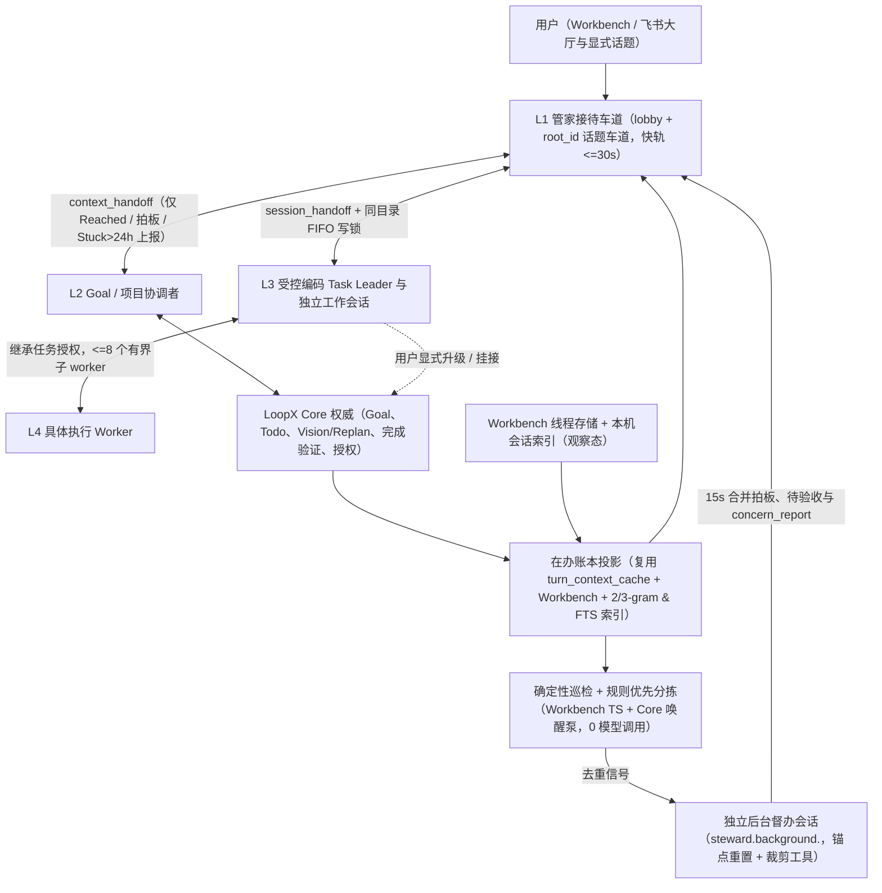

# RFC：管家统一入口——让既有管家同时管住所有会话与 LoopX Goal（v0）

- **RFC 状态：** 已接受
- **替代 / 关闭：** none
- **交付成熟度：** Proposal
- **作者 / 责任人：** LoopX 维护者、管家工程负责人
- **创建：** 2026-11-22
- **最近规范修订：** 2026-11-23
- **实现基线：** `49881d5a3`
- **相关契约：** [强能力管家与语义交接](capable-manager-semantic-handoff-v0.zh-CN.md)、[Router–Controller–Worker 统一契约](controller-executor-unified-contract-v0.zh-CN.md#superagent-acceptance)、[管家运行时 profile](manager-runtime-profile-v0.zh-CN.md)、[App 对话与异步收件箱](app-conversation-and-async-inbox-v0.zh-CN.md)、[长程测量模型](long-horizon-harness-benchmark-research-program-v0.zh-CN.md#6-测量模型)、[管家 golden queries](../../product/use-cases/steward/golden-queries.md)、[整体路线图](loopx-overall-roadmap-v0.zh-CN.md)
- **语言镜像：** [English](steward-unified-entry-v0.md)

## 文档地图与维护约定

- 第 1–10 节是规范性设计与验收契约。
- 第 11 节是规范性交付计划。
- 第 12 节是待决事项；推荐答案不等于批准。
- 附录 A–E 为非规范性的执行台账、决策日志、证据登记表、被拒备选方案与泛化运行教训。

本文是[强能力管家与语义交接](capable-manager-semantic-handoff-v0.zh-CN.md) M1–M3 与 [App 对话与可复用异步工作投递](app-conversation-and-async-inbox-v0.zh-CN.md) 下聚焦落地的交付切片。在主干基线 `49881d5a3` 上，LoopX **已经具备面向 LoopX Goal 的双入口管家能力**——覆盖 App/Workbench 与飞书，包含全局分拣、按修订号校验的上下文热缓存（`turn_context_cache.py`）、`context_handoff` 跨 Goal 委派、带证据的原路回传，以及运行在独立后台会话上的 `continuous_monitor` 定时巡检（`steward_monitor.py` 中的 `steward.background.<binding_id>`）。本文不重造第二套助手，而是复用上述主干已有 owner，补齐通往**本机全部非 Goal 会话**的发现、受控委派、防呆督办与向长期 Goal 渐进升级的桥梁，不新增第二套任务库、调度器或权限权威。中英文互为语义镜像。

---

## 1. 决策摘要

1. **在既有管家之上扩边界，不另起炉灶。** 完整保留并复用主干已交付的 App/Workbench 与飞书管家（`chat_manager.py`、`conversation_binding.ts`、`StewardPage.tsx`）、Core 上下文热缓存（`turn_context_cache.py`）、独立后台监控会话（`steward.background.<binding_id>`）、`context_handoff`、`completion_validation` 与 `return_delivery`；补齐面向非 Goal 本机会话的统一桥接。
2. **一份只读“在办账本”与中英文子串快速找会话。** 管家每轮可读一份统一投影：合成 Core Goal/Todo（直接复用 `turn_context_cache.py`）、Workbench 会话线程（`threads.ts`）以及本机扫描到的自开 CLI/IDE/App 会话（`local-sessions.ts`），并用 SQLite FTS 配合可随时删掉重建的中英文 2/3-gram 文件排除索引（`.search/`）实现毫秒级找会话。
3. **统一委派（`context_handoff` + `session_handoff`）、多层静音汇报纪律与不阻塞管家车道。** Goal 工作继续走 `context_handoff`（L2 Goal 协调者仅在 `Reached`、`Needs decision` 或 `Stuck > 24h` 时上浮汇报；已获授权仓库内的 L3 编码 `Task Leader` 可在本任务授权内派生并验收 `≤ 8` 个有界子 worker）。非 Goal 工作通过 `session_handoff` 委派（复用 `threads.ts` + `coordination.ts` 信箱、非 worktree 同目录 FIFO 写互斥锁、调用方凭证 socket 鉴权，以及督办提示词动态注入）。前台接待通过飞书显式话题子车道（`lane_key = root_id`）、效果入口封锁式软抢占，以及带首轮锚点重置和裁剪工具集的 `steward.background.<binding_id>` 保持快速响应（目标 `≤ 30 秒`）。
4. **确定性会话巡检、仅答普通问题的硬红线、原文子串校验分拣与 `concern` 闭环。** Workbench 的零模型 30 秒 + 事件驱动循环优先用确定性规则处理断连、切号与结构化结项；仅对停在自由文本末尾提问的会话运行一次轻量分拣并**代码级强制校验提取出的问题为 Agent 原文精确子串**（失败则 fail-open 附原文末尾片段）；代码级硬禁止 `steward.background` 自动批准任何 `permission`、`plan`、`screen`、`secret_run` 或外发确认框（自动放行率 `0/N`）；对话式叮嘱通过持久化 `concern -> concern_report` 回执闭环；声称完成前逐项核验完成证据，并将人工拍板在固定 15 秒窗口内合并推送。
5. **零仪式感升级到 LoopX 长期目标推进。** 自开会话默认只读进账本，按需开启会话督办，需要跨天推进时一键挂接或升级为 LoopX Goal。一旦并入 Goal，同一任务证据打回 `≥ 2` 次、实测推翻 Goal 假设或依赖长期阻塞时立即升级给 Core `Vision/Replan` 重规划，并在所有交互窗口关闭时通过既有心跳与 `quota/stride` 预算跨天续跑。
6. **自主督办默认关、保守首版授权与零退步回滚。** 账本只读收录（`ledger.capture=true`）默认开；跨轮自动恢复（`supervision.enabled=false`）默认关；D2 批准前首版 `SupervisionGrant` 默认仅授予保守动作集 `["continue", "retry", "answer_choice"]`（且 `answer_choice` 仅限 `kind: "question"`）。关闭新账本或新话题车道开关时，完整保留主干已交付的 `LOOPX_MANAGER_CONTEXT_CACHE` 与 `steward.background.<binding_id>` Goal 后台监控隔离，绝不退回单会话抢锁。
7. **本文不批准：** 跨主机无人值守接管远端会话、无人值守发布/付款/外发、自动点权限/计划确认框、本机长期项目/主题记忆蒸馏（由独立的本地文件记忆 RFC 承载），或按上下文阈值自动轮转会话。

## 2. 问题与动机

LoopX 在主干 `49881d5a3` 上已经支持飞书与 App/Workbench 双入口管家（`StewardPage` + `StewardOverview`）。在 **LoopX Goal 范围内**，跨 Goal 委派（`context_handoff`）、按修订号校验的上下文热缓存（`turn_context_cache.py`）、运行在独立后台会话上的定时巡检（`steward_monitor.py` -> `steward.background.<binding_id>`）、周期汇报（`steward_reports.py`）和证据回传均已交付。

用户真正还做不到的是：**跟同一个管家对话，既管住 LoopX Goal，又安全、不堵死地管住日常大量非 Goal 会话**：

| 用户 / 运营痛点 | 已核对的基线根因（`49881d5a3`） | 架构缺口 |
| --- | --- | --- |
| “我开了七八个终端/Workbench 会话外加两个 Goal，问管家今天进度，非 Goal 会话全漏掉” | `loopx_manager_read`、`turn_context_cache.py` 与 `steward_triage.py` 只读 Core `registry` 与 Goal Todo；Workbench 的 `threads.ts` 与 `local-sessions.ts` 对管家不可见 | **视野不完整：** 管家只看得见 LoopX Goal，看不见普通与自开会话 |
| “顺手派个非 Goal 活要么逼我先建 Goal，要么管家在前台改码一小时把跨话题提问堵住” | `context_handoff` 只能派给已注册 `(goal_id, agent_id)`；飞书不同话题仍共用单条前台 `(binding_id, source_ref)` 会话锁，且 `steering: False` 宿主（`antigravity_adapter.py`）缺少效果入口封锁式抢占 | **缺少会话级委派与前台多话题争锁：** 非 Goal 会话无标准交接，飞书多话题共享前台锁 |
| “普通会话停了没人盯或乱推报错；而粗糙的自动督办极易误点权限框、编造选项、同目录并发写撞车或上下文滚雪球爆 token” | Workbench 的 `worker-reports.ts` / `todo-stage.ts` / `push.ts` 仍绑在已下线的 `personal-router` 上；`steward.background.<binding_id>` 目前只跑 Goal `native_loopx` 监控，未接入会话巡检、首轮锚点重置或“仅答普通提问”红线；会话级卡点也无法升级到 Core `Vision/Replan` | **会话督办断层、缺少防呆与控费护栏、缺少向长程 Goal 重规划升级通道** |

**具体场景。** 早上用户在终端开 Codex 修导出 bug；中午在飞书管家某个话题里问“PR `#9176` 为什么关了”、顺口叮嘱“导出测试跑通了叫我一声”，并派管家调研竞品定价；同时还有一个跑跨周评测的长期 Goal。下午用户问*“今天各块进展怎样？”*：
- **期望结果：** 中午的飞书话题提问在独立 `lane_key = root_id` 子车道秒级作答，竞品调研在独立工作线程并行推进；终端导出会话停在测试参数追问时，`steward.background` 生成经原文子串核验的点选卡（绝不自动点任何权限框），跑通后用 `concern_report` 闭环中午的叮嘱；下午一轮汇总同时报齐终端会话、已核验引用的竞品结论，以及跨周 Goal 因连续两次指标反转触发的 `Vision/Replan` 换路线拍板卡。
- **当前基线（`49881d5a3`）表现：** Goal 侧缓存与后台监控正常，但管家完全不知道早上的终端会话，无法不建 Goal 就委派普通会话而不占用前台锁，也无法把非 Goal 会话卡点接入防呆督办或升级到 `Vision/Replan`。

### 两个参照设计与在 LoopX 上的取舍

| 参照 | 借鉴机制 | 如何落到 LoopX 既有 owner 上（不重复造轮子） |
| --- | --- | --- |
| **Calli（LooChat 前身）Superagent 设计研究** | 自动收录自开会话的在办账本；确定性阶段优先级推导；持久任务范围督办授权；“先核证据再报完成，缺证据打回”；单阻塞唯一恢复负责人；15 秒合并推送；找会话首次命中率 `≥ 90%` | 采纳阶段推导、证据门禁、15 秒合并窗口与检索指标；**绝不复活** Workbench 个人事项库——Goal 权威留在 Core，普通会话留在 Workbench `threads.ts`，按需升级 |
| **[Persona 统一入口与 SuperAgent](https://github.com/nwverse/persona)** | 派活三档 + `机器 × 仓库 × 模式` 工作区策略；30 秒规则优先循环 + 原文子串校验选项分拣；仅答普通 `question` 硬红线（权限/计划框 `0` 自动放行）；首轮锚点重置 + 裁剪督办工具集防上下文滚雪球；非 worktree 同目录 FIFO 写互斥锁 + 调用方凭证工具鉴权 + 动态注入督办提示词；`concern -> concern_report` 叮嘱闭环；L1–L4 静音汇报与有界 `Task Leader`；中英 2/3-gram 文件排除索引；每日打扰次数 + 主对话可用率（未记录标 `unknown` 而非 `0`） | 直接复用 `#9320` 已交付的 `steward.background.<binding_id>` 并加上首轮锚点重置与工具裁剪；L2 映射到既有 Goal 协调者、L3 映射到受控仓库 `Task Leader`；SQLite FTS 配合 2/3-gram 排除器；补齐 LoopX 独有的 `Vision/Replan` 升级与完整成本成果指标 |

### 不变量

1. **无证据不报完成：** 管家汇报的每一个“已完成”都必须追到已核验的完成证据（Goal 的 `completion_validation` 或会话的验收产物核对）；缺证据只能标为“待核验”或“缺证据”。
2. **覆盖与新鲜度显式透明：** 任一 Goal 数据源或本机会话存储过期、未读或不可用时，账本必须点名具体缺口；严禁用 `unknown` 掩盖可判定状态，也严禁把“未覆盖”说成“无事发生”。
3. **正文绝不生权限，权限框绝不自动点：** 会话记录、工作回报、仓库文件与聊天正文一律视为不可信材料，不能创建或扩大授权；worker 进程调用督办 socket 工具一律返回 `403`；`steward.background` 绝不自动批准 `permission`、`plan`、`screen`、`secret_run` 或对外发送确认框（`0/N`）。
4. **前台不被饿死，抢占与写目录绝不撞车：** 重型 worker 轮次与 `steward.background` 绝不占用交互车道锁；在不支持实时转向的宿主上，软抢占仅限宿主强制只读轮次、或已先原子封锁旧 Turn 效果准入并读回确认零已提交副作用的轮次；非 worktree 同目录可写任务严格经目录级 FIFO 互斥锁串行。
5. **单阻塞唯一恢复负责人且督办上下文有界：** 任一阻塞版本最多由一个恢复方处理；每轮 `steward.background` 均从缓存的首轮锚点重置并仅挂载裁剪后的督办工具集，跨百轮运行输入 token 不滚雪球。
6. **用户直接操作永远优先：** 用户在目标会话或 Goal 里先点确认、先发消息，管家的待发恢复或代答动作立即以 `409 user_intervened` 作废。
7. **长程遇阻升级重规划，回滚绝不丢失主干隔离：** 验收证据连续打回或实测推翻 Goal 假设时升级 Core `Vision/Replan`；关闭任何新增开关均完整保留主干已有的后台监控隔离与上下文热缓存。

## 3. 范围与非目标

### 范围内

- **统一在办账本与快速找会话：** 只读合成 Core Goal/Todo（复用并组合 `#9320` 的 `turn_context_cache.py`，不改动其 Goal 缓存失效契约）、Workbench 线程与 `local-sessions.ts`（覆盖 Codex、Claude Code、Antigravity、TRAE CLI、pi、dsh），底层检索采用 SQLite FTS + 可重建的中英 2/3-gram 文件排除索引。
- **会话级委派（`session_handoff`）、多层协同与不阻塞管家车道：** 新建、带栅栏续接非 Goal Workbench/已导入会话并原路回传；非 worktree 同目录 FIFO 写互斥锁；调用方凭证 socket 鉴权；督办提示词动态注入；飞书显式话题子车道（`lane_key = root_id`，顶层大厅默认确定性留 `lobby`）；效果入口封锁式软抢占；L2 协调者静音汇报纪律与 L3 编码 `Task Leader` 有界子任务派生（`≤ 8`）。
- **确定性会话巡检、防呆控费护栏与合并拍板：** 接入 `steward.background.<binding_id>`（含首轮锚点重置与工具集裁剪）的 30 秒 + 事件驱动规则优先循环、保守首版 `SupervisionGrant`、仅答 `kind: "question"` 硬红线、原文精确子串核验选项分拣（失败 fail-open 附原文）、持久化 `concern -> concern_report` 叮嘱闭环、完成证据门禁与 15 秒合并推送。
- **渐进升级到 LoopX 长期目标：** 零仪式感 `会话 -> Goal` 升级/挂接、`replan_needed` 升级 Core `Vision/Replan`、跨天心跳续跑、`quota/stride` 节奏治理与长程成果/注意力双维度度量。

### 非目标

- 新建第二套任务库、调度器、权限存储或 Python 决策镜像。
- 替代或回退 LoopX Goal 已有的 `context_handoff`、`continuous_monitor`、`turn_context_cache.py`、`steward.background.<binding_id>`、`completion_validation` 或 `Vision/Replan`。
- 重写 Workbench 看板或 Agents 页面、往仓库 `AGENTS.md` / `CLAUDE.md` 写入督办指令，或强迫用户只能通过管家和会话说话。
- 跨主机无人值守接管远端 CLI 会话，或本机长期项目/主题记忆蒸馏与外部收件箱预分流（由配套的本地文件记忆 RFC 独立定义）。
- 无人值守的对外发布、消息外发、数据删除、付款，或自动批准权限/计划确认框。

## 4. 当前系统契约

以下事实基于 `main` 基线 `49881d5a3`（含已合入的 `#9320` 与 `#9328`）核对。

### 4.1 主干已具备的管家与工作台能力（`49881d5a3`）

| 已有能力 | 权威 owner / 代码位置 | `49881d5a3` 主干已交付行为 |
| --- | --- | --- |
| App 与飞书双入口管家对话 | `loopx/chat_manager.py`、`native_chat/external_conversations.py`、`collaboration/conversation_binding.ts`、Workbench `StewardPage.tsx` + `StewardOverview.tsx` | 已验证 owner 私聊管家同时支持 App/Workbench 与飞书；支持 `trusted_owner` / `restricted` profile（`manager-runtime-profile-v0.zh-CN.md`）及 Codex/Antigravity 弹性故障切换 |
| 全局读取、快车道分拣与修订号校验热缓存 | `manager_context/inspection.py`、`manager_context/turn_context_cache.py`（`LOOPX_MANAGER_CONTEXT_CACHE`、`is_manager_turn_context_cache_enabled`）、`native_chat/steward_triage.py` | `loopx_manager_read`、零模型 `/triage`、`/inbox`、`/gates`、`/todos`，以及 `#9320` 已交付的 30 秒上限、按底层权威存储/Goal 投影/状态摘要/SSH 证据守卫严格校验的 `manager_turn_context` 热快照缓存 |
| 跨 Goal 委派与原路回传 | `manager_context/execution.py`、`roundtrip.py`、`tracking.py`、`templates/FOLLOWTHROUGH.md` | `context_handoff`（单轮最多 32 个 `goal_id/agent_id/brief` 目标，携带 `collaboration_brief_v0`）、团队计划预览确认卡与 `original_conversation` 自动回传 |
| 独立后台 Goal 定时巡检与周期汇报 | `native_chat/steward_monitor.py`（`STEWARD_BACKGROUND_SESSION_PREFIX = "steward.background."`、`ensure_steward_background_session`、`pump_steward_monitors`）、`steward_turn.py`、`steward_reports.py` | `continuous_monitor` Todo 由宿主廉价唤醒泵检查（空闲轮询零模型调用），并经 `#9320` 路由到独立的 `steward.background.<binding_id>` 后台会话执行，Goal 监控轮不再与前台交互轮争抢同一会话锁 |
| Goal 长期推进内核 | `control_plane/todos/completion_validation_*`、Goal `Vision/Replan`、heartbeat/scheduler、`quota` | Todo 完成验证计划、基于证据的重规划、跨会话租约与受预算约束的跨天续跑 |
| 本机会话发现与线程信箱 | Workbench `threads.ts`、`local-sessions.ts`、`session-enrich.ts`、`coordination.ts`、`adapters/loopx/binding.ts`、`ext-board` | 跨目录扫描本机支持历史读取的 Agent 会话，单看板统一展示线程与 Goal，提供带 `[进度]` 解析的持久协作信箱 |
| 可复用的会话督办部件 | Workbench `worker-reports.ts`、`todo-stage.ts`、`auto-retry.ts`、`proactive.ts`、`push.ts`、`turn-batch.ts` | 轮次落定回报、确定性阶段推导、瞬时错误退避重试与推送节流 |

### 4.2 阻碍“安全管住所有会话”的已核对缺口

1. **读取与热缓存边界仍仅覆盖 Core：** `turn_context_cache.py` 与 `loopx_manager_read` 只覆盖 Core Goal；管家读不到 Workbench 的 `threads.ts` 与 `local-sessions.ts`，也缺少支持中英文单双字与任意子串的本地会话检索索引。
2. **委派仅限已注册 Goal Agent，缺少目录写锁与 socket 角色隔离：** `context_handoff` 要求 `(goal_id, agent_id)`；管家缺少 `session_handoff` 去拉起或续接非 Goal 会话，缺少非 worktree 同目录 FIFO 写互斥锁，也缺少防止 worker 进程反向调用管家接口的调用方凭证鉴权。
3. **前台交互多话题仍共用单会话锁，非转向宿主缺少效果入口抢占栅栏：** 尽管 `#9320` 已把 Goal 后台监控迁入 `steward.background.<binding_id>`，飞书不同话题（`root_id`）的前台交互仍挤在单条 `(binding_id, source_ref)` 会话锁上，内联长耗时改码会堵住前台，且 `steering: False` 宿主（`antigravity_adapter.py`）缺少在效果准入层先封锁旧 Turn 的安全软抢占协议。
4. **`steward.background` 尚未覆盖会话督办，缺少锚点控费、确认红线与 `Vision/Replan` 升级桥：** `steward.background.<binding_id>` 目前只消费 Core `continuous_monitor`，未接入 Workbench 会话巡检信号与前台 `concern` 叮嘱，缺少跨百轮不滚雪球的首轮锚点重置与工具裁剪、仅答普通 `question` 的硬红线、原文子串校验分拣，以及从卡住会话升级到 Core `Vision/Replan` 的通道。

## 5. 架构设计

### 5.1 归属、权威与四层自治汇报纪律



| 领域事实 | 唯一权威 owner | 禁止的平行权威 |
| --- | --- | --- |
| Goal、Todo、租约、`Vision/Replan`、`completion_validation`、Goal `continuous_monitor` | LoopX Core（`loopx/control_plane/*`） | Workbench 个人事项库、管家提示词清单、重复的 Goal 轮询器 |
| Core 全局上下文热快照缓存 | `manager_context/turn_context_cache.py`（`LOOPX_MANAGER_CONTEXT_CACHE`） | 未校验的提示词缓存，或回滚新账本时顺带关掉 Core 既有热缓存 |
| 非 Goal 线程生命周期、适配器轮次、本机会话扫描、同目录 FIFO 写互斥锁、持久信箱 | Workbench daemon（`threads.ts`、`local-sessions.ts`、`coordination.ts`） | Core 为每个终端临时会话自动制造无主 Goal |
| 会话与 Goal 的挂接身份 | Core `conversation_binding.ts` + Workbench `adapters/loopx/binding.ts` | 按仓库目录相同或标题相似猜测合并 |
| 督办授权（`SupervisionGrant`）与前台 `concern` 叮嘱记录 | Core 授权 owner（Goal Todo）+ Workbench 督办存储（未进 Goal 的受督办线程与 `concern` 回执，升级时迁入 Core） | 提示词暗示、worker 报告或外部聊天文本 |
| 管家通道寻址、话题车道与 `steward.background.<binding_id>` | Core `conversation_binding.ts` + `native_chat/steward_monitor.py` & `steward_turn.py` | 未校验的频道名拼接、允许 worker 调督办 socket，或回滚时把 `steward.background` 退回 `lobby` |

**四层协同与向上静音汇报纪律：**
- **L1 管家（前台车道 + `steward.background`）：** 负责意图分拣、只读秒回、派活路由，以及交付合并后的人工拍板、已核验完成项与 `concern_report` 叮嘱闭环。
- **L2 Goal / 项目协调者（对应路线图 R2）：** 负责多步 Goal 推进，向上仅在 **`Reached`（阶段/目标已核验达成）、`Needs decision`（触碰六类边界或跨范围 `Vision/Replan`）、`Stuck > 24h`（阻塞超 24 小时）** 三种情况下向管家上报，严禁发送常规“还在跑”噪音。
- **L3 编码 `Task Leader`（已获授权仓库会话）：** 当用户在某仓库显式授予编码任务（`SupervisionGrant` 带 `allowChildWorkers: true`，上限 `≤ 8`）时，该 L3 `Task Leader` 可在已授权 `workdir` 与预算包络内自行派生、审查和打回有界只读或子 worktree L4 子任务，无需每个子任务重复弹计划卡；超过 `L1 -> L2/L3 -> L4` 的更深嵌套一律拒绝。
- **L4 执行 Worker：** 执行单一有界任务单，禁止调用 `steward_*` 接口或扩权，完工后向父节点提交附带命令/产物出处的回报。

**会话的三级渐进治理：**
1. **观察态（默认）：** 本机扫描到的会话（`local-sessions.ts`）与普通 Workbench 线程只出现在只读账本里，零 Core 写入、零后台干预。
2. **会话级督办（按派活或用户点选开启）：** 由管家派出的工作线程或用户显式开启“督办”的会话，由 Workbench 盯住轮次落定、卡顿与验收证据并执行有界恢复，无需先建 Core Goal。
3. **Goal 长期治理（显式升级或多步目标）：** 当用户说“把这个归到 X 目标”或“作为长期目标推进”时，管家把会话挂接/升级到 Core Goal，启用 `Vision/Replan`、跨天心跳与 `quota/stride` 预算治理（§5.6）。

### 5.2 在办账本、2/3-gram 排除索引找会话与 socket 调用方鉴权

在办账本为读取时合成的只读视图，支持显式游标分页（`cursor`、`has_more`）与分源健康度声明：

```ts
type OpenWorkLedgerItem = {
  ref:
    | { kind: "goal_todo"; goalId: string; todoId: string }
    | { kind: "workbench_thread"; threadId: string; goalId: string | null }
    | { kind: "local_session"; machineId: string; agent: string; sessionId: string; goalId: string | null };
  title: string;
  cwd: string | null;
  sessions: Array<{
    machineId: string;
    agent: string;
    sessionId: string;
    origin: "workbench" | "app" | "cli" | "managed" | null;
    status: "running" | "idle" | "error" | "offline" | "unknown";
    lastActivityAt: string | null;
    current: boolean;
  }>;
  phase:
    | "not_started" | "running" | "continuing" | "waiting_external"
    | "recovering" | "verifying" | "needs_user" | "review"
    | "paused" | "done" | "unknown";
  supervised: boolean;
  validation: "pending" | "passed" | "missing" | "failed" | null;
  replanSignal: "repeated_rejection" | "assumption_contradicted" | "dependency_stalled" | null;
  reason: string;
  nextStep: string | null;
  observedAt: string;
  freshness: "current" | "cached" | "stale" | "unavailable";
};
```

- **推导优先级与交接去重：** `phase` 严格按当前有效证据推导：`paused > needs_user > recovering > running > waiting_external > verifying > review > continuing（闲置未完） > done > unknown`。已被交接替代的旧执行段（`coordination.ts`、`auto-handover.ts`）折叠在当前有效席位下。
- **不按时间窗截断未结事项：** 账本绝不因“超过 3 天/7 天”丢掉未结工作。旧会话只读取轻量轮廓（`title`、`cwd`、最后一次用户提问、最后一轮 `[进度]`/结果摘要），无法判定的标 `unknown` 并给出核验提示。
- **语义词汇登记：** `phase`、`validation` 与 `replanSignal` 为 Workbench/管家侧投影闭集，映射自 Core `completion_validation` 与 Todo 状态，不侵入 Core 线协议；实现前按 [语义词汇 diff advisory](../../../CONTRIBUTING.md#check-new-semantic-vocabulary-while-developing) 登记。
- **直接复用主干 `turn_context_cache.py` 并叠加 Workbench 修订号：** Core Goal 部分原样复用 `#9320` 已交付的 `turn_context_cache.py`（受 `LOOPX_MANAGER_CONTEXT_CACHE`、权威存储摘要与 SSH/远端证据守卫保护），与 Workbench 内存中的 `(threads_revision, local_sessions_index_revision)` 合成，使未变更热读在 `< 100 ms` 返回且不触碰 Core 缓存失效规则。
- **可重建的中英 2/3-gram 文件排除索引 + SQLite FTS：** 针对 SQLite FTS 分词无法覆盖英文词中子串（如搜 `uild` 命中 `build`）及 1–2 个汉字精确子串检索的问题，`steward_sessions_find` 在 SQLite FTS 之上配套纯本地 `.search/` 分段排除缓存：对 NFC 归一化小写字符流，**宽字符（中日韩/Emoji）提 2-gram、窄字符（ASCII）提 3-gram、中英交界提跨界 2-gram**（单汉字走有序键前缀范围扫描）。查询时先核对 `stat(path, mtime_ns, size)`，索引**只负责排除绝不可能命中的会话文件**，剩余候选再走精确匹配——因此索引落后、损坏或直接 `rm -rf .search` 都零丢召回、零数据库 WAL 写放大，后台自动增量重建。

**管家会话工具与调用方凭证 socket 鉴权：**
Workbench 本地 socket 上的全部 `steward_*` 与 `session_handoff` 接口强制校验宿主签发的督办角色凭证与进程归属（仅限已验证管家会话及获授权限范围内的 L3 `Task Leader`）；L4 worker 进程或任意非督办本地子进程调用一律 fail-closed 返回 `403 unauthorized_caller_role`。

| 工具 | 交付阶段 | 契约说明 |
| --- | --- | --- |
| `steward_ledger_read(cursor?, include_done_since?)` | S1 | 只读合成 Core Goal（复用 `turn_context_cache.py`）、Workbench 线程与 `local-sessions.ts` 的一致性快照（`snapshot_id`、`coverage`、`source_health`、`items`、`next_cursor`） |
| `steward_sessions_find(query, repo?, agent?, cursor?)` | S1 | 基于 SQLite FTS + 2/3-gram 排除索引按仓库/目录、现用与曾用标题、用户原话词项和最后进展只读检索全量会话，优先返回当前交接席位 |
| `steward_session_read(target_ref, turn_cursor?, turns?)` | S1 | 复用 Workbench `history.ts` 分页只读查看会话历史（S1 零导入、零写入） |
| `session_handoff(mode, target_ref?, workdir, brief, expected_last_turn_id?)` | S2 | 经鉴权新建或带栅栏续接会话（含 `workdir` 白名单、同目录 FIFO 写锁与沿 `return_delivery` 回传发起车道） |

### 5.3 统一委派（`context_handoff` + `session_handoff`）、确定性飞书车道与锚点重置后台督办

1. **统一委派、非 worktree 同目录 FIFO 写互斥锁与动态提示词注入：**
   - **Goal 工作**继续使用 `context_handoff`（`goal_id`、`agent_id`、`collaboration_brief_v0`）及原路回传。
   - **非 Goal 会话工作**在 **S2** 新增 `session_handoff`：
     - `mode: "spawn"`：在白名单 `workdir` 上拉起已配置的本机适配器线程（`codex`、`claude-code`、`antigravity`、`trae`、`pi`、`dsh`），传入 `objective`、`constraints`、`acceptance_checks` 与 `return_route`。
     - **默认独立 worktree + 同目录 FIFO 写互斥锁：** 可写改码任务默认分配独立 `git worktree`。凡因非 Git 目录或用户明确指定原地修改而指向**同一真实路径 `workdir`** 的多个可写任务，Workbench 强制进入按规范化路径隔离的**持久化 FIFO 写队列**（同一目录可写并发度严格为 `0`），根绝双 Agent 同目录改码互相踩踏。
     - `mode: "continue"`：校验 `workdir` 白名单，按需导入外部 `local_session`，并以 `expected_last_turn_id` 做乐观并发栅栏——若用户已先手发言或点击确认则立即返回 `409 user_intervened`。
     - **动态注入督办提示词：** `steward.background` 与 L3 `Task Leader` 的角色指令仅在启动对应会话时通过进程参数动态注入（`--append-system-prompt` / `developerInstructions`），**严禁**修改业务仓库下的共享 `AGENTS.md` 或 `CLAUDE.md`。
2. **前台快轨接待 vs. 后台慢轨执行：**
   - **前台快轨（目标 `≤ 30 秒`）：** 状态分拣、进度汇总、找会话、拍板记录、`concern` 登记、受保护动作确认卡、`context_handoff` 与 `session_handoff` 派单直接在本车道完成。
   - **后台慢轨：** 分钟级改码、测试/`canary premerge`、`pr-review` 闭环通过 `context_handoff` 或 `session_handoff(mode="spawn")` 派发，前台立即返回已绑定的工作会话链接，完工后原车道回传。`trusted_owner` 下几秒级的轻量本地只读核查与单轮小修仍可直接完成。
3. **管家话题并发车道（含 S2 确定性 `lobby` 默认路由）与首轮锚点重置 `steward.background`：**
   - **确定性车道寻址（`(binding_id, source_ref, lane_key)`）：**
     - **飞书显式话题内消息（带 `root_id`）：** 路由到 `lane_key = root_id` 的独立子会话（独立轮次锁、独立队列、独立上游模型线程，受全局信号量 `max_concurrent_steward_lanes` 约束，默认 `4`），在原话题内回复；后续用户在该话题内的全部补充与纠偏均确定性归入同一 `lane_key = root_id`。
     - **飞书私聊顶层主窗口消息（无 `root_id` —— S2 规范默认）：** 默认固定路由到 `lane_key = "lobby"`（`steward.auto_thread_on_busy = false`）。当 `lobby` 忙碌时，顶层新消息确定性留在 `lobby` 处理（走下述同车道排队合并或效果封锁式软抢占）并在 `lobby` 回复，使回复位置与后续更正归属完全可判定。忙碌时自动拉起新话题（`lane_key = message_id`）保留为显式受控开关，待 D3 完成桌面与移动端飞书体验验证后再评估是否调整默认值。
   - **复用主干 `steward.background.<binding_id>`（`#9320`）并增加首轮锚点重置与工具集裁剪：**
     - 直接复用 `ensure_steward_background_session`（`steward_monitor.py`），使 Core `native_loopx` Goal 监控与 Workbench 会话督办批次均与前台交互车道物理隔离。
     - **首轮锚点重置 + 督办专用裁剪工具集：** 为防止 `steward.background` 跑上百轮后历史消息滚雪球导致缓存失效与延迟劣化，`steward.background` 保存一份只含稳定督办规则与**裁剪后督办专用工具集**（`steward_ledger_read`、`steward_session_read`、`session_handoff`、`context_handoff`、拍板/`concern_report` 发送，剔除重型代码编辑/浏览器等工具）的**首轮缓存锚点**。每轮督办均从该首轮锚点分叉/重置（支持 CLI 宿主的 `--resume-session-at` 或 app-server 轮次状态重置），仅注入当批结构化信号快照，保证前缀 KV 缓存常热，第 200 轮相对首轮的非缓存输入 token 漂移 `< 10%`。
4. **同车道排队合并与效果入口封锁式软抢占（消除检查后中断前的写竞态）：**
   - **排队期自动合并：** 同一 `lane_key` 忙碌期间连续到达的用户补充消息，在下一轮认领时原子合并为同一批输入（保留各自消息 ID 与时间戳）。
   - **运行期纠偏与效果入口封锁式软抢占：** 在支持实时转向的宿主（`codex`）上走 `chat_queue_steering.ts`。在 `steering: False` 宿主（`antigravity`）上，仅满足以下任一条件时才允许中断并合并重开：
     1. 当前活跃 Turn 从准入起即由宿主强制限定为只读模式（`effect_admission = "read_only"`）；**或**
     2. 对允许写入的 Turn，先由既有效果准入 owner **原子关闭/撤销该旧 `turn_id` 的效果准入**，随后读回准入账本确认在封锁生效前**零外部写入、零 Git 推送、零交接派发、零 Core 状态变更**已被受理或提交（旧执行者此后迟到的任何写请求均被准入层 fail-closed 拒绝），确认无误后才下发 `interrupt` 并携带用户纠偏重开新 Turn。
     凡宿主无法原子封锁并证明零已提交效果时，**严禁抢占**，一律走既有排队分支回执“当前轮次收尾后立即按新要求处理”，等原轮次落定后紧接执行（严格对齐父 RFC A18/A23）。

### 5.4 确定性会话巡检、保守首版授权、仅答普通提问红线、原文子串校验分拣与 `concern` 闭环

LoopX Goal 外部巡检继续由 Core `continuous_monitor` 负责。对 `supervised=true` 的条目及未结前台 `concern` 叮嘱，Workbench daemon 每 30 秒及轮次落定/状态变更事件时运行**规则优先**的确定性循环（**零模型调用**）：

| 信号 | 确定性触发条件（默认值，可配置） |
| --- | --- |
| `review` | 工作会话汇报 `[进度] 待验收`/完成，或关联 Core Todo 进入 `completion_validation` |
| `idle_unfinished` | 最新 `[进度]`/轮次状态显示进行中，但会话已 `idle` 且无生效外部等待 |
| `trailing_question` | 会话停在 `idle` 且末尾为未答自由文本追问或原生 `kind: "question"` 提问框 |
| `needs_you` | 原生 `permission` / `plan` / `screen` / `secret_run` 确认框、六类受保护边界，或 `[进度] 需要你`（阻塞式权限/计划框直接进 15s 合并窗，普通状态挂起 `> 3 分钟` 触发） |
| `stalled` / `no_progress` | 会话处于 `running` 但超过 `max(20 分钟, 预估 × 1.5)` 无事件推进，或只有 sleep/轮询调用而无任何文件/产物/状态增量 |
| `failed` | 未被 `AutoRetry`、额度切换或 Core 重试接管的终态失败轮次 |
| `replan_needed` | 同一 Todo/会话任务验收打回 `≥ 2` 次、实测证据推翻 Goal 假设，或依赖阻塞超过阈值 |

**规则优先、小模型殿后的分拣与原文精确子串核验：**
- `408/429/503` 瞬时错误（归 `AutoRetry`）、套餐耗尽切号、运行超时计时与带结构化 `[进度]` / `completion_validation` 标记的轮次，`100%` 由确定性代码直接分流，**零模型调用**。
- 仅当受督办会话停在无结构化标记的自由文本末尾（`trailing_question` 候选）时，才调用一次已配置轻量模型做结构化分拣（区分 `completed_claim | ordinary_question | human_decision | idle_unfinished` 并可提取 2–4 个点选按钮）。
- **原文精确子串防幻觉校验（失败 fail-open）：** 渲染点选卡前，宿主代码强制校验模型提取出的 `question_quote` **必须是 Agent 最后一条回复正文的逐字精确子串**。一旦轻量模型报错、超时或未通过精确子串核验，立即丢弃合成选项并 **fail-open** 直接附上 Agent 末尾原文片段，确保 `0` 漏报、`0` 编造提问。

**`SupervisionGrant` 可表达动作枚举 vs. 保守 S3 首版默认授权：**
- 设置提供独立开关 `ledger.capture`（默认 `true`）、`supervision.enabled`（默认 `false`）、`steward.topic_lanes`（owner 私聊默认 `true`）与 `steward.auto_thread_on_busy`（默认 `false`），仅允许用户在前端设置中修改。
- **协议可表达动作闭集（`SupervisionAction`）：** `"continue" | "retry" | "switch_model" | "split" | "answer_choice"`。
- **保守 S3 首版默认授权集合（`supervision.default_actions`）：** 在 D2 批准前，普通“把 X 修好/做完”派活或点击「督办」生成的 `SupervisionGrant`，其实际授权字段 `grantedActions` **默认仅写入 `["continue", "retry", "answer_choice"]`**（且 `allowChildWorkers` 默认 `false`，仅显式派发为 L3 仓库 `Task Leader` 时开启）。`switch_model` 与 `split` **首版默认不含在普通续接授权内**，仅当用户显式开启 `supervision.allow_model_switch_and_split=true`（或在计划卡勾选扩展档）并绑定允许的备选端点与预算上限时才写入。
- 每次自动动作在提交时刻必须逐项重验：`supervision.enabled=true`、未撤销、`scopeRevision` 未变、**本次具体动作属于该单 `grantedActions`**、目标 `workdir`/备选端点/剩余预算合规，且无用户新消息（`expected_last_turn_id`），先落盘意图回执再执行。
- **派活三档：** 即时问答本轮直答；只读调研自动拉起工作会话；改代码、首次写某仓库或启动 L3 多 worker 先展示紧凑计划卡（可按 `机器 × 仓库 × 只读/可写` 保存策略并在设置中移除）。

**仅答普通提问硬红线（`question`-only）与六类人工拍板边界：**
- 原生交互框统一区分类型 `kind: "question" | "permission" | "plan" | "screen" | "secret_run" | "external_send"`。
- **代码级硬红线：** 即便 `grantedActions` 含 `"answer_choice"`，`steward.background` **也只允许回答 `kind: "question"`**（可由已记录用户原话严格推出的普通澄清选择题）。宿主代码无条件拦截对 `permission`、`plan`、`screen`、`secret_run` 与 `external_send` 的任何自动批准（自动放行率 `0/N`，且绝不选“始终允许”）。减少权限弹窗只能依靠用户本人点击或用户在设置中显式保存的 `机器 × 仓库 × 模式` 工作区策略。
- **六类人工拍板边界**一律停下并推送带推荐选项的拍板卡：(1) 花钱或未授权付费运行，(2) 删除/覆盖持久数据，(3) 未事先授权的对外发送/发布/建 PR/合入，(4) 扩大系统/仓库/账号权限，(5) 超出授权目录/范围的持久改动，(6) 真实需求歧义。
- **有界恢复与完成证据门禁：** 同一阻塞版本最多执行 `1` 次恢复动作。完工声称凡缺命令/产物出处、引用旧提交证据、实际入口失败或串用他处回执，一律标 `missing`/`failed` 打回原工作会话（满 `≥ 2` 次触发 `replan_needed`）；证据齐全才进 `review`。
- **前台叮嘱的持久化 `concern -> concern_report` 闭环：** 当用户在管家对话里随口叮嘱*“帮我盯着 X，跑通了叫我”*或*“如果 X 的 CI 挂了提醒我”*时，管家落盘一条轻量 `ConcernRecord`（`concernId`、`originLaneKey`、`targetRef`、`conditionSummary`、`createdAt`、`closedByReportId: null`）。确定性巡检循环在目标轮次落定或状态变化时比对未结 `ConcernRecord`，**唯有当 `steward.background` 向原 `originLaneKey` 成功投递显式 `concern_report` 回执（或用户主动取消）时才核销该叮嘱**，跨重启不丢单且零定时模型轮询。

### 5.5 合并拍板推送、`@会话` 分阶段边界与极简前端呈现

- 开启督办后，受督办事项的原始报错与提问先入待判断队列；已自恢复的阻塞不打扰用户。
- 真实人工拍板（六类边界、权限/计划确认框）、`replan_needed` 换路线建议、证据齐全的 `review` 待验收项，以及触发的 `concern_report` 叮嘱闭环，从首条到达起固定收集 **15 秒**（不顺延），在 Workbench 与飞书合成**一条**推送：任务/Goal 名、经子串核验的原话或核验结果、推荐选项及利弊、管家车道与原会话直达链接。
- 若 `steward.background` 超过 60 秒未响应，确定性摘要器仅兜底推送**真实人工拍板卡（附原文末尾片段）与已触发的 `concern` 提醒**，绝不把普通未判报错伪装成拍板刷屏。推送回执严格区分 `transport_sent` 与 `user_handled`。
- **界面克制与 `@会话` 的 S1/S2 分阶段边界：**
  - 不加新看板页、不加口号式说明文字。管家输入框上方用紧凑状态胶囊（`N 在跑 · M 等你`）展开账本抽屉；拍板卡支持行内一键点选。
  - **S1 阶段（纯只读定位与打开）：** 在管家输入框键入 `@会话` 调用 `steward_sessions_find` 定位并**直接打开/跳转到**对应 Workbench 线程或本机会话详情页（若目标是已绑定且具备既有入口的 Goal 会话，则打开该既有入口）；S1 对未绑定本机会话或非 Goal 线程**零导入、零发消息**。
  - **S2 阶段（受控栅栏直发与回传）：** 键入 `@会话 <消息内容>` 正式走 `session_handoff(mode="continue")`，完整执行 `workdir` 白名单核验、按需导入、`expected_last_turn_id` 轮次栅栏、同目录 FIFO 写串行，并将回复沿原管家车道回传。

### 5.6 渐进升级到 LoopX 长期目标推进

会话督办解决“单件事不掉地上”，**LoopX Core 解决“跨天跨周的复杂目标在预算内收敛到可验证成果”**：

```text
  用户的注意力  ◀── L1 管家（合并拍板、concern_report 闭环、路线调整建议与已核验成果）
                      ▲
  长期目标收敛  ◀── L2 LoopX Core Goal（Vision/Replan、跨天心跳、quota/stride；仅 Reached/拍板/Stuck>24h 上报）
                      ▲
  具体执行会话  ◀── L3 受控 Task Leader（<=8 个 L4 worker）+ 升级/挂接的 Workbench 与本机会话
```

1. **零仪式感升级与挂接（`会话 -> Goal`）：** 用户对任意会话说“归到 X 目标”或“升级成长期目标持续跑”时，调用 Core 既有 `goal.create`（`open_session=false`）或 `external_conversations` / `adapters/loopx/binding.ts` 绑定事务，保留原线程 ID、历史与 worktree，将督办权威移交 Core Todo 与 `completion_validation`。未升级会话对 Core 零写入。
2. **遇阻升级 `Vision/Replan`，替代盲目重试：** 已挂接 Goal 的会话或 Todo 触发 `replan_needed`（同一 Todo 证据连续打回 `≥ 2` 次、实测反例推翻 `Vision`/标尺、或依赖阻塞超预算）时，`steward.background` 立即停止会话级重试并把结构化证据提交给 Core `Vision/Replan`；涉及修改共享验收标准、预算或目标范围时推送清晰的换路线拍板卡。
3. **跨天心跳续跑与 `quota/stride` 预算节奏：** 并入活跃 Goal 后，即便所有交互终端关闭，Core heartbeat/scheduler 与 `automatic_resume` 仍在 `quota` 与 `Stride/Yardstick` 包络内跨天唤醒就绪 Todo。
4. **进度问答补齐 Goal 轨迹线：** 汇总进度时按 Goal 聚合报告*距最终验收差距、本窗口实证增量、配额消耗/剩余及维持原路线或重规划判断*，其后列出独立受督办/观察态会话及未结 `concern` 叮嘱。

### 5.7 度量与长程成果评估

所有指标均从已落盘回执计算；未记录时段一律报 `unknown`，绝不记为 `0`。

| 指标 | 口径定义 | 目标方向 |
| --- | --- | --- |
| 每日打扰次数 | 每自然日首次送达用户的拍板卡、权限框与通知数（`steward.background` 消化、工作区策略放行及测试目录单列） | 越少越好（权限框自动误点固定为 `0`） |
| 前台管家可用率与 p95 响应时延 | `steward.background` 或重型 worker 运行期间，交互车道的 `ok / attempts` 及首条实质回复时延 | 可用率更高；后台负载零队头锁阻塞 |
| 后台督办 token 稳定性 | 首轮锚点重置下，`steward.background` 第 200 轮相对第 1 轮的非缓存输入 token 漂移比 | `< 10%` |
| 账本覆盖率与找会话首次命中率 | 固定时点未结 Goal 与本机会话召回率（`100%` 附 `source_health`）；找会话首选命中率（总体与自开子集均附 Wilson 95% 区间 `≥ 90%`） | 召回 `100%`；首选命中 `≥ 90%` |
| 手动打开非管家会话次数 | 每活跃日从侧栏/搜索/直链打开非管家会话次数（仅计元数据，不采正文） | 较 7 天基线下降 `≥ 30%` |
| 长程可验证成果效率 | 按[测量模型](long-horizon-harness-benchmark-research-program-v0.zh-CN.md#6-测量模型)，可比条件下独立验收成果除以完整成本（模型 token + 工具/验证 + 管家/督办控制税 + 人工介入次数） | 同等完整预算下可验证成果不降或更高 |

## 6. 备选方案与设计取舍

| 备选方案 | 优点 | 为何拒绝或设限 | 结论 |
| --- | --- | --- | --- |
| **A. 在主干管家（`#9320` 缓存 + `steward.background`）上扩建 Workbench 账本/2-3-gram 检索、带栅栏 `session_handoff`、锚点重置与 `question`-only 防呆督办及 Core Goal 升级（本文）** | 100% 复用 Core Goal/监控/缓存/验证/重规划 owner 与 Workbench 扫描器及信箱；从机制上封死误点权限框、上下文滚雪球、软抢占写竞态与同目录并发写踩踏 | 需维护鉴权本地 socket 与跨进程效果/轮次栅栏 | **采纳** |
| **B. 复活独立 Calli 个人助手台与个人事项库** | 旧个人台现成代码多 | 与 Core Goal/Todo 双权威脑裂；重造 Goal 巡检与验证 | **拒绝** |
| **C. 强制每条请求和自开终端会话一开始就建 Core Goal** | 从第 0 秒就只有一种对象 | 违背零仪式感入口；临时对话污染 Core 注册表；混淆“被扫描到”与“已授权执行” | **拒绝** |
| **D. 用不重置的长会话跑 LLM 督办，或允许模型代点权限/计划确认框** | 守护进程规则少 | 跑百轮后上下文线性膨胀拖垮成本与准确率，且模型误点一次权限框即可造成删库或越权外发 | **拒绝** |

## 7. 安全、隐私与兼容性

- **逐开关相对 `49881d5a3` 的关闭态严格等价：** `supervision.enabled=false`（默认出厂值）时，不发生任何跨轮自动续接、重试、`question` 代答或通知拦截。关闭 `ledger.capture` 或 `steward.topic_lanes` 时，主干已交付的 Goal `context_handoff`、`LOOPX_MANAGER_CONTEXT_CACHE`、`steward.background.<binding_id>` Goal 监控隔离、统一看板、Agents 页与 `AutoRetry` 与 `49881d5a3` 完全一致。
- **严格的授权、socket 角色鉴权与仓库提示词卫生：** `SupervisionGrant` 与升级 Goal 只能由已认证 owner 轮次或前端显式点击产生；`steward.background` 代码级硬禁止批准 `permission`、`plan`、`screen`、`secret_run` 与 `external_send`；worker 进程调用督办 socket 一律返回 `403`；督办角色提示词仅动态注入，绝不污染业务仓库 `AGENTS.md` 或 `CLAUDE.md`。
- **受众与车道隔离：** 飞书显式话题子车道（`lane_key = root_id`）继承父 `binding_id` 受众核验结果；群聊绑定绝不能访问 `local-sessions.ts`、`.search/` 或私聊车道。
- **仅存元数据与公开边界：** 账本缓存、`.search/` 索引段与度量均留在 git 忽略的本机私有目录，公开产物零原始对话、零凭证、零本机私有路径。
- **增量存储兼容：** `lane_key`（缺省 `"lobby"`）、`SupervisionGrant`、`ConcernRecord` 与线程督办元数据均为纯增量字段。

## 8. 迁移与回滚

1. **独立开关（`preview -> apply -> readback`）：** `ledger.capture`、`steward.topic_lanes`、`steward.auto_thread_on_busy`、`session_handoff`、`supervision.enabled`、`supervision.allow_model_switch_and_split` 与 Goal 升级各自独立控制，互不隐式联动。
2. **不伤主干缓存的账本回滚：** 设 `ledger.capture=false` 仅停止读取 Workbench `threads.ts` 与 `local-sessions.ts`，**原样保留**主干 `LOOPX_MANAGER_CONTEXT_CACHE`（`turn_context_cache.py`）配置与 Core Goal 热缓存行为；删除 `.search/` 自动后台重建或回退原扫描，零数据丢失。
3. **不伤 `steward.background` 监控隔离的话题车道回滚：** 开启 `steward.topic_lanes` 时，原私聊主窗口保留为 `lane_key = "lobby"`，飞书显式 `root_id` 话题进入子车道。关闭 `steward.topic_lanes` 时，在跑 `root_id` 子车道自然落定，后续交互消息回到 `lobby`（子车道历史保持可读），**同时保持 `#9320` 已交付的 `steward.background.<binding_id>` Goal 后台监控会话继续独立运行**，绝不退回前后台共用单会话锁。
4. **督办回滚：** 设 `supervision.enabled=false` 立即停止 Workbench 会话巡检向 `steward.background` 派单（Core `native_loopx` Goal 监控继续在 `steward.background` 正常运行），恢复原始通知路径，完整保留已有授权、`ConcernRecord`、回执与未决拍板卡。
5. **不可逆边界：** 已显式升级为 Core Goal 的会话在关闭会话督办后继续按标准 Goal 生命周期（`Stop` / `Archive`）管理。

## 9. 验证与验收

开发夹具、打包前端旅程与真实宿主/飞书实测分列记录，单测夹具通过不代表真实宿主或跨周实测通过。

| 主张 | 测试或证据 | 要求结果 | 边界与排除项 |
| --- | --- | --- | --- |
| **A1 · 统一账本、S1 只读定位 `@会话` 与缓存合成**（`GQ09/GQ10`） | 覆盖活跃/停止 Goal、Workbench 线程、自开 CLI 会话、超 30 天未结会话、交接链与离线源的真值集测试 + S1 输入框 `@会话` 行为检查 | 未结项召回率、阶段正确率、链接有效率均为 `100%`；多页总数一致；`turn_context_cache.py` + Workbench 修订号未变时热读 `< 100 ms`；S1 中 `@会话` 仅定位并打开目标会话（或既有已绑定 Goal 入口），对未绑定会话 `0` 导入、`0` 发消息 | 不证明真实模型措辞质量 |
| **A2 · 中英子串找会话命中率与 `.search/` 排除等价性**（`GQ02`） | `≥ 50` 条找会话回放（含 `≥ 20` 条自开会话、1–2 个汉字词项与英文词中子串）+ `rm -rf .search` / `mtime` 过期注入 | 总体与自开子集首选命中率均 `≥ 90%`（附 Wilson 95% 区间）；索引正常、删除、过期三种状态下与原始全扫召回率 `100%` 一致 | 单机索引范围，不含未挂载远端磁盘 |
| **A3 · 显式话题分道、`lobby` 确定性路由、效果封锁软抢占、同目录 FIFO 写锁与锚点重置**（`GQ03/GQ08`） | 并发集成测试：跑 `session_handoff` 任务（含两个指向同一非 worktree 目录的可写任务、worker 进程调 `steward_*` socket）+ 连续 200 轮模拟 `steward.background` + 飞书显式 `root_id` 话题提问 + `lobby` 忙碌时顶层新消息 + `steering: False` 宿主“查账本后、interrupt 前首次写入”交错竞态用例 | 显式 `root_id` 话题零队头锁等待并发作答；忙碌时顶层消息确定性留在 `lobby` 并合并同车道追发；扫描后 interrupt 前出现首次写入的交错用例由原子效果封锁拒绝旧写入或安全转入排队，重复效果执行数为 `0`；同目录非 worktree 可写任务严格串行（并发重叠 `0`）；worker 调督办 socket 返回 `403`；S2 `@会话 <消息>` 强制校验 `workdir` 与 `expected_last_turn_id` 并原车道回传；第 200 轮 `steward.background` 非缓存输入漂移 `< 10%` | 上游供应商网络首包时延仍受宿主约束 |
| **A4 · 保守首版授权、`question`-only 红线、原文子串核验与六类边界**（`GQ07/GQ08`） | 真实 daemon + 故障注入：`429`、配额耗尽、缺路径、`20` 个原生 `permission`/`plan`/`secret_run` 确认框、`20` 条末尾自由文本追问（含注入非原文子串的幻觉分拣输出）、全部六类边界、用户先手回复，以及仅获续接授权（`["continue", "retry"]`，不含 `switch_model`/`split`/`answer_choice`）的反例组 | `0 / 20` 权限/计划/密钥确认框被自动批准；仅获续接授权组中模型切换、拆分与代答全部保持待决（越权执行数 `0`）；渲染出的点选卡 `100%` 命中 Agent 原文精确子串，幻觉分拣全部 fail-open 回退原文片段（漏单数 `0`）；可恢复故障自处理 `≤ 1` 次；用户先手使待发动作返回 `409` | 受控注入不替代跨周真实使用 |
| **A5 · 完成证据门禁**（`GQ07`） | 六类缺证据样本（仅写“测试通过”、缺产物、旧提交证据、实际入口失败、部分完成、串用他处回执）+ 完整证据样本 | `6 / 6` 缺证据样本全部标 `missing/failed` 打回工作会话、不推待验收；齐全样本进入 `review` | 督办会话本身不重跑小时级长测试 |
| **A6 · 15 秒合并推送、60 秒兜底与 `concern -> concern_report` 闭环**（`GQ09`） | 虚拟时钟多任务并发触发、前台注册 `concern` + 目标结项、L2 协调者常规进展静默压测、60s 督办超时与窗口内重启测试 | 15s 内拍板与 `concern_report` 合成 `1` 条推送；未结 `concern` 仅在收到 `concern_report` 回执后关闭且跨重启不丢；L2 常规进展唤醒管家次数为 `0`；60s 超时仅兜底人工拍板与已触发叮嘱（重复推送 `0`） | 飞书真机移动端推送时延另行实测 |
| **A7 · 升级 Goal 与 `Vision/Replan` 重规划** | 把运行中的 Workbench 会话升级为 Core Goal，连续注入 `2` 次证据打回与指标反转，随后关闭所有交互会话等待心跳 | 会话无损绑定 Goal 且历史保留；第二次打回停止盲目重试并触发 `Vision/Replan` 生成换路线拍板卡；后续就绪 Todo 在 `quota` 内由心跳正常唤醒 | 单 Goal 集成不替代多任务对照实验 |
| **A8 · 逐开关相对 `49881d5a3` 的关闭态严格等价** | 分别关闭 `supervision.enabled`、`steward.topic_lanes`、`session_handoff` 与 `ledger.capture`，跑 `context_handoff`、`continuous_monitor`、`turn_context_cache.py`、`steward_triage`、统一看板、Agents 页与 `AutoRetry` 回归集 | 关闭 `steward.topic_lanes` 时 `steward.background.<binding_id>` Goal 监控隔离继续生效；关闭 `ledger.capture` 时 `LOOPX_MANAGER_CONTEXT_CACHE` 继续生效；相对 `49881d5a3` 零行为与协议回归 | — |
| **A9 · 一周真实日常使用** | 开启前完整 7 天基线 vs. 开启后完整 7 天日常实测 | 每活跃日手动打开非管家会话次数下降 `≥ 30%`，同时 A1–A4 不退步；完整披露任务量与活跃天数 | 单人前后对比属使用信号，非随机对照因果证明 |
| **A10 · 长程完整成本与成果对照** | 按[测量模型](long-horizon-harness-benchmark-research-program-v0.zh-CN.md#6-测量模型)在配对任务集上对比“仅单任务重试”与“升级 Goal + `Vision/Replan`” | 报告独立验收成果、完整 token/工具/督办控制税开销、人工介入次数及不确定性；如实保留负向或持平结果 | 默认开启推广需维护者另行审批 |

## 10. 运行契约

- **巡检与锚点重置开销上限：** 受督办集合为空或状态未变时，30 秒循环只做内存/索引级修订号核对，零子进程、零模型调用；`steward.background` 唤醒时通过首轮锚点重置 + 裁剪工具集保证单轮输入开销恒定有界，不随运行天数增长。
- **热缓存与 `.search/` 安全：** Core 写入沿用 `turn_context_cache.py` 既有签名机制精准失效；`.search/` 每次查询校验 `stat(path, mtime_ns, size)`，不匹配或重建期间自动回退直接扫描。
- **崩溃与重启恢复：** 信号游标、15 秒收集窗口、单阻塞恢复计数、同目录 FIFO 写队列、`ConcernRecord`、`session_handoff` 回执与 `steward.background` 锚点元数据全部落盘；重启后先对账在途轮次与效果栅栏再发新动作。
- **类型化故障可观测：** 本机会话扫描关闭（`LOOCHAT_LOCAL_SCAN=off`）、socket `403 unauthorized_caller_role` 拦截、`max_concurrent_steward_lanes` 满载或授权撤销时，CLI 与前端 `StewardOverview` 均展示明确错误码与修复指引。

## 11. 规范交付计划

分四个可独立评审、可独立回滚的切片推进，前序切片无需等待后续切片即可独立交付：

| 里程碑 | 交付行为 | 准入条件 | 退出证据 | 回滚路径 |
| --- | --- | --- | --- | --- |
| **S1 · 只读统一账本、2/3-gram + FTS 找会话与只读定位 `@会话`** | Workbench 暴露带调用方凭证鉴权的只读 `steward_ledger_read` / `steward_sessions_find`（SQLite FTS + 可重建 2/3-gram `.search/` 排除索引）/ `steward_session_read`；管家宿主接入并将 `#9320` 已交付的 `turn_context_cache.py` 与 Workbench 修订号合成；前端状态胶囊、仅定位/打开原会话（及既有已绑定 Goal 入口）的 `@会话` 导航与基础度量埋点 | RFC 合入且完成投影词汇登记 | A1、A2、A8 | 设 `ledger.capture=false`，退回纯 Core 读取，同时完整保留主干 `LOOPX_MANAGER_CONTEXT_CACHE` |
| **S2 · 带栅栏 `session_handoff`、显式飞书话题车道与锚点重置后台路由** | `session_handoff`（`spawn` 与带 `expected_last_turn_id` 栅栏的 `continue`），含 `workdir` 白名单、非 worktree 同目录 FIFO 写互斥锁、督办提示词动态注入，以及 S2 `@会话 <消息>` 受控直发与原车道回传；飞书显式 `root_id` 话题车道（顶层消息确定性留 `lobby`，`steward.auto_thread_on_busy=false`）；同车道合并与原子效果封锁式软抢占；`steward.background.<binding_id>`（`#9320`）首轮锚点重置与督办工具裁剪；L2 静音汇报与 L3 `Task Leader`（`≤ 8` 子 worker）约束 | S1 已合入 | A3、A8 | 关闭 `steward.topic_lanes` 与 `session_handoff`，子车道排空回 `lobby`，同时主干 `steward.background.<binding_id>` Goal 监控隔离继续生效 |
| **S3 · 规则优先巡检、`question`-only 护栏、原文子串校验分拣与 `concern` 闭环** | 30 秒/事件驱动 Workbench 巡检接入 `steward.background.<binding_id>`、保守首版 `SupervisionGrant`（默认 `["continue", "retry", "answer_choice"]`）、派活三档与 `机器 × 仓库 × 模式` 策略、权限/计划框 `0/N` 自动批准硬拦截、原文子串核验选项分拣（失败 fail-open）、完成证据门禁、`concern -> concern_report` 叮嘱闭环及 15 秒合并拍板推送 | S2 已合入 | A4、A5、A6、A8，随后跑 A9 | 设 `supervision.enabled=false`，停止会话自动督办，保留 Core Goal 后台监控及全部未决拍板卡/叮嘱 |
| **S4 · 渐进升级 Goal 与长程 `Vision/Replan` 桥接** | 零仪式感 `会话 -> Goal` 升级/挂接（`open_session=false` + `adapters/loopx/binding.ts`）、`replan_needed`（打回 `≥ 2` 次/标尺反转/依赖长阻塞）升级 Core `Vision/Replan`、跨天心跳与 `quota/stride` 回读及 Goal 轨迹汇报 | S3 已合入 | A7、A8、A10 | 关闭 `replan_needed` 自动升级开关，已升级 Goal 继续按标准 Core Goal 规则运行 |

## 12. 待决事项

以下推荐项在写入附录 B 批准前不改变 §§5–11 中已确立的首版规范默认行为。

1. **D1 · 自开会话是显式点名督办还是按目录批量开启**（*责任人：* 管家产品与工程负责人；*依赖里程碑：* S3）
   - *S3 规范默认：* 选项 **A**（默认全部只读进账本；仅由管家派出或用户显式说/点“督办”/“归到某 Goal”时挂载督办授权）。
   - *候选扩展 B：* `supervision.enabled=true` 时自动督办白名单目录内全部自开会话。待 A9 实测手动开启摩擦后再议。
2. **D2 · 是否将 `switch_model` 与 `split` 纳入普通督办的默认授权配置**（*责任人：* 管家工程负责人；*依赖里程碑：* S3）
   - *S3 规范默认：* 保守档 **`["continue", "retry", "answer_choice"]`**（`answer_choice` 仅限 `kind: "question"`），`switch_model` 与 `split` 默认关闭（`supervision.allow_model_switch_and_split=false`），需显式开启并绑定备选端点与预算上限。
   - *候选升级：* 在 A4/A9 量化打扰下降幅度与备选模型开销比后，再决定是否纳入默认档。
3. **D3 · `lobby` 忙碌时飞书顶层消息自动转话题（`steward.auto_thread_on_busy`）的开启门禁**（*责任人：* 飞书与管家工程负责人；*依赖里程碑：* S2 之后客户端体验验收）
   - *S2 规范默认：* `steward.auto_thread_on_busy=false`——飞书显式话题（带 `root_id`）走 `lane_key = root_id` 并发，顶层主窗口消息一律确定性留在 `lane_key = "lobby"`（走同车道排队合并或效果封锁软抢占）。
   - *候选升级：* 待桌面与手机飞书客户端实测确认自动“回复成话题”（`lane_key = message_id`）在消息提醒与后续追问归属上无困惑后，再行审批开启。
4. **D4 · 拍板推送的固定合并窗口时长**（*责任人：* 管家产品负责人；*依赖里程碑：* S3）
   - *选项：* **A（S3 默认）：** 固定 `15 秒` 不顺延。**B：** `60 秒`。**C：** `0 秒` 立即推送。在 A6/A9 中评估合并率与感知延迟。
5. **D5 · 升级到 `Vision/Replan` 的打回阈值**（*责任人：* Core 控制面与管家负责人；*依赖里程碑：* S4）
   - *选项：* **A（S4 默认）：** 同一 Todo 连续打回 `2` 次、出现推翻 `Vision` 假设的实测反例、或依赖等待超预算 `2 倍`。**B：** 连续打回 `3` 次。在 A7/A10 中对比无效重试与重规划开销。

---

## 附录 A：执行台账（非规范性）

带日期的交付检查点存放在 [`ledger/steward-unified-entry-v0/`](ledger/README.zh-CN.md) 目录下，按 `.md` 与 `.zh-CN.md` 成对记录对应的精确基线提交、已交付切片、验证产物与剩余缺口。

## 附录 B：决策日志

| 日期 | 决策 | 责任人 / 批准 | 备选方案 | 变更的规范章节 |
| --- | --- | --- | --- | --- |
| 2026-11-22 | 初版统一入口切片提案：提出在办账本、确定性督办循环、有界恢复与合并通知 | 提案作者（待维护者合入评审） | §6 中的 B、D | §§1–12 |
| 2026-11-23 | 对齐 `49881d5a3`（含 `#9320` 已交付的 `steward.background` 与 `turn_context_cache.py`）；补齐带栅栏 `session_handoff`、确定性飞书车道、原子效果封锁软抢占、保守首版授权与 `question`-only 防呆红线、首轮锚点重置、原文子串核验分拣、同目录 FIFO 写锁、socket 角色鉴权、`concern` 闭环、2/3-gram 排除索引及 S4 Goal `Vision/Replan` 升级 | 提案作者（待维护者合入评审） | §6 中的 B、C、D | §§1–12 |

## 附录 C：证据登记表

| 证据编号 | 主张 | 基线 / 环境 | 产物或命令 | 结果 | 隐私 / 有效性边界 |
| --- | --- | --- | --- | --- | --- |
| E1 | 主干管家、`#9320` `steward.background` 与 `turn_context_cache.py`、快车道分拣、Workbench 本机会话扫描与统一看板归属核对 | `49881d5a3` 源码审计 | `loopx/chat_manager.py`、`loopx/capabilities/native_chat/steward_monitor.py`、`loopx/capabilities/manager_context/turn_context_cache.py`、`apps/workbench/packages/daemon/src/local-sessions.ts` | pass | 仅限源码事实核对，不证明新运行时行为 |
| E2 | RFC 头部、状态索引、中英文成对镜像与公开边界合入前门禁检查 | 基于 `49881d5a3` 变基后的 `codex/steward-unified-entry-rfc` | `uv run --extra test python scripts/generate_rfc_status_index.py --check` 与 `uv run --extra test loopx canary premerge --from-git-diff --git-diff-base origin/main` | pass | 仅限文档与静态治理门禁验证 |

## 附录 D：被拒或已替代方案

1. **在 Workbench 内重做一套 Goal 巡检、热缓存或个人事项库（复活 `Calli personal-router`）：** 拒绝，因为 LoopX Core 已交付运行在 `steward.background.<binding_id>` 上的 `continuous_monitor`、`turn_context_cache.py`、`completion_validation`、`context_handoff` 与 `Vision/Replan`。
2. **让不重置的长会话跑 LLM 督办，或允许模型自动点 `permission`/`plan` 确认框：** 拒绝，因为误点一次权限框即可触发删文件或越权外发，而不重置历史的督办会话跨百轮后会因上下文膨胀拖垮 KV 缓存命中率、成本与判断稳定性。
3. **只查历史步骤账本而不先封锁旧 Turn 效果准入的软抢占：** 拒绝，因为可写轮次可能在查完步骤账本之后、收到 `interrupt` 之前提交首个外部写入，直接重开会导致同一副作用被重复执行。

## 附录 E：事故与评审教训

1. **单漏斗前台争锁与软抢占写竞态（TOCTOU）：** 不同飞书话题共用单条前台锁会造成跨话题阻塞，而在 `steering: False` 宿主上仅靠步骤账本历史判断“尚未写入”会漏掉中断送达前的首次写入窗口。*由此沉淀的设计规则：* §5.3 显式 `root_id` 话题分道 + 顶层消息确定性留 `lobby` + 抢占前原子关闭旧 Turn 效果准入并读回零已提交效果（由 A3 交错用例验证）。
2. **多 Agent 自治督办的五类高频工程踩坑：** 真实督办运行中最易出现五类事故：督办模型顺手替用户点过权限/计划框、总结提问时编造 Agent 没问过的选项、两个可写任务同时改同一个非 worktree 目录互相覆盖、worker 子进程反向调督办工具越权自派活、后台督办会话跑百轮后上下文滚雪球爆掉 token。*由此沉淀的设计规则：* §5.2 调用方凭证 socket 鉴权 + 2/3-gram 排除索引，§5.3 同目录 FIFO 写互斥锁 + 首轮锚点重置与工具裁剪 + 动态提示词注入，以及 §5.4 仅答 `kind: "question"` 硬红线 + 原文精确子串核验（失败 fail-open）+ `concern -> concern_report` 闭环。
3. **新特性回滚不得破坏主干既有隔离：** 把 `#9320` 已合入主干的 `steward.background` Goal 监控隔离或 `turn_context_cache.py` 绑到新开关上，会导致回滚新切片时把主干退回旧争锁状态。*由此沉淀的设计规则：* §4.1/§8/A8 严格区分主干已有基线与新增开关，保证逐开关回滚零退步。
