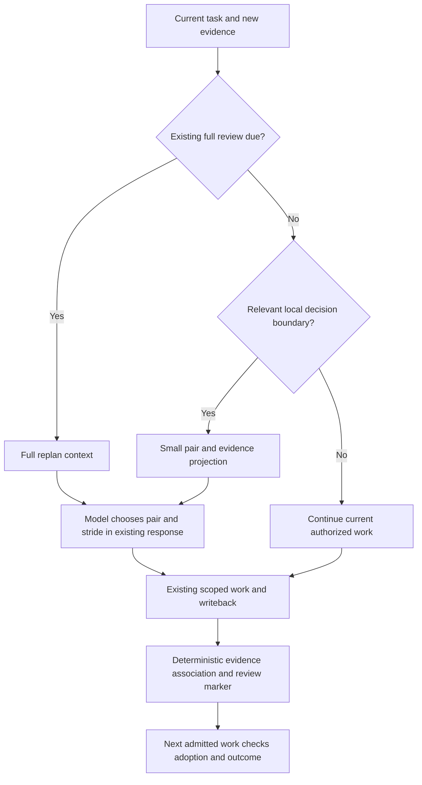

# RFC: Joint Target, Yardstick and Stride Decisions (v0)

- **RFC status:** Accepted
- **Supersedes / closes:** none
- **Delivery maturity:** M1 implementation proposal; M2/M3 unqualified
- **Authors / owners:** LoopX maintainers
- **Created:** 2026-11-05
- **Last normative revision:** 2026-11-07
- **Implementation baseline:** `aa82591fb0a129f3ea9cc5e67343e742899c7ccd`
- **Related contracts:** [Hierarchical stride](hierarchical-agent-stride-control-v0.md), [Research exploration](research-exploration-control-plane-v0.md), [Research measurement](long-horizon-harness-benchmark-research-program-v0.md), [Controller/executor composition](controller-executor-unified-contract-v0.md)
- **Semantic mirror:** [中文版](target-yardstick-stride-decisions-v0.zh-CN.md)

## Document map and maintenance contract

Sections 1–3 and 5–11 propose the design and acceptance contract; section 4 records
audited implementation facts. Section 12 names unresolved implementation choices.
Appendix A identifies sources and the limits of their evidence. Merge accepts a
design basis, not implementation, deployment, a default change or measured benefit.
Keep both language versions semantically synchronized. Later execution evidence
belongs in the existing RFC ledger convention, with explicit normative revisions
when a decision changes. Section 11 records the bounded M1 implementation boundary;
no long-horizon effectiveness gain or default promotion is established.

## 1. Decision summary

Extend the existing Stride decision owner to consider **which target to pursue,
how to measure it, and how much work to do before another useful observation**.
Use one decision model through two entry points: a small ordinary-Turn projection
and the existing full replan review. Do not make every Turn a replan.

Three related judgments must remain distinguishable:

| Judgment | Question | Example consequence |
| --- | --- | --- |
| Target/yardstick co-discovery | Which direction and measurement method together justify investment? | Narrow a broad optimization target, or try a different high-impact component. |
| Yardstick fidelity | Does this measurement distinguish candidates reliably under these conditions? | Recalibrate or replace a misleading proxy while retaining the target. |
| Stride | What coherent work, mechanism distance and validation breadth should come next? | Expand supported work, compare a different mechanism, or resolve uncertainty. |

The selected object is a **target–yardstick pair**; `grow / switch / verify`
still describes the action. Fidelity is evidence about a pair, not a fourth
Stride action. Continuing unchanged is a legal decision and needs no fabricated
`grow` record on quiet Turns. A target can also use direct authoritative
evaluation without a proxy.

The new ordinary-Turn and yardstick treatment starts explicitly off. Existing
Stride defaults, configured periodic reviews, acceptance, budgets and host
continuation retain their meaning. This RFC does not approve automatic tool
execution, benchmark-protocol changes or autonomous acceptance changes.

## 2. Problem and motivation

A long-running agent may optimize a large component but spend most of its budget
building an affordable evaluator. Conversely, it may repeatedly improve an easy
microbenchmark whose code contributes almost nothing to the real objective.
Checking the current proxy's fidelity addresses neither target-selection error.

For example, a broad scheduler target may have large potential but no cheap
representative workload. A per-step prefill allocation model may support many
cheap candidate comparisons; an isolated copy operation may support a reliable
microbenchmark. Neither wins automatically: the allocation model may misrank
real workloads, and copying may account for very little end-to-end cost.
Compare these **pairs**, including direct evaluation of the broad target.

[DuoDiscover](https://arxiv.org/abs/2610.17184v1) motivates this separation. Its
agents discover targets and local yardsticks together, search cheaply, then
confirm gains with the true evaluator. Appendix E.1 compares a yardstick per
target with one per task. Reported validated shares are 58% versus 21% on its
repository tasks and 73% versus 33% on kernels; corresponding yardstick costs
are 4% versus 29% and 2% versus 18% of a true evaluation. These are results of
that study, with different target/task denominators, not predicted LoopX gains.

### Invariants

1. Task acceptance and authoritative evaluation stay with their existing owner.
   A proxy can guide search; it cannot certify an accepted gain.
2. Every measurement binds the actual candidate, target, evaluator version,
   workload and comparison conditions. Missing evidence remains unknown.
3. A declaration, schema-valid decision or read receipt does not prove execution,
   fidelity, adoption or goal improvement.
4. Cheap checks cannot discharge an existing replan or acceptance obligation.
   Review due-ness alone cannot invalidate a still-useful task identity.
5. Budget includes building and repairing the yardstick, unsuccessful exploration,
   confirmation, control overhead and opportunity cost. Preserve failures.
6. No added model call, tool call or durable event is required merely because an
   otherwise unchanged ordinary Turn started or settled.

## 3. Scope and non-goals

In scope: joint local research decisions, scoped measurement evidence, bounded
ordinary-Turn context, replan composition, decision followthrough, failure/replay
semantics and a qualification program. This refines Stride §§7.5–7.7 and the
roadmap's S3/S6/S11 work; it is not a parallel research roadmap.

Out of scope: a new scheduler, new global goal authority, a learned controller,
a generic plugin registry, automatic model fleets, changing frozen evaluations,
or implementing numerical fidelity in the kernel. Non-numerical work can use
Stride without inventing a score or proxy. This first design serves the existing
single-agent ordinary-Turn and replan callers; shared evidence does not grant
cross-agent mutation rights.

## 4. Current-system contract

The named `main` baseline has these relevant seams:

| Owner | Audited behavior | Implication |
| --- | --- | --- |
| [`stride_policy.ts`](../../../loopx/control_plane/work_items/stride_policy.ts), `normalizeStrideDecision` | `stride_decision_v2` requires a delivered `replan-context-*` and admitted `replan-*` obligation. It carries action, three plan/reason axes, next probe and prior review. | The current replan-shaped record cannot simply be required on ordinary Turns. |
| [`replan_semantics.ts`](../../../loopx/control_plane/work_items/replan_semantics.ts), `qualify` | Enabled periodic/observed-stall reviews require a current evidence-linked decision; stale context and mismatched prior evidence are checked. | Preserve due-review enforcement and same-obligation recovery. |
| [`replan_history.ts`](../../../loopx/control_plane/work_items/replan_history.ts), `periodicTrigger` | Counts qualified settled work; unchanged monitor polls do not count as work. | A cheap decision/check is not another effective Turn or a counter reset. |
| [`machine_defaults.py`](../../../loopx/capabilities/todo_replan_cadence/machine_defaults.py), `default_replan_cadence_configuration` | Inherited defaults enable evidence-conditioned Stride and review after six settled work Turns; explicit off and saved legacy configuration retain meaning. | The new treatment must have its own explicit opt-in, not silently change these defaults. |
| [`replan_context.ts`](../../../loopx/control_plane/work_items/replan_context.ts), `decisionFollowthrough` | Projects the previous accepted decision and subsequent progress; actual execution/goal gain remain to be established. | Extend this feedback path; do not create a second decision journal. |
| [`Explore result writeback`](../../../loopx/capabilities/explore/result_writeback.py) and [`turn context`](../../../loopx/capabilities/explore/turn_context.py) | Existing ordinary work can attach findings; primary commit survives a retryable attachment failure. Bounded views retain access to omitted evidence. | Reuse attachment/replay and source-bound evidence, without treating bounded delivery as bounded total source work. |

There is no shipped Yardstick capability in this audited source. Numerical
fidelity below is a proposed profile, not a renamed existing feature. The
[integration guide](../long-running-execution-exploration-and-correction.md)
separates source delivery, actual use and outcome benefit. Open controller
composition work such as [#7430](https://github.com/loopx-project/loopx/pull/7430)
is related transport work, not an implementation dependency or proof of this RFC.

## 5. Proposed architecture

### 5.1 One semantic owner, existing storage and specialized measurement

Keep the joint proposal semantics beside the typed Stride owner in
`control_plane/work_items`. Replan and ordinary-Turn adapters compose this owner;
Python adapters must not implement another policy. Reuse the existing cadence
capability for configuration and the existing Explore result/evidence owner for
findings. No new top-level capability or provider distribution is needed yet.

Domain measurement adapters own score meaning, correctness, noise, coverage,
headroom estimates and fidelity computation. A first numerical profile can use
the benchmark toolkit's existing evidence boundary. The kernel validates typed
identities and legal transitions, not scientific truth. Two callers sharing
decision semantics justify a shared helper; they do not justify a general agent
decision framework.

### 5.2 Evidence and identity model

The following are conceptual fields, not a shipped wire schema. Final naming
must reuse the registered vocabularies and existing reference owners.

| Record | Required meaning |
| --- | --- |
| Target | Stable reference/revision; goal-acceptance reference; bounded change region or hypothesis; incumbent candidate; allowed scope; headroom evidence and uncertainty. It is a research subproblem, not a replacement Goal. |
| Yardstick | Optional reference/revision; target applicability; executable or rubric identity; workload/input revision; metric direction/units; correctness rule; cost estimate/observations; authoritative evaluator/profile reference. |
| Measurement | Immutable result reference; exact candidate/content identity; target and evaluator revisions; conditions; score and correctness separately; actual cost or unknown; observed/ingested ordering. |
| Fidelity assessment | Target–yardstick–oracle/profile scope; exact evidence set and selection policy; noise/coverage; resolved comparisons; state/reason; evidence watermark and tested validity range. |
| Decision | Original Goal/Agent/work-Turn binding; optional real replan binding; source revision; prior decision; chosen pair or direct evaluation; changed axes/probe; triggering evidence; stop/cost bounds and next review condition. |
| Followthrough | Decision → actual method/artifact → applicable measurement → adoption → authoritative outcome, each allowed to remain unknown. |

Same-target candidate edits do not automatically invalidate a proxy: those are
what it evaluates. Edits outside its declared applicability, changed workload,
metric, correctness rule, yardstick implementation or authoritative evaluator
require a new scope/revision and fresh qualification. Retain old measurements;
do not transfer a `validated` label by name similarity. Omission retains an
unchanged field; explicit direct-evaluation selection clears only the active
proxy binding, never its evidence history.

Two entry bindings are a tagged union: **work Turn with Todo** or **real replan
obligation**. Reject mixed/stale bindings. Preserve existing replan decision
references and add an ordinary-work reference form through the same owner;
never synthesize a replan obligation to satisfy the current regex. Exact
serialization uses the additive `work_yardstick_decision_v0` attachment below,
not an implicit v2 relaxation.

The M1 attachment is optional `work_yardstick_decision` inside the existing
`explore_result_attachment_v0` (including the existing path-delta authoring
adapter). Its owner is `control_plane/work_items/yardstick_decision.ts`.
It records a bounded target and acceptance-source reference, an outcome
measurement profile, an optional proxy profile, source-linked counterevidence,
next method/reason/cost bound and the prior same-Todo finding. Profiles reuse
Explore's exact metric, unit, direction, comparison scope, input revision and
evaluator reference; they do not merge proxy and authoritative measurements.
`authoritative` names the Agent's declared outcome profile, not verified authority.

The original settlement supplies Goal/Agent/Todo/Turn identity. The existing run
journal, Explore event log and additive Todo link own persistence and retry;
there is no extra journal, metadata note, planner or mandatory writeback.
A changed decision must cite the current same-Todo finding; validation and append
CAS use the same graph snapshot. An exact durable replay with an original commit
strictly older than the current choice may restore its missing historical
capture. This does not relax predecessor checks for equal-time or newer work,
and attachment callers cannot supply the replay timestamp. Current context
selects by original committed time, so late ingestion cannot replace a newer
choice. Ordinary work preserves its original settlement type and never creates
an obligation to satisfy Stride v2. Replans retain their existing v2 contract.
An absent attachment preserves the current decision; an explicit `proxy: null`
chooses direct evaluation while historical profiles remain readable.

### 5.3 Co-discovery: invest in a pair

The model compares the incumbent pair, direct evaluation and a small relevant
set of alternatives, expanding source-bound detail only when needed. It asks:

- Is there evidence of useful end-to-end headroom, and what is still uncertain?
- Can this yardstick distinguish plausible candidates on this target?
- How much useful search remains after building/calibrating it and confirming
  results? Does the remaining horizon justify that investment?
- Would changing target, measurement method, or both resolve the bottleneck?

Use complete marginal cost: construction + search + repair/calibration + true
confirmation + model/control + switching/opportunity cost. Cheap evaluation time
alone is insufficient. For speed optimization, a measured cost share `w` can
bound ideal whole-program speedup by `1/(1-w)`; this is an upper bound under its
assumptions, not attainable headroom or a universal objective for other domains.
Prefer defensible comparisons/ranges over a fabricated universal utility score.

Bound proxy construction by an evidence-producing checkpoint and cost budget.
At that checkpoint, compare continued construction, a different proxy kind,
narrowing/changing target and direct evaluation. An untested proxy may support
bounded exploration while confirmations accumulate. An easy proxy is not a reason
to remain on a low-impact target; no reliable proxy is not a reason to idle.

Retaining a promising incumbent can provide a matched control or recovery point;
it is not a universal final-delivery requirement. Follow the accepted outcome:
a best-seen valid-score objective does not require the final workspace to contain
the best candidate, whereas a deliverable-quality objective may. Switching must name
what changes: only yardstick, only target, or both. Replacing a broken yardstick
is usually `verify`; it is not automatically a mechanism-changing `switch`.

### 5.4 Fidelity and revalidation

The proposed numerical-profile states below are scoped assessments, not global
properties. `suspect` is a LoopX proposal, not a fourth state attributed to the
paper. Non-numerical providers need an explicit comparable evidence contract;
do not force Kendall correlation onto document review or qualitative acceptance.

| State | Evidence | Permitted use / next step |
| --- | --- | --- |
| Untested | Insufficient applicable/noise-resolved comparisons. | Bounded candidate screening with uncertainty; obtain confirmations or use direct evaluation. Never declare validation. |
| Validated | The named profile passes on the scoped evidence set. | Use for search within that scope; authoritative confirmation still required for accepted gains. |
| Suspect | New conflict or applicability uncertainty requires assessment; rejection is not yet established. | Protect incumbent, reduce reliance and perform a bounded discriminating check; no promotion from the proxy alone. |
| Invalidated | Applicable evidence fails the named rejection rule. | Stop using this revision to rank/promote candidates; retain evidence, rebuild or use direct evaluation. |

New authoritative results trigger a deterministic fidelity reassessment over
applicable paired observations, reusing existing true evaluations. Executing the
proxy against an old candidate still has a cost and requires admission; a trigger
does not launch that work inside `postwriteback`. Untested/suspect assessments can
become validated when sufficient evidence arrives; validated can become suspect
or invalidated. A rejected revision stays historical: repair creates a new
revision, rather than overwriting the failure. Unavailable/corrupt evidence is a
typed observation failure, not statistical invalidation.

DuoDiscover Appendix A.1 measures noise on identical content states, excludes
unresolved/tied pairs and tests rank agreement, not equality of numeric scores.
Its benchmark recipe uses at least six resolved states, Kendall-style rank
agreement ≥0.5 and one-sided permutation significance at 0.05; its expensive
real-world setting uses a smaller evidence floor. These are study-specific
recipes. LoopX must version the profile, including selection policy, minimum
evidence, noise/tie handling and re-test policy, rather than install universal
thresholds. Repeated tests and proxy-selected candidates create statistical
selection risks: track them, use independent/held-out confirmations where
feasible, and do not interpret nominal significance as a lifetime guarantee.

### 5.5 Ordinary Turn and full replan

| Property | Ordinary Turn | Full replan |
| --- | --- | --- |
| Trigger | Newly relevant evidence, a pair applicability change, reached probe boundary, or the model's explicit local reconsideration. | Existing due review/stall obligation, or a proposed change requiring broader work/authority reconciliation. |
| Context | Current task and acceptance, active pair, changed evidence/counterevidence, applicable uncertainty/cost, prior decision followthrough and omitted-detail routes. | Existing Goal/Vision/work graph, competing routes, dependencies, unresolved decisions and selected pair evidence. |
| Model work | In the existing work response; assess changed facts and author only the needed delta. No fixed three-option form each Turn. | Existing explicit planning/review response with required Stride fields and applicable wider comparison. |
| Effects | Existing admitted task, same lease and settlement. A local probe may change within its declared scope. | Existing Todo/Goal/authority operations; newly selected work starts after original settlement and its own admission. |
| Recovery | Original Turn and work identity. | Original obligation, Turn and replan context/recovery owner. |

Per-Turn **availability** does not mean per-Turn mandatory deliberation. No new
evidence and no reached decision boundary means continue the current authorized
slice with no extra decision payload. Existing settlement and periodic-review
duties still apply. The new record is optional on ordinary Turns; when supplied,
identity, evidence and scope validation are mandatory. Do not describe a rejected
write as advisory guidance.

Change magnitude and authority determine escalation, not the action word. A
small local `switch` can stay inside the current task. A `grow` that changes
dependencies or crosses permissions needs existing authoring/authority handling.
Acceptance, task protocol and budget changes always go to their current owner.
If a review is already due, combine the local evidence with that review once;
an ordinary decision cannot reset its counter or acknowledge its obligation.

### 5.6 Lifecycle, writeback and delayed results

`quota`/guard composes available facts and trigger reasons without a separate
model invocation. Selection remains model judgment. Normal work can inspect
feedback and adjust the next in-scope probe; the final decision is committed
with existing writeback. `postwriteback` only associates committed evidence,
updates materialized assessments when inputs already exist, and records the
next review condition. It does not run an evaluator, edit a Todo graph, request
a new model plan or grant execution authority.

Use the existing original-Turn effect identity plus an attachment identity.
Exact replay repairs missing associations without re-executing work, duplicating
quota debit or changing the chosen task. Same identity with different contents
is rejected. New decisions within a Turn need explicit ordered identities; they
cannot overwrite a committed proposal. Pre-commit checks reject malformed/stale
attachments. A post-commit delivery failure preserves the primary result and
returns retryable status, following Explore's established boundary.

Late evaluation belongs to the candidate/pair that produced it, even after the
agent switches direction. It may create a new review reason for the current
agent but cannot silently replace its active pair. Preserve event/ingestion
order and evidence watermarks; resume/compaction may change context delivery,
not reset scientific state or imply the model remembers an omitted finding.
Multiple consumers can cite evidence; only the existing authorized writer can
change the active decision. Conflicting source revisions require reconciliation.

### 5.7 How the decision changes the model's next action

Use a **minimal current-work cue derived from the accepted decision**, not a
new Todo, a note on a future Todo, or an invisible ranking hint. This is a
projection of the existing decision's axes and `next_probe`, with source-bound
evidence; it is not another editable planning store or a new Step lifecycle.
Todo owns the deliverable, acceptance, dependencies and lease. The decision
owns the current method, measurement choice and next evidence boundary within
that task. The host still owns individual tool calls.

Default to one short sentence expressing the decision-relevant uncertainty;
use a second only when needed to avoid misunderstanding. This is a presentation
preference, not a token ceiling, required four-field form or mandatory action
sequence. With no material change, add no repeated cue. For example:

> Local scores improved, but overall gains are unconfirmed; reconsider whether
> this yardstick is worth continuing to use.

The model chooses how to investigate, how much in-scope work to do and whether
to retain or replace the method. Do not prescribe tool order, candidate count,
an exhaustive checklist or a canned plan. The durable decision may contain its
reason, evidence and review boundary; those are available on demand and need
not all appear in the cue. Carry
opaque identity and revision metadata through the existing host/context owner.
Full constraints and cited sources remain accessible through their original
owners; shortening the cue cannot omit a newly relevant constraint or contrary
fact from the overall task input. A controller/executor
host uses its existing natural-language work exchange; a single-agent host uses
the current task context. This does not require deploying a second controller
model or waiting for the controller-composition PR.

| Boundary | How the decision is carried | What must not happen |
| --- | --- | --- |
| Feedback arrives during the same work Turn | The model revises its local next probe while working; commit the meaningful decision with ordinary writeback. | Do not insert another guard/model invocation after every tool result. |
| Next ordinary work Turn on the same task | Project a changed cue beside existing task context; keep evidence and prior adoption available on demand. | Do not create a Todo/Step solely to transport the cue or repeat unchanged guidance. |
| A real new deliverable, dependency or acceptance boundary | Use normal Todo authoring; its first input may reference the applicable decision. | Do not copy a stale decision into arbitrary task notes or let it leak into unrelated work. |

The cue is explicit, revisable guidance within the current task. It does not
have priority over new user direction, acceptance or fresh counterevidence.
The agent can act on it, revise it or explain why it is no longer applicable
within the existing response; no separate acknowledgement call or compulsory
form is introduced. An unchanged applicable decision can be reused only when
context continuity is established; otherwise the current projection is delivered
again under the existing recovery contract.

Prompt delivery cannot guarantee obedience. At the next meaningful evidence
boundary, inspect actual calls, candidate/artifact identities and measurements
to distinguish **delivered, adopted, and beneficial**. If the agent continued
an unsupported parameter sweep, record non-adoption and the remaining gap;
do not mark the probe executed because it appeared in a plan. Repeated
non-adoption is evidence for existing stall/replan handling, not an infinite
loop forcing the agent to repeat the same sentence. Hard enforcement remains
limited to real scope, identity, budget and acceptance constraints. Adoption
means addressing the decision-relevant question, not copying a suggested tool
sequence; an independently better route is not a compliance failure. C13 and the
A–D study must establish that the cue helps without narrowing model capability.
Reuse available artifact/measurement evidence for this review; do not require
new per-tool tracing or reread the entire trajectory on each Turn.

## 6. Alternatives and design choices

| Alternative | Decision / trade-off |
| --- | --- |
| Separate Stride and Yardstick planners | Reject for the first slice: duplicate reviews can disagree about which target is worth measuring. Keep specialized fidelity computation, share the research decision. |
| Full replan every Turn | Reject: creates fake obligations, broad context and unnecessary work-graph churn. |
| One scalar action or utility score | Reject: conflates target value, measurement reliability and work shape; hides uncertainty and unlike cost units. |
| Calibrate a fixed target only | Insufficient: may spend the horizon repairing a yardstick for an uneconomical target. |
| Always use the true evaluator | Retain as comparator/fallback, especially for cheap evaluation or a short remaining horizon. Proxy construction has no guaranteed benefit. |
| Mandatory form in every writeback | Reject: unchanged work should not need repeated explanation. Shared semantics do not require maximal payloads. |
| A Todo, Step or future-Todo note for each decision | Reject as the transport: the existing decision already owns the method/probe; project it onto the current work input. Create tasks only for actual work boundaries. |
| Model planning inside post-writeback | Reject: introduces hidden cost and failure after the primary commit; use the next admitted work response. |

## 7. Safety, privacy and compatibility

The new treatment must be explicitly enabled through the existing configuration
owner; preserve independent existing Stride configuration. Disabled mode adds
no prompt guidance, model/tool calls, decision requirement or change to ordinary
settlement. On readback, historical extra records remain accessible without
being treated as current authority. A shadow experiment must not deliver its
recommendations to the baseline actor; use isolated replay, or label exposure
as a treatment.

No hidden test access, protocol/cooldown change, scorer replacement or outcome
relabeling is permitted by pair selection. Providers may expose only authorized
evidence. Raw tasks, traces, credentials and private evaluator data stay at the
runtime boundary; public docs/fixtures use synthetic examples. Failed controls
and unknown costs remain visible. Choosing direct evaluation still respects
its availability, cost and permission gates; otherwise report the evidence gap.

Preserve `stride_decision_v2` readers, writers and due-review validation. Do not
make its required replan identities nullable. New attachments use negotiated
support through existing version handling. An old writer cannot erase new
records or silently downgrade an enabled treatment; unsupported activation
returns an actionable typed result, while feature-off work keeps its old path.

## 8. Migration and rollback

First characterize existing replan/off behavior and the ordinary attachment
path. Implement the shared semantics with no default switch. Opt in an isolated
Goal/profile with a source-bound current task, measurement profile and initial
unknown fidelity; historical proxy claims receive no automatic validation.
Read back the exact decision and its first adopted work before broader use.

Disable at a settled boundary, retain measurements/decisions and finish pending
attachment delivery under the original identities. Disable does not cancel a
healthy task or erase a due replan. Before binary downgrade, verify no pending
new-schema write remains; otherwise finish recovery with a supporting binary
or keep the affected write paused with its original receipt. No destructive
conversion or journal rewrite is part of this proposal.

## 9. Validation and acceptance

### 9.1 Conformance scenarios

These are implementation acceptance requirements, not tests already passed.

| ID | Scenario | Required observable result |
| --- | --- | --- |
| C1 | No new evidence on an ordinary Turn | Same task/lease/settlement, no new model/tool call or decision event; no manufactured replan. |
| C2 | Strong local proxy gain, tiny target cost share | Compare goal headroom and alternatives; no accepted whole-goal gain inferred from the local number. |
| C3 | High-impact target, unaffordable/unreliable proxy | Bound construction; allow narrowing/other target/direct evaluation. Do not idle or rebuild indefinitely. |
| C4 | Proxy ordering disagrees with applicable true results | Profile-scoped suspect/invalidation; incumbent protected; failed revision and confirmation cost retained. |
| C5 | Too few/noisy/tied observations, or missing evidence | Unknown/untested rather than validated or disproven; failed transport distinguished from scientific evidence. |
| C6 | Candidate within target versus changed workload/oracle | Former can add fidelity evidence; latter requires a new applicability assessment. No transfer of validation by name. |
| C7 | Late true result after a target switch | Result attaches to original candidate/pair; current decision changes only through explicit authorized review. |
| C8 | Crash after primary commit, before evidence association | Repair under original identity; no repeated experiment or second debit. |
| C9 | Local check coincides with due full replan | One combined review; all existing obligations remain enforced. |
| C10 | Local mechanism switch versus scope/authority expansion | In-scope probe stays on task; broader change uses owning authoring/authority path. No implicit permission. |
| C11 | Stale/foreign refs, partial context, concurrent writer, mixed schema | Reject unsupported identity/effect; recover source-bound detail without pretending omitted evidence was read. |
| C12 | Treatment off, old configuration, disable/re-enable | Existing behavior/history retained; no new default, prompt, required field or schedule effect. |
| C13 | Cue raises ranking uncertainty; actor ignores it, finds a better method, or receives contrary user direction | Actual artifacts distinguish delivery from addressing the question; allow improved alternatives and justified revision. Compare concise cue versus no cue for useful action and overhead; never require a scripted tool sequence. |

Replay typed scenarios with synthetic evidence against real File/SQLite owners
where persistence is touched. Use actual host/CLI settlement and packaged
readback for the first adopted slice; schema-unit tests alone are insufficient.

### 9.2 Outcome and cost study

Use staged comparisons, not all combinations immediately:

| Arm | Treatment / question |
| --- | --- |
| A | Current Stride at existing replan boundaries. |
| B | A + lightweight ordinary-Turn decision path, no proxy machinery: does timely local judgment help? |
| C | B + fidelity-aware yardstick for a fixed target: what does calibration add? |
| D | C + joint target/yardstick selection: does co-discovery justify switching/build cost? |

First use matched saved starting states for focused decision episodes; then
whole tasks across distinct workloads and repeated seeds. Freeze model,
available tools, feedback/acceptance protocol, starting artifact, task budget,
stopping rules and resource contention policy. Compare both equal total cost
and score over wall time; the same token ceiling alone does not equalize cost.
Fixed-target C and joint D must share initial target and candidate information;
target freedom is the intended treatment. Keep arms/results traceable after
reruns and include valid zero outcomes and agent failures.

Primary measures are authoritative accepted outcome versus **complete cost**
and time to first accepted gain, with paired uncertainty and cost/quality
frontiers. Also measure control tokens/calls/latency, evaluator construction and
repair share, true evaluations per accepted gain, selected-pair lifetime,
unsupported promotions, unnecessary switches and abandoned useful work.
Decision → adopted work → useful information → confirmed gain are separate
columns; more decisions or higher proxy scores are not success metrics.

Before a confirmatory run, register task split, repeats, non-inferiority margin,
cost/latency budgets and stopping/analysis rules. Do not choose thresholds after
seeing a favorable case. Promotion requires conformance, no authority/protocol
regression, and repeated evidence of better accepted outcomes at comparable
cost or lower complete cost for comparable outcomes. Keep inconclusive/negative
results. Paper gains and a successful synthetic replay do not qualify LoopX.

## 10. Operational contract

CLI, App and Lark reuse the same projection: current target, current yardstick
or direct evaluation, fidelity/uncertainty, last true outcome, why the next
action was chosen, cost to the next boundary and any full review due. Show
details on demand; do not make users read the decision schema. Configuration
activation/disable and unsupported-version feedback belong in existing editors.

Keep a compact current projection plus immutable evidence references and
explicit omitted counts/detail access. Measure total source-reading work,
returned context, writes and latency: a short JSON view does not establish
bounded backend cost. Batch known required reads; avoid an extra discover/read
round trip when the current pair already supplies the needed references.
Unavailable optional measurement evidence keeps the current legally supported
task path, with utility unknown; unavailable authority still obeys its existing
fail-closed owner. No evidence outage authorizes fake scientific progress.

## 11. Normative delivery plan

| Milestone | Useful slice | Entry / exit evidence | Rollback |
| --- | --- | --- | --- |
| M1 | One typed proposal owner with replan compatibility, an opt-in ordinary-Turn attachment and minimal work cue | Approved binding/version seam; C1/C8–C13; source and packaged same-Turn readback; no default changes. | Disable new treatment; retain records and settle pending attachments. |
| M2 | One real numerical target/yardstick profile, bounded context and joint decision through both callers | M1; C2–C7; complete build/search/confirmation costs; real adopted probe and truthful CLI/App/Lark readback. | Direct authorized evaluation or existing task path; preserve failed evidence. |
| M3 | Matched episodes then full-task outcome/cost qualification | C1–C13 and registered A–D study; actual adoption, negative cases, uncertainty and full cost. | Keep opt-in; reject or revise unsupported policy. |

M1 and M2 are delivery slices, not claims of long-horizon gain. Reuse the
existing Stride/Explore owners and downstream callers; remove prototype
duplicates when adopted. Do not add a registry, second journal or speculative
provider abstraction to make these milestones appear complete.

### M1 implementation checkpoint

`execution_profile.yardstick_enabled` is an independent, default-off setting of
the existing Goal review/stride capability. Machine and Goal editors share that
owner; an explicit Goal false wins. Explore evidence must be available before a
new capture; enabling this setting does not launch work or activate another
capability. Disabling removes the extra ordinary-Turn cue and rejects new
captures before primary commit, while historical findings and successful exact
replays remain readable.

The existing Research finding reader exposes the recorded target, outcome/proxy
metrics, source, next action and cost bound. The ordinary task-scoped Explore
context projects only that Todo's current target, a short next-choice cue and
counterevidence references. Its existing question-scoped read command exposes
the full decision, exact-profile feedback and prior execution attribution; the
default projection does not repeat that full record.
Before a current work decision exists, the same opt-in starting read can expose
bounded measurement feedback from the Todo's canonical question links. This
reuses Explore's exact-profile comparison owner, includes source references and
omitted-group navigation, and does not infer a target, accepted outcome metric
or proxy classification. A shared question link is evidence association, not
immutable attribution of execution to that Todo. Recording the first decision
remains optional; default-off and exact-field first reads retain their prior
semantics. Production File/SQLite reader qualification and actual model benefit
are separate obligations.

During an open Turn, an explicit Explore finding can use the ordinary result
attachment and the same canonical Todo question as refresh-state. Its write
receipt includes the changed measurement groups and an advisory comparison
when the confirmed evidence covers the same two candidates on both declared
profiles. The native adapter verifies the submission and supplies measurement
facts. Explore and Yardstick own the association, comparison and readback.

Counterevidence requests reassessment at the next concrete choice; it is not a
new hard gate, fidelity certification, permission to waive correctness or an
instruction to replan every Turn. At a later meaningful capture, existing
execution observations can bind the predecessor's proposed method to the actual
method, candidate and evidence, including a justified different method.

Source validation includes a real isolated SQLite CLI → ordinary guard →
concrete synthetic artifact/evaluation → same-Todo result journey, off-mode
rejection/readback and recovery checks. Its deterministic actor demonstrates
transport and attribution only. The packaged configuration journey qualifies
machine inheritance, Goal overrides and failed-read recovery; the populated
Research reader qualifies the original HTTP/SQLite history on desktop and narrow
screens. Lark uses its existing finding-summary projection, with no external send
in qualification. Actual model adoption, a numerical fidelity profile, complete
marginal cost and matched benefit remain untested; schema survival and synthetic
followthrough do not close C13 or M2/M3.

## 12. Open decisions

| Decision | Owner / recommendation | Evidence needed / deadline |
| --- | --- | --- |
| Attachment and configuration seam | Work-items owns `work_yardstick_decision_v0`; cadence owns independent `yardstick_enabled`; Explore owns ingestion and readback. Preserve replan v2. | Keep exact-head C8–C12 and packaged journey evidence with the implementation proposal. |
| First fidelity profile and evidence floor | Measurement provider maintainer: rank-based profile for a numerical task; no universal six-state rule. | Noise, selection/re-testing risks and affordable true confirmations before M2. |
| Automatic triggers and context budget | Stride/context maintainers: typed evidence deltas and reached probe conditions; no prose classifier or fixed per-Turn form. | Full-path overhead and missed-decision counterexamples in M1/M2; thresholds fixed before M3. |
| Default promotion | Product owner: remain off until matched evidence justifies promotion. | M3 including regressions, uncertainty and actual user journey. |

## Appendix A: Evidence registry and limitations

| Evidence | Source | What it supports / limit |
| --- | --- | --- |
| E1 | [DuoDiscover v1](https://arxiv.org/html/2610.17184v1), §§2.2–2.4; Appendices A.1, E.1, F.1–F.5 | Joint search, rank fidelity, per-target ablation and failure behavior. Author-reported results; not independently reproduced here. |
| E2 | Baseline source links in §4; [Stride §7.6](hierarchical-agent-stride-control-v0.md#76-research-scope-and-evidence-conditioned-control) | Current replan identity, axis and followthrough seams. A source audit, not installed/new-feature validation. |
| E3 | [Research measurement model](long-horizon-harness-benchmark-research-program-v0.md#6-measurement-model) | Shared outcome/cost/adoption comparison owner; this RFC adds a bounded treatment matrix. |
| E4 | Scenarios C1–C13 | Proposed falsifiable acceptance cases; unexecuted until implementation. |

The paper's favorable fallback observations do not prove a no-regret guarantee:
failed yardstick construction has already consumed budget. Per-target versus
task-wide validation rates use different units. Candidate selection and
repeated fidelity tests limit statistical interpretation. These caveats motivate
complete-cost accounting and authoritative confirmation, not rejection of
co-discovery. There is no implementation decision log yet; recommendations in
this proposal are not maintainer approval.
