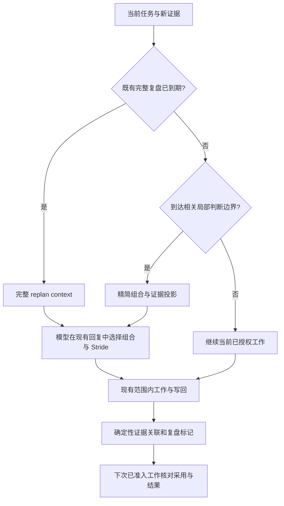

# RFC：Target、Yardstick 与 Stride 联合决策（v0）

- **RFC 状态：** Accepted
- **替代 / 关闭：** none
- **交付成熟度：** M1 源码实现；预算内规划为提案；M2/M3 未资格确认
- **作者 / 归属：** LoopX maintainers
- **创建日期：** 2026-11-05
- **最近规范修订：** 2026-11-10
- **实现基线：** `8f6e88cb2a0fb76aba32bce979ba51293c1981f8`
- **相关契约：** [分层 Stride](hierarchical-agent-stride-control-v0.zh-CN.md)、[研究探索](research-exploration-control-plane-v0.zh-CN.md)、[研究测量](long-horizon-harness-benchmark-research-program-v0.zh-CN.md)、[Controller/Executor 组合](controller-executor-unified-contract-v0.zh-CN.md)
- **语义镜像（语言镜像）：** [English](target-yardstick-stride-decisions-v0.md)

## 文档地图与维护契约

第 1–3、5–11 节提出设计与验收契约；第 4 节记录已核对的当前实现；
第 12 节列出尚待决定的实现选择。附录 A 标明来源及证据边界。
合并只接受设计依据，不证明实现、部署、默认启用或效果收益。
双语版本保持语义一致。后续执行证据沿用 RFC ledger 约定；改变设计时显式修订规范。
第 11 节记录有界 M1 实现边界；尚未证明长程效果收益，也不提升默认配置。

目标、理论假设、完整反馈案例与设计理由见[预算内研究规划](../../research/budgeted-research-planning.zh-CN.md)。
该说明把设计连接到首个 EdgeBench 实验，不新增策略 owner，也不把解释性的 Bellman 模型当成
已经实现的求解器。

## 1. 决策摘要

扩展现有 Stride 决策归属，让它共同考虑：**研究哪个方向、如何测量、
在下一次有用反馈前做多少工作**。按剩余资源期限内的预期验收成果比较有界多步接续，
包含前置建设、信息获取与最终确认。同一套判断通过两个入口使用：
普通 Turn 的精简投影，以及现有完整 replan。不要把每个 Turn 都变成 replan。

三种相关判断必须可以区分：

| 判断 | 回答的问题 | 可能产生的行动 |
| --- | --- | --- |
| Target/yardstick co-discovery | 哪种“方向＋测量方法”值得共同投入？ | 收窄过大的优化目标，或转向另一处高收益组件。 |
| Yardstick fidelity | 在这些条件下，这把尺子能否可靠地区分候选？ | 保留方向，校准或替换误导性的代理评测。 |
| Stride | 下一步做多大工作、改变多少机制、验证多宽？ | 扩大有依据的工作、比较不同机制，或消除不确定性。 |

选择对象是 **target–yardstick 组合**；`grow / switch / verify` 仍描述行动。
Fidelity 是关于组合的证据，不是第四种 Stride 动作。保持原计划合法，
没有变化的 Turn 不必补造 `grow` 记录。方向也可以直接使用权威评测，不配置代理。

新增普通 Turn 与 yardstick 行为初始显式关闭。现有 Stride 默认值、配置的周期复盘、
验收、预算和宿主续跑语义保持。本 RFC 不批准自动工具执行、benchmark 协议改动，
也不允许 Agent 自行改变验收。

## 2. 问题与动机

长程 Agent 可能选择了很有空间的大组件，却把大部分预算花在制作便宜评测上；
也可能不断改善一个很好测、但对整体目标几乎无贡献的微基准。
只检查当前尺子的 fidelity，无法解决这两种方向选择错误。

例如，整个调度器或许有很大空间，但找不到便宜且有代表性的 workload。
每步 prefill 配额可以用成本模型快速比较候选；隔离的数据复制操作可能很好测。
二者都不是天然优选：成本模型可能错排真实 workload，复制也可能只占整体成本的一小部分。
应该比较这些**组合**，也保留直接评测整个调度器的选项。

[DuoDiscover](https://arxiv.org/abs/2610.17184v1) 提供了这个区分的研究依据。
Agent 联合发现 target 和局部 yardstick，便宜地搜索，再用真实评测确认收益。
附录 E.1 对比每个 target 一把尺子与每个 task 一把尺子：仓库任务报告的通过
fidelity 检查比例分别为 58% / 21%，kernel 为 73% / 33%；尺子成本占真实评测的
比例分别为 4% / 29% 和 2% / 18%。这是论文结果，且 target/task 的分母不同，
不能作为 LoopX 收益预测。

### 不变量

1. 任务验收和权威评测仍由原 owner 决定。代理可以引导搜索，不能证明收益已获验收。
2. 每项测量绑定实际候选、target、评测版本、workload 和比较条件。缺失证据保持未知。
3. 声明、合法 schema、读取回执都不等于执行、fidelity、采用或 Goal 改善。
4. 轻量检查不能抵消既有 replan 或验收义务；复盘到期本身不能废弃仍有价值的工作身份。
5. 成本包含造尺子、修尺子、失败探索、真实确认、控制开销和机会成本。失败证据必须保留。
6. 不能仅因无变化的普通 Turn 启动或结算，就要求新增模型调用、工具调用或持久化事件。

## 3. 范围与非目标

范围包括联合局部研究决策、有适用范围的测量证据、普通 Turn 有界上下文、
replan 组合、决策采用追踪、失败/重放语义及资格验证。
这是 Stride §§7.5–7.7 和 roadmap S3/S6/S11 的细化，不另建研究路线图。

不包括新 scheduler、新全局 Goal 权威、实现学习型 controller、通用插件注册中心、
自动模型集群、修改冻结评测，或在 kernel 中实现数值 fidelity。
非数值工作可以只用 Stride，不必发明分数或代理。首版服务现有单 Agent 的普通 Turn
和 replan 两个调用方；共享证据不授予跨 Agent 修改权限。

## 4. 当前系统契约

在标明的 `main` 基线上核对了以下接缝：

| Owner | 当前行为 | 对设计的影响 |
| --- | --- | --- |
| [`stride_policy.ts`](../../../loopx/control_plane/work_items/stride_policy.ts)，`normalizeStrideDecision` | `stride_decision_v2` 要求已交付的 `replan-context-*` 和已准入的 `replan-*` obligation，携带 action、三个 plan/reason 轴、next probe、previous review。 | 不能直接要求普通 Turn 填这份 replan 结构。 |
| [`replan_semantics.ts`](../../../loopx/control_plane/work_items/replan_semantics.ts)，`qualify` | 已启用的周期/停滞复盘要求当前、证据关联的决策；校验过期 context 和不匹配的前序证据。 | 保留到期复盘要求及原 obligation 恢复。 |
| [`replan_history.ts`](../../../loopx/control_plane/work_items/replan_history.ts)，`periodicTrigger` | 计数合格的已结算工作；无变化 monitor poll 不算工作。 | 轻量判断不是额外有效 Turn，也不重置计数。 |
| [`machine_defaults.py`](../../../loopx/capabilities/todo_replan_cadence/machine_defaults.py)，`default_replan_cadence_configuration` | 继承默认启用 evidence-conditioned Stride，每六个已结算工作 Turn 复盘；显式 off 和旧配置保持原含义。 | 新行为要独立显式启用，不能悄悄改变默认。 |
| [`replan_context.ts`](../../../loopx/control_plane/work_items/replan_context.ts)，`decisionFollowthrough` | 投影前次已接受决策和后续进展；实际执行/Goal gain 仍需判断。 | 扩展现有反馈路径，不新建决策 journal。 |
| [`Explore 写回`](../../../loopx/capabilities/explore/result_writeback.py)、[`Turn context`](../../../loopx/capabilities/explore/turn_context.py) | 普通工作可附加 finding；附件可重试失败不抹掉主提交；有界视图保留被省略证据的读取入口。 | 复用附件/重放和来源绑定，不能把投影有界等同于总读源成本有界。 |

此基线已包含可选的
[`yardstick_decision.ts`](../../../loopx/control_plane/work_items/yardstick_decision.ts)
M1 owner：成果/代理 profile、引用反证、同候选排序比较、`proxy_order_reversed`、
下一方法/理由/成本边界及前序 finding。`next_action.cost_bound` 是有界文本，
不是已经计算出的数值行动价值。源码明确保留 proxy fidelity 未资格确认的边界；
尚未实现已校准的状态转移模型、自动秩相关资格判断、全局代理黑名单或预算最优规划器。
第 11 节保留 M1 的实际交付边界。

2026-11-10 源码接续核对：在
[`bd2af5e`](https://github.com/loopx-project/loopx/tree/bd2af5e0ec5acc9eafb0b0eb6b3d4661206a2eef)
中，[引用测量（#8382）](https://github.com/loopx-project/loopx/pull/8382) 与
[Stride 反馈投影（#8385）](https://github.com/loopx-project/loopx/pull/8385) 已合并。
后者把既有 Explore 的有界测量比较与工作尺子提示带入 Stride basis，并保留省略来源的读取路径。
这些源码变化证明证据可达，不证明模型采用、数值 fidelity 或规划收益。
[Controller/Worker 提案（#8378）](https://github.com/loopx-project/loopx/pull/8378)
仍独立于此，不是单 Agent pilot 的前置。试验前固定实际源码与投影；此日期明确的接续核对
不改写原 implementation baseline 的审计。
[整合说明](../long-running-execution-exploration-and-correction.zh-CN.md)
区分来源交付、实际使用与结果收益。

## 5. 提议架构

### 5.1 一个决策 owner，复用存储，测量归专业层

联合提案语义放在 `control_plane/work_items` 的既有 typed Stride owner 附近。
replan 和普通 Turn adapter 组合它；Python adapter 不另写一套策略。
配置复用 cadence capability，finding/证据复用 Explore owner，暂不新建顶层 capability
或 provider distribution。

领域测量 adapter 负责分数意义、正确性、噪声、覆盖、headroom 估计和 fidelity 计算。
首个数值 profile 可复用 benchmark toolkit 既有证据边界。Kernel 检查身份和合法转换，
不判科学结论。两个调用方共享判断，足以支持一个共用 helper；不足以支持通用 Agent 决策框架。

### 5.2 证据和身份模型

以下为概念字段，不是已交付 wire schema。最终命名应复用已注册词汇和 reference owner。

| 记录 | 必须表达的含义 |
| --- | --- |
| Target | 稳定引用/版本、Goal 验收引用、有界修改区域或假设、当前候选、允许范围、headroom 证据及不确定性。它是研究子问题，不替代 Goal。 |
| Yardstick | 可选引用/版本、target 适用范围、程序或 rubric 身份、workload/input 版本、指标方向/单位、正确性规则、成本估计/观测、权威 evaluator/profile 引用。 |
| Measurement | 不可变结果引用、精确候选/content 身份、target/评测版本、条件、分开记录的分数与正确性、实际成本或未知、观测和接收顺序。 |
| Fidelity assessment | Target–yardstick–oracle/profile 范围、精确证据集合及选择规则、噪声/覆盖、可区分比较、状态/原因、证据 watermark 和已测有效范围。 |
| Decision | 原 Goal/Agent/工作 Turn 绑定、可选的真实 replan 绑定、来源版本、前次决策、所选组合或直接评测、变化的轴/probe、触发证据、停止/成本边界与下次判断条件。 |
| Followthrough | 决策→实际方法/产物→适用测量→采用→权威结果，各环节都允许保持未知。 |

同一 target 内修改候选不会自动让尺子失效，这正是它要评测的对象。
超出适用范围、改变 workload、指标、正确性规则、yardstick 实现或权威 evaluator，
才需要新范围/版本和重新确认资格。保留历史测量，不能凭名字相似转移 `validated`。
省略字段表示保持；显式选择直接评测只清除当前代理绑定，不清除其证据历史。

入口绑定是 tagged union：**有 Todo 的工作 Turn**，或**真实 replan obligation**。
拒绝混合/过期绑定。保留现有 replan decision reference，并通过同一 owner 添加普通工作引用形式。
绝不为满足当前 regex 伪造 replan obligation。精确序列化采用下述追加的
`work_yardstick_decision_v0` 附件，不能隐式放宽 v2。

M1 在既有 `explore_result_attachment_v0` 中添加可选 `work_yardstick_decision`，
也支持既有 path-delta authoring 适配。owner 为
`control_plane/work_items/yardstick_decision.ts`。它记录有界 target 与验收来源引用、
成果 measurement profile、可选 proxy profile、有来源的反证、下一方法/原因/成本边界
及同 Todo 的前次 finding。Profile 复用 Explore 的精确指标、单位、方向、比较范围、
输入版本和 evaluator 引用，不合并代理与权威测量。
`authoritative` 表示 Agent 声明的成果 profile，不证明权威性已被验证。

原 settlement 提供 Goal/Agent/Todo/Turn 身份。既有 run journal、Explore event log
和 Todo 追加关联管理持久化与重试；不新建 journal、metadata note、planner 或必填写回。
决策变化必须引用同 Todo 当前 finding，校验与 append CAS 使用同一 graph 快照。
原提交时间严格早于当前选择的 durable 精确重放可以补回缺失的历史 capture，
但不放宽同刻或较新工作的前驱检查，附件调用方也不能提供重放时间戳。
按原提交时间选择当前决策，迟到接收不能覆盖更新的选择。
普通工作保留原 settlement 类型，不为 Stride v2 伪造 obligation；
replan 沿用既有 v2 契约。省略附件保留当前决策；显式 `proxy: null` 选择直接评测，
历史 profile 仍可读取。

当前决策可以复用同一 Agent 在关联问题中已记录、且本次明确引用的测量。
各 profile 保留自己的输入和 evaluator 版本，跨 profile 比较仍须对应同一候选对。
已附带 Yardstick 决策的 finding 继续遵循原工作与目标范围。
主提交为这些引用记录服务端生成的 canonical event 前缀数量及绑定内容的 event-id
摘要。附件恢复核对原前缀，后来的写入顺序不能扩大证据范围。缺少来源快照的旧
capture 仍可读取，但普通引用测量保留未知，不把恢复时的新图当成原证据。
回读用既有 Explore projection 重放原前缀，同一 finding 的后来更新不能改写原引用测量。
服务端来源快照不进入展示用 capture payload，独立安装的 reader 继续收到原 decision/binding 结构。

### 5.3 Co-discovery：投资于组合

模型比较当前组合、直接评测及少量相关替代方案，需要时才扩读有来源绑定的细节。它考虑：

- 是否有整体收益空间的证据，哪些部分还不确定？
- 这把尺子能否区分这个方向上的合理候选？
- 扣掉构造、校准和真实确认后还剩多少搜索空间？剩余 horizon 是否值得这笔投入？
- 改 target、改测量方法，还是同时改，最可能解除瓶颈？

按真实资源单位统计构造、搜索、修复/校准、真实确认、模型/控制和实际切换成本。
在 §5.8 的固定预算下比较放弃的其他机会，不再额外扣一次虚构的机会成本。
不能只看单次小评测有多快。对于性能优化，已测成本占比 `w` 可在假设成立时提供
`1/(1-w)` 的理想整体加速上界；它不是可实现 headroom，也不是其他领域的统一目标函数。
优先使用有依据的比较与区间，不捏造通用 utility 标量。

造尺子要有能产出证据的 checkpoint 和成本边界。到边界时比较继续构造、换尺子类型、
收窄/改变 target、直接评测。Untested 尺子可以支持有界探索，同时积累真实确认。
容易测不是留在低收益方向的理由；找不到可靠尺子也不是空转的理由。

保留有前景的 incumbent 可以提供同期对照或恢复点，不是通用终态交付要求。
应服从实际验收：最高有效已见分数目标不要求最终工作区保留最佳候选，而交付物质量
目标可能要求。切换明确改的是尺子、方向还是两者。
只替换坏尺子通常属于 `verify`，不自动意味着研究机制发生 `switch`。

### 5.4 Fidelity 与重新验证

以下数值 profile 状态是带适用范围的判断，不是全局属性。`suspect` 是 LoopX 提案，
不把它说成论文第四种状态。非数值 provider 需定义可比较证据契约，
不能把 Kendall correlation 强加到文档评审或定性验收上。

| 状态 | 证据 | 允许用途 / 下一步 |
| --- | --- | --- |
| Untested | 适用或超出噪声的比较不足。 | 带不确定性的有界筛选，补真实确认或直接评测；不声称已验证。 |
| Validated | 指定 profile 在该范围证据上通过。 | 在范围内用于搜索；收益验收仍需权威确认。 |
| Suspect | 新冲突或适用范围不确定，尚未达到否定条件。 | 保护 incumbent、减少依赖，做有界区分检查；不能仅凭代理推广。 |
| Invalidated | 适用证据满足指定否定规则。 | 停止用该版本排名/推广候选；保留证据，重建或直接评测。 |

新权威结果触发基于已有适用配对观测的确定性重评，复用已做的真实评测。
在历史候选上再运行代理仍有成本，需要准入；不能因触发条件成立，就在 `postwriteback`
里偷偷执行。证据充分后，untested/suspect 可变为 validated；validated 可变为
suspect/invalidated。被否定版本保持历史，修复创建新版本，不覆盖失败。
证据不可用/损坏属于带类型的观测失败，不等于统计否定。

DuoDiscover 附录 A.1 在相同 content state 上估计噪声，排除不可区分/并列 pair，
检验排序一致而非分数相等。论文 benchmark recipe 使用至少六个可区分状态、
Kendall 式排序相关 ≥0.5、单侧置换显著性 0.05；昂贵的真实任务采用更小的证据下限。
这些是特定实验的规则。LoopX 应版本化 profile，包括样本选择、最低证据、噪声/并列处理
和重测规则，而非全局固定阈值。重复检验和代理筛出的候选存在选择偏差：需要记录，
可行时使用独立/留出确认，不把名义显著性当成终身可靠保证。

### 5.5 普通 Turn 与完整 replan

| 属性 | 普通 Turn | 完整 replan |
| --- | --- | --- |
| 触发 | 新相关证据、组合适用范围变化、probe 到边界，或模型显式重新考虑局部方案。 | 现有到期/停滞复盘义务，或需要更广工作/权限协调的变更。 |
| 上下文 | 当前任务/验收、组合、变化证据/反证、适用的不确定性/成本、前次采用及省略细节入口。 | 既有 Goal/Vision/工作图、竞争路线、依赖、未决问题和组合证据。 |
| 模型工作 | 在现有工作回复中判断变化，只写必要 delta；不要求每轮填三选一。 | 原 planning/review 回复及必需 Stride 字段，按需更广比较。 |
| Effects | 原准入任务、同一 lease 和 settlement；可在声明范围内调整局部 probe。 | 既有 Todo/Goal/权限操作；新工作在原结算完成并再次准入后启动。 |
| 恢复 | 原 Turn 和工作身份。 | 原 obligation、Turn、replan context/recovery owner。 |

每轮**可用**不等于每轮强制审议。无新证据且未到判断边界时，继续当前合法工作，
不附加决策 payload；原结算及周期复盘要求仍适用。普通 Turn 的新记录是可选的；
一旦提交，身份、证据和范围校验是强制的。不能把会拒绝写回的规则称为“建议”。

是否升级由变更幅度和权限决定，不由动作词决定。小范围 `switch` 可以留在当前任务；
改变依赖或越过权限的 `grow` 要走原 authoring/authority 路径。
验收、协议、预算变更始终由原 owner 处理。若复盘已经到期，局部证据合入该次复盘，
只判断一次；普通决策不能重置计数或确认该义务已完成。

### 5.6 生命周期、写回与延迟结果

`quota`/guard 组合已有事实和触发原因，不另调模型。选择由模型判断。
普通工作可检查反馈并调整下一项范围内 probe，最终决策和原 writeback 一起提交。
`postwriteback` 只关联已提交证据、在输入齐备时更新物化判断、记录下次 review 条件；
不运行 evaluator、不编辑 Todo 图、不调用模型重新计划、不授予执行权限。

复用原 Turn effect identity 并绑定 attachment identity。精确重放只补缺失关联，
不重复执行、不重复扣额、不切换当前任务；同身份不同内容拒绝。
同 Turn 新决策需显式有序身份，不能覆盖已提交提案。提交前拒绝错误/过期附件；
提交后交付失败保留主结果并返回可重试状态，沿用 Explore 边界。

即使 Agent 已换方向，延迟评测仍归产生它的原 candidate/pair。它可以产生新的 review 原因，
不能悄悄替换当前组合。保留事件/接收顺序和 evidence watermark。
恢复/压缩只影响上下文交付，不重置研究状态，也不假定模型记得省略的 finding。
多个消费者可以引用证据，只有既有授权 writer 可以改变当前决策；来源版本冲突需核对。

### 5.7 如何驱动模型的下一步行动

用**由已接受决策生成的最小当前工作提示**，不新建 Todo，不塞下个 Todo 的 note，
也不靠模型看不到的排序暗示。这是现有决策 axes、`next_probe` 和来源证据的投影，
不是另一个可编辑计划库，也不新建 Step 生命周期。Todo 管交付物、验收、依赖和 lease；
决策管任务内当前方法、尺子选择与下一次证据边界；具体工具调用由宿主承载。

默认一句短提示，指出当前值得判断的不确定性；确实有歧义时才补第二句。
这是呈现偏好，不是 token 硬上限、强制四字段表格或操作顺序。没有实质变化时不重复提示。例如：

> 局部指标变好了，但整体收益未确认；先判断这把尺子是否值得继续用。

模型自主决定怎么调查、在范围内做多少、保留还是替换方法。不规定工具顺序、候选数量、
完整 checklist 或固定计划。持久化决策可以包含理由、证据和复盘边界，
这些按需可查，不必全部塞进提示。Opaque identity/revision 由现有 host/context owner 携带。
完整约束和引用材料仍通过原 owner 可用；不能因缩短提示，从整体任务输入中丢掉新相关约束或反证。
Controller/Executor host 复用既有自然语言工作交互，单 Agent host 使用当前 task context。
不需要部署第二个 controller 模型，也不等待 controller composition PR。

| 边界 | 如何交付决策 | 不应发生的事 |
| --- | --- | --- |
| 同一工作 Turn 中反馈到达 | 模型工作时修正局部 probe，有意义的决策随普通写回提交。 | 每个工具结果后再插一次 guard/模型调用。 |
| 同任务下一普通 Turn | 在既有任务旁投影变化的短提示，证据和前次采用按需可查。 | 仅为运送提示创建 Todo/Step，或重复无变化建议。 |
| 真有新交付物、依赖或验收边界 | 正常 Todo authoring，首个工作输入可引用适用决策。 | 把过期决策复制到随意的 task note，或带到无关工作。 |

提示是显式、可修正的任务内建议，不高于新用户指令、验收或新反证。
Agent 可以执行、修正，或在现有回复中说明已不适用；不新增 ACK 调用或强制表格。
仅在上下文连续性成立时复用无变化的适用决策，否则按既有恢复契约重新交付当前投影。

Prompt 交付不能保证模型执行。到下一次有意义的证据边界，检查实际调用、候选/产物身份和测量，
区分**送达、采用、获益**。若它仍在无依据地扫参数，记录未采用和剩余差距；
不能因为计划中出现过 probe 就说做过。反复未采用可成为现有停滞/replan 的证据，
不能强迫模型无限复述同一句话。硬约束只保留真实范围、身份、预算和验收。
“采用”指处理了相关判断问题，不是照抄建议的工具序列；自主发现更好方案不算不服从。
C13 和 A–D 实验需要证明短提示有帮助，同时不压缩模型能力。
复用已有产物/测量证据，不要求新增逐工具 tracing，也不每 Turn 重读整条轨迹。

### 5.8 预算内的多步研究规划

[设计依据](../../research/budgeted-research-planning.zh-CN.md#planning-model)解释为什么创造候选、
获取信息与投资尺子应纳入同一预算比较，以及为什么即时增益／成本只是启发式。

这是既有组合/Stride 决策的扩展，不另建工作图或 scheduler owner。近期调用方是
[研究计划 §8.7](long-horizon-harness-benchmark-research-program-v0.zh-CN.md#edgebench-budgeted-planning)
中的 EdgeBench 策略试验。计划是跨有用证据边界的可修订接续，不承诺执行全部步骤，
也不为每次工具调用新增必填记录。

#### 目标与剩余资源

固定起始研究状态 `s0`，令 `Y_B` 为资源期限 `B` 时，按冻结选择规则获得的原生验收成果。
用预先声明的“越大越好”方向表达（如对越小越好的步数取负），只调整记号，不改变
native 验收或跨题聚合。比较策略：

$$
J_\pi(B\mid s_0)=\mathbb E[Y_B^\pi\mid s_0],\qquad
\Delta J(B\mid s_0)=\mathbb E[Y_B^\pi-Y_B^{\pi_0}\mid s_0].
$$

单次运行相对起始候选的增量，不等于相对持续改进的基线多带来的收益。
共同起始值可以抵消，不必先精确估计绝对水平；但同分数不代表同研究状态。
遵守既有“最好有效已评测提交”“最终产物”等成果选择规则，不能把未测试的最佳候选算作已获结果。

`B` 可以分别约束墙钟、token 与评测资源。从现有 owner 读取剩余量、可用性、覆盖和未知项；
等墙钟不等于等 token。规划、读源、失败探索、造尺/修尺与确认都计入真实资源；
并行工作与等待不能通过相加重叠墙钟来计费。在固定资源、终局成果目标下，机会成本体现为
放弃的其他工作，不能将 token 与分数直接相减，也不能重复扣除这份机会成本。
另设货币惩罚需要明确效用换算和目标。

假设行动的正资源消耗 `k(a)` 已知，一个简化规划模型是：

$$
V^*(s,b)=\max\left\{G(s),\ \max_{a:\,k(a)\le b}
\mathbb E[V^*(S',b-k(a))\mid s,a]\right\}.
$$

`G` 是按验收选择规则结束研究的价值。状态包含 incumbent/frontier 证据、未完成前提、
yardstick 适用范围、待返回结果和剩余资源。真实耗时可能随机且受可用性限制；
此模型说明优化目标，不要求 kernel 求解 Bellman 方程。停止分支可以转移预算；
如果未用预算没有其他价值，结束整场运行没有自动的节省收益。保留既有诚实完成、
范围耗尽、权限和资源停止条件，不新增无限工作义务，也不套用固定成本 Bernoulli 停止次数。

#### 比较接续计划，先执行有界切片

以当前路线为对照，只展开与决策有关的替代方案。价值依赖竞争路线和剩余期限，
不是每个候选独立的固定 index。即时增益/成本仅可粗筛：前置建设、互补证据和延迟收益
可能使它错排计划。首个探针零增益不能否定多步计划；过去出现过后程突破也不支持任意坚持。

以下含义应可从现有工作与证据恢复：

| 含义 | 最小有用内容 |
| --- | --- |
| 比较 | 当前验收目标、incumbent/frontier、所比较的接续及同状态/预算范围。 |
| 接续 | 必要依赖，以及通向有用信息或验收成果的简短条件路线；分支失败后保留什么。 |
| 预测 | 可能结果、目标增益或范围、资源/耗时范围、依据与重要未知项。 |
| 下一边界 | 可行首切片、区分性观察、继续/修订/停止条件，以及确认所需时间和资源。 |

这是规划语义，不是四个新增 wire 字段或反复填报的表单。复用 Stride 的 plan/reason 轴、
`next_probe`、普通 Yardstick 的 `next_action`，并用引用的 Explore finding 保存支持性推理。
当前提示保持简短（§5.7）；不把完整计划塞入有界 `cost_bound`，也不向 v0 添加不支持的 key。
真实新增交付物/依赖沿用 Todo owner；同一交付物中的计划步骤不必创建 Todo。
先执行首个完整切片，在有用证据边界重估；保留正常结算与到期复盘，不强迫切换方法。

例如，比较继续优化已有实现，与先建立必要正确性检查、再尝试新机制。
检查失败就修订此前提，通过且剩余预算有价值就继续；若确认已赶不上期限，比较可行的已验证路线。
这是有条件的研究计划，不是通用的强制工具顺序。

预期来自机制/headroom 证据、可比历史和有界探针。允许未知、区间与决策门槛，
不编造精确概率。预测在结果出现前记录，再与实际结果校准。模型自信度和
`grow`/`verify`/`switch` 的观察成功率，不是动作的因果价值，因为选择发生在不同状态。
Bellman 表达式不会提供状态转移模型；事后峰值不能成为决策当时的特征。

#### 进展证据与测量选择

里程碑是带证据、适用范围且可能逆转的依赖状态谓词；替代路线不必完成同一组里程碑。
不能把不同步骤当成同一 Bernoulli 分布的独立重复试验，也不能每完成一步就等额加奖励。
验收目标增量、新成立的前提、信息与采用分开记录。incumbent 分数不变不自动证明学习有用或
防住回归。固定标量成果规则下，分数差分可抵消中间项而得到最终增量；未来学习器的过程奖励
应保留该目标，不能奖励活动数量或反复修复同一缺陷。

本地测量同时存在噪声和系统偏差。更多本地样本不会自动修复 workload 错配或遗漏的硬正确性/
尾部耗时限制。在真正发生选择的位置验证尺子：同父候选、精确评测/输入范围、相邻方案和
原生反例。跨时间秩一致可能只反映共同的搜索进步。有助于发现漏选时，对不确定或被代理拒绝的
候选做有界审计；代理不能单独否决有信息价值且已授权的评测。冲突促使重估有范围的方法，
不生成整类方法的全局黑名单。

评测冷却、队列可用性和待返回反馈是规划输入，不授予修改 benchmark 的权限。
迟到反馈沿不可变候选/结果关联写回；等待时可做独立工作，但 pending 不是测得的收益。
确认必须赶上冻结的终态协议；用于自适应开发的 Native 反馈不是未触碰的 holdout。

### 5.9 沿同一 owner 演进策略

| 阶段 | 下一项有用结果 | 保留的边界 |
| --- | --- | --- |
| 当前模型试验 | 固定版本的有界规划策略改变实际工作，并改善 §8.7 对照结果。 | 沿用 Stride/Yardstick/Explore owner 和普通响应；不以第二个 controller session 或数值 fidelity 引擎为前置。 |
| 校准预期 | 将事前预测关联实际方法、耗时、后继状态与终局结果，在留出 episode 上改善预测/校准。 | 领域 provider 负责测量含义；估计不是验收、权限或编造的反事实标签。 |
| 学习预算分配 | 学习型策略在匹配完整预算和迁移测试中胜过已资格确认的当前模型策略。 | 在同一工作决策边界替换策略实现；Core 保留准入、预算、身份与结算。 |

通过已有 provenance/followthrough 记录决策当时可见的状态与证据、选择和实际方法、
资源消耗、后继观察/状态及后续成果。已选动作日志可以训练预测，却不揭示未选动作的结果。
策略价值主张使用前瞻匹配接续，或明确论证离线策略评估的假设。保留失败、取消和未知结果。
原始任务数据留在研究边界内，不因记录轨迹就进入生产 memory 或训练语料。

首个调用方不需要新策略 registry、计划库、scheduler 或通用标量排序。
以后若修改 schema，先证明缺失的生产者/消费者事实，再扩展既有版本化 owner，
验证读回、恢复和关闭状态。Controller–Worker 组合以后可消费同一决策，
不因此获得更多权限，也不因此证明收益。

原生 measurement adapter 独立记录服务自身的 result、receipt 与评测条件，不要求
先有本地执行。没有保留上传字节时，已接受归档的摘要仍是稳定 subject；可选文件
内容证明保留自身较窄的覆盖范围，不重标既有 measurement。各 outcome/proxy
profile 保留真实 workload revision 与 evaluator。既有 typed 比较 owner 只配对
适用的声明 subject；producer 所在位置及路径/字节内容相等不证明执行等价。
普通 current-work 证据还保留原提交时间与 canonical prefix 边界；旧记录延迟写入
不能变成新 decision 的未引用证据，已显式引用并验证的历史仍可使用。

## 6. 替代方案与设计选择

| 方案 | 选择 / 取舍 |
| --- | --- |
| Stride、Yardstick 各一个 planner | 首版不采用：两次复盘可能对哪个方向值得测产生冲突。保留专业 fidelity 计算，共享研究判断。 |
| 每 Turn 完整 replan | 不采用：伪造义务、扩大上下文、造成无必要工作图变化。 |
| 通用的预计算行动分数 | 不采用：混淆方向价值、尺子可靠性和工作形状，掩盖不确定性及不同成本单位。定义清楚的终局目标（§5.8）仍可支持依赖上下文的比较。 |
| 固定方向，只校准尺子 | 不充分：可能把整个 horizon 用来修一个不划算方向的尺子。 |
| 始终真实评测 | 保留为对照/回退；评测便宜或剩余 horizon 很短时尤其合理。造尺子并无必然收益。 |
| 每次 writeback 强制填表 | 不采用：无变化工作无需重复解释；语义共享不要求最大 payload。 |
| 每次决策变 Todo、Step 或下个 Todo note | 不作为传输方式：方法/probe 已有决策 owner，投影到当前工作输入即可；任务只随真实工作边界创建。 |
| post-writeback 中调模型 planning | 不采用：主提交后引入隐含成本和失败，放在下一次已准入工作回复里。 |

## 7. 安全、隐私与兼容

新增行为通过现有配置 owner 显式启用，保留独立的原 Stride 配置。
关闭时不加 prompt 指引、模型/工具调用、决策义务，也不改变普通结算。
历史扩展记录仍可读取，但不作为当前权威。Shadow 实验不能把建议送给基线执行模型；
使用隔离 replay，否则把“看到了建议”列为 treatment。

组合选择不允许访问隐藏测试、修改协议/cooldown、替换 scorer 或重标结果。
Provider 只暴露授权证据。原始任务、trace、凭据、私有 evaluator 数据留在 runtime 边界；
公共文档/fixture 使用合成例子。失败对照、未知成本保留。直接评测同样受可用性、成本、
权限限制；不能执行时报告证据缺口。

保留 `stride_decision_v2` 的 reader、writer 和到期校验，不能把必需 replan identity 变为 nullable。
新附件通过原版本处理协商支持；旧 writer 不得擦除新记录或静默降级启用的 treatment。
不支持的启用返回可操作的 typed result；feature-off 工作保留旧路径。

## 8. 迁移与回滚

先刻画既有 replan/off 行为和普通 attachment 路径，不切默认值地实现共享语义。
在隔离 Goal/profile 中启用，绑定当前任务和 measurement profile，初始 fidelity 未知；
不自动验证历史 proxy 声明。扩大使用前回读精确决策和首次实际采用工作。

在已结算边界关闭；保留测量/决策，用原身份完成 pending attachment delivery。
关闭不会取消健康任务或抹除到期 replan。降级 binary 前确认无 pending 新 schema 写入；
否则用支持版本完成恢复，或保留原 receipt 暂停受影响的写入。
本提案不包含破坏性转换或 journal 改写。

## 9. 验证与验收

### 9.1 语义场景

这些是实现验收要求，不是已经通过的测试。

| ID | 场景 | 必须看到的结果 |
| --- | --- | --- |
| C1 | 普通 Turn 无新证据 | 原 task/lease/settlement；无新模型/工具调用或决策事件；不制造 replan。 |
| C2 | 局部代理大幅提升，但 target 成本占比很小 | 比较整体 headroom 和替代方向；不从局部分数推断整体已验收收益。 |
| C3 | 高收益方向没有便宜可靠尺子 | 构造有界，允许收窄/换方向/直接评测；不空转或无限重建。 |
| C4 | 代理排序与适用真实结果冲突 | 按 profile suspect/invalidate；保护 incumbent；保留失败版本和确认成本。 |
| C5 | 样本少、噪声大、并列或缺证据 | 未知/untested，而非 validated 或已否定；传输失败与科学证据分开。 |
| C6 | target 内改候选，对比改变 workload/oracle | 前者可积累 fidelity 证据，后者需新适用范围判断；不能凭名字转移资格。 |
| C7 | 换方向后旧真实结果才到达 | 归原 candidate/pair；当前决策只能经显式授权判断改变。 |
| C8 | 主提交成功、证据关联前崩溃 | 原身份修复；不重复实验、不重复扣额。 |
| C9 | 局部检查与完整 replan 同时到期 | 合并判断一次，保留所有既有义务。 |
| C10 | 局部机制变化，对比跨范围/权限扩展 | 范围内 probe 留在原任务；更大变化走原 authoring/authority；无隐含授权。 |
| C11 | 过期/外部 refs、部分 context、并发 writer、混合 schema | 拒绝不支持身份/effect；恢复有来源绑定的细节，不冒充读过省略证据。 |
| C12 | Treatment off、旧配置、关闭再开启 | 保留既有行为/历史；不加默认、prompt、必需字段或调度效果。 |
| C13 | 提示指出排序疑问，模型忽略、找到更好方法或收到相反用户指令 | 产物区分交付与解决问题；允许改进方案及有据修正。比较短提示/无提示的有效行动和开销，不强制工具脚本。 |
| C14 | 同样证据、不同剩余时长 | 比较包含确认的可行终局结果，不要求选择同一路线或使用固定的候选自身分数。 |
| C15 | 前置工作不立即涨分，但使后续改善成为可能 | 考虑条件序列与有界的首个判别切片；相互依赖的里程碑只作为状态证据，不当成独立奖励。 |
| C16 | 确认仍在进行，或无法在终局协议内完成 | 保留不可变结果归属和真实 unknown；比较独立工作或可行的已验证路线，不重置 cooldown 或虚构收益。 |

若涉及持久化，用合成证据在真实 File/SQLite owner 上重放 typed 场景。
首次采用要覆盖实际 host/CLI settlement 和 packaged readback；schema 单测不足以验收。

### 9.2 效果与成本研究

分阶段比较，不立即展开全部组合：

| 实验臂 | Treatment / 问题 |
| --- | --- |
| A | 当前 Stride，仅在既有 replan 边界。 |
| B | A＋轻量普通 Turn 决策，无 proxy 机制：及时局部判断是否有用？ |
| C | B＋固定 target 的 fidelity-aware yardstick：校准增加什么收益？ |
| D | C＋target/yardstick 联合选择：co-discovery 是否值得切换和构造成本？ |

先从相同保存状态做聚焦 decision episode，再做不同 workload、重复 seed 的整任务。
冻结模型、可用工具、反馈/验收协议、起始产物、任务预算、停止规则和资源争用策略。
同时比较等完整成本及随墙钟时间的得分；同 token 上限不等于同成本。
C/D 共享初始 target 和候选信息，方向自由度是有意 treatment。
补跑后仍可追踪实验臂和原结果，包含有效零分与 Agent 故障。

主指标是权威验收结果对**完整成本**的关系、首个已验收收益时间，给出配对不确定性和
成本/效果前沿。辅指标包括 control tokens/调用/耗时、造尺子/修尺子占比、
每次已验收收益需要的真实评测数、组合寿命、无据推广、不必要切换和放弃的有用工作。
决策→采用→有用信息→真实收益分别列出；决策多、代理分高不算成功。

确认性实验前注册 task split、重复数、非劣界限、成本/延迟预算和停止/分析规则，
不看过有利 case 后再选阈值。推广需语义合格、无权限/协议回归，以及可重复证据：
同成本下更好验收结果，或同结果下更低完整成本。保留不确定/负结果；
论文收益和合成 replay 成功都不能替 LoopX 通过资格验证。

聚焦的 [EdgeBench 预算规划试验](long-horizon-harness-benchmark-research-program-v0.zh-CN.md#edgebench-budgeted-planning)
先在已有 M1 路径上验证 §5.8，再考虑广泛 A–D 矩阵。不必等待通用 fidelity 引擎或双会话
runtime，也不据此关闭全部 M2/M3 验收。冻结策略、配对 episode 与整场运行推广规则归研究计划，
不复制为 Core 默认配置。

## 10. 运维契约

CLI、App、Lark 复用同一投影：当前方向、尺子或直接评测、fidelity/不确定性、
最近真实结果、下一行动原因、到下个边界的成本及是否有完整 review 到期。
细节按需，不让用户学习决策 schema。启用/关闭和版本不支持反馈复用现有配置编辑器。

保留精简当前投影、不可变证据引用和明确的省略数量/详情入口。
测量总读源工作、返回 context、写入和耗时；短 JSON 不代表后端成本有界。
已知所需引用时直接批量读取，当前组合已有引用就不再多走发现/读取往返。
可选测量不可用时，继续当前仍有合法依据的任务路径，utility 保持未知；
权限来源不可用仍由原 fail-closed owner 处理。证据故障不允许伪造研究进展。

## 11. 规范交付计划

| 里程碑 | 有用切片 | 入口 / 出口证据 | 回滚 |
| --- | --- | --- | --- |
| M1 | 一个 typed proposal owner，兼容 replan，支持 opt-in 普通 Turn 附件和最小工作提示 | 批准 binding/version 接缝；C1/C8–C13；源码/打包后同 Turn 回读；不改默认。 | 关闭新行为，保留记录，结清 pending attachment。 |
| M2 | 一个真实数值 target/yardstick profile、有界 context，两个调用方都能联合判断 | M1；C2–C7；完整构造/搜索/确认成本；真实采用 probe 和准确 CLI/App/Lark 回读。 | 直接授权评测或原工作路径；保留失败证据。 |
| M3 | 配对 episode 再整任务效果/成本验证 | C1–C13、预注册 A–D 研究；真实采用、负例、不确定性和完整成本。 | 保持 opt-in，拒绝或修改无证据策略。 |

M1/M2 是交付切片，不代表长程收益。复用既有 Stride/Explore owner 和下游调用方，
采用后移除原型重复实现；不为凑齐里程碑加入 registry、第二个 journal 或假想 provider 抽象。

### M1 实现 checkpoint

`execution_profile.yardstick_enabled` 是既有 Goal 复盘/Stride capability 的独立、
默认关闭设置。设备和 Goal 编辑器共用 owner，Goal 显式 false 优先。新 capture 需要
Explore evidence 可用；开启该设置不启动工作或自动开启其他 capability。
关闭后移除普通 Turn 的新增提示，并在主提交前拒绝新 capture；历史 finding
及成功的精确重放仍可读。

既有 Research finding reader 展示记录的目标、成果/代理指标、来源、下一步和成本边界。
普通 task-scoped Explore context 只投影该 Todo 当前目标、下一选择短提示和反证引用。
既有 question-scoped 扩读命令返回完整决策、精确 profile 的反馈和前次执行归属；
默认投影不重复完整记录。
尚无当前工作决策时，同一 opt-in 首读可呈现来自该 Todo 规范问题关联的有界测量反馈。
复用 Explore 精确 profile 比较 owner，保留来源引用及被省略组的读取入口，不推断目标、
验收成果指标或代理分类。共享问题关联只表示证据关联，不是该 Todo 执行测量的不可变归属。
首次决策仍为可选记录；默认关闭及按字段首次读取保留原语义。真实 File/SQLite reader
资格与实际模型收益分别验收。
初始测量提示与已有组合的比较在有意义的证据或 probe 边界复用同一局部选择指导：
验收约束内的预计成果收益、剩余时间，以及完整实现、搜索和确认成本（含模型和控制
开销）。未知保持未知；证据支持的路线可以继续，无实质变化时继续当前获准工作。
局部增益本身不决定哪项投入最值得做。该指导不新增必做比较、评测调用、决策附件或
复盘，也不根据指标名称或近期展示顺序推断 profile。启用时，同一工作的 finding
receipt 也由共享测量事实 owner 投影这段指导。更大的测量索引继续按需读取，不扩充
每次首读。真实模型采用与成果收益仍未取得资格。

在尚未结算的回合里，显式 Explore finding 可以使用普通结果附件，并与
refresh-state 复用同一个 Todo 的规范研究问题。写入回执返回这次写入涉及的
测量变化。两份候选均在已声明的正式与代理指标下取得确认结果时，回执还可
给出排序对比。原生适配器负责核验提交并提供测量事实，Explore 和 Yardstick
负责关联、对比与读回。

新的工作绑定 finding 没有更早的主提交来授权图写入。在本地 File/SQLite、
legacy 源 registry profile 中，它在图 append 期间同时持有既有 canonical writer
guard、源 registry 和设备策略锁。Typed 准入 owner 在这些 guard 内复验原
claim/lease 代际、开放 Todo、注册 actor、Goal Stop 及证据策略的开启状态。
Release 或 transfer 不能穿过该提交。Lease 准入使用日志锁等待与图 CAS 完成之后的
新运行时时钟，排队期间到期会被拒绝；完成这一次已准入的 append 不续授执行权。
提交之后若关联失败，仍可重试关联而不改写
已提交的 finding。该入口尚未验证 source-session incarnation 或远程 provider
fence，因而在 append 前拒绝这些路径；本机互斥锁不能证明 PostgreSQL 的分布式
fence。普通主提交已经成功的附件恢复，继续遵守原有延迟交付契约。

反证要求在下一个具体选择处重新判断，不构成新的硬门、fidelity 认证、放松正确性约束的
权限或每轮重规划指令。后续有意义的 capture 可复用 execution observation，把前次
提议方法连到实际方法、候选和证据，也允许有据采用不同方法。

源码验证包括真实隔离 SQLite CLI → 普通 guard → 具体合成产物/评估 → 同 Todo
结果链、关闭时拒写/回读与恢复检查。确定性 actor 只证明通路和归属。
打包配置旅程验证设备继承、Goal 覆盖与读取失败后的恢复；有密集内容的 Research reader
在桌面和窄屏上验证原始 HTTP/SQLite 历史读回。Lark 复用 finding summary 投影，
资格验证没有对外发送。真实模型采用、数值 fidelity profile、完整边际成本和匹配收益
仍未测试；schema 存活和合成 followthrough 不能关闭 C13 或 M2/M3。

## 12. 待决事项

| 决策 | Owner / 建议 | 需要的证据 / 截止边界 |
| --- | --- | --- |
| 附件与配置接缝 | Work-items 管理 `work_yardstick_decision_v0`，cadence 管理独立 `yardstick_enabled`，Explore 管理接收与回读；保留 replan v2。 | 实现提案保留 exact-head C8–C12 及打包 journey 证据。 |
| 首个 fidelity profile/证据下限 | Measurement provider maintainer：先用于数值任务的排序 profile，不全局规定六状态。 | M2 前核对噪声、选择/重复检验风险及可负担真实确认。 |
| 自动触发与 context 预算 | Stride/context maintainer：typed evidence delta 和 probe 到边界，不用 prose classifier 或每轮固定表格。 | M1/M2 实测完整路径开销和漏决策反例；M3 前固定阈值。 |
| 默认推广 | Product owner：有配对证据前保持关闭。 | M3，包含回归、不确定性和实际用户流程。 |

## 附录 A：证据登记与局限

| 证据 | 来源 | 支持内容 / 边界 |
| --- | --- | --- |
| E1 | [DuoDiscover v1](https://arxiv.org/html/2610.17184v1)，§§2.2–2.4；附录 A.1、E.1、F.1–F.5 | 联合搜索、排序 fidelity、按 target 的消融和失败行为；作者报告，本地未独立复现。 |
| E2 | 第 4 节基线源码；[Stride §7.6](hierarchical-agent-stride-control-v0.md#76-research-scope-and-evidence-conditioned-control) | 当前 replan 身份、轴和 followthrough 接缝；源码核对，不是本机/新能力验收。 |
| E3 | [研究测量模型](long-horizon-harness-benchmark-research-program-v0.md#6-measurement-model) | 公用效果/成本/采用比较归属；本 RFC 添加有界 treatment 矩阵。 |
| E4 | C1–C16 场景 | 验收要求；第 11 节记录 M1 源码覆盖。预算规划场景仍为提案，尚未执行。 |
| E5 | [Selecting Computations](https://aima.cs.berkeley.edu/~russell/papers/uai12-meta.pdf)，§§2–6 | 信念状态决策、互补信息、依赖上下文的优先级与固定预算采样；固定候选的保证不能直接认证会生成候选的研究。 |
| E6 | [Multi-fidelity Bayesian Optimisation](https://proceedings.mlr.press/v70/kandasamy17a.html)，§§1–3 | 区分廉价近似与目标结果；GP/fidelity 假设用于程序搜索前需要验证。 |
| E7 | [Policy invariance under reward transformations](https://people.eecs.berkeley.edu/~russell/papers/icml99-shaping.pdf)，§3 | 势函数 shaping 在其假设下保持目标；任意里程碑奖励没有这个保证。 |
| E8 | [EdgeBench 适配器契约](../../../benchmark/edgebench/README.md)、[反馈与记忆分析](https://loopx-project.github.io/loopx/blog/zh/edgebench-feedback-and-memory/)及第 4 节源码 owner | Native 协议、起点/接续的区分与当前 M1 接缝；说明 pilot 的动机，不是新的实测收益。 |

论文中回退的有利观测不代表无后悔保证：失败造尺子已经消耗预算。
每 target 与每 task 的通过率单位不同；候选选择和重复 fidelity 检验限制统计解释。
这些边界要求完整成本及权威确认，不是否定 co-discovery。
M1 决策/接续实现不能证明预算规划收益；本提案建议不等于 maintainer 批准新的运行时策略。
