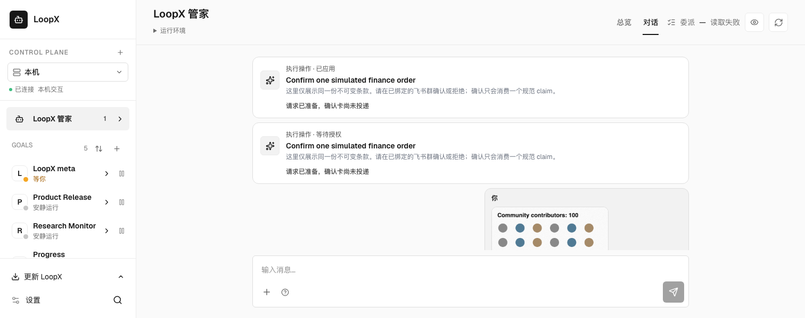
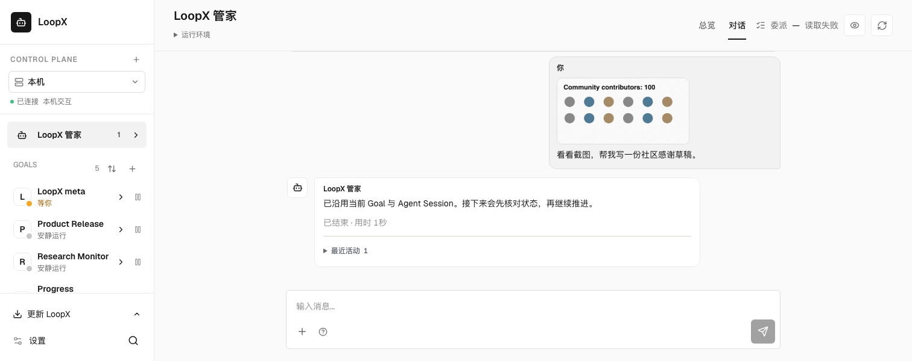

# Conversation layout following / 对话布局跟随

These unedited captures use the existing `conversation-image-request` browser
fixture. All messages, operation cards, images and provider responses are synthetic.
No private conversation or real financial operation appears here. The delegation
read failure in the fixture header is intentional and unrelated to this change.

The desktop viewport is 1512 × 600 and the narrow viewport is 390 × 600. Before
uses the production view from `c56f55307e87110e54d9a82c868d3649280f22fb` with the
new regression: after shrinking the window, the newest reply falls below the
visible area. After uses this change: the newest reply remains visible. The
scenario separately verifies that resizing while reading older history preserves
the reader’s position, and the existing latest-message button resumes following.

这些原始截图来自既有合成浏览器场景，展示同一共享对话界面的窗口缩放行为。
源码及打包后的场景验收、已安装原生输入、真实 provider 投递与完整 App/飞书同步分别核验；
截图不证明后三项通过。测试修订及实际通过范围以 PR 验证记录为准。

## Before / 修改前

## After / 修改后

