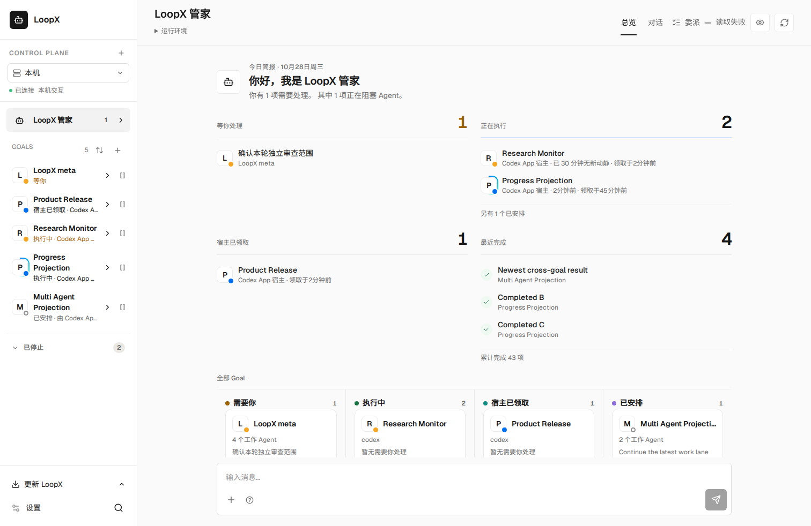
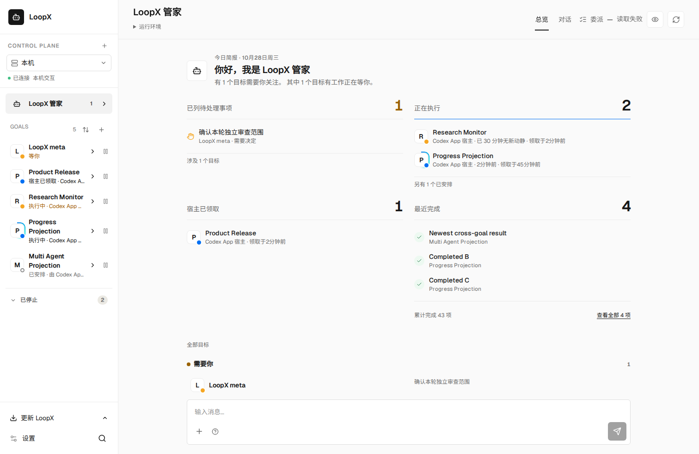
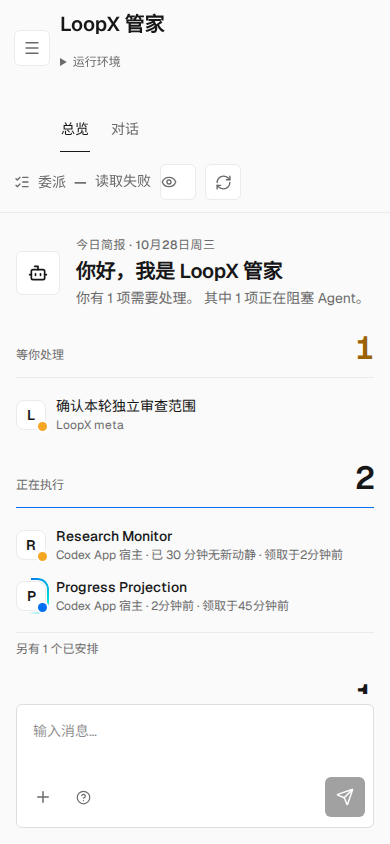
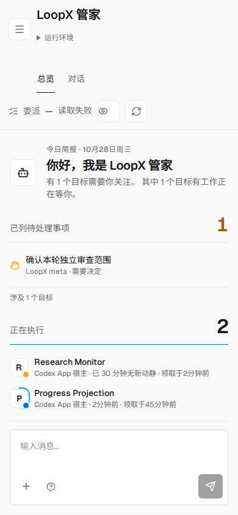
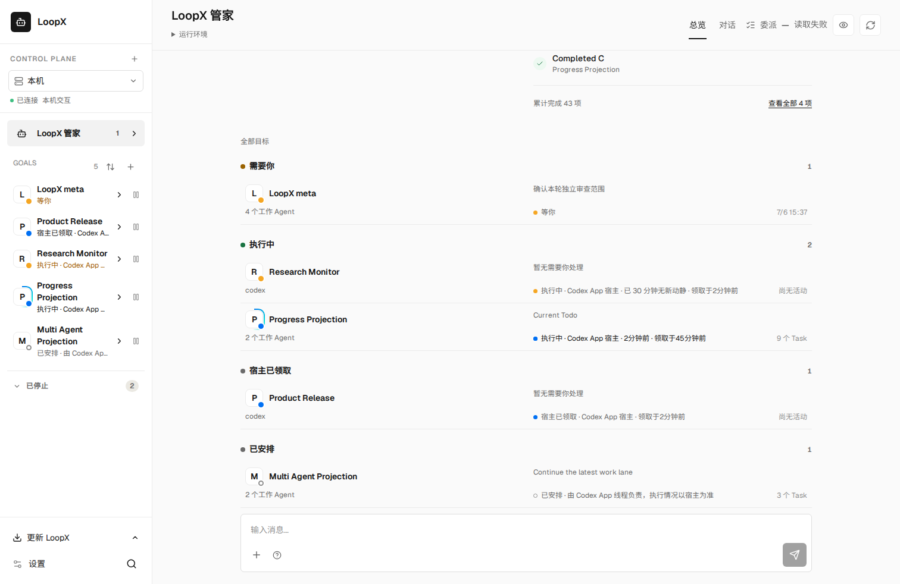
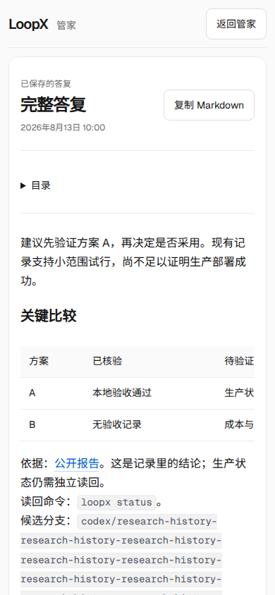
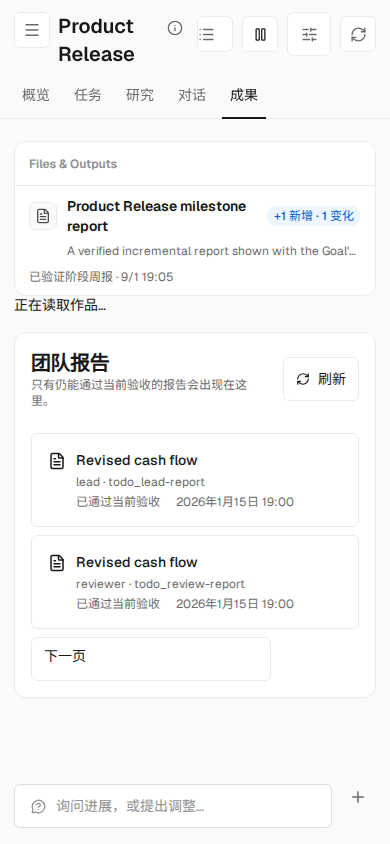
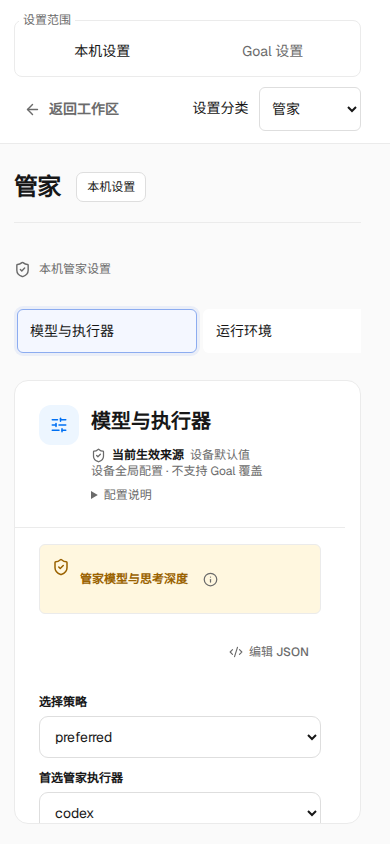

# Workspace continuity review evidence

These captures use the repository's synthetic workspace fixtures. They contain
invented requests, Goals, reports and runtime observations. No live messages,
credentials, private runtime paths or production configuration are included.

The before screens use `main` at
`1fe6134e0b0fd0df6dc671a9bce0ea29c9613891`. After screens use this PR's packaged
Chat source; the PR description pins its submitted head. The package's source
witness was verified against all 663 inputs. Screenshot additions do not change
the product bundle. Browser qualification used Chromium 153 and a temporary Noto
Sans SC font because the pinned browser download was unavailable. This is
packaged browser evidence, not installed native-WebView or live-team acceptance.

## Home

| View | Before | After |
| --- | --- | --- |
| Desktop, 1512 × 982 |  |  |
| Phone, 390 × 844 |  |  |

The native attention count is distinct from the affected-Goal count and operation
delivery. A row opens that original request. The same fixture preserves the
separate facts of a managed Turn, an attached host claim and queued work.

## Reading and recovery

| Saved report | Results catalog | Device settings |
| --- | --- | --- |
|  |  |  |

Report headings and outline preserve the complete answer and exact source return.
The Files catalog preserves native identities when titles match and reads only an
explicitly selected body. Settings retain the original target and distinguish
saved configuration from runtime adoption and failed readback.

## Reproduce

Build with `npm --prefix apps/presentation/dashboard run build`. Select an
existing scenario with `LOOPX_PERSONAL_WORKSPACE_SCENARIO`, set
`LOOPX_PERSONAL_WORKSPACE_PACKAGED=1`, and run
`node examples/personal-workspace-browser-smoke.mjs`.

Focused passing scenarios are `attention-user-action`, `goal-activity`,
`confirmed-operations`, `goal-showcase`, `goal-workspace-create`, `goal-draft`,
`task-inspector-return`, `steward-model-settings`, `capability-scope`,
`answer-presentation`, `managed-goal-results`, `research-results`, `team-evidence`
and `research-display-language`. The standalone runtime-source workspace,
task-inspector-route and goal-workspace-craft smokes also passed. Task routing
covers 1512, 1024, 768, 390 and 320 px. Craft verifies actual narrow-container DOM
order, reduced motion and focus recovery; native 200% browser zoom was not
separately qualified.

Attention handling and Todo creation/editing also use disposable real native
HTTP/typed owners and independent canonical reads, including wrong actors, CAS
conflicts, lost successful responses, no duplicate writes and original-request
recovery. Settings and most result/report reads use fixture APIs; these are
separate evidence boundaries. Parser/SSR, Unicode owner, scoped browse-state,
CSS-token and paired-RFC checks supplement the browser journeys.

上述截图均为合成测试内容。此次验证覆盖打包页面、任务路由和隔离的原生 Todo
读写恢复，不代表已安装 App、真实模型执行、完整设备矩阵或整个 M4 验收完成。
