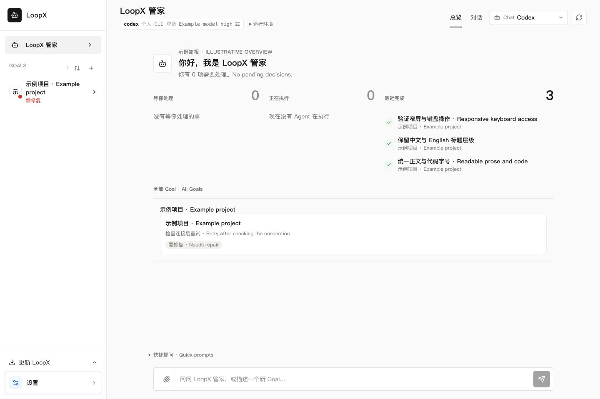
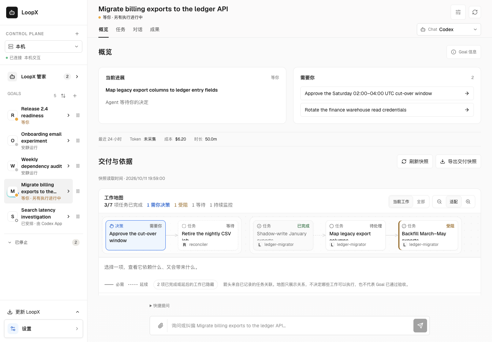
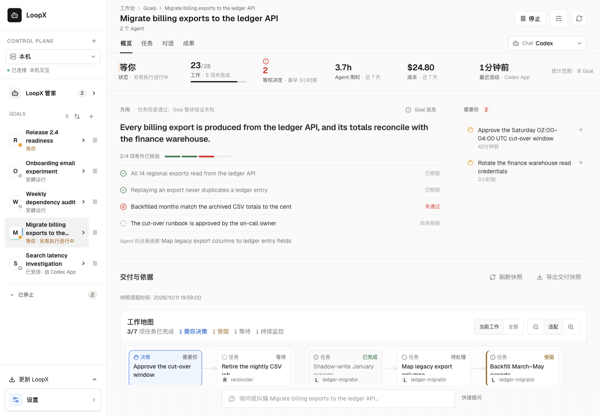

# LoopX Design System

This file is the canonical visual design contract for LoopX user interfaces.
Read it before changing the public website, dashboard, desktop application,
documentation chrome, prototypes, screenshots, or any UI reproduction task.

The visual direction adapts the black-and-white precision, Geist typography,
hairline surfaces, and restrained accent system documented in the
[Vercel docs/development/design.md reference](https://getdesign.md/vercel/design-md). LoopX is
not affiliated with Vercel. The reference is an inspiration and token source;
this document owns the LoopX-specific decisions.

## Using This Contract

`AGENTS.md` requires this read for UI work; a Markdown link does not automatically
load this file into every host or prove that an Agent applied it. Existing
sessions may retain older instructions. Keep one canonical contract here rather
than copying rules into another prompt or installing a competing design system.

Use the existing task brief and PR evidence, without a new approval form:

1. Before editing, name the user's primary question and map the affected content
   to the [default view or requested detail](#explanations-on-demand). Inspect
   the actual page and existing primitives, then apply the relevant tokens.
2. Implement that hierarchy across the whole page. A complete state contract
   does not require showing every field and explanation by default.
3. Run the [populated page review](#populated-page-review) on the built result.
   Report the observed result, tested revision and remaining gaps. A checklist
   tick, source read or passing component test is not the visual verdict.

## Product Character

LoopX should feel:

- precise, calm, and engineered;
- readable before decorative;
- monochrome by default, with color reserved for state and one controlled hero
  accent;
- dense enough for operators without becoming visually noisy;
- consistent across marketing, dashboard, and future desktop surfaces.

The interface should read like excellent technical documentation that also
communicates a confident product.

LoopX's value to an owner is delegating long-running work to Agents without
losing sight or control of it. Every surface should answer, at a glance, what
is moving, what is waiting on the owner, and what can be trusted, and let the
owner act on the answer in place. The same honesty is what makes LoopX credible
to people outside the project: a screenshot of LoopX should never overstate
progress.

### Earn The User's Attention

Every visible element must provide at least one of these:

1. **High-value information** that changes what the user understands or decides.
2. **An essential interaction** needed at this point in the user's journey.
3. **Expressive visual presentation** worth seeing: a clear composition, useful
   visual comparison, or purposeful motion that improves understanding or delight.

This is an OR rule, not a demand for three justifications per element or for
maximum minimalism. Decorative density, raw protocol fields, duplicated status,
and a button for every available capability do not earn attention by existing.
Judge the whole viewport, including information repeated across components.

Before implementation, inventory the visible elements and their value. Keep
conversation, results, and decisions prominent; consolidate routine activity;
offer one-step access to relevant controls and details without a chain of pages.
Start from the owner's original task and minimize the whole job they must do.
Agent preparation should absorb discovery, identifiers, formatting and execution
detail within existing authority. The owner supplies missing intent and real
decisions. Compare a smaller lawful route before justifying individual controls:
a sequence of locally useful fields can still assign the wrong work to the user.
Reuse prior scoped authorization; explain any remaining command effect at its
decision point. Advanced configuration must remain optional for an ordinary task
when an Agent can prepare the same reviewable plan.
Count mandatory interaction rounds from the original intent to a usable result,
including preparation outside the visible page. One round is one user statement,
choice or confirmation required to continue; merging buttons does not merge
decisions. Most ordinary capabilities should complete in one round. With intent
and scoped authorization already present, aim for zero additional rounds.
Two or more rounds need a concrete missing fact, consequential choice or authority
boundary for each extra round. High value may justify deeper collaboration, but
does not itself justify mandatory friction. Keep voluntary exploration separate,
and record navigation, copying, waiting and recovery effort alongside round count.
Do not collapse failures, missing authority, uncertain observations, or actions
requiring judgment into a reassuring success summary. Read models select facts;
they must not invent execution, acceptance, or completion from prose or counts.

Owner-facing state follows four rules:

- **Decide in place.** When LoopX already owns the authority for an owner
  decision, the surface performs it: choose, confirm once with the stated
  effect, then read back the recorded outcome and its effect on dependent work.
  Do not hand the owner a CLI command to copy, a generic "apply" step, or a
  control whose effect differs from its label. When an action is truly
  unavailable here, say why in plain language and name where it can be done.
- **Liveness comes from observation.** Live treatment (a pulsing dot,
  "executing", "running") requires an observed active worker, session or turn.
  A stored status, a registration or a count is not activity; unknown stays
  visibly unknown.
  Aggregate mixed Agent lanes without letting one unreadable lane erase
  another's observed activity. Distinguish a recent ended turn from execution.
  Show missing coverage neutrally beside the Goal state, with each affected
  Agent, host and read failure available through the shared contextual help.
  A cadence miss is an older observation, not proof of a stopped worker.
- **Group by responsibility.** Collaboration surfaces place work under the
  member, Agent or owner responsible for it, so one glance shows who is doing
  what and who is blocked. Work with no resolvable owner goes into an explicit
  "other" group; it is never dropped.
  Keep the steward's request inventory discoverable in its existing header,
  with one count and an in-place reader grouped by recipient. Counts describe
  requests still needing follow-up, not distinct tasks or accepted outcomes.
  Show an unavailable or partial count honestly; put full current briefs,
  linked work, provenance and original conversations behind row expansion.
  A Goal's supporting outcomes need the same bounded reading hierarchy: show
  requirement-state counts once, then at most three compact outcome rows in the
  default overview, prioritizing declared failures, held or changed checks and
  Agent-reported gaps. Each **whole outcome body** starts collapsed: its title
  and meaningful states remain visible; expanding it reveals its requirements,
  with individual rationale and evidence available in place. Collapsing only
  evidence, status groups or a few requirement rows does not satisfy this rule.
  Keep failed, held, changed, partial and unconfirmed-operation observations in
  the summary. Make the full outcome collection available in one expansion,
  including unverified and passing work. Clamp long text only in collapsed rows;
  expansion restores it completely. Explain Agent review versus independent
  checks once at section level. Overview check details stay collapsed at every viewport;
  an operation's consequences and actual failures remain visible.
- **Owner language first.** Primary copy uses the owner's words. Protocol ids,
  gate kinds, preview mechanics and executor profiles belong in a collapsed
  diagnostics disclosure.
  Generated analysis follows the current interface language, including its
  questions, explanations and limitations. Pass that language through the
  analysis owner and cache identity; translating labels alone is insufficient.
  Switching language is a read, never implicit model execution. Keep original
  questions and quoted evidence available on demand, identified as originals.

Review realistic populated, quiet, blocked, and unavailable states on desktop
and mobile. Show before/after views, name what earns attention and what was
consolidated, and verify keyboard access and return to the original context.
Put the actual first viewport directly in the PR description's visual evidence
section, with its revision and data/build boundary. Follow the repository's
[First-Screen Review Evidence](../../AGENTS.md#first-screen-review-evidence):
ordinary authorized work reuses prior direction without another user approval;
refresh evidence when the visible result changes.

Review proportions as well as typography. Within a workspace view, align the
greeting, summaries, work list, and composer to one content frame. An overview
board may be wider than a conversation's reading column. Keep ready-state
runtime details alongside their model context, allow failures to expand, and
size empty summaries to their content rather than filling large decorative cards.

### Research Workspace / 研究工作台

A Goal's research is a first-level peer of Overview, Tasks, Chat and Files.
Overview answers what is moving and what needs attention. The tab itself is
the research entry; add an Overview shortcut only when it carries a useful
summary, not a second navigation label. Put complete history, timeline/graph, native measurements,
analysis and the saved-finding reader in Research, bound to the original Goal
and source. Opening or switching a view only reads; analysis and research
execution keep their separate explicit actions and authority.

研究与概览、任务、对话、成果并列。概览回答当前推进与待处理事项；页签本身就是研究
入口，只有带来有用摘要时才增加概览快捷入口。完整历程、图表、原生测量、分析与
结论阅读放在同一真实 Goal 的研究页。
浏览和切换标签只读取，分析与启动研究仍遵循各自的明确操作及权限。

Keep Goal-wide statistics in Overview, full work in Tasks, and outputs in
Files. A reading tab starts with its content, not repeated counters or an
expanded conversation composer. Reveal executor/model controls when the
composer is open; preserve drafts and running-turn controls across views.
Research enablement belongs beside the research navigation and must use the
existing Goal configuration transaction. Explain its consequence on demand:
configuration does not itself launch analysis, and disabling retains history.

Goal 统计集中在概览，完整工作放在任务，输出放在成果。阅读页直接呈现内容，不重复
堆叠统计条与展开的输入框。展开输入框时展示执行器与模型，跨页保留草稿和运行控制。
研究模式入口使用现有 Goal 配置事务；按需解释开启不等于启动分析、关闭保留历史。

Keep the selected view, time group and evidence focus on reload and browser
Back/Forward. Keep scroll position across tabs. Scope every selection to its
Goal and source; a same-named Goal from another source must not inherit it.
While reading Research, choosing another Goal in the sidebar stays in Research.
The destination loads its own evidence; Back restores the prior Goal's selection.
Home and explicit task, conversation or output links keep their own destinations.
Saved findings lead with readable observations, interpretations and decisions.
Put references, applicability, revisions and full original text behind one
expansion. Clamp repeated titles only in the selection list, never the selected
finding's full content. Do not invent short titles or infer findings from prose.
A selected question is a focused document, not another full history stacked below
the chart. Show one finding at a time with its declared status and full text;
keep all findings selectable and failed or tentative counts visible. Preserve
the exact finding on reload and Back. Offer the whole recorded history in place
and through the existing return action, without letting it bury the chosen text.

Decision history groups records by their recorded question identity, with the
question title once above its successive decisions. Matching titles alone do
not establish shared identity or decision revision. Show recent records first,
with their outcome, change and recorded status; retain stopped/retained evidence
and expose earlier records in place. Counts and date spans describe the selected
time range. Keep negative and tentative record counts visible when older rows
are folded, and open each row's exact finding in the existing reader.

Route captions distinguish start and end and wrap as readable entries. If a
long title is clamped in that list, one activation opens its complete original
in the existing reader; keyboard return restores the exact entry. Keep view,
analysis, help and refresh on a shared primary control row. Model, usage and
scope details occupy separate rows, so their presence or wrapping does not
shift the controls. Reflow the composition on narrow screens without hiding
action consequences or relying on fixed alignment offsets.

选中问题后聚焦阅读一条结论，完整正文与记录状态保留；全部结论可直接切换，反驳和
暂定结论计数仍可见。刷新与返回保留所选结论，全景可原位展开或通过原入口返回，
不再把整张图和全部折叠标题堆在所选正文之前。
路线标题区分起点与末端并自然换行；列表收起长标题时，一次操作进入现有阅读器查看
完整原文，键盘返回准确入口。视图、分析、帮助和刷新共用主控件行，模型、用量与
范围另行显示；说明出现或换行不挤偏控件，窄屏重排保留操作后果，不使用固定偏移。

Reading a citation opens only the requested original, preserving the explicit
open or closed state of the full analysis and returning to the exact citation.

Search results use the same reading hierarchy: compact title, recorded time and
status in the list; opening a row restores its complete title and body. Keep
protocol identities and source references in one disclosure, with version
comparison beside it. Counts stay compact; coverage and comparison-method
explanations use contextual help. Reading failures retain a visible state and
the existing recovery action. Do not clamp the opened document or its evidence.

搜索列表以标题、时间和记录状态供浏览，展开后完整呈现正文。来源与标识合并按需查看，
版本比较保留原位入口；范围、口径用共享帮助，真实读取失败和恢复动作仍可见。

When an explicit analysis supplies a whole-history translation, use it throughout
the matching research snapshot, including routes, decisions and expanded history.
Offer one in-place original/translation switch; keep coverage and source/version
detail in contextual help, with incomplete or inapplicable coverage visible.
Version comparison uses that same qualified field projection for both records,
while lineage and change counts still compare original records. Keep both
originals readable in place; a translation must not create a source change.
Keep original evidence directly readable. A language switch only reads; missing
or failed translations retain original text and never silently launch a model.

版本比较复用两条记录已核对的同一快照译文；版本关系与差异数仍按原始记录计算，
两侧原文可原位展开，不把译文变化算作来源变化。

Review the displayed translation against its original and cited context, including
quantities, their referents, negation and uncertainty. Field coverage and preserved
literals do not establish readable meaning. When the source supports a quantity,
state it in ordinary localized prose; an opaque English compound in parentheses
is insufficient. Keep exact source terms available, and leave ambiguous counts,
units or identifiers unresolved rather than guessing. Correct saved translations
through their existing versioned analysis owner; review does not itself rerun a
model or rewrite a saved result. Record remaining content failures in the
existing task and review.

译文验收须对照原文及引用语境，核对数量所指、否定和不确定性。字段齐全、原始标记
未变，不代表含义已经清楚。有来源支持的数量用界面语言正文说清，不能只留下括号内
的连写英文；准确原词仍可查，含义不明的计数、单位和标识不猜测。修订沿版本化分析
处理，评审不自动重跑模型或覆盖已存结果；剩余正文问题记入原任务和评审。


刷新和前进后退保留视图、时间分组与证据焦点；标签之间保留阅读位置。选择状态按
Goal 和来源隔离。研究中从侧栏切换 Goal 仍停留在研究页，读取新 Goal 自身证据；
返回恢复原 Goal 的选择。首页及任务、会话、成果的明确链接保留各自目的地。
结论正文以正常字号呈现观察、解读与决策；来源、适用范围、版本
和完整原文按需展开。仅列表中的重复长标题可收起，选中后的正文须完整可读。
读取引用只打开所选原文，保留完整分析原先的展开或关闭状态，关闭后回到同一引用。
明确分析生成整页译文后，同一快照中的路线、决策和展开历史统一消费；原位切换原文，
来源、版本与完整覆盖按需查看，部分或不适用状态保持可见。原文始终可读，语言切换只
读取，缺失或失败回退原文，不静默调用模型。

### Explanations On Demand

Make layout explain the interface before adding secondary copy. Hierarchy,
grouping, spacing and clear control names should reveal what belongs together
and what can be done. Remove decorative slogans, subtitles that repeat headings,
instructions that restate visible controls, and implementation or Agent-facing
directions. When a paragraph compensates for unclear layout, redesign that layout
first. This applies across the page, not only inside one component. It does not
remove accessible control names, necessary input constraints, permission or
activation consequences, errors, recovery or action outcomes. Keep optional help
at the existing contextual entry; a blanket word limit cannot judge its value.
This distinction follows the [layout-first copy observation](https://x.com/luinlee/status/2113085361836744764)
and the [author's explanation](https://x.com/luinlee/status/2113085363606765963);
those observations motivate the rule, not a measured model-quality guarantee.

The primary view presents the result, its unit and scope, material uncertainty,
and the next useful action. A truthful interface does not need to repeat its
methodology in every component. Review the whole viewport for repeated scope,
source, method and limitation paragraphs before adding another note.

Choose a default treatment by the user's task, before choosing components:

**Auxiliary explanations are icon help, not default prose.** Apply this across
the product frontend: Overview, Tasks, Research, Chat, Files and Settings,
including their empty and unavailable states. Do not add paragraphs, small-print
subtitles or repeated footnotes to explain a snapshot, a count, incomplete
coverage, missing observations or the meaning of an empty list. Attach one small
semantic glyph to the owning heading, value or control. Use an information or
question glyph for definitions, an alert glyph for incomplete/unknown evidence,
and the existing source/state glyph when it already expresses that fact. Do not
add a generic information icon beside a second icon saying the same thing.

辅助说明默认不用正文段落、小字副标题或逐行脚注。概览、任务、研究、对话、成果、
设置，以及空态和来源不可用状态，统一在所属标题、读数或控件旁使用一个语义合适的
小符号。统计口径、覆盖缺口、快照含义和“没有记录不等于完成”等解释按需读取；
同一事实不在标题、状态行、空态和页尾重复。布局不清先改布局，不用说明补救。

Reuse `ContextHelp` for non-interactive explanations. Its accessible name must
identify the current fact, including partial, unknown or unavailable evidence
where applicable. The complete explanation opens on mouse hover, keyboard focus
and deliberate tap/click; Escape, outside dismissal and focus return must work.
Use the existing reader or disclosure for interactive recovery and long evidence.
Icons must not turn unknown into zero, failure into success, or a permission
restriction into an available action. Do not use color alone, a native `title`
alone, hover-only access, global CSS hiding, shorter body type or text heuristics
to achieve a quieter screenshot.

This rule concerns interface explanation, not the owner's actual work: keep
requested documents, original evidence, generated analysis and user messages
readable in full. Keep consequential action labels, necessary input constraints
and the immediate result of an operation visible. An actionable failure retains
its concise failure state and recovery action; move its optional technical cause
and repeated explanation into the same contextual entry. Permission and model,
cost or execution consequences remain clear at the actual decision point.
Reading help never invokes a model, retries work, changes configuration or grants
permission.

Classify content by its purpose, not its HTML tag, CSS class or sentence length.
A legacy `hint` paragraph may contain the actual count, delivery result or source
read state; those primary readouts stay visible. Review each moved explanation
with its owning heading and current value, and give the glyph an accurate name.
Do not use a mechanical paragraph sweep as a design or review verdict.

完整解释必须支持悬停、键盘聚焦和点按，不能只用原生 `title` 或颜色。小符号保留
未知、缺失、失败和只读等真实含义，不得补零或暗示通过。真实错误与恢复动作、输入
约束、权限和实际执行后果仍在决策处清楚呈现；技术原因和重复解释放入同一个帮助
入口。用户正文、原文证据和分析结果不属于可隐藏的辅助说明。打开帮助只读取。

| Content | Default presentation | On request |
| --- | --- | --- |
| Current outcome, progress, owner decision or main research result | The page's primary reading region, with the status and scope needed to interpret it | Its existing evidence and action reader |
| Repeated supporting outcomes, requirements or analysis episodes | Comparable compact rows: identity, meaningful result/status and a relevant exception; shared context appears once | Expand the selected item for complete requirements, rationale, evidence and history |
| Definitions, methodology, routine provenance and empty/partial snapshot explanations | One accessible semantic glyph at the owning heading, value or control | Shared hover/focus/tap help or existing details, without repeating it inside every row |
| Failure, stale evidence, unknown result, missing permission or consequential cost | A concise marker at the affected item/action, including disagreement that changes trust | Cause, recovery instructions and full evidence |

README product illustrations and evidence diagrams belong in the default reading
flow, with concise captions and material evidence limits. Fold supporting
explanations, setup instructions and source detail after the visual; do not hide
the illustration inside those disclosures when simplifying the page.
README 的产品配图与证据图应默认展示，并保留简短图注和必要的证据边界；详细解释、
配置步骤与来源说明可在图后折叠，精简页面时不要把图一起隐藏。

Repeated items must not default to a stack of full documents. For example, a
supporting-outcome list must not render every requirement, Agent review and
independent-check explanation before the reader reaches the next main region.
When consecutive analysis questions differ only by their exact declared episode
identity, a substantial repeated question can appear once with a labelled slot
and compact episode/verdict rows, including a pair of long questions. Expanding
a row starts with its rationale and evidence; do not repeat the shared template
there. Keep the complete localized question and original in the existing question
disclosure, preserving order and accessible full questions. Do not
guess a common question from similar wording, remove negation or comparisons,
or invent short titles; different or small questions retain their full wording.
连续分析问题只有已声明片段身份不同且文字大量重复时，共同问题展示一次，各行保留片段
与判读，两条长问题也适用。展开先呈现理由与证据，不再重复公共模板；完整本地化问题
与原文放在已有问题详情内，顺序与无障碍名称不变。不按相似意思合并问题，
不删否定或比较条件，不编造短标题；不同或简短问题保持完整。
Keep the summary's actual verification state visible; open the chosen item in
place, with its complete content and original evidence reachable. A disclosure
must not duplicate the same content above and below its trigger.

Read freshness and verification validity are different facts. Reuse the existing
cached, coalesced read owner for quiet background updates; pause polling in the
background and back off after read failures. Preserve scroll, open items and
drafts across same-source updates. Show an unavailable read or historical source
once for the affected region rather than repeating a refresh instruction on
every row. A fresh read never validates a changed requirement or starts a check,
model or worker; those operations retain their existing explicit controls.

As data grows, preserve access to every item through the existing list,
pagination or history, with honest coverage. Do not silently keep only recent
or successful items. Reduce default expansion and repetition before adding
nested panels, smaller text, fixed-height text walls or more explanatory copy.
Summary wording must come from declared identities and states, not guessed
labels, invented completion or a new frontend score.

- Keep the smallest qualifier needed to read a value correctly beside it:
  selected sample, partial window, uncalibrated, unknown or historical. Keep
  failed reads, missing authority and consequences such as separate model usage
  visible at the affected value or action. Never hide these in help.
- Put optional definitions, denominator rules, sampling caveats and chart-reading
  explanations in one nearby information disclosure per related region. Prefer
  one shared explanation to an icon beside every metric or repeated footnotes.
  Put long provenance and diagnostic fields in the existing collapsed details.
- The same help must work on hover, keyboard focus and click/tap. It must remain
  readable when the pointer enters it, dismiss with Escape or an outside click,
  fit a narrow viewport, and not trigger the operation it explains. Do not rely
  on a native `title` alone, color alone or hover-only access.
- After loading a requested source or detail asynchronously, bring the mounted
  content into view and move keyboard focus there. Opening its parent must not
  compete for that focus. Closing returns to the exact originating control;
  a late response after closing or changing scope must not reopen the detail.
  Check immediate and delayed responses on desktop and narrow screens.
- Preserve actual unknowns, denominators, negative results and evidence links.
  Reduce explanatory noise without replacing missing evidence with a reassuring
  summary. Keep chart keys that are necessary to decode the marks visible.
- When a metric applies to fewer items than the displayed sample, identify
  explicitly ineligible items in its existing detail and show their count beside
  the metric. Unknown eligible judgments stay in the denominator. Missing item
  metadata or an arithmetic count gap cannot establish ineligibility.
- Review a metric group as one composition: prominent values, body-size names,
  one shared unit/denominator explanation and only nonzero exceptions beside
  the affected value. Avoid six repeated status lines, all-zero qualifiers and
  per-cell footnotes. On wide screens, use a compact value band so the related
  graph or result remains nearby; reflow on narrower screens. Merge optional
  source, method and cost material into the existing disclosure where practical.
  In recorded measurement groups, align values and units, keep direction and
  zero/unknown differences visible, and share one source disclosure across the
  group. Requested provenance uses readable label/value rows with complete
  identities; it must not become a smaller-font wall of hashes and paragraphs.
  已记录的测量按组对齐数值与单位，保留方向、零和未测量的区别，共用一个来源入口；
  展开来源后使用正常字号的标签/值排版，完整身份可读，不堆小字哈希与段落。
- In an expanded assessment, make items comparable before asking the owner to
  read their evidence: one compact row per declared item, with its identity and
  actual judgment. Show the shared interpretation once on demand. Expand an
  individual row for its complete question, verbatim rationale and source links;
  do not repeat a long question template, full rationale and button wall for
  every item. Apply the same hierarchy to the deep-analysis reader: opening
  analysis should show comparable episode rows, not expand every evidence
  section. Show each rationale and its citations once within that episode.
  Use declared identities rather than extracting guessed labels
  from prose. Keep unknowns, exclusions and denominators visible at the metric,
  and preserve keyboard and touch access to the full evidence.
- When analysis has a successor, show one compact version/change summary and
  the existing previous-version entry. Keep the new result separate from the
  last valid result while pending or failed. Put detailed input differences and
  changed judgments in the same optional disclosure; do not introduce another
  setup page, repeated methodology paragraphs or automatic model execution.

For example, research metrics can show “19 episodes · purposive sample ·
uncalibrated” once, with a nearby explanation of yes/eligible counts and unknowns.
They should not repeat a whole-study exclusion paragraph above and below the
same six values. A source-read failure still appears directly beside the values.

中文要点：结果、单位、必要范围标记与异常直接可见；范围、方法、分母和读图的重复
解释就近按需展开。整页去重，保留图例及真实未知；悬浮、键盘和触屏使用同一入口，
不能把失败、权限缺失或额外用量藏进提示。

## Source Of Truth

- Use this file as the default visual contract for all new LoopX UI work.
- Preserve existing product behavior, accessibility, information hierarchy,
  and public/private boundaries.
- When a task provides an explicit approved design source, screenshot, or
  Figma file, match that source while using these tokens for unspecified
  details.
- Do not introduce a second design language for one page or framework.
- Keep reusable tokens and primitives framework-neutral. React, static HTML,
  and future desktop applications should express the same system.

## Color

### Core Palette

| Token | Value | Role |
| --- | --- | --- |
| `--color-ink` | `#171717` | Primary text, primary CTA, darkest chrome |
| `--color-body` | `#4d4d4d` | Body copy and secondary navigation |
| `--color-muted` | `#8f8f8f` | Metadata, captions, low-emphasis copy |
| `--color-faint` | `#a1a1a1` | Placeholder and disabled text |
| `--color-canvas` | `#fafafa` | Default application and page background |
| `--color-surface` | `#ffffff` | Cards, inputs, menus, elevated panels |
| `--color-surface-soft` | `#f2f2f2` | Inset wells and subtle alternate bands |
| `--color-border` | `#ebebeb` | Default 1px structural hairline |
| `--color-link` | `#0070f3` | Links, focus, selected informational state |
| `--color-danger` | `#ee0000` | Destructive or invalid state |
| `--color-warning` | `#f5a623` | Caution state |

Use near-black rather than pure black for standard text. Use pure black only
inside code or media surfaces where the stronger contrast is intentional.

### Accent Gradients

Color is a controlled accent, not general chrome:

- Develop: `#007cf0` to `#00dfd8`
- Preview: `#7928ca` to `#ff0080`
- Ship: `#ff4d4d` to `#f9cb28`

Marketing pages may blend these stops into one soft hero mesh. Do not repeat
the mesh in every section. Product and operator surfaces should prefer solid
semantic colors and monochrome structure.

### Dark Surfaces

Dark mode is an inverse of the same system, not a separate visual identity:

- use near-black canvas and slightly lifted neutral surfaces;
- retain the same spacing, radius, typography, and hierarchy;
- keep borders subtle and neutral;
- preserve semantic meaning and contrast;
- do not add neon glows, glossy gradients, or decorative shadows.

## Typography

Use **Geist Sans** for UI and prose and **Geist Mono** for code, data, compact
technical labels, and section eyebrows.

Fallbacks are owned per surface, because each bundles its own font files. A
stylesheet must reference the token rather than repeat the stack, and the token
must be defined on the surface that uses it — a bare `var(--font-mono)` with no
fallback drops the whole declaration when the token is missing, and the element
silently inherits the body face instead of failing visibly.

Dashboard (`apps/presentation/dashboard/src/styles.css`):

```css
--font-sans:
  "Geist Variable", "Geist", "PingFang SC", "Microsoft YaHei", "Noto Sans CJK SC", ui-sans-serif, system-ui, -apple-system, BlinkMacSystemFont, "Segoe UI",
  sans-serif;
--font-mono: "Geist Mono Variable", "Geist Mono", ui-monospace, "SFMono-Regular", Menlo, Consolas, "PingFang SC", "Microsoft YaHei", "Noto Sans CJK SC", monospace;
```

Marketing site (`apps/presentation/site/src/styles.css`):

```css
--font-mono: "Geist Mono", "JetBrains Mono", "SFMono-Regular", monospace;
```

`scripts/check-css-custom-properties.mjs` rejects Dashboard CSS bare references
whose custom property has no definition in the surface inventory. Run `npm ci`
at the repository root and `npm ci --prefix apps/presentation/dashboard`, then
`npm run check:css-custom-properties --prefix apps/presentation/dashboard`.
The check uses the existing TypeScript parser for
JSX style objects, `CSSProperties`-typed objects and literal
`element.style.setProperty` calls. Comments, string examples and ordinary data
keys do not define tokens. PostCSS and its declared value parser distinguish
stylesheet declarations and variable functions from quoted examples, comments
and other declaration values. Parse errors fail the check.

This is a syntactic inventory: it does not prove runtime reachability, resolve
object spreads or aliases, or model CSS inheritance and selector scope. Tokens
that are genuinely optional may keep a fallback (`var(--pw-surface, #fff)`).

### Type Scale

| Token | Size / line height | Weight | Tracking | Use |
| --- | --- | --- | --- | --- |
| Display | `48px / 48px` | 600 | `-0.05em` | Marketing hero |
| Heading L | `32px / 40px` | 600 | `-0.04em` | Major section |
| Heading M | `20px / 28px` | 600 | `-0.02em` | Card or panel |
| Body L | `16px / 24px` | 400 | normal | Lead copy |
| Body M | `14px / 20px` | 400 | normal | Default UI copy |
| Body S | `12px / 16px` | 400 | normal | Metadata |
| Mono eyebrow | `12px / 16px` | 500 | `0.06em` | Uppercase technical label |
| Code | `14px / 20px` | 400 | normal | Code and CLI output |

Use 600 for headings, 500 for controls and labels, and 400 for body copy.
Avoid decorative italics, ultra-light text, and black weights.

The Personal Workspace, settings and answer reader share the Dashboard's
`--text-*` and `--leading-*` tokens. Use caption (`12px / 16px`) for metadata,
body (`14px / 20px`) for default copy and controls, lead (`16px / 24px`) for
reading copy, heading (`20px / 28px`) for panels, title (`24px / 32px`) for
operator page titles, and display (`32px / 40px`) for major headings and counts.
Prose uses `--leading-prose` (`1.7`) for multiline Chinese and English text.
Tokens use rem units so browser text preferences apply. Do not introduce
fractional pixel sizes or sub-12px UI copy. Themes share this scale and font
families; they may change color, borders and surfaces. Controls inherit the
same family, including textareas. CJK fallback names are shared by prose and
code; Latin code remains Geist Mono. This intentionally replaces the older
12px primary choices and 9–11.5px auxiliary copy with readable body and caption
roles across Goal, Task, Chat, settings and result surfaces.



Illustrative synthetic state rendered with the workspace sidebar, header, brief
components and packaged styles. It shows mixed-language text, quiet summaries
and an unavailable Goal; it is a composition example, not runtime evidence.

## Spacing And Layout

Use a 4px base:

```text
4, 8, 12, 16, 24, 32, 40, 64, 96, 128
```

- Page container: approximately `1200px` max width.
- Desktop gutters: `24px` to `32px`.
- Mobile gutters: `20px`.
- Card padding: `24px`; larger panels may use `32px`.
- Section rhythm: `96px` to `128px` on marketing pages.
- Operator surfaces may use tighter `24px` to `40px` section rhythm.
- Grids should collapse predictably from 3-4 columns to 2 and then 1.

Whitespace is structural. Prefer space and hairlines over alternating saturated
background blocks.

## Shape And Depth

| Token | Value | Use |
| --- | --- | --- |
| Tight | `6px` | Inputs, app buttons, navigation controls |
| Card | `12px` | Standard cards and code blocks |
| Panel | `16px` | Large feature or pricing panels |
| Pill | `9999px` | Marketing CTAs, tags, avatars |

Use shapes by context:

- marketing CTAs use full pills;
- application and desktop controls use tight 6px corners;
- content cards use 12-16px corners.

Default elevation is a 1px hairline and no shadow. Floating menus and modals may
use a low-alpha layered shadow. Do not use heavy drop shadows.

## Components

### Navigation

- White or near-white surface with a bottom hairline.
- Compact wordmark, restrained links, and one clear primary action.
- Desktop navigation collapses behind an accessible menu trigger.
- Sticky headers may use a subtle backdrop blur; content must remain readable
  without it.

### Buttons

- Primary marketing: ink fill, white label, pill shape, minimum 44px target.
- Secondary marketing: white surface, ink label, hairline, pill shape.
- Application primary: ink fill, white label, 6px radius.
- Application secondary: white surface, ink label, hairline, 6px radius.
- Icon controls: circular or 6px square, with visible focus state.

Do not mix marketing pills and application squares in the same control group.

### Cards And Panels

- White surface on near-white canvas.
- 1px hairline before any shadow.
- Clear heading, concise body, and optional mono metadata.
- Use precise grids rather than masonry.
- Avoid decorative cards with no information or action.

- Theme and language choices use the same two-column grid in every workspace theme.
- Omit secondary descriptive lines under workspace page titles, navigation labels, and display choices. Preserve operational status, errors, and action outcomes.
- Capability navigation shows the localized name; omit the secondary internal identifier. Show Goal/machine badges only in mixed-scope catalogs, not when the page already selects one scope. Configuration forms use shared spacing and a full-width switch row; optional capability and field explanations live in a collapsed configuration-help section. Keep activation consequences and read-only restrictions visible. Goal and machine editors share the enable-row JSON entry point. Goal JSON accepts only registered editable fields and invalidates the previous preview whenever edited; applying still requires a new reviewed preview.
- Organize Settings by an explicit **this device / one Goal** target, then by purpose within that scope. Keep one Capability Center in each selected scope; its target comes from the shared settings header. Goal entry points preselect their Goal; the global entry opens device settings and never silently chooses the background Goal. Switching to Goal scope requires an explicit Goal choice. Keep that target visible while scrolling and on narrow screens; preserve scope, target and category on refresh/Back, and discard drafts and previews on target/source changes. Read-only or missing sources show their restriction instead of local management forms. Missing statistics remain unknown, never zero. Target changes discard the previous editor draft and preview, fetch the selected configuration, and preserve the existing revision-checked write owner. Distinguish configuration ownership from the currently selected target and editor permission: show device-only, Goal-only or device-default-with-Goal-override from the capability contract, even for read-only capabilities; keep writability in the existing editor status, and never list a machine-only capability in Goal scope. Show the affected scope and effective source before changes; do not turn storage boundaries into competing navigation entries.
- Keep Steward a first-level destination within device settings for the host steward executor/model/effort and runtime grant. Device means this installation/runtime, not every machine. Describe effect timing per owner: new sessions, future Goals and live inherited capability defaults are different. Lark profile credentials and the all-connection directory belong to device settings; Goal settings show only that Goal’s connections, with no implicit target or private-steward conversation. See the [per-capability scope decisions](../architecture/rfcs/desktop-execution-frontends-v0.md#settings-ownership-and-scope).
- Scope each settings catalog to its owner: Goal settings include only capabilities with Goal scope, including Goal-scoped read-only entries. Machine-only capabilities belong in machine or steward settings even when a shared API catalog also describes them.

### Forms

Conversation controls belong to the single composer: keep the message above a
compact toolbar, attachments and optional actions at the left, and the current
executor/model/reasoning entry beside Send at the lower right. Reuse the existing
configuration and delivery owners. Keep immutable source identity truthful;
current-turn observations and next-send selections must remain distinct. Global
defaults and permissions stay in Settings. Reading views keep their folded input.
Menus preserve drafts, never submit on open/dismiss, work by keyboard and touch,
and open within the viewport above the input. Keyboard instructions use the
shared contextual help; actual delivery failures and recovery remain visible.

单一输入框内，消息在上、紧凑工具栏在下；附件和低频操作收进左侧入口，执行器、
模型与思考深度就近放在右下角发送键旁。原会话身份、本轮实际配置与后续选择如实
区分，全局默认和权限保留在设置。菜单开启、关闭不发送或丢失草稿，支持键盘和
触屏，窄屏展开仍完整可操作；阅读页保留折叠输入。快捷键按需帮助，真实失败及
恢复操作保持可见。

- White surface, ink text, hairline border, 6px radius.
- Labels remain visible; placeholders do not replace labels.
- Focus uses the blue link/focus token with sufficient contrast.
- Errors use text and iconography in addition to color.

- Settings titles omit eyebrow text. Settings occupy the dynamic viewport height. Capability detail cards shrink to their content and are capped by the available panel height. The settings sidebar, capability catalog, and capability detail scroll independently with contained overscroll. Other settings content scrolls inside the main panel. Narrow screens use a bounded horizontal capability catalog above the detail panel.

### Code And Terminal Surfaces

- Geist Mono or the approved mono fallback.
- Use either a white hairline code panel or a deliberate near-black terminal.
- Preserve selectable text and horizontal scrolling.
- Avoid fake terminal decoration when the content is not technical evidence.

### Status And Control-Plane States

- Use color as a secondary signal; always include text or an icon.
- Prefer compact badges and hairline panels.
- Keep goal, gate, owner, evidence, risk, budget, and next action visually
  distinguishable.
- Summarize many records with one hairline count strip of typed states: zero
  counts recede, states that need the owner take the danger color and an icon,
  and the scope of the counts (for example "this page only") sits next to it.
  Counts come from the same typed classification as the labels, never from
  prose.
- Metric cells name their window and scope. An absent measurement renders as
  an em dash with a "not measured" label, never as zero; owner-reported partial
  coverage carries a visible marker. The
  [Goal workspace RFC](../architecture/rfcs/goal-workspace-surface-v0.md)
  defines the per-Goal vitals, glyph set and page composition.
- Detail many owners with a grid of owner cards: identity, one status pill, the
  owner's own records, and identifiers behind a disclosure. A blocked owner's
  card may carry a tinted hairline; avoid filling the card with color.
- Never render raw private state, credentials, provider IDs, or machine paths.

## Motion

- Motion explains state transitions; it does not decorate idle content.
- Use 120-200ms control transitions and 200-350ms section transitions.
- Prefer small transforms. Reading regions, authoritative values and action
  consequences stay fully visible from the first frame. Their availability
  must not depend on an entrance animation finishing: a native WebView can
  suspend its animation clock while accessible navigation still changes the
  page. Check populated views with that clock paused; a screenshot that
  fast-forwards animations can conceal a blank first frame.
- 阅读区域、真实读数和操作后果从首帧起保持可见；原生视图暂停动画时，也不能只剩
  标题或空白。验收包含暂停动画的整页，不能只看自动跳到动画结束的截图。
- Respect `prefers-reduced-motion`.
- Do not animate layout continuously, pulse large surfaces, or create
  background motion that competes with reading.

## Accessibility

- Maintain WCAG AA contrast.
- Use semantic HTML and visible keyboard focus.
- Interactive targets should be at least 44px where practical.
- Do not encode status using color alone.
- Support keyboard navigation, reduced motion, zoom, and narrow viewports.
- Keep English and Chinese layouts equally readable.

## Responsive Behavior

- `<= 640px`: one-column layout, collapsed navigation, full-width primary CTA.
- `768px`: two-column content grids where useful.
- `1024px`: full navigation and 3-column product grids.
- `>= 1200px`: centered max-width composition.

Do not shrink diagrams or code until they become illegible. Reflow or enable
bounded horizontal scrolling.

## Target Compositions

The rules above say what to avoid. This section says what a finished
operator surface looks like, so a change can be judged against a composition
rather than only against a list of prohibitions. Each pattern names the
mechanism; copy the mechanism, not another product's styling.

### Goal workspace: a document, not a card grid

From top to bottom, one reading column with an optional right rail:

1. **Masthead.** Breadcrumb, title, one context line (agents, repository) and
   the single consequential control (Stop / Resume). Nothing else competes.
2. **Vitals.** At most six stats in one row. The value carries the weight
   (heading size, tabular numerals); the label and its qualifier sit beneath
   in one caption line. No cell borders: spacing separates stats, one hairline
   separates the row from the page. Unknown is an em dash with its reason,
   never zero.
3. **One hero.** On the Overview, the Goal's objective is set as heading-size
   prose without a card around it, followed by a segmented criteria meter and
   a hairline checklist. Everything below the hero recedes: smaller headings,
   ghost controls, a hairline instead of another bordered panel.
4. **Owner rail.** What needs the owner sits beside the hero as a hairline
   list: glyph, the decision in owner language, relative age, an arrow that
   opens it in place. A quiet Goal shows no empty rail.
   Do not repeat the same work in a permanently visible task rail. Overview
   shows up to three compact tasks per responsible owner; the group summary
   retains its task count and significant state, including blocked work.
   Expand the remaining tasks in place or open All work for search, filters,
   completed history and activity. Direct task links reveal their selected row.
   Read-only acceptance observations begin as one disclosure with gap/guard
   counts and an explicit partial or unknown state; full reasons, requirements
   and evidence remain inside. Zero listed gaps never means Goal acceptance.
   不要在常驻任务侧栏重复展示主栏的工作。概览每位负责人默认最多展示三条紧凑任务，
   组摘要保留任务数和受阻等重要状态；其余任务就地展开，搜索、筛选、已完成历史与活动
   从“全部工作”打开。任务直链自动展开选中行。只读验收观察默认折叠，摘要显示缺口、
   限制数量及“部分观测”或“未知”；完整原因、要求与证据保留在正文，零缺口不等于验收通过。
5. **Folded composer.** Reading views fold the composer to one line that
   expands on request; conversation views keep it open.

The browser scenario `goal-showcase`
(`examples/personal-workspace-browser/goal-showcase.mjs`) renders this
composition on the synthetic showcase workspace
(`examples/personal-workspace-browser/showcase-workspace.mjs`): two agents,
measured usage, an observed live turn, owner decisions, a partly verified
contract and a delivery map. Take before/after screenshots from that state,
not from placeholder fixtures.

The same public synthetic workspace illustrates the composition below. The
before view is the earlier masthead proposal; the after view uses the packaged
Goal overview with the document hero, owner rail and folded composer. These
are composition references, not installed-App or model-acceptance evidence.

| View | Before | Proposed composition |
| --- | --- | --- |
| Desktop |  |  |
| Phone |  |  |

### Status glyphs

One glyph per state across lists, vitals and maps; color is the second signal.

| State | Glyph | Color |
| --- | --- | --- |
| Settled / quiet | filled dot | track neutral |
| Waiting or stopped | hollow ring | muted |
| Observed live | ring with a core and a rotating arc | state color |
| Verified | check in circle | green |
| Failing | cross in circle | red |
| Not yet verified | dashed circle | faint |
| Owner decision | hand | caution |

The rotating arc requires an observed active turn (see "Liveness comes from
observation"). Reduced motion stops the arc; the ring and core still read live.

### States that are designed, not defaulted

- **Empty or sparse Goal overview** keeps the same content frame and clear
  hierarchy as a populated one. Use the existing Goal identity as the anchor;
  show available current work directly instead of hiding the main content
  behind a disclosure while absence messages fill the page. Keep a genuinely
  missing declared objective as one concise source-status line, without
  inventing it from tasks or an Agent summary. An unconfigured optional check
  belongs in the existing Goal information/configuration detail, not a primary
  empty-state paragraph. Failed reads, unavailable authority and consequential
  restrictions remain visible. Align information/history entries with their
  region and use readable labels; retain long native identities in detail.
  Let the region shrink to its useful content, without decorative filler or
  turning a read-only source into a setup task. A known empty state and an
  unobserved source remain different states.
- **Loading** holds the final geometry with a quiet skeleton; a region does
  not collapse to one spinner and then jump. An initial read is not evidence of
  an empty or disconnected source. Bind loading, errors and results to the same
  Goal/source/language/selection; a delayed response cannot borrow another
  scope's content. Keep one read-status surface across summary and detail,
  with retry available where the user encountered the failure. A failed refresh
  may retain the same scope's last result, visibly marked as such.
- **Region failure** is one announced line (icon, plain cause, how to retry)
  sized to its content. Reserve banners for a whole-surface failure.
- **Unknown** stays visible as "—" with its reason; it never becomes zero or
  disappears.

### Motion vocabulary

Tokens live in the Dashboard root: `--motion-fast` (120ms controls),
`--motion-base` (200ms state swaps), `--motion-section` (280ms panels),
`--ease-out` and `--ease-standard`.

- A changed value moves once with a 3px rise; a view panel enters with a 4px
  movement. Both render their complete current content at full opacity.
- Values use the short swap transition while their text changes directly to
  the new observation. Do not interpolate task counts, decisions, time or money:
  intermediate text would invent a state. Goal and usage-window changes, unknown
  values and reduced motion retain the same exact observation semantics.
- New list rows enter with opacity and a 4px rise; row arrows nudge 2px on hover.
- Infinite motion is reserved for an observed live state or an in-flight read.

### Reference research

References inspected in October 2026: the LobeHub creator walkthrough shows
composition; the Up.computer video was sampled for expansion and status changes;
Linear documents its review interaction; Agent Dashboard describes planned
behavior in a design specification. These are research inputs, not approved
design sources or evidence that LoopX has shipped the same interaction.

| Reference | Mechanism adopted | Not adopted |
| --- | --- | --- |
| LobeHub Goal and task detail ([source](https://github.com/lobehub/lobehub), [public walkthrough](https://x.com/arvin17x/status/2108966992149713125)) | Document layout; value-over-label stat row; objective as body prose; one glyph family with an animated running ring; four grey text levels; inline expansion of a failed row | Dark-first chrome; graph as a default view at high fan-out |
| Linear Reviews ([official interaction](https://linear.app/docs/diffs), [creator post](https://x.com/artman/status/2107130290053447824)) | Quiet segmented view switch; hairline file list with compact counts; generous reading column beside dense data | Code-review specific structure |
| Up.computer ([launch video](https://x.com/krl_grn/status/2107478644226396339)) | Status word as a quiet prefix in a list ("Working"); collapsible "worked for" and tool-call steps; composer with model and permission inline | Parallel chat panes as the primary layout |
| Agent Dashboard design spec ([source](https://github.com/wildware-uk/agent-dashboard/blob/main/docs/superpowers/specs/2026-08-25-agent-dashboard-design.md)) | New items animate in; an "N new" affordance instead of moving the reader; pending decisions pinned above the feed | Name-hashed avatar colors as identity |
| Awesome Design Skills, Agentic ([inspected source](https://github.com/bergside/awesome-design-skills/blob/f631a09b4fcc0166f2e2c1a8c81906ef680c57e8/skills/agentic/SKILL.md)) | Delegated tasks and clear outcomes; concrete component states, anti-patterns and reviewable acceptance | Its visual tokens and a second installed design system; source guidance is not evidence of LoopX usability |

## UI Reproduction Workflow

For feature development, carry one user task through the
[task-first delivery workflow](frontend-delivery.md#task-first-delivery--从用户任务开始).
A visually consistent composition must also eliminate unnecessary re-entry and
confirmation, identify the affected target, and show truthful state after action.


For UI implementation, migration, or reproduction:

1. Read this file before editing.
2. Inspect the real target surface, source code, screenshot, or Figma file.
3. Inventory behavior, states, breakpoints, assets, and copy.
4. Map unspecified visual details to these tokens.
5. Reuse existing LoopX primitives before creating new ones.
6. Validate desktop and mobile layouts in a real browser.
7. Capture screenshots for first-screen or high-fidelity changes.
8. Compare spacing, typography, borders, color, and interaction states—not
   only component presence. Apply the populated page review below to the actual
   affected composition, not just its most polished component.

When reproducing an existing approved LoopX surface, visual and behavioral
parity is required. Framework migration alone must not alter the UI.

## Do

- Use black-and-white precision with deliberate hierarchy.
- Let typography, whitespace, grids, and hairlines do most of the visual work.
- Reserve gradients for a single meaningful accent area.
- Keep operator interfaces calm, compact, and scannable.
- Use tokens rather than one-off color, radius, or spacing values.
- Preserve exact behavior during framework migrations.

## Do Not

- Do not add a second decorative system.
- Do not fill large surfaces with accent colors.
- Do not use glassmorphism, neon glows, heavy shadows, or excessive blur.
- Do not mix unrelated radius and button styles.
- Do not use generic component-library defaults without adapting them.
- Do not claim fidelity without browser validation and screenshot evidence.

## Review Checklist

- [ ] The task read and followed `docs/development/design.md`.
- [ ] Core tokens are reused rather than duplicated.
- [ ] Marketing and application controls use the correct shape language.
- [ ] Desktop and mobile layouts are validated.
- [ ] Keyboard, focus, contrast, and reduced-motion behavior are preserved.
- [ ] Layout and control names explain the task without slogans, repeated labels
      or instructions about the implementation. Necessary labels, qualifiers,
      failures and action consequences remain visible; optional help works on
      hover, focus and tap.
- [ ] Owner decisions complete in place with a readback; live treatment is
      backed by an observed active fact; protocol identifiers are not primary copy.
- [ ] English and Chinese content remain usable.
- [ ] Screenshots are provided for first-screen or fidelity-sensitive changes.
- [ ] No private data or local paths enter the UI or screenshots.

### Craft review

Run these against before/after screenshots of the showcase workspace, not a
placeholder fixture:

- [ ] The viewport has one hero; secondary regions visibly recede.
- [ ] No bordered card exists only to group; a hairline or spacing would do.
- [ ] Loading, empty, unknown and failed states are designed and sized to content.
- [ ] Changed values and entering rows move once, by token; idle content is still.
- [ ] Glyphs follow the status glyph family; color is never the only signal.
- [ ] Touched stylesheets use theme tokens, not new raw hex values.

### Populated Page Review

Use the affected feature's representative, public-safe data as well as the
showcase composition. A quiet showcase alone cannot expose a long requirements
list or repeated analysis explanations. This is a human/browser review, not an
automated readability score or an additional owner approval.

- [ ] With all optional details closed, the first viewport answers the task's
      primary question. Routine requirements and self-review explanations do
      not push the main progress, result, graph or owner action out of view.
- [ ] Compare a small case with a realistically large one containing long
      Chinese/English text and mixed verified, unverified, stale and failed
      items. The larger case stays scannable; no item, exception or later page
      section disappears to make the screenshot cleaner.
- [ ] Also inspect empty, sparse and source-unavailable views. Their composition
      still has a clear anchor; optional setup omissions do not dominate, useful
      current work stays visible, and real source gaps remain identifiable.
- [ ] Open a representative item and read its complete requirements, rationale
      and evidence once. Check keyboard/touch access, delayed loading, closing
      and return to the same item. Long content remains readable when expanded.
      For translated research, apply the original/context comparison above to
      actual saved output, not only a synthetic translation or its coverage count.
- [ ] Inspect the entire page as well as the first viewport at desktop and
      narrow widths. Count repeated explanations across regions, remove or share
      them, and check that failures, uncertainty and action consequences remain
      visible with help closed. Do not fix density by shrinking body text.
- [ ] Default interface explanations use the appropriate shared glyph, with no
      duplicate paragraph, empty-state caveat or footnote elsewhere on the page.
      Hover, focus and tap reveal the complete explanation; closing restores
      context. Verify unknown/partial/unavailable and permission states, without
      hiding actual user content, action consequences or recovery controls.

Record the before/after default view and a representative expanded/error state
in the existing PR visual evidence, with the data/build boundary. State what
became easier to find and which detail moved behind which existing entry.
Read the expanded content as a document: check the main reading text's size,
the repeated explanations across rows and regions, and whether values remain
distinct from methods, hashes and provenance. A disclosure can reduce the
default page while leaving its requested detail unreadable. For a responsive
disclosure change, inspect that same expanded content at a narrow width too.
Record those observations separately from data, folding and overflow assertions
in the review capability's `outcome_impact.user_experience.visual_review`.
Publish the concrete composition judgment and the unverified scope; passing
functional checks alone cannot support a visual improvement claim.
If the main task is still buried, the design review fails even when each
component is accessible, every field is present and the automated checks pass.
