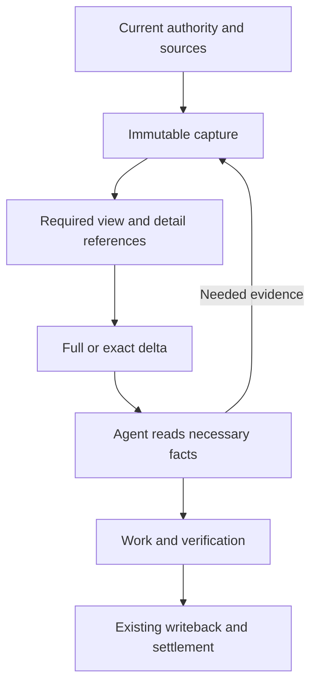

# Understand, use and evaluate context delivery

[中文](context-delivery.zh-CN.md)

Context delivery gives an Agent the requirements for its current work and a
verifiable route to the evidence behind them. **Progressive reading** determines
which material a decision needs; **differential delivery** represents changes
between exact versions. They share a pipeline, but answer different questions.

The native Codex path defaults on for supported POSIX Codex App/SSH and declared
benchmark heartbeat callers when no machine preference is saved. Saved or explicit
off disables it; ordinary CLI, other hosts and unsupported platforms inherit full
delivery.

A saved setting is not proof that a host is ready,
that a particular response used a delta, or that the model understood it. The
complete C1 caller migration and long-horizon cost/outcome qualification remain
open. Broad default adoption and old-path retirement need the evidence below.

- To understand a work session, start with [the example](#one-task-four-situations).
- To operate it, see [enable, verify and roll back](#enable-verify-and-roll-back).
- To change the implementation or its defaults, see
  [qualification and retirement](#qualify-default-adoption-and-retirement).

The [required-work-context reference](../reference/required-work-context.md)
owns current semantics; the [controller/executor RFC](../architecture/rfcs/controller-executor-unified-contract-v0.md)
owns proposed convergence. This guide explains those owners rather than defining
another protocol.

## Follow the information, not just the prompt

1. Existing Goal, Todo, acceptance, preference and capability owners supply facts.
   A pending read or unavailable source stays visible; presentation cannot turn
   it into a successful read or execution permission.
2. Capture binds the source version and work identity. Current native delivery
   keeps an original `projection.json` and a required model view,
   `required-context.json`. Supporting provenance and review explanations can
   remain in the original capture with exact detail references.
3. The TypeScript owner composes the required view, then encodes it. Known
   acceptance requirements and current review/check states remain available;
   supporting explanations are read when the decision depends on them. Exact
   repeated rows may point to their complete occurrence in the same view.
   Unknown or unsupported shapes retain their full obligations.
4. The codec compares compatible versions. Native Codex uses a verified saved
   file within its session/epoch as the baseline. The final native output also
   accounts for reference and complete-read framing when choosing full versus
   delta. A full response can therefore be the cheaper valid choice.
5. The Agent obtains the facts required by its next action and does the work.
   Admission, fresh authority checks, validation and once-only effects remain
   with their existing owners. Reading a capture does not perform those actions.

The shared implementation starts at
[`prepareProgressiveContextDelivery`](../../loopx/control_plane/quota/progressive_context.ts),
uses the [exact codec](../../loopx/control_plane/quota/context_delivery.ts), and
leaves native files, locking and lifecycle IO to the
[Codex adapter](../../loopx/control_plane/turn_driver/codex_context.py).
One shared preparation call does not prove that every final caller has migrated.

### Keep three meanings of reuse separate

| Mechanism | What it reuses | What it does not prove |
| --- | --- | --- |
| Same-response reference | One complete exact value in this current view | That a hidden or older value was read |
| Saved-file delta | Verified immutable file versions with compatible identity | Model retention, comprehension or fresh permission |
| Provider prompt cache | Provider-specific processing/billing reuse of input | Source correctness, task success or LoopX net savings |

Native first reads can also reuse an exact selected Todo note after its whole
body was observed in the same compatible Host session and context epoch. A fresh
canonical read must still establish the selected Todo and its source. The
note binds to its Goal, Agent, Todo, reader and authority source; changing only
evidence or other Todo metadata does not make the same literal note new. Current
task text and controls remain fresh, and metadata keeps its current source and
existing reader. If the new note starts with the exact observed note, the reader
can present only the added text. In an `append_to_observed_text` selection,
`value` is the suffix after `prefix_bytes` UTF-8 bytes. The next read can use the
longer note as its prefix only after the Host observes the complete suffix view.
A partial prior read, rewrite, incompatible identity, or compaction calls for the
full note. Explicit recovery reads the same capture. Observed delivery does not
establish model comprehension or net workflow savings.

Replan authoring uses the same-response form: CLI display can reference the
complete `vision_authoring` in a durable-writeback step. The existing TypeScript
Turn owner chooses an exact owner and resolves it for ordinary and captured
readers. Dangling references, reference chains, conflicting inline values and
references to another kind of step are rejected. A small or different value
stays inline. Sharing neither changes the original settlement identity nor
establishes cross-Turn retention or net cost savings.

Semantic summarization is another operation: it can change wording or meaning.
The exact codec is not a semantic summary. A controller-authored brief remains
a separate proposed workflow with its own retained-requirement and outcome
tests. Neither shorter wording nor a provider cache hit validates that proposal.

Explicit confirmed-input clients also have a retained-input contract. Do not
replace that contract with native Codex's saved-file assumption, or require
native Codex to read an old full packet merely to establish a file baseline.

## One task, four situations

Consider a synthetic task: **add a UTF-8 export, preserve the existing format,
and never overwrite an existing destination**. The checks and evidence below
are illustrative; they are not a benchmark result.

| Situation | What the Agent sees or retrieves | What must still happen |
| --- | --- | --- |
| Cold start | A current capture reference and navigation to the full task, Goal intent, applicable requirements, authority and stops | Read the necessary facts and required sources before work; inspect supporting implementation/evidence as needed |
| Warm continuation | A full or delta view of the new version; unchanged facts remain binding through the compatible capture | Read the new test result and any necessary inherited facts; validate the actual export rather than equating a smaller input with success |
| Constraint changes | The current source revision now also requires a distinct output naming rule | Reconcile the changed requirement before the affected write; an old permission or successful test does not cover the new requirement |
| Compaction or lost baseline | Recovery references remain available, while a later work Turn starts a new baseline epoch | Recover missing necessary facts from the same current capture and continue with the original work/effect identity; do not repeat admission or an already committed export merely because context was lost |

“Full” describes an available complete saved view, not an obligation to drain
every field before making any decision. Read the applicable Goal intent,
requirements, authority, stops and verification obligations first. Expand
supporting evidence when the decision needs it. A broader replan or whole-Goal
acceptance needs a correspondingly broader reading scope.

The native saved-file basis can inherit unchanged fields, including controls.
An omission from a delta is not evidence that a constraint disappeared, or that
the model has retained it. Retrieve necessary current facts when uncertain.
Default-off and signed-envelope callers retain their own read contracts; the
progressive native example does not relax them.

In a continuing native session, a progressive first read can reference exact
criteria or requirement descriptions delivered by an earlier complete read. An appended
criterion, revised review or supporting-material projection need not replay
every unchanged description. Current revisions, changed descriptions, review
states and new controls invalidate their containing criterion and remain visible.
An exact unchanged criterion needs no metadata split. Splitting a container adds addresses
and recovery guidance, so the reader keeps the complete presentation when the
split would not save enough bytes. This tool-delivery assumption is separate
from file deltas and provider caching; it does not prove model retention or
lower total cost. Partial reads and lost continuity cannot qualify this reuse.
Explicit same-capture selections always recover the complete current value.

An unchanged Goal narrative can also be referenced after an exact read of the
same registered source in the current session and epoch. The current source
revision and Turn controls still appear. A change to the narrative or its
source, an incomplete read, or compaction restores the current text.

For the same ready Todo in a native context epoch, the first read can reference
an exactly matching writeback precondition already delivered in full. It still
delivers the current settlement identity, commands and other steps. Changed
guidance and lost continuity restore the literal text. An explicit same-capture
read always returns the current precondition.

For ready work on the same registered route and Todo, the native first read can
reference an exact write-scope list that the session already received in full.
The rest of the current boundary, including guards and stops, still appears.
If unsure about a path, select `/goal_boundary/write_scope` from the current
recovery reader. Changes to the list or route, incomplete reads and compaction
restore the current list.

### Read and recover the right object

Use the path, digest and command returned by the current response. A native
response's `recovery` identifies its complete current required view;
`context_details` can identify the original capture containing deferred evidence.
Do not substitute one file's hash for another's.

- Use known JSON Pointers directly; repeat `--select` for related fields.
- For an unknown pointer, list the nearest known parent with
  `--list /interaction_contract --list-depth 2`. This is equivalent to
  `--list --select /interaction_contract --list-depth 2`; repeated `--list POINTER`
  and `--select POINTER` combine into the same index. To list the root, use bare
  `--list` without selectors or `--list ''`; `/` denotes an empty-name property.
- Follow the returned byte cursor for an unfinished selected range. EOF applies
  to that selection, not to unread fields elsewhere in the capture.
- Size both reader pages and the host tool's combined output budget. Valid JSON,
  a saved log or an EOF flag does not account for bytes the host truncated.
  Recover the missing range from the same capture with a smaller batch.
- A missing baseline, unsupported delta or invalid binding recovers the current
  full capture. Do not fetch an old packet just to seed a new baseline.

Compaction does not cancel an admitted Turn. A working brief helps recover its
identity and progress; it grants no new authority or retention proof. Keep a
known accepted operation and its receipt distinct from unresolved delivery.
Fresh authority is still required when the action's owner requires it, but
transport recovery alone does not justify another guard or quota spend.

## Enable, verify and roll back

The current native continuity adapter supports POSIX Codex App heartbeat, Codex
App SSH Goal and the explicitly declared Codex benchmark heartbeat worker.
Declarations select an adapter; they do not authenticate a host. Unsupported,
missing or contradictory explicit-on declarations are errors. Other resolved
hosts keep full delivery when inheriting this Codex-scoped preference.

In the App, use **Settings → This machine → Capabilities → Differential context
→ Codex**. The existing revision-locked preview/apply/readback transaction owns
the setting. It does not initialize the current native session or prove that
its lifecycle hooks are installed. Read-only settings views cannot save it.

For CLI operators, the same `context_delivery` machine namespace is documented
under [Machine default](../reference/required-work-context.md#machine-default).
There is no separate Goal configuration to duplicate:

- **Explicit `--context-delivery on` or `off`:** overrides the inherited machine
  choice for that invocation.
- **No explicit choice:** uses the saved machine preference when present.
- **No machine preference:** supported native Codex callers default on; other
  callers keep full delivery.
- **Worker `LOOPX_CONTEXT_DELIVERY=off`:** overrides inheritance; environment on
  alone does not enable native delivery.
- **Turn the App switch off:** saves off through the same transaction; it does
  not reverse task effects or rewrite old captures.

After enabling, inspect an actual supported invocation: its target binding,
full/delta mode, current recovery reference and supported lifecycle context must
agree. Full mode is valid at cold start, after loss, or when complete delivery
costs less. Saving on and observing full do not by themselves indicate failure
or success of delta reuse.

Machine consumers that parse raw `should_run` or settlement facts must continue
to request raw output on their internal calls. A native presentation envelope
is not the raw authority response; a missing `should_run` is not a denial.
Do not change an experiment's frozen mode, source or clock by changing machine
settings. Trials retain their explicit configuration and original authority.

### Roll back to another runtime

To disable progressive or differential presentation, use the existing settings
on the current runtime. An older release may read fewer persisted formats.
Qualify the exact target on the affected Host and authority provider before
switching:

1. On isolated state, verify that the target reads the current Goal
   requirements and the original capture. Include
   [record-format outcomes](../reference/goal-acceptance-observations.md#long-horizon-record-storage)
   when present. Reading a saved capture alone does not show that the target
   can read current authority or finish its pending settlement.
2. Quiesce new admissions on the affected entrypoint. Retain the original
   runtime, captures and receipts; reconcile in-flight Turns through that
   runtime and their original identities.
3. Switch only to a target that can read the retained state and continue
   work. Before reopening normal scheduling, check that new admission sees
   the same requirements and that the earlier effects remain settled once.
   If the target cannot read the current format, keep a compatible runtime
   and use its presentation settings. Never restore an older authority
   snapshot over committed requirements.

### Troubleshoot without changing task history

| Observation | Check next |
| --- | --- |
| On is rejected | Actual host declaration, supported scenario and POSIX requirement; do not guess a different host identity |
| Every response is full | Session/epoch continuity, file availability and the codec's reason; full may be the expected cheaper representation |
| A selector is missing | List the current parent and use the correct capture/digest; recover necessary facts without another admission |
| A source changed during an exact read | Follow the current task/source freshness contract; a historical capture is not fresh authority |
| A reply disappeared after an effect | Reconcile the original operation and receipt before retrying the effect |
| A new setting saved but no native reuse appears | Host/session setup and actual invocation readback; the saved preference is only one prerequisite |

Captures and journals may contain private tasks and evidence. Native storage
uses a private runtime directory and per-session journals, with restrictive
permissions and unsafe-path rejection. Do not attach raw captures, local paths
or journals to a public issue. Share a permitted redacted reproducer. Turning
off presentation is not a retention-policy change or a request to delete logs.

## Qualify default adoption and retirement

The [RFC's single-session comparison](../architecture/rfcs/controller-executor-unified-contract-v0.md#9-validation-and-acceptance)
remains first: original quota packet versus the fused contract in the same
product path. Optional controller/executor separation is a later comparison.
Do not explain away a single-session regression with a two-session result.

Future broader default adoption requires **both a declared DeepSeek model and a strong
model** to pass comparable effectiveness and complete-cost evaluation. Run each
model's comparison within its own fixed conditions; do not pool them to hide a
regression. This guide supplies a plan, not new experimental authority or a
claim that either model family has passed.
These criteria govern extending the current scoped default; that shipped default
does not itself prove either model comparison has passed.

### A minimum discriminating study

1. Reuse the [benchmark-toolkit](../../loopx/capabilities/benchmark_toolkit/README.md) board,
   source/integrity contracts and already qualified evidence. Before execution,
   declare exact model/provider/version/reasoning settings, source and host,
   tasks/inputs, tools, evaluator/feedback, budget and stops. Declare repetition,
   acceptance criteria and the available billing basis; do not invent missing
   prices, versions, sample sizes or thresholds.
2. First qualify engineering semantics: cold input, warm continuation, a changed
   constraint, and compaction/interrupted recovery. Include a small task and
   repeated history; verify source fidelity, required facts, invalid references,
   authority boundaries and once-only effects before comparing model benefits.
3. For each model, compare the original-quota/current control with the composed
   path under the same single-session workload. Report the actual final model
   input, detail reads and recovery, not only the middle serializer. Reuse lawful
   progressive-only or delta-only controls when contribution needs separation;
   add only the minimum authorized ablation, not new production switches or an
   automatic large matrix.
4. Measure the table below and retain failures, variation and negative cases.
   Freeze promotion criteria before running; collect subsequent accepted work
   that proves adoption of changed constraints or feedback.

Keep the minimum comparison visible as four cells, each covering the same
declared cold/warm/changed-constraint/recovery scenarios:

| Declared model | Control | Treatment |
| --- | --- | --- |
| DeepSeek, exact provider/version/settings recorded | Pinned original quota path | Pinned composed path, same host and conditions |
| Strong model, exact provider/version/settings recorded | Pinned original quota path | Pinned composed path, same host and conditions |

Read existing board rows before selecting cases. Reuse eligible runs; a missing
cell stays unqualified. Preregister each treatment's baseline run binding and
the repetition/order policy, then let the authorized runner execute unchanged
task inputs and evaluator. Each cell returns its source/host binding, actual
final inputs and recovery reads, native outcomes, full costs and integrity
status. Keep failed or censored attempts in the record. The board represents
run eligibility; it does not itself prove a causal comparison or authorize a run.

The native adapter above is Codex-scoped. It does **not** establish a DeepSeek
host's support. A DeepSeek comparison needs an authorized, qualified host that
exercises the same semantic pipeline; unsupported coverage remains a gap, not
a license to substitute Codex results or change a running study.

| Effectiveness | Complete applicable cost |
| --- | --- |
| Independent task acceptance/success or task-native metric | Actual input/output and cached/uncached tokens, including known compaction/request coverage |
| Constraint omissions, wrong actions, evidence use | Model/tool requests, detail reads, retries and recovery |
| Recovery, duplicate-effect prevention and usable delivered artifacts | Wall time, applicable tail latency, snapshot/hash/IO and setup/maintenance |
| Actual subsequent adoption of revisions | Human decisions, navigation, intervention and attention |

Use the task's native ranking. For optimization tasks ranked by historical best,
do not replace it with the final source's score; final artifact/retention facts
remain separate where applicable. Unknown costs are not zero. Time between
evaluation completion and feedback collection can overlap independent
validation; measure that overlap before calling it idle delay. Fewer calls or
smaller bytes can coexist with worse accepted outcomes.

The existing [packaged-source comparison](../architecture/rfcs/ledger/controller-executor-unified-contract-v0/2026-10-29-packaged-source-comparison.md)
provides real CLI/source/recovery evidence and also records larger cold/output
bytes. Reuse that qualified scope, not a claim of model savings. Cold start,
small tasks, lost baselines and one model regressing are required countercases
to a broad default recommendation.

### Release and deletion are separate decisions

| Stage | Exit evidence and owner |
| --- | --- |
| Explain current behavior | Guide/reference agree with real callers; documentation owner preserves the proposal/implementation boundary |
| Evaluate both models | Benchmark owner records fixed conditions, accepted outcomes, costs, uncertainty and unsupported coverage |
| Adopt a supported profile | Runtime/host owner qualifies the real packaged journey and reversible configuration; maintainer decides release scope |
| Recommend a broader default | Both model results support that declared scope; mixed/regressed results retain scoped opt-in or explicit limitations |
| Retire an old path | Caller owner proves replacement, historical-reader compatibility, supported-version/rollback coverage and no remaining live consumer |

Retirement must name an actual producer, consumer and replacement. Removing a
duplicate decision algorithm after caller migration differs from deleting a
historical decoder. Keep complete snapshots, digest checks, authority/identity/
stop validation and required recovery. Explicit retained-input clients and
native file-baseline clients are distinct compatibility obligations. Do not
leave two permanent semantic owners, or delete a still-supported reader merely
because the new path exists.

The [roadmap](../architecture/rfcs/loopx-overall-roadmap-v0.md#unified-contract-and-controllerexecutor-delivery)
and RFC retain the owners and remaining C1/C2/C9 work. Documentation can ship
before model experiments; neither a merged guide nor a smaller packet completes
those runtime, adoption or benefit requirements.
