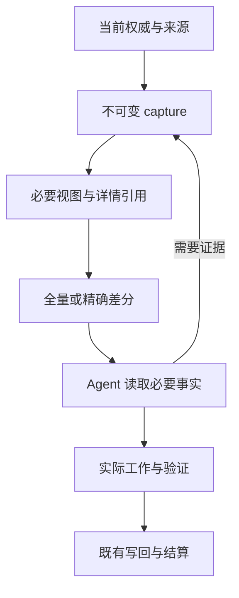

# 理解、使用和验收上下文交付

[English](context-delivery.md)

上下文交付让 Agent 获得当前工作的要求，以及通向其证据的可核验入口。**渐进阅读**决定
本次判断需要哪些材料；**差分交付**表达精确版本之间发生了什么变化。二者共用管线，
但回答不同的问题。

未保存机器偏好时，受支持的 POSIX Codex App／SSH 和已声明的 benchmark 心跳入口
默认开启原生路径。保存 off 或显式关闭可禁用；普通 CLI、其他宿主与不支持的平台
继承完整交付。

保存开关不证明宿主已就绪、某次输入用了 delta，或模型已理解材料。完整 C1 消费链迁移和
长程成果／成本资格仍未完成；广泛默认化和旧路径退役须取得下文证据。

- 理解一次工作，从[四种场景](#一项任务四种场景)开始。
- 实际使用，看[开启、验证和回退](#开启验证和回退)。
- 修改实现或默认行为，看[默认化与退役的验收](#默认化与退役的验收)。

[Required work context](../reference/required-work-context.md) 定义当前语义；
[Controller/executor RFC](../architecture/rfcs/controller-executor-unified-contract-v0.zh-CN.md)
拥有未来收敛设计。本指南解释既有 owner，不另立一套协议。

## 沿信息链理解，而不只看 prompt

1. 既有 Goal、Todo、acceptance、偏好与 capability owner 提供事实。待完成读取和来源
   不可用继续可见；展示不能把它们变成已读或执行许可。
2. Capture 绑定来源版本和工作身份。当前原生交付保留原始 `projection.json`，以及
   面向模型的必要视图 `required-context.json`。来源历史与评审解释可保存在原 capture，
   通过精确详情引用到达。
3. TypeScript owner 先组成必要视图，再编码。已知验收要求与当前评审／检查状态保持
   可达；判断依赖解释时再展开。完全相同的重复行可引用同一视图中完整的那一份。
   未知或不支持的形状保留完整义务。
4. Codec 比较兼容版本。原生 Codex 以同一 session/epoch 中校验过的保存文件为基线；
   最终输出还计入引用与完整读取的封装成本，再选择 full 或 delta。因此 full 也可能
   是更便宜的合法结果。
5. Agent 取得下一动作所需事实，执行并验证。准入、新鲜权限检查、验收和一次性效果
   仍归既有 owner；读 capture 不执行这些操作。

共享实现由
[`prepareProgressiveContextDelivery`](../../loopx/control_plane/quota/progressive_context.ts)
开始，使用[精确 codec](../../loopx/control_plane/quota/context_delivery.ts)，文件、锁和原生
生命周期 IO 留给 [Codex adapter](../../loopx/control_plane/turn_driver/codex_context.py)。
一次共享准备调用，不证明所有最终消费者已经迁移。

### 三种复用分别看

| 机制 | 复用什么 | 不证明什么 |
| --- | --- | --- |
| 同响应引用 | 当前视图内一份完整、精确的值 | 隐藏或旧版本的值已经被读过 |
| 保存文件差分 | 身份兼容、经过校验的不可变文件版本 | 模型保留、理解或新鲜权限 |
| Provider prompt cache | Provider 自己的输入处理／计费复用 | 来源正确、任务成功或 LoopX 净收益 |

原生首读也可以复用当前 Todo 完全相同的备注，前提是同一兼容 Host session 和
context epoch 中已经观察到整段正文交付；仍须新鲜 canonical 读取确认当前选择的 Todo
及其来源。备注绑定 Goal、Agent、Todo、reader 和 authority 来源；仅更新证据或其他
Todo 元数据，不会让相同备注变成新正文。当前任务文本、控制和元数据仍由当前来源及
既有 reader 提供。当前备注以已完整观察的旧备注开头时，reader 可只送新增文字。
在 `append_to_observed_text` 选择项里，`value` 是从 `prefix_bytes` 个 UTF-8 字节
之后开始的新增内容。Host 完整观察到这份增量后，后续读取才可把拼接后的备注作为
前缀。此前只读到一部分、正文被改写、身份不兼容或发生压缩时，reader 返回完整备注。
显式恢复仍读同一 capture。观察到交付本身无法证明模型理解或完整流程净收益。

重规划 authoring 使用同响应引用：CLI 展示可指向 durable-writeback 步骤中完整的
`vision_authoring`。现有 TypeScript Turn owner 选择精确一致的正文，并为普通及捕获
读取器展开它。悬空引用、引用链、与引用冲突的内联值，以及指向其他种类步骤的引用
都必须拒绝；很小或不同的值保持内联。共享不改变原结算身份，也不证明跨 Turn 保留
或整体成本节省。

语义摘要是另一种操作，会改变措辞，可能改变含义。精确 codec 不做语义摘要。
Controller 编写 brief 仍是单独提议的工作流，须验收保留要求与实际成果；更短的文字或
provider cache 命中都不能替它通过。

显式确认完整输入的客户端另有 retained-input 契约。不能把它换成原生 Codex 的文件
假设，也不能要求原生 Codex 为建立文件基线先把旧完整包读进模型。

## 一项任务，四种场景

用一个合成任务贯穿：**增加 UTF-8 导出，保留原有格式，绝不覆盖已有目标文件**。
下列检查和证据是说明例子，不是 benchmark 结果。

| 场景 | Agent 看到或取得什么 | 仍须完成什么 |
| --- | --- | --- |
| 冷启动 | 当前 capture 引用，以及完整任务、Goal 意图、适用要求、权限与停止条件的入口 | 工作前读必要事实与必读来源，按需检查实现／支持证据 |
| 暖态继续 | 新版本的 full 或 delta；未变化事实仍经兼容 capture 保持约束力 | 读新测试结果及所需继承事实；验收实际导出，不能把输入变短当成功 |
| 约束变化 | 当前来源 revision 新增输出命名规则 | 在受影响写入前对齐新要求；旧许可或旧测试不覆盖新要求 |
| 压缩或基线丢失 | 恢复引用仍在，后续工作 Turn 使用新基线 epoch | 从本轮同源 capture 补缺失必要事实，沿原工作／effect 身份继续；不能因丢上下文重复准入或已提交的导出 |

Full 表示完整保存视图可用，不要求判断任何问题前先遍历所有字段。先读适用的 Goal
意图、要求、权限、停止与验证义务，判断需要时展开支持证据。广域重规划或整体验收
相应扩大阅读范围。

原生文件基线可继承未变化字段，包括控制字段。Delta 没列出某条约束，不表示它已
消失，也不证明模型保留了它。不确定时取得必要当前事实。Default-off 与签名 envelope
调用方继续遵守各自读取契约；这个渐进原生例子不放宽它们。

原生会话持续期间，渐进首读可以引用此前完整读取实际送达的精确条件或要求正文。新增条件、
修订评审或支持材料投影不必让每条未变正文重送；当前修订号、已改正文、评审状态和
新控制条件使对应整条条件失效并重新显示；精确未变的整条条件无需拆开元数据。
拆开容器会增加地址及恢复说明，节省不足时 reader 保留完整展现。
这种工具投递假设与文件差分、provider 缓存分别成立，不证明模型保留或完整成本下降。
未读完或连续性丢失不能取得该复用资格；显式同 capture 选择仍可恢复完整当前值。

当前原生会话在同一上下文周期内完整读取同一注册来源后，也可引用未变的 Goal 正文。
首读仍交付当前来源修订和 Turn 控制条件。正文或来源变化、读取不完整或发生压缩时，
读者恢复当前正文。

同一原生上下文周期内，如果同一个已准入 Todo 的写回前置说明逐字相同，且先前已完整交付，
首读可以引用这段说明。当前结算身份、命令和其余步骤仍会交付。说明变化或上下文连续性丢失时，
首读恢复当前原文。显式读取同一 capture 始终能取得当前说明。

同一注册路由和 Todo 的工作已就绪时，原生首读可以引用会话此前完整收到的同一份写入
范围列表。当前边界的其他部分仍会显示，包括防护和停止条件。不确定某个路径是否在
范围内时，通过当前恢复读取命令选择 `/goal_boundary/write_scope`。列表或路由变化、
读取不完整或发生压缩时，会恢复当前完整列表。

### 读对对象，再恢复

使用当前响应返回的路径、摘要与命令。原生响应的 `recovery` 指向当前完整必要视图；
`context_details` 则可指向包含延后证据的原始 capture。不能交换两份文件的 hash。

- 已知 JSON Pointer 直接选择，相关字段用重复 `--select` 批量读取。
- 未知 pointer 先对最近的已知父节点执行 `--list /interaction_contract --list-depth 2`，
  等价于 `--list --select /interaction_contract --list-depth 2`。重复的 `--list POINTER`
  与 `--select POINTER` 会合并到同一个索引。列出根节点用不带 selector 的 `--list`
  或 `--list ''`；`/` 仍表示空名称属性。
- 未完成的选择沿返回的字节 cursor 继续。EOF 只覆盖该选择，不代表读了其他字段。
- 同时控制 reader 页与宿主工具的合计输出预算。合法 JSON、落盘日志和 EOF 都不能
  补上被宿主截掉的字节；缩小批次，从同一 capture 补缺失范围。
- 基线缺失、不支持的 delta 或绑定无效时，恢复当前完整 capture；不要先取旧包给
  新基线垫底。

压缩不取消已准入的 Turn。Working brief 帮助找回原身份和进度，不提供新权限或模型
保留证明。已接受操作及其回执，与尚未解决的投递分开；动作 owner 要求新鲜权限时
仍须取得，但单纯传输恢复不构成再次 guard 或扣额的理由。

## 开启、验证和回退

当前原生连续性 adapter 支持 POSIX 下的 Codex App heartbeat、Codex App SSH Goal，
以及显式声明的 Codex benchmark heartbeat worker。声明选择 adapter，不认证宿主。
显式 on 的声明缺失、矛盾或不支持会报错；其他已解析宿主继承这个 Codex 范围偏好时
保持完整交付。

App 中使用 **Settings → This machine → Capabilities → Differential context → Codex**。
已有的 revision 锁定 preview/apply/readback 事务拥有这项设置；它不初始化当前原生
session，也不证明生命周期 hook 已安装。只读设置页不能保存。

CLI 使用同一个 `context_delivery` 机器 namespace，详见
[机器级默认](../reference/required-work-context.md#机器级默认)，无需再建 Goal 配置。

- **显式 `--context-delivery on` 或 `off`**：覆盖该次调用继承的机器选择。
- **没有显式选择**：已保存机器偏好时使用该偏好。
- **没有机器偏好**：受支持原生 Codex 调用方默认开启；其他调用方保持完整交付。
- **Worker 显式 `LOOPX_CONTEXT_DELIVERY=off`**：覆盖继承；环境变量 on 本身不开启原生交付。
- **关闭 App 开关**：经同一事务保存 off，不撤销任务效果或改写历史 capture。

开启后核对一次真实受支持调用：target 绑定、full/delta 模式、当前恢复引用与宿主
生命周期上下文应一致。冷启动、丢失后或完整交付更便宜时，full 完全合法；保存 on
与看到 full 本身，都不能判断差分是否正确复用。

解析原始 `should_run` 或结算事实的机器消费者，其内部调用仍须请求 raw 输出。原生
展示封装不是原始权威响应；封装中缺少 `should_run` 不表示拒绝准入。不能通过改机器
设置改变某个实验冻结的模式、来源或时钟；trial 保留原显式配置与权限。

### 回退到另一个运行时

只需关闭渐进或差分展示时，在当前运行时使用原有设置即可。旧版可能支持较少的
持久化格式；切换前，应在受影响的宿主和状态后端上验证确切的目标版本：

1. 在隔离状态上确认目标版本能读当前 Goal 的验收要求及原捕获。若已采用
   [记录格式](../reference/goal-acceptance-observations.md#long-horizon-record-storage)，
   应覆盖该格式。能打开历史捕获，不说明它能读取当前权威状态或完成仍待结算的轮次。
2. 暂停受影响入口的新准入。保留原运行时、捕获和回执，用原运行时和原身份核对、
   结清在途 Turn。
3. 只切换到可读保留状态且能继续工作的版本。恢复常规调度前，确认新准入仍看到原
   验收要求，且此前效果只结算过一次。若目标版本不能读当前格式，就保留兼容运行时，
   用它的设置关闭展示。不要用旧权威快照覆盖已提交的验收要求。

### 排障不改写任务历史

| 观察 | 下一检查 |
| --- | --- |
| On 被拒绝 | 实际宿主声明、支持场景与 POSIX 要求，不猜一个不同宿主身份 |
| 每次都是 full | Session/epoch 连续性、文件是否可读及 codec 原因；full 可能就是更便宜的预期形式 |
| Selector 不存在 | 列当前父节点，使用正确 capture/digest，补必要事实而不再次准入 |
| 精确读取时来源变化 | 遵守当前任务／来源新鲜度契约；历史 capture 不是新鲜权限 |
| 效果发生后回复丢失 | 先对齐原 operation 和回执，再决定是否重试效果 |
| 设置已保存却未见原生复用 | 核宿主/session 准备与实际调用；保存偏好只是一个前提 |

Capture/journal 可包含私有任务与证据。原生存储使用私有 runtime 目录和分 session
journal，限制权限并拒绝不安全路径。不要把原始 capture、本机路径或 journal 附到
公开 issue，使用获准的脱敏复现。关闭展示不改变保留政策，也不是删除日志的请求。

## 默认化与退役的验收

先保留 [RFC 的单会话对照](../architecture/rfcs/controller-executor-unified-contract-v0.zh-CN.md#9-验证与验收)：
同一产品路径中的原 quota packet 与融合契约。可选 controller/executor 分离是之后
的独立比较，不能用双会话结果解释或抵消单会话回归。

未来扩大默认采用范围必须同时有**明确版本的 DeepSeek 模型与强模型**的可比效果、完整成本
证据。每个模型内部固定条件分别比较，不能合并结果掩盖某一个模型退步。本指南提供
方案，不授予新实验权限，也不宣称任何一个模型系列已经通过。
这些标准约束现有范围化默认的扩展；已交付的默认行为本身不证明双模型对照通过。

### 最小判别研究

1. 复用 [benchmark-toolkit](../../loopx/capabilities/benchmark_toolkit/README.md) 的 board、来源／
   integrity 契约和已有合格证据。执行前声明 model/provider/version/推理配置、source
   与宿主、任务/输入、工具、evaluator/反馈、预算与停止条件；同时冻结重复策略、
   验收标准和可获得的计费口径。不编造缺失价格、版本、样本量或数值阈值。
2. 先验收工程语义：冷态、暖态、关键约束变化、压缩／中断恢复，并纳入小任务和重复
   历史，验证来源保真、必要事实、无效引用、权限边界和一次性效果，再比较模型收益。
3. 每个模型用同一单会话负载，对照原 quota／现行控制与组合路径。记录真实最终模型
   输入、详情补读与恢复，不只测中间 serializer。需要拆贡献时复用合法的 progressive
   或 delta 单因素对照；只补最小获授权消融，不为试验添加生产开关或默认启大矩阵。
4. 按下表测量，保留失败、波动与负结果；执行前冻结晋级标准，并用后续验收工作证明
   模型实际采用变化要求或反馈。

最小比较保留四格，每格覆盖同一组已声明的冷态／暖态／约束变化／恢复场景：

| 已声明模型 | 控制 | 处理 |
| --- | --- | --- |
| DeepSeek，记录精确 provider/version/配置 | 固定版本的原 quota 路径 | 固定版本的组合路径，同宿主、同条件 |
| 强模型，记录精确 provider/version/配置 | 固定版本的原 quota 路径 | 固定版本的组合路径，同宿主、同条件 |

选案例前先读现有 board，复用合格 run；缺失一格就保持未合格。预登记各处理组的基线
run 绑定及重复／顺序策略，再由获授权 runner 执行不变的任务输入与 evaluator。
每格返回 source/host 绑定、实际最终输入与恢复补读、原生任务成果、完整成本及
integrity 状态，保留失败或截尾尝试。Board 表达 run 资格，本身不证明因果比较，也不
授权启动。

上述原生 adapter 范围是 Codex，**不证明 DeepSeek 宿主已支持**。DeepSeek 对照需要
获授权且已资格化、能经过同一语义管线的宿主。不支持保持缺口，不能替换成 Codex
结果或修改在跑研究。

| 效果 | 完整适用成本 |
| --- | --- |
| 独立任务验收／成功率或原生任务指标 | 实际 input/output、cached/uncached tokens，披露压缩／请求覆盖 |
| 约束遗漏、错误动作和证据采用 | 模型／工具请求、详情补读、重试与恢复 |
| 恢复、避免重复效果、可用交付物 | 墙钟、适用尾延迟、快照／hash／IO、搭建与维护 |
| 后续工作实际采用修订 | 人工决策、导航、介入与注意力 |

按原任务排名规则：以历史最佳排名的优化任务，不能拿终点源码分数替换它；适用的
终态产物／保留事实另列。未知成本不记零。评测完成至收集反馈之间可能仍在独立验证，
须测量重叠后再判断空等；更少调用或字节可以与更差的验收成果同时发生。

已有[打包来源对照](../architecture/rfcs/ledger/controller-executor-unified-contract-v0/2026-10-29-packaged-source-comparison.zh-CN.md)
提供真实 CLI、来源和恢复证据，也保留了更大的冷态／累计输出。复用它已验的范围，
不转写成模型节费。冷启动、小任务、丢基线和某个模型退步，都是广泛默认建议的必要
反例场景。

### 发布与删除分开决定

| 阶段 | 退出证据与 owner |
| --- | --- |
| 讲清当前行为 | 指南／reference 与真实 caller 一致，文档 owner 保留提案／实现区别 |
| 双模型比较 | Benchmark owner 记录固定条件、验收成果、成本、不确定性与不支持范围 |
| 采用受支持 profile | Runtime/host owner 验实际打包旅程与可回退配置，维护者决定发布范围 |
| 建议扩大默认 | 两模型证据支持该声明范围；混合／退步时保留范围化 opt-in 或明确限制 |
| 退役旧路径 | Caller owner 核替代、历史读取兼容、支持版本／回退覆盖及不再有活跃消费者 |

退役须点名实际 producer、consumer 与替代项。调用方迁移后删除重复判断算法，与删除
历史 decoder 是两件事。完整快照、摘要校验、权限／身份／停止验证和必要恢复应保留。
显式 retained-input 客户端与原生文件基线客户端是不同兼容义务。既不长期保留两套
同义决策 owner，也不因新路径存在就抢先删除仍受支持的 reader。

[Roadmap](../architecture/rfcs/loopx-overall-roadmap-v0.zh-CN.md#统一契约与-controllerexecutor-交付)
与 RFC 继续拥有 C1/C2/C9 的负责人和未闭工作。文档可以先于模型实验交付；指南合并
或 packet 变小，都不结清运行时、实际采用与收益要求。
