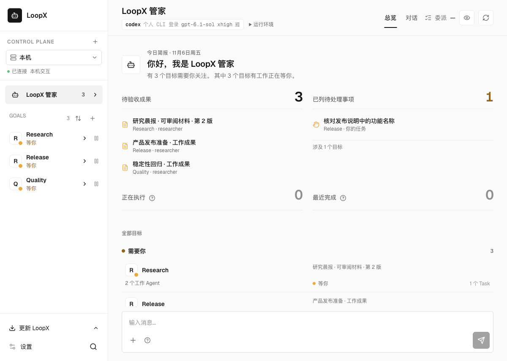
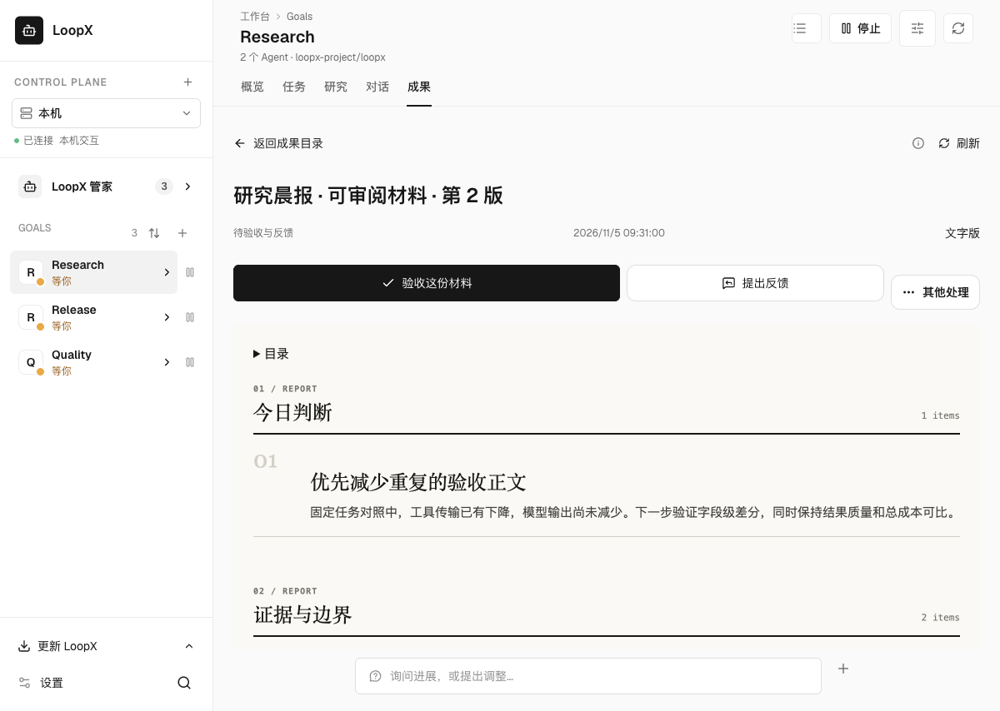
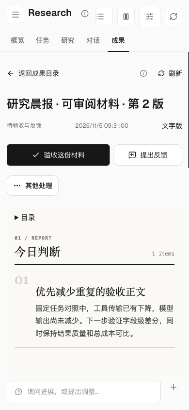

# 审阅工作成果 / Review work materials

材料准备好后，工作台的 **待验收成果** 显示尚待处理的材料数量和标题。
点击一项，直接进入该 Goal 的 **成果** 页，打开对应版本。



在阅读区选择 **页面版** 或 **文字版**。**提出反馈** 会打开负责 Agent 的工作对话，
带上原请求和 Todo 引用；撰写反馈不会自动发送。**验收这份材料** 使用现有操作预览，
确认后处理这一个版本的 User Todo。处理材料不等于整个 Goal 验收通过。
阅读、刷新、切换格式都不会处理验收。修订版独立提醒，旧版本的处理结果保留。
页面版提供静态目录；打开外部来源链接请切换到文字版。



窄屏保留正文与操作。报告日期、条目计数和来源回执在报告附录中展开。



**来源与版本** 可展开查看生成记录和摘要。若原材料不可读，页面显示错误及刷新入口；
原提醒继续保留，不会因为读取失败而变成已验收。

## 定时准备材料

在 Goal 设置中打开定期报告配置，选择 `weekly-progress`、已有的报告接收会话和日历，
开启 **材料就绪后请求验收**，预览并保存。该开关只适用于本 Goal 原 Agent 会话的报告，
默认关闭，不是设备级默认值。现有频道报告和已有日历不会被自动改写。

例如希望上午 9 点前审阅，可以把日历触发时间设为每天 08:30，时区设为 `Asia/Shanghai`，
给生成和核验预留时间。这是准备工作的触发时间，不是按时完成保证；原会话及现有唤醒
仍须可用。生成、材料就绪、实际送达和用户处理分别核验。关闭开关只停止以后新材料的
自动请求，已有待审阅版本仍可阅读和处理。

Agent 也可以为已经生成的配对报告显式请求审阅：

```bash
loopx periodic-report request-review \
  --goal-id <goal-id> --agent-id <registered-agent> \
  --bundle-json <generation-bundle.json> --execute
```

省略 `--execute` 仅验证请求。命令接受同一报告的内置 Markdown 和 HTML 生成包；
它不会调用模型、启动实验或授权后续工作。相同 Goal、生产者和生成包重试不会重复提醒，
也不会重新打开已处理版本。

原会话已知时可加 `--session-id <original-session-id>`。日历报告会自动绑定这个来源；
未指定时，反馈先进入负责 Agent 的会话目录，选择现有会话后再填写草稿，不会自动换一个会话发送。

## English

**Results awaiting review** on Home lists pending materials. Select a title to
open its exact edition in the Goal's **Results** tab. Page and text views are
available. **Give feedback** prepares a draft in the responsible Agent's work
conversation; it does not send it. **Accept this material** uses the existing
action preview and handles only that edition's User Todo, not Goal acceptance.
Reading and refreshing never acknowledge a result. Revised editions have
independent review decisions. Unreadable material retains its pending request.

In Goal settings, configure the existing `weekly-progress` report, original
Agent conversation and calendar, then enable **Request review when ready**.
The switch defaults off and is unavailable as a machine default. For a 09:00
review, an 08:30 `Asia/Shanghai` calendar can reserve preparation time; dispatch
is not an on-time completion guarantee. Original Sessions and existing wakes
must remain available. Disabling future requests preserves earlier editions.

The explicit CLI above queues an existing built-in report bundle without a
model call. Retry identity includes Goal, producer and exact bundle; retries do
not duplicate requests or reopen handled editions.

Use optional `--session-id <original-session-id>` to retain an exact feedback
destination. Calendar reports bind it automatically. Without it, feedback
opens the responsible Agent's directory and waits for an explicit Session
selection; it does not silently send into another conversation.

## Rendering boundary

The embedded reader displays the built-in report in a scriptless, opaque
sandbox with a restrictive content policy. Host review controls sit outside
that frame. The embedded layout removes the repeated title and standalone
script-driven controls while retaining report summaries, periods and sources;
the exact Markdown remains available. Reporting-window and fallback count metadata
remain in the report appendix so the first viewport can show the judgment.
Report bytes cannot execute host actions.
In-document anchors stay in the report; external source links are available in
text view. The anchor handling follows the
[documented srcdoc URL behavior](https://developer.mozilla.org/en-US/docs/Web/HTML/Reference/Elements/iframe#srcdoc).
Canonical User Todos own review state; the report file and reading preferences
are not a second authority store.

This boundary takes inspiration from
[Porthole](https://github.com/botiverse/porthole) and its
[threat model](https://github.com/botiverse/porthole/blob/main/docs/THREAT_MODEL.md).
It adds no Porthole dependency, arbitrary HTML app runtime, host-function bridge
or annotation service.
