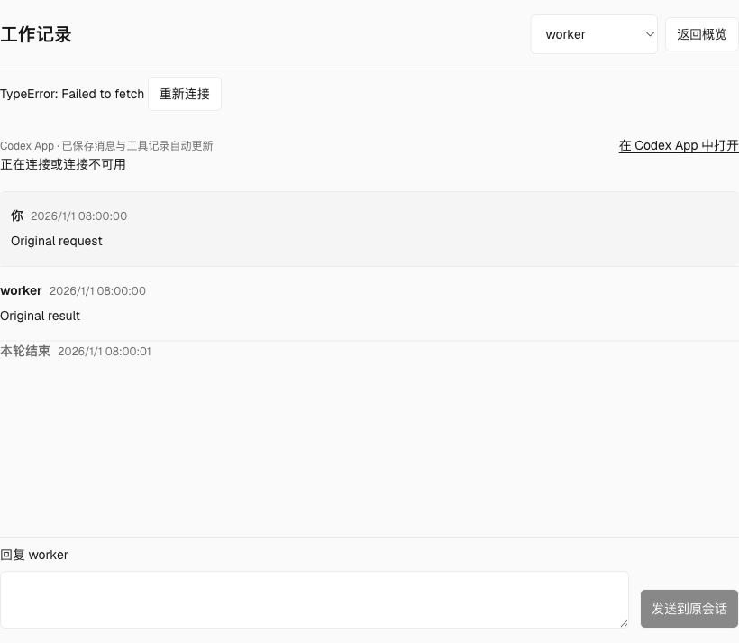
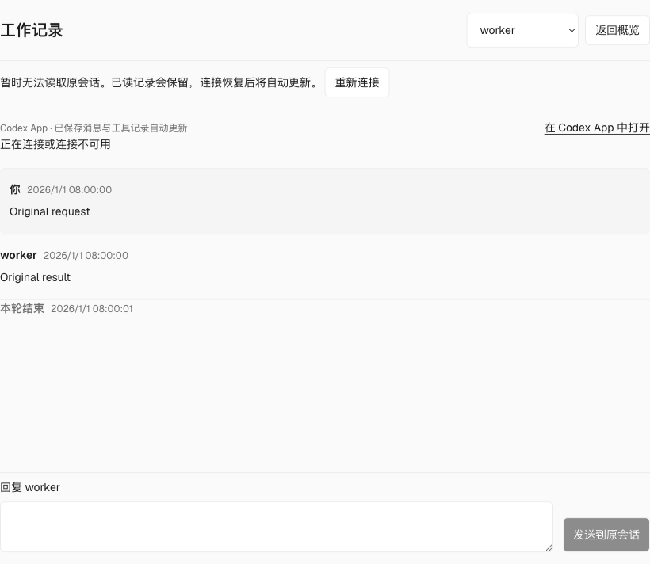
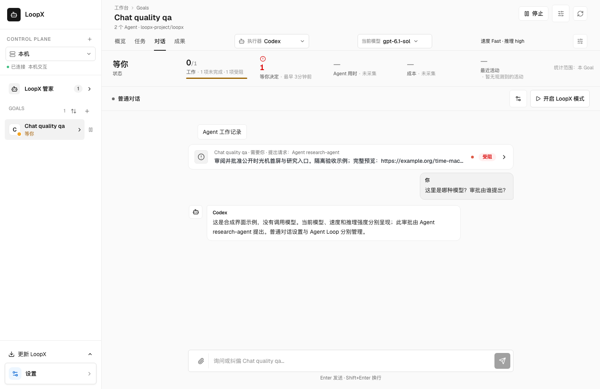
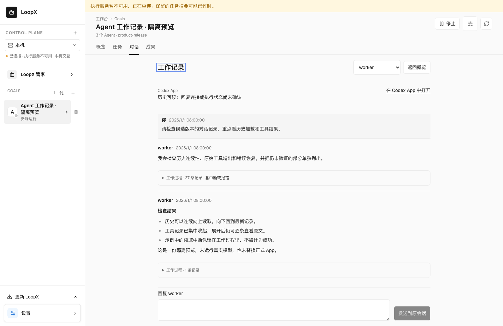
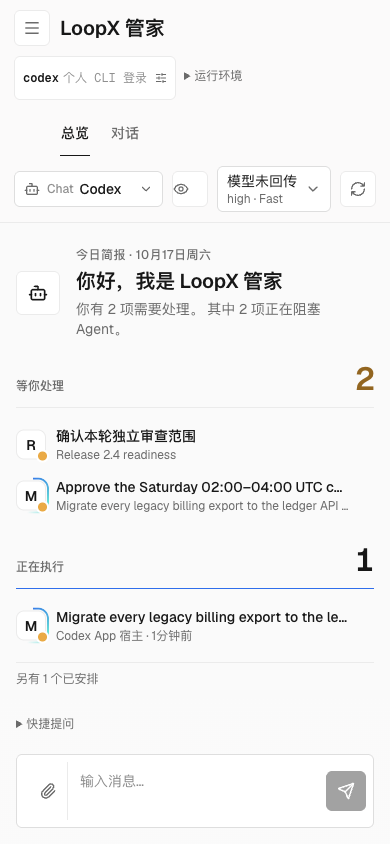
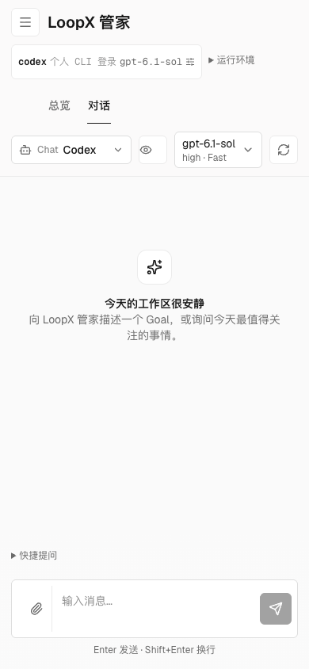
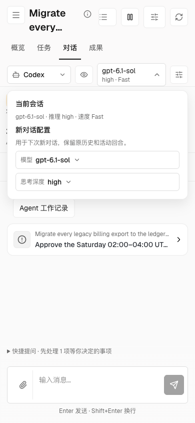

# Session Runtime Control-Plane Adapter

Status: public-safe architecture target + read-only projection contract v0.

LoopX should be able to sit beside an existing agent host without
becoming that host. The target role is a long-horizon task control plane:
turn session-level execution facts into goal-level state that is recoverable,
auditable, gated, attention-ranked, and reusable across sessions.

## Layer Boundary

An agent host owns the execution plane:

- agent definitions and runtime configuration;
- environment and session lifecycle;
- append-only session events;
- tool and sandbox execution;
- host authentication, rate limits, billing, trace, and audit;
- raw transcripts, raw logs, and raw tool outputs.

LoopX owns the goal-level control projection:

- `goal_state`: objective, non-goals, authority sources, current boundary;
- `run_projection`: compact session/outcome summary with pointers to source
  facts;
- `operator_gate`: cross-session owner/controller decisions;
- `human_reward`: human judgment on a route or run result, separate from a
  task scorer;
- `work_lane_contract`: advancement, monitor, blocker, and user-gate routing;
- `quota_decision`: whether the goal should spend the next automatic agent
  turn;
- `handoff_packet`: the approved next action for a project agent;
- `dreaming_proposal`: background exploration that remains advisory until
  promoted.

A product surface owns the frontstage user experience: task cards, approvals,
progress, recovery entry points, and collaboration views. LoopX should
explain why a card exists, whether it may run, which gate blocks it, and how it
recovers after approval; it should not become the default end-user console.

## Core Principle

### Managed Codex home ownership (implemented)

The managed Chat adapter captures `LOOPX_CHAT_CODEX_HOME`, then `CODEX_HOME`,
then the host's default Codex home at controller startup. It explicitly passes
that home to each app-server process, including catalog-compatibility retries.
New managed Codex sessions persist this binding in owner-local session state.
Resume and submit reject a different home before starting an upstream process
or modifying a turn. Legacy sessions acquire the binding only after successful
upstream restoration; startup alone neither rebinds nor copies their history.

Desktop-owned Chat processes explicitly default `LOOPX_CHAT_CODEX_HOME` to
`~/.codex`, independently of the launching terminal's `CODEX_HOME`. An explicit
`LOOPX_CHAT_CODEX_HOME` still selects another native account configuration.
Direct CLI launches and existing LaunchAgents retain their documented
precedence. Switching the service home selects the default for new conversations;
existing threads remain bound to their original store. An ordinary managed
Session can resume in its original discovered native profile when its exact
thread remains available there. No history or credentials are copied, and the
service default does not change. Explicit profile conflicts, unavailable original
threads and workspace-only home mismatches remain errors. The steward defaults to Codex/GPT;
DeepSeek Harness remains an explicit Runtime choice with its own SDK and
operator credential, rather than sending GPT model names to a DeepSeek provider.
Model discovery uses the same captured native home as execution. The guided
steward editor clears model/effort overrides when changing executor, and labels
empty values as Runtime defaults; the existing preview/apply owns the write.

中文：桌面自己启动的 Chat 默认固定到 `~/.codex`，不再继承启动终端的
`CODEX_HOME`；显式 `LOOPX_CHAT_CODEX_HOME` 仍可选择其它原生账号配置。
直接 CLI 和已有 LaunchAgent 的优先级不变。换目录只改变新对话默认值，旧线程保持原存储绑定。
普通托管会话在原配置仍可发现且精确原线程仍可用时，可直接恢复，不复制历史或凭据，
也不改变服务默认值。显式配置冲突、原线程不可用及 workspace-only 目录不匹配仍拒绝。
管家默认 Codex/GPT；DeepSeek Harness 是可选 Runtime，单独检查 SDK 与 operator
凭据，不把 GPT 模型名发给 DeepSeek provider。
模型发现与执行共用启动时固定的原生目录。引导表单切换执行器会清空模型与档位覆盖，
空值明确表示 Runtime 默认值；写入仍归原有预览/应用流程。

The macOS LaunchAgent installer preserves an existing binding on upgrade,
including older shell-export plists. Use `LOOPX_CHAT_CODEX_HOME` explicitly when
installing a deliberately different host profile. A later ambient `CODEX_HOME`
does not overwrite it. A home-mismatch gate requires restoring the original
native profile and thread, or resolving an explicit profile conflict; changing
this variable is not a session-migration command.

The LaunchAgent keeps service execution `CODEX_HOME` separate from
`LOOPX_CHAT_CODEX_HOME`. Set both when a coordinator's workers resume in a
different existing home from its Chat app-server. Install/restart preserves the
recorded execution home when `CODEX_HOME` is omitted; an explicit value changes
only that service setting. A fresh install without an execution selection uses
the Chat home. Changing the Chat override no longer overwrites an existing
worker profile. This affects macOS-managed Chat/delegation launches, leaves
session-profile checks in force, and neither migrates sessions nor copies auth.

中文：macOS 登录服务分别保存执行端 `CODEX_HOME` 与聊天端
`LOOPX_CHAT_CODEX_HOME`。需要沿用不同的原会话时同时指定两者；升级或重启时未指定
`CODEX_HOME` 就保留已安装的执行目录，新安装未指定则沿用聊天目录。只修改聊天目录
不再覆盖已有 worker 配置；会话检查仍会拒绝不一致的恢复，不迁移历史或复制凭据。

Sharing a host home does not by itself prove a SQLite lock failure. A desktop
launcher should separate ordinary open (read-only identity/configuration checks)
from offline account switching, migration, or rollback (exclusive ownership).
Do not make a normal open perform hidden migrations, kill managed workers, or
move sessions into another home to pass an overly broad file-open check.
Sharing a home also does not authorize two clients to run the same thread
concurrently. Account changes still require quiescing all users of that home;
this binding does not implement credential copying or account-refresh logic.

Validation: `python -m pytest tests/test_chat_codex_home.py tests/test_chat_agent.py`
and `python examples/macos-dashboard-launchagent-status-smoke.py`. The latter
exercises the actual installer with fixture LaunchAgents, not real services.

### Projection boundary

The host session log is the raw fact source. LoopX run history is a
compact control projection. A projection may reference host ids such as session,
event, tool call, artifact, approval, or outcome ids, but it must not copy full
transcripts, credentials, raw logs, private traces, or sandbox internals into
LoopX state.

This avoids a second event store. If the host says a session completed and
LoopX says a goal is still blocked, the projection must explain the
reconcile rule: missing gate, missing validation, failed outcome, stale
artifact, or human decision not yet recorded.

For managed Codex conversations, `agent_model_id` reports the model resolved
by the bound app-server Session. The executor name and model catalog order do
not establish that identity. A missing readback stays explicitly unavailable;
the catalog's first model is never shown as current. The private Session keeps
the requested model separately, so observing a default does not pin it on
restart. An explicit model change still creates a distinct Session and preserves
the old conversation.

Open **Settings → Conversations and models** (or the Goal header's settings
button) to configure machine defaults for ordinary Codex Goal conversations.
The `codex_chat` namespace separately stores an existing native profile alias,
model, reasoning effort and service tier. For example `codex-gpt`,
`gpt-6.1-sol`, `high`, `fast` are four settings, not a composite model name.
The form uses the existing machine preview/apply/readback/rollback transaction;
the same namespace is available through `loopx machine-config`. Clear the fields
or remove this namespace to restore service defaults. Credentials and global
Codex configuration remain with their original native owner. Missing or
ambiguous profiles and unsupported native settings fail visibly.

Changed defaults create a distinct ordinary Session at the next idle open;
existing history stays addressable. Active Turns, exact Session resumes,
attached Agents, task workers and an already started Agent Loop retain their
original identity. The header separates **New conversation model/reasoning**
choices from the current Session readback. Its compact model control keeps the
observed model and settings visible. Without a model observation it offers
settings, with the missing-model explanation inside the disclosure rather than
a permanent unknown-model label. Opening it shows the complete observation
and optional new-conversation choices in place. Native catalog discovery begins
when those choices are opened, rather than while reading an overview or typing
an ordinary message. Closing or changing the executor cancels that read; retry
remains explicit, and catalog failures do not replace the observed model.
The same disclosure links to the existing ordinary-conversation defaults editor;
the header does not need a second model-settings button. Refresh failures remain
visible; successful status refreshes are announced without another header label.
Effort and tier appear only when the native host reports
them; Fast may be returned as `priority`. Model selection does not enable a
LoopX Agent Loop: its separate settings own coordinator identity, token
allowance and member bindings, and its start control remains explicit.

Ordinary Goal/project conversations can choose an advertised reasoning effort
alongside the model. Codex choices come from the selected account's model
catalog, separately for each model. ACP choices use the host's
[`thought_level` configuration category](https://agentclientprotocol.com/protocol/v1/session-config-options),
and model selection is applied before reading its dependent options. An absent
option is unavailable, never a guessed list of levels. Status-only answers are
a separate read mode, not an executor or a model choice. Unknown actual models
remain status text and never become a model option; catalog failure has a retry and
does not claim to refresh the current model.

An explicit pick applies when opening the next distinct ordinary conversation;
it does not rewrite, interrupt or merge the previous conversation. The existing
steward configuration editor remains its configuration owner. Clients can pass
optional `agent_reasoning_effort` to `POST /api/chat/sessions` alongside
`agent_model_id`; omitting it keeps existing defaults. The private Session
retains the requested effort separately from the observed value, including
after restart. Native start/resume and the subsequent prompt must retain the
choice. Unsupported or unconfirmed explicit settings fail before a prompt is
dispatched or a new LoopX Session is published. Attached hosts and running
Agent Loops keep their own settings; a conflicting resume request is refused.
Changing a choice neither runs a model prompt nor changes global native config.

This reasoning-selector increment has isolated HTTP/File-store and native
stdio qualification. Packaged visual/interaction, installed provider adoption
and the shared original Lark conversation retain their separate acceptance;
source transport tests do not certify those journeys.

Managed Chat now displays only explicit public reasoning summaries, labelled
**Reasoning summary**, inside the work-step disclosure. Raw `reasoning/textDelta`
and completed reasoning content are excluded from presentation; the primary
status remains **Working**. This changes the former raw-content fallback.
Historical SSE replay also withholds unqualified reasoning text without
rewriting the saved events. Commands, tools, public answers and step timing
remain available. A provider's readable summary is not its hidden reasoning.

User request cards and their confirmation show canonical `created_by` as the
requesting Agent, separately from `bound_agent` / `blocks_agent` as the reply
recipient. Missing author provenance is stated explicitly; the recipient never
stands in for the author or gains authority from this display. Full request
content is used when drafting a reply or asking for an explanation, preserving
trailing conditions and URLs that compact card labels may omit.

## Experimental owner-local Codex App conversations

This is a follow-up path for an owner already reviewing a Goal: read a specific
Agent's result, give it a correction and keep the original conversation. It is
not the general Goal entrypoint or a replacement for the native App. The useful
product comparison is the complete task, including finding the right Agent,
understanding its result and recovering an interrupted reply. An additional
chat window or successful transport alone does not establish a better experience
than working in Codex App. Goal progress and acceptance still come from their
existing owners, never from the transcript or an input acknowledgement.

In the Goal overview's **By owner** view, **Work conversation** opens that owner's
stable working page directly. The owner is already selected; a
missing binding is shown as unavailable and never selects another Agent instead.
Read-only workspaces do not expose this control. The Goal **Chat** view also
offers **Agent work conversations** with the complete registered Agent directory.
The URL retains the selected Goal and `workAgent` across reload and browser
Back/Forward. Goal or source changes clear the Agent route. Unbound and unsupported
hosts remain visible with their specific limitation; discovery never silently
substitutes a different Agent. The native provider still authorizes each read
and reply independently. The page hides the ordinary Goal composer and executor
selector so a reply has one explicit recipient.

Supported entries read the original saved work records and send a plain-text reply
when that conversation is observed idle. Leaving the Agent page stops observation;
the original App keeps its executor, conversation, model and approval settings.
There is no separate Agent process, automatic resume/fork or permission change.

This is an experimental Desktop provider within the existing native Chat
boundary, not a second generic session authority. Binding selection reuses
`thread_agent_binding`; activity reuses the existing Codex host observer. The
provider reads the uniquely matching local Codex home and bounded read-only
SQLite/JSONL windows. The history view now includes user/assistant visible
messages, function/custom-tool calls and results, and explicit turn start/end,
interruption and error records. This intentionally extends the former text-only
default. System/developer instructions, analysis/reasoning, token counters and
duplicate message mirrors are excluded; authentication files are never read.
The provider does not infer a successful task, a retry or current execution from
a tool result or a recorded turn end. Current activity retains its own observer.

Tool records use a single expandable row; long text continues in the same view
with explicit content reads. Native text-only output blocks are decoded before
pagination so Unicode offsets remain lossless. Structured shell output shows its
output and recorded exit code, with every original field available in a disclosure;
unknown formats remain verbatim. Neither a rendered exit code nor readable output
establishes task acceptance. Native record positions order and deduplicate pages, including
bursts larger than a page between observations and incomplete appends. Older and
newer pages remain reachable when the visible window reaches 300 records.
Looking back pauses automatic insertion; new activity is disclosed without
moving the reader. Scrolling up loads older history; scrolling down through the
current window loads newer history and resumes live updates at the tail. No
history paging buttons are required. The reader anchors the visible source
record while extending or trimming its bounded window. Consecutive tool and
activity records share a collapsed work-activity disclosure, while user and
Agent messages remain primary. Expanding it retains original order, complete
record access and explicit interruption/error or unavailable-record notices;
record counts do not imply tool success or task completion.
Source and content fingerprints reject stale detail reads;
history replacement resets the visible window instead of mixing conversations.
An interrupted or timed-out history read keeps the records already displayed
and explains that updates resume automatically when the connection recovers.
Replies remain disabled until a fresh observation permits them. Changing the
display language preserves the reader's position. These are read-recovery
guarantees; interrupted reply delivery still follows its receipt contract.
Initial conversation discovery also retries network interruptions, timeouts and
server failures automatically, including service failures that answer with an
HTML or empty body. The response status keeps deciding retryability when the
body stalls or is cut short after the headers have arrived, so a retryable
service failure still recovers while a denied read stays stopped. Permission,
other client errors and unreadable successful responses remain visible without
automatic retries. Leaving the Agent page cancels pending discovery retries;
recovery never submits input or selects another Agent.

These examples use public synthetic records and an isolated Desktop protocol
peer. They illustrate the recovery message, not a live executor or installed-App
qualification.

| Interrupted read before | Recovery feedback |
| --- | --- |
|  |  |

Pages contain at most 100 records and scan approximately 2 MiB, allowing a whole
larger record at a boundary. The reader skips up to eight metadata-only windows
per read gesture or observation; it stops on visible work, the source boundary,
a changed source or navigation away. Exhausting that bounded burst leaves the
next scroll able to continue; it never scans the full rollout in one unbounded
request. Short pages fill automatically from earlier history within the
300-record window, without treating that automatic fill as a reader pause.
Detail responses
carry up to 24,000 characters.
Records above the 8 MiB reader limit, malformed records and unsupported response
types retain an explicit unavailable position. Non-text attachments are disclosed
as unavailable. These limits remain coverage gaps, not a claim of complete native
event parity. Credential-shaped content is withheld through the shared detector;
that detector is not a guarantee of identifying every possible secret.

Original content remains private to the local owner. One-second observation of
saved records is **not token streaming**. When the original host is connected and
not observed idle, the Agent page also subscribes to that exact owner's live
state. Unfinished visible assistant text and supported tool work update in place;
they are labelled as live observations. Looking back freezes insertion until
the reader scrolls back to the latest records. Completion removes the transient row; saved history remains
the durable reader and the place to continue long output. Neither observed work
nor its completion establishes Goal acceptance or a delivery receipt.

Current visible messages and tools carry a small activity glyph rather than a
repeated live-observation banner. It moves only for supported work observed in
the original active Turn while following the live tail. Looking back makes the
glyph still; completion, disconnection and switching Agents stop it. Reduced
motion keeps the readable glyph and accessible state label without rotation.
Source/update details are available on the Codex App label; input availability
and failures remain visible. This treatment does not imply token streaming.

Live observation sends only the versioned following/unfollowing broadcasts. It
never starts, resumes, steers or interrupts a Turn, loads complete history, or
answers approvals. It rejects another owner/thread, unsupported versions and
revision gaps, and rechecks the current binding before exposing updates. Leaving
the page closes the subscription. Reasoning, user input, model/configuration
metadata and unrecognized items do not enter this live projection. The existing
credential detector still applies; it cannot identify every possible secret.

The live reader has a separate 64 MiB frame bound, retains only compact current
Turn content, and limits the browser projection to 32 rows / 256 KiB. Ordinary
RPC/input bounds are unchanged. At most two live readers run per presentation
process. Unsupported, over-limit or discontinuous live observations fall back to
the saved-record reader with an explicit notice. Oversized live fields are
withheld; after persistence the existing history/detail path remains available.
Transient disconnections reconnect automatically; unsupported protocol/baseline
shapes stop the live reader until the Agent view is reopened.
These limits and private Desktop protocol compatibility remain coverage gaps.
This adds observation, not native-input, approval or installed-host qualification.

History is neither copied into LoopX run history nor made available to a shared
sink. Stable Agent routing is shared
by the Goal directory; other providers and native approval/stream parity remain
within the working-session acceptance. The Codex provider does not close those gaps.

Reply uses Codex Desktop's version-sensitive follower IPC, requires its original
owner to advertise support for external input, and retains the original thread
settings. It does not use the app-tools pipe or impersonate a model tool caller.
Busy, unknown, ambiguous, rebound and disconnected conversations cannot send
through this surface. Continue such work in the original App. Tool approvals,
questions and active-turn steering remain there; this stage does not claim the
complete attached-session acceptance or Lark parity.

Input receipts contain an operation id, binding, content fingerprint and native
acknowledgement, without copying the message body. The same operation cannot be
sent twice. A confirmed submission clears the draft and leaves the next reply
composer available, including after reload; it does not require a second human
acknowledgement. Sending again still requires an explicit new message and a fresh
idle observation. If the Agent becomes busy before dispatch, the API returns
`input_not_submitted: true` with the rejected operation id. The page retains the
draft and restores the composer directly, including across reload, without an
original-App check or automatic resend. This proof applies only before a receipt
or native input exists; a generic conflict, missing receipt or transport failure
does not establish it. After an interrupted response or reopening with a pending
submission, the page automatically reads its existing receipt once. A recorded
acknowledgement restores the composer without another user step; genuinely
unconfirmed delivery remains pending and never silently retries a native effect.
Check the original App before discarding an uncertain receipt. Late reads cannot
restore a discarded operation over a new draft. The UI keeps only its reply recovery
record and unsent draft in the current browser session, scoped to the exact Goal
and binding; switching Agents never carries text to another recipient. Replies are explicit local owner actions;
a registered binding or observer does not authorize an Agent to message peers.

The local presentation API is `/api/chat/codex-attached`: GET requires the
registered Goal, then the exact Agent/binding for history or a receipt; POST
requires that same binding, one operation id and text. It cannot select arbitrary
host threads, paths, RPC methods, approvals, models or permissions. Existing
loopback Origin checks still protect effects. Native send is unavailable on
Windows in this stage. **Open in Codex App** uses an explicit same-origin POST to
`/api/chat/codex-attached/open` with only Goal, Agent and binding. The provider
rechecks the accepted binding and local conversation, then requests macOS open
the fixed Codex bundle with that conversation's canonical UUID. It cannot launch
arbitrary URLs or commands, submit input or bypass the desktop navigation fence.
The UI reports OS dispatch, not proof that the App displayed the thread; errors
are visible and retry requires another explicit click. Other hosts report this
operation unavailable. Leave the Agent page to stop reads; rolling back the runtime
removes this UI/provider without editing native sessions, credentials or App
startup configuration. Do not expose this owner-only API through a shared sink.

Source research: official [app-server transports and history](https://learn.chatgpt.com/docs/app-server),
[codex-monitor](https://github.com/lucianlamp/codex-monitor) (loaded owner selection),
[CodexMonitor](https://github.com/Dimillian/CodexMonitor) (a separately owned
app-server UI), [codex-bridge](https://github.com/hitsmaxft/codex-bridge) (writer
ownership and explicit Desktop interposition), and
[codex-web's follower IPC](https://github.com/i-am-BT/codex-web/blob/c401ea7f33cbfff227e154b8d817b150d39256fc/desktop-ipc-client.mjs).
The provider is independently implemented; none of these projects is installed,
vendored or allowed to replace the owner's App/runtime automatically.

## Adapter Phases

### Phase 1: Read-Only Projection

Input: compact host summaries for sessions, events, outcomes, approvals, and
artifacts.

Output: a LoopX attention item with:

- `waiting_on`;
- `next_action`;
- first open user todo;
- first executable agent todo;
- latest validation or blocker;
- gate state;
- compact source pointers.

This phase must not write back to the host, alter runtime behavior, or launch a
session. The first useful demo is a long-running task first screen that answers
four questions:

1. Who or what is the goal waiting on?
2. Can the agent continue now?
3. What gate or evidence is required before continuing?
4. What did the most recent run validate or block?

### Phase 2: Controlled Writeback

After the read-only projection proves useful, LoopX may map compact
control events back to host metadata or events. The stable boundary is
[`session_runtime_controlled_writeback_v0`](../reference/protocols/session-runtime-controlled-writeback-v0.md):

- operator gate requested/resolved;
- human reward or route judgment;
- handoff packet accepted;
- quota decision as a scheduler hint, not billing;
- artifact pointer or run projection pointer.

Writeback must remain compact and reversible. It should not copy raw evidence
or turn LoopX into the host's permission system.

### Phase 3: Product Surface Integration

The product surface should display LoopX projections instead of asking
users to read the LoopX dashboard directly. LoopX remains the
reliability and governance layer behind the product view.

## Non-Goals

LoopX should not:

- reimplement the host's agent loop or model strategy;
- reimplement the host's event store;
- run tools or sandboxes directly when the host already owns them;
- replace host authentication, billing, rate limits, or trace;
- become the product frontstage for ordinary end users;
- store raw transcripts, private traces, credentials, or raw benchmark logs.

## First Public Contract

A minimal read-only adapter contract can be shaped as:

```json
{
  "schema_version": "session_runtime_readonly_projection_v0",
  "source": {
    "host_kind": "session_runtime",
    "source_ids_redacted": true
  },
  "session_facts": {
    "session_count": 1,
    "latest_event_at": "2026-01-01T00:00:00Z",
    "outcome_status": "blocked",
    "approval_state": "none",
    "raw_transcript_copied": false
  },
  "goal_projection": {
    "waiting_on": "codex",
    "next_action": "write compact blocker or continue approved handoff",
    "first_user_todo": null,
    "first_agent_todo": "advance one bounded segment",
    "latest_validation": "compact validation summary"
  }
}
```

The public fixture should prove only projection semantics. Private source ids,
raw event bodies, exact host URLs, raw logs, credentials, and local paths stay
outside the repository.

The current v0 implementation is a pure builder,
`loopx.session_runtime.build_session_runtime_readonly_projection(...)`.
It accepts compact session, event, outcome, gate, artifact, and decision-result
summaries, then returns:

- `first_screen`: waiting owner, user action, agent action, validation, blocker,
  and recommended next step;
- `attention_item`: a compact dashboard/status item with source pointers;
- `work_lane_contract`: `user_gate`, `advancement_task`, `blocker`, or
  `monitor`;
- `reconcile_rule`: the rule that host logs remain raw facts while LoopX stores
  only compact control projection.

### Raw-Material Key Classification

The builder never reads input values to decide whether they are raw material;
it classifies input key names with a typed, word-level rule. Keys are split
into words on `_`, `-`, and camelCase and matched as exact keys, whole words,
or exact word sequences, never as substrings. Every key lands in one of three
states:

| State | Effect | Examples |
| --- | --- | --- |
| compact | allowed | keys the projection reads (`status`, `summary`, `next_action`), timestamps, pointer/count suffixes only when no raw evidence is present (`catalog_id`, `login_at`), explicit safe collisions (`trace_id`, `message_id`, `log_count`), usage metrics (`token_count`, `max_tokens`) |
| raw material | `raw_material_detected`, `agent_can_continue=false`, category recorded in `raw_material_categories`; its value is never copied | `credential` (`api_key`, `access_token`, `password`, `secret_id`, `api_key_id`), `transcript` (`message`, `raw_transcript`, `messages`, `prompt`, `body`, `transcript_id`), `log` (`log_path`, `stack_trace`), `local_path` (`file_path`), `raw_output` (`stdout_tail`, `diff`, `raw_id`) |
| unclassified | reported in `unclassified_key_names` (bounded), never blocks | `backlog`, `changelog`, `logical_clock` |

The word `token` is a credential only in auth forms (`token`, `access_token`,
`auth_token`, `api_token`, `bearer_token`, `refresh_token`, `id_token`); count
forms such as `tokens_used` are compact, but a raw-material word or phrase in
the same key takes precedence over both metric and pointer shortcuts
(`tokens_password`, `raw_tokens`, `secret_id`, and `api_key_id` are raw).
`trace_id` is an explicitly safe pointer; `trace`, `stack_trace`, and
`trace_path` are logs. `log_count`, `prompt_tokens`, and `prompt_token_count`
are explicitly safe aggregates and `conversation_id` is an explicitly safe
pointer. Transcript evidence otherwise matches the exact key `message` and the
whole words `messages`, `prompt`, `prompts`, and `conversation`: `prompt_id`,
`prompt_text`, and `conversation_ref` stay raw, `message_count` and
`message_ref` are compact pointers, and `message_text` is reported as
unclassified rather than guessed either way. `log`
matches only as a whole word, so `catalog_id`, `login_at`, and `changelog` are
not flagged.

Run:

```bash
python3 examples/session_runtime/session-runtime-readonly-projection-smoke.py
```

OpenViking-style issue-fix memory is covered by the public specialization
[`openviking_session_memory_adapter_v0`](../reference/protocols/openviking-session-memory-adapter-v0.md).
That adapter keeps per-goal and per-issue session memory as compact refs and
retrieval gates only: no live OpenViking retrieval, memory writeback, issue or
comment body read, raw trajectory, or raw tool-output ingest is authorized by
the public fixture. Validate it with:

```bash
python3 examples/openviking-session-memory-adapter-smoke.py
```

## Metrics

The integration is valuable if it improves:

- interrupted task recovery rate;
- duplicate compute avoided;
- owner gates preserved across sessions;
- cross-session handoff success;
- stale projection detection;
- time from "task is blocked" to "the right owner sees the blocker".

These metrics are goal-control metrics, not model-quality scores.

### Conversation presentation example

The packaged Goal Chat separates executor, observed model, speed and reasoning;
approval cards name the requesting Agent. This synthetic example illustrates
presentation only: no model Turn or real approval is executed. Attached history
keeps conversation primary and groups tool records without discarding errors.

Ordinary managed Chat has one composer. Enter sends; while a Turn is running,
it queues the message for the next Turn in the same Session. Shift+Enter inserts
a newline. Command+Enter explicitly steers the current Turn when the executor
supports it, and sends normally when idle. Input-method candidate confirmation
does not send. The adjustment shortcut focuses this same composer. Attached
Sessions and LoopX mode retain their existing delivery rules.

The browser requests FIFO delivery with `delivery: "queue"` on
`POST /api/chat/sessions/{session_id}/turns`, retaining `client_turn_id` and image
attachments for an uncertain receipt. The existing Session queue owns ordering
and duplicate suppression; acceptance is not execution or completion. Omitting
`delivery` preserves direct submission and its busy rejection. Full queues and
pre-admission context failures report non-delivery so the original draft can be
edited safely. A refused browser-storage write leaves the draft editable in the
composer, without recording an uncertain delivery for an attempt that was never
dispatched. A genuinely uncertain request still retries its exact durable identity.
This does not widen project grants or authorize another Session.

Queued acknowledgements do not show execution duration or completion. Short
answers and steering instructions reconcile their canonical message identities
and timestamps as well as long answers; an admission/history race cannot add
a second copy. Before readback, a terminal work row uses its observed completion
rather than its preparation time. Refresh preserves the same conversation order.
If a confirmed instruction's history refresh fails, the existing history notice
offers a read-only retry, including cached Sessions that may contain new records.
Delivery remains confirmed; retrying history never resubmits the instruction.





The shared steward header also retains readable title and runtime diagnostics
when the actual model is unknown. These packaged synthetic views exercise both
390px states; the optional Goal model menu stays within the viewport.

| Model unavailable | Native observation available |
| --- | --- |
|  |  |


