# Managed steward monitoring and periodic reports

Status: source-bound identity preparation, opt-in status monitoring, the
original steward's periodic full-body reports and explicitly configured local
Agent Session calendar reports are implemented. Installation,
an enabled subscription and a natural scheduled delivery require their own
readback evidence. Preparing an identity enables neither monitoring nor reports.

Markdown, the HTML report and its copied full text use the same source-link
rule. An unchanged, well-formed HTTP(S) address is a link. Opaque evidence
digests, native Task/artifact references and private relative paths stay source
references; they are never presented as working web links. Malformed addresses,
credentials in an address, control characters and non-web schemes remain inert.
Markdown escapes destination punctuation without inventing a different source.
This is presentation validation, not a claim that a URL is reachable, public or
authorized for another audience. Source collection, frozen evidence, redaction
and delivery authorization retain those responsibilities.

Text reports include the same authored overview values, labels and details as
the HTML artifact. When that overview is present, it replaces the generated
title-only opening; reports without highlights retain their compiled summary.
This exposes existing editorial content, not an independent verification of it.

Opaque source references receive stable numbers in document order. Repeated
references share one exact, redacted entry in **Source references**, including
sources used only by supporting items. Web addresses keep their existing links.
Markdown retains the index in its full linear body. HTML opens its existing
appendix when a source number is followed and moves keyboard focus to the
reference; reopening the fragment restores it. Printing includes the full index
and restores the prior disclosure state afterward. No lookup, upload or new
source authority is introduced.

An already frozen report retains its original bytes and generation identity.
Validation can reconstruct the exact previous inline-reference and source-link presentations without
rewriting its artifacts, invoking generation or acknowledging publication.
The full frozen source, authored response, bundle, candidate and body must still
match; an unsupported or altered presentation remains unavailable. New reports
always use the shared source-link rule above.

A report refused because its model allowance was exhausted can receive one
new, correlated Turn when the original host independently reads a stable native
failure containing only its original user input and observes usable allowance
for the current authentication. A reset time or successful authentication RPC
alone does not qualify. The shared typed conversation owner also checks the
original failed kernel receipt, unchanged actor, subscription, window and Task,
and the absence of any authored response, generation or delivery attempt.
The original Chat Turn and failed kernel journal remain unchanged. The new Turn
uses ordinary admission, lease, quota, validation and original-route publication;
user work retains priority. A second failure is retained, never chained into
another automatic attempt. Unknown effects, unavailable native metadata,
revocation, cancellation and an unavailable allowance retain the existing hold.
The admitted continuation refreshes only its own native adapter to reload
current authentication while retaining its native thread. This applies to
original steward reports and ordinary managed Session reports; authentication
selection and unrelated clients retain their existing owners.

The following synthetic reports use the production formatters. Text views use
the compiled App Markdown component and its stylesheet; HTML views use the
standalone report artifact. The same normalized records retain their outcomes,
counterevidence, next actions and source identities. These captures qualify
format rendering, separately from the full packaged App, installed scheduling,
live-model content and provider delivery. Desktop is 1440×1000; narrow views
are 390×844 viewport emulations.

| Text report before | Text report after |
| --- | --- |
| 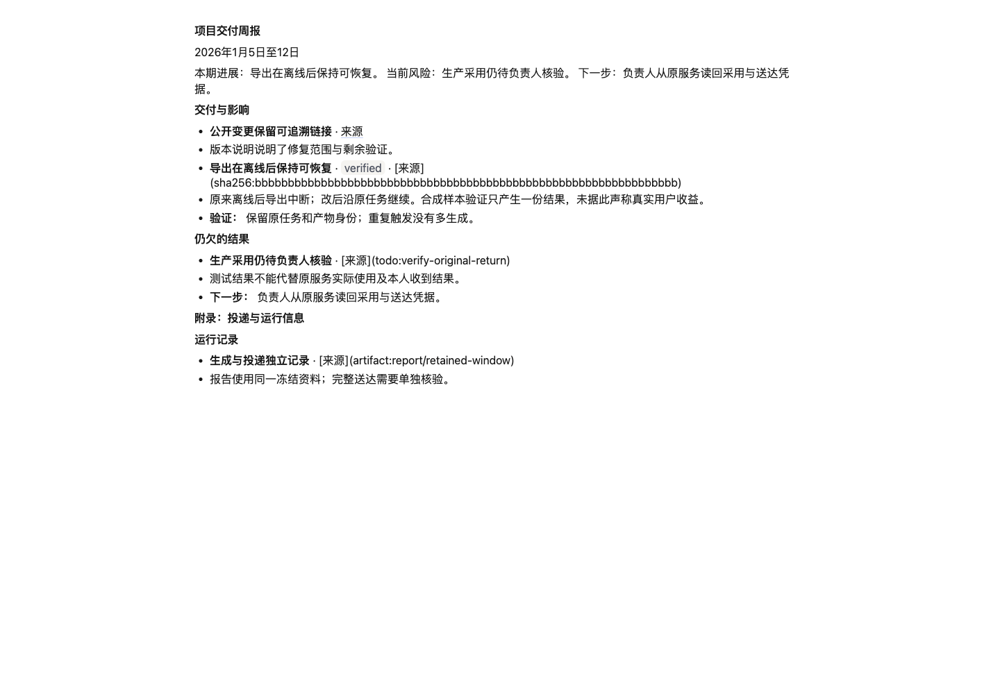 |  |

| Narrow text before | Narrow text after |
| --- | --- |
| 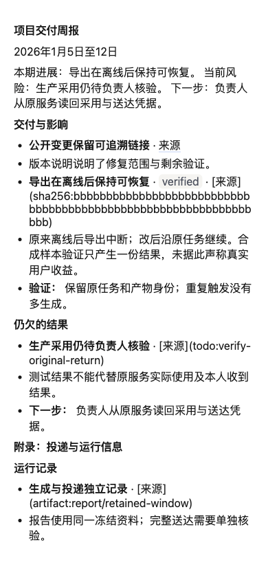 | 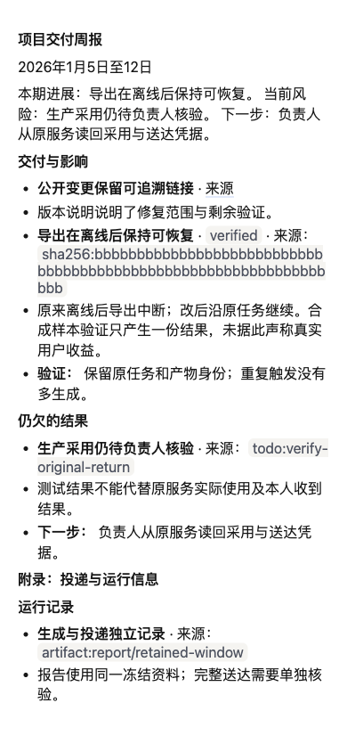 |

| HTML report | Narrow HTML report |
| --- | --- |
| 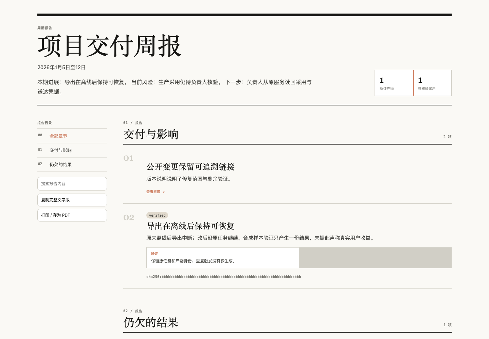 | 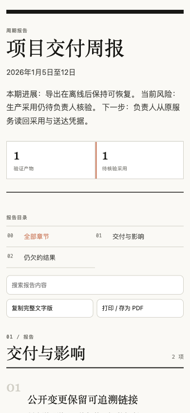 |

The following same-input synthetic report contains ten substantive items and
two repeated internal source identities. The text overview now retains its
authored numbers and source gaps; nine inline digests become two indexed
references. The text changes from 2,875 to 2,420 characters while preserving
every item title, summary, detail and next action. This is a fixture result,
not a token-cost or live-report quality measurement. The expanded HTML index
also stays within a 390-pixel viewport; its exact references were read back
from the browser's printed PDF. The same frozen pre-change Markdown/HTML
artifacts remain byte-identical under read-only reconstruction.

| Text before | Text after |
| --- | --- |
| 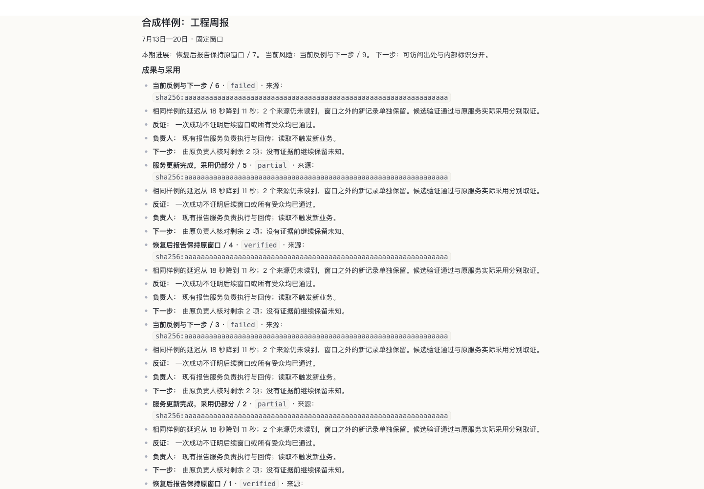 | 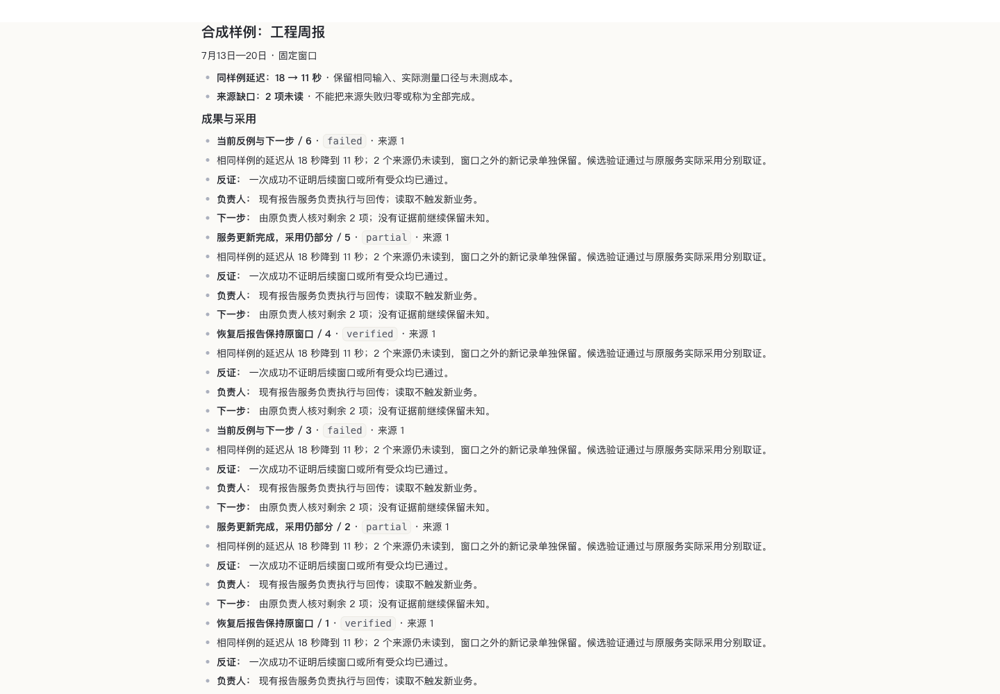 |

| Narrow text before | Narrow text after |
| --- | --- |
| 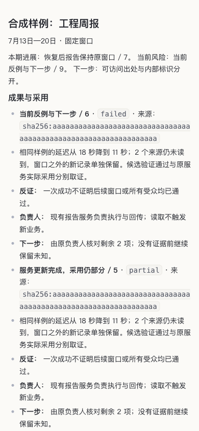 | 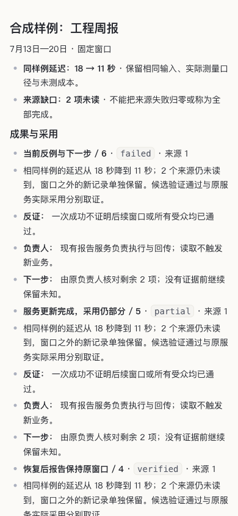 |

| HTML before | HTML after |
| --- | --- |
| 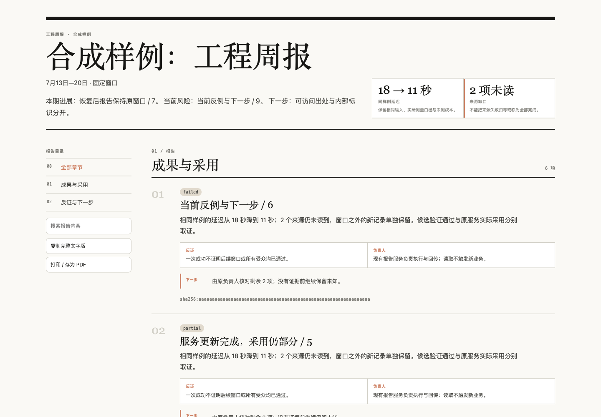 | 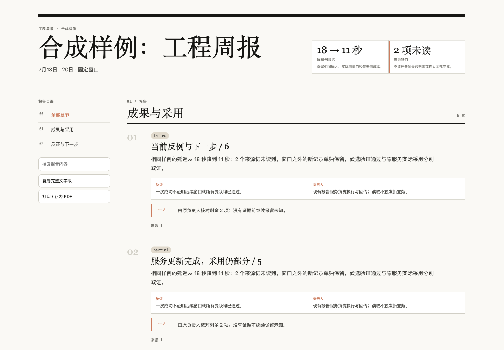 |

| Narrow HTML | Expanded source index | Narrow expanded source index |
| --- | --- | --- |
| 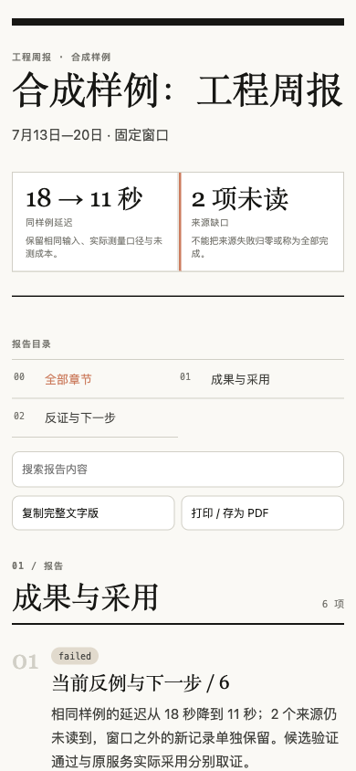 | 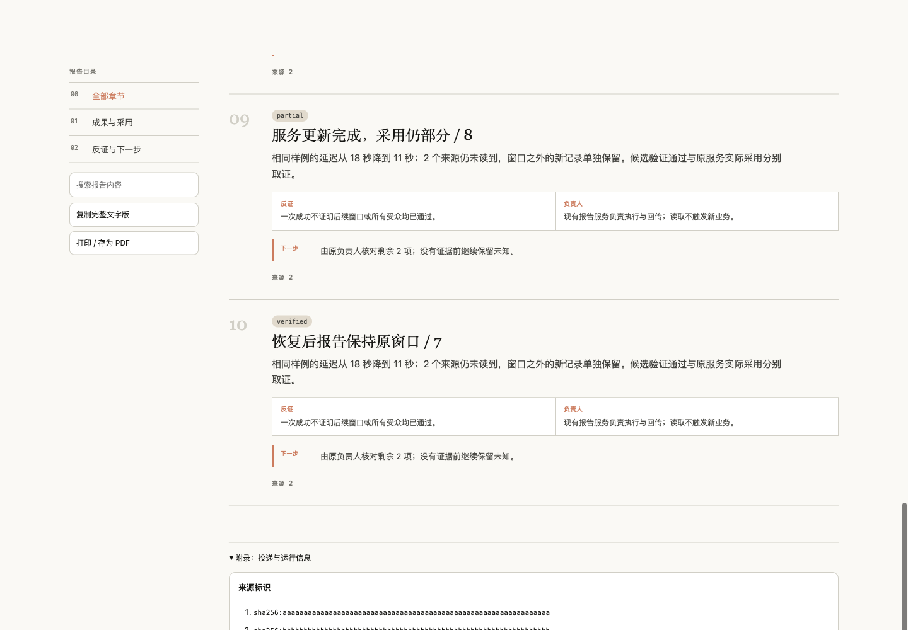 | 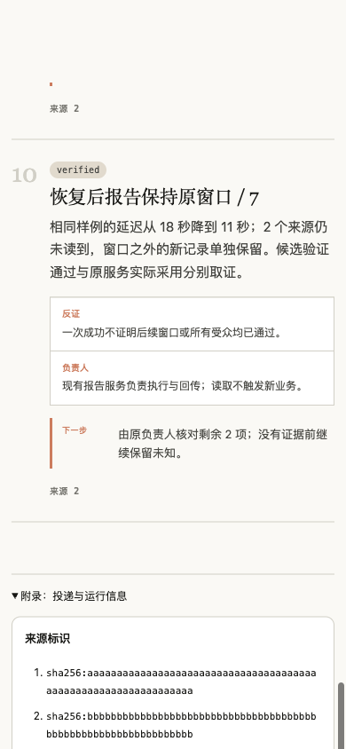 |

The same local calendar can explicitly repeat an already completed native Task
in its original managed Session. This backend/configuration slice is described
below; arbitrary new tasks from natural language and the unified Agent UI
remain separate, unfinished acceptance.

Calendar changes use the existing Goal configuration transaction. If a pause,
schedule change or clear was written but its readback is unavailable or differs,
the response retains the partial-write receipt instead of claiming that the old
configuration was preserved. Reload the source configuration before deciding on
another change. This does not rerun the task, confirm an unfinished result or
retire a failed window; those remain with their original lifecycle owners.

The steward becomes a persistent LoopX-managed Agent. Its original private
conversation remains the user's entry point. Native monitor Todos, Turn
admission, scheduling and periodic-report publication own recurring work.

## Lifecycle owners

The current components already provide most of the lifecycle:

- `control_plane/scheduler/monitor_todo.py` and the typed scheduler project due
  monitor work and the next deadline.
- `control_plane/turn_driver/` provides registered Goal/Agent admission, single
  executor ownership, recovery, settlement and quota lineage.
- `capabilities/periodic_report/cadence.py`, `cadence_journal.py` and
  `cadence_runtime.py` evaluate calendar windows, retain a pending reporter and
  expose due report intents at Turn start.
- Native external-conversation admission and the existing Lark reply journal
  retain original requests, audience identity and delivery evidence.

The private steward retains the special `loopx-manager` conversation identity;
preparation adds the separate registered execution Goal/Agent described below.
The original project-Goal Chat endpoint still rejects this private steward.
Its source-bound native host bridge supplies monitoring admission. A report
Turn-start hook alone does not independently wake a sleeping actor, so calendar
calculation does not enable a report.

The existing calendar settings support an optional **First report date**, in
the schedule's timezone. Before its first matching daily or weekly deadline,
the calendar admits no report intent or generation work. The first report still
covers the preceding full interval. Leaving the date empty retains the existing
calendar behavior. This setting does not enable the steward's daily portfolio
report integration by itself.

New scheduled reports appear as independent full-body messages in the original
owner's private conversation. The retained source message verifies the original
App, chat and read grant; an unrelated historical question does not become the
new report's reply parent. Rich parts use the same frozen placement and delivery
journal, and readback verifies the private chat and main-conversation position.
An existing delivery record without explicit placement retains its original
source-context behavior, including pending or unknown sends. Upgrading neither
retargets those attempts nor republishes a report already verified as delivered.
Ordinary replies keep their existing source-context/thread behavior; this does
not enable chat-root delivery for group conversations.

The synthetic packaged settings journey below uses real preview/apply/readback
over local HTTP. It preserves the date across frequency, time and timezone
edits and reload. The narrow view is a 390×844 viewport emulation.

| Before: recurrence only | After: optional first report date |
| --- | --- |
|  |  |

| Before, narrow viewport | After, narrow viewport |
| --- | --- |
|  |  |

Chat `/goal` transport supervision and a LoopX-managed Turn are distinct. Merely
relaxing `validate_goal_chat`, changing a Session field, adding a prompt, or
starting a Codex native Goal does not establish the LoopX lifecycle below.

## One persistent steward actor

Extend the existing source-bound upgrade/activation path. A typed preview must
identify the original private binding, its conversation, the steward workspace,
the persistent execution identity and the current host/profile. Apply is an
idempotent native transaction using the owner's existing authorization.

Register one visible steward Goal/Agent, rather than creating a hidden Goal for
each monitor or borrowing a project worker's identity. The Goal owns the
steward's durable monitoring and reporting lifecycle. Its execution authority
does not include performing other projects' business work.

The upgrade retains private chat identity, visible history, queued and accepted
requests, unfinished delegations, original delivery routes and existing grants.
In-flight work stays with its original accepted Turn; the upgrade waits for an
eligible idle boundary. If host tools require a replacement upstream thread,
preserve the visible conversation and history, and record that transport change.
Do not claim to preserve a physical thread that was actually replaced.

The macOS CLI update path checks every configured Chat store before switching
its LaunchAgent services. Accepted, queued, completing or unreadable work defers
the whole service switch; an empty Session summary is insufficient. Updated
consumers and the updater share an admission lock through process replacement,
so a new request cannot pass the idle check and begin on the retiring process.
The first adoption from an older consumer without that fence still requires an
independently established idle boundary. Installation readback remains visible
when service activation is pending, including partial restart failures. The
same-source update retry performs a fresh check; this adds no second consumer,
automatic business replay or separate activation scheduler. The combined App
upgrade also stops before restarting the App when this service switch is pending.

Keep the steward's existing portfolio-read authority separate from its execution
actor. Resolve both through their native owners on every admission. Registering
the actor does not grant new project writes or broaden the original audience.
Keep ordinary project assistants unchanged.

### Identity preparation available now

In the private steward's connection settings, expand **Native periodic
monitoring** and choose **Prepare steward identity**. The same gesture obtains
a current preview and applies it. A stale preview, unverified provider, changed
grant, active Turn or queued user request refuses preparation. Resolve that
condition and retry in the original conversation.

The existing local-owner endpoint is
`POST /api/chat/lark/private-conversations/managed-steward`. A preview accepts
`binding_id` and optional `session_id`. Apply additionally requires
`execute: true` and the preview's `plan_id`. Callers cannot select a Goal, Agent,
workspace, provider account or new grant. Existing loopback/origin checks apply.

The typed conversation owner names one Goal and registered `steward` Agent from
the original binding. Existing native Goal creation and configuration owners
initialize File or SQLite storage according to machine settings. The existing
conversation binding stores only the resulting identity reference, including
the original Session and native creation operation. Source-session registries
retain their lifetime token; ordinary registries retain the existing nullable
lifetime contract. Preparation does not strengthen that legacy contract.

A lost registration or binding response can resume the same verified creation;
it cannot adopt an unrelated Goal or recreate a missing bound Goal. Repeating
an applied request verifies the same registration and returns the same actor.
The original Session, history, upstream thread, accepted requests and portfolio
grant are retained. Preparation invokes no model and enables no native monitor.
The UI shows the prepared identity with monitoring not yet enabled.

Preparation remains separate from enabling recurring work. Disconnecting the conversation uses its existing owner
and leaves the registered, unscheduled Goal visible; it does not delete history
or accepted work. Removing that Goal remains an explicit native Goal lifecycle
operation. Monitoring requires the separate explicit setting below.

### Native status monitoring

If the host restarts before a native watch observes anything, the original
idle pump can create one separately correlated Chat continuation. It preserves
the failed request and uses the same native observation identity and deadline.
The shared typed admission requires an untouched observation-only request, an
available original worker lock, complete event/history reads and no pending or
committed native poll receipt. It rechecks current authority, lease generation
and user work; it never starts a model, repeats business or spends execution
quota. Unknown effects, unreadable history, an active old worker, revoked or
paused watches and another failed continuation remain held for reconciliation.
This bounded recovery applies to both local managed Sessions and the prepared
steward through the existing host, without another scheduler or consumer.

After preparation, choose **Enable monitoring** in the same connection panel.
The native continuous-monitor Todo owns enable/pause, the 30–1440 minute cadence,
last observation, result hash and next deadline. The panel's single gesture
obtains a fresh source-bound preview and applies it through
`POST /api/chat/lark/private-conversations/managed-steward/monitor`; it accepts
only the original binding, enable/pause operation, cadence and preview id.
It cannot select a different actor, workspace, account or grant.

The existing Chat host wake service checks this native frontier. A due watch
enters the original Session's Core worker and settles through native
`quota monitor-poll`, with an exact task-lease generation. It reads the current
authorized local portfolio, including stopped Goals and coverage gaps, without
a model call or execution-quota spend. Its own monitor bookkeeping is excluded
from the material-change hash. This watch neither delivers business replies
nor enables a daily report.

Active or queued user work retains priority. Pause uses the existing native
blocked lifecycle to retire the current lease atomically; enable reopens that
same Todo and obtains a fresh generation for cadence edits. First enable checks
immediately; resume or a changed cadence starts a fresh future window. An
unchanged setting leaves the existing deadline alone. Each accepted watch fixes
its native deadline and observed lease version before collecting data, so a
pause/re-enable cannot let old data borrow a new lease generation. Final native
writeback rechecks the collected scope under the binding's configuration and
revocation fence. Native Goal stop
also blocks observation. The user can still pause the retained monitor while
that Goal is stopped. Restart reads the native Todo/deadline and original Core
request. A failed or unknown accepted attempt is retained, never replayed.
An in-memory wake hint expires within a minute and holds no scheduling
authority; configuration invalidates it immediately. No extra scheduler,
message consumer or binding-side scheduling toggle is created.

An unreadable Session or queued Turn file affects only its own binding. Other
stewards continue their due checks. The unreadable data and original monitor
deadline remain intact; once the file is repaired, queued user work still takes
priority over monitoring.

The packaged browser journey below uses synthetic private connections over
real HTTP, Core and native File storage. Desktop views are 1440×1000; narrow
views are 390×844 viewport emulations, not physical-phone acceptance. The
journey covers enable, one automatic poll, cadence edit, failed authorization,
pause, resume and reload. An ordinary web-manager Session may also be prepared
by the workspace; the original private Session remains unchanged and the watch
adds no model request. File/SQLite regression tests independently check that
monitor polls leave execution-quota slots and original business replies alone.

| Before: prepared identity | After: enabled native monitor |
| --- | --- |
|  |  |

| Enabled, narrow viewport | Paused, retained deadline |
| --- | --- |
|  |  |

## Native scheduling and execution

### Owner Todo notifications during a source outage

The existing **Automatically notify new owner tasks** setting uses the original
private steward's background outbound worker. It does not enable a native
monitor, report, model Turn or second message consumer.

Discovery enumerates the complete current authorized Goal scope. Each Goal must
provide a complete native Todo read and exact current decision terms. If one
Goal is unreadable or unmigrated, its previous subjects, pending notices and
unknown sends remain retained; an unavailable source is never treated as an
empty or withdrawn Todo list. Notices from other readable Goals continue. An
unsent notice becomes eligible only after its own source is read again, with
the original generation and provider intent preserved. Real withdrawals or
scope removal still cancel unsent notices. A known provider locator continues
independent readback of the frozen original effect, even if the Todo changes
or its source is unavailable; current App, owner and original-route verification
remain required. This read cannot create another notification.

First enable baselines readable history and remembers unreadable initial Goals.
Their first successful read also baselines history, avoiding a delayed recovery
burst. Later changes and newly registered Goals retain ordinary discovery.
Failure to enumerate scope or verify the original owner, App, grant or route
still pauses delivery. The panel distinguishes a fresh partial-source check
from a stale worker or a delivery error; unknown receipts remain visible.

The packaged fixture
`apps/presentation/dashboard/smoke/owner-attention-source-fixture.py` uses real
HTTP, native File authority and the existing outbound worker, with synthetic
provider/model transport and no paid call. Its unmigrated Goal reproduces the
outage; initializing that disposable source verifies recovery. File/SQLite
regressions separately cover source errors, incomplete reads, changing exact
reads, retained queue identities and independent provider readback. The baseline
image shows the prior UI bundle over the same partial-source backend state;
the baseline adapter also fails the healthy-source regression independently.
These captures establish packaged browser behavior, not phone-device or live
account acceptance.

| Before: generic incomplete notice | After: explicit partial coverage |
| --- | --- |
|  |  |

| Partial coverage, narrow viewport | Recovered worker, narrow viewport |
| --- | --- |
|  |  |

The intended flow is:

```text
original private ingress -> original steward conversation
                                      |
                              steward Goal / Agent
                                      |
           native monitor/report deadline -> scheduler admission
                                      |
                              one managed LoopX Turn
                                      |
                    periodic-report generation/publication
                                      |
                     original private reply + provider readback
```

Represent monitors as native `continuous_monitor` Todos under this actor. Reuse
their due times, observations and lifecycle; do not create another task store,
cron, model loop or message consumer. Expose the report calendar's next boundary
to that same scheduler frontier. The periodic-report calendar/journal remains
the owner of report windows; a monitor deadline is its scheduling projection,
not a second publication cursor.

The existing runtime host checks the frontier without invoking a model. When
nothing is due, it sleeps until the next eligible native deadline. Only an
admitted Turn can invoke the model. A fixed daily report remains due even if
project state has not changed. Preserve the owner's minimum scheduling cadence;
align eligible calendar wakes to the requested wall time and disclose lateness
when the machine, host or actor cannot run then.

User messages, due monitors, outstanding original replies and reports use the
same actor's queue and admission. A busy actor retains due work and rechecks it
at the normal terminal boundary. It does not create another executor. Existing
priority, replan, budget, stop and settlement policies remain effective. Pausing
the steward prevents new scheduled model Turns without discarding accepted work
or historical results.

If the native guard refuses the exact report Task before execution because a
semantic replan is due, the original idle worker can admit one correlated
continuation of that window. It rechecks native admission without choosing
another business Task. When governance is still due, the canonical writeback
preview must independently accept the original Agent's semantic delta before
writeback and quota settlement. When the fresh guard no longer owes governance,
the host-only admission stop can request a new exact admission of the original
report Task without a governance model call. A different advisory Task in that
probe is never executed and grants no authority over the report. A retained stop
from the earlier host can receive one separately correlated continuation only
when its canonical journal proves that exact host-only path and no model work;
missing output alone is insufficient. Both paths retain the original native
report identity, task validator, report window and publication owner.
Ordinary delivery remains withheld during governance. The original return
reader then verifies the full report through its existing publication owner.
The refused Chat request remains in history. Unknown execution, partial effects,
a frozen generation, changed authorization or an unsuccessful continuation do
not authorize another model replay, window or message consumer.

A native status watch calls the existing monitor-poll owner under its original
Chat Turn and task lease. It does not select a continuous monitor as a heartbeat
advancement task, so open executable work does not prevent a due observation.
Fresh source, user-gate, capability, deadline and lease checks still apply; the
poll keeps its stable Turn identity and does not invoke a model or spend a slot.
The earlier adapter's exact pre-poll selection rejection can receive one
separately correlated attempt only when its failed Turn has no native start,
answer, delta or poll event. The original failure remains; unknown failures,
interruptions and a failed recovery do not trigger a retry loop.

## Daily portfolio report

Configure the original steward's daily report for 09:00 `Asia/Shanghai`. At
scheduled boundary T, freeze the reporting interval as `[T-24h,T)`. Keep scheduled
boundary, actual generation time and actual delivery time separate.

Read all locally authorized registered Goals, including stopped Goals, through
their current native read surfaces. Do not reactivate them. Collect window
progress, relevant active/completed Todos, actual artifacts and validation,
unresolved requests/returns and concrete blockers. Distinguish reported claims
from independent verification, and report incomplete coverage explicitly.
Reconcile current approvals and dependencies before proposing a new owner ask.

The steward produces the full Chinese body and returns it to the original
private chat. A summary, queued outbox row, attachment alone or assistant-side
completion flag is insufficient evidence that the user received the report.

Use a stable identity for each scheduled window. Retain generation and delivery
progress separately. A restart resumes that window; confirmed delivery is not
sent again, and uncertain sends are read back before retry. After extended
offline time, produce the most recent complete window and disclose missing
windows, rather than starting an unbounded series of model calls.

### Original private report settings and execution

In **Settings → Lark → the original steward → Native periodic monitoring**,
the owner can enable or update detailed reports, select daily/weekly frequency,
local time, timezone and first report date, or pause/cancel. The existing calendar
field is reused. A source-bound preview and exact-plan apply configure the
existing `periodic_report` Goal setting with the `portfolio-progress` preset;
the destination is derived from the original private binding. Neither the
browser nor the model can supply another Goal, App or recipient. The generic
single-Goal report consumer cannot consume this private portfolio preset.
This preset requires a calendar; its switch cannot select the generic
stage-boundary reporting mode. Pause or cancel through the report actions.

After `/new` and first preparation in the new Session, route discovery selects
a verified source belonging to that exact managed actor's Session and private
source. An older Session in the same chat cannot mask an eligible route, and
a retained report route cannot fall back to another Session or audience.
Provider, owner and original-message verification still apply. Owner Todo
notifications retain their existing private-chat route selection.

Portfolio evidence collection finishes before the governed driver captures its
launch authority. A long read can then observe legitimate registry rewrites
without immediately invalidating an earlier launch witness. The original
source and execution lease are checked after collection and again at dispatch;
authority changes after plan capture still reject the launch. This ordering
does not authorize replay of a historical attempt with unknown host effects.

The original pump can resume one retained report after the first-party launch
owner's exact `stale_goal_authority` refusal. That owner rejects before publishing
`turn/start`; a missing answer or missing events alone is insufficient. The
typed admission checks the original Chat request, canonical native transaction,
one recorded attempt, no generation or settlement, and the current original
subscription and grant. A separately correlated Chat attempt resumes the same
native journal, window, Todo and settlement identity through `run-once` recovery.
The historical outer response is retained. A failed recovery, unknown transport
outcome, real model start, changed identity or revoked permission cannot trigger
another automatic model attempt. Existing no-model settlement recovery and
independent full-body delivery readback still apply.

Frozen generation is checked independently inside the original host using the
same installed report provider. An embedded Python host's bootstrap does not
imply that its bare child interpreter can import LoopX; no second installation
or ambient import path is required. Ordinary CLI command validators are unchanged.

If the original model has returned and the frozen generation validates, the
original pump can resume a failed native **validation** phase without invoking
the model again. The typed owner requires the same live subscription, actor,
window and open generation Todo, the canonical cached host/result phases, and
an explicit no-host recovery decision. The native driver revalidates the frozen
artifacts and current authorization, reacquires the original task lease and
performs ordinary completion and settlement. A paused subscription, changed
identity or grant, invalid generation or unknown model effect stays blocked.
The historical Chat response is retained; only the native committed receipt
allows the existing original-audience sender to proceed.

Once generation is frozen, delivery checks the original source Goal identities
against the current authorized scope. Adding an authorized Goal does not revoke
the frozen report or rewrite its source/body; later windows include the new
Goal. Removing a frozen Goal, replacing its identity, revoking the original
grant or changing frozen artifacts still blocks delivery, including after a
partial or uncertain send. Existing provider readback decides which original
parts remain unsent; scope growth never authorizes another model run or resend.

Read coverage and authorization are separate. A partial source may omit an
unreadable or oversized Goal without revoking the original report grant. New
private editorial requests freeze the complete authorized Goal identities
alongside their existing authorization digest. Delivery checks this immutable
witness, including unread Goals; it never upgrades partial coverage to complete.
Later authorized additions belong to a future report, while removal or identity
replacement of an original authorized Goal still blocks publication.

Older frozen requests remain immutable. When their readable Goal list does not
reconstruct the original authorization digest, recovery requires the complete
current authorized scope to match that original digest exactly. An absent
identity witness never permits guessing which Goals were originally authorized;
an ambiguous later scope change remains retained, without another model run.

The existing idle Chat wake producer admits one calendar window and creates
one native finite generation Todo for it. The original Chat worker and native
thread author the report, using complete frozen source records and the owner's
`REPORTING.md` criteria. Public-safe Turn fields remain separate from private
editorial content. A report-specific opt-in allows the kernel's existing
`validated_completion`; its original task lease and independent artifact
validator must pass before the generation Todo closes. Ordinary host prompts
and result vocabulary retain their defaults.
The finite postcondition is the validated generation itself: a complete valid
editorial response closes this generation Todo even if the model labels it
progress. This does not close the ongoing Goal or claim delivery.

If generation has completed but native writeback or debit has not committed,
the normal idle producer resumes the remaining effects of that same original
Turn. It reads the canonical completion under the original Turn fence, without
reopening the Todo or invoking the model again. Existing effect readbacks also
reconcile a committed effect whose response was lost; a missing outer Chat
result event can be recovered from the committed native journal. Historical
failures and generated content remain intact. Delivery still requires the
native committed result and current original authorization; unknown or
contradictory journal identity remains blocked.

The existing Lark outbound pool reads the committed native result, validates
the frozen source/editorial/artifact lineage and returns the full Chinese body
through the original reply owner, splitting long text into verified parts.
Known part IDs are read back after restart; a send with unknown outcome and no
locator is retained without another create. Only complete provider verification
advances the existing publication cursor. No additional scheduler, consumer,
model worker, business store or provider scope is created.

Pause disables subsequent generation and delivery. Cancel also requests a stop
only for an active report Turn; an unconfirmed stop is shown separately from
the committed configuration. Original reports and delivery receipts remain.
Revocation, subscription changes, source/provider changes or damaged artifacts
block late publication. Monitoring and ordinary conversation retain their own
lifecycles. The settings show the next due time, retained window, generation and
verified/unconfirmed delivery as separate facts.
Changing a frozen, unverified report's schedule is rejected with a specific
pending-window explanation. Pause and restoration of the same plan remain
available; schedule edits can proceed after verified publication. This keeps an
unfinished original window from being stranded by a different subscription.

A terminal native attempt with a retained invalid editorial response, no
generation and no delivery attempt is shown as generation failed. The owner's
existing cancel action can explicitly retire that failed window: its Todo is
paused as blocked, the native failure, cost and artifacts remain, and the cadence journal
records retirement separately from publication. Restoring the same plan does
not replay the failed attempt; a later due window can progress. A changed future
plan is also allowed after retirement. Unknown model outcomes and partial or
unknown sends cannot take this exit; they keep the original recovery boundary.

| Cancelled failure on the original settings page | Narrow retained-failure state |
| --- | --- |
| 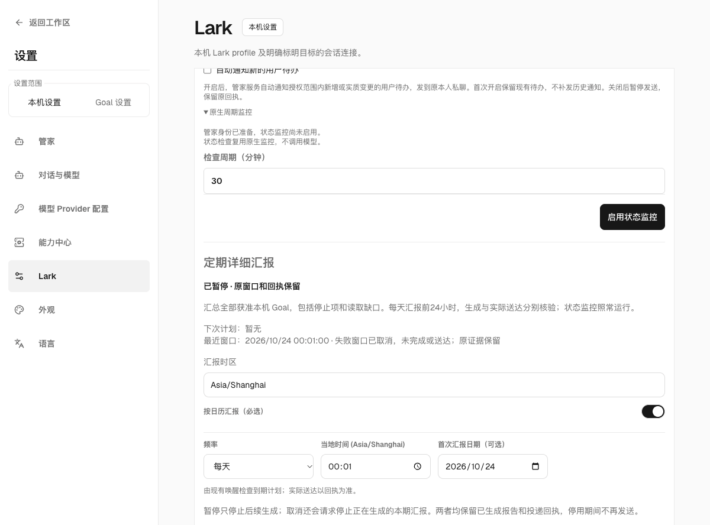 | 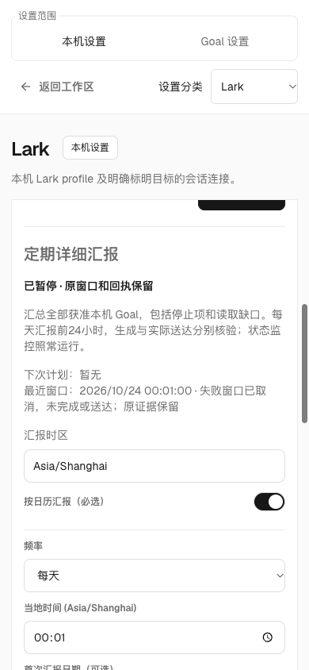 |

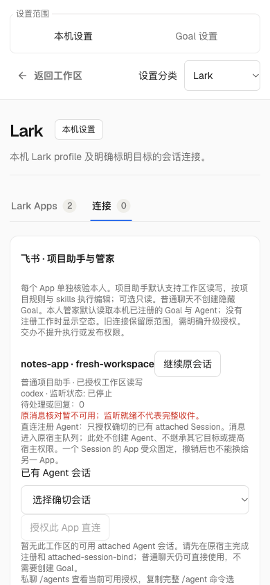

The packaged browser fixture uses actual HTTP/Core/calendar storage with a
synthetic original provider/model. Screenshots below are that isolated journey,
not production-message or real-phone proof.

| Before integration: monitoring only | Enabled future first date |
| --- | --- |
| 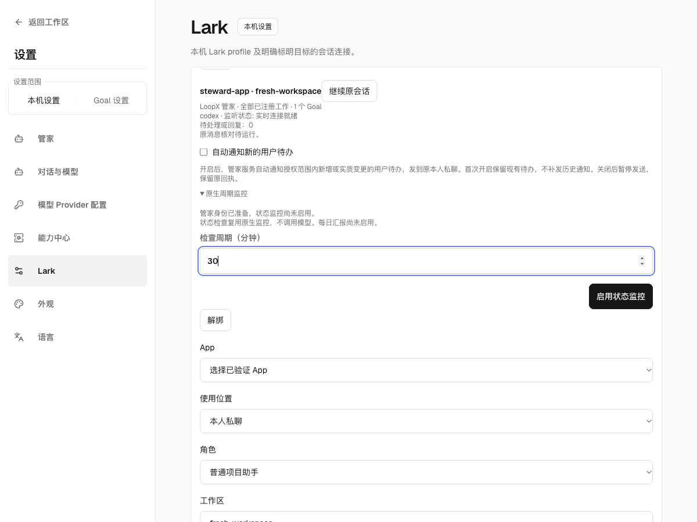 | 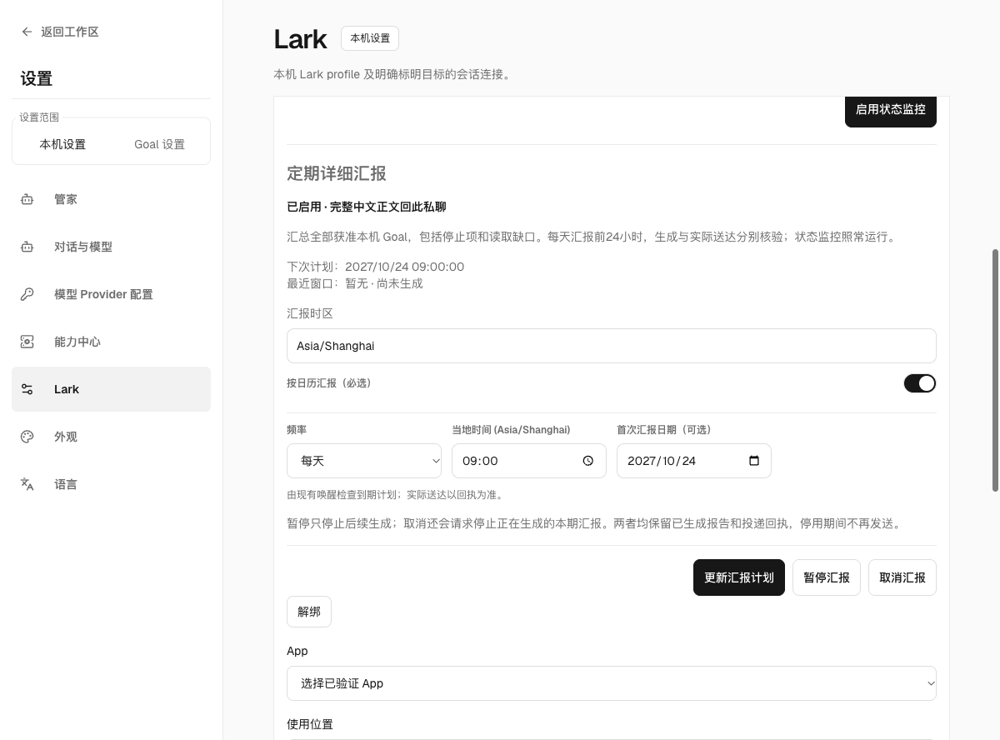 |

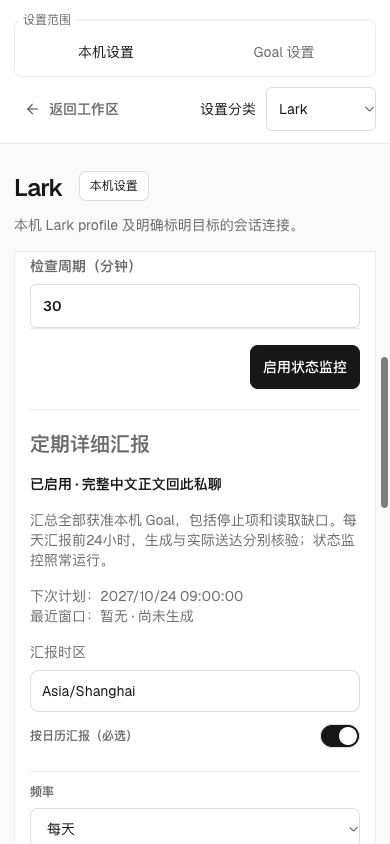

## Acceptance boundaries

### Managed Agent execution boundary

A managed conversation must belong to the selected registered **Agent**, with
its own original Session, execution state and return path. In the Goal's Agent
view, managed and attached conversations are parallel sources; a Goal-wide
Codex chat with an extra Agent selector does not establish that binding.
The experimental **Advance LoopX tasks** control has therefore been withdrawn
from ordinary Goal Chat. The existing general conversation, native Goal mode
and original attached conversation entry retain their current owners.

The native host groundwork remains separately qualified: an explicitly invoked
local managed request can use the original Core worker and native Task/Turn
owners for a finite source-validation task. It retains the same thread and
sandbox, resolves the selected Task's immutable argv validation declaration
before model execution, and checks its canonical digest/revision and lease
before accepting completion. Missing validation starts no model; a failed
postcondition cannot complete the Task or spend a delivery slot. The low-level
request accepts no runtime profile or caller validation command. Stable Core
operation identity retains failed or unknown requests without replay.

The existing session creation API now accepts `managed_agent_id` for a local
Goal. It binds the registered work identity separately from the executor
(`agent_id`) and model. Core persists that immutable identity, Goal lifetime
and original thread, with a distinct Agent channel. Resume selects only that
Goal/Agent/executor channel; another Agent cannot execute its native work.
Old Goal-wide conversations remain readable and unassigned, and cannot gain a
native work identity through a request-time selector. Existing project,
steward and attached entrypoints retain their original identities and workers.
Registration removal, Goal stop, a changed lifetime or a mismatched workspace
refuses continued execution rather than transferring the conversation.

This is an API/host lifecycle slice, **not** the finished Agent workspace
entry or arbitrary periodic-task journey. The Agent view still needs to expose this
binding alongside attached sources, including all original history and honest
unavailable states. Reuse existing Session, native Turn,
monitor/calendar and periodic-report owners; do not add a second scheduler,
task store or model worker. General writable execution, natural-language
configuration and arbitrary recurring task composition remain unfinished.

An explicitly bound local managed Session can also observe its Goal's native
work through an existing `continuous_monitor` Todo. Use the existing Todo
authoring path with `action_kind=local_runtime_observe`, `watch_only=true`,
the registered Agent as `claimed_by`, and
`target_key=managed-session-watch.<original-session-id>`. Its existing cadence,
deadline and open/blocked lifecycle are authoritative. For example, after
selecting an authorized existing Goal, Agent and bound Session:

```sh
loopx todo add --goal-id PROJECT --role agent \
  --claimed-by WRITER --text 'Observe this Goal native work' \
  --task-class continuous_monitor --action-kind local_runtime_observe \
  --target-key managed-session-watch.ORIGINAL_SESSION_ID --watch-only \
  --cadence 30m --next-due-at 2030-01-01T09:00:00+08:00 \
  --required-capability filesystem --execute
```

Replace the illustrative identities and future deadline with the actual
authorized task. Registration, opening a Session or installing the feature
does not author or enable a watch. The existing idle wake producer admits a
due watch into that Session's original Core worker; the shared observation
adapter and native `monitor-poll` settle it without starting/resuming a model
thread or spending a delivery slot. Other runnable work remains available.
The original private steward retains its own portfolio source and provider
checks; a local watch requires neither a private binding nor portfolio access.

The local observation hashes canonical work fields from the complete native
Agent Todo read in that Goal. Monitor bookkeeping and ordering do not create
work transitions. This is current work-state observation, not a claim that the
business or Goal has completed. Busy/queued user work wins; a paused watch,
revoked Agent, stopped/replaced Goal or mismatched Session cannot poll. A host
restart reads the original native deadline and Core operation, including a
failed or unknown attempt, rather than replaying it. External Todo edits are
observed within the existing one-minute wake hint; the hint is not authority.
This watch does not generate a report, execute a business task, send an
external reply or complete the natural-language/periodic-task user journey.

Earlier packaged browser evidence demonstrated only the finite host/API path
with disposable real Core/File data and a synthetic model/provider. It did not
establish the correct Agent hierarchy, real-model adoption or natural-deadline
acceptance. The UI withdrawal does not alter the original private steward's
subscription, published reports, pending requests or publication route.

### Calendar reports in an existing Agent Session

In **Goal settings → Capability center → Periodic reports**, use the
`weekly-progress` profile and choose an existing **Report conversation**.
The selector lists only this Goal's already bound managed Agent Sessions. It
does not create an Agent or assign a legacy Goal-wide conversation. Enable
reports, set a daily or weekly calendar and optional first date, then use the
existing preview/apply controls. Reload reads back the saved destination,
calendar and original conversation's execution/delivery status. No calendar
means no automatic local Session report; the status asks for a report time.
After verified delivery, **Read this period's full report** opens the existing
original-message report viewer, including its full body and **Copy Markdown**.
The link is available only while that exact returned body is readable.

This is an explicit Goal override. Machine defaults, registration, opening a
Session and installation do not enroll a conversation. The reserved route
`managed-session:<original-session-id>` is persisted in the existing
periodic-report configuration; it is a destination reference, not an execution
or permission grant. Other profiles and configured Goal Channel routes retain
their existing path. Local Session reports do not enter the generic CLI
report-consumption hook or gain a second Goal Channel delivery.

The existing idle host wake admits the calendar window into the selected
Session's original Core worker. Native periodic-report owns the finite
generation Todo, fixed window, frozen source/editorial artifacts, validator,
publication candidate and cursor. Native Turn owns the original executor,
lease, validation, completion and quota. Busy or queued user work has priority;
another registered Agent cannot claim this route. Paused/stopped Goals,
removed registration and replaced Session/Goal identities refuse execution.

The local source reads the complete original Goal's current native tasks and
completed Agent history without a display limit, retaining full rows and
observed times in the frozen source. The report distinguishes this fixed
window's recorded completions from older history and current work. It does not
reconstruct task state as of a past deadline, independently certify linked
artifacts or read another Goal's portfolio. Source overflow or an unavailable
complete read fails visibly rather than silently dropping trailing tasks.

After native generation commits, the adapter writes one complete report to
that original Core conversation and independently reads back its exact body,
message and Turn identity. Only then does the existing publication cursor
advance. The normal Core finalizer uses the same message identity. A lost
append/cursor response reconciles that original body after restart without a
second model call or duplicate publication. Cached validated generation can
resume only the native journal's permitted remaining effects; an earlier
partial/failed answer remains historical evidence.

Use **Enable** to pause the same configuration; the original task, frozen
window, failure and message history remain. Re-enable that exact plan to
continue eligible native recovery. An unpublished frozen window prevents a
schedule/destination change from stranding it. Failed/unknown generation is
retained for repair by its original execution owner; toggling the setting does
not replay it. After a known terminal generation failure, with no generated
report or delivery attempt, **Restore device defaults** can clear this Goal's
subscription through the existing preview/apply transaction. Verified apply
blocks the original failed Task and retires its window without changing its
artifacts, costs, Turn or publication cursor. Preview alone does not cancel.
If cancellation is interrupted after the configuration clears, retry the same
clear request: the original frozen Session identity and failure recover the
remaining retirement, without a model call or replay. Re-enabling the same
calendar does not retry that failed period; the next independent period can run.
Existing reports and unknown or partial delivery retain the original protection.
Natural-language schedule authoring and arbitrary task profiles remain part of
the existing general recurring-task work.

The packaged journey uses disposable Core/SQLite state and synthetic model
and provider transports. It checks future-date inactivity, preview/apply/reload,
one automatic full-body return, retained failure and pause. The 390×844 view is
viewport emulation; this evidence does not establish real-model report quality,
production backlog completion or a natural production deadline.

The cancellation check also uses that packaged UI and real disposable SQLite
state: a synthetic invalid editorial result remains failed, clear preview leaves
it intact, and applied clear retires it without another model call, message or
provider send. File/SQLite regressions separately cover interrupted cancellation,
unchanged artifacts and history, unknown effects and the next independent period.

| Retained failed period | Cleared Goal override, failure retained |
| --- | --- |
| 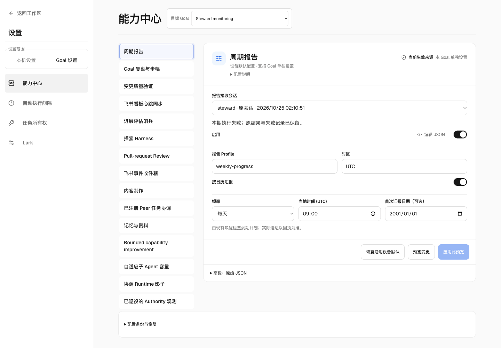 | 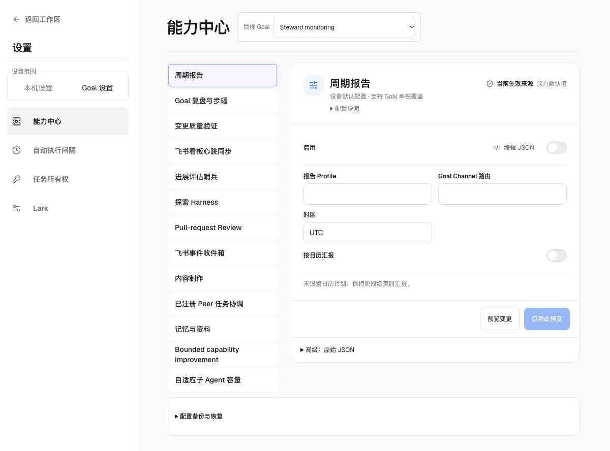 |

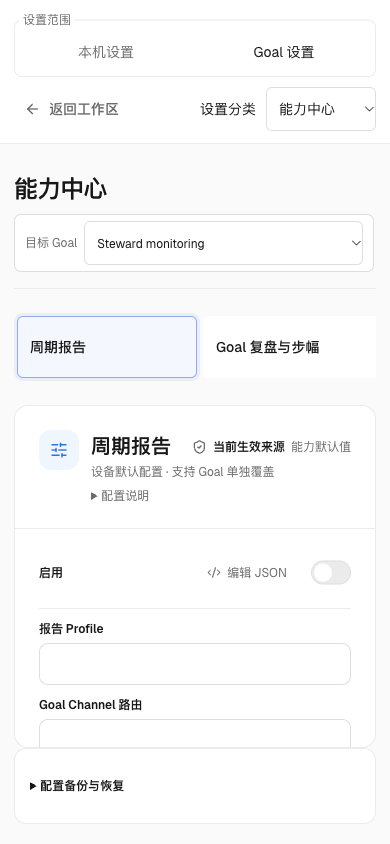

| Before: raw route | After: original Agent conversation and verified return |
| --- | --- |
| 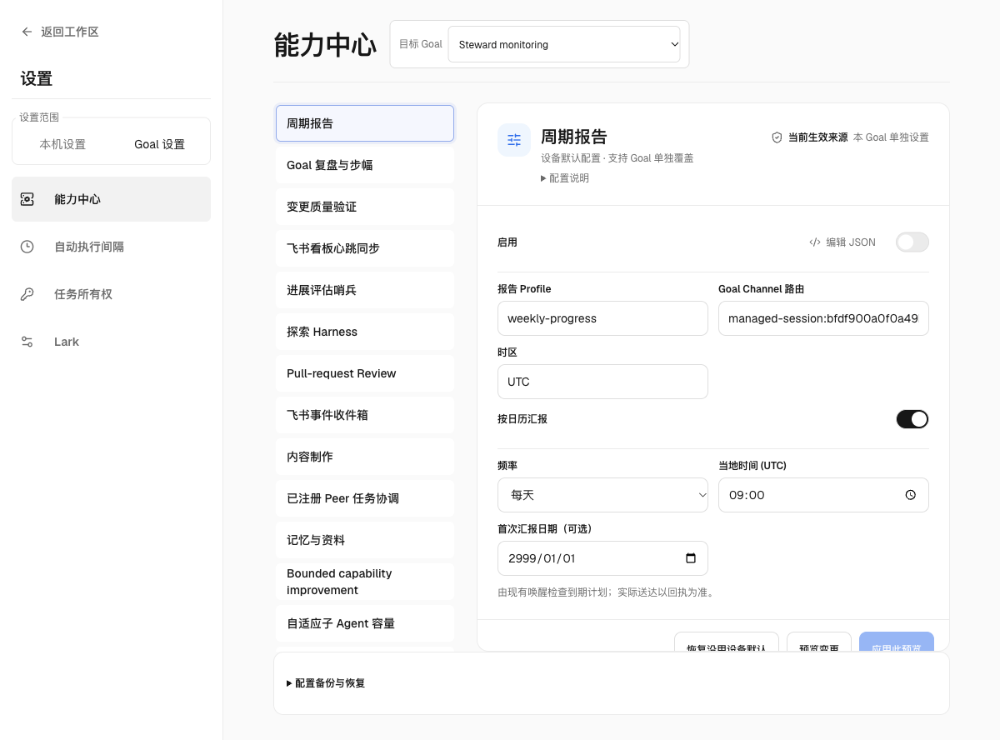 | 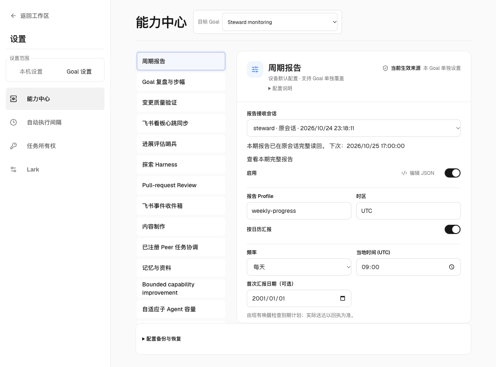 |

| Temporarily unknown delivery state, narrow | Paused configuration |
| --- | --- |
| 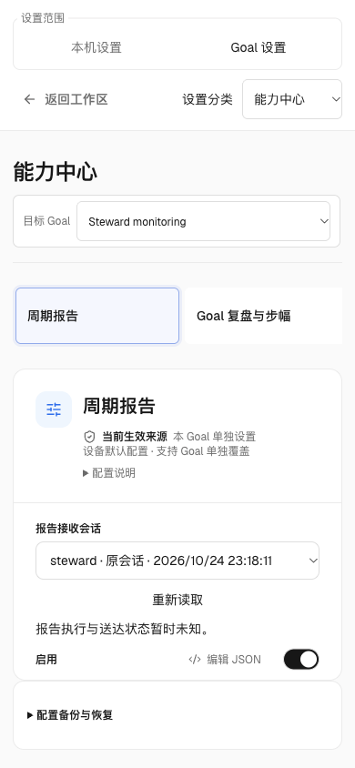 | 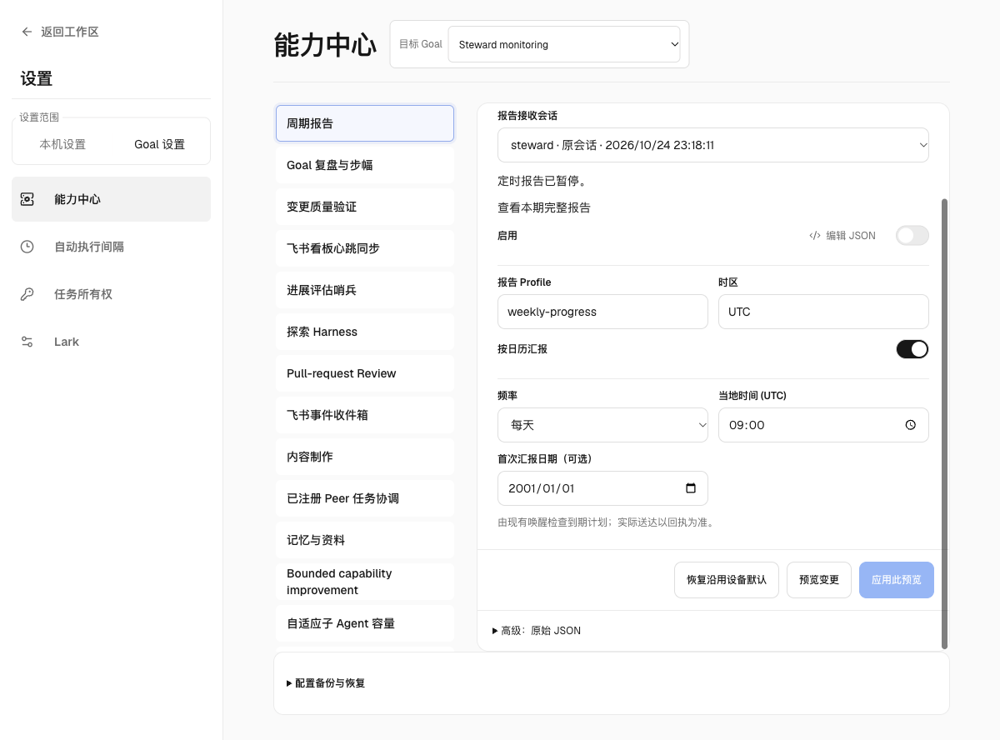 |

### Original private steward

The original-Session host bridge now runs a bounded native Turn through the
existing Chat worker and Codex app-server connection. It uses the explicit
`codex_app_server` outer-controller profile, not Codex CLI execution or a
desktop App heartbeat. Fresh native work selection, independent validation,
writeback, quota and scheduler handoff remain with the existing Turn command.
It retains the original visible conversation, provider and portfolio grant.
With unchanged authorization it reuses the upstream model thread. For an
all-registered report whose authorized inventory or Goal lifetime changed before
execution, the existing context owner discards old model history and prepares a
fresh upstream context, records it through the existing context owner, then re-enters strict native
execution admission. No new user message is required to repair this context.
Selected-scope changes, revocation and changes during a model call still fail
closed. Busy/queued user work wins admission, and revoked or stopped sources cannot
commit a late model result. Same-request readback does not restart failed or
unknown work.

The native status-monitor producer now uses this original-Session bridge,
with the separate no-model observation path described above. Identity
preparation still leaves monitoring disabled. Calendar configuration, native
generation and original private publication use the owners described above.
A passing synthetic File/SQLite host journey does not establish an enabled
production subscription, real model/report quality or natural deadline delivery.

1. Qualify the native steward upgrade and rollback at an idle boundary. Verify
   one registered actor, preserved original history/requests/grants, and no
   change to ordinary assistants or other project Agents.
2. Connect a real monitor deadline to that actor's native host and Turn driver.
   Verify not-due checks invoke no model; due, busy, pause and restart cases
   preserve one executor and native settlement.
3. Add the authorized portfolio report source to periodic-report, project its
   next calendar deadline and configure the original private delivery route.
   Reuse the existing report settings and monitor views for edit/pause/cancel,
   next due time, last result, coverage and actual delivery status.
4. Run semantic File/SQLite and host tests for fixed windows, unchanged-but-due
   reports, offline recovery, original audience, revoked grants, duplicate or
   unknown sends, partial delivery and late callbacks after cancellation.
5. Qualify the exact final diff, publish and merge under the existing repository
   policy, install it, then independently verify original-service adoption,
   actual configuration and an end-to-end report. The first natural scheduled
   report remains a separate acceptance event.
## Reading a fixed local evidence window

The existing private steward's evidence tool can read an exact report interval.
For example, a report ending at 09:00 uses `view=deliveries`, the authorized
`goal_id`, `window_start=2026-01-01T09:00:00+08:00` and
`window_end=2026-01-02T09:00:00+08:00`. Both timestamps need offsets. The read
includes the start and excludes the end; it does not move the interval to local
midnight or to the time the report happens to run. The existing `days` lookback
keeps its calendar-day behavior and cannot be combined with these bounds.

Follow `next_offset` and pass the first page's `source.source_revision` as
`expected_source_revision` on subsequent pages. If the index changes, the reader
returns a conflict with no rows: restart that Goal's read rather than combining
pages from different revisions. Complete the authorized portfolio pagination,
including stopped Goals when requested; one Goal's page is not global coverage.
This exact-window interface currently supports local sources. It rejects these
arguments for SSH sources instead of silently substituting a remote lookback.

Use an observed row's `source_ref` as `delivery_ref` to recover its complete
permitted `recorded_details` and evidence references, with the same interval and
revision. A related task outside the overview is joined through its exact
canonical Todo read. Oversized, unavailable or changed records remain explicit
coverage gaps. Recorded delivery time is not necessarily actual work time;
reading a receipt does not read its referenced artifacts or independently verify
the Agent's claims.

This extends evidence reading in the existing conversation. It does not enable
a report subscription, start a model, change a Goal, or send a report. Calendar
admission, report generation and verified delivery retain their existing owners.

### Authorized portfolio source

The same original conversation reader now accepts `view=report_source` with a
closed `window_start`/`window_end`. This composes the existing local portfolio,
Todo, fixed-window delivery and handoff readers. It enumerates every permitted
Goal, including stopped Goals; expands task excerpts and delivery details;
and reads each delivery's associated task, including completed records. It does
not read unregistered projects, SSH sources or referenced artifact contents.
Its delivery reads include typed `outcome_gap` records as counterevidence;
ordinary `view=deliveries` retains progress-only selection unless the caller
explicitly sets `include_outcome_gaps=true`. Neutral observations and untyped
host failures are outside that delivery source, so even complete pagination is
not a claim to have independently audited every failure or artifact.

The first call freezes one bounded snapshot in that Turn's reader. Source
observations and individual coverage gaps are rows too. Page through
`next_offset`, carrying `source.source_revision`. Later pages reuse the frozen
data, while the original live authorization check still wins over the cache.
Another Turn or a lost snapshot cannot resume at an old offset. An inventory
change, source revision conflict, outage, invalid/oversized row or read budget
limit remains an explicit coverage gap. Other readable Goals continue. Current
task and handoff state is observed at collection time; it is not an as-of-window
reconstruction or proof of a newly completed business outcome.

The provider's `manager_portfolio_report_source_adapter` composes with the
existing `PeriodicReportAdapterRegistry` using that authorized reader. Its
supporting items contain lossless JSON-string parts of the permitted evidence
rows, grouped by `source_ref`; decode each part's `summary` and concatenate in
item order. These are editorial input data, not audience-facing report prose.
The Agent still reads relevant referenced artifacts and authors the report.
There is no new state store or background loop. A capture allows at most 512
reader calls, 4,000 evidence rows and 4 MiB of evidence data, plus bounded source
coverage metadata; exhaustion is partial coverage,
not success or zero progress. These are IO bounds, not a model budget.

This source can also be read through the original Chat dynamic tool. Reading
alone does not activate a subscription or deliver a report. The opt-in original
steward report path binds it to the admitted calendar window, native generation
and private full-body delivery; installed adoption, current configuration and
the original production route still need independent verification.


## Repeat an existing native Task in a managed Session

Use this optional mode for “repeat this completed task on a calendar.” It uses
an existing Goal, registered Agent and exact local managed Session. It creates
no Goal, executor, recurring cron or separate task database. The source Task
must already be completed, belong to that Agent and retain an independent argv
validation declaration. Open, deferred, blocked, foreign and unvalidated tasks
are rejected; configuring a calendar does not resume them or install commands.
Report-generation and calendar-generated Tasks are already window-bound and
cannot be sources themselves. Use the existing report calendar for reports.
This uses the Goal's existing single calendar subscription. Selecting this
mode replaces that Goal's previous subscription after the pending-window
guard; it does not add another schedule beside an enabled report calendar.
The original validator must check the repeated task's current expected
outcome; a check pinned to an old output does not establish fresh business
work. Scheduling preserves that declaration rather than improving its proof.

The existing Goal capability configuration transaction accepts:

```json
{
  "goal_id": "example-project",
  "capability_id": "periodic_report",
  "configuration": {
    "enabled": true,
    "profile_preset": "session-task",
    "route_ref": "managed-session:11111111111111111111111111111111",
    "timezone": "UTC",
    "schedule": {
      "schema_version": "periodic_report_schedule_v0",
      "schedule_id": "repeat-completed-task",
      "timezone": "UTC",
      "rrule": "FREQ=DAILY;BYHOUR=9;BYMINUTE=0",
      "start_date": "2030-01-01"
    },
    "task": {"source_todo_id": "todo_completed_example"}
  }
}
```

Replace the example with the actual existing identities and requested time.
Prepare through `/api/chat/goal-configuration/preview`, then apply the same
body and its `expected_plan_revision` through
`/api/chat/goal-configuration/apply`. The existing Goal settings JSON editor
uses this transaction; read back the saved configuration and the managed
Session's `scheduled_task` inspection. A stale preview or changed identity is
rejected. This is an explicit Goal override: a machine default cannot enroll
another conversation. `session-task` is a calendar execution mode, not a report
renderer preset; it does not invoke the progress-report source or editorial
format. Task descriptions, scripts and validation argv cannot be supplied in
this configuration.

At the first due boundary, the original idle Chat pump freezes the source
Task's declaration into the existing cadence attempt. It creates one finite
native Task for that window, inheriting the source Task's scope, repository,
capability requirements, decision requirements and independent validation.
TypeScript admission rechecks those declarations, the exact Session, Goal
lifetime and current configuration. The same native Turn worker executes and
settles it. Successful Task validation, native commit and the complete original
Core answer must all read back before that period is acknowledged. This Task
completion receipt is distinct from report/provider publication; it never
claims an external message was sent. Source and previous-period Tasks may be
read from canonical completed history after archival.

Before the first deadline, while the Session has accepted user work, or while
the schedule is disabled, this path starts no task model. Ordinary calendar
and source reads still have local IO costs. Each actual execution uses native
admission, a Task lease, independent validation and quota settlement. Token
usage and fees depend on the configured host; the calendar makes no savings
claim. Duplicate observations and a lost completion acknowledgement reconcile
the existing Task and Core message without another model execution or answer.
If the native transaction has committed and the Chat result-event append loses
its acknowledgment, that same invocation may finish returning the original
answer after reading exactly one event with the complete matching result.
Missing, conflicting, duplicate or unreadable result events, and uncommitted
transactions, retain their failure. This readback neither repeats native
execution or settlement nor reopens historical failed Chat Turns.

Set `enabled=false` to pause new work and delivery; retain the rest of the
configuration to resume that plan. Clearing the override after a known failed
independent task-postcondition validation retains that Task and retires only
that window, after verified
configuration apply. Re-enabling cannot replay the failed period; the next
independent due boundary can execute. Unknown, partial or interrupted work is
retained for the existing native recovery owner; there is no automatic model
replay. A template/source change during an unfinished period cannot silently
replace the frozen task. Clearing or disabling this mode preserves ordinary
Chat, attached Sessions, existing reports and their histories.

This slice does not interpret conversation text as a subscription, configure
an arbitrary future task that has no completed native source, send to an
external destination, or finish the unified managed/attached Agent journey.
Those remain part of the existing recurring-task work. Tests use real HTTP,
File/SQLite, native Tasks/Turns and an independently checked synthetic model
artifact; they do not establish live-model comprehension, installed adoption,
a natural production deadline or a full frontend acceptance.

For rollback, pause or cancel through a runtime that understands this mode.
Older runtimes do not understand its Task completion receipt; downgrading that
Goal's calendar owner with retained Task windows is unqualified. Keep the
compatible reader and original evidence, rather than deleting the journal to
make an older reader accept it. Ordinary feature-off Goals create no new
calendar Task or Task receipt and retain their existing rollback path.
