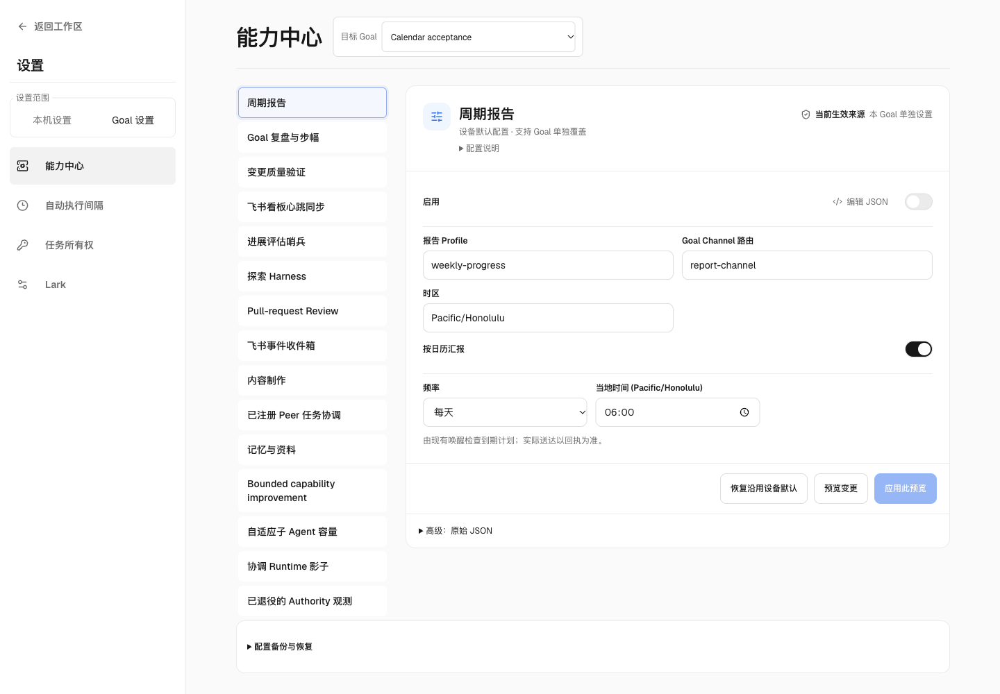
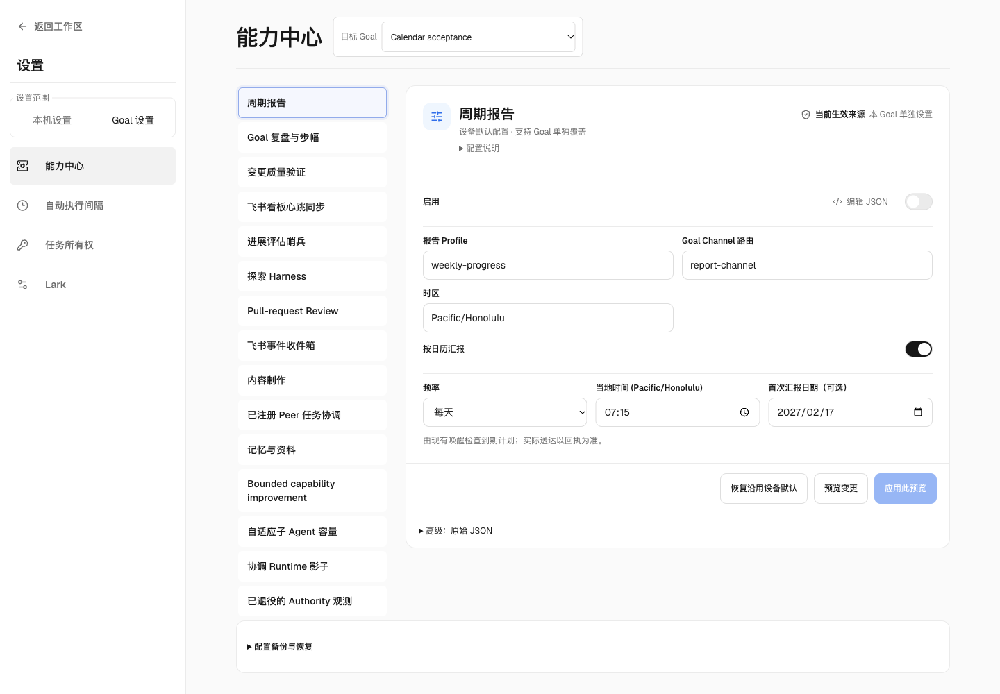
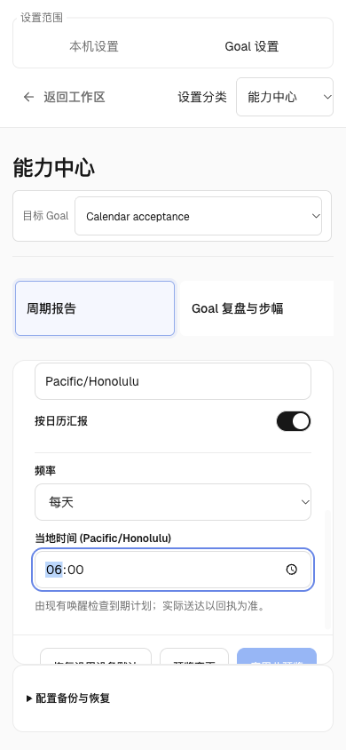
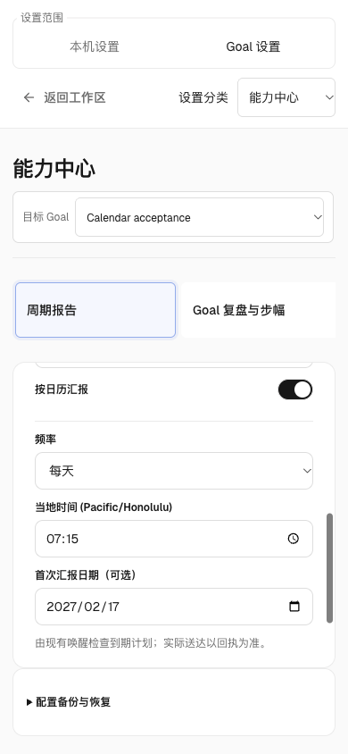
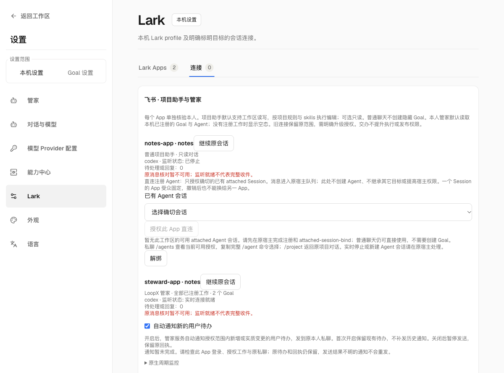
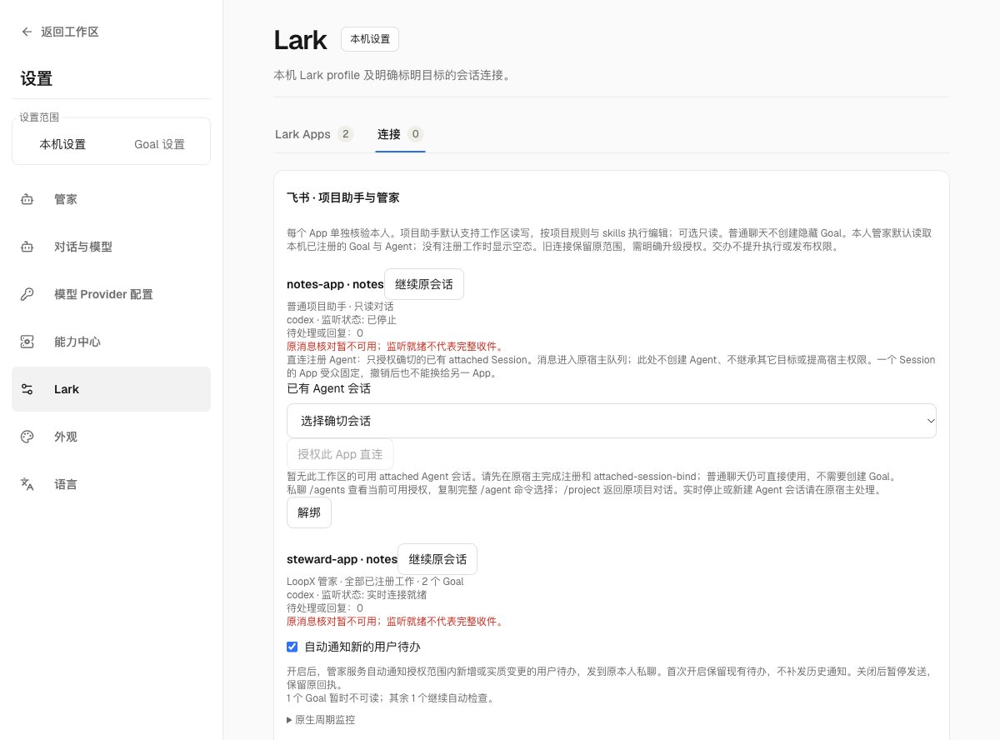
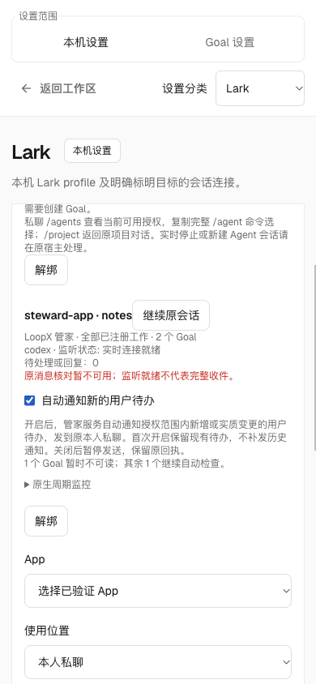
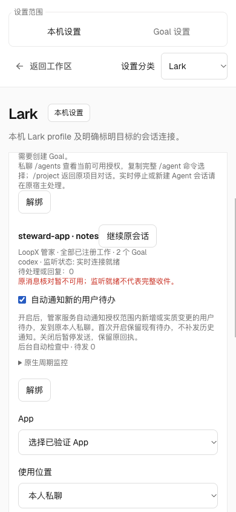

# Managed steward monitoring and periodic reports

Status: native identity preparation and opt-in status monitoring are implemented.
Daily portfolio reports remain the target described below. Preparing an identity
enables neither monitoring nor reports.

The steward should become a persistent LoopX-managed Agent. Its original private
conversation remains the user's entry point. Native monitor Todos, Turn
admission, scheduling and periodic-report publication own recurring work.

## What exists and what is missing

The current components already provide most of the lifecycle:

- `control_plane/scheduler/monitor_todo.py` and the typed scheduler project due
  monitor work and the next deadline.
- `control_plane/turn_driver/` provides registered Goal/Agent admission, single
  executor ownership, recovery, settlement and quota lineage.
- `capabilities/periodic_report/cadence.py`, `cadence_journal.py` and
  `cadence_runtime.py` evaluate calendar windows, retain a pending reporter and
  expose due report intents at Turn start.
- Native external-conversation admission and the existing Lark reply journal
  retain original requests, audience identity and delivery evidence.

The private steward retains the special `loopx-manager` conversation identity;
preparation adds the separate registered execution Goal/Agent described below.
The original project-Goal Chat endpoint still rejects this private steward.
Its source-bound native host bridge supplies monitoring admission. A report
Turn-start hook alone does not independently wake a sleeping actor, so calendar
calculation does not enable a report.

The existing calendar settings support an optional **First report date**, in
the schedule's timezone. Before its first matching daily or weekly deadline,
the calendar admits no report intent or generation work. The first report still
covers the preceding full interval. Leaving the date empty retains the existing
calendar behavior. This setting does not enable the steward's daily portfolio
report integration by itself.

The synthetic packaged settings journey below uses real preview/apply/readback
over local HTTP. It preserves the date across frequency, time and timezone
edits and reload. The narrow view is a 390×844 viewport emulation.

| Before: recurrence only | After: optional first report date |
| --- | --- |
|  |  |

| Before, narrow viewport | After, narrow viewport |
| --- | --- |
|  |  |

Chat `/goal` transport supervision and a LoopX-managed Turn are distinct. Merely
relaxing `validate_goal_chat`, changing a Session field, adding a prompt, or
starting a Codex native Goal does not establish the LoopX lifecycle below.

## One persistent steward actor

Extend the existing source-bound upgrade/activation path. A typed preview must
identify the original private binding, its conversation, the steward workspace,
the persistent execution identity and the current host/profile. Apply is an
idempotent native transaction using the owner's existing authorization.

Register one visible steward Goal/Agent, rather than creating a hidden Goal for
each monitor or borrowing a project worker's identity. The Goal owns the
steward's durable monitoring and reporting lifecycle. Its execution authority
does not include performing other projects' business work.

The upgrade retains private chat identity, visible history, queued and accepted
requests, unfinished delegations, original delivery routes and existing grants.
In-flight work stays with its original accepted Turn; the upgrade waits for an
eligible idle boundary. If host tools require a replacement upstream thread,
preserve the visible conversation and history, and record that transport change.
Do not claim to preserve a physical thread that was actually replaced.

Keep the steward's existing portfolio-read authority separate from its execution
actor. Resolve both through their native owners on every admission. Registering
the actor does not grant new project writes or broaden the original audience.
Keep ordinary project assistants unchanged.

### Identity preparation available now

In the private steward's connection settings, expand **Native periodic
monitoring** and choose **Prepare steward identity**. The same gesture obtains
a current preview and applies it. A stale preview, unverified provider, changed
grant, active Turn or queued user request refuses preparation. Resolve that
condition and retry in the original conversation.

The existing local-owner endpoint is
`POST /api/chat/lark/private-conversations/managed-steward`. A preview accepts
`binding_id` and optional `session_id`. Apply additionally requires
`execute: true` and the preview's `plan_id`. Callers cannot select a Goal, Agent,
workspace, provider account or new grant. Existing loopback/origin checks apply.

The typed conversation owner names one Goal and registered `steward` Agent from
the original binding. Existing native Goal creation and configuration owners
initialize File or SQLite storage according to machine settings. The existing
conversation binding stores only the resulting identity reference, including
the original Session and native creation operation. Source-session registries
retain their lifetime token; ordinary registries retain the existing nullable
lifetime contract. Preparation does not strengthen that legacy contract.

A lost registration or binding response can resume the same verified creation;
it cannot adopt an unrelated Goal or recreate a missing bound Goal. Repeating
an applied request verifies the same registration and returns the same actor.
The original Session, history, upstream thread, accepted requests and portfolio
grant are retained. Preparation invokes no model and enables no native monitor.
The UI shows the prepared identity with monitoring not yet enabled.

Preparation remains separate from enabling recurring work. Disconnecting the conversation uses its existing owner
and leaves the registered, unscheduled Goal visible; it does not delete history
or accepted work. Removing that Goal remains an explicit native Goal lifecycle
operation. Monitoring requires the separate explicit setting below.

### Native status monitoring

After preparation, choose **Enable monitoring** in the same connection panel.
The native continuous-monitor Todo owns enable/pause, the 30–1440 minute cadence,
last observation, result hash and next deadline. The panel's single gesture
obtains a fresh source-bound preview and applies it through
`POST /api/chat/lark/private-conversations/managed-steward/monitor`; it accepts
only the original binding, enable/pause operation, cadence and preview id.
It cannot select a different actor, workspace, account or grant.

The existing Chat host wake service checks this native frontier. A due watch
enters the original Session's Core worker and settles through native
`quota monitor-poll`, with an exact task-lease generation. It reads the current
authorized local portfolio, including stopped Goals and coverage gaps, without
a model call or execution-quota spend. Its own monitor bookkeeping is excluded
from the material-change hash. This watch neither delivers business replies
nor enables a daily report.

Active or queued user work retains priority. Pause uses the existing native
blocked lifecycle to retire the current lease atomically; enable reopens that
same Todo and obtains a fresh generation for cadence edits. First enable checks
immediately; resume or a changed cadence starts a fresh future window. An
unchanged setting leaves the existing deadline alone. Each accepted watch fixes
its native deadline and observed lease version before collecting data, so a
pause/re-enable cannot let old data borrow a new lease generation. Final native
writeback rechecks the collected scope under the binding's configuration and
revocation fence. Native Goal stop
also blocks observation. The user can still pause the retained monitor while
that Goal is stopped. Restart reads the native Todo/deadline and original Core
request. A failed or unknown accepted attempt is retained, never replayed.
An in-memory wake hint expires within a minute and holds no scheduling
authority; configuration invalidates it immediately. No extra scheduler,
message consumer or binding-side scheduling toggle is created.

An unreadable Session or queued Turn file affects only its own binding. Other
stewards continue their due checks. The unreadable data and original monitor
deadline remain intact; once the file is repaired, queued user work still takes
priority over monitoring.

The packaged browser journey below uses synthetic private connections over
real HTTP, Core and native File storage. Desktop views are 1440×1000; narrow
views are 390×844 viewport emulations, not physical-phone acceptance. The
journey covers enable, one automatic poll, cadence edit, failed authorization,
pause, resume and reload. An ordinary web-manager Session may also be prepared
by the workspace; the original private Session remains unchanged and the watch
adds no model request. File/SQLite regression tests independently check that
monitor polls leave execution-quota slots and original business replies alone.

| Before: prepared identity | After: enabled native monitor |
| --- | --- |
|  |  |

| Enabled, narrow viewport | Paused, retained deadline |
| --- | --- |
|  |  |

## Native scheduling and execution

### Owner Todo notifications during a source outage

The existing **Automatically notify new owner tasks** setting uses the original
private steward's background outbound worker. It does not enable a native
monitor, report, model Turn or second message consumer.

Discovery enumerates the complete current authorized Goal scope. Each Goal must
provide a complete native Todo read and exact current decision terms. If one
Goal is unreadable or unmigrated, its previous subjects, pending notices and
unknown sends remain retained; an unavailable source is never treated as an
empty or withdrawn Todo list. Notices from other readable Goals continue. An
unsent notice becomes eligible only after its own source is read again, with
the original generation and provider intent preserved. Real withdrawals or
scope removal still cancel unsent notices. A known provider locator continues
independent readback of the frozen original effect, even if the Todo changes
or its source is unavailable; current App, owner and original-route verification
remain required. This read cannot create another notification.

First enable baselines readable history and remembers unreadable initial Goals.
Their first successful read also baselines history, avoiding a delayed recovery
burst. Later changes and newly registered Goals retain ordinary discovery.
Failure to enumerate scope or verify the original owner, App, grant or route
still pauses delivery. The panel distinguishes a fresh partial-source check
from a stale worker or a delivery error; unknown receipts remain visible.

The packaged fixture
`apps/presentation/dashboard/smoke/owner-attention-source-fixture.py` uses real
HTTP, native File authority and the existing outbound worker, with synthetic
provider/model transport and no paid call. Its unmigrated Goal reproduces the
outage; initializing that disposable source verifies recovery. File/SQLite
regressions separately cover source errors, incomplete reads, changing exact
reads, retained queue identities and independent provider readback. The baseline
image shows the prior UI bundle over the same partial-source backend state;
the baseline adapter also fails the healthy-source regression independently.
These captures establish packaged browser behavior, not phone-device or live
account acceptance.

| Before: generic incomplete notice | After: explicit partial coverage |
| --- | --- |
|  |  |

| Partial coverage, narrow viewport | Recovered worker, narrow viewport |
| --- | --- |
|  |  |

The intended flow is:

```text
original private ingress -> original steward conversation
                                      |
                              steward Goal / Agent
                                      |
           native monitor/report deadline -> scheduler admission
                                      |
                              one managed LoopX Turn
                                      |
                    periodic-report generation/publication
                                      |
                     original private reply + provider readback
```

Represent monitors as native `continuous_monitor` Todos under this actor. Reuse
their due times, observations and lifecycle; do not create another task store,
cron, model loop or message consumer. Expose the report calendar's next boundary
to that same scheduler frontier. The periodic-report calendar/journal remains
the owner of report windows; a monitor deadline is its scheduling projection,
not a second publication cursor.

The existing runtime host checks the frontier without invoking a model. When
nothing is due, it sleeps until the next eligible native deadline. Only an
admitted Turn can invoke the model. A fixed daily report remains due even if
project state has not changed. Preserve the owner's minimum scheduling cadence;
align eligible calendar wakes to the requested wall time and disclose lateness
when the machine, host or actor cannot run then.

User messages, due monitors, outstanding original replies and reports use the
same actor's queue and admission. A busy actor retains due work and rechecks it
at the normal terminal boundary. It does not create another executor. Existing
priority, replan, budget, stop and settlement policies remain effective. Pausing
the steward prevents new scheduled model Turns without discarding accepted work
or historical results.

## Daily portfolio report

Configure the original steward's daily report for 09:00 `Asia/Shanghai`. At
scheduled boundary T, freeze the reporting interval as `[T-24h,T)`. Keep scheduled
boundary, actual generation time and actual delivery time separate.

Read all locally authorized registered Goals, including stopped Goals, through
their current native read surfaces. Do not reactivate them. Collect window
progress, relevant active/completed Todos, actual artifacts and validation,
unresolved requests/returns and concrete blockers. Distinguish reported claims
from independent verification, and report incomplete coverage explicitly.
Reconcile current approvals and dependencies before proposing a new owner ask.

The steward produces the full Chinese body and returns it to the original
private chat. A summary, queued outbox row, attachment alone or assistant-side
completion flag is insufficient evidence that the user received the report.

Use a stable identity for each scheduled window. Retain generation and delivery
progress separately. A restart resumes that window; confirmed delivery is not
sent again, and uncertain sends are read back before retry. After extended
offline time, produce the most recent complete window and disclose missing
windows, rather than starting an unbounded series of model calls.

## Implementation order and acceptance

The original-Session host bridge now runs a bounded native Turn through the
existing Chat worker and Codex app-server connection. It uses the explicit
`codex_app_server` outer-controller profile, not Codex CLI execution or a
desktop App heartbeat. Fresh native work selection, independent validation,
writeback, quota and scheduler handoff remain with the existing Turn command.
It preserves the original conversation thread, provider and portfolio grant;
busy/queued user work wins admission, and revoked or stopped sources cannot
commit a late model result. Same-request readback does not restart failed or
unknown work.

The native status-monitor producer now uses this original-Session bridge,
with the separate no-model observation path described above. Identity
preparation still leaves monitoring disabled. Calendar configuration, unfinished
native-journal recovery and original report publication remain the next
integration boundary. A passing synthetic File/SQLite host journey does not
establish an enabled daily report or real model/report quality.

1. Qualify the native steward upgrade and rollback at an idle boundary. Verify
   one registered actor, preserved original history/requests/grants, and no
   change to ordinary assistants or other project Agents.
2. Connect a real monitor deadline to that actor's native host and Turn driver.
   Verify not-due checks invoke no model; due, busy, pause and restart cases
   preserve one executor and native settlement.
3. Add the authorized portfolio report source to periodic-report, project its
   next calendar deadline and configure the original private delivery route.
   Reuse the existing report settings and monitor views for edit/pause/cancel,
   next due time, last result, coverage and actual delivery status.
4. Run semantic File/SQLite and host tests for fixed windows, unchanged-but-due
   reports, offline recovery, original audience, revoked grants, duplicate or
   unknown sends, partial delivery and late callbacks after cancellation.
5. Qualify the exact final diff, publish and merge under the existing repository
   policy, install it, then independently verify original-service adoption,
   actual configuration and an end-to-end report. The first natural scheduled
   report remains a separate acceptance event.
## Reading a fixed local evidence window

The existing private steward's evidence tool can read an exact report interval.
For example, a report ending at 09:00 uses `view=deliveries`, the authorized
`goal_id`, `window_start=2026-01-01T09:00:00+08:00` and
`window_end=2026-01-02T09:00:00+08:00`. Both timestamps need offsets. The read
includes the start and excludes the end; it does not move the interval to local
midnight or to the time the report happens to run. The existing `days` lookback
keeps its calendar-day behavior and cannot be combined with these bounds.

Follow `next_offset` and pass the first page's `source.source_revision` as
`expected_source_revision` on subsequent pages. If the index changes, the reader
returns a conflict with no rows: restart that Goal's read rather than combining
pages from different revisions. Complete the authorized portfolio pagination,
including stopped Goals when requested; one Goal's page is not global coverage.
This exact-window interface currently supports local sources. It rejects these
arguments for SSH sources instead of silently substituting a remote lookback.

Use an observed row's `source_ref` as `delivery_ref` to recover its complete
permitted `recorded_details` and evidence references, with the same interval and
revision. A related task outside the overview is joined through its exact
canonical Todo read. Oversized, unavailable or changed records remain explicit
coverage gaps. Recorded delivery time is not necessarily actual work time;
reading a receipt does not read its referenced artifacts or independently verify
the Agent's claims.

This extends evidence reading in the existing conversation. It does not enable
a report subscription, start a model, change a Goal, or send a report. Calendar
admission, report generation and verified delivery retain their existing owners.
