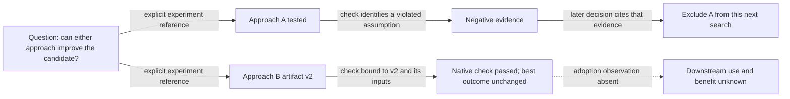

# Long-horizon progress: a product reading journey

- **Stage:** proposed product refinement; no shipped UI, evaluator qualification,
  metric promotion or experiment result is established by this note.
- **Ownership:** research leads the overall assessment design and calibration;
  product owns the reading journey and presentation refinement. Repository
  integration must reconcile both contributions against the current owners.
- **Language:** [中文版](long-horizon-progress-design.zh-CN.md).
- **Existing owners:** [Live Team Workspace](../../../architecture/rfcs/live-team-workspace-v0.md),
  [Goal Workspace](../../../architecture/rfcs/goal-workspace-surface-v0.md),
  [research evaluation](../../../architecture/rfcs/research-exploration-control-plane-v0.md#15-evaluation-and-claim-boundary)
  and [auto-research metrics](auto-research-product-metrics.md).

## The question to answer

“The score looks flat. Did the later work change anything useful, why did the
direction change, and what actually supports that account?”

The default reading object is the whole recorded research history, including a
study lasting well over ten hours: competing routes, multiple attempts, evidence,
turning points, reversals, waiting and gaps in one graph. A research episode is
an inspectable detail within that history: a question, a discriminating attempt,
an observable result and the next decision. An episode may span Turns; concurrent
attempts retain their identities. The [proposed research unit and rubric](../../../architecture/rfcs/long-horizon-harness-benchmark-research-program-v0.md#evidence-based-episode-evaluation-proposed-refinement)
require research qualification before metric use. A displayed grouping
does not create an evaluation unit or a new writable graph.

Show the original outcome curve together with the whole-history Explore graph;
selection expands an episode's evidence and decision. Preserve the authority of
the native scorer and existing board.
A graph, model summary, completed Todo or accepted artifact cannot rewrite its
score or establish causal benefit.

## Shortest ordinary journey

Count deliberate user actions from an **already-open Goal** to an answer backed
by inspectable evidence. This is an acceptance target, not a measurement of the
current product. Opening the Goal from elsewhere has its own navigation cost.

| Actions | What the person can do | Product requirement |
| --- | --- | --- |
| 0 | Read the full covered history and native result, including competing routes, failed/unfinished attempts, reversals, later work and gaps | Default whole-history Explore in the existing Goal; no setup, provider choice, extra model call or manual graph construction; requested/observed coverage and unloaded pages explicit |
| 1, optional detail | Select a route, attempt or episode and answer what changed, why, which artifact/version was checked and whether anyone used it | Open decisive inline evidence and highlight the same history window/branch; return to the full graph without losing context |
| 1, optional analysis request | Ask the Agent for a deeper account of this history | Reuse the benchmark owner's deep trajectory evaluation and a valid matching assessment, or its existing authorized analysis path; no second evaluator, manual ids or extra approval when intent and scoped authority already exist |
| 2, optional | Compare that episode/window with a baseline or earlier checkpoint, or inspect its original source | Preserve selection and return focus; label whether a matched comparison is available rather than manufacturing one |

Source opening is optional only when the inline detail already contains the
decisive audience-authorized evidence. If the fact cannot be shown, say what is
missing; do not count a summary badge as an evidenced answer. Extra actions need
concrete value, such as choosing a comparison basis. Reading and replay never
start analysis or a run, submit feedback or add an approval. The optional analysis
request uses its existing execution, permission and budget owner; it is not an
effect of selecting an episode. Any later write uses its existing action owner
and authority boundary.

## One focus across time, branches and evidence

The existing Goal workspace owns navigation and selection. The Live Team
Workspace projection owns its timeline/map/list rendering. Explore and the
capability's evidence records own relationships and source identities.

```text
Existing research Goal
  Default: whole-history Explore + native outcome curve + observed coverage
    Questions / competing routes / attempts / evidence / decisions / gaps
                    select once (optional)
  Focused episode / branch  <-->  inline source, artifact version, check,
                                  next decision, adoption and missing evidence
                    request analysis once (optional, through existing authorized execution)
  Benchmark deep-trajectory assessment --> generated explanation + citations
    Same versioned inputs/result; factual history remains available
```

Keep one primary reading focus. The score curve, small branch context and detail
panel share a selection; do not present three independently navigated dashboards.
Avoid a new wall of summary cards, unqualified progress percentages, activity
animation or an unreadable all-node view. Fit the full covered interval first;
semantic grouping and progressive detail reduce density without dropping old
anchors, failures, abandoned/unfinished routes, later work, waiting or gaps.
Routine work is collapsible; retirement, invalidation and disagreements remain
discoverable. Unloaded pages or retention limits prevent a complete-history claim.
Task dependencies, research links and outcome attribution remain distinct; missing
attempt times or explicit relationships stay unknown. Compact screens use the same
ordered evidence chain vertically, with keyboard access, visible focus and
reduced-motion parity. Meaning cannot depend on color or motion alone.

When only Explore records are available, label the view as recorded Explore history.
`recorded_at` is record time, including delayed analysis and historical backfills;
it does not establish when a native attempt occurred or complete route/adoption
coverage. Parent/topic containment is grouping, including older projections that
encoded it as `supports` with `materialized_from=node_parent_id`; it is not
scientific support. Preserve explicit source relationships without treating their
presence as independent verification.

The display must preserve these distinctions:

| Reading lens | Decisive observation | What it does not establish |
| --- | --- | --- |
| Result | Native outcome value, metric direction, source and scoring conditions | Generalization or improvement under a different evaluator/version |
| Information | A supported exclusion, uncertainty change or discriminating result linked to a next decision | Benefit merely because a failed attempt or negative row exists |
| Adoption | A specific receiver used a specific artifact/version in an observed action | Delivery alone, scientific correctness or improved outcome |
| Realized benefit | An independently qualified downstream outcome under the owning acceptance | Causal uplift from temporal adjacency or joint enablement |

Reliability and cost qualify all four lenses; they are not merged into a scalar
progress score. Evidence badges separate an observed fact, a model interpretation
and a version-specific independent check. An interpretation cites its basis and
can abstain. A disputed interpretation remains disputed; selecting it does not
promote it to a fact. These are presentation distinctions, not new protocol enums.

## Two layers, one trajectory-assessment basis

The [Goal workspace contract](../../../architecture/rfcs/goal-workspace-surface-v0.md#511-research-goals-whole-history-explore-and-on-demand-analysis)
owns the two-layer composition. Layer 1 projects existing authorized Explore
records and explicit relationships with zero extra model calls. Layer 2 is a
product consumer of the benchmark research owner's deep trajectory evaluation:
one method and referenced versioned assessment, then a generated explanatory
graph and conclusions. The whole run and prospectively fixed comparison windows
own coverage, native outcomes and marginal cost; research defines cross-Turn
episodes and explicit source/submission/artifact bindings in the same snapshot.
Product rendering does not define a new unit, rubric or progress score.

The [existing behavior findings/report](../../../reference/benchmark-behavior-findings.md)
support exploratory observations and interpretations, not scientific scoring.
The toolkit's compact native Goal lifecycle summary is not a full history graph
or quality assessment; the experiment board still owns native results and
comparability. A unified deep-research evaluation service, product assessment
schema and calibrated model rubric are not implemented. Initial integration
can consume permitted versioned research analysis artifacts, without relabeling
these existing producers as the missing service.

Before runtime integration, inventory the existing producer and reconcile source
snapshot/revisions, requested and observed time coverage, episode/event/artifact
bindings, permitted audience, input digest, method/code revision, model/configuration
only if used, qualification, actual cost,
counterevidence, uncertainty, abstention and result identity. This is an interface
requirement, not a claim that a schema or calibrated evaluator already exists.
Observations, Agent interpretations, independent checks and actual adoption retain
separate provenance. Unqualified model confidence is not a scientific probability.

Retain a generated result's historical input basis. New inputs or method make its current
applicability unestablished; a new assessment cannot silently overwrite it. Keep
the factual graph readable through denied access/budget, in-progress analysis,
cancellation, failure and retry. Repeated requests/navigation must not duplicate
execution. Only the existing authorized Agent/execution owner may perform an
analysis; opening this page grants no model budget, source access or intervention
in a frozen benchmark. Analysis cannot borrow the solver's budget, cooldown or
feedback opportunities. The source/evaluator restrictions below still apply.

## Time and score alignment

Use the research owner's predeclared budget/checkpoint to define the later
window. Show continuation elapsed time, inherited prefix and total source age
separately. Do not choose “the latter half” after observing the best score, align
incomparable restarts by wall clock alone, or charge concurrent work twice.

Keep recorded score points at their actual measurement/checkpoint and distinguish
the best-so-far candidate from the current submitted candidate. Show gaps, waiting
and censored endings; do not interpolate missing measurements as an improving or
flat result. Selecting an episode highlights its interval and related recorded
points, without drawing a causal edge to them. An unchanged best score can coexist
with a new tested implementation or reusable exclusion.

A comparison exposes its task, model/harness, source, feedback, evaluator, budget
and observation basis. Changed controls or unequal coverage remain visible.
Without comparable measurements, say “comparison unavailable” rather than zero
lift. Preserve the common denominator and the research owner's resource-weighted
and episode-count views, including failures, incomplete work and abstentions.
Do not silently discard unobservable baseline work. Human/model/tool cost,
elapsed/active/wait time and assessment overhead retain their units and coverage;
unknown cost is not zero. Existing usage owners provide interval costs; subtracting
unqualified rolling totals is not an alternative ledger.

## Synthetic example: exclusion, implementation and outcome diverge

Everything in this example is illustrative. It is not a real trajectory,
benchmark result, calibrated rubric or installed screen.



In the declared later window, A changes a decision through supported exclusion.
B reaches a version-specific native check without improving the incumbent.
That is neither “no work happened” nor “the run improved.” A one-selection detail
shows the assumption/check, exact artifact version, cited next decision and absent
adoption observation. The original score remains unchanged. Dotted absence is
not an adoption edge; a time-neighboring later score is not an attribution claim.

The real pilot should include an authorized exclusion, a genuine implementation
that fails native transfer, a positive proxy under changed controls, and useful
baseline work with weaker mechanism instrumentation. Research chooses the cases,
rubric, independent coding and held-out calibration. This note supplies no weights,
thresholds, automatic interventions or new experiment authorization.

## Source, access and recovery

An inline evidence detail needs the producing owner, source identity/revision,
artifact version, observation/check time, freshness/coverage, explicit relationship
basis and separate check/adoption observations. Inventory existing producers before
defining a new field; reuse the shared typed presentation owner when a real caller
requires an extension. Python may adapt permitted observations, not invent a second
assessment or progress authority.

| Case | Required reading behavior |
| --- | --- |
| Missing or incomplete observation | Show the gap and affected claim; unknown is neither zero nor negative |
| Restricted source | Explain limited access without leaking the source body; never replace it with a confident generated account |
| Artifact/input revision changed | Retain the historical check basis and mark current validity unestablished; do not keep a current-green badge |
| Model assessment disagrees with a check | Show both provenance and disagreement; original check/scorer authority remains intact |
| Stream gap, refresh, back navigation | Resnapshot within scope, preserve or explicitly invalidate selection/window, and never replay execution effects |
| No granular events or unsupported host | Show the available snapshot and freshness; do not simulate live progress |

Only audience-authorized projections enter the product. The existing metrics
boundary against parsing raw private traces/transcripts or protected evaluator
bodies remains intact. Research may analyze permitted private material under its
own contract and return safe versioned evidence/assessment references with coverage.
Hidden evaluator material is eligible only after the solver has terminated **and**
scoring has completed; it never returns to solver context or runtime feedback.
Opening the view grants no additional source access, model budget or control power.

## Smallest useful implementation and its acceptance

1. **Design contribution now:** reconcile this reading journey with the research
   design in existing roadmap/RFC/metrics owners. The synthetic example and link
   checks qualify documentation only; calibration and packaged behavior remain open.
2. **Read-only product slice:** one existing Goal entry with the default
   whole-history Explore graph, original score/window, complete/unknown coverage
   and optional one-selection evidence/check/adoption detail. Preserve multi-hour
   competing routes, attempts, negative/unfinished work and gaps over the existing
   projection. No new writable graph or automatic evaluator. Missing relationships
   stay visible; an implementation prerequisite must name its owner.
3. **Packaged qualification:** use the real backend and an authorized case to
   carry the 0/optional-1/optional-2-action reading journey through refresh/back,
   narrow viewport, keyboard use, old/missing anchors, absent timestamps/causal
   bindings, pagination, duplicate/out-of-order events, disconnect, Goal isolation,
   restricted/missing data and changed artifact inputs. Verify no execution or
   hidden evaluator feedback from reading/replay. Separately integrate the optional
   Agent request with the same pinned benchmark assessment: one authorized request
   reuses a matching result or executes once, with versioned citations,
   uncertainty/abstention, stale-input/method handling,
   denied budget/access, cancellation and failed/retried analysis while Layer 1
   remains usable. Specification alone does not qualify that integration.
4. **Comprehension and scientific qualification separately:** compare against the
   existing list/map using predeclared questions about outcome, turning point,
   source, validation and uncertainty; record answer errors, time and action count,
   including false-progress and false-no-progress cases. Research independently
   qualifies the rubric, matched baseline, cost/window coverage and calibration.

Successful comprehension does not validate an evaluator; evaluator agreement does
not prove a usable UI. Neither closes original small-team/live-stream acceptance,
installs the proposal or qualifies downstream benefit. This design must not delay
the existing L1/R2 correction journey until every research question is settled.

Open decisions for research/product integration are the episode unit and labeling
rubric, window/censoring policy, comparable baseline coverage, source permissions,
cost coverage and which existing producer can supply a versioned decision link.
Do not turn these questions into mandatory user setup or pretend they are approved.
