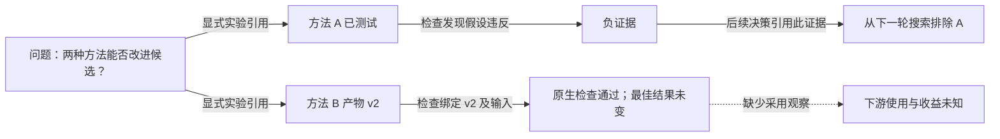

# 长程进展：产品阅读旅程

- **阶段：** 产品细化提案；本文不证明界面已交付、评估器已合格、指标已晋升或实验取得结果。
- **归属：** 研究侧牵头整体评估设计和校准；产品侧负责阅读旅程与展示细化。仓库整合须与既有 owner 核对两侧贡献。
- **语言：** [English](long-horizon-progress-design.md)。
- **既有 owner：** [团队实时工作区](../../../architecture/rfcs/live-team-workspace-v0.zh-CN.md)、[Goal 工作区](../../../architecture/rfcs/goal-workspace-surface-v0.zh-CN.md)、[研究评估](../../../architecture/rfcs/research-exploration-control-plane-v0.zh-CN.md#15-评估与-claim-边界)与 [auto-research 指标](auto-research-product-metrics.md)。

## 要回答的问题

“分数看起来没变。后半程有没有带来有用变化，为什么转向，到底有什么依据？”

有用的阅读对象是一个研究 episode 中有证据的变化：问题、能区分假设的尝试、可观察结果和下一项决策。Episode 可以跨 Turn；并行尝试保留各自身份。[研究侧拟议单位与口径](../../../architecture/rfcs/long-horizon-harness-benchmark-research-program-v0.zh-CN.md#基于证据的研究片段评估拟议细化)须先经科学资格验证，才能用于指标。展示分组不会自动成为评估单位或新的可写图。

将原始结果曲线与所选 episode 的证据和决策一起读。保留原生 scorer 与既有 board 的权威；图、模型摘要、已完成 Todo 或已验收产物都不能改写分数，也不能据此证明因果收益。

## 普通路径最短化

从**已经打开的 Goal**到有可查证依据的回答，统计用户主动操作。这是验收目标，不是当前产品的实测结果；从其它位置打开 Goal 的导航成本另计。

| 操作次数 | 用户能做什么 | 产品要求 |
| --- | --- | --- |
| 0 | 读当前结果，以及相对可见检查点的实质变化 | 复用概览/地图上下文；不用设置向导、选 provider、手工建图或添加配置 |
| 1 | 选择一项变化或 episode，回答改了什么、为何改变、哪个产物/版本经过何种检查，以及有没有被使用 | 同时展开行内证据详情并关联时间窗口/分支；关键事实不藏在另一次点击后 |
| 2，可选 | 对比基线或更早检查点，或打开原始来源 | 保留选择与返回焦点；明确有没有匹配对照，不能制造对照 |

只有行内详情已包含用户有权读取的决定性证据时，打开原始来源才是可选操作。事实无法展示时说明缺什么，不能把摘要徽章当成有证据的回答。额外操作须有明确价值，例如选择比较基准。阅读和回放不启动 run、不提交反馈，也不增加审批；后续写操作仍由既有 action owner 与权限边界承接。

## 时间、分支和证据共用一个焦点

既有 Goal 工作区拥有导航与选择；团队实时工作区投影拥有时间轴/地图/列表展示；Explore 与能力证据记录拥有关系和来源身份。

```text
既有 Goal 概览 / 工作地图
  原生结果曲线 + 声明的窗口 + 观测覆盖度
  实质变化：“A 被排除；B 已检查；下游收益未知”
                   选择一次
  聚焦 episode / 分支  <-->  行内来源、产物版本、检查、
                              下一项决策、采用与缺失证据
```

只保留一个主要阅读焦点。曲线、小范围分支上下文与详情共享选择，不做三个独立导航的 dashboard。不新增摘要卡片墙、无资格的进度百分比、活动动画或全节点密集图；常规活动可折叠，退役、失效和分歧仍可发现。窄屏沿相同顺序纵向展示证据链，支持键盘、可见焦点和 reduced motion，语义不能只靠颜色或动画表达。

展示必须保留这些区别：

| 阅读视角 | 决定性观察 | 不能据此证明什么 |
| --- | --- | --- |
| 结果 | 原生结果值、指标方向、来源和评分条件 | 换 evaluator/版本后的泛化或提升 |
| 信息 | 有依据的排除、不确定性变化或区分性结果，并关联下一项决策 | 仅存在失败尝试或负证据行就有收益 |
| 采用 | 特定接收者在可观察动作中使用特定产物/版本 | 仅投递、科学正确或结果变好 |
| 已实现收益 | 在原验收范围内独立合格的下游结果 | 时间相邻或共同启用导致因果提升 |

可靠性和成本限定上述四个视角，不能合并成一个进展总分。证据标记区分观察事实、模型解释和绑定版本的独立检查。解释须引用依据，允许弃权；有分歧就保留分歧，选中它不会将其晋升为事实。这些是展示区别，不是新的协议 enum。

## 时间与分数对齐

用研究 owner 预先声明的预算/检查点定义后段窗口，分开展示 continuation elapsed、继承前缀与来源总年龄。不能看过最佳分数后才选择“后半程”，不能只按墙钟对齐不可比的重启，也不能把并行工作重复计入 elapsed。

分数点保留实际测量/检查点，区分 best-so-far 与当前提交候选。展示观测缺口、等待和被截断的结束，不能将缺失测量插值成提升或持平。选择 episode 只是高亮其区间与关联的已记录分数点，不为它们画因果边。最佳分数不变，可以同时发生新实现通过检查或形成可复用排除。

对照应展示任务、模型/harness、来源、反馈、evaluator、预算和可观测基准；控制条件变化或覆盖度不等必须可见。没有可比测量时显示“无法比较”，不能显示零提升。保留共同分母，以及研究 owner 的资源加权与 episode 计数视角，包含失败、未完成和弃权；不能静默丢弃不可观测的基线工作。人工/模型/工具成本、elapsed/active/wait 时间与评估开销保留各自单位和覆盖度，未知成本不是零。区间成本来自既有 usage owner，不能相减未经资格化的滚动总量，另造账本。

## 合成示例：排除、实现和结果分开

以下全部为示意，不是真实轨迹、benchmark 结果、已校准口径或安装态首屏。



在声明的后段窗口内，A 通过有依据的排除改变了一项决策；B 到达绑定版本的原生检查，但没有超过原最佳结果。这既不能写成“什么都没发生”，也不能写成“run 取得提升”。一次选择的详情呈现假设/检查、精确产物版本、引用它的后续决策，以及缺失的采用观察。原分数保持不变；虚线缺失标记不是采用关系，时间接近的后续分数也不是归因。

真实试点应包含：有权使用的排除案例、实现确有变化但原生迁移失败、控制条件改变时出现正向 proxy，以及机制记录较弱但确有价值的基线工作。研究侧选择案例、口径、独立编码和 held-out 校准；本文不提供权重、阈值、自动干预或新增实验授权。

## 来源、访问与恢复

行内证据详情需要生产 owner、来源身份/版本、产物版本、观测/检查时间、新鲜度/覆盖度、显式关系依据以及分离的检查/采用观察。新增字段前先盘点既有 producer；有真实调用方需要扩展时复用共享 typed presentation owner。Python 可适配获准观察，不能另造评估或进展 authority。

| 情形 | 必须怎样呈现 |
| --- | --- |
| 缺少或不完整的观察 | 显示缺口及受影响的结论；未知不等于零或负向 |
| 来源受限 | 说明读取受限，不泄露正文，不用自信的生成叙述替代 |
| 产物/输入版本已变 | 保留历史检查基准，标明当前有效性未建立；不能继续标当前绿色 |
| 模型评估与检查不一致 | 保留各自依据和分歧，原检查/scorer 权威不变 |
| 流缺口、刷新、返回 | 在原范围重读快照，保留或明确失效选择/窗口，不重放执行副作用 |
| 无细粒度事件或宿主未接入 | 显示已有快照和时效，不能模拟实时进展 |

产品只接收受众获准的投影。既有指标文档禁止解析原始私人轨迹/聊天或保护 evaluator 正文的边界不变。研究侧可按自己的契约分析获准私人材料，返回安全、带版本的证据/评估引用与覆盖度。隐藏 evaluator 材料仅在 solver **已终止且评分已完成**后可用；绝不回流 solver 上下文或运行反馈。打开视图不会新增来源权限、模型预算或控制能力。

## 最小有用实现与验收

1. **当前设计贡献：** 将本阅读旅程与研究方案整合到既有 roadmap/RFC/指标 owner。合成示例和链接检查只验收文档；校准与打包产品行为仍开放。
2. **只读产品切片：** 一个既有 Goal 入口、一个选中 episode、原分数/窗口，以及基于既有投影的带版本证据/检查/采用详情。不新增可写图或自动 evaluator。关系缺失可见；实现前置若存在，须有明确 owner。
3. **打包态资格：** 使用真实 backend 与获准案例，贯穿 0/1/可选 2 次操作路径，验证刷新/返回、窄屏、键盘、来源受限/缺失和产物输入变化。证明阅读/回放不启动工作，也不发送隐藏 evaluator 反馈。
4. **理解与科学资格分别验证：** 对照既有列表/地图，用预先声明的问题询问结果、转向、来源、验证和不确定性；记录误答、时间与操作数，覆盖误判有进展与误判无进展。研究侧独立验证口径、匹配基线、成本/窗口覆盖和校准。

理解通过不等于 evaluator 合格；evaluator 判断一致不证明界面易用。两者都不能关闭原小团队/实时流验收、证明提案已安装或证明下游收益。本设计不能让原 L1/R2 纠偏旅程等待所有研究问题解决。

研究/产品整合仍需决定：episode 单位和标注口径、窗口/截断策略、可比基线覆盖、来源准入、成本覆盖，以及哪个既有 producer 能提供带版本的决策关联。不能把这些未决问题变成用户必填设置，也不能写成已经批准。
