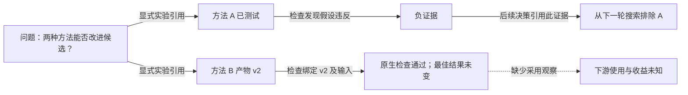

# 长程进展：产品阅读旅程

- **阶段：** 产品细化提案；本文不证明界面已交付、评估器已合格、指标已晋升或实验取得结果。
- **归属：** 研究侧牵头整体评估设计和校准；产品侧负责阅读旅程与展示细化。仓库整合须与既有 owner 核对两侧贡献。
- **语言：** [English](long-horizon-progress-design.md)。
- **既有 owner：** [团队实时工作区](../../../architecture/rfcs/live-team-workspace-v0.zh-CN.md)、[Goal 工作区](../../../architecture/rfcs/goal-workspace-surface-v0.zh-CN.md)、[研究评估](../../../architecture/rfcs/research-exploration-control-plane-v0.zh-CN.md#15-评估与-claim-边界)与 [auto-research 指标](auto-research-product-metrics.md)。

## 要回答的问题

“分数看起来没变。后半程有没有带来有用变化，为什么转向，到底有什么依据？”

默认阅读对象是完整已记录研究历史，包括持续十几个小时的研究：一张图呈现竞争路线、多轮尝试、证据、转向、回退、等待和空档。研究 episode 是其中可展开的细节：问题、能区分假设的尝试、可观察结果和下一项决策。Episode 可以跨 Turn；并行尝试保留各自身份。[研究侧拟议单位与口径](../../../architecture/rfcs/long-horizon-harness-benchmark-research-program-v0.zh-CN.md#基于证据的研究片段评估拟议细化)须先经科学资格验证，才能用于指标。展示分组不会自动成为评估单位或新的可写图。

将原始结果曲线与完整历史 Explore 图一起读，选中后展开 episode 的证据和决策。保留原生 scorer 与既有 board 的权威；图、模型摘要、已完成 Todo 或已验收产物都不能改写分数，也不能据此证明因果收益。

## 普通路径最短化

从**已经打开的 Goal**到有可查证依据的回答，统计用户主动操作。这是验收目标，不是当前产品的实测结果；从其它位置打开 Goal 的导航成本另计。

| 操作次数 | 用户能做什么 | 产品要求 |
| --- | --- | --- |
| 0 | 读完整已覆盖历史与原生结果，含竞争路线、失败/未完成尝试、回退、后半程和空档 | 既有 Goal 默认全历史 Explore；无需设置、选 provider、额外模型调用或手工建图；请求/观测覆盖与未加载分页明确 |
| 1，可选详情 | 选一路线、尝试或 episode，回答改了什么、为何改变、哪个产物/版本经过何种检查，以及有没有被使用 | 决定性证据在原位展开，关联同一历史窗口/分支；可回到全图并保留上下文 |
| 1，可选分析请求 | 请 Agent 更深入地解释这段历史 | 复用 benchmark owner 的深入轨迹评测与有效匹配结果，或其既有获准分析路径；不另造 evaluator、不手填 id；已有意图和范围授权时不另加审批 |
| 2，可选 | 对比基线或更早检查点，或打开原始来源 | 保留选择与返回焦点；明确有没有匹配对照，不能制造对照 |

只有行内详情已包含用户有权读取的决定性证据时，打开原始来源才是可选操作。事实无法展示时说明缺什么，不能把摘要徽章当成有证据的回答。额外操作须有明确价值，例如选择比较基准。阅读和回放不启动分析或 run、不提交反馈，也不增加审批；可选分析请求走既有执行、权限与预算 owner，不因选中 episode 而发生。后续写操作仍由既有 action owner 与权限边界承接。

## 时间、分支和证据共用一个焦点

既有 Goal 工作区拥有导航与选择；团队实时工作区投影拥有时间轴/地图/列表展示；Explore 与能力证据记录拥有关系和来源身份。

```text
既有研究 Goal
  默认：完整历史 Explore + 原生结果曲线 + 观测覆盖度
    问题 / 竞争路线 / 多轮尝试 / 证据 / 决策 / 空档
                   可选选择一次
  聚焦 episode / 分支  <-->  行内来源、产物版本、检查、
                              下一项决策、采用与缺失证据
                   可选请求分析一次（沿既有执行权限）
  benchmark 深入轨迹评测 --> 生成解释图与引用
    相同版本的输入/结果；事实历史仍可回看
```

只保留一个主要阅读焦点。曲线、分支上下文与详情共享选择，不做三个独立导航的 dashboard。不新增摘要卡片墙、无资格的进度百分比、活动动画或难读的全节点密集图。默认适配完整已覆盖区间；语义分组和渐进细节降低密度，但不丢旧锚点、失败、放弃/未完成路线、后半程、等待与空档。常规活动可折叠，退役、失效和分歧仍可发现；分页未加载或保留期受限时不能声称历史完整。任务依赖、研究关系与结果归因分开；缺少尝试时间或显式关系就保持未知。窄屏沿相同顺序纵向展示证据链，支持键盘、可见焦点和 reduced motion，语义不能只靠颜色或动画表达。

只有 Explore 记录时，应标明“已记录 Explore 历史”。`recorded_at` 是记录时间，可能包含延后分析与历史回填，不能当成原生尝试发生时间或完整路线/采用覆盖。父子主题只表示分组，包括旧投影中以 `supports` 和 `materialized_from=node_parent_id` 表达的归属关系，不能展示成科研支持。保留显式来源关系，但关系存在本身不等于独立验证。

展示必须保留这些区别：

| 阅读视角 | 决定性观察 | 不能据此证明什么 |
| --- | --- | --- |
| 结果 | 原生结果值、指标方向、来源和评分条件 | 换 evaluator/版本后的泛化或提升 |
| 信息 | 有依据的排除、不确定性变化或区分性结果，并关联下一项决策 | 仅存在失败尝试或负证据行就有收益 |
| 采用 | 特定接收者在可观察动作中使用特定产物/版本 | 仅投递、科学正确或结果变好 |
| 已实现收益 | 在原验收范围内独立合格的下游结果 | 时间相邻或共同启用导致因果提升 |

可靠性和成本限定上述四个视角，不能合并成一个进展总分。证据标记区分观察事实、模型解释和绑定版本的独立检查。解释须引用依据，允许弃权；有分歧就保留分歧，选中它不会将其晋升为事实。这些是展示区别，不是新的协议 enum。

<a id="record-relationships-before-the-next-study"></a>

## 下一轮实验前先记录研究关系

本细化基于[全历史提案 #6648](https://github.com/loopx-project/loopx/pull/6648) 的
`f657a65c6abd03f1f6b87937c327f4ccfb2ccde2`：默认记录时间视图、可选关系视图及行内证据。
该源码仍是产品提案，不代表已安装或 V11/V12 完整验收。它不会补造缺失的研究关系，也没有自动比较原生指标。时间线点选目标问题和独立评审仍归产品侧修复，新头须重新读回。

首先要留下的是：**上一次结果为什么导向下一次实验。** 在有意义的结论或路线变化时，研究 Agent 复用已有问题，在正常结果回写中附上有依据的关系。用户不用输入 ID、手工拉线或逐条确认。这是研究指导，不是每 Turn 必填附件或图密度配额。

| 关系要回答的问题 | 复用已有表示 | 需要的依据 |
| --- | --- | --- |
| 这次尝试回答什么、依赖什么前提？ | 明确的问题/假设/实验节点；`answers`、`depends_on` 的方向符合断言 | 尝试身份、实际测试输入、确有其事的前提或答案 |
| 这个结果支持或反驳哪个主张？ | 已有节点间的 `supports`、`refutes` | 有范围的 finding、获准结果引用、不确定性和适用输入版本；运行失败不自动反驳假设 |
| 为什么选择下一条路线？ | 明确决策引用；有可证后果才使用 `leads_to` | 决策确实引用依据；后续产物或行为单独证明实际采用 |
| 它属于什么主题？ | `subtopic_of` 或既有 parent 投影 | 只表示主题归属，不能计作科研支持 |

复用[已有结果附件](../../../../loopx/capabilities/explore/README.md#results-from-ordinary-work-writeback)：完整结果可带 `question_update` 与至多四条 `relations`，方向是当前问题指向同一 Goal 中已有节点，summary 写明观察依据。这个 hook 不会自动创建任意实验/产物图。真实案例需要假设、实验或产物身份时，通过既有 Explore owner 建立有意义的对象；不要为了连线把所有 finding 都改成新问题。缺失目标、越域、自连、重复及不合法环路继续沿既有规则拒绝；成功回放不能重复写边或重复宣称采用。

**当前证据边界尚不完整。** Finding 有证据引用和测试输入版本，但 edge writer 没有直接的 `evidence_refs` 或端点版本参数。summary 是一项断言，不等于持久化版本绑定。研究分析 sidecar 保留 edge event 身份、来源快照及获准 finding/产物引用；关联无法复核就标未知，不能向严格 writer 塞入自创字段。后续合同扩展归既有 Explore 类型化 owner，需一起验证写入、读取、checkpoint 回放、CLI 和打包展示；本文没有交付该扩展。

默认图区分显式来源关系与 parent 分组。后续推断关联进入按需分析层，标明来源、方法版本和不确定性，不静默晋升为来源边。同 checkpoint 血缘、匹配对照、实现继承与实际采用各有含义，不能统统塞进 `supports` 或 `leads_to`。在真实调用方和已接受合同推动词汇扩展前，先在 sidecar 保留既有精确身份。

新实验若要论证关系信息改善研究决策，启动前由研究侧完成一条端到端采集 canary，产品侧负责对应阅读检查：

1. 沿一个获准真实 case 追到问题/尝试、结果、显式关系和下一次决策，复核来源、产物/输入版本、记录时间及可得的实际尝试时间。replan 前捕获关系与相关证据；恢复后接收者能读到同一依据，没有重复写入或未来证据。
2. 通过真实结果 owner 和 #6648 衍生的打包历史视图读回，选中项目应打开它自己的证据。保留缺失关系、孤立节点、拒绝写入、延后回填和输入变化的限制。视图仍有缺陷就保持产品验收开放，不把截图或本机定制渲染当成已交付旅程。
3. 单独检查接收者的下一次动作。关系被保存或引用，不证明实际采用或实验更有价值。保留无依据推断与没有后续采用机会的情形。Graph 分类指标与运行时间罚、Portfolio 代理指标与原生迁移、checkpoint 捕获与实际唤醒输入分别提供三个诊断问题；选择获准证据，不预设有利结论。
4. 对比两臂冻结相同采集指导、字段与开销口径。要求 Agent 主动组织关系可能改变决策，须进入 treatment manifest，不能等同被动记录。TurnEnvelope 单独保持关闭，除非显式研究它；不把新指导回填进旧冻结实验。

启动要求是当前研究主张所需的采集与恢复验证，不是等全部 V12 深度分析或通用溯源 schema 完成。可观测性较弱的原生结果研究须声明范围。覆盖诊断按预先声明的机会记录无法关联、缺失版本和错误链接；边数、连通度不算进展指标。公共文档使用泛化案例，原始轨迹和私有实验身份保留在获准研究存储中。

## 两层展示，共用轨迹评测基准

[Goal 工作区合同](../../../architecture/rfcs/goal-workspace-surface-v0.zh-CN.md#511-研究-goal全历史-explore-与按需深度分析)拥有两层组合。第一层只投影已有获准 Explore 记录和显式关系，零额外模型调用。第二层消费 benchmark 研究 owner 的深入轨迹评测：一套方法、一个可引用的版本化评测结果，再生成解释图和结论。整条 run 和预先固定的共同比较窗口负责覆盖、原生结果与边际成本；研究侧定义跨 Turn episode 及同一快照中的显式来源/提交/产物绑定。产品展示不另定义单位、口径或进展评分。

[已有行为发现/报告](../../../reference/benchmark-behavior-findings.md)仅提供探索性观察与解释，不是科学评分；toolkit 的紧凑原生 Goal 生命周期摘要不是全历史图或质量评定；原生结果与可比性仍由实验 board 负责。当前 toolkit 已提供版本化的 `trajectory_assessment_input_v1` / `trajectory_assessment_v1` 产物及其 store，Goal 读览展示六项未校准判读与绑定引用。这一有限整合不是统一科学评测服务或已校准模型口径，不能据此确立原生效用或因果收益。

扩展整合时盘点已有 producer，对齐来源快照/版本、请求及观测时间覆盖、episode/事件/产物绑定、获准受众、输入摘要、方法/代码版本、实际使用时才记录模型/配置、资格、实际费用、反证、不确定性、弃答与结果身份。这是接口要求，不代表科学评测资格已建立。观察、Agent 解释、独立检查与实际采用各自溯源；未经校准的模型信心不是科学概率。

明确的片段适用性与判读不确定性分开：适用但未知的片段仍在原分母中，明确不适用的片段不改记为“否”或“未知”。在指标旁显示已声明的排除数，同一可选详情中列出对应片段。缺少片段资料，或样本数与分母的差值，都不能确立排除。读览只格式化 producer 的适用性与计数，不重新决定科学适用性或计算指标。

生成结果保留历史输入基准；输入或方法变化后，当前适用性尚未建立，新评测不能静默覆盖旧结果。权限/预算不足、执行中、取消、失败和重试时仍能读事实图，重复请求/导航不能重复执行。只有既有获准 Agent/执行 owner 可进行分析；打开页面不授予模型预算、来源访问或干预冻结 benchmark 的权限。分析不能借用 solver 预算、冷却或反馈机会；下述来源/evaluator 边界继续适用。

## 时间与分数对齐

用研究 owner 预先声明的预算/检查点定义后段窗口，分开展示 continuation elapsed、继承前缀与来源总年龄。不能看过最佳分数后才选择“后半程”，不能只按墙钟对齐不可比的重启，也不能把并行工作重复计入 elapsed。

分数点保留实际测量/检查点，区分 best-so-far 与当前提交候选。展示观测缺口、等待和被截断的结束，不能将缺失测量插值成提升或持平。选择 episode 只是高亮其区间与关联的已记录分数点，不为它们画因果边。最佳分数不变，可以同时发生新实现通过检查或形成可复用排除。

对照应展示任务、模型/harness、来源、反馈、evaluator、预算和可观测基准；控制条件变化或覆盖度不等必须可见。没有可比测量时显示“无法比较”，不能显示零提升。保留共同分母，以及研究 owner 的资源加权与 episode 计数视角，包含失败、未完成和弃权；不能静默丢弃不可观测的基线工作。人工/模型/工具成本、elapsed/active/wait 时间与评估开销保留各自单位和覆盖度，未知成本不是零。区间成本来自既有 usage owner，不能相减未经资格化的滚动总量，另造账本。

## 合成示例：排除、实现和结果分开

以下全部为示意，不是真实轨迹、benchmark 结果、已校准口径或安装态首屏。



在声明的后段窗口内，A 通过有依据的排除改变了一项决策；B 到达绑定版本的原生检查，但没有超过原最佳结果。这既不能写成“什么都没发生”，也不能写成“run 取得提升”。一次选择的详情呈现假设/检查、精确产物版本、引用它的后续决策，以及缺失的采用观察。原分数保持不变；虚线缺失标记不是采用关系，时间接近的后续分数也不是归因。

真实试点应包含：有权使用的排除案例、实现确有变化但原生迁移失败、控制条件改变时出现正向 proxy，以及机制记录较弱但确有价值的基线工作。研究侧选择案例、口径、独立编码和 held-out 校准；本文不提供权重、阈值、自动干预或新增实验授权。

## 来源、访问与恢复

研究与实验复用现有 Goal 工作台。同一状态来源内，注册表声明的 `parent_goal_id` 组织递归侧栏：子 Goal 默认折叠，刷新或浏览器返回时展开当前所选 Goal 的祖先路径。排序只移动同级 Goal，不改变父子关系。缺少父项或存在环的 Goal 仍可见，并标明父关系未解决。

选中父 Goal 后可选择**只看此 Goal 及子 Goal**：仍使用同一前端，`rootGoalId` 形成可分享的展示范围；**全部 Goals**返回当前来源的完整工作台。另一前端窗口可直接打开该 URL，无需复制、迁移或重新绑定真实 Goal。根项不可用时提供重试，不能换成无关 Goal。组织关系不继承 Agent 分工、依赖、权限、预算或生命周期，每个 Goal 保留自身执行状态与验收，子项数量不能结算父项成果。此同源视图本身不会接入其他注册表或 runtime 中的实验实例；带来源身份的读桥仍是独立整合边界。

行内证据详情需要生产 owner、来源身份/版本、产物版本、观测/检查时间、新鲜度/覆盖度、显式关系依据以及分离的检查/采用观察。新增字段前先盘点既有 producer；有真实调用方需要扩展时复用共享 typed presentation owner。Python 可适配获准观察，不能另造评估或进展 authority。

| 情形 | 必须怎样呈现 |
| --- | --- |
| 缺少或不完整的观察 | 显示缺口及受影响的结论；未知不等于零或负向 |
| 来源受限 | 说明读取受限，不泄露正文，不用自信的生成叙述替代 |
| 产物/输入版本已变 | 保留历史检查基准，标明当前有效性未建立；不能继续标当前绿色 |
| 模型评估与检查不一致 | 保留各自依据和分歧，原检查/scorer 权威不变 |
| 流缺口、刷新、返回 | 在原范围重读快照，保留或明确失效选择/窗口，不重放执行副作用 |
| 无细粒度事件或宿主未接入 | 显示已有快照和时效，不能模拟实时进展 |

产品只接收受众获准的投影。既有指标文档禁止解析原始私人轨迹/聊天或保护 evaluator 正文的边界不变。研究侧可按自己的契约分析获准私人材料，返回安全、带版本的证据/评估引用与覆盖度。隐藏 evaluator 材料仅在 solver **已终止且评分已完成**后可用；绝不回流 solver 上下文或运行反馈。打开视图不会新增来源权限、模型预算或控制能力。

## 最小有用实现与验收

1. **当前设计贡献：** 将本阅读旅程与研究方案整合到既有 roadmap/RFC/指标 owner。合成示例和链接检查只验收文档；校准与打包产品行为仍开放。
2. **只读产品切片：** 一个既有 Goal 入口，默认完整历史 Explore 图、原分数/窗口、完整/未知覆盖，以及可选一次选择的证据/检查/采用详情。既有投影保留多小时竞争路线、多轮尝试、负向/未完成工作和空档。不新增可写图或自动 evaluator。关系缺失可见；实现前置若存在，须有明确 owner。
3. **打包态资格：** 使用真实 backend 与获准案例，贯穿 0/可选 1/可选 2 次阅读操作路径，验证刷新/返回、窄屏、键盘、旧/缺失锚点、缺时间/因果绑定、分页、重复/乱序、断线、Goal 隔离、来源受限/缺失和产物输入变化。证明阅读/回放不启动执行或发送隐藏 evaluator 反馈。另行整合可选 Agent 请求，消费同一固定版本的 benchmark 评测：一次获准请求复用匹配结果或只执行一次，保留版本化引用、不确定性/弃答、输入/方法失效、预算/权限不足、取消、失败/重试且第一层仍可读；仅有规格不证明此整合已通过。
4. **理解与科学资格分别验证：** 对照既有列表/地图，用预先声明的问题询问结果、转向、来源、验证和不确定性；记录误答、时间与操作数，覆盖误判有进展与误判无进展。研究侧独立验证口径、匹配基线、成本/窗口覆盖和校准。

理解通过不等于 evaluator 合格；evaluator 判断一致不证明界面易用。两者都不能关闭原小团队/实时流验收、证明提案已安装或证明下游收益。本设计不能让原 L1/R2 纠偏旅程等待所有研究问题解决。

研究/产品整合仍需决定：episode 单位和标注口径、窗口/截断策略、可比基线覆盖、来源准入、成本覆盖，以及哪个既有 producer 能提供带版本的决策关联。不能把这些未决问题变成用户必填设置，也不能写成已经批准。
