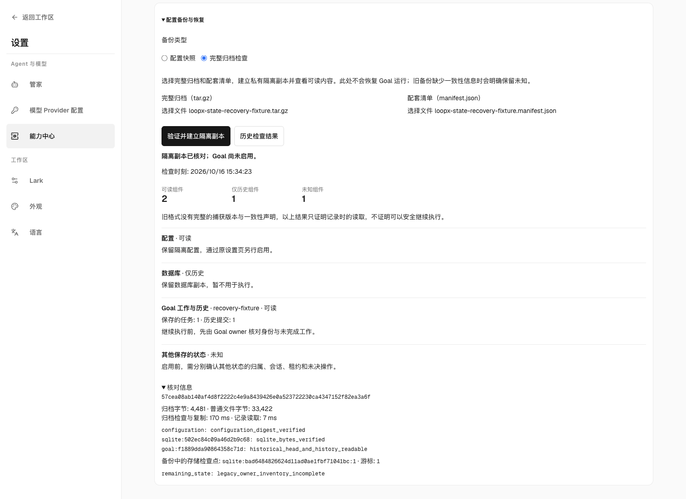

# Configuration backup and recovery

`backup-state --execute` includes a first-class `configuration-backup.json`
component beside the physical archive. It captures the stored machine
configuration and complete source-owned Goal registry rows, including explicit
capability overrides, storage intent, extension fields, nulls and disabled
values. It resolves shared registry entries to their canonical project registry;
an effective/public settings projection cannot replace the stored configuration.
Unreadable or ambiguous source ownership aborts publication of the backup.
Capture compares the complete transport result with its source values; an
unrepresentable value (such as an integer rounded by JavaScript) aborts instead
of publishing a lossy checkpoint or replacing an earlier backup.

Use a configuration-only backup without copying databases, Host sessions,
credential stores, skill directories or automation state:

```sh
loopx --runtime-root /absolute/runtime --registry /absolute/registry.json \
  --format json configuration-backup export --goal-id example \
  --output /absolute/operator-owned/configuration.json
# Review scope, then repeat with --execute. Export never replaces an existing file.
loopx --runtime-root /absolute/runtime --registry /absolute/registry.json \
  --format json configuration-backup export --goal-id example \
  --output /absolute/operator-owned/configuration.json --execute
loopx --format json configuration-backup verify \
  --input /absolute/operator-owned/configuration.json
loopx --format json configuration-backup restore \
  --input /absolute/operator-owned/configuration.json \
  --expected-sha256 SHA256_FROM_VERIFY --destination /absolute/new-checkpoint
# Review, then repeat with --execute.
```

Omit `--goal-id` to include all Goals in the invoked registry; repeat it to
select several. Full `backup-state` captures its global discovery registry by
default, or the selected project registry with `--current-project-only`. The private
archive manifest reports configuration verification and presence separately.

For a reviewed cohort on a host with unreachable historical source registries,
repeat `backup-state --configuration-goal-id example` to select the embedded
configuration checkpoint. This uses the same strict source-owner capture as
`configuration-backup export --goal-id`; a missing selected source still aborts.
Omitting the flag retains all-Goal capture and its failure behavior. Physical
state discovery remains unchanged: the archive retains reachable state and raw
registry/history bytes, while `configuration_goal_ids`, `missing` and the
verified configuration component expose the coverage limit. A selected cohort
does not prove configuration recovery for omitted Goals.

中文：历史源 registry 失联时，可显式重复 `--configuration-goal-id` 选择已审查的
配置备份范围；所选源仍须严格校验，默认全量配置捕获不变。完整状态发现不收缩，
原始 registry、历史和可达状态照常保存，清单明确记录配置范围及缺失项；不能把
成功归档解释为已恢复未选 Goal 的配置。

With `--current-project-only`, physical discovery also includes the selected
project's registered `state_file` and `source_registry` routes, including custom
paths outside conventional Goal directories. Relative routes resolve against
the registered repository. The selected project's `.loopx/registry.json` owns
this scope, even when `--registry` names another project. Other projects are not
followed; default host-wide discovery continues to use the global registry.
For global discovery, the existing canonical source route owns the Goal: relative
`source_registry` values resolve against the global registry's parent, and the
source registry supplies the current repository, full `state_file` and declared
`common_runtime_root`. Distinct source runtimes are captured once and shared by
their Goals. Review the dry-run paths before execution: this can include more
private state than the shared runtime alone. An unavailable source or an
undeclared external runtime remains missing; discovery does not copy an implicit
host-wide default to fill that gap.

Inspect `included`, `missing` and `warnings`: successful publication alone does
not prove every registered source was reachable. Full-state copies retain raw
Markdown history and runtime files; inert extraction does not import their
leases, pending effects or historical receipts as new execution authority.

Discovery uses the same registry reader as configuration capture. Legacy project
objects and valid strict-v1 project envelopes both retain their declared external
routes and the original registry bytes. A readable envelope's minimum writer
protocol does not authorize a writer: backup only preserves data. Invalid
envelopes and lifecycle-only `source_session_v1` project registries still refuse
publication; global discovery registries remain object-only. This does not
qualify lifecycle journals for capture or change the v0 consistency and recovery
holds below.

New v0 archives record `registry_discovery.goal_runtime_roots` as archive-relative
capture bindings. Inert owner inspection reads each Goal from its captured source
root. An absent Goal binding, an explicit null, a missing directory or a symlink
root remains unknown; another runtime's same-named Goal is not a substitute.
Bindings must name safe included roots. Historical archives without the entire
binding map retain their original `runtime-root` readback. The map records capture
location, not cross-owner consistency, complete owner coverage or activation
eligibility.

中文：状态发现与配置捕获复用同一个 registry reader；旧对象格式及有效 strict-v1
项目信封均保存声明的外置路径及原始 registry 字节。可读信封的最低 writer 协议
不授予写入权，备份只保留数据。无效信封和仅供生命周期操作的 `source_session_v1`
项目仍拒绝发布，global registry 仍只接受对象。这不代表已完成生命周期日志捕获
资格，也不改变下文 v0 的一致性限制与恢复 hold。

全局发现沿用 canonical source 路由：相对 `source_registry` 以 global registry
父目录为基准，当前仓库、完整 `state_file` 与显式 `common_runtime_root` 均来自
源 registry；多个 Goal 共用的 runtime 只捕获一次。执行前检查 dry-run 路径，
捕获范围可能比共享 runtime 更大，并包含私有状态。源不可达或外部 runtime 未声明
时保留缺失，不擅自复制隐式主机默认目录。`--current-project-only` 仍保留所选
runtime 及以注册仓库为基准的历史相对路径规则。

新 v0 清单的 `registry_discovery.goal_runtime_roots` 只记录归档内的源位置，隔离
读回按此定位；缺少 Goal 条目、null、目录缺失或根目录是符号链接均为 unknown，
不能拿另一 runtime 的同名 Goal 代替。绑定必须指向安全且已列入清单的根路径。
完全不含此映射的旧归档继续按 `runtime-root` 读回。映射不证明跨 owner 一致性、
owner 完整覆盖或可激活性。

Settings → Capability Center → **Configuration backup and recovery** offers
download, file verification and isolated recovery through the same typed owner.
Device scope includes all invoked Goals and machine settings; Goal scope
includes the selected Goal plus machine settings. Recovery reports a relative
checkpoint reference under the runtime's `backups/configuration/`. A duplicate
restore rejects the occupied destination; it does not silently replace it.
CLI destinations require an existing physical parent and a new directory.
Symlink ancestors and occupied/dangling destinations are rejected.

Known invalid envelopes, changed or mismatched digests, and unsafe destination
parents retain their specific refusal messages through the typed runtime and
CLI. An already occupied destination is a state conflict. These use the existing
`request_rejected`/`conflict` error categories; CLI refusals still exit with code
1 and never activate settings or overwrite a checkpoint. Filesystem errors and
unexpected readback failures retain the runtime's protected diagnostics. The
browser keeps its existing bounded recovery error and permissions.

中文：配置、摘要或目标父目录不合法时，CLI 保留具体拒绝原因；目标已占用按既有
状态冲突分类。拒绝仍返回退出码 1，不覆盖检查点或激活设置。文件系统与未知读回
故障继续使用受保护诊断，浏览器的恢复错误及权限边界不变。

## Configuration is not activation

The checkpoint contains the original envelope, the machine configuration at
`machine/configuration.json`, individual Goal rows under digest-named `goals/`
files, and a verified receipt. It creates no live registry, provider selector,
writer fence, lease, Host session, grant or timer. Unknown optional configuration
is preserved as data; its original installed owner must validate it before use.
Restoring these values is not proof that an optional provider is installed.

Adopt reviewed machine namespaces through `machine-config preview/apply`
(or the existing settings editor), preserving destination siblings. Adopt Goal
overrides through `configure-goal` or the existing revision-checked Goal editor;
remap paths and identities and verify effective readback. These owners retain
their current revision, permission, global-sync and rollback contracts. This
checkpoint is not an alternate configuration authority or a batch-activation API.
Rollback live settings through their owning transactions; an unused isolated
checkpoint may be removed without changing live settings.

In particular, three facts are different: a Markdown display file exists;
`goal_storage.new_goal_provider` requests SQLite for future Goals; and the live
Todo authority actually reads from `sqlite_v0`. Missing machine configuration
retains the existing File default. Applying a default after creation does not
retarget an existing Goal. Follow [new-Goal storage and provider selection](local-authority-provider-selection.md)
and [reviewed promotion](reviewed-coordination-promotion.md), then inspect the
real Todo `authority_read` after cutover. An isolated SQLite archive or a
configuration value alone cannot satisfy live provider acceptance.

## Physical file witnesses

Full `backup-state --execute` now records `execution.file_members` in both the
in-archive manifest and the external manifest/readback. Each regular tar member
has its archive path, copied byte count and SHA-256. Ordinary files are hashed
while tarfile reads them; the witness never comes from rereading a source after
it changed. SQLite members use the existing verified private snapshot, and
`configuration-backup.json` witnesses its generated bytes. Unknown Markdown
metadata, historical lease files and original receipts remain raw data.

Inspect the private external manifest with
`jq '.execution.file_members' loopx-state-BACKUP_ID.manifest.json`. To validate an
isolated restore, independently hash each listed regular member and compare its
byte count. The list excludes the self-containing `manifest.json`, directories
and tar links; retain the existing whole-archive checksum for their integrity
and inspect link destinations separately. Earlier backups may lack this list;
its absence does not grant migration qualification or erase their recovery
support. A failed or short source read leaves an earlier backup intact.

These witnesses describe saved bytes, not one atomic observation of all live
writers. A reviewed cold import still needs complete source discovery, writer
and Host quiescence, lease/outbox disposition, immutable source/target binding,
explicit confirmation and original-operation recovery. Neither this manifest
nor configuration verification authorizes an import or a new execution grant.

Full backups also compare the registry and stored machine-configuration bytes
actually decoded into `configuration-backup.json` with every mapped regular tar
copy. Missing witnesses or different bytes refuse publication; an owner-confirmed
absence also refuses when the archive contains that source's earlier file.
A revision mismatch reports
`backup configuration source differs from copied bytes; retry the backup`.
This tightens the earlier best-effort behavior that could publish older raw
configuration beside a newer checkpoint, or claim absence beside an earlier
file. Self-contained local aliases resolve through saved tar metadata to an
included regular target witness; repointing a live symlink cannot select another
saved target. A retained tar link also prevents a false absence. A later
source-path reread cannot replace the snapshot witness: an
A → B → A change must still be caught when the checkpoint used B. A malformed
or unreadable machine source is not a confirmed absence. Unchanged sources
retain the same configuration envelope and v0 archive format. The bounded
migration backup keeps its existing source-owner witness contract. Older
archives remain readable under the existing recovery holds.

The private `execution.configuration_capture` records the configuration capture
interval and matching member revisions, including routed registries and the
stored machine configuration when present. These are configuration-owner IO
facts; they do not establish a common point in time with authority, effects or
other owners, or qualify the M2 `online` profile.

中文：完整备份将配置 owner 实际解码的 registry 与 machine 配置字节，同每份
映射的普通 tar 副本比较。缺少见证或字节不同就停止发布；owner 确认源不存在而
归档仍保留其旧文件，也会拒绝。原先可能发布“旧原始配置 + 新 checkpoint”或把
旧文件误作不存在的 best-effort 行为因此收紧。自包含链接复用归档内普通目标文件：
硬链接与符号链接只按保存的 tar route 解析，live 链接改向不能重选别的见证；保留的
tar 链接也不能
被误判为不存在。比较的不是事后重读路径，所以配置
使用 B 后即使源回退为 A 仍会拒绝。损坏或不可读的 machine 源不当作确认不存在。
未变化来源、v0 格式和历史归档读回保持兼容；有界 migration backup 仍使用原
source owner 的见证契约。私有 `execution.configuration_capture` 记录配置捕获
区间与匹配成员 revision，包括外部 registry 和存在的 machine 配置；它不证明
与 authority、effect 等其他 owner 的跨源同时刻，也不代表 M2 `online` 合格。

New full-backup plans also bind the registry bytes used to discover documents,
source runtimes and lifecycle journals. The private
`registry_discovery.source_capture` freezes their read interval, hashes and
archive routes; publication checks those hashes against the saved members.
Changing a declaration after planning now reports
`backup discovery source differs from copied bytes; retry the backup` instead of
saving old dependencies beside a new registry. Rebuild the plan and retry with
fresh output names. Any registry byte change can require a retry, including
unrelated metadata. Routing and configuration decoding reuse the same immutable
registry reads. Historical plans without this evidence remain readable, and
migration-only backups retain their existing contract. This IO agreement does
not freeze document contents or establish a complete recovery-set profile.

中文：新完整备份计划还绑定发现文档、源 runtime 和生命周期日志时实际读取的
registry 字节。私有 `registry_discovery.source_capture` 固定读取区间、哈希与
归档路径，并在发布前核对已保存成员。计划后声明改变会拒绝发布，避免保存
“旧依赖 + 新 registry”；应重新规划并以新输出名称重试。任意 registry 字节变化
（包括无关 metadata）都可能要求重试；路由与配置解码复用同一不可变读取。
历史计划和迁移专用备份保持原契约。这不冻结文档内容，也不使完整恢复集合格。

Full-backup discovery also retains declared local `authority_sources` entries
with `kind=goal_doc`, including documents outside conventional state directories.
The existing material resolver confines reads to the selected Goal's repository,
state and runtime roots; a missing or out-of-scope document is reported in the
private missing-source inventory. A directory is not treated as a document.
Global discovery uses the actual source-owned Goal declarations, not the cached
shared row. Hash-only registrations and links inside document text are not
permission to discover more files.

For a registered Goal, discovery also retains existing registration, recreation
and Turn-settlement directories beside its actual registry. The same lifetime
path helpers are used by their existing writers. Discovery scopes these paths
by Goal identity, does not sweep the sibling lifetime root or initialize absent
state, and does not resume any restored journal. Full archives can consequently
contain additional private source bytes; the migration-only backup is unchanged.
These are raw, individually witnessed historical files. They establish neither
an owner export, a consistent capture profile nor permission to reactivate.

中文：完整备份新增保留已声明的本地 `kind=goal_doc` 文档，以及实际 registry
旁按 Goal 身份定位的注册、重建和 Turn-settlement 目录。文档沿用既有材料解析器
的 repo/state/runtime 读取边界；缺失或越界文档进入私有 missing 清单，目录不被
当作文档。全局发现使用真实 source-owned Goal，不采用共享缓存行的材料声明；
不会从哈希引用或正文链接继续抓取。生命周期目录复用实际 writer 的路径 owner，
不扫描整个相邻目录，不创建不存在的状态，也不执行恢复日志。因此完整归档可能
包含更多私有原始字节；有界 migration 备份不变。这些仍是各自见证的历史文件，
不证明 owner export、一致性 profile 或再激活权限。

## Moving an Agent to another environment

The desired result is continued work with the Goal, full Todo/history, necessary
Agent context, materials and capability configuration available at the
destination. The current backup/inspection entry does not deliver that result:
it creates readable isolated evidence and grants no destination execution.
The [planned-transfer proposal](../architecture/rfcs/complete-state-recovery-v0.md#planned-agent-transfer)
defines one prepared source-to-destination journey and its required product,
identity, credential and failure-recovery boundaries. It is not an available
transfer command or a qualification claim.

`migrate-state` is the retained legacy Goal Harness copy tool. Both its dry-run
and execution now check source and destination eligibility, including the old
runtime of an existing target registry. A canonical provider, promotion fence
or protected shadow source refuses instead of producing a successful copy
preview. This is a change to preview behavior; execution keeps its existing
locked recheck. A valid preview can become stale and grants no future write.
Do not use this command or an isolated `authority-archive restore` as a shortcut
to resume a modern Agent from a backup.

中文：目标是让 Agent 带着目标、完整待办/历史、必要上下文、材料和能力配置，在
目标环境继续工作。当前备份检查入口只提供隔离可读证据，尚未完成这个结果。
[计划内迁移提案](../architecture/rfcs/complete-state-recovery-v0.zh-CN.md#planned-agent-transfer)
定义完整旅程及产品、身份、凭证和失败恢复边界，不是已经可用的迁移命令。
`migrate-state` 仍只复制旧 Goal Harness 状态；现在 dry-run 和执行都会检查源端、
目标端及目标 registry 原 runtime 的准入，canonical/fence/受保护 shadow 均拒绝。
这是预览行为变更；执行时仍在原锁内重验，成功预览不保证以后可写。该旧工具和
隔离 `authority-archive restore` 都不能作为备份后恢复现代 Agent 执行的捷径。

### Source stop, admission closure and lease drain

These existing operations have different responsibilities. `goal-lifecycle`
stop suspends automatic advancement; it preserves an already admitted Agent's
lease and permits its authorized Todo writeback. It is not a quiescence receipt.
Withdrawing registered source peers rejects their current Todo writes and fresh
lease acquisitions, but does not release stored lease tuples. Lease inspection
can therefore report `active: false` with `executor_constraint.reason` equal to
`owner_not_registered` while the retained `lease.status` is still `active`.
That effective constraint must not be mistaken for a drained lease: membership
can be restored during recovery.

The exact original owner/key/version can still release a lease after withdrawal.
After that release, restoring membership does not revive its old execution proof.
A planned-transfer operation must compose these owners, settle in-flight work
and external effects, preserve their original receipts, and separately establish
destination admission. Neither stop nor withdrawal certifies that a process has
stopped or that an external effect has completed. The CLI/provider regression
in `test_planned_transfer_source_boundary.py` checks these distinctions on File
and SQLite, including a cold runtime; it does not qualify a complete transfer.
This is an integration contract, not an instruction for users to stitch a
migration together manually.

中文：停止 Goal 只暂停自动推进，保留已获准 Agent 的租约和合法 Todo 回写，
不证明源端已静止。撤回已注册 peer 会拒绝其当前回写和新租约申请，但不释放
保存的租约；检查中的 `active: false` 可能只是 `owner_not_registered` 的有效性
限制，原 `lease.status` 仍为 `active`，恢复成员资格可能重新使它有效。
原 owner/key/version 在撤回后仍可精确释放租约，释放后的旧执行证明不会因重新
注册而复活。迁移编排须组合这些 owner，排空在途工作、确认外部 effect 的实际
结果、保存原 receipt，并另行完成目标准入。stop 或撤回都不证明进程已停止、
外部操作已完成。File/SQLite 及冷启动回归只验证这些现有边界，不代表完整迁移
已交付；这也不是要求用户手工拼接迁移步骤。

The planned-transfer implementation under development retains original indexed
run artifacts with the closed Turn and quota history. Ordinary destination
history and same-effect spend replay read those verified local copies, including
original spends and voids; an empty live destination index does not erase prior
usage. Original receipt bodies and source addresses remain unchanged. Artifact
addresses in the read model point to the retained local copies and carry their
original paths separately. Missing, changed, linked or unbound history holds
instead of reporting zero usage or repairing from the old source. Unrecognized
or missing indexed source artifacts must be reconciled before preparation.
Existing destination accounting also rejects staging before its Goal/provider
is published; later accounting is preserved and requires its recovery owner.
These are historical projections while the destination remains stopped; they
do not adopt live accounting, configuration, credentials or execution authority.
Final cutover, destination admission and the packaged continuation journey are
still separate, unqualified parts of this implementation.

中文：开发中的计划内迁移将原索引所指的运行产物与已结算 Turn、扣额和冲销
历史一起保留。目标普通历史和同 effect 扣额重放读取经核验的本地产物，不能
因为目标当前索引为空就丢掉已有用量。原 receipt 正文和源地址不改写；读模型
提供本地保留地址，并另存原地址。历史缺失、改变、链接或绑定损坏时明确拒绝，
不回报零用量、不从旧源修补；源端不支持或缺失的索引产物须先由原 owner 处理。
目标已有账务时，在发布 Goal/provider 前拒绝导入；后写账务保留，交原 owner 恢复。
目标仍停止，这些历史投影不授予当前扣额、配置、凭证或执行权限；最终切换、
目标准入及打包后的继续工作旅程尚未资格化。

## Full-state recovery after cold import

Keep the reviewed pre-import backup as well as a new full-state backup after
canonical writes. The latter saves the current provider head and committed
journal together with the original capture, rollback and released-lease files;
it does not replace the former's original Markdown bytes with their later display
projection. Inspect registered-source discovery and verify every saved member
before using an independently extracted copy.

File/SQLite qualification now composes the real CLI cold import, a later Todo
write, full-state backup, inert extraction into an empty directory and fresh
provider/history readback. The original project and runtime are made unreachable
before readback, so stale absolute paths cannot make the check read the original
store. The restored committed journal is compared in full through the existing
`authority-archive audit` owner; missing selected-provider storage rejects
without creating a replacement or falling back to File.

This qualifies retained bytes and independent historical reads, not live recovery.
The copy retains historical identities and released lease facts as data. Do not
register it as a second live Goal or start a Host using an old grant. Explicit
identity/path adoption, pending-effect disposition and authorized reactivation,
including their App journey, remain separate acceptance work.

## Full-backup publication and retries

Full `backup-state --execute` now requires unused archive **and** manifest names.
Unlike the earlier two-file replacement, it never overwrites either existing
file, directory or dangling symlink. Reusing `--backup-id` in the same output
directory fails; omit it for a new timestamp or choose a fresh id/output directory.
A dry-run does not reserve these names.

The producer publishes the manifest first and archive second, preferring exclusive
links from private staging. If filesystem policy does not support linking, it
copies through exclusively created private files instead; that fallback adds a
file copy and may expose an unfinished file while writing. It never falls back
to replacement. Concurrent producers cannot both publish the same names.
This is not an atomic two-file transaction:
interruption or an I/O error may leave an incomplete pair, and a lost response may
leave a complete pair. Preserve those files and verify that both exist and the
archive checksum matches the manifest before using them. A retry never deletes
partial output or treats its presence as success; use fresh names for a new capture.
Earlier backup pairs remain untouched.

This protects captured bytes and their verification identity. It does not provide
cross-owner capture consistency, recover volatile work, or reactivate a Goal.

中文：完整备份现在拒绝复用已占用的归档或清单文件名，不再覆盖旧文件。预览不保留
名称；执行以排他方式先发布清单、再发布归档，优先使用硬链接；不支持链接时，通过
排他创建的私有文件复制，多一次文件复制，写入中可能看到未完成文件，但不会覆盖。
并发同名备份至多一个成功。中断可能留下不完整文件对，响应丢失也可能留下完整文件对；
应保留现有文件，先检查两者及归档校验和，再使用新的备份 id 或输出目录重新捕获。
命令不会自动删除部分输出，也不会因文件存在就宣称成功。这不证明跨 owner 一致性
或恢复后的执行权限。

## Inspect a complete backup without activating it

In **Settings → Capability Center → device defaults → Configuration backup and
recovery**, choose **Full archive inspection**. Select the original `.tar.gz`
and matching external `.manifest.json`, then choose **Verify and create isolated
copy**. The existing configuration-snapshot option remains separate. Full-archive
inspection is a machine-level operation; it is not shown in single-Goal scope.
Unsupported services/platforms keep the operation unavailable.

The local server streams the two uploads into private temporary inputs. It checks
the archive digest before decoding tar data, then checks embedded/external
manifest agreement, paths, links, member hashes and extraction capacity. Only a
new inert checkpoint can be published. It reads configuration and selected
File/SQLite authority through their existing owners, including the complete Todo
read model and committed history. Original registry paths are never followed.

The result separates **readable**, **historical only** and **unknown** components,
with an owner and one next action. SQLite bytes alone do not prove a readable Goal
work model. Remaining v0 state has no complete owner inventory, so it stays
unknown; every v0 audit carries `legacy_manifest_incomplete`, stays `held`, and
reports `execution_authority_granted=false` and `activation_eligible=false`.
No Goal is registered, no provider is selected, and no Host, lease, timer or
pending external operation is resumed. This is the M1 inspection path in the
[complete recovery RFC](../architecture/rfcs/complete-state-recovery-v0.md),
not controlled reactivation.

Readable File/SQLite Goal components retain the `provider_revision` and `cursor`
read from the captured authority after its complete head/history check. The JSON
audit, CLI summary and the packaged view's existing **Verification details** show
that historical checkpoint, even when the original source is unavailable or has
later commits. Saved-report readback preserves the recorded position; older
reports without it keep the checkpoint unknown. These are positions in the saved
component, not producer capture intervals, a shared consistency point or current
execution authority. Other owners and M2/M3 qualification remain unchanged.

中文：可读 File/SQLite Goal 的报告保留隔离副本实际读取的存储版本和游标，
可在 JSON、CLI 和原有“核对信息”中核对。来源之后的新提交不会成为这份备份的
恢复位置；历史报告重读保留原值，旧报告缺少该信息时仍为未知。这只标识保存组件的
历史检查点，不证明跨 owner 捕获一致性，也不授予继续执行的权限。

These public synthetic scenes use the existing offline owners after source
loss. The configuration and phone references use a built wheel and real File
backend; the current desktop checkpoint view uses the packaged bundle and real
SQLite backend. None registers the saved Goal. The phone view is explicitly a
historical report, and checkpoint identifiers stay behind Verification details.

| Before: configuration only | Inert full-archive inspection | Phone historical readback |
| --- | --- | --- |
|  |  |  |

Use **Previous inspections** after reloading to read the saved, digest-checked
report. A historical report describes its recorded observation time; reading it
again does not reverify copied data. A damaged new input clears the prior success
view and leaves existing checkpoints intact. If a response was lost, **Check for
an existing result** reads the original checkpoint; a repeated write to that
occupied target is refused.

**Verification details** retain the archive byte size, copied regular-file
bytes (including the embedded manifest), and two measured phases. Archive
processing covers input checks, both scans and copying; owner reads cover the
isolated configuration/storage audit. Durations use monotonic clocks and exclude
HTTP upload, verifier process startup, the final source rehash/report publication,
and historical readback. They describe processing cost, not end-to-end recovery
time or a deadline guarantee. Earlier reports without measurements show that
absence instead of zero. Reading history preserves the original measurements.

The additive CLI route preserves existing backup creation syntax:

```bash
uv run --extra test loopx --format json backup-state verify \
  --archive BACKUP.tar.gz --manifest BACKUP.manifest.json \
  --destination NEW_PHYSICAL_DIRECTORY

# Explicitly create and inspect that new inert copy.
uv run --extra test loopx --format json backup-state verify \
  --archive BACKUP.tar.gz --manifest BACKUP.manifest.json \
  --destination NEW_PHYSICAL_DIRECTORY --execute
```

Preview checks archive/manifest bytes and capacity; owner records are not yet
read and no zero-readability result is invented. Execution writes `data/` and
`recovery-audit.json` below the new destination. Source archive and manifest must
be private regular files; the destination must not exist and its ancestors must
be physical directories. Existing targets are never replaced. Browser callers
use opaque upload/checkpoint refs and cannot supply filesystem destinations.
Uploads expire after an hour and are cleaned by a later upload; completed audits
are retained. Removing these inert copies cannot undo or authorize live state.

The first profile is POSIX with local File/SQLite state. Bounds are 128 MiB
compressed archive, 512 MiB expanded tar stream, 16 MiB external/embedded
manifest, 20,000 entries, expansion ratio 2,000, 128 KiB per extended tar header
and 16 MiB total extended metadata. Paths have at most 64 components, 1,024
characters and 255 UTF-8 bytes per component; JSON nesting is bounded at 64.
Owner inspection permits 128 Goals, 128 SQLite files and 20,000 committed
transactions per Goal. Overflow refuses publication rather than truncating a
required inventory. Internal symlinks remain inert; escaping/cyclic links,
hard links, sparse or special files and normalized name collisions reject.

Archive parsing never loads restored code. Database/domain inspection runs in a
disposable verifier with a 90-second deadline and a 512 MiB V8 heap ceiling.
SQLite gets a 64 MiB process-local [hard heap limit](https://www.sqlite.org/pragma.html#pragma_hard_heap_limit);
this is why that verifier is not dispatched in the shared Effect daemon. Views
and virtual tables cannot masquerade as authority tables. WAL-mode copies and
unsupported/service-owned providers remain unknown and need their existing
owner; PostgreSQL is never contacted. The normal 2 MiB RPC wire is unchanged;
only the two complete-manifest checks opt into the existing 64 MiB private-file
transport. These unchanged bounds are approved for local POSIX File/SQLite
inert inspection by the [recorded maintainer decision](../architecture/rfcs/complete-state-recovery-v0.md#m1-capacity-default-decision).
Compound worst cases and broader platforms/providers remain unqualified; no
production SLO or merge authority follows from capacity consent.

### Native authority capture in new full backups

Ordinary full backups now also call the existing authority archive owner for
each configuration-selected local Goal. The private `execution.authority_captures`
rows bind the configuration checkpoint digest and captured runtime route to an
actual capture interval, provider/store identity, revision, cursor and native
history export. Selector and writer-fence bytes, including confirmed absence,
travel beside that export with their byte digests. Missing authority is not
initialized; a dependency or store-lineage change during export leaves that
Goal's capture unknown. Ordinary concurrent appends may continue: the archive
owner verifies the complete retained prefix at its captured cursor.

Inspection prefers this owner export when the new rows are present. It verifies
the full transition/receipt chain and reads the Goal/Todo model through the
existing typed owners. A damaged or missing native capture stays unknown even
when the earlier raw store copy is readable. An independent valid native export
can remain readable when a raw database is unreadable; that database still has
its own unknown storage finding and is never queried through restored views.
Older v0 archives without these rows retain their existing raw-store inspection.
Explicit migration-only backups keep their existing capture contract.

After inert verification, the native artifact is at the row's `archive_path`
under the new destination's `data/`. Its `archive.archive_sha256` is the native
archive's chained seal, **not** the file byte checksum. Existing
`authority-archive verify`, `restore` and `audit` can independently verify,
restore to a new standalone store, and check every original receipt. Those
operations grant no Goal, lease, session or effect admission; follow the
[existing recovery contracts](../architecture/rfcs/complete-state-recovery-v0.md#relationship-to-existing-recovery-contracts)
and owner cutover rules before live use.

The additional logical export preserves the raw safety copy and consumes the
same unchanged archive, history and verifier budgets. It is not a shared epoch
with configuration, quota, session, scheduler, material or external-effect
owners. Every audit remains `held` / `legacy_best_effort`; M2 profile
qualification and M3 activation remain open. Rollback is to the earlier producer
for future backups; already-created artifacts remain private inert data.

新完整备份会通过既有 authority owner 保存各 Goal 的完整历史前缀，并绑定配置摘要、
来源 runtime、实际捕获区间、provider/store 身份、revision、cursor，以及 selector 和
writer fence 的原始字节或确认不存在。并发追加可继续；捕获中依赖或存储身份变化、
来源缺失时保持 unknown，不会初始化来源。新格式优先检查原生导出，损坏时不会用较早
的 raw copy 冒充成功；旧 v0 和专用迁移备份保留原有规则。导出可由现有
`authority-archive verify` / `restore` / `audit` 独立核验和恢复到全新隔离 store，
不会激活 Goal、租约、会话或外部操作。额外历史占用原有容量预算；跨 owner 一致性、
M2 完整资格和 M3 执行准入仍未完成，报告继续保持 held。

### Choosing backup inspection or a research checkpoint

Use this Settings entry or `backup-state verify` to read a complete archive when
the original source is unavailable. Its tasks/history are historical evidence;
unknown components remain unknown, and the report does not resume work.
[Research checkpoints](research-checkpoint.md) instead capture a settled research
boundary and explicitly admit a distinct Goal/session before adopting context.
They already reuse backup inventory and SQLite snapshot owners, but their
component format is not accepted by `backup-state verify`, and a full archive
is not a research checkpoint input.

The [shared-owner and staged recovery contract](../architecture/rfcs/complete-state-recovery-v0.md#backup-inspection-and-research-checkpoint-reuse)
keeps format/capture qualification in M2 and guided continuation in M3. No manual
format conversion can establish missing authority or consistency. Keep the
original archive and read the existing report's component states and holds;
automatic activation and the joint recovery journey are not available in M1.

中文：完整备份检查用于原来源不可用时找回可读任务和历史；报告不恢复执行。
研究 checkpoint 用于已稳定的研究边界，在独立 Goal／会话准入后显式采用上下文。
两者已共用备份清单和 SQLite 快照，但格式不互换。缺失组件或捕获事实仍为未知，
不能手工改格式来取得权限；M2 负责资格，M3 才交付引导式继续工作，M1 保留原报告
的状态和 hold 供读取。

### Measured local capacity cases

At source `884eae425c77ae6db9d8042bd98ee19663e7bdd4`, disposable native backups
were inspected through the real `backup-state verify --execute` CLI after hiding
their original project/runtime/registry. Measurements used macOS arm64, Python
3.11.7 and Node 22.22.3. Times below include the verifier command, not backup
creation; peak RSS is the macOS `time -l` command metric, not a simultaneous
process-tree total. These are individual synthetic observations under local
development load, not latency targets or proof that all maxima combine.

| Native input / boundary | Result | Wall seconds | Peak RSS MiB |
| --- | --- | ---: | ---: |
| 511 MiB zero-filled regular file | Held audit; captured configuration readable | 4.941 | 97.8 |
| 512 MiB regular file plus archive metadata | Refused: expanded capacity | 1.931 | 88.2 |
| 127 MiB seeded incompressible file; 133,212,049 archive bytes | Held audit | 1.284 | 100.6 |
| Archive input 134,217,729 bytes | Refused before decoding: archive capacity | 0.521 | 81.5 |
| External manifest padded with JSON whitespace to 16 MiB | Held audit; bounds input bytes, not maximum structured metadata | 0.945 | 113.8 |
| External manifest 16 MiB + 1 byte | Refused: manifest capacity | 0.520 | 81.4 |
| Exactly 20,000 archive members | Complete inventory and held audit | 8.698 | 225.8 |
| Exactly 20,001 archive members | Refused: member capacity | 1.888 | 143.8 |
| 128 native File Goals, one retained task/commit each | All 128 Goal records readable | 0.843 | 103.5 |
| 128 native SQLite Goals/databases, one retained task/commit each | All 128 Goal records readable; database bytes historical-only | 1.041 | 107.1 |
| 129 File Goals | Refused: Goal inventory capacity | 0.738 | 96.8 |
| 129 SQLite databases | Refused: SQLite inventory capacity | 0.534 | 83.7 |

All refusal cases left no destination or staging directory. The real SQLite
history regression additionally proves that **20,000 committed transactions
are fully read**, while **20,001 refuse publication**. An earlier implementation
incorrectly turned that overflow into an unknown component and published the
copy. The owner now checks the canonical cursor before scanning and propagates
the capacity error instead of treating it as unreadable source state:

```bash
uv run --extra test python -m pytest tests/test_state_recovery.py \
  -k real_sqlite_history_limit -q
```

Keep an over-limit backup complete and use the owning storage recovery process;
do not trim historical transactions to force inspection through this profile.
The optional browser capacity case accepts a native over-limit archive pair via
`LOOPX_RECOVERY_HISTORY_OVERFLOW_ARCHIVE` and
`LOOPX_RECOVERY_HISTORY_OVERFLOW_MANIFEST`, alongside the existing
`configuration-backup` scenario. It must show refusal and retain the earlier
historical report. Installed-wheel checks on Python 3.12.13 and 3.13.12 also
passed normal source-loss inspection and early GNU/PAX sparse/metadata refusal;
they do not expand the capacity observations or qualify other platforms.

中文：在设置的能力中心选择设备范围，打开既有备份入口并切到“完整归档检查”，
选择同一份备份的归档与清单，一次明确操作建立隔离副本。可读、仅历史和未知分别
显示；旧格式始终保留一致性/owner 缺口，不能据此启动 Goal。重载后可读历史报告，
但历史读回不等于重新验证副本。CLI 不带 `--execute` 只做计划，不虚构 owner 读取结果。
当前支持本地 POSIX File/SQLite 检查；Windows、服务端 PostgreSQL、身份接纳和实际
重新启用仍未取得此路径的资格。备份内可能包含私有数据和凭据，副本及上传始终私有。

## Privacy, consistency and limits

Backups are **private by default**. Full Goal rows can contain private paths,
organization data, identity bindings and provider-specific values. Credential
files are not opened by configuration capture, but credentials already embedded
in a configuration remain private data. `privacy_certified=false` never becomes
true because verification passed. A checksum proves content integrity, not
public-safety or authorization. Review and rebuild a separate portable artifact
before transferring it across trust boundaries; retain the private original.

Capture reads each configuration owner independently, without a cross-project
atomicity promise. External files referenced by configuration are dependencies,
not inlined by this component; full state backup retains its existing discovery
scope. Inspect those dependencies and transfer/install reviewed contents
separately. Source-byte differences are not repaired by silently using a settings
summary or dropping unknown fields.

The HTTP restore path uses the existing 64 MiB local-snapshot budget, without
changing the 64 kB ordinary request budget. Oversize or invalid envelopes reject
without partial recovery; CLI/effect transport keeps its existing bounds.
Restored checkpoint files use owner-only POSIX modes. Windows ACL behavior
has not been independently qualified; choose a private destination directory.
Native Windows tests cover the configuration-only CLI export/verify/restore and
local HTTP checkpoint with UTF-8 values. The packaged browser journey, full
state backup, provider promotion, a destination machine and long-duration SQLite
operation remain separate qualifications.
