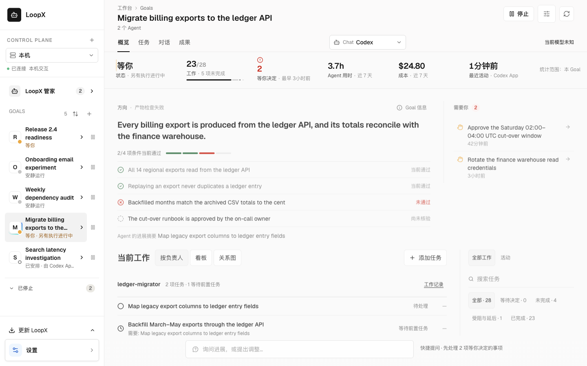
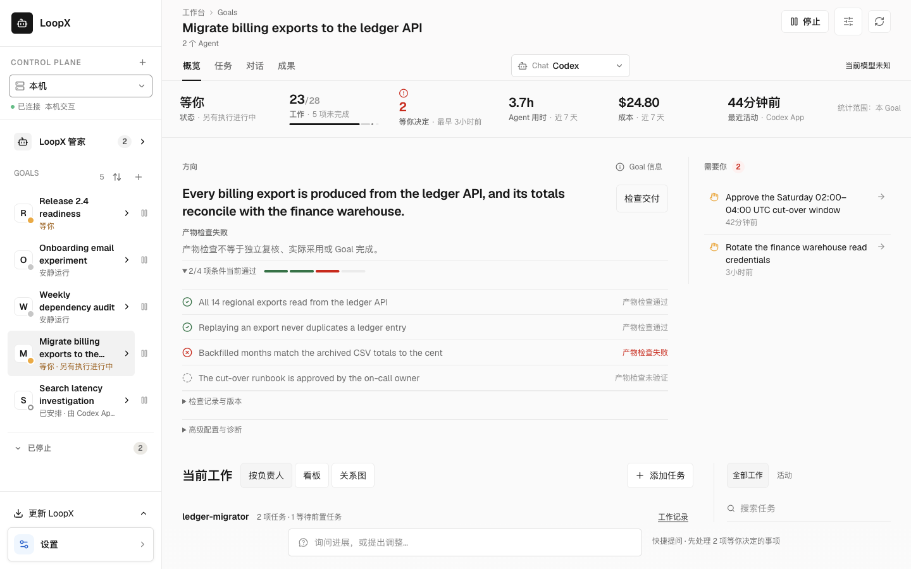
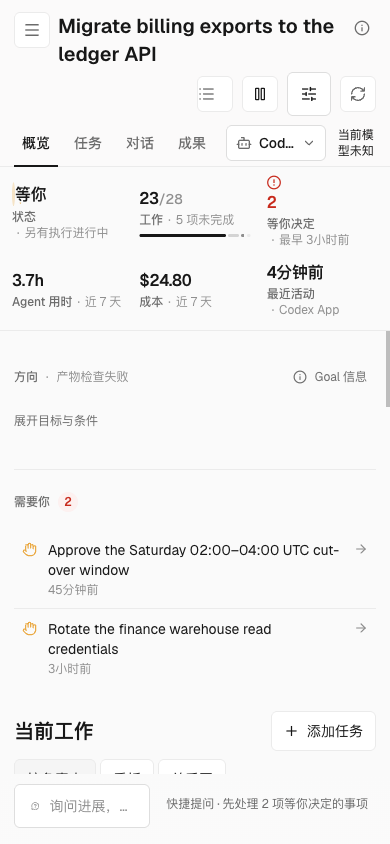
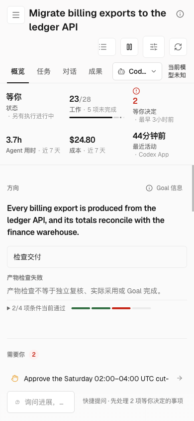

# Goal acceptance observations

Open a local Goal, then **Overview → Delivery & evidence → Acceptance observations**.
The read-only card shows each observed acceptance requirement with its Agent and
observation time, pending gates with their target Agent and decision scope,
and the next action already projected by status. A missing human decision owner
is shown as unknown; the blocked Agent is not assumed to be the approver.

The same projection is available as `run_history.goals[].acceptance_observation` in
`loopx status --format json`; status Markdown includes a compact summary.
The observation card requires no activation or new permission. It changes presentation only;
Todo, gate, quota, settlement, and Goal completion authority are unchanged.

Acceptance requirements reuse the frontier's existing per-Agent vision rules
from already-collected history before display trimming. It does not collect a
complete frontier or audit all Agent lanes. History is bounded, so every
result is partial: no gaps is not successful acceptance. Missing sources and
truncated observations stay visible. Historical lifecycle markers have source
references when available and never override current open gates.

This bounded slice uses `goal_acceptance_observation_projection_v0`. It is not
the broader `goal_artifact_lifecycle_projection_v0` contract proposed by the
[Goal artifact lifecycle RFC](../architecture/rfcs/goal-artifact-lifecycle-projection-v0.md),
whose phases, declared milestones and legal transitions remain unchanged.
No alias accepts that broader schema as this observation payload.
It does not introduce declared milestone authoring, a universal phase sequence,
an exhaustive evidence audit, new legal transitions, or a completion decision.
Legacy sources without the projection display unavailable, not success.
The proposed [Goal direction baseline](../architecture/rfcs/goal-direction-baseline-v0.md)
material declarations and revision-bound usage receipts are not implemented here;
historical progress does not establish that current direction materials were read.

Goal Overview counts only currently passing criteria within the configured
scope. The acceptance owner's `stale`, `held` and task-only `partial` states
remain visible even when the retained receipt has the same contract revision.
All declared criteria remain listed; reading them does not revalidate evidence
or complete the Goal. Historical receipts remain in Delivery & evidence.

中文：概览只统计当前覆盖范围内通过的条款。即使合同版本相同，依据已过期、
关联待确认和仅任务检查通过仍分别显示；所有已声明条款都保留。查看不会重新
验证依据或完成 Goal，历史回执仍可在“交付与依据”中读取。

Status also exposes a separate `run_history.goals[].artifact_lifecycle` readout
and Markdown summary: observed phase, evidence milestones, guards and next steps.
It consumes the current Goal's session-runtime work observation before display
trimming. Outstanding required work keeps the phase `qualifying` even when
Todos are complete and historical progress is reached. An absent work observation
does not invent a work requirement. This v0 readout **never recommends a terminal
transition**: `closing` stays a verification step with the machine-readable
`next_transitions[].reason_codes` value `acceptance_unverified`, both when sources
are missing and when all bounded sources were observed. Consumers use that code,
not English `precondition` text. A Goal already recorded as terminal still displays
`lifecycle_phase: closed` with no next transitions. Adding acceptance-driven
terminal advice requires a separate contract change and producer-side validation.
This readout grants no execution or completion authority; the Dashboard card
above keeps its separate acceptance-observation contract.

Work observation coverage follows the supplied projection, not `adapter.kind`:

| Source delivered to status | Work observation coverage |
| --- | --- |
| Session-runtime adapter, or another adapter emitting the same session-runtime projection | Available only with `session_runtime_readonly_projection_v0`, a matching Goal id, and work facts |
| Adapter without that projection, or a projection with a mismatched schema/Goal id | Unavailable; this readout does not query quota or other lane owners |

Without that source a Goal may read `closing` from Todo/history even when a lane
outside the observation still requires work. Neither `closing` nor absence of
`work_lane_selected` proves all work is complete; the lane and completion owners
retain their decisions.

Validation: `python -m pytest tests/control_plane/test_goal_acceptance_observation.py`
and `python -m pytest tests/control_plane/test_goal_artifact_work_observation.py`,
plus `node examples/dashboard-goal-acceptance-browser-smoke.mjs`. The browser
check consumes real status collection over a disposable synthetic Goal; set
`LOOPX_GOAL_ACCEPTANCE_PACKAGED=1` after the Dashboard build to check shipped assets.

## Owner-authorized contract (v0)

An owner can opt an existing registered Goal into a versioned acceptance contract.
The Goal must already use promoted canonical authority. These commands never
promote a provider or fall back to legacy Markdown when canonical reads fail.
The owner makes three explicit decisions: the objective and its acceptance
criteria, which existing advancement tasks serve those criteria, and whether to
enable this governance. The existing Goal authority owns the contract; the
Dashboard presents its checked result and uses the same owner for authorized changes. No new capability editor or provider is introduced.

For an ordinary delivery, the Agent prepares the technical plan from the stated
outcome and existing task/file context. The local owner sees its objective,
criteria, coverage and command effect beside the delivery, then uses **Use plan
and check** once. A configured contract needs only **Check delivery**. The
advanced JSON import remains available for technical migration; it is not a
prerequisite for this path.

The Overview places this interaction in its Direction brief, before work and
result lists. The same acceptance readback supplies the objective, criteria and
current check result; it is not a second overview controller. Desktop expands
the check details, while phones fold them without hiding the required action,
its command effect or failure feedback. Technical records and migration controls
remain in that disclosure. A configured recheck is a quiet secondary control;
a prepared plan retains its explicit **Use plan and check** decision.

In an explicitly enabled Goal LoopX conversation whose native tool advertises
`prepare_check`, the Agent can call `loopx_collaboration` with
`action=prepare_check`, a stable `operation_id` and the existing acceptance
`document`. The host binds the Goal, registered preparing Agent and runtime;
the model cannot replace those identities or roots. Paused, stopped, obsolete
Turns and revoked execution configuration cannot prepare a plan. A conflicting
retry retains the original proposal and requires reconciliation.

This reuses the existing typed action preview store. It does not add a second
configuration owner or enable LoopX mode automatically. Native thread tool
schemas are fixed when created: an older thread may not advertise this action,
and an unfinished native Goal is never replaced just to add tools. The existing
registered-Agent CLI preparation remains available independently:

```bash
loopx --format json goal-acceptance prepare --goal-id example-goal \
  --agent-id example-agent --document acceptance.json \
  --operation-id prepare-delivery-check --execute
```

Here `--execute` persists only the reviewable proposal. Omit it for a read-only
validation preview. Neither form configures the Goal, approves governance or runs
commands. The local owner's action applies the described configuration and
executes its bounded checks; this is the existing trusted local owner surface,
not an authenticated remote owner decision. Use runtime command names and safe
relative file references in proposals, rather than machine-specific paths.
The original operation identity and native receipts recover a lost response.
Concurrent or repeated apply does not rerun a consumed intent; if a started check
has no matching native receipt, the result stays uncertain until explicitly
reconciled. Readback never runs checks. A stored successful receipt cannot
certify changed files, independent reviewer identity, adoption or Goal completion.
A later finished/cancelled plan does not resurrect an older draft.

Prepared plans bind the reviewed acceptance configuration and declared work,
rather than every update to the Goal's provider revision. Notes and work outside
an explicit `selected_work` scope do not require preparing the same plan again.
Changed covered requirements, a new owner configuration or another Goal instance
still invalidate it. TypeScript classifies that context; each actual write keeps
the current provider CAS. The original operation and configuration context remain
bound to native receipts, including recovery after a lost response. Historical
plans without a reviewed context retain their original strict revision check.

Retrying preparation with the same operation, Goal, preparing Agent and document
returns the original saved proposal, even after unrelated progress or an owner
decision. It does not refresh the reviewed basis, rerun checks or reopen a
cancelled, stale or applied plan. Changed intent still conflicts, and applying
the recovered proposal still validates the current acceptance context. Its
historical receipt is not current acceptance.

Count the complete task: with an Agent-prepared plan already delivered, the owner
has one required decision. If the original request still lacks acceptance intent
or authority, that missing decision is an additional round; preparing a proposal
alone does not establish a one-round cold-start or live-model experience.
No-plan/default-off behavior remains unchanged, and no Lark action is introduced.

中文：普通路径由 Agent 根据目标与既有上下文准备方案，负责人在交付处核对要求、覆盖范围和
执行影响，一次“采用并检查”；已有配置直接“检查交付”。JSON 导入仅保留为高级迁移入口。
`prepare --execute` 只保存可审阅方案，不修改 Goal 规则、不执行检查。丢失回执先对账，
不能自动重跑；历史通过不能认证变化后的版本。交互次数从原始意图算起，前置缺失的意图或
授权不能从计数中省略。此入口沿用可信本机所有者边界，不证明远程身份、独立复核或实际采用。
显式启用的 Goal LoopX 会话在原生工具声明 `prepare_check` 时，可直接准备相同方案；
Goal、Agent 与运行目录由宿主固定，暂停、过期 Turn 或撤销配置后不能继续准备。
旧原生线程的工具声明不会自动升级，也不会为新增工具替换未完成线程；未声明时保留 CLI
准备路径。该入口不自动启用 LoopX、不配置或运行检查。
准备响应丢失后，以相同操作、Goal、准备 Agent 和文档重试会读回原方案及其当前记录状态，
不因进展或所有者决定而刷新审阅依据，也不重跑检查或重新打开已取消、过期、已采用的方案。
意图改变仍报冲突；执行原方案仍检查当前依据，历史回执不代表当前验收。
概览将同一个交付检查交互放在“方向”正文中，先于工作和成果列表；目标、条件和当前结果
使用同一验收读回。桌面展开检查细节，窄屏默认折叠条件、版本记录与高级迁移入口，但不折叠
必需动作、命令影响或失败反馈。已有配置的重查使用次要按钮，待采用方案保留明确的采用决定。
待采用方案绑定实际审阅的验收规则与工作声明；备注或明确范围外的工作变化，不要求重复准备。
覆盖任务要求、所有者配置或 Goal 实例变化仍使方案失效。TypeScript 判断依据，写入继续使用
当前 provider CAS；原操作与配置依据由原生回执保留。旧方案维持原来的严格版本检查。

For advanced CLI configuration, inspect the current provider revision:

```bash
loopx --format json goal-acceptance inspect --goal-id example-goal
loopx --format json todo list --goal-id example-goal
```

Prepare an owner-reviewed `acceptance.json`, replacing the illustrative file
check and task ID with the actual artifact checks and existing advancement task:

```json
{
  "scope": {"kind": "selected_work", "todo_ids": ["todo_deliver"]},
  "objective": "Deliver a checked artifact",
  "non_goals": ["Publish the artifact"],
  "criteria": [{
    "id": "artifact-present",
    "description": "The delivered text artifact exists and is nonempty.",
    "validation_argv": ["python3", "-c", "from pathlib import Path; assert Path('deliverable.txt').read_text().strip()"],
    "validation_timeout_seconds": 5
  }],
  "bindings": [{"todo_id": "todo_deliver", "criterion_ids": ["artifact-present"]}]
}
```

Every new configuration or reconfiguration must explicitly declare coverage:
`selected_work` requires a nonempty list of existing Agent advancement Todo IDs;
`all_advancement` explicitly covers all current and future advancement work.
Prefer selected work for a bounded experiment or delegated artifact. Selection
and binding are separate: selected work with no confirmed binding remains held.
Bindings outside the selected set are rejected. Agents cannot change coverage;
owner configuration still uses preview, provider CAS and exact operation replay.

Legacy persisted documents without `scope` retain their Goal-wide behavior and
original digest. Reading or upgrading does not narrow them. A fresh configuration
without scope is rejected with an actionable error; original committed retries
still recover their receipts. An older runtime that does not understand selected
coverage rejects it rather than silently ignoring it; update readers before an
owner-approved scope change.

Unselected work retains its ordinary validation, claims, leases, permissions and
continuation checks. Selected work cannot edit role/class/status to escape its
contract. Changes to unrelated work do not stale a selected-work verification;
changes to selected work do. The dashboard's acceptance detail, Markdown export and CLI expose coverage.
Configuration continues through the same owner-authorized CAS transition.
No Lark configuration operation is introduced.

**恢复与范围 / Recovery and coverage.** Missing/stale associations trigger scoped
replanning, but a concrete blocker receipt is a wait checkpoint, not a repair or
handoff. Inspect contract coverage before requesting per-task rebinding. If a
bounded experiment accidentally gates independent work, prepare a correction for
the authorized owner, retain all task-level validation and read back runnable work
after applying it. Do not rebind every new task, disable checks, or create another
unbound repair Todo. Contract revision changes invalidate old hold checkpoints.

所有新配置与重新配置都必须明确选择覆盖范围：`selected_work` 只管明确列出的既有推进任务，
`all_advancement` 明确覆盖当前和未来全部推进任务。局部实验应选择前者；选中但未绑定的任务
仍然受阻。旧合同省略范围时保持原来的全局语义和摘要，升级不会偷偷放松。
范围仅由原 owner 配置路径修改；范围外任务继续接受自身的校验、租约和权限检查。
记录阻塞只能暂停重复重规划，不能冒充修复已完成或已交接；应诊断范围、提交具体修正并验证恢复。

Keep executable declarations in the owner's local file; public readback omits
command arguments and output. The configured checks run as bounded argv commands
without a shell, using the existing delivery-workspace validation rules.
Each criterion allows 1–25 seconds and defaults to 5 seconds. The sum of all
criterion timeouts must not exceed 25 seconds. Run longer evaluations outside
the completion wrapper and configure a bounded check of their resulting artifact.

The inline Python example binds its code text in the versioned document. For a
script validator, optionally run `sha256sum verify.py` and add
`"validation_files": [{"path": "verify.py", "sha256": "<64-hex-digest>"}]`
to that criterion, using a delivery-workspace-relative path. The host checks the
declared file bytes before and after the real run to detect changes. This bounded
check does not prove all transitive imports or interpreter/external-tool identity.

Configure without `--agent-id`: registered Agent-role invocations can inspect
and verify, but cannot configure or disable the contract. **This is a trusted
local invocation role, not an authentication boundary.** The CLI relies on
existing local-process and private-runtime filesystem permissions; omitting
`--agent-id` is not authentication. Processes with the same private-runtime
permissions are not isolated from owner operations.

Substitute the exact
`provider_revision` from the preceding inspect, not the acceptance revision:

```bash
loopx goal-acceptance configure --goal-id example-goal --document acceptance.json --expected-provider-revision '<provider_revision>'
loopx goal-acceptance configure --goal-id example-goal --document acceptance.json --expected-provider-revision '<provider_revision>' --execute
loopx --format json goal-acceptance inspect --goal-id example-goal
```

Omitting `--execute` previews configuration. A revision conflict requires a new
inspect and review of the changed basis before retrying. After enablement, the
existing task claim and completion paths enforce the contract: applicable work
with an unbound or stale association is held; the owner must confirm its current
association by reconfiguring. Completion executes fresh bound artifact checks
and retains the existing claim, lease/fence, permission and continuation gates.
A prior verification receipt or a confirmed association cannot complete a task.
Use `loopx todo claim --help` and `loopx todo complete --help` for the existing
task arguments; this contract adds no bypass flags.
When a fresh completion criterion fails, `todo complete` keeps the Todo open
and returns `goal_acceptance_validation_failure_v0` with the criterion ID,
privacy-safe validation status, exit code when available, and a bounded next
action. A dirty or mismatched delivery worktree is diagnosed as a workspace
failure, not as a stale owner association. Commands, output, local paths and
arbitrary runner summaries are not projected. Retry under the same Turn and
current lease after repairing the indicated execution context.

Terminal observations, including `no_followup`, do not change the work digest:
finishing a task must not stale the binding that just admitted its completion.
The v0 binding matcher also accepts a prior digest when the only intervening
changes are a valid append-only completion-validator revision history or added
successor links, or when a previously absent `resume_when` scheduling condition
is added. It checks reconstructible prior states rather than rewriting
owner bindings, so existing ready contracts retain their stored digests.
Revised validators still undergo their own fresh completion check; Goal
acceptance criteria remain separately configured and checked. Text, whether
completion validation is required, repository/write-scope declarations, and
unknown future work fields still invalidate the association. Replacing an
existing `resume_when` is not reconstructible from the latest Todo and remains
`stale`. When no advancement Todo is selectable, both missing (`unbound`)
and stale associations enter the existing agent-scoped recovery lane. Recovery
preserves the original Turn/Todo identity and does not authorize execution of
held work. Inspect a missing association and prepare it for owner confirmation;
for a stale association, inspect the work delta and use the
[exact text/wait restoration](#restore-an-unintended-textwait-edit-after-lease-release)
when possible, or propose the changed association for owner review. An already eligible successor remains a
separate execution identity. Do not create another unbound repair Todo and
mistake its existence for a runnable successor.

Acceptance holds precede general vision gaps in the bounded trigger packet, so
the Agent can read the exact checkpoints that recovery requires. Only an
accepted, evidence-linked runnable successor or concrete blocker receipt covering
the exact hold generation can quiet it. Unrelated progress, a vision rewrite,
or an acknowledgement for another association cannot discharge the hold.
Reconfirming the contract or changing the work rearms recovery. Disabled/absent
acceptance retains its existing behavior. When quota selects replan, candidate
monitors remain inventory; `selected_todo` and `agent_lane_next_action` do not
advertise them as this decision's execution target. Original receipt identities
remain in their settlement contracts. A genuinely Todo-bound replan still
projects its selected Todo; this only removes the unrelated inventory fallback.

Existing enabled contracts configured
with a persisted `no_followup` field under the earlier digest rule require owner inspection and
reconfiguration; no historical receipt is rewritten or automatically accepted.
Disabled/absent acceptance retains its existing behavior.

For an already authorized delegation, `turn plan --todo-id todo_example` and
`turn run-once --todo-id todo_example` select that exact currently eligible work
through the existing quota owner. Omitting the option retains controller
selection. An unavailable task cannot silently select a different one.
The option does not retarget resumed Turns or host sessions and is not exposed
by `turn managed-step`; it grants no new task, lease, budget or completion authority.

Run all configured Goal checks and read back their recorded basis:

```bash
loopx goal-acceptance verify --goal-id example-goal
loopx goal-acceptance verify --goal-id example-goal --execute
loopx --format json goal-acceptance inspect --goal-id example-goal
```

Verification without `--execute` is a preview. In **Overview → Delivery &
evidence**, refresh the snapshot and expand **Goal acceptance contract** below
the delivery chain. It shows the Goal ID, contract revision/digest, criteria,
task associations, and verification results with their own revision/digest.
The section exists only when the server's
`acceptance.goal_acceptance_contract.enabled` is `true`. Missing or disabled
contracts retain the baseline UI and export. The existing snapshot export and
status Markdown include the enabled readback without command bodies or raw logs.

| Server state | Readback meaning |
| --- | --- |
| Task `ready` | Owner confirmed the current task association; artifact checks are separate |
| Task `unbound` / `stale` | Association is missing / no longer current; `applicable: false` identifies tasks outside the current gate |
| Contract `unverified` | Artifact checks have not been verified |
| Contract `failed` / `stale` | Checks failed / their recorded basis is no longer current |
| Contract `partial` | Task-scoped checks passed; Goal-wide verification remains unknown |
| Contract `held` | Applicable task associations require confirmation; historical results remain inspectable |
| Contract `accepted` | All configured artifact checks passed on the current basis; this does not approve or complete the Goal |

Disabling is an explicit owner operation against a freshly inspected provider
revision. It hides the contextual readback and removes this opt-in gate; existing
task authority, permissions, and lifecycle rules still apply:

```bash
loopx --format json goal-acceptance inspect --goal-id example-goal
loopx goal-acceptance disable --goal-id example-goal --expected-provider-revision '<current_provider_revision>' --execute
loopx --format json goal-acceptance inspect --goal-id example-goal
```

Activation grants no publication, external effect, provider-promotion or Goal
completion authority. Keep objective, criterion descriptions and reasons safe
for their status audience. Lark rendering, remote contract editing, semantic
intent-preservation proofs and general shared amendments remain outside this
local-owner slice. Follow-up belongs to [#3836](../architecture/rfcs/shared-goal-alignment-and-governed-amendment-v0.md)
and [#2831](../architecture/rfcs/goal-direction-baseline-v0.md); it does not close
either RFC.

Readback validation: Dashboard `npm run smoke:delivery-review`,
`node smoke/goal-acceptance-contract-smoke.mjs`,
`npm run smoke:goal-acceptance-contract-browser`, and
`uv run --extra test python -m pytest tests/test_goal_acceptance_contract_rendering.py`.
After the integrated Dashboard build, `npm run smoke:goal-acceptance-contract-packaged`
runs the same contract browser check against the shipped assets.

## 中文

打开本机 Goal，选择 **概览 → 交付与依据 → 验收观察**。
只读卡片展示已有验收要求、对应 Agent、观测时间、待处理门禁的目标 Agent 和决策范围，
以及 status 已给出的下一步。人类决策责任人未提供时显示未知，不把被阻塞的 Agent
当作审批人。`loopx status --format json` 中的
`run_history.goals[].acceptance_observation` 提供相同投影，Markdown 提供简要摘要。

原有观察卡片无需启用或增加权限。仅改变展示，不改变 Todo、gate、quota、settlement 或 Goal 完成权威。
验收要求复用执行前沿已有的 Agent vision 规则，并消费展示截断前已读取的历史，不额外读取文件。
不收集完整执行前沿，也不审计所有 Agent 通道。历史是有界输入，因此始终显示部分观测：
没有缺口不等于通过验收。
缺少来源及观测截断会明确提示；历史生命周期记录不能覆盖当前未关闭的门禁。

此有界切片使用 `goal_acceptance_observation_projection_v0`，不是 RFC 中的完整
`goal_artifact_lifecycle_projection_v0`；后者的阶段、声明式里程碑和合法迁移设计保持不变。
不保留把完整协议误认作该观察结构的别名。此切片不增加里程碑声明入口、统一阶段序列、完整证据审计、
新的合法迁移或完成判定。Goal direction baseline 提案中的材料声明和绑定版本的阅读回执
不在此次实现范围；历史进展不能证明已阅读当前方向材料。旧来源不提供投影时显示不可用。
status 同时在独立的 `run_history.goals[].artifact_lifecycle` 和 Markdown 摘要中展示
观测阶段、证据里程碑、门禁和下一步。它在展示截断前读取当前 Goal 的 session-runtime
工作观察：即使 Todo 全部完成且历史进展已达成，只要仍有必须执行的工作，阶段就保持
`qualifying`。缺少工作观察不会凭空产生执行要求。此 v0 读出**始终不建议终态迁移**：
`closing` 保持为验收核验步骤，无论是否缺少来源，均通过
`next_transitions[].reason_codes` 中的 `acceptance_unverified` 表达本读出未验证验收。
机器消费者读取该 code，无需匹配英文 `precondition`。已记录为终态的 Goal 仍展示
`lifecycle_phase: closed`，下一步列表为空。未来若增加基于验收的终态建议，必须另行变更合同并验证产出侧。
此读出不授予执行或完成权威，Dashboard 卡片仍使用独立的验收观察合同。

工作观察覆盖取决于实际提供的投影，不按 `adapter.kind` 名称判断：

| status 接收的来源 | 工作观察覆盖 |
| --- | --- |
| session-runtime adapter，或提供相同 session-runtime 投影的其它 adapter | schema 为 `session_runtime_readonly_projection_v0`、Goal id 匹配且包含工作事实时可用 |
| 不提供该投影的 adapter，或 schema/Goal id 不匹配的投影 | 不可用；此读出不会额外查询 quota 或其它工作通道权威 |

缺少该来源时，即使观察范围外仍有必须执行的工作，Todo/历史也可能让 Goal 显示 `closing`。
`closing` 或缺少 `work_lane_selected` 均不证明所有工作完成，工作通道与完成权威仍保留各自的判断。
上面的测试命令覆盖合成 Goal 的生产 refresh-state 写入、
真实 status 收集和浏览器入口；打包验证使用 `LOOPX_GOAL_ACCEPTANCE_PACKAGED=1`。

### 所有者授权的验收合同（v0）

所有者可为已注册且**已提升到 canonical authority** 的 Goal 显式启用版本化验收合同。
命令不会自动提升 provider，canonical 读取失败也不回退到旧 Markdown。
三个明确决定是：目标与验收条件、现有推进任务与条件的关联、是否启用这项治理。
合同归既有 Goal authority 所有，Dashboard 展示其检查结果，并通过同一 owner 执行授权操作；
不新增独立配置 owner 或 provider。普通路径采用上方的 Agent 准备与原位检查，以下 CLI/JSON
步骤保留给高级配置及迁移。

在 Goal 的交付工作区先运行
`loopx --format json goal-acceptance inspect --goal-id example-goal`，
并用 `loopx --format json todo list --goal-id example-goal` 查看任务。
按上方 JSON 示例准备所有者审阅过的 `acceptance.json`，将文件检查与任务 ID 替换为实际产物
检查和已有推进任务。argv 检查不经过 shell，沿用既有交付工作区验证规则；命令声明保留在本地，
公开读回不含参数、输出或原始日志。每个条件允许 1–25 秒，默认 5 秒；所有条件的
超时总和不得超过 25 秒。较长评估在完成包装器之外运行，再配置有界的产物检查。

上方内联 Python 示例的代码文本绑定在版本化文档中。脚本型验证器可选地运行
`sha256sum verify.py`，并在该条件中加入
`"validation_files": [{"path": "verify.py", "sha256": "<64-hex-digest>"}]`，
路径相对于交付工作区。host 在真实运行前后检查声明文件的字节以发现变更；
这项有界检查不证明全部传递导入或解释器/外部工具身份。

所有者使用 `goal-acceptance configure --goal-id example-goal --document acceptance.json
--expected-provider-revision '<provider_revision>'` 预览，再加 `--execute` 启用；
这里填写最近 inspect 返回的 provider revision，不是合同版本。配置时不传 `--agent-id`：
已注册 Agent 角色调用可 inspect/verify，但不能配置或停用合同。
**所有者角色依赖受信任的本地调用，不是身份认证边界。** CLI 沿用本地进程与私有 runtime
文件系统权限；省略 `--agent-id` 不构成身份认证，具有相同私有 runtime 权限的进程
不会与所有者操作隔离。发生版本冲突时重新 inspect，
审阅变化后再重试，配置后再次 inspect 确认。

启用后，现有任务 claim/complete 路径执行真实门禁：适用任务缺少关联或关联过期时受阻，
所有者通过重新配置确认当前关联；完成任务必须执行当前绑定的产物检查，并继续满足原有
claim、lease/fence、权限和后续工作要求。既有验证回执或已确认的关联不能代替本次任务完成验证。
任务参数沿用 `loopx todo claim --help`、`loopx todo complete --help`，没有绕过门禁的新参数。
本次完成验收失败时，`todo complete` 保持 Todo 未完成，返回
`goal_acceptance_validation_failure_v0`：验收项 ID、脱敏的验证状态、可得的退出码和有界
下一步动作。工作区不干净或不匹配会明确归类为工作区失败，而非所有者关联过期；命令、输出、
本地路径和执行器任意摘要不会投影。修复执行环境后沿原 Turn 和当前 lease 重试。

终态观察不会让刚完成的任务关联过期。对既有 v0 绑定，若差异仅来自可校验的完成验证命令
修订历史追加、后继任务链接追加，或此前不存在的 `resume_when` 调度条件新增，读出会比对
可重建的旧状态并自动保留 `ready`，无需所有者
重复确认，也不改写已保存的绑定摘要。修订后的命令仍须在完成时重新验证，Goal 验收条件
也仍独立执行。任务文本、是否要求完成验证、仓库与写入范围等实质工作声明变化仍使关联
过期；未知的新工作字段默认按实质变化处理。已有 `resume_when` 被替换时，当前 Todo
无法证明旧值，仍保持 `stale`。无可选推进任务时，缺失关联（`unbound`）与过期关联
（`stale`）统一进入现有 Agent 范围的恢复路径。缺失关联需要准备关联方案供所有者确认；
过期关联需要核查工作变化、恢复误改或提交变更后的关联。恢复保留原 Turn/Todo 身份，
不授权执行或完成受阻任务，也不自动重绑。不要再新建一个同样 unbound 的修复 Todo，
然后将其当作可运行后继。

有界触发项优先保留验收阻塞及其精确检查点，再展示通用 vision 缺口。只有覆盖该阻塞
代次、被接纳的有据可运行后继或具体阻塞回执，才会消解重复唤醒。无关进展、改写 vision、
其他关联的确认均不能代替；重新确认合同或改变工作会重新触发恢复。未启用时保持原行为。
配额选择重规划时，候选观察任务仍可见于清单，但不再同时成为 `selected_todo` 或
`agent_lane_next_action`；原回执身份仍由结算合同保留。真正绑定 Todo 的重规划仍展示原 Todo，
本次仅移除从无关观察清单补出的选择。

`loopx goal-acceptance verify --goal-id example-goal` 仅预览；加 `--execute` 执行全部配置条件，
再运行 inspect 读回。进入 **概览 → 交付与依据**，刷新并展开交付链下方的 **Goal 验收合同**。
区块仅在服务端 `acceptance.goal_acceptance_contract.enabled=true` 时显示，缺失或停用保持原界面与导出。
区块及导出展示 Goal ID、合同版本/摘要、条件、任务关联，以及带独立版本/摘要的历史验证结果。

任务 `ready` 只表示所有者确认关联；`unbound` / `stale` 表示缺失 / 过期；
`applicable=false` 表示不属于当前任务门禁范围。合同 `unverified` 表示未验证，
`failed` / `stale` 表示检查失败 / 检查基线过期，`partial` 表示任务检查通过但 Goal 整体验证未知，
`held` 表示适用任务关联需要确认。`accepted` 仅表示当前基线上的全部配置产物检查通过，
不代表自动批准或完成 Goal。

停用前重新 inspect，随后执行
`loopx goal-acceptance disable --goal-id example-goal --expected-provider-revision '<current_provider_revision>' --execute`，
并再次 inspect。停用隐藏此区块并移除此项显式启用的门禁，原有任务权威、权限和生命周期规则仍生效。
启用不会授予发布、外部副作用、provider 提升或 Goal 完成权威；目标、条件描述与原因必须适合其 status 受众。
Lark 呈现、远端合同编辑、语义意图保持证明与通用共享 amendment 留给 #3836 / #2831 后续切片，
不宣称任一 RFC 已完成。合同浏览器检查用 `npm run smoke:goal-acceptance-contract-browser`；
前端集成打包后，`npm run smoke:goal-acceptance-contract-packaged` 对已发布资源跑同一项检查。
Python renderer 测试和 API/export smoke 覆盖缺失、停用、过期、失败及通过的区别。


## Restore an unintended text/wait edit after lease release

A hard-lease Todo may become stale after its claimed Agent accidentally changes
its text or clears an existing `resume_when`, then releases the execution lease.
The same claimed Agent can use a reviewed update to restore the **exact original
work declaration**, without first acquiring a lease over stale work:

```sh
loopx goal-acceptance inspect --goal-id example
loopx todo update --goal-id example --todo-id todo_artifact --agent-id agent-a \
  --resume-when 'resume_at:2026-01-01T00:00:00Z' \
  --update-operation-id restore-original-wait \
  --update-expected-provider-revision '<revision from inspect>'
```

Supply the actual original wait/text, not the example value. TS compares the
entire candidate work digest with the existing owner-confirmed binding. It
rejects a different scope, wrong revision, foreign/excluded actor, active lease,
stale execution proof, or a bundled lifecycle/validator/ownership edit. The
restoration writes neither an owner rebind nor an execution grant. Acquire a
fresh lease through the usual command before executing work; an exact update
retry reads the old operation receipt and cannot alter the new lease generation.
It does not complete a Todo or settle/spend a Turn.

This is not a general history rollback. If the previous declaration is unknown,
other work fields changed, or compatible subsequent revisions prevent an exact
match, prepare the current intent for owner review and explicit rebind. The CLI
and managed replan guidance name that route instead of prescribing a lease /
restore loop. Existing ready, unbound and acceptance-disabled work keeps its
ordinary admission rules. Frontend and Lark consume the resulting canonical
state; this introduces no separate editor or authority owner.

硬租约 Todo 因误改文本或原有等待条件而 stale、且租约已释放时，同一 claimed Agent
可带当前 provider revision 和稳定 operation id，通过原来的 `todo update` 精确还原。
TS 校验整个候选工作声明的摘要必须等于 owner 当初确认的摘要；不会把任意修改当成
无害变化，也不修改验收标准、owner 绑定或租约。恢复后仍须正常获取新租约才能执行。
重复请求仅恢复旧回执，不会重复结算 Turn 或改变新一代租约。

必须提供真实的原文本/等待条件。若不知道原声明、改动涉及其他字段，或后续兼容修订
使完整摘要无法精确匹配，应请 owner 审核并显式重新绑定。不能猜测旧值、伪造完成，
也不能先取得 stale 工作的租约来绕过这条边界。


## Owner-pinned oracle and exact versions

In **Goal settings → Task ownership → Goal acceptance contract**, the local owner
can import a complete approved JSON document, review its scope and command,
save it, run the configured checks, read back the result, or disable the contract.
Existing configured contracts offer the same operations in **Delivery & evidence**.
Saving does not run a command. Reading does not run checks. Failed or uncertain
operations retain a readback/retry path; an uncertain check is never replayed
automatically. These actions use the existing acceptance owner and provider CAS.
Agent callers still cannot configure the owner's contract or submit a verdict.

An optional criterion `oracle` declares an **owner-pinned checker**, rather than
inferring independent acceptance from a worker's name, report or artifact hash:

```json
{
  "kind": "owner_pinned_oracle",
  "source_id": "export-checker",
  "input_refs": ["expected.txt"],
  "output_refs": ["result.txt"]
}
```

Add this object to a criterion in the existing document format. That criterion
must explicitly pin the invoked checker in `validation_files`, with its actual
SHA-256, and invoke that file directly or as Python's immediate script argument.
The supported interpreter names are `python`, `python3`, and versioned
`python3.<digits>`, optionally ending in `.exe`; absolute host paths to those
interpreters are allowed. Relative interpreter wrappers must themselves be
pinned and directly invoked; they cannot borrow Python's script-argument rule.
For example, use
`validation_argv: ["python3", "checks/export.py"]` with a pin for
`checks/export.py`. Interpreter options before the script (including `-c`, `-m`
and `--`) are unsupported. Arbitrary commands such as `true checks/export.py`
or `cat checks/export.py` cannot attest execution of that pinned source and are
rejected before configuration is written. Script arguments after the file are
allowed. Other runtimes can use a directly executed pinned entry point with a
relative path containing `/` (for example `checks/export`), not a bare name
resolved through `PATH`. This grammar does not authenticate the local interpreter
binary, which remains part of the trusted host environment.
Declare every input/output file whose version the receipt is meant to cover;
there must be at least one output. Source, input and output roles are distinct.
All refs are bounded repository-relative files; symlinks and unavailable files
fail closed. Ordinary criteria without `oracle` retain their previous execution,
canonical document bytes and result shape.

The host copies the pinned source and declared inputs/outputs into a temporary
workspace, verifies their bytes, executes the approved command there, and checks
those copies and the original workspace again before returning evidence. The
successful criterion result contains `oracle_evidence`: source identity and
digest, UTC check time, and exact input/output SHA-256 versions. A changed or
missing source/output, failed check or timeout does not produce a success
receipt. Completion still has its existing fresh checks and transaction; an
ordinary completion receipt is not substituted for this explicit oracle record.

This is file-snapshot isolation, **not an OS sandbox**. The local interpreter,
environment, external services and unpinned imports remain trusted host inputs.
The owner must approve the checker's meaning, provenance and any effects before
running it. The source label is not an authenticated remote reviewer's identity;
file hashes do not prove independent authorship. The checker record does not
resolve an objection, establish requester adoption, or complete a Goal.

`goal-acceptance inspect` observes current files without executing checks. It
shows `current` only when the current contract/work, pinned source and declared
versions match the stored receipt. Changed bytes show `stale`; unavailable files
or missing receipts cannot become current success. Raw canonical/status snapshots
without host file observations show `recorded`, which does not certify current
bytes. Delegation evidence includes the checker only when the acceptance owner
observed it current and its tested outputs cover that execution's exact outputs.
Requester adoption remains a separate record.

**Export the evidence.** The existing **Delivery & evidence → Export delivery
snapshot** action includes each oracle criterion's observed state and the saved
checker's source identity, digest, UTC check time and exact input/output versions.
The witness remains under the historical check record when files change or
current observations are unavailable. It cannot turn a recorded or stale check
into current acceptance. Downloading reads the snapshot; it does not execute a
checker. Missing witness fields stay missing. Ordinary criteria and disabled
contracts retain their existing export format.

**导出依据。** 现有「交付与依据 → 导出交付快照」保留检查器来源、摘要、实际检查时间
及输入／输出版本，并分别显示条件的观测状态与历史检查记录。文件变化或当前观测缺失时，
旧依据仍可回看，但不表示当前通过；下载不会重跑检查，也不会补造缺失的回执。
普通条件与停用合同保留原有导出格式。

The same local-owner journey is available through the existing CLI:

```sh
loopx --format json goal-acceptance inspect --goal-id GOAL
loopx --format json goal-acceptance configure --goal-id GOAL --document owner-contract.json --expected-provider-revision REVISION --execute
loopx --format json goal-acceptance verify --goal-id GOAL --execute
loopx --format json goal-acceptance inspect --goal-id GOAL
loopx --format json goal-acceptance disable --goal-id GOAL --expected-provider-revision CURRENT_REVISION --execute
```

Use revision tokens from fresh inspect results. Disable withdraws the current
contract and current oracle projection while retaining historical evidence;
removing every `oracle` through an explicit owner reconfiguration restores
ordinary criterion behavior and withdraws the current oracle receipt. The immutable
operation journal retains its historical evidence; ordinary checks must run again.
Before downgrading to a runtime that predates this optional field, use the newer
runtime to configure that ordinary document with a fresh revision, inspect the
result, then optionally disable. Disable alone retains the newer document and is
not a backward-format migration. This enables no worker, model, transport, budget
or permission.
Local HTTP operations share the same owner through `/api/chat/goal-acceptance`;
remote/missing authority and stale revisions remain explicit failures.

The packaged regression runs Agent preparation and the in-place owner decision
against a disposable real SQLite/HTTP/CLI source, including changed output,
failure/recovery, optional configuration, disable, 390px and keyboard/reduced-motion:

```sh
uv run --extra test python scripts/chat_bundle.py build --install
LOOPX_PERSONAL_WORKSPACE_PACKAGED=1 LOOPX_PLAYWRIGHT_PACKAGE="$PWD/apps/presentation/dashboard/node_modules/playwright" uv run --extra test node examples/personal-workspace-browser/goal-acceptance-oracle.mjs
```

Workspace discovery in this regression is synthetic; it does not establish
installed-App adoption or the live L1 correction episode.


Packaged composition comparison on the canonical synthetic showcase workspace.
The images illustrate placement and disclosure; the disposable SQLite regression
above separately qualifies the operation. Neither proves installed-App adoption,
model preparation or a complete one-round request.

| View | Before | Contextual check |
| --- | --- | --- |
| Desktop |  |  |
| 390px |  |  |
