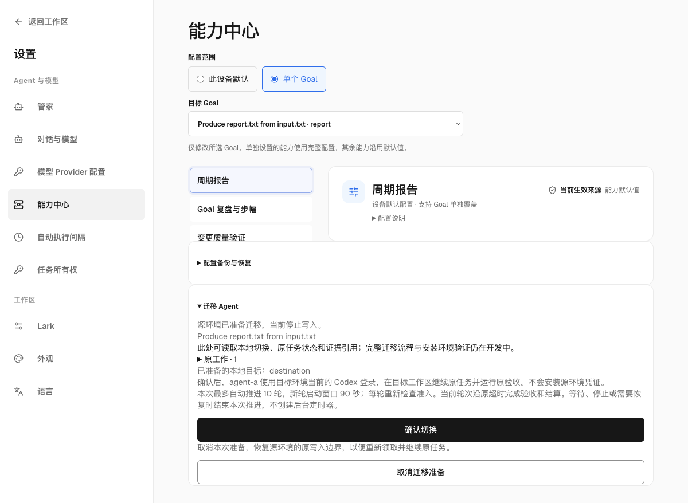
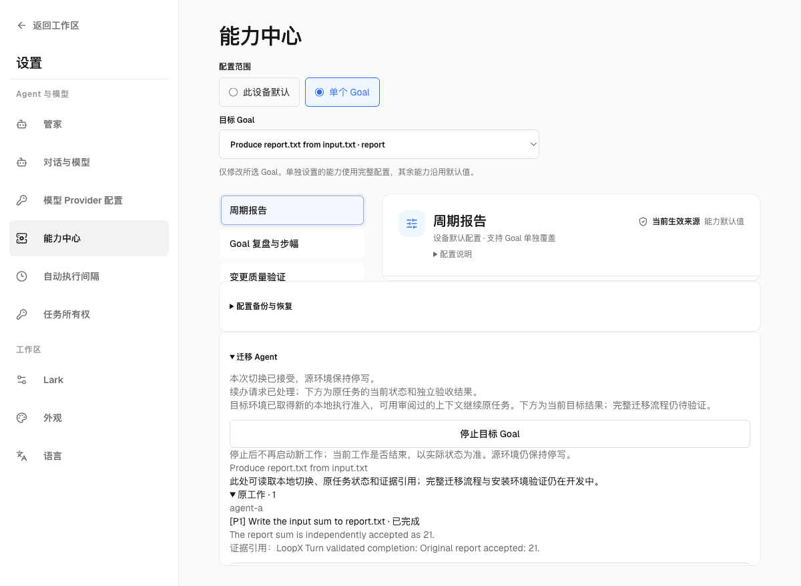
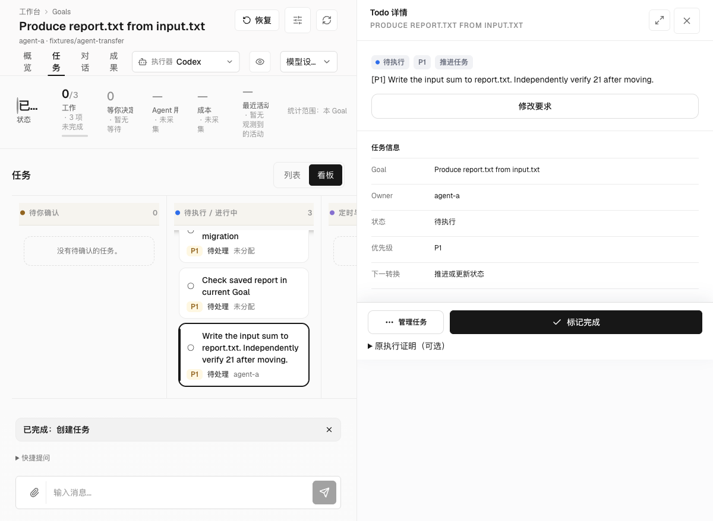

# Explicit research checkpoints

`loopx research-checkpoint` captures a settled research boundary and adopts its
history into an independently admitted Goal. It uses the existing TypeScript
artifact and Todo authority owners, Explore event codec, backup inventory and
Codex Host session provider. Ordinary Goals do not need the benchmark package.
Benchmark adapters separately supply their task, feedback and budget state.

This is a CLI/Host stage. The packaged frontend journey, automatic ordinary-Goal
replan capture and sustained research utility remain open. It is not disaster
replacement, a process-memory snapshot or a promise of arbitrary Host support.

## Prepare and capture

Use a quiescent source with a settled LoopX Turn, completed native cursor,
registered agent-scoped session and promoted canonical coordination. Supply a
physical registry scoped to this Goal and explicit workspace artifacts. The
caller must stop concurrent writers; rereads reject observed source movement.

Set the qualified `CODEX_BIN`, `CODEX_HOME`, `MODEL_NAME` and `REASONING_EFFORT`.
The source profile must match the explicit project and sandbox. Create a private
request file, using physical absolute paths appropriate to the local machine:

```json
{
  "destination": "/private/checkpoints/point",
  "components": [{"id": "code", "source_path": "/private/workspace/candidate.py"}],
  "point_metadata": {"purpose": "compare continuations"}
}
```

```sh
loopx --registry SOURCE_REGISTRY --runtime-root SOURCE_RUNTIME --format json \
  research-checkpoint capture --goal-id SOURCE_GOAL --agent-id SOURCE_AGENT \
  --project SOURCE_WORKSPACE --sandbox workspace-write \
  --turn-instance-id SETTLED_TURN --request-file REQUEST_JSON
```

Capture, admission and adoption preview by default, without reading the source
or calling the native provider. Add `--execute` to perform that explicit
operation. Capture adds revision-bound Todo context, complete Explore events and
indexed vision history, the current session binding, full paginated native
history and qualified native stores. The native inventory excludes credential
files; arbitrary caller-declared artifacts remain private and are not privacy
certified. A new destination is required; capture never overwrites a point.

Artifact operations use the existing private local snapshot transport for full
inventories and retained metadata above the ordinary 2 MiB Effect wire limit.
The existing 64 MiB local snapshot bound and original operation deadlines still
apply. No witness is truncated, no capture is enabled implicitly, and a lost
capture response must be reconciled under its original identity before another
operation is considered.

The inventory covers only declared file roots plus the automatically owned
session and LoopX state participants. A conversation mentioning an external
candidate or report does not capture that file. Declare every needed research
directory before capture, keep its source quiescent, and verify its bytes at the
receiver. Never broaden capture to an entire temporary or credential directory
just to obtain apparent coverage. Missing historical bytes cannot be supplied
from a later state under the original point identity. Domain receivers must
explicitly materialize their selected research components; the
[SForge warm transport](../../benchmark/README.md#explicit-warm-worker-composition-qualification-in-progress)
provides that selection for its data paths.

For new checkpoint-enabled native EdgeBench runs, the startup prompt and workspace
`AGENTS.md` now tell the solver to keep reusable research artifacts in a task
workspace subdirectory, including local inputs and negative results. The prompt
states whether the supplied declaration covers that workspace. A declared
directory includes files created later; an explicit file list does not grow
when a conversation or report mentions another path. Capture-disabled prompts
are unchanged. This is storage guidance, not an enforced completeness check.

For new donors, declare the task workspace directory before launch. For existing
runs, preserve their frozen instructions and source; use a newly qualified
attempt when adopting this guidance. Previously external artifacts still need
explicit capture and receiver validation. Do not rewrite an old point using
later live files or claim that the new guidance repairs missing historical bytes.

Verify the returned digest before preparing a receiver:

```sh
loopx --format json research-checkpoint verify \
  --root CHECKPOINT_ROOT --expected-sha256 CAPTURE_DIGEST
```

## Admit a fresh session and adopt context

Prepare a fresh isolated environment preserving the captured guest paths and
the qualified native Host/configuration. Register a distinct current Goal and
Agent through normal LoopX configuration. Use a new native home at the qualified
fixed path; do not replace an active user's home. Supply the destination Host
environment and separately retain the captured configuration file. Automatic
native Goals must remain disabled.

```sh
loopx --registry DEST_REGISTRY --runtime-root DEST_RUNTIME --format json \
  research-checkpoint admit-session --goal-id DEST_GOAL --agent-id DEST_AGENT \
  --project QUALIFIED_WORKSPACE --sandbox workspace-write \
  --root CHECKPOINT_ROOT --expected-sha256 CAPTURE_DIGEST \
  --config-path CAPTURED_CONFIG --execute
```

This reads and forks the native history, verifies its cursor/configuration and
binds the distinct session through current Goal lifetime authority. It starts
no model and grants no work. Acquire a current claim and lease on a destination
Todo with an empty note, then use its current provider revision:

```sh
loopx --registry DEST_REGISTRY --runtime-root DEST_RUNTIME --format json \
  research-checkpoint adopt-context --goal-id DEST_GOAL --agent-id DEST_AGENT \
  --project QUALIFIED_WORKSPACE --sandbox workspace-write \
  --root CHECKPOINT_ROOT --expected-sha256 CAPTURE_DIGEST \
  --source-todo-id SOURCE_TODO --todo-id DEST_TODO \
  --operation-id CONTEXT_OPERATION --expected-revision ORIGINAL_REVISION \
  --lease-key CURRENT_LEASE_KEY --lease-version CURRENT_LEASE_VERSION --execute
```

The native fork above qualifies the preserved guest paths, not relocation to an
arbitrary physical `CODEX_HOME` or workspace. In the pinned paginated native
store, retained session indexes still name absolute rollout paths. Supplying a
different rollout path to the native fork API does not qualify that relocation;
its stale-path check can reject the copied index. Forking by thread id can also
require the original rollout path in that index. Do not rewrite the provider's
SQLite/history or alias an active source home to bypass that boundary.

For ordinary migration to different paths, retain this native point as history
and use a separately qualified, reviewed continuation context through the
current Goal/session/Todo owners. That composition must preserve the original
work and obtain fresh destination admission; it is not implemented merely by
creating a fresh conversation. The fixed-path native profile remains available
without making it the only allowed design for the planned Agent-transfer journey.

The development `goal-transfer cutover` composition can separately review
`--continuation reviewed_context` for an already protected, staged local Goal.
It admits a new physical destination runtime while retaining the original
Goal/Task ids, archived relations, requirements, material mappings and original
accounting. The ordinary Codex Turn driver receives that reviewed context and
still needs current Task/lease authority and independent result validation.
It neither copies a native session nor installs the source's credentials or
creation receipt. The default Task-only cutover remains unable to launch a Host.
This is a source-online, same-host development profile; it does not establish
cross-machine authorization, portable-artifact privacy certification or the
complete installed Settings journey. Those product qualifications remain held.

An Agent can prepare this local composition with one
`goal-transfer prepare-local --goal-id GOAL --operation-id MOVE --destination-root DIRECTORY --material INPUT --execute`
invocation. Repeat `--material` for each explicitly reviewed workspace input.
The existing owners prepare the source, recipient-bound artifact, stopped
destination and retained cutover review. This does not discover every dependency,
certify credential-free input or move capability settings. An unsupported or
unsettled owner keeps its hold; cancellation remains in the existing Settings
entry. Native source writes remain fenced until preparation is cancelled or the
move is confirmed.

For a normal generic Goal created with `bootstrap --goal-doc`, preparation also
includes its registered primary Goal document. The document must be a physical
workspace file accepted by the existing material owner. It needs no separate
`--material` argument. Cutover maps its live reference to the reviewed destination;
the original context and receipts retain their historical source paths. The
native continuation context supplies `current_goal` for current document reads.
Later destination edits survive retries of the original confirmation.

When unfinished Tasks name one Git repository and recorded working checkout,
local preparation verifies their real origin and Task workspace identity before
fencing the source. The clean canonical checkout does not substitute for the
Agent's branch. Preparation retains the actual branch commit, its ancestry,
exact staged index, later unstaged edits, deletions, executable modes and ordinary
untracked files. Ignored files within the original Task's write scopes or explicit
material selection are included; other ignored data stays outside this profile.
The primary Goal document and selected canonical inputs keep their own mappings.
Different Agent bytes use a separate protected material namespace and an explicit
Task-workspace relative mapping, rather than overwriting the canonical inputs.
Selected contents and Git history are not privacy-certified.

Preparation builds a separate local repository and independent `codex/` worktree.
The original branch name remains provenance; the destination uses a fresh branch
and must obtain a fresh Task lease and runtime admission. Source Git configuration,
credential bindings, hooks, index files and native sessions are not installed. Only the
recorded Git objects and reviewed working files are used. The continuation context
provides `execution_workspace` and its `execution_materials` mapping to the
existing Task/lease and Turn entrypoints. Canonical Goal materials remain
separately identifiable when their bytes differ from the unfinished work.
A changed source tree/index or destination tree/index refuses the final confirmation
and retains source cancellation. After admission, normal new edits and commits
survive retries of the original confirmation and Turn.

An Agent may explicitly add `--continue-todo-id ORIGINAL_TODO` to that same
preparation. This prepares one existing Task for automatic continuation after
confirmation. Its preview identifies the responsible registered Agent, the
current local Codex login, workspace-write sandbox and original independent
checks. Confirmation composes a fresh Task lease, native session and stable Turn;
this is execution by the responsible Agent, rather than an owner Goal Chat
assuming that role. Without this option, confirmation retains its existing
admission/readback behavior and launches no Host.

Canonical Todos retain validation commitments rather than private command argv.
Preparation now captures those selected private declarations inside the encrypted
history and restores them through the existing validation store. Missing or
changed declarations hold before source preparation or final confirmation.
Their private paths and arguments are retained, not rewritten for another
machine, and their contents are not privacy-certified. No source credential
binding or native session is installed.

The opt-in preview also selects validation of the original pending working
files. Its native transfer owner requires the same admitted Goal, original Task,
validator commitment and physical execution workspace. The original independent
checks still run; the Agent need not commit or discard unrelated pending edits
just to pass a clean-tree test. Generic delivery validation keeps its existing
clean-worktree rule. The fresh caller-held lease proof is retained in the original
Turn and rechecked by the native terminal owner. Manual Turn callers can supply
that proof with `--task-lease-idempotency-key` and
`--task-lease-expected-version`; reading a lease or changing those arguments on a
journal retry cannot supply a new grant.

An accepted cutover stays recorded when continuation fails. The original entry
reads the current Task and independent acceptance. Repeated confirmation reads or
recovers the same native Turn; already recorded work and debits are not repeated. A pending
settlement retains its existing lease proof; its owner may still hold recovery.
A successful request does not itself prove Task completion.

The initial confirmation may instead settle independently checked intermediate
progress while the same original Task stays open. Explicit Todo selection now
uses the existing typed delivery-boundary owner, and the signed Turn envelope
retains that boundary through progress writeback. This does not waive terminal
validation: the later completion still uses the original Task's independent
acceptance. New reviews freeze a continuation budget of at most ten Turns and
a 90-second window for starting further Turns. The same confirmation asks the
existing Turn Loop Controller whether a fresh signed plan may continue this
original Task, obtains a new lease, and resumes the destination-native Agent
thread. A running Turn's validation and settlement keep their owning timeouts;
this dispatch window is not the full migration's elapsed-time qualification.
Waiting, stopping, replan, an exhausted budget or a failed original validator
ends this request. No background timer is installed. Previously admitted
decisions without this budget retain a single dispatch. Retrying confirmation
recovers the exact original chain
from native journals, including a completed descendant; it cannot start another
chain or rerun settled tools. A resumed destination can recover this same move.
The original App's completed-Task history and accepted-result reads use the same
verified destination; cached pages from another source cannot become target
history. A disconnected destination refuses instead of presenting old results.

Codex can register the current workspace as trusted in its local configuration
during the first process startup. The shared-session adapter observes only that
exact first registration when recording the resulting profile. It writes no
trust setting. Another workspace, extra project settings, untrusted state or
provider/model/sandbox changes retain the original profile fence; later profile
changes still refuse resume. Existing binding and digest formats are preserved.

The isolated File/SQLite qualification carries one original Task through two
actual Codex processes, a declared intermediate check and independent final
acceptance, with one resumed native thread and one debit per settled Turn.
The argv-only transfer bridge closes its CLI child's stdin. A terminal or
long-lived App input pipe must not be consumed by an independent validator or
leave final writeback waiting for EOF. Host protocol/result input keeps its own
explicit channel; other callers retain the validation runner's inherited-input
contract, the original validator and its declared timeout.

The normal packaged App shows the reviewed request bounds before confirmation
and the original Task's independent acceptance afterward. With an already
admitted single-Turn decision, the upgraded App instead shows that replanning
is required; it retains the original incomplete Task and recorded Turn. A
disconnected destination refuses readback, then recovers the same accepted
result when the destination returns, without another model call or debit.





The original confirmation replays without executing tools again. Normal
noneditable-package qualification uses deterministic local model responses and
synthetic inputs. Bounded continuation inside this request is separate from
persistent wake after waiting or service exit, live-model behavior and the
complete installed migration/120-second qualification.

Distinct source workspaces, unknown mappings, links/submodules, conflicted or
special index states, and dirty canonical checkouts still hold before preparation.
These holds do not complete the full profile. Automatic continuation is limited
to the explicitly prepared local Codex Task above. Required credential/configuration
rebinding, full Host/effect drain, secure cross-machine delivery and the
convenience target remain unqualified. This local
path never requires discarding or committing an Agent's pending edits merely to
satisfy a clean-checkout test.

The local configuration and required-Task capability checks run before source
preparation as well as at final cutover. Missing, unsafe or unmapped documents,
unsupported capability configuration and required capabilities outside this
profile hold before source writes are fenced or a destination is created.
Configure or rebind those dependencies through their actual owners; this profile
does not silently drop them, copy credentials or adopt optional settings. App
automatic dispatch beyond that explicit local Codex profile and the complete
migration qualification remain separate work.

Settings → Capability Center → the original Goal → Move Agent shows the
prepared destination and original work. **Confirm local move** performs the
reviewed cutover; **Resume this move** recovers an already recorded cutover whose
destination admission is incomplete. The browser supplies identifiers and the exact reviewed digest,
never a registry path. The CLI counterpart is
`goal-transfer confirm --goal-id GOAL --operation-id MOVE --expected-preview-sha256 DIGEST --execute`.
Changed materials or destination bindings refuse confirmation. Duplicate
confirmation reads the original decision and preserves destination writes.
An accepted switch followed by missing readback stays visibly accepted and
offers a current-state read. The complete installed migration flow remains
unqualified, including automatic active-work drain and necessary configuration,
dependency and credential rebinding.

Stopping the admitted destination Goal keeps original work and results readable
in this entry. New Host/runtime execution remains stopped until the existing
Goal lifecycle owner resumes it; viewing a result does not renew admission.
Ordinary Todo management keeps its existing owner rules.

The same **Move Agent** entry now offers **Stop destination Goal** or
**Resume destination Goal** after the local runtime is admitted. These actions
use the existing Goal lifecycle owner, current destination fingerprint and the
original cutover binding. They never redirect old source workers or accept a
browser-supplied registry path. A stale preview or unavailable destination
requires a fresh read; a response-loss retry can observe the already requested
state without rewriting it. Resume permits later execution; it does not launch
another Turn or replay completed work. Stopping prevents new admission and does
not itself prove an in-flight process has exited.

中文：本地目标取得执行准入后，原“迁移 Agent”入口可“停止目标 Goal”或“恢复目标
Goal”。操作复用既有 Goal 生命周期、当前目标状态摘要和原切换绑定，不重定向旧源
执行器，也不接收浏览器提供的 registry 路径。旧预览或目标不可用时重新读取；响应
丢失后的重试可读回已达到的状态，不重复改写。恢复只允许后续执行，不启动新轮次、
不重放已完成的工作；停止阻止新准入，并不证明进行中的进程已经退出。

After an admitted local move, selecting the original Goal also reads the current
destination in its ordinary overview and delivery review. A stopped destination
uses the existing stopped-Goal archive projection, retaining its objective and
unfinished Tasks. The overview's existing **Stop** / **Resume** actions use the
same verified destination and Goal lifecycle owner. A proposal prepared before
the move becomes stale; an unavailable target refuses instead of reading or
controlling the old source. Goals without a local move keep their existing read
and lifecycle owners, including the established orphan-stop recovery rules.

The original Task entry also reads complete requirements and applies ordinary
creation, edits and pause/resume through the admitted destination's existing Todo
owner. Exact reads and edits share that destination's registry/provider revision;
old source previews become stale. A lost edit response recovers the original
canonical operation without applying it twice. An unavailable destination refuses
instead of reading or writing the old source. Creating a Task with automatic
execution from this entry refuses before creation until its Task execution/Host
path is qualified; the ordinary Task form creates without starting execution.

The original Goal Chat entry opens a fresh Session in the verified destination's
normal Chat store and controller. It reads current Goal/Task facts there and
keeps its upstream thread when the Chat service restarts. Repeating the same
message identity reads its original Turn instead of dispatching another one.
Previous source conversations remain readable as non-resumable history; send,
queue, resume, attach and close requests cannot reuse them as destination
authority. Target disconnection refuses without falling back to the source.
Goal Stop permits history/status readback but rejects new Host messages. The
existing per-Turn interrupt and Session close use the destination controller.
Manager and ordinary project conversations retain their existing routes.

This workspace adoption covers selected status, delivery review, activation,
ordinary Task interaction and the owner-local Goal Chat route. Conversation
tests use a scripted upstream adapter over real File/SQLite and HTTP/Turn
owners; they do not qualify a live Codex Host. Normal non-editable package
checks cover the existing status-only conversation and unavailable-Host path,
without model inference. Decision and monitor flows, deletion and sustained
original-task execution still need their own integration. It does not redirect
source CLI commands or executors. The full installed-profile and 120-second acceptance
remain unqualified.

中文：已准入的本地迁移也会让原 Goal 主视图和交付评审读取真实目标。目标停止时，
复用既有历史视图保留目标说明与未完成任务；原“停止／恢复”操作作用于经核验的
目标。迁移前的旧预览失效，目标不可用时明确拒绝，不回退到旧源。未迁移 Goal 的
原有行为保持。原任务入口也会从目标读取完整要求，并复用目标 Todo owner 创建、
编辑、暂停或恢复任务；详情与编辑绑定同一 registry/provider revision，旧源预览
失效。编辑响应丢失后重试恢复原操作，不重复写入；目标不可用时不读写旧源。普通
创建表单不启动执行；附带自动执行的创建请求在写入前拒绝，等待其 Task 执行与 Host
路径接通并通过验收。
原 Goal 对话入口会在经核验的目标端创建独立新会话，读取当前目标与任务；服务重启
后仍恢复目标端同一个线程，相同消息身份不会重复派发。旧源会话保留为不可恢复的
历史，不可借发送、排队、恢复、挂接或关闭请求取得目标权限。目标断开时拒绝请求，
不回退旧源；停止目标后仍可读历史和只读状态，但不接受新的 Host 消息。回合中断与
会话关闭作用于目标控制器，管家及普通项目会话保持原路由。对话测试的上游适配器是
脚本化替身，底层 File/SQLite、HTTP 与 Turn owner 为真实路径；正常非 editable 包
验证只读状态对话及 Host 不可用路径，未进行模型推理，不宣称真实 Codex Host 验收。
审批与监控、删除及原任务持续执行仍未完成；旧 CLI 与执行器不自动重定向，完整安装
迁移及 120 秒验收仍未通过。

另有隔离 File/SQLite 实测覆盖同一个原任务的两轮真实 Codex 进程：第一轮经预先声明
的阶段检查后结算，任务仍未完成；同一次确认通过既有 Turn Loop Controller 及新签名
计划决定下一轮，新租约续接目标端同一个原生线程，再经原任务独立终验完成。每轮
只扣一次，重复确认沿原生 journal 恢复同一轮次链，完成后也不重复工具调用。显式
任务选择复用现有类型化交付边界，签名 TurnEnvelope 保留该边界；最终验收规则不放宽。
首次启动仅观察 Codex 对当前工作区新增的信任登记，不代写配置；其它工作区、额外
项目设置、非信任状态及 provider/model/sandbox 等变化仍受原配置摘要约束。正常非
editable 包使用本地固定模型响应，不调用付费模型。新准备的审阅冻结最多十轮、
90 秒的新轮启动窗口；当前轮次的终验与结算沿原超时处理，不冒充全旅程耗时门。
等待、停止、重规划、预算耗尽或终验失败时结束本次推进，不安装后台定时器。
已准入的历史决定若未带此预算，仍只有单轮预算；升级界面会提示需要重新规划，
保留原任务和已记录的轮次。目标恢复后可恢复同一次迁移；跨等待或服务退出后的持续唤醒、
真实模型及完整 120 秒旅程仍待验收。
仅通过 argv 传参的迁移桥接会关闭 CLI 子进程的 stdin，避免独立验收消费宿主的
终端／长期输入管道并等待 EOF。Host 协议和结果仍走独立输入通道，其它 caller 的
验收输入兼容性、原校验命令和原超时不变。界面显示本次推进的实际等待／重规划等
状态；重复确认不会重置已审阅的轮次上限。
原 App 的已完成任务和验收结果也读取同一经核验目标；旧来源分页不能变成目标历史，
目标断开时拒绝读取，不展示旧源结果。



For a governed CLI Turn with an explicit Todo and `--turn-instance-id`, retrying
that same identity now reads the original journal before rebuilding a live plan.
A changed plan hash cannot allocate a second canonical journal for the same
structured settlement identity. Unknown, inconsistent or conflicting history
refuses; use the original recovery path instead of starting another conversation.

The existing continuation owner prepares/adopts a complete context reference.
Explore knowledge seeds the fresh Goal with preserved counterevidence, topology,
authorship, timestamps and checkpoint provenance. Ordered-prefix recovery rejects
divergent destination evidence. Historical operational observations, decisions,
leases, grants, timers and effects remain historical. Neither command imports
them as authority or resets a benchmark's budget or feedback opportunities.

After an uncertain response, retain the same source digest, destination and
original operation/revision arguments and read back through the owner. Do not
invent a new operation, overwrite the destination or rerun a model to resolve
uncertainty. A branch that has already advanced cannot adopt an older cursor.

Read the destination Todo and `explore turn-context`, obtain current work
admission and inspect the next accepted replan. A useful readback cites retained
evidence, explains the next complete experiment and later checks its outcome.
Restoring files or accepting a structured review alone proves no research gain.

## Disable and qualification

Omit `--execute` or stop issuing the explicit operations to disable this entry;
there is no automatic activation switch. Published points stay inert. Change
adopted Todo notes through their normal owner; dispose of an isolated receiver
through its normal lifecycle. Do not delete or rewrite source history to roll
back a continuation.

The ordinary-Goal test forbids every benchmark import and exercises the shipped
CLI with real SQLite/artifact owners. Its native variant uses actual Codex
processes and deterministic local inference to capture, fork, adopt a retained
counterexample, accept a current typed review, execute a complete tool experiment
and settle it. The joined qualification recipe in `benchmark/README.md` also
runs this Core case. It validates mechanics and isolation; real-model decisions,
long-run reliability and net score/cost improvements require separate evidence.
The relocated-path case instead verifies an actionable refusal before creating
the destination native home or session binding, with the original point and
unfinished destination Task preserved. It does not certify portable native
session reconstruction or complete Agent migration.
