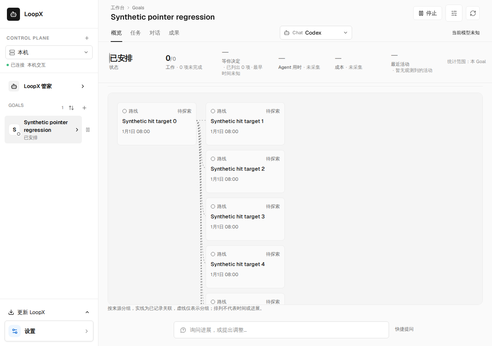
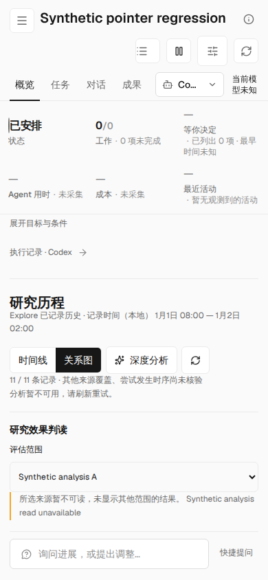
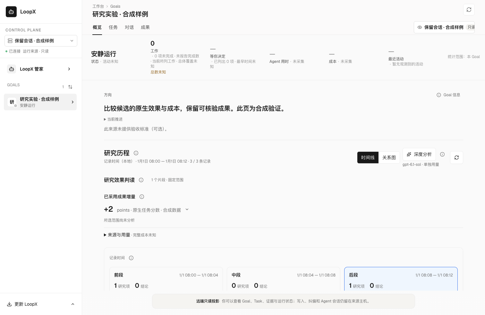
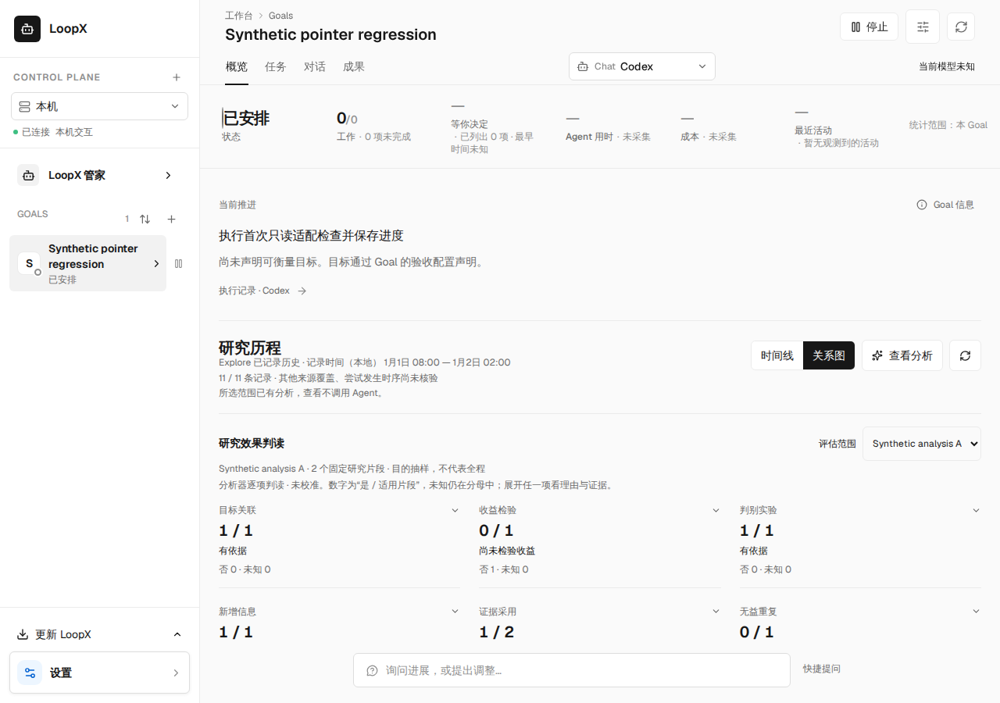
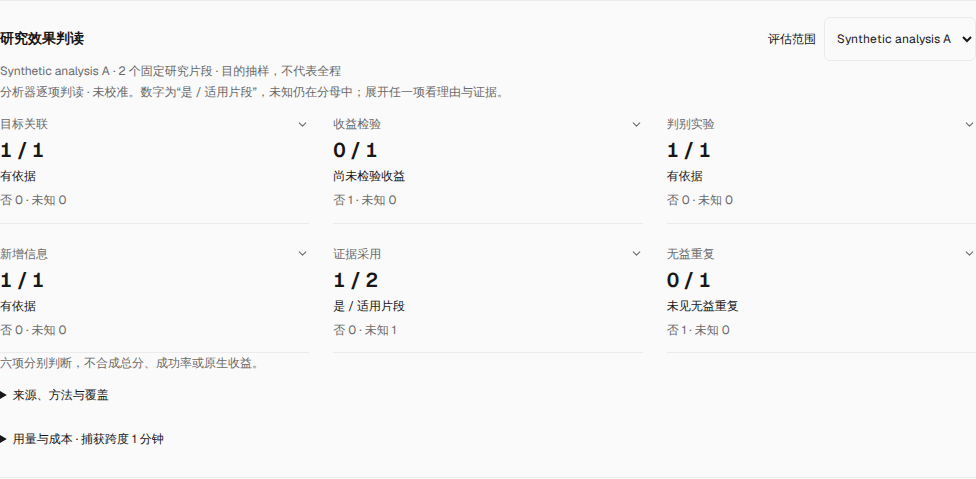

# Evidence-bound trajectory assessment

Status: source-verified trajectory packs, an opt-in analysis producer and the
packaged Goal reader. Independent evaluator calibration and scientific
treatment-effect qualification remain separate acceptance work.
These use the S5/S11
[research episode assessment](../architecture/rfcs/long-horizon-harness-benchmark-research-program-v0.md#evidence-based-episode-evaluation-proposed-refinement).
It does not change solver prompts, benchmark scoring, checkpoints or research budgets.

The Goal reader requests `output_language` (`zh` or `en`) from the current
interface language on reads, explicit execution/retry, cancellation and citation
readback. The typed assessment owner binds it and its presentation instructions
to the analysis key. Each language has its own job/cache over the same registered
pack and frozen evidence; browsing or switching language never starts a job.
Generated `reason`, `limitations` and `episode_questions` follow that language.
The latter map each existing episode ID to an analytical rendering of its
question; the complete original question and source text remain available.
IDs, eligibility, verdict tokens, citation ranges and source bytes are unchanged.
Requests without a language retain their original identity and stored artifacts;
the frontend does not present an unspecified or other-language result as a new
analysis in the selected language. Output-language metadata records the request,
not independent verification of a model's translation or judgments.

### Whole-history presentation language

A trusted curator can include the complete authorized Explore history read as
another verified source, then set the optional input binding:

```json
"display_snapshot": {
  "schema_version": "research_display_snapshot_v1",
  "source_id": "history-capture",
  "source_namespace": "local"
}
```

That source is the complete JSON history page (`ok`, `goal_id`, `items`, `total`,
`next_cursor: null`), consolidated from the same server snapshot without dropping
pages or duplicate/conflicting identities. Use the actual physical source namespace
for linked Goals; `local` denotes the ordinary local Goal. The existing trusted
pack-registration path still verifies full-file bytes and literal text. The
renderer cannot register a source or submit free-form strings for translation.
This binding creates no Goal, worker, Explore record or new capability.

An explicit language-specific analysis translates narrative fields from every
captured event, including historical revisions: node/route questions, finding
titles, plain summaries, observations, interpretations, applicability, declared
changed/stopped/retained lists and recorded change reasons. Structured labels,
statuses, identities, versions, measurements, timestamps and references retain
their original owners. A history capture does not make every event an assessment
episode or change the six metrics' declared sample and denominator.

The existing analysis job owns execution, timeout, cancel, explicit retry, cache
and observed usage. There are no per-card calls or translation scheduler. A
display-only capture is supplied once as fields rather than duplicated in the
prompt; evidence actually used by episodes retains its numbered citation text.
The same analysis key binds the whole input, output language and display method.
Fields use content-bound opaque identities. Literal code, links, numeric tokens
and technical identifiers are protected; missing, duplicate or corrupt rows fall
back to the original with explicit partial/invalid coverage. This mechanical
check does not verify linguistic quality, causal meaning or model calibration.

For ambiguous compact notes, the curator can add `display_snapshot.contexts`
rows with `event_id`, `field` and `citations` (existing `source_id`, absolute
inclusive `first_line`/`last_line`). Bind only a narrative field in that captured
snapshot and verified source ranges. Empty evidence, duplicate bindings, missing
fields/sources and out-of-range lines are rejected. The same explicit analysis
reads those numbered ranges to resolve terms, units and referents; it must not
import later outcomes, new measurements or stronger certainty into the original
field. Context evidence is supplied once through the existing source pack.
The versioned display field retains `context_citations`; equal text with different
context does not share a translation identity. Context additions, corrections or
removal invalidate reuse. Omission preserves existing prompts and identities.
The original source reader and existing job budget, cancellation and retry remain
the entrypoints; neither a context binding nor an ordinary read launches a model.

压缩记录有歧义时，可由原输入整理者把准确事件/字段关联到已有证据的具体行。
同一次明确分析据此解释术语、单位和指代，不能把上下文的新结果补写成原记录结论。
关联随展示产物保存并参与版本隔离；不同上下文不共用同一译文。没有关联时沿用原路径，
字面校验和来源关联仍不等于译文已获独立语义验证。

For a large capture, the curator can set the optional
`display_snapshot.translation_encoding: "source_text_aliases_v1"`. The same
owner requests one translation per exactly equal original string using compact
content-bound identifiers, then restores each original event/field separately.
Different literal numbers or identifiers never share an alias merely because
their masked text looks alike. Coverage still counts all original fields,
including every historical revision. No text is summarized or truncated and no
extra model call is created. The explicit encoding participates in the analysis
identity; omission preserves already saved direct-field jobs and their failures.
For captures with compact prose inside protected spans, use
`"source_text_aliases_with_literals_v1"`. It retains the same alias mapping and
exact-token checks, and supplies each row's protected original literals as
read-only model context. The prompt asks for their meaning in the output
language, with exact source terms retained, rather than leaving failure, loss or
uncertainty opaque inside a placeholder. It grants no tools or source authority.
This explicit encoding has a distinct analysis identity; prior direct and alias
jobs remain unchanged. Context availability does not certify translation quality:
read the resulting language and negative/uncertain claims, not only coverage.
When those compound terms also hide numbers, the explicit
`"source_text_aliases_with_literal_values_v1"` encoding additionally supplies
`explanation_numbers`. The translation may restate each listed exact signed
component once in readable prose while retaining every original placeholder.
For example, a compact trial/check term can retain its source spelling while
explaining the trial number and failed-check count in the interface language.
Code, hashes and links contribute no explanation numbers. Changed signs,
rounding, new values and excess repetitions fail the field check and retain its
original. This is lexical integrity, not verification of units, referents or
scientific meaning: ambiguous glued digits must remain ambiguous rather than
being guessed into counts. The existing job, language selection, original-text
reader, partial coverage and explicit execution boundaries are unchanged.
This encoding has its own analysis identity. Existing direct, alias and
literal-context artifacts keep their original preparation and remain readable;
viewing an old result does not upgrade it or launch a new analysis.
Translated prose is applied to decoded narrative fields; it is never serialized
and reparsed as an Explore decision. Owner-format labels or list markers inside
model text cannot change the original outcome, eligibility or list cardinality.

The qualified `research_display_v1` sidecar records source identity, language,
snapshot key, exact source text per translated field and coverage. The reader
hashes its normalized complete history before applying it. A different Goal,
source, language or corrected/deleted/added event cannot borrow the translation.
Changed/unreadable source bytes keep the result historical. The whole-page
original switch and individual original findings preserve direct readback;
ordinary browsing, expansion, reload, source refresh and language switching never
start a model. A pack without this optional binding keeps its prior identity,
output contract and episode-only localization; it does not claim whole-page
translation. An absent or failed new job leaves the original history readable.
For a partial result, **Reanalyze to complete translation** explicitly retries
the whole existing job with new analysis usage. Prior results and receipts are
archived before that attempt. A running, failed or cancelled retry keeps the
last successful result readable, labelled as previous; its own usage stays bound
to that saved attempt while the current job's state remains distinct. A complete
successful result continues to reuse its cache, even if retry is requested.

整体正文译文沿同一次深度分析生成，覆盖固定快照中的问题、决策、结论及历史版本。
它只属于展示产物，不改原始记录、状态、指标、引用和执行权限。缺失或校验未通过的
字段回退原文并显示覆盖；内容、来源或语言不匹配时不套用旧译文。浏览、展开、刷新和
切换原文不调用模型，失败和取消沿既有分析任务恢复。机械完整性校验不等于译文已经
独立校对，也不等于实际收益或因果结论已获验证。

The Codex observer reuses native Chat's shared authenticated HTTP transport.
Credentials and refresh remain with Codex's existing signed-in account; the
observer neither copies tokens nor imports user tool/rule configuration. Its
child follows the desktop service's explicit `LOOPX_CHAT_CODEX_HOME` account
selection rather than an unrelated inherited `CODEX_HOME`. Without that Chat
selection, ordinary CLI account discovery remains unchanged. This selects an
existing native account directory; it does not copy credentials or change login.
The explicit read-only sandbox, disabled shell/exec/web tools and fixed supplied
evidence remain in force. A failed provider attempt stays in job history and
requires an explicit retry after the host problem is repaired.

## What the measurements should answer

Use one **research episode** as the process unit: a bounded question or competing
explanation, intervention, observation and subsequent decision. An episode can
span Turns; a tool call, a repeated capture or every test input is not an episode.
Freeze episode boundaries, eligibility and the observation window before judging
outcomes. Keep unfinished work and reasonable replication visible.

The following vector is motivated by long-horizon benchmark failure modes. It is
not a weighted total or a universal leaderboard. The first producer implements
only the six explicitly labelled model assessments; measured results and costs
continue to come from their existing authorities.

| Question and metric | Definition and denominator | What the observation changes |
| --- | --- | --- |
| **Native progress and cost to useful result** | Best and final valid native result, gain over the fixed starting incumbent, elapsed/model/resource cost to a predeclared threshold; unreached thresholds are censored, not zero time. Show prefix, continuation and total study cost separately. | Distinguish true objective improvement from proxy gains, timing noise and expensive marginal gains. Decompose quality and runtime penalties using the task's actual scoring rule. |
| **Bottleneck-directed work** (`goal_alignment`, model assessed) | Executed episodes with a supported link to a current bottleneck of the original objective / predeclared eligible executed episodes. Keep unknowns in the denominator. | A new model family is not inherently better than a small optimization. Detect when provisional agent gates displace the original objective. |
| **Benefit-test completion** (`benefit_test`, model assessed) | Completed episodes that actually test the claimed utility on the original objective path, through native evaluation or an independently justified task-representative proxy / eligible completed episodes. A negative utility test counts; a numerical prerequisite alone does not. | Detect an indefinitely lengthening chain of locally useful prerequisites. Report together with prerequisite cost and time until the first utility test; this is not an instruction to skip necessary correctness checks. |
| **Discriminating experiments** (`discrimination`, model assessed) | Completed experiments that validly distinguish the stated competing explanations / predeclared completed experiments. Invalid experiments do not become useful because they passed unrelated checks. | Prefer experiments that can change a decision; identify long prerequisite chains that never test the proposed benefit. |
| **Decision-relevant new evidence** (`information_gain`, model assessed) | Episodes resolving a relevant uncertainty not already settled by the available prior evidence / predeclared eligible episodes. Useful negative results count; noisy unresolved evidence stays unknown. | A flat native curve can contain useful progress. More graph nodes or more detailed prose are not evidence of that progress. |
| **Evidence adoption and response lag** (`evidence_adoption`, model assessed; lag measured separately) | Applicable evidence with a subsequent action demonstrably informed by it / applicable evidence with a real follow-up opportunity. Measure feedback-available → first qualifying action latency where timestamps exist. | A citation or replan statement alone is not adoption. Retaining an incumbent can be correct adoption. No later opportunity is excluded explicitly, not scored as neglect. |
| **Avoidable repetition and its cost** (`redundancy`, model assessed; cost measured separately) | Repeated same-question/intervention/input episodes with no new information or justified replication/recovery purpose / assessable eligible episodes. Also show attributed redundant resource cost / covered resource cost. | Separate looping from legitimate noise estimation, correctness validation and fault recovery. A repeated unchanged capture is not proof of redundant research. Here a positive verdict indicates a problem. |
| **Proxy-to-native transfer** | Among proxy-improved candidates with an eligible, completed valid native follow-up, count native improvement / unchanged / regression; show those lacking native follow-up separately. Bind candidate source and compare matched conditions. | Local quality improvement or a faster component cannot establish full-task benefit. Adaptive candidate selection limits generalization. |
| **Operational loss and checkpoint utility** | Failure counts / attempts separately for wake, replan, capture and restore; recovery wall-time union and resource costs with coverage. Qualified restore-and-continue points / attempted points. | Wake failure need not end the run; later recovery may continue. Failure frequency is not a fraction of useful work lost. File presence alone does not establish a reusable checkpoint. |

Route changes are a **descriptive distribution**, not an optimization target:
local refinement, representation/model/objective change, and correctness or
recovery work need a rationale and evidence. A substantive new route may still
repeat an already-refuted assumption. More switches can mean worse research.
Do not infer a route or adoption edge just because two events are adjacent.

## Coverage and interpretation

Every displayed process metric has `yes`, `no`, `unknown`, and `eligible` counts.
`assessed_fraction = (yes + no) / eligible`. Empty eligibility yields null, not
zero. `[yes / eligible, (yes + unknown) / eligible]` is a **missing-data bound on
this sample**, not a confidence interval and not a claim that model labels are
correct. `selection.exhaustive=false` or unknown population forbids presenting
these counts as a whole-run rate. Eligibility is supplied before model execution;
the model cannot silently drop difficult episodes or choose its denominator.

Separate source facts, model interpretation and independently reviewed findings.
The producer labels every result `uncalibrated_model`. Citation range validation
only proves that a reference exists in the supplied pack, not that the claim is
entailed. Scientific use still requires independent human boundary/label review,
held-out evaluator calibration and matched source, feedback, budget and window
rules from the research RFC. A selected debugging case is not a treatment effect.

For cost, retain unknown and unassigned intervals. Concurrent wall time uses the
union of intervals; resource usage and overlapping waiting labels are separate.
Do not add reasoning tokens again if the provider includes them in output tokens.
Ancestor response usage is deduplicated, but processing inherited context again
is new cost. Analysis-job usage is separate from solver and native-evaluation cost.
Never impute missing dollars from an unverified model price.

## Producer and consumer boundary

### Continuing a frozen analysis

The trusted curator can register a complete successor snapshot using the
existing `benchmark trajectory-pack-register --base-pack-id <previous-pack>`.
The base must already belong to the same owner Goal and original Goal/case/run.
This records an immutable version link; it neither appends to the original
source nor starts a model. The Agent prepares this link with the input, rather
than asking the reader to enter internal identifiers.

The existing Goal analysis action becomes **Continue analysis**. Its inline
version summary identifies added, corrected and removed sources/episodes,
previous and current coverage, and changed judgments after completion. Previous
versions remain accessible through the same reader and browser history.
Reading, registering or refreshing a successor never starts analysis. A failed,
cancelled or concurrently running successor does not replace a valid base result.

The typed comparison reuses a qualified output only when literal excerpts,
source identities/paths/line positions, episode questions, eligibility,
objective, selection/window and analyst configuration are equivalent. Capture
revision/hash changes outside those excerpts do not themselves prove new
information. Explicit reuse requalifies every row against the current manifest
without starting a model; the original usage stays with its original job.
Missing or unreadable base evidence is not eligible for reuse.

All substantive additions, corrections, deletions or contract changes currently
trigger **full reassessment of the complete successor input**, including old
episodes that later evidence may affect. No heuristic certifies an unaffected
row and no prior model summary substitutes for original evidence. New metrics
are reduced from the complete new eligible pairs, including unknowns; old and
overlapping-window counts are never summed. This conservative continuation does
not claim tail-only execution, lower token cost or scientific uplift. Method or
configuration changes retain their original applicability boundaries.

Capability owner: existing `benchmark-toolkit`. Shared input validation, fixed
rubric, applicability identity and count reduction live in TypeScript at
`loopx/control_plane/capabilities/trajectory_assessment.ts`; browser-safe shapes
and metric vocabulary live in the adjacent `trajectory_assessment_types.ts`.
The built-in Codex
adapter only owns local process and file I/O; it is not another solver runner,
LoopX Turn, scheduler, Explore writer, native judge or capability.

The input schema is `trajectory_assessment_input_v1`:

- `scope`: Goal, case, run, revision and observation-window identities;
- `objective`: original objective and priorities, distinct from provisional gates;
- `selection`: selection rule, known population episode count or null, exhaustive flag;
- `sources`: unique IDs, artifact reference, full artifact SHA-256, first line and
  literal excerpt text. The caller must read and hash the authorized original;
  the validator cannot independently verify a full-file digest from an excerpt;
- `episodes`: fixed IDs/questions, allowed source IDs and eligible metric names.

The analysis key binds the normalized complete input, rubric/method version,
model, reasoning effort and requested service tier. Input changes produce a new
key; old output must not appear current. Each eligible pair must appear exactly
once in model output. Decisive labels require source IDs and inclusive 1-based
line ranges within the episode's supplied evidence. Invented references, omitted
unknowns and duplicated pairs reject the whole result.

`assessment.json` is a `trajectory_assessment_v1` sidecar containing the key,
method, scope, selection, evidence manifest, per-episode assessments, count vector
and limitations. It contains no writable canonical graph edges, HTML or score
updates. Rendering must escape model text and distinguish inferred links from
recorded relations. Private evidence remains private; consumers must apply the
existing source audience/access rules before presenting it. No hidden evaluator
content may enter an active solver or its feedback.

## Explicit execution and readback

Prepare an authorized local evidence pack, then preview without a model call:

```sh
loopx benchmark trajectory-assess --input-json evidence-pack.json \
  --output-dir .local/trajectory-analysis --format json
```

Add `--execute` to invoke the installed Codex CLI using its existing account.
Defaults are `--model gpt-6.1-sol --effort max --service-tier fast`; override these
explicitly for another supported local configuration. Unsupported configuration
fails visibly rather than falling back. The receipt records requested settings;
`served_service_tier=null` means the adapter has no service-tier readback and does
not establish fast-mode delivery or a speedup. The CLI uses an ephemeral session,
ignores user configuration/rules, disables shell tools and web search, and passes
only the evidence pack in its prompt. It is not a security sandbox for hostile
executables or an authorization to read arbitrary machine files.

The command runs synchronously, with a default 900-second analysis timeout. A host
may supervise it asynchronously and read its immediate receipt:

```sh
loopx benchmark trajectory-assessment-status --directory .local/trajectory-analysis/KEY --format json
loopx benchmark trajectory-assessment-cancel --directory .local/trajectory-analysis/KEY --format json
```

`receipt.json` reports `running`, `succeeded`, `failed` or `cancelled`, the separate
analysis wall time and observed Codex usage. Cancellation is cooperative: a
request file instructs the owning adapter to terminate its child; the command
never signals a PID copied from disk. Same-key execution is exclusive (`busy`
while claimed); successful reuse revalidates output against the current input.
A failed/cancelled attempt needs explicit `--retry`, preserving the prior attempt.
A crashed adapter's stale lock/running receipt requires operator inspection;
this slice deliberately does not guess process ownership or silently re-launch.
No model call occurs on opening a history page, preview or status read.

## Register a fixed case for the research workbench

A trusted operator registers an authorized, fixed evidence pack for the owner
Goal. This is preparation by the Agent, not a path-entry task assigned to the
workbench user:

```sh
loopx benchmark trajectory-pack-register --goal-id OWNER_GOAL \
  --input-json evidence-pack.json --source-root authorized-capture \
  --title "Case · fixed observation window" --format json
loopx benchmark trajectory-packs --goal-id OWNER_GOAL --format json
```

The command uses the selected registry/runtime. Registration verifies every full
artifact SHA-256 and literal excerpt against files within the supplied source
root, rejecting traversal and escaping symlinks. It stores an immutable input
snapshot and opaque pack ID in private runtime storage. Registration does not
launch a model, copy permissions or alter the solver Goal. Multiple case/window
packs can belong to one research workbench; the most recently registered pack is
the default selection. A pack's actual solver Goal/case/run/window and sample
coverage must remain visible instead of being relabelled as the owner Goal's
whole history. This registry does not infer episode boundaries from every log
line or automatically qualify arbitrary captures.

The existing authenticated Goal host uses the provider in
`trajectory_assessment_store.py`: `discover`, `inspect_pack`, `execute_pack`,
`cancel_pack`, and `read_citation`. The host resolves the authorized runtime and
owner Goal before each call. Renderer requests contain only opaque pack IDs,
analysis keys and cited ranges; no file paths, shell commands or free-form model
configuration. There is no renderer registration endpoint. The filesystem and
Codex adapters remain Python because they own local provider I/O; shared
assessment/eligibility rules remain in the existing TypeScript owner.

Opening or polling a pack only reads. Explicit execution rechecks source hashes
and excerpts, resolves the registered configuration and calls the same exclusive
process owner. Results are requalified from model output; citation reads return
only exact ranges already cited in that result, from the immutable captured
excerpt. Missing/changed sources block new execution but preserve the historical
result and captured citations with a historical applicability label. A changed
assessment method requires a newly registered pack and does not silently relabel
old judgments as current. Historical display verifies the original receipt,
input/config/key and qualified sidecar digest without applying the new rubric.
Legacy results lacking that proof remain unavailable for automatic historical
display; original raw artifacts are retained for host inspection. While the
original method is still available, explicit same-key reuse requalifies its
output and records the proof. Raw provider errors, local paths and process IDs are not projected
to the workbench. Same-key success reuses the prior result; explicit retry is
reserved for failed/cancelled attempts.

The Goal research-history product owner consumes this API. Its companion journey
must finish case selection, explicit trigger, progress/cancel/retry, unavailable
and historical states, inline source return and packaged frontend/backend
readback. Present the key finding and uncertainty first, episode decisions next,
and citations/method/cost on demand. CLI success alone does not complete that
journey or qualify the model assessor.

## Measured solver session cost (optional)

### Native outcome readback (optional, separate from analyzer judgments)

The trusted provider/Agent may add `--native-outcomes-json native-outcomes.json`
to the existing `benchmark trajectory-pack-register` operation. The file is
relative to its already authorized `--source-root`; the renderer cannot register
paths or invent measurements. Reading it does not execute analysis or change a
solver, evaluator, retained archive or study board. Omitting it preserves the
previous pack identity and response shape.

The provider-exported JSON has this local diagnostic contract:

```json
{
  "schema_version": "trajectory_native_outcomes_v1",
  "scope": {"goal_id":"solver", "case_id":"case", "run_id":"run", "revision":"fixed", "window":"declared capture"},
  "start": "2026-01-01T00:00:00Z",
  "end": "2026-01-01T00:10:00Z",
  "complete": true,
  "metric": {"name":"error", "unit":"points", "higher_is_better":false},
  "retained_result_id": "result-1",
  "samples": [{
    "submission_index":1, "result_id":"result-1", "candidate_ref":"candidate-a",
    "submitted_at":"2026-01-01T00:01:00Z", "observed_at":"2026-01-01T00:02:00Z",
    "valid":true, "value":2,
    "citation":{"source_id":"native-source", "first_line":1, "last_line":1}
  }]
}
```

Every scope field must equal the registered assessment input. Source IDs and
line ranges must belong to that input; measurement/candidate IDs are opaque.
UTC timestamps must name real calendar instants (including leap-day validity),
not dates that a JavaScript parser silently normalizes into another window.
The source must contain provider-recorded released outcomes, not assessor
ratings or hidden evaluator material. The input curator/provider remains
responsible for the claim's truth and validity. `complete` declares prefix
coverage, not official integrity or score countability. A complete prefix has
contiguous submission indices starting at one. An invalid record uses
`valid:false,value:null`; zero is a valid measured value, never a missing value.
`retained_result_id:null` means retention is unknown, not that the mathematically
best value was adopted.
An archived measurement may explicitly use `submitted_at:null` when only its
readback time is known; `observed_at` must still be inside the capture. This does
not invent an original submission time, a full evaluation duration or prefix
coverage. Known submission times retain all existing calendar/window checks.

The existing typed benchmark-toolkit prepare owner returns a separate bounded
`native_outcomes` projection: first valid submission-one value when the prefix
is complete, best valid measurement within the capture under the explicit native
metric direction, provider-selected retained result, and final valid submission.
These are distinct: delayed feedback does not promote an older submission to
the final candidate, and a better measured score does not override retention or
guardrails. No generic score, monetary estimate or causal benefit is derived.
The original analysis key/model input is unchanged; native capture provenance
instead versions the pack identity. Changed/unavailable files leave historical
captured values visible with their warning, rather than borrowing another pack.

The existing Goal research source disclosure renders those facts and opens only
their bound original citations, even before model analysis exists. Solver
capture, native outcome and analyzed-episode windows remain separate. The cost
disclosure also shows the current analysis attempt's observed receipt usage;
earlier failures, native evaluation, recovery, operator costs and unmeasured
windows are not silently combined into a full-study bill. This does not complete
threshold-cost, gain-area, matched-study or scientific qualification.

Synthetic packaged native readback (not benchmark findings):



[Narrow-screen source disclosure](../development/assets/research-analysis/native-outcomes-mobile.png).
Detailed native facts live in the existing source disclosure, with costs in
their separate disclosure.

#### Quantified retained improvement

To expose observed outcome value alongside the six process judgments, the same
provider may optionally add `comparison` to its native capture:

```json
"comparison": {
  "baseline_result_id": "result-1",
  "retention_citation": {"source_id":"adoption-source", "first_line":4, "last_line":8}
}
```

The provider fixes a comparable baseline under the same native objective,
metric, unit and evaluation conditions; it must not select a baseline after
seeing the gain. Its result must be valid and present in this same scoped
capture, no later in submission order than the retained result. An incomplete
prefix may still contain an explicitly known baseline; that does not establish
the study's initial value. The retention citation must bind original evidence
of actual retained source/result identity, not a proposed decision or the
mathematically best score. Source binding checks provenance, not the truth or
comparability of provider claims.

The TypeScript owner adds `retained_improvement`: baseline, retention citation,
signed `value` and separate `final_candidate_delta`. Higher-is-better uses
retained minus baseline; lower-is-better reverses the subtraction. For example,
native error 7 → retained 3 yields **+4 points**. Retaining 7 after rejecting a
candidate with error 9 yields **0**, with candidate delta **−2**; avoiding that
regression is not a new realized benefit. An actually retained regression is
negative. Baseline or retention may explicitly be `null`; missing baseline,
retained result or retention evidence leaves realized value `null`, never zero.
Invalid references, unbound citations and non-finite differences are rejected.
Omitting `comparison` preserves the previous projection shape and does not
invent a baseline from the first/best result. Native-only registration still
does not execute an analysis or alter its key.

The Goal shows one compact **Retained improvement / 已采用成果增量** value before
the process judgments. Hover, keyboard focus or tap explains the metric;
expansion exposes both measured endpoints, retention evidence and candidate
change. Historical/unreadable provenance remains visible. The value describes
the declared native comparison, not objective completion, a general utility
score, matched LoopX uplift or causal attribution. Do not add across tasks,
units, overlapping windows or inherited results. Displayed precision is rounded;
original endpoint values remain readable in their citations. Pack selection
creates browser history so Back/Forward restores its scope and evidence.

### Solver capture registration

A trusted pack curator can bind a **complete captured Codex session** separately
from the model evidence. The existing register command accepts:

```sh
loopx benchmark trajectory-pack-register --goal-id OWNER_GOAL \
  --input-json evidence-pack.json --source-root authorized-capture \
  --title "Case · observation window" \
  --usage-jsonl solver-session.jsonl --usage-session-id EXPECTED_SESSION_ID \
  --format json
```

The capture path is relative to `source-root`, under the same containment rules.
The expected session ID must be supplied with it. Registration reads the original
file, verifies one unforked session with complete measured Turns, and retains its
hash and a deterministic numeric projection. It never sends the session text to
the analysis model. It does not execute, resume or change the solver.

`solver_usage.projection` is returned by existing discovery and pack inspection,
without a model call. It includes actual first/last event times, per-Turn source
lines, input, cached input, uncached input and output tokens. Codex cumulative
counter observations are differenced across Turns; summing the cumulative
`turn.completed` snapshots would charge earlier work repeatedly. Cached input is
part of input, and reasoning is part of output, not another additive cost.

Complete counter histories use the existing private local snapshot transport
when they exceed the ordinary 2 MiB RPC wire. Only this explicitly allowed
method opts in; reduced snapshots retain the 64 MiB ceiling and digest checks.
Oversized captures fail explicitly rather than dropping earlier Turns.

This adapter deliberately rejects missing prefixes/counter gaps, resets, wrong
session IDs, forked sessions, unmatched or unmeasured completions and a capture
ending inside a Turn. Unsupported captures are not zero-cost sessions. The
current adapter does not combine donor and continuation sessions. A curator must
verify that the session belongs to the selected run; identity and hash checks do
not independently establish that scientific association.

The projection's own event window can differ from the curated episode window.
`elapsed_seconds` spans its first Turn start to its last completion;
`turn_elapsed_seconds` sums those non-overlapping timestamp intervals, excluding
between-Turn gaps. Both include model/tool/orchestration time and are neither CPU
usage nor token-generation time. They deliberately use event timestamps rather
than mixing in provider-rounded `duration_ms`. Dollar, evaluator and inherited
study costs remain unknown; no token price or waste fraction is inferred.

Usage facts have their own provenance and applicability. A changed or missing
capture leaves the captured values visible as historical, while unrelated model
evidence retains its existing availability. Changing a bound capture produces a
new pack ID but does not invalidate a reusable assessment of unchanged evidence.
The source binding and projection are covered by that ID. Omit both options to
retain the previous registration identity and response shape. To stop using this
projection, register/select a pack without the optional capture; no solver change
or destructive removal of historical evidence is necessary.

Ownership stays with `benchmark-toolkit`: this built-in provider adapter produces
a read-only observation-window diagnostic. The existing quota Codex reader owns
live cumulative observations and idempotent ledger booking; it intentionally
accepts partial active sessions and does not validate complete per-Turn windows.
This diagnostic neither books usage nor replaces that authority. Python performs
file containment and counter-only transport; TypeScript owns window validation
and reduction, and the browser-safe assessment types expose the result.

This is the measured-cost producer for the existing research workbench. Its
HTTP consumer can read the same inspection field; numerical presentation and the
full packaged user journey remain a companion acceptance. No new renderer path
or command input, model execution permission, score authority or default analysis
is introduced.

## Goal workspace reader

The Goal overview offers **Deep analysis** beside the recorded Explore history.
The primary summary displays the existing six process judgments, each with
its yes/eligible, no and unknown counts. An eligible denominator of zero is
N/A, and missing analysis stays unanalysed. One metric disclosure shows the
bound episode, explanation and citations; original source reads reuse the
same reader as detailed analysis. Coverage and missing-data bounds come from
the assessment owner, not a frontend score. Avoidable repetition has the
opposite interpretation to a useful positive observation. Costs are optional
secondary context. These are not native outcome magnitudes or a total score.

Choose a registered source, inspect its fixed scope and model request, then
explicitly run or retry analysis. Reading, refreshing, switching sources and
following citations never launches a job. Running work can be cancelled;
changed or missing sources preserve the historical result with a visible warning.

Browser back/forward applies the same source transition as the selector: a
different pack clears the prior pack's judgments, costs and citation readback
before loading. If that read fails, the selected source remains unavailable
until retry; another pack's result is not displayed under its identity. A failed
refresh of the same pack may retain its last readback with an explicit warning.



Synthetic packaged recovery state: the selector names the requested source;
another source's results are absent, and retry reads that same source without
launching analysis.

The existing toolkit owns registration, model admission, output validation,
metrics and source-bound reuse; the browser cannot supply local paths, model
settings or arbitrary commands. Native utility remains unknown without its
measured projection. Agent judgments are uncalibrated and do not establish
scientific gains or a whole-run success rate.

### Existing isolated Goal sources

The prepared runtime workspace can use this same reader and analysis provider
without copying an execution Goal into the local registry. Start its ordinary
entry with an explicit, local analysis store:

```sh
python -m loopx.presentation.runtime_workspace --sources sources.json \
  --analysis-runtime-root .local/source-analysis
```

This option enables **local** Codex analysis on explicit button clicks. It uses
the local account and incurs separate analysis usage. Omitting it preserves
the original read-only behavior: no analysis jobs or mutations are accepted.
It grants no source-Goal lifecycle, conversation, scoring or solver writes.
Stop and restart the reader without the option to disable local execution;
historical packs remain on disk. Cancel running analysis through its existing
action before stopping the server.

The trusted curator registers authorized inputs through the existing
`trajectory-pack-register` command. For each source, use runtime root
`<analysis-runtime-root>/goal-sources/<source-namespace>` and the **original
source Goal id** as `--goal-id`. The input's `scope.goal_id` must match that id.
The namespace is returned by `/api/goal-source`; it binds the prepared physical
source, including its pinned container and registry. Keep the native run,
checkpoint, evidence revisions and observation window explicit in the pack.
Registration creates analysis artifacts only; it does not create or reparent
a Goal. Parent/child organization remains whatever the original authority
actually records.

The packaged Goal overview then shows registered factual measurements and
citations without a model call. **Deep analysis** explicitly invokes the same
toolkit provider, claim, retry, cancellation and result validation as the local
Goal reader. Its selector, refresh and browser history retain the physical
source. Analysis reads and writes require its namespace and current registered
Goal membership; another source with the same Goal name cannot read or execute
those packs. Provider operations re-read the original source before admission;
ordinary display reads retain their short cache. Removed or unavailable sources
fail visibly and retry against the original selection. Changed evidence retains
its historical result and prevents
new execution until its source is requalified.

The following packaged reader uses a synthetic Goal, evidence and provider
response. Its example values do not qualify model judgment or benchmark gains.



[After explicit analysis](../development/assets/runtime-source-analysis/analysis-desktop.png)
and the [narrow-screen metric reader](../development/assets/runtime-source-analysis/analysis-phone-detail.png).

The synthetic packaged example below illustrates the reader and its scope
controls; its numbers are test data, not benchmark findings. Real registered
checkpoint reads are qualified separately from this presentation example.






### Observe an unfinished final Turn

For a captured run that stopped mid-Turn, the curator may explicitly add
`--include-incomplete-usage` to the same registration command, together with
`--usage-jsonl` and `--usage-session-id`. This reads persisted counters without
running a model or changing the solver. The default complete-session contract
above remains unchanged.

The opt-in method is `codex_observed_session_counters_v1`. Its totals include
observed counters in the final unfinished Turn. `completed_turns` and `turns`
still contain only measured completions; `incomplete_turn` identifies the final
open interval, source lines, observation count and observed delta. With no
counter in that interval its `usage` is null, never an invented zero. With no
measured counters anywhere registration fails. Duplicate snapshots do not add
usage. Both methods reject wrong identity, forks, missing prefixes, gaps, resets,
unmatched completions and malformed JSONL. Cancellation without a completion
remains incomplete; recovery that starts another Turn without closing the prior
one remains unsupported. This opt-in is not a relaxed integrity qualification.

The Research workbench's existing Sources and usage disclosure shows the
unfinished interval and its persisted input/output next to the capture totals,
with complete cost unknown. No extra owner confirmation or model run is needed
to read these facts. An unfinished interval ends at the last supported observed
event, not at an inferred process death. Observed time includes tools and waits;
unpersisted requests, later activity, model prices, evaluator costs and operator
attention remain unknown. Do not sum overlapping captures or repeated pack
registrations: the pack is a versioned diagnostic, not a billing ledger.

The original source hash and historical/unavailable handling also apply to this
mode. Select a capture-free or default complete-session pack to stop using it;
old observations stay readable. The builtin benchmark-toolkit provider and its
TypeScript reducer retain ownership, with Python restricted to scoped file
reading and transport. There is no new telemetry, accounting store or scoring
policy.

### Reconcile request and compaction coverage

New usage captures also inspect persisted Codex `token_usage_record` and
`compacted` counters when present. The supplemental
`request_coverage.method=codex_request_reconciliation_v1` projection deduplicates
response identities, verifies per-Turn and session cumulative totals, and
reconciles every session-counter observation against a stable captured basis:
`all_requests` includes compaction and `ordinary_requests` excludes it. Equal
prefixes retain both candidates until informative evidence distinguishes them;
zero compaction or otherwise indistinguishable evidence yields `undetermined`.
Changing basis within a capture is unavailable, as is any new unique request
after its final session-counter observation, including a zero-token request.
The additive `counter_basis` field is absent on historical saved projections;
readers keep that basis unknown without rewriting the original capture.
A compaction's `latest_token_usage_record` is a mirror of its linked request,
never another charge. Input includes cached input; output includes reasoning.

Research → Sources and usage keeps **Session counters** on their original basis
and shows **Request coverage** separately: recorded request totals and the
compaction subset. Do not add these totals to one another or to repeated pack
captures. This diagnostic does not change Goal accounting, provider invoices,
scoring, completion admission or model execution. Even verified reconciliation
cannot establish unpersisted requests, other sessions, evaluator costs or money.

Missing request fields, conflicting responses, mismatched prefixes, unresolved
compaction links and inconsistent counters produce unavailable request coverage,
with no speculative request totals. Independently valid session counters remain
readable. Hosts without request records and previously saved packs remain
unchanged; absent coverage means unknown, not zero compactions. Malformed JSONL,
including a truncated final record, still rejects registration. The existing
complete-session default and explicit unfinished-Turn opt-in both remain in force.

Only allowlisted identity/counter fields cross the Python file adapter into the
existing TypeScript owner; replacement history and response text are excluded.
Registration retains the source hash, and changed or missing sources mark the
saved capture historical. Re-registering a source with this additional
projection can create a new pack identity; old packs are never rewritten.

### LoopX packet share of model input

Research → Sources and usage also exposes **LoopX input share**. For the same
reconciled requests and capture window, the metric is:

`sum(LoopX packet input tokens) / sum(all request input tokens)`

Both include cached input. Reprocessed packet context counts in each request;
duplicate receipts and compaction mirrors count once. A compaction request is
not automatically all LoopX input. The separate uncached share requires an
explicit cache attribution, rather than charging every LoopX token as uncached.
This is a measured resource share, not a percentage loss of task effectiveness,
avoidable time, monetary cost or LoopX's causal impact. Compare native outcomes
and complete costs separately; a lower packet share alone is not an improvement.

The existing frozen usage JSONL import accepts an optional **host-produced
attribution receipt**, bound to a native `token_usage_record` in the same
capture. For example, a synthetic receipt for a request with 100 input tokens:

```json
{"type":"loopx_input_token_attribution","payload":{
  "method":"provider_input_token_attribution_v1",
  "session_id":"synthetic-session","thread_id":"synthetic-session",
  "turn_id":"synthetic-turn","root_turn_id":"synthetic-turn",
  "response_id":"synthetic-response",
  "input_tokens":100,"loopx_input_tokens":20,"loopx_cached_input_tokens":12
}}
```

The host is responsible for classifying the actual delivered packet spans and
counting them on the **same provider token basis** as that request's input.
Count each span once even when several LoopX components describe it. References
or packets emitted but not consumed are not processed input. Do not classify
arbitrary prose or commands as LoopX usage by substring matching, divide byte or
character counts into estimated tokens, or append invented receipts to original
client logs. A recorder may export an immutable annotated capture; preserve the
original log separately. The import validates identities and arithmetic, not
the truth of a host's attribution or its billing completeness. Raw prompts,
packet text and account metadata never cross the counter transport.

This reader does **not** add instrumentation to Codex or reconstruct attribution
from historical counters. Existing Codex captures without these receipts retain
their exact saved projection and show **uncaptured**, not zero. Hosts capable of
producing attribution use the existing `--usage-jsonl` registration path; no
model call, second accounting store or new configuration is introduced.

With provider receipts, the TypeScript usage owner adds
`solver_usage.projection.loopx_input`. Every receipt must bind the original session, response,
Turn/root identity and input total. Counts must fit the native input/cache
subsets; conflicts withhold only attribution, leaving valid session and request
counters intact. Complete coverage shows the ratio. Partial coverage retains
the attributed request/input denominators and withholds the whole-window ratio;
its optional bounds allocate missing request input as none/all LoopX, **not a
confidence interval**. Zero input has an undefined ratio. Missing cache
attribution keeps the uncached ratio unknown. Source changes retain historical
values with the existing warning and never borrow another pack's measurement.

中文：同一请求窗口内，LoopX packet 的实际输入 token 总量除以全部输入 token 总量，
含缓存；重复处理按请求计量，重复回执不重复记账。需要宿主真实归因，现有历史计数
不能反推 packet token；未采集、部分覆盖与真实零分开。比例是结构开销，不能单独
当作净效率损失、可避免成本或因果贡献。普通阅读不调用模型。

### Recorded Turn packet estimate

The existing native `codex-cli` Turn host can record its actual injected packet
when the invocation already has `CODEX_ROLLOUT_TRACE_ROOT` enabled. This is a
local, opt-in Codex diagnostic feature; LoopX does not enable it globally or
change a running experiment. The Agent prepares a private, invocation-scoped
trace directory through the existing host environment. Native tracing contains
sensitive prompts and outputs; keep it and `loopx-input-sources/*.json` private.
The host records the exact injection only beside its newly observed session
bundle. It never edits the original client rollout or changes task results,
session authority, permissions, account selection or model execution.

An Agent can prepare the optional computation provider with
`uv sync --extra input-token-estimates` in a source checkout, or install the
`input-token-estimates` package extra in its existing qualified runtime. This
uses [tiktoken 0.12.0](https://pypi.org/project/tiktoken/0.12.0/) and the explicitly named `o200k_base` encoding. Its first
encoding load can download the public encoding asset; packet text stays local.
It does **not** establish the tokenizer of an unknown provider model.

Register a frozen host source with the existing usage capture using
`--loopx-input-json <relative-source-json>` alongside `--usage-jsonl` and
`--usage-session-id`. The Agent prepares those artifacts within the existing
source root; the owner need not discover ids or copy a command. Registration
reads the native trace and tokenizes locally, without running a model. Ordinary
Research reads use the saved projection and make no tokenizer or model call.

The same TS request owner binds the recorded source digest to one unambiguous
native input item, then follows that item and content across full requests.
Each native response, Turn, model and all six counters must match the existing
usage capture. Repeated consumption counts per request; duplicate responses
do not increase totals, and copies under another item id are not classified as
extra LoopX input. Changed source files become historical. Missing dependencies,
invalid references and conflicting identities withhold only this observation,
preserving valid native totals. Compressed websocket requests need verified
replay; compaction and uncovered requests cannot supply invented attribution.

Research labels this **LoopX Turn packet · estimate** with method
`tiktoken_o200k_base_input_estimate_v1`. Its numerator covers only the explicitly
recorded Turn packet text; it excludes other LoopX tool output, model framing
and compacted summaries. It is not the total LoopX footprint. The denominator
is native input, including cache, for the same captured requests. The native
model, encoding and tokenizer version remain available in details. Unknown
cache allocation stays unknown. Partial request coverage withholds the whole
capture ratio; estimates provide no mathematical or confidence bounds. A token
estimate larger than its native input is withheld, never clamped. Existing
provider-measured receipts take precedence; the two methods are not mixed.

This producer supplies a recorded-component estimate, not a scientific
calibration of model tokenization, a retrospective reconstruction, or proof of
net efficiency loss. Existing uninstrumented experiments remain unknown; do not
launch or retune a frozen solver just to populate this field.

中文：Agent 可在既有获准调用的私有原生 trace 中记录真实注入的 Turn packet，
并在登记同一会话用量时以 o200k_base 做明确标注的文本估计。只统计已记录的
Turn packet，不冒充全部 LoopX 输入或 provider 实测；原生模型分词器、缓存归属、
压缩回放和缺失范围保持各自边界。原始记录不改，读取不调用模型，不重启既有实验。
