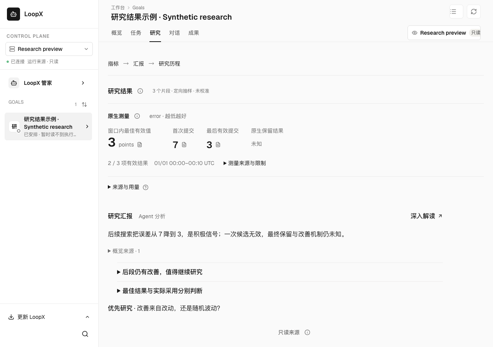
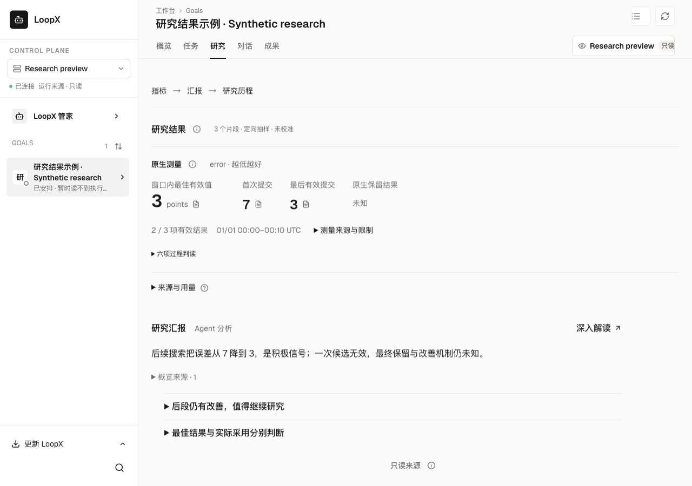
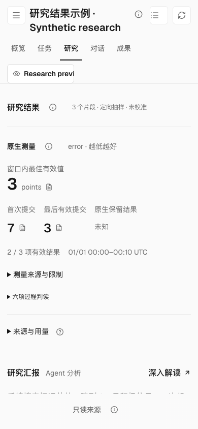
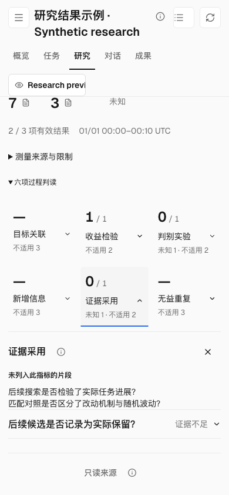

# Process judgments in ordinary research reading

The research page places results, the saved report and history in separate
reading layers. Hiding the report inside `ResearchProgress` also hid its only
process-judgment disclosure. Readers could reach those judgments only by opening
the deep report.

The existing disclosure now remains available independently of the embedded
report. It starts closed, preserves all six judgments and their unknown or
ineligible counts, and uses the existing evidence reader. Native measurements
and the saved report retain their separate meanings and appear once. Opening
deep analysis continues to suppress the duplicate ordinary judgment list.

The smaller fix is one existing render condition; it adds no setting, provider,
metric, protocol or execution path. Other callers and results without synthesis
retain their existing presentation. CLI and messaging contracts do not change.

## Source and validation

- Base: `2acb4b519d8efeb938e97b03d630633245c20de3`.
- Tested component blob: `f4937ab35e89f1ebf70a5890b24ae35a1df085bf`.
- `research-synthesis-readback.json` supplies public synthetic measurements,
  three distinct questions, two findings and an experimental proposal. Saved
  analyses use deterministic fixture output; no external inference is involved.
- The added assertion fails on the unchanged base: ordinary reading has zero
  process disclosures. The complete packaged `research-history` scenario passes
  with the fix, including uncertain/ineligible counts, legacy reads, citations,
  source failures and the real isolated SQLite/HTTP backend (179.131 seconds).
- Built Chat passed TypeScript checking and bundle verification. Public browser
  readback at 1280×900 and 390×844 confirms one report, six available judgments,
  16px report body text, no narrow horizontal overflow, and return from a cited
  unknown result to its original evidence control.

```sh
LOOPX_PERSONAL_WORKSPACE_PACKAGED=1 \
LOOPX_PERSONAL_WORKSPACE_SCENARIO=research-history \
uv run --extra test node examples/personal-workspace-browser-smoke.mjs
```

## Visual evidence

| Before · desktop | After · desktop |
| --- | --- |
|  |  |

| Default · narrow | Expanded unknown judgment · narrow |
| --- | --- |
|  |  |

Desktop retains the native results and report summary in the first viewport.
Narrow reading prioritizes the results and optional detail entries; the report
starts below them. Expanded judgments preserve the uncertainty and excluded
questions without turning either into a score. Complete original explanations
and evidence stay available through the existing controls.

These captures qualify source-built packaged reading, not an installed App,
independent researcher comprehension, benchmark benefit or global presentation
optimality.
