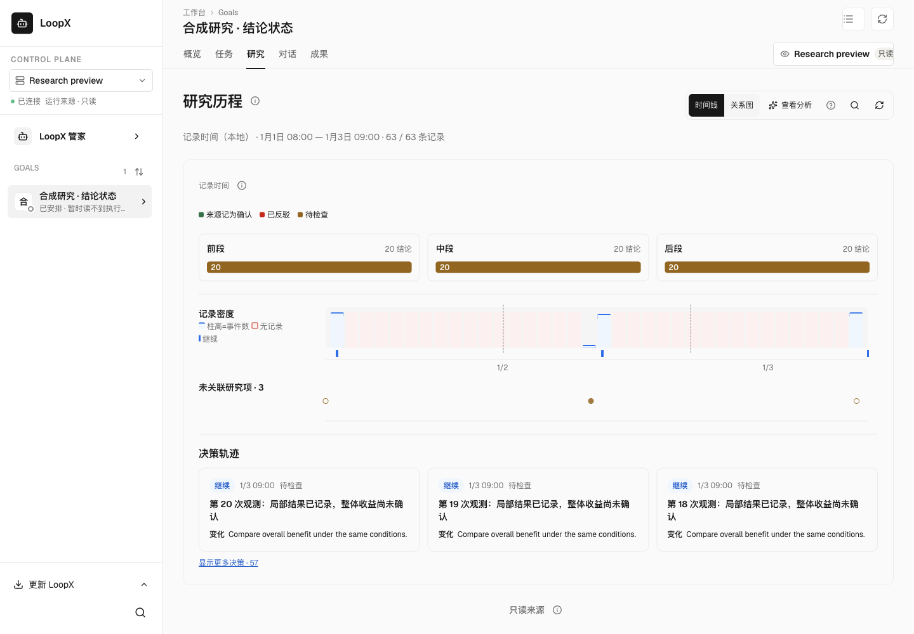
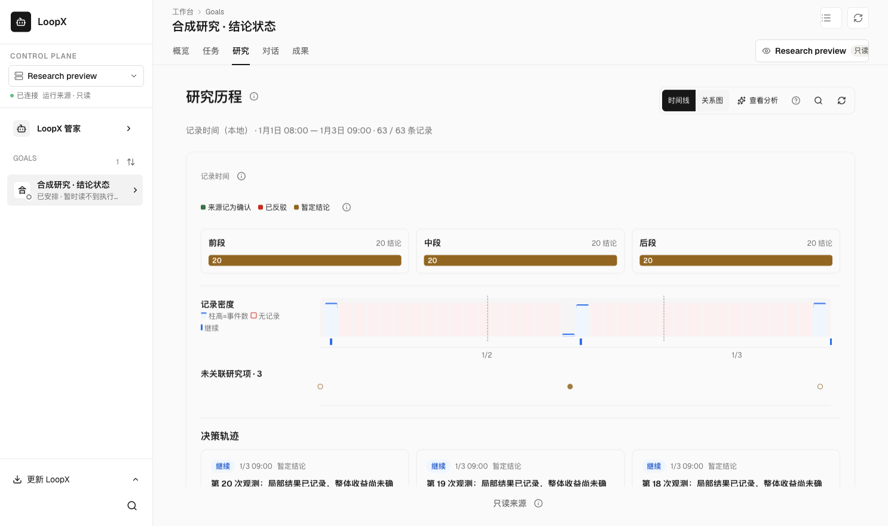
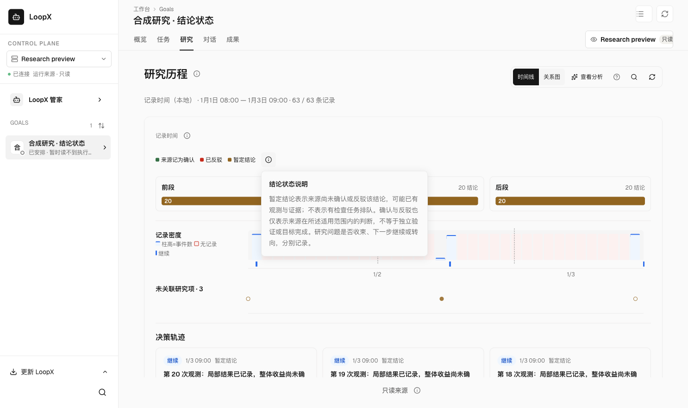
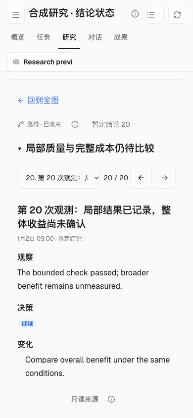

# Finding state reading

Packaged frontend against the real isolated research-history HTTP reader, with
60 synthetic tentative findings on three nodes. No model or live Goal is used.
The default view keeps the recorded counts and source judgments; the new help
explains that tentative findings are not queued checks. On a 390px viewport,
a resolved question and tentative findings remain separately visible, with
observations and decisions readable in full. No horizontal overflow was observed.
Source readback reported zero mutation attempts and unchanged fixture bytes.

| Before | After |
| --- | --- |
|  |  |

The packaged `research-route-reading` smoke additionally exercises mixed source
states, English/Chinese, desktop/narrow layouts, keyboard help dismissal and
focus return. This validates display and transport, not scientific correctness,
live model adoption, historical reclassification or an installed App upgrade.
