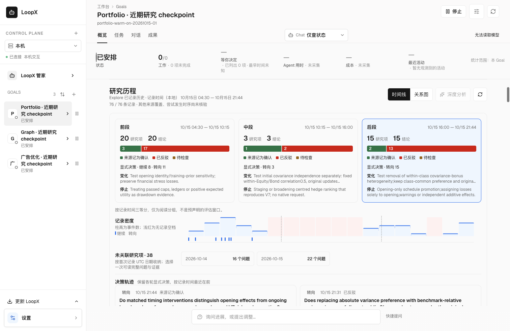
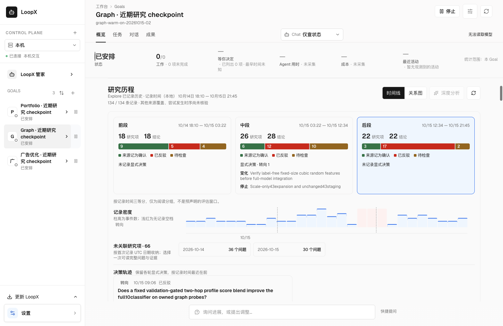
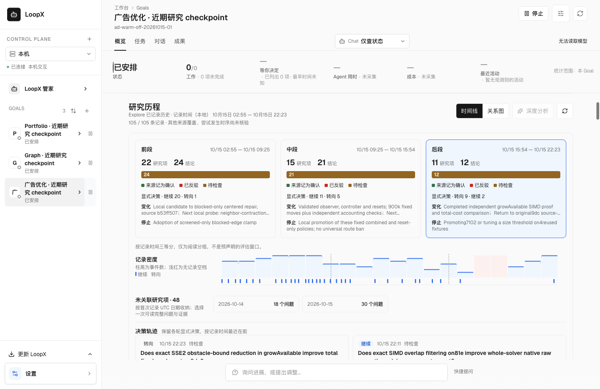
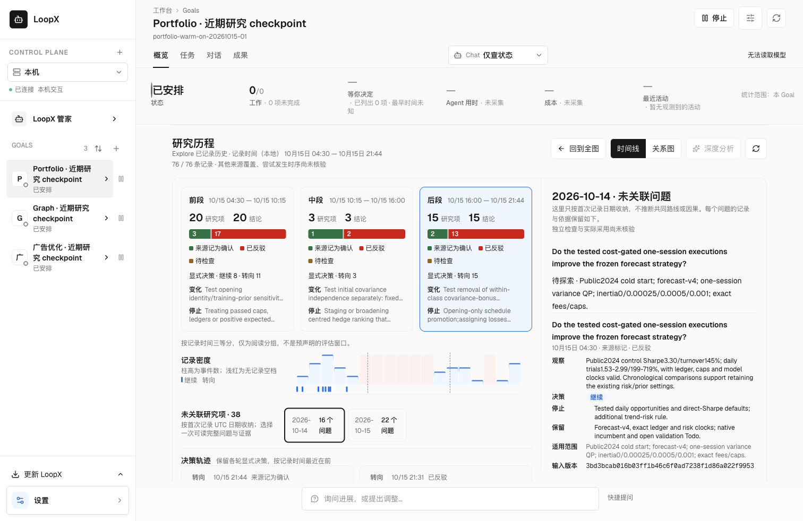

# Three real research checkpoints

The default research-history preview uses three actual EdgeBench checkpoints
sealed on 15 October 2026 and **restored by subsequent experiments**. It replaces
the older Squirrel example. The Explore records retain their original text,
timestamps, IDs, references, append order and scoped findings.

| Case | Checkpoint | Native Turns | Explore records | Questions / findings | Findings recorded as refuted |
| --- | --- | ---: | ---: | ---: | ---: |
| Portfolio risk calibration | `7fa63b57b1d3472496ed917d3acdba91` | 58 | 76 | 38 / 38 | 32 |
| Graph node classification | `4af468bfd8b84edb9cea23c8665ecaca` | 100 | 134 | 66 / 68 | 34 |
| Ad placement optimization | `8656d5442a664ada9d8bdb4877349f43` | 87 | 105 | 48 / 57 | 0 |

A native Turn, JSONL record, research question and evaluator submission are
separate units. Ad placement's 57 findings are all tentative; the display must
not promote them to confirmations merely to make the example more conclusive.

## Published trajectories and provenance

The [Hugging Face dataset](https://huggingface.co/datasets/huangrt01/loopx-edgebench-research-checkpoints-20261015/tree/c858f51021dc1c1cf08263f9c04b692a5e29b40b)
pins the original Explore logs and the complete session files retained in each
checkpoint: **315 Explore records and 64,064 native JSONL records in seven
session files**. Three downloadable task archives contain original messages,
visible reasoning summaries, tool calls and tool results. No session was sampled
or shortened. The reader fixture contains only the Explore logs; the full
trajectories are external evidence, not frontend bundle assets.

The dataset's `manifest.json` records original and published member hashes,
checkpoint identities, record intervals and downstream restoration evidence.
`archives.json` pins the downloadable ZIP hashes. `redactions.json` audits
8,784 removed opaque encrypted-context fields by file, JSON path, record number,
removed-value hash and reason. Original plaintext remains intact. Credential
checks found no plaintext credential values in the selected content. No native
SQLite store, credential file, execution envelope, checkpoint workspace,
model/data weights or hidden evaluator component is included.

The unchanged Explore JSONL can be reconstructed from the three wrappers by
serializing each event with `json.dumps(event, ensure_ascii=False, sort_keys=True)`
and appending a newline. Independent source digests are frozen in the tests:

| Fixture | Original JSONL SHA-256 | Bytes |
| --- | --- | ---: |
| [Portfolio](../../apps/presentation/dashboard/src/data/fixtures/edgebench-research-history.json) | `b876dd7660e0aab19db717f60e86865494a74b8fa27b42a5a67ee295ef524397` | 104,922 |
| [Graph](../../apps/presentation/dashboard/src/data/fixtures/edgebench-graph-checkpoint-history.json) | `b105de360ed7d015ae5d7bf96b545879e12507b1fc97eaeb5fb6fa2c0bbc00ab` | 200,333 |
| [Ad placement](../../apps/presentation/dashboard/src/data/fixtures/edgebench-ad-checkpoint-history.json) | `de04b679e9f382b650e891e5c7dd7146bc690500435c511f107c9d24da4f4efa` | 145,296 |

Six native restore receipts bind the selected point identities and destination
runs with `work_started=true`. Their corresponding runtime receipts match the
original enclosing checkpoint digests. The evaluation-capsule manifest digest is
a separate identity; it is not the digest of `checkpoint.json`.

Selection follows actual experimental reuse rather than the highest score:

- Graph: `graph-warm-stride-on-20261015-02`, reused by
  `graph-replan-fresh-20261016-05` and `graph-replan-retained-20261016-05`.
- Portfolio: `portfolio-warm-stride-on-20261015-01`, reused by
  `portfolio-replan-fresh-20261016-02` and `portfolio-replan-retained-20261016-02`.
  Its 58-Turn checkpoint was the actual recovery choice after a newer 65-Turn
  point failed fresh preparation. That failure is not erased by selection.
- Ad placement: `ad-warm-stride-off-20261015-01`, reused by
  `ad-warm-stride-on-20261015-05` and `ad-warm-stride-off-20261015-05`.
  A later planned-only checkpoint input is not counted as actual reuse.

These captures are **diagnostic only, not score-countable**. Reuse is not proof
of scientific success, completed grading or LoopX benefit. Source-authored
confirmation and refutation labels retain their original applicability; the
reader does not independently verify or extract benchmark scores from prose.

## Time and relationship coverage

| Case | Original recording interval (UTC) |
| --- | --- |
| Portfolio | 2026-10-14 20:30:26 through 2026-10-15 13:44:53 |
| Graph | 2026-10-14 10:10:59 through 2026-10-15 13:45:49 |
| Ad placement | 2026-10-14 18:55:41 through 2026-10-15 14:23:55 |

Recording time is not attempt time or active solver time. Gaps in the event log
do not establish that the solver stopped. The overview's three equal time bands
are reading groups, not predeclared evaluation windows. The color legend names
source-recorded confirmations, refutations and tentative findings; the numbers
remain research items and findings, not measured improvement.

All three logs have **zero explicit edges and zero parent links**. Missing
relations are a real collection gap. Unlinked questions are grouped by their
actual first-record UTC date, without creating a scientific route from similar
prose, time adjacency, shared versions or checkpoint reuse. The optional graph
can only display relationships actually supplied by the native source.

## Ordinary reading journey

Open the preview to read the complete Portfolio recording interval. Switch
between the three Goals in the existing sidebar. One date or point selection
opens all corresponding original records, versions, scoped negative evidence
and references. Refresh and browser Back/Forward preserve context. Reading
requires no model call, authority import or task execution. Agent analysis
remains explicitly unavailable in this reader.









See the [two-layer workspace contract](../../docs/architecture/rfcs/goal-workspace-surface-v0.md#511-research-goals-whole-history-explore-and-on-demand-analysis).
The history API and typed projection are production owners. The preview's empty
registry, runtime, task state and surrounding chrome are disposable scaffolding;
they do not observe or adopt the former worker's live execution state. No installed
App, autonomous relationship quality or deep analysis is qualified by this reader.

## Reproduce

### Find an earlier observation

Use **Search research records** in the history toolbar, then enter words, a
source reference or a run/result ID. Terms match literally, ignoring case; all
terms must occur in a record. The recorded-status filter can isolate negative
observations. Expand a result to read its original text and identifiers, including
historical revisions. Search covers the loaded snapshot before display pagination;
incomplete reads and failed refreshes stay visible. Clear filters to browse again.
Queries are local to this open reader and reset when it closes or the Goal changes.

The synthetic packaged regression exercises native paged history, an old negative
revision after 75 other findings, status filtering, interrupted reads and retry,
Goal isolation and desktop/narrow layouts without dispatching an Agent:

```sh
node --experimental-strip-types --test apps/presentation/dashboard/src/features/personal-workspace/research-record-search.test.mjs
LOOPX_PERSONAL_WORKSPACE_PACKAGED=1 LOOPX_PERSONAL_WORKSPACE_SCENARIO=research-record-search node examples/personal-workspace-browser-smoke.mjs
```

From the worktree root:

```sh
uv run --extra test python scripts/chat_bundle.py build --install
uv run --extra test python scripts/chat_bundle.py verify --source
LOOPX_PERSONAL_WORKSPACE_PACKAGED=1 LOOPX_PERSONAL_WORKSPACE_SCENARIO=research-history node examples/personal-workspace-browser-smoke.mjs
```

The packaged scenario checks every original event across two Portfolio pages,
four Graph pages and three Ad placement pages, actual negative prose and
references, missing relationships, cross-Goal switching, date selection,
reload/Back/Forward, narrow layout and failed-refresh recovery. Its disposable
native history owner retains unchanged source bytes and receives no mutation
attempts; other workspace APIs use the existing browser scenario scaffold. A
**separate explicitly synthetic** coincident-point regression checks pointer,
keyboard and 44px target grouping. Its artificial links are never inserted into
the real solver captures.

For standalone inspection of all three Goals:

```sh
uv run --extra test python examples/personal-workspace-browser/research-history-backend.py
```

Repeat `--fixture PATH` to select explicit captured-event wrappers. Every event
passes the production canonical validator. The server freezes source bytes and
digests at startup; restart after changing a fixture. All writes are rejected,
including preferences and the shell's automatic empty-session creation. The
standalone UI can therefore show unavailable execution/configuration services;
rejected requests do not start an Agent. Empty native stores supply read-only
workspace metadata, without importing captured execution state, leases,
credentials, hidden evaluators or a live model. `/fixture/readback` reports
source integrity, history reads and rejected write attempts.

中文：默认展示三道近期真实研究题，并按后续实验实际使用的 checkpoint 选取；
315 条 Explore 原记录完整保留，完整轨迹另存 Hugging Face 固定版本。三例均无显式
关系边，界面不得通过时序或相似文字补造。Portfolio 保留大量反证，广告案例保留
全部待检查结论；恢复接续事实不等于科学收益、评分完成或原生 App 已验收。

When a current analysis supplies translated history, record search still matches original text and IDs. Results show the validated translation with a full-original-text disclosure; toggling originals preserves the query. The `research-display-language` packaged scenario covers this combination.
